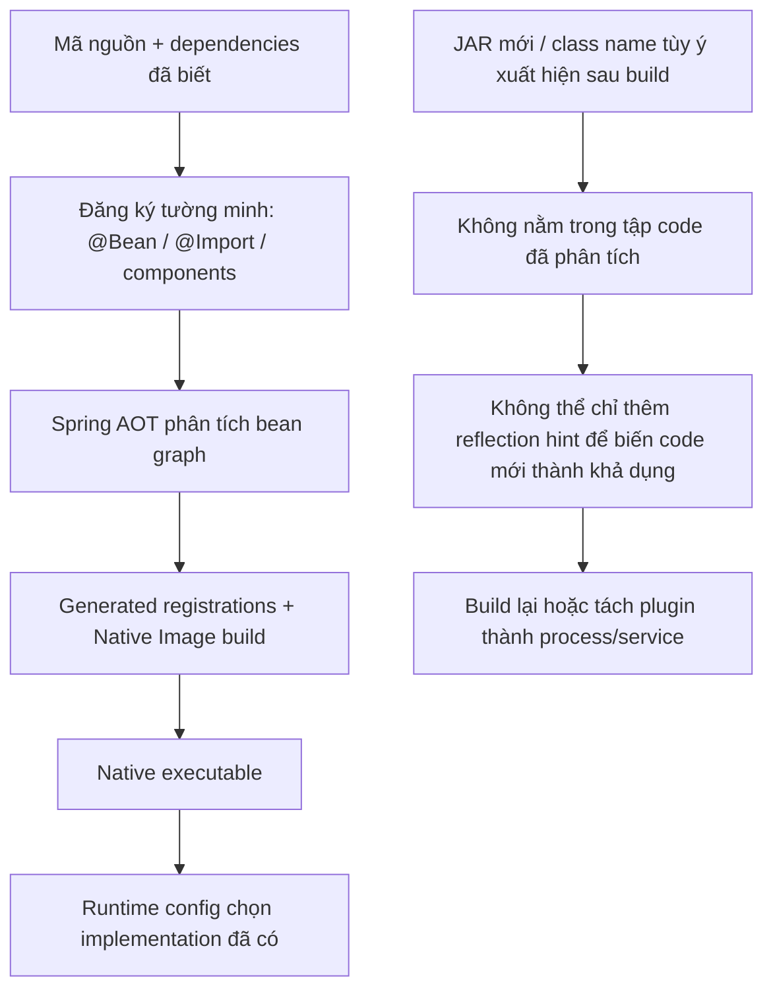

# Chọn cơ chế đăng ký tường minh thay cho quét hoặc phát hiện hoàn toàn động

Trên JVM, ứng dụng Spring có thể dùng classpath scanner, reflection, tên class lấy từ cấu hình hoặc thư viện plugin để tìm implementation khi chạy. Cách này linh hoạt, nhưng khi chuyển sang **Spring AOT và GraalVM Native Image**, compiler cần biết trước những class và đường truy cập nào có thể được sử dụng. Một binary native không thể mặc nhiên nạp một JAR mới hoặc tạo instance của bất kỳ class nào chỉ vì tên class xuất hiện trong database hay file cấu hình sau khi build.

Một thiết kế phù hợp native thường **đăng ký rõ tập implementation trong mã nguồn hoặc dependency ở build time**, sau đó dùng cấu hình/dữ liệu runtime để chọn giữa các implementation đã có. Spring Dependency Injection, `@Bean`, `@Import`, `List<T>` và `Map<String, T>` giúp tạo registry có kiểu, dễ kiểm thử và để Spring AOT phân tích.

Bài học thuộc chương **Giới hạn động** của mô-đun `SPRING_BOOT_NATIVE_IMAGE`. Ta sẽ phân biệt component scanning được Spring AOT xử lý với runtime discovery tùy ý, thay reflection-based plugin lookup bằng registry tường minh, chọn implementation theo cấu hình runtime, và xác định khi nào cần build lại hoặc tách plugin thành process/service riêng.

## 1. Vì sao cần đăng ký tường minh?

GraalVM Native Image sử dụng phân tích *closed-world*: khi build, compiler cần xác định mã có thể chạy, kiểu cần giữ và những truy cập động cần metadata. Spring AOT cũng phân tích ApplicationContext để tạo trước bean registrations và các hỗ trợ khởi tạo.

Vì vậy, cần phân biệt hai trường hợp:

- **Tập class đã biết lúc build:** các implementation nằm trong source code hoặc dependency, được khai báo bằng component/configuration/import hoặc cơ chế registry tương thích AOT. Spring AOT và Native Image có thể phân tích tập này.
- **Tập class chỉ được phát hiện tùy ý lúc runtime:** ứng dụng quét một thư mục JAR, đọc tên class từ database hoặc nhận tên implementation từ request rồi cố nạp class chưa biết khi binary được tạo. Đây là mô hình khó hoặc không phù hợp với native image.

Điều này **không có nghĩa component scanning của Spring bị cấm**. Component scan trên classpath của ứng dụng là một phần bình thường của Spring AOT. Giới hạn nằm ở việc kỳ vọng binary có thể phát hiện code mới mà nó chưa biết khi build.



## 2. Những kiểu discovery cần phân biệt

| Cơ chế | Thời điểm tìm implementation | Khả năng phù hợp AOT/native |
| --- | --- | --- |
| Spring component scanning trên package có trong build | Build/AOT phân tích context | Phù hợp nếu package/classpath và điều kiện được xác định |
| `@Bean` và `@Import` | Đăng ký rõ trong cấu hình | Phù hợp; đường tạo bean thể hiện trong context AOT |
| Inject `List<T>` hoặc `Map<String, T>` | Spring tập hợp bean đã đăng ký | Phù hợp; tập bean có thể xác định khi AOT |
| `ServiceLoader` với provider đã đóng gói | Runtime đọc service descriptor và provider đã có trong artifact | Có thể dùng nếu provider và metadata native được xử lý; cần test đúng toolchain |
| Quét package/JAR tùy ý bằng thư viện scanner khi runtime | Runtime tìm class theo package/JAR | Rủi ro; không thể mở rộng code ngoài tập đã build |
| `Class.forName(name)` với tên lấy từ database/request | Runtime nạp class theo tên động | Chỉ dùng được với class đã nằm trong image và được hỗ trợ metadata; không nạp được code mới tùy ý |
| Đọc file JSON/YAML ngoài để chọn key | Runtime đọc dữ liệu | Phù hợp nếu key chỉ chọn implementation đã đăng ký |
| Mount JAR plugin mới sau deploy | Runtime mong muốn thêm bytecode | Không phải mô hình mở rộng mặc định của Native Image |

Một điểm dễ nhầm: **đăng ký tường minh không đồng nghĩa phải hard-code mọi giá trị vận hành**. Ta cố định tập code có thể chạy, còn cấu hình vẫn có thể chọn implementation, endpoint, timeout hoặc rule data trong runtime.

## 3. Ví dụ không phù hợp: tìm class theo tên từ cấu hình

Giả sử ứng dụng có một interface exporter:

```java
package com.example.export;

public interface DocumentExporter {
    byte[] export(String content);
}
```

Một cách triển khai dựa vào tên class:

```java
// Ví dụ minh họa discovery động; không nên dùng làm mặc định cho native.
Object createExporter(String className) throws ReflectiveOperationException {
    Class<?> type = Class.forName(className);
    return type.getDeclaredConstructor().newInstance();
}
```

Giả sử cấu hình ngoài chứa:

```yaml
export:
  implementation: com.example.export.PdfExporter
```

Trên JVM, nếu class nằm trên classpath và có constructor phù hợp, ứng dụng có thể tạo instance. Nhưng với native image:

- Native compiler có thể không biết class nào sẽ được nạp qua chuỗi `className`.
- Class có thể không được giữ trong executable nếu không có đường reachability khác.
- Constructor/member cần reflection có thể thiếu metadata.
- Nếu implementation nằm trong JAR mount sau khi phát hành, bytecode của nó không có trong binary.
- Thêm reflection hint chỉ mô tả cách truy cập class đã có; nó không thêm JAR hoặc biên dịch code mới vào image.

Nếu danh sách implementation hữu hạn và được biết trước, hãy đăng ký chúng thành bean rồi dùng key cấu hình để chọn.

## 4. Dùng Spring DI tạo registry tường minh

Ví dụ có hai cách xuất tài liệu: CSV và JSON. Cả hai được đóng gói cùng ứng dụng.

### 4.1. Khai báo contract và implementation

```java
package com.example.export;

public interface DocumentExporter {
    byte[] export(String content);
}
```

```java
package com.example.export;

import java.nio.charset.StandardCharsets;

import org.springframework.stereotype.Component;

@Component("csv")
public class CsvExporter implements DocumentExporter {

    @Override
    public byte[] export(String content) {
        return ("CSV," + content).getBytes(StandardCharsets.UTF_8);
    }
}
```

```java
package com.example.export;

import java.nio.charset.StandardCharsets;

import org.springframework.stereotype.Component;

@Component("json")
public class JsonExporter implements DocumentExporter {

    @Override
    public byte[] export(String content) {
        String escaped = content.replace("\\", "\\\\").replace("\"", "\\\"");
        return ("{\"content\":\"" + escaped + "\"}")
                .getBytes(StandardCharsets.UTF_8);
    }
}
```

Các bean name `csv` và `json` được khai báo rõ. Spring component scanning tìm các class này trong package đã biết khi tạo context/AOT.

### 4.2. Inject Map<String, DocumentExporter>

Spring có thể inject map trong đó key là bean name và value là bean instance:

```java
package com.example.export;

import java.util.Map;

import org.springframework.beans.factory.annotation.Value;
import org.springframework.stereotype.Service;

@Service
public class ExportService {

    private final Map<String, DocumentExporter> exporters;
    private final String defaultFormat;

    public ExportService(
            Map<String, DocumentExporter> exporters,
            @Value("${export.default-format:csv}") String defaultFormat) {
        this.exporters = Map.copyOf(exporters);
        this.defaultFormat = defaultFormat;
    }

    public byte[] export(String format, String content) {
        String selected = (format == null || format.isBlank())
                ? defaultFormat
                : format;

        DocumentExporter exporter = exporters.get(selected);
        if (exporter == null) {
            throw new IllegalArgumentException(
                    "Unsupported export format: " + selected);
        }
        return exporter.export(content);
    }
}
```

Spring biết các bean `csv` và `json` trong context. Property `export.default-format` chỉ chọn key trong map lúc bean được tạo; request có thể chọn key khác trong tập implementation đã có. Không cần gọi `Class.forName`, quét JAR hoặc tự tạo object qua reflection.

Nếu format đến từ HTTP request, validate giá trị và trả lỗi 400 phù hợp thay vì để exception nội bộ trở thành lỗi 500. Nếu format đến từ property lúc startup, có thể fail-fast khi giá trị không hợp lệ để tránh ứng dụng khởi động với cấu hình sai.

### 4.3. Chọn default implementation ở runtime

`application.yaml` có thể đặt mặc định:

```yaml
export:
  default-format: csv
```

Môi trường staging có thể dùng:

```bash
EXPORT_DEFAULT_FORMAT=json ./target/export-service
```

Cùng một native executable có thể khởi động với default format khác nhau vì hai bean đã nằm trong bean graph. Thay đổi environment variable sau khi `ExportService` đã được tạo không tự cập nhật field `defaultFormat`; muốn đổi nóng cần thiết kế config động riêng.

## 5. Khi nào dùng List<T>, Map<String, T> hoặc registry tự định nghĩa?

| Kiểu inject | Khi nào phù hợp | Ưu điểm |
| --- | --- | --- |
| `List<Strategy>` | Muốn duyệt tất cả strategy, chạy theo thứ tự hoặc áp dụng nhiều handler | Đơn giản; không phụ thuộc bean name |
| `Map<String, Strategy>` | Muốn chọn implementation theo key/bean name | Lookup rõ ràng; key có thể là cấu hình runtime |
| Một bean cụ thể qua constructor | Chỉ có một dependency cần dùng | Dependency rõ và compile-time type-safe |
| Registry class riêng | Có alias, validation, fallback, ưu tiên hoặc chính sách chọn phức tạp | Tập trung logic lựa chọn và test dễ |
| `ObjectProvider<Strategy>` | Muốn trì hoãn lấy/khởi tạo bean hoặc xử lý optional dependency | Lazy access tới bean đã đăng ký |
| `ApplicationContext.getBean(name)` | Tích hợp đặc biệt cần tra cứu theo tên đã biết | Có thể dùng, nhưng phụ thuộc container API và khó thấy dependency hơn injection |

Ví dụ dùng List để tập hợp các bước xử lý theo thứ tự:

```java
public interface ExportStep {
    byte[] apply(byte[] input);
}
```

```java
import java.nio.charset.StandardCharsets;

import org.springframework.core.annotation.Order;
import org.springframework.stereotype.Component;

@Component
@Order(10)
class TrimExportStep implements ExportStep {
    @Override
    public byte[] apply(byte[] input) {
        return new String(input, StandardCharsets.UTF_8)
                .trim().getBytes(StandardCharsets.UTF_8);
    }
}
```

```java
import java.nio.charset.StandardCharsets;

import org.springframework.core.annotation.Order;
import org.springframework.stereotype.Component;

@Component
@Order(20)
class PrefixExportStep implements ExportStep {
    @Override
    public byte[] apply(byte[] input) {
        String value = new String(input, StandardCharsets.UTF_8);
        return ("[EXPORT]" + value).getBytes(StandardCharsets.UTF_8);
    }
}
```

```java
import java.nio.charset.StandardCharsets;
import java.util.List;

import org.springframework.stereotype.Component;

@Component
class ExportPipeline {

    private final List<ExportStep> steps;

    ExportPipeline(List<ExportStep> steps) {
        this.steps = List.copyOf(steps);
    }

    byte[] export(String content) {
        byte[] current = content.getBytes(StandardCharsets.UTF_8);
        for (ExportStep step : steps) {
            current = step.apply(current);
        }
        return current;
    }
}
```

Nếu thứ tự quan trọng, khai báo `@Order` hoặc `Ordered` rõ ràng; không dựa vào thứ tự tình cờ của classpath. Nếu chỉ cần chọn một implementation theo tên, Map thường diễn đạt ý định tốt hơn.

`ObjectProvider` chỉ trì hoãn việc lấy bean hoặc tạo bean lazy; nó **không khám phá class mới** từ JAR bên ngoài sau khi native image đã build.

## 6. Đăng ký tường minh bằng @Bean và @Import

Component scanning không phải lựa chọn duy nhất. Nếu muốn nhìn thấy rõ tập implementation trong một nơi, dùng configuration class:

Ví dụ này là **phương án thay thế** cho cách gắn `@Component` ở phần trước. Nếu dùng `@Bean` để đăng ký exporter, hãy bỏ `@Component` trên các class tương ứng hoặc điều chỉnh component scan để không đăng ký cùng implementation hai lần.

```java
import org.springframework.context.annotation.Bean;
import org.springframework.context.annotation.Configuration;

@Configuration(proxyBeanMethods = false)
class ExporterConfiguration {

    @Bean
    DocumentExporter csvExporter() {
        return new CsvExporter();
    }

    @Bean
    DocumentExporter jsonExporter() {
        return new JsonExporter();
    }
}
```

Nếu các class implementation không được component scan hoặc thuộc package khác, có thể import configuration:

```java
import org.springframework.context.annotation.Configuration;
import org.springframework.context.annotation.Import;

@Configuration(proxyBeanMethods = false)
@Import(ExporterConfiguration.class)
class ExportApplicationConfiguration {
}
```

Đây là cách đăng ký tường minh vì các configuration class và factory method được khai báo trong build. Spring AOT có thể phân tích các bean definitions này.

Không khai báo đồng thời `@Component("csv")` và `@Bean` tạo một bean khác cùng mục đích nếu không có lý do rõ; nếu cả hai được đăng ký, ứng dụng có thể có hai bean cùng kiểu và injection trở nên mơ hồ.

### 6.1. Dùng @Import cho tập configuration đã biết

`@Import` hữu ích khi một module cung cấp một tập cấu hình cố định:

```java
@Configuration(proxyBeanMethods = false)
@Import({
        CsvExporterConfiguration.class,
        JsonExporterConfiguration.class
})
class ExportFeatureConfiguration {
}
```

Các configuration class phải nằm trong dependency/classpath ở build. Nếu một implementation chỉ được tải từ JAR tùy ý mount sau deploy, `@Import` không thể biến JAR đó thành một phần của native image đã tạo.

## 7. Chọn hành vi runtime, không thay đổi bean graph tùy tiện

Một nhầm lẫn phổ biến là dùng `@ConditionalOnProperty` để bật/tắt bean rồi kỳ vọng property runtime luôn có thể thay đổi kết quả.

Ví dụ:

```java
@Bean
@ConditionalOnProperty(
        name = "export.pdf.enabled",
        havingValue = "true")
DocumentExporter pdfExporter() {
    return new PdfExporter();
}
```

Condition này có thể được đánh giá khi Spring AOT phân tích ApplicationContext. Nếu bean bị loại ở thời điểm đó, truyền `--export.pdf.enabled=true` lúc chạy native không tự thêm lại bean definition.

Nếu cùng binary cần có khả năng chọn CSV/JSON/PDF theo môi trường, hãy đăng ký toàn bộ implementation cần thiết trong bean graph rồi dùng registry/router để chọn. Nếu PDF implementation chỉ dành cho một bản phát hành, có thể tạo biến thể build riêng với condition tương ứng.

| Yêu cầu | Thiết kế |
| --- | --- |
| Chọn CSV hoặc JSON theo request | Cả hai bean có mặt; Map registry chọn theo request |
| Mặc định CSV ở local, JSON ở staging | Cả hai bean có mặt; runtime property chọn default |
| Bản nhỏ chỉ chứa CSV | Condition/build profile quyết định bean ở AOT; build artifact riêng |
| Bật/tắt quyền dùng PDF theo tenant | Bean PDF phải có trong binary; policy/feature data quyết định tenant có được phép sử dụng |
| Thêm implementation mới sau khi phát hành | Build lại native hoặc tách implementation thành service/process riêng |

## 8. ServiceLoader: chỉ dùng khi provider đã được đóng gói và kiểm tra native

Java `ServiceLoader` là cơ chế chuẩn để tìm provider theo service interface. Một thư viện có thể chứa file:

```text
META-INF/services/com.example.export.DocumentExporter
```

với nội dung:

```text
com.example.export.CsvExporter
com.example.export.JsonExporter
```

Ứng dụng tải provider:

```java
import java.util.ServiceLoader;
import java.util.List;

ServiceLoader<DocumentExporter> loader =
        ServiceLoader.load(DocumentExporter.class);

List<DocumentExporter> exporters = loader.stream()
        .map(ServiceLoader.Provider::get)
        .toList();
```

ServiceLoader phù hợp với một tập provider được đóng gói cùng application/dependencies. Native Image và Native Build Tools có hỗ trợ một số đường ServiceLoader, nhưng cần kiểm tra metadata/provider discovery theo phiên bản GraalVM đang dùng. Provider class và constructor phải nằm trong artifact và được compiler nhận biết.

Nếu provider dùng reflection, resource hoặc dynamic proxy, vẫn cần metadata tương ứng. Không coi ServiceLoader là cách nạp JAR tùy ý sau khi binary đã phát hành. Trong ứng dụng Spring, nếu các provider cần được quản lý bởi Spring (dependency injection, lifecycle, configuration), inject `List<T>` hoặc `Map<String,T>` thường đơn giản hơn.

## 9. Build-time generation cho danh sách plugin lớn

Một số hệ thống có nhiều implementation được đóng góp bởi các module khác nhau. Việc viết tay registry lớn có thể khó bảo trì. Có thể tạo registry **trước khi AOT chạy** bằng annotation processor hoặc build plugin:

1. Các module khai báo plugin bằng annotation/descriptor có schema rõ.
2. Build tool thu thập descriptor từ source/dependencies đã có.
3. Một annotation processor hoặc task sinh Java source chứa registry tường minh.
4. Source sinh được compile cùng ứng dụng.
5. Spring AOT phân tích registry và bean graph.
6. GraalVM build native image từ tập code đã biết.

Ví dụ registry được sinh có thể có dạng:

```java
final class GeneratedExporterRegistry {

    static Map<String, Supplier<DocumentExporter>> providers() {
        return Map.of(
                "csv", CsvExporter::new,
                "json", JsonExporter::new
        );
    }
}
```

Đây là minh họa về cấu trúc source sinh; trong ứng dụng Spring thực tế nên cân nhắc sinh configuration/bean definitions để dependency injection và lifecycle được quản lý đúng. Nếu constructor cần dependency khác, không tự `new` mà nên sinh các factory method nhận dependency từ Spring.

Ưu điểm của build-time generation:

- Danh sách provider có thể kiểm tra trong source sinh.
- Class references tường minh giúp compiler thấy các kiểu cần thiết.
- Có thể kiểm tra trùng ID và thiếu provider ngay trong build.
- Thay đổi plugin set dẫn tới build mới có thể tái lập.

Giới hạn: generator chỉ thấy module/dependency được đưa vào build. Nó không thể dự đoán JAR sẽ được người vận hành mount sau khi binary đã phát hành.

## 10. Khi nào cần tách plugin thành process/service riêng?

Nếu yêu cầu sản phẩm là người dùng có thể cài plugin code mới sau deploy mà không rebuild ứng dụng chính, native executable thường không phải plugin host phù hợp cho mô hình classloader tùy ý.

Có ba hướng kiến trúc:

| Hướng | Cách hoạt động | Phù hợp khi |
| --- | --- | --- |
| Build lại native image | Thêm plugin dependency, AOT và native compile lại | Plugin thay đổi theo release |
| Plugin process/JVM riêng | Mỗi plugin chạy trong process riêng; native app gọi qua HTTP/gRPC/message | Plugin code cần cài/nâng cấp độc lập |
| Service ngoài | Chức năng mở rộng được triển khai thành service và giao tiếp qua API | Plugin có vòng đời, scale hoặc quyền truy cập độc lập |

Tách process tạo ranh giới rõ về classloader, dependency và crash isolation. Đổi lại, cần quản lý network, timeout, authentication, version contract, retry và observability. Không nên chuyển mọi strategy nhỏ thành microservice; chỉ dùng khi yêu cầu cập nhật code độc lập thực sự cần thiết.

## 11. Những cách "nửa tường minh" và giới hạn của chúng

Một số cơ chế giúp giữ tập class có thể dự đoán mà vẫn hỗ trợ lựa chọn động ở mức dữ liệu:

- **Allowlist class:** cấu hình chứa key; registry ánh xạ key sang bean đã đăng ký.
- **Generated index:** file index liệt kê provider đã có trong build; native metadata vẫn phải bao phủ cách nạp provider.
- **ServiceLoader:** provider descriptors và classes được đóng gói trong dependency.
- **Reflection hints:** cho phép truy cập động vào member của class đã có trong image.
- **External config:** thay đổi endpoint/rule/feature data mà không thay đổi code.

Những cơ chế này không thay thế lẫn nhau:

| Cơ chế | Có thể làm | Không thể làm |
| --- | --- | --- |
| Allowlist key → bean | Chọn giữa implementation đã đăng ký | Tạo class mới từ tên tùy ý |
| Generated index | Ghi nhận provider đã biết lúc build | Tìm JAR mới sau khi phát hành |
| ServiceLoader metadata | Giúp discovery provider đã đóng gói | Đảm bảo mọi plugin runtime mới đều load được |
| Reflection hint | Cho phép truy cập member của type đã có | Thêm bytecode/class chưa nằm trong image |
| External config | Thay đổi dữ liệu hoặc lựa chọn runtime | Thêm code native mới vào executable |

### 11.1. Vì sao thêm Runtime Hints không giải quyết mọi dynamic loading?

Ví dụ:

```java
hints.reflection().registerType(
        PdfExporter.class,
        MemberCategory.INVOKE_DECLARED_CONSTRUCTORS);
```

Hint này có thể cho phép gọi constructor của `PdfExporter` qua reflection nếu class đã được đưa vào build và metadata phù hợp. Nếu `PdfExporter` nằm trong `pdf-plugin.jar` mà chỉ được mount vào container sau khi native executable được tạo, hint không thêm class đó vào binary. Cần đưa dependency vào build và build lại, hoặc chạy plugin trong một JVM/process riêng.

## 12. Kiểm thử registry và bean graph

Một registry tường minh nên có test cho cả tập provider lẫn hành vi chọn.

Ví dụ unit test:

```java
package com.example.export;

import java.nio.charset.StandardCharsets;
import java.util.Map;

import org.junit.jupiter.api.Test;

import static org.assertj.core.api.Assertions.assertThat;
import static org.assertj.core.api.Assertions.assertThatThrownBy;

class ExportServiceTests {

    @Test
    void selectsCsvExporter() {
        DocumentExporter csv = content -> "csv".getBytes(StandardCharsets.UTF_8);
        DocumentExporter json = content -> "json".getBytes(StandardCharsets.UTF_8);

        ExportService service = new ExportService(
                Map.of("csv", csv, "json", json),
                "csv");

        assertThat(new String(
                service.export(null, "hello"),
                StandardCharsets.UTF_8)).isEqualTo("csv");
    }

    @Test
    void rejectsUnknownFormat() {
        DocumentExporter csv = content -> content.getBytes(StandardCharsets.UTF_8);
        ExportService service = new ExportService(Map.of("csv", csv), "csv");

        assertThatThrownBy(() -> service.export("xml", "hello"))
                .isInstanceOf(IllegalArgumentException.class);
    }
}
```

Ví dụ test Spring context để xác nhận các bean được đăng ký:

```java
package com.example.export;

import java.util.Map;

import org.junit.jupiter.api.Test;
import org.springframework.beans.factory.annotation.Autowired;
import org.springframework.boot.test.context.SpringBootTest;

import static org.assertj.core.api.Assertions.assertThat;

@SpringBootTest
class ExporterRegistrationTests {

    @Autowired
    Map<String, DocumentExporter> exporters;

    @Test
    void registersAllBuildTimeExporters() {
        assertThat(exporters).containsKeys("csv", "json");
    }
}
```

Test context giả định lớp `@SpringBootApplication` nằm trong package `com.example.export` hoặc package cha để Spring Boot tìm được cấu hình chính. Các test này kiểm tra logic registry và bean graph trên JVM. Để xác minh native, cần chạy native test hoặc native executable và gọi đúng đường sử dụng. Nếu registry dùng serialization/reflection/resource bên trong implementation, thêm test cho các đường đó.

## 13. Quan sát kết quả Spring AOT

Sau khi chạy AOT, tìm generated registrations cho các bean cần thiết.

Maven:

```bash
./mvnw spring-boot:process-aot
rg -n "CsvExporter|JsonExporter|ExportService" target/spring-aot
```

Gradle:

```bash
./gradlew processAot
rg -n "CsvExporter|JsonExporter|ExportService" build/generated
```

Vị trí output phụ thuộc plugin/version. Tìm theo bean name/type thay vì dựa vào tên generated class cố định.

Khi đọc output, xác nhận:

1. Các implementation cần thiết có bean definition không?
2. Bean name/key có đúng với registry logic không?
3. Constructor/factory và dependency có được biểu diễn?
4. Condition/profile nào đã tác động tới tập bean?
5. Hints cho reflection/resource/proxy của implementation có được đóng góp không?

Nếu một bean bị thiếu, kiểm tra AOT profile và condition trước khi thêm reflection hint. Reflection hint không thể sửa việc bean definition đã bị loại khỏi bean graph.

## 14. Lỗi thường gặp khi chuyển từ dynamic discovery sang registry

| Hiện tượng | Nguyên nhân | Cách xử lý |
| --- | --- | --- |
| Native không tìm thấy class từ tên trong database | Class không nằm trong native image hoặc không có metadata | Thay bằng key → bean registry; nếu class mới thì build lại |
| Map injection không có provider mong đợi | Component không được scan/import, condition loại bean hoặc bean name khác | Kiểm tra package, configuration, profile và generated registrations |
| `NoUniqueBeanDefinitionException` | Inject một interface nhưng có nhiều implementation mà không dùng collection/qualifier | Dùng `Map<String,T>`, `List<T>`, `@Qualifier` hoặc `@Primary` |
| Thay property runtime nhưng implementation không xuất hiện | Bean bị loại bởi condition trong AOT | Đưa implementation vào graph và chọn bằng router, hoặc build biến thể |
| ServiceLoader không tìm thấy provider | Thiếu descriptor/provider hoặc metadata | Kiểm tra `META-INF/services`, dependency và native test |
| Thêm reflection hint nhưng vẫn báo class not found | Hint không thêm class/bytecode vào image | Đưa dependency vào build hoặc tách plugin ra process |
| Provider mới được mount nhưng không load | Native image không phải JVM plugin host tùy ý | Build lại hoặc dùng JVM/service plugin host |
| Thứ tự strategy thay đổi giữa môi trường | Dựa vào thứ tự discovery không được quy định | Dùng `@Order` hoặc explicit priority trong registry |
| Native chạy được nhưng dùng sai provider | Key config, default hoặc alias không khớp | Validate cấu hình và test từng key/unknown key |

## 15. Quy trình thay thế một cơ chế quét động

Khi refactor một hệ thống đang dùng package scanner hoặc reflection:

1. **Liệt kê provider hiện có:** tên, interface, dependency và nơi đăng ký.
2. **Xác định tập provider:** provider nào thực sự được phép dùng trong một bản phát hành?
3. **Định nghĩa key ổn định:** ví dụ `csv`, `json`, `pdf`; không dùng tên class đầy đủ làm API config.
4. **Đăng ký bean tường minh:** component, `@Bean`, `@Import` hoặc source registry sinh ở build.
5. **Chọn bằng typed registry:** inject `Map<String,T>` hoặc một registry class có validation.
6. **Tách code và data:** provider code thuộc build; rule/template/catalog có thể ở runtime nếu chỉ là dữ liệu.
7. **Viết test:** kiểm tra tập bean, lựa chọn hợp lệ, key không tồn tại và tác dụng phụ.
8. **Chạy AOT/native:** kiểm tra generated bean graph, metadata và đường gọi thật.
9. **Xác định plugin lifecycle:** nếu cần thêm code sau deploy, chuyển plugin sang process/service riêng hoặc chấp nhận build release mới.

## 16. Checklist thiết kế tương thích AOT/native

- [ ] Phân biệt component scanning trên classpath build với runtime discovery tùy ý.
- [ ] Các implementation cần thiết nằm trong source/dependency khi build.
- [ ] Bean được đăng ký bằng component/configuration/import hoặc cơ chế AOT tương thích.
- [ ] Dùng `List<T>` hoặc `Map<String,T>` thay cho quét class và reflection nếu phù hợp.
- [ ] Bean name hoặc registry key ổn định, có validation và xử lý unknown key.
- [ ] Không dựa vào thứ tự classpath; dùng `@Order` hoặc priority rõ ràng.
- [ ] Không dùng `@ConditionalOnProperty` để mong thay đổi bean graph tùy ý sau AOT.
- [ ] Reflection hints chỉ được dùng cho type/member đã có trong native image.
- [ ] ServiceLoader provider và metadata được kiểm thử trên đúng native toolchain.
- [ ] Nếu plugin code cần cập nhật độc lập, đã chọn build lại hoặc process/service boundary.
- [ ] Generated AOT output được kiểm tra để xác nhận bean graph.
- [ ] Native integration tests bao phủ tất cả provider và nhánh lựa chọn.

### Câu hỏi tự đánh giá

1. Vì sao component scanning của Spring trên classpath build vẫn có thể tương thích AOT, trong khi quét JAR tùy ý sau deploy lại rủi ro?
2. Spring inject `Map<String, T>` có ý nghĩa gì đối với việc tạo registry implementation?
3. Vì sao `ObjectProvider<T>` không giúp nạp class mới từ một JAR chưa có trong native image?
4. Khi nào dùng `@Bean`/`@Import` thay cho `@Component`?
5. Vì sao property trong `@ConditionalOnProperty` có thể không thay đổi tập bean khi chạy native?
6. Reflection hint có thể giải quyết phần nào của dynamic class access, và giới hạn của nó là gì?
7. Khi nào ServiceLoader phù hợp, và khi nào nên dùng Spring DI registry?
8. Nếu yêu cầu là cài plugin code mới sau khi ứng dụng đã phát hành, vì sao tách process/service có thể là lựa chọn phù hợp hơn?

## Tài liệu tham khảo

- [Spring Framework — Ahead-of-Time Optimizations](https://docs.spring.io/spring-framework/reference/core/aot.html): Spring AOT, bean registration và runtime hints.
- [Spring Framework — Java-based Container Configuration](https://docs.spring.io/spring-framework/reference/core/beans/java.html): khai báo bean bằng `@Configuration` và `@Bean`.
- [Spring Framework — Classpath Scanning and Managed Components](https://docs.spring.io/spring-framework/reference/core/beans/classpath-scanning.html): component scanning và cách Spring phát hiện managed components.
- [Spring Framework — Dependency Injection](https://docs.spring.io/spring-framework/reference/core/beans/dependencies/factory-collaborators.html): inject dependency và collection/map of beans.
- [GraalVM Native Image — Dynamic Features](https://www.graalvm.org/latest/reference-manual/native-image/dynamic-features/): các giới hạn và metadata cho reflection, resources, proxies và ServiceLoader.

**Kết quả cần đạt:** thay được cơ chế quét hoặc phát hiện class hoàn toàn động bằng registry có kiểu và tập implementation xác định ở build time. Ứng dụng vẫn có thể chọn hành vi bằng cấu hình runtime, nhưng mọi code cần chạy đã được đưa vào native image và được kiểm tra qua Spring AOT/native tests. Khi yêu cầu cần cài code mới sau phát hành, ranh giới plugin nên được thiết kế ở build/release hoặc process/service thay vì dựa vào classpath động tùy ý.
