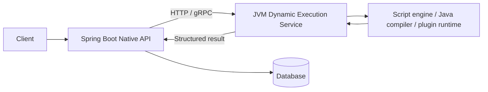
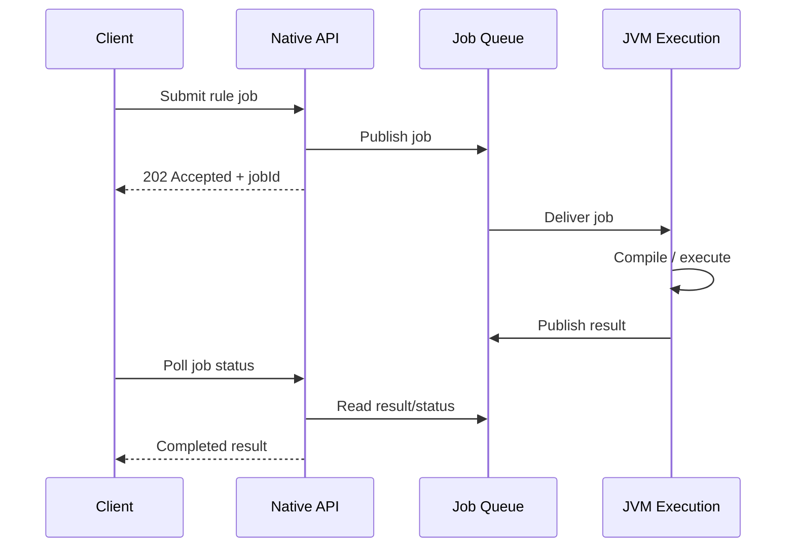

# Tách thành phần chưa tương thích sang ranh giới dịch vụ khi phù hợp

## 1. Khi nào nên tách một thành phần khỏi Native Image?

Spring Boot Native Image phù hợp với nhiều dịch vụ cần startup nhanh, footprint nhỏ và triển khai container gọn. Tuy nhiên, một ứng dụng có thể phụ thuộc vào thành phần cần khả năng động mạnh: biên dịch Java source lúc runtime, nạp plugin JAR sau khi phát hành, dùng script engine chưa hỗ trợ Native Image, hoặc dựa vào classloader/bytecode generation không thể phân tích trước.

Khi một thư viện không tương thích với Native Image, có ba hướng chính: thay thư viện bằng giải pháp tương thích, thay đổi thiết kế để dùng tập mã biết trước, hoặc **tách năng lực đó qua ranh giới dịch vụ**. Tách dịch vụ phù hợp khi năng lực động là một phần độc lập, có thể giao tiếp qua API và có lý do vận hành rõ ràng.

Ví dụ: hệ thống Order API được build thành native executable, nhưng nghiệp vụ cho phép quản trị viên gửi Java rule mới và biên dịch lúc runtime. Thay vì buộc toàn bộ Order API phải chạy trên JVM, có thể tách compiler/rule execution thành một JVM service chuyên trách. Order API gửi yêu cầu qua HTTP/gRPC hoặc message broker và nhận kết quả theo contract ổn định.

Mục tiêu của bài là giúp quyết định ranh giới tách, thiết kế contract, triển khai giao tiếp và đánh giá trade-off trong module **SPRING_BOOT_NATIVE_IMAGE**.

## 2. Phân biệt giới hạn kỹ thuật và lý do kiến trúc

Không nên tách dịch vụ chỉ vì một dependency báo lỗi native. Trước hết cần hiểu giới hạn thực tế:

- Thành phần có thật sự tạo class mới hoặc nạp mã ngoài tập đã biết không?
- Nó chỉ dùng reflection trên class đã biết và có thể bổ sung RuntimeHints không?
- Thư viện có reachability metadata hoặc bản release hỗ trợ Native Image không?
- Có thể chuyển code generation sang build time không?
- Nghiệp vụ có cần cập nhật logic độc lập sau khi native artifact phát hành không?
- Năng lực đó có thể được gọi qua một API nhỏ, có input/output rõ ràng không?

| Tình huống | Hướng nên đánh giá trước |
|---|---|
| Reflection trên một tập class cố định | RuntimeHints/metadata |
| Resource classpath được chọn từ danh sách biết trước | Resource hints |
| JDK proxy với interface đã biết | Proxy hints |
| Plugin cố định lúc build | Đưa vào dependency/build inputs và đăng ký metadata |
| Java source tùy ý cần compile sau deploy | JVM service hoặc môi trường compiler chuyên biệt |
| Script engine chưa hỗ trợ Native Image | Kiểm tra engine khác, DSL hoặc tách execution |
| Thư viện native phụ thuộc ABI không tương thích | Chọn builder/runtime tương thích hoặc tách process nếu cần |

Ranh giới dịch vụ là quyết định kiến trúc, không phải cách né mọi lỗi build. Hãy chỉ tách khi có ranh giới nghiệp vụ và vận hành hợp lý.

## 3. Kiến trúc điển hình: native API và JVM execution service

Một mô hình phổ biến là giữ API chính ở native và đưa phần động sang JVM service:



Native API đảm nhiệm authentication, validation, nghiệp vụ chính và truy cập dữ liệu phù hợp. JVM execution service đảm nhiệm biên dịch/chạy mã động, nạp plugin hoặc engine chưa tương thích.

Hai process có lifecycle, resource limit và deployment độc lập. Chúng có thể dùng cùng repository hoặc pipeline, nhưng nên có artifact/runtime riêng để toolchain của phần dynamic không buộc toàn bộ hệ thống chạy cùng một runtime.

## 4. Xác định ranh giới trách nhiệm

Một ranh giới tốt nên có contract nhỏ và trách nhiệm rõ:

**Native service** thường chịu trách nhiệm:

- Nhận request từ client và xác thực caller.
- Kiểm tra quyền sử dụng năng lực dynamic.
- Validate kích thước, schema và loại input.
- Gán request ID, deadline và idempotency key.
- Gọi execution service qua giao thức nội bộ.
- Áp dụng timeout, retry có giới hạn và xử lý lỗi.
- Kiểm tra/chuẩn hóa kết quả trước khi trả về.

**JVM execution service** thường chịu trách nhiệm:

- Quản lý phiên bản engine/compiler.
- Compile hoặc evaluate script/rule theo policy.
- Nạp plugin trong phạm vi cho phép.
- Áp dụng sandbox/giới hạn CPU, memory, thời gian và filesystem.
- Trả kết quả theo schema, không trả object Java nội bộ.
- Ghi log/audit và metrics cho từng execution.

Không để execution service tự quyết định quyền truy cập nghiệp vụ mà native API đã chịu trách nhiệm kiểm soát. Ngược lại, native API cũng không nên phải biết chi tiết classloader, compiler options hay API riêng của scripting engine.

## 5. Thiết kế API contract ổn định

Giao tiếp qua service boundary nên dùng dữ liệu có schema, không truyền Java object hoặc serialized class nội bộ giữa hai process.

Ví dụ request:

```json
{
  "requestId": "req-8f21",
  "ruleId": "discount-v3",
  "ruleVersion": "3",
  "input": {
    "orderTotal": 250000,
    "customerTier": "GOLD"
  },
  "deadlineMs": 1500
}
```

Response thành công:

```json
{
  "requestId": "req-8f21",
  "status": "COMPLETED",
  "result": {
    "discountRate": 0.1,
    "discountAmount": 25000
  },
  "executionMs": 18
}
```

Response lỗi có cấu trúc:

```json
{
  "requestId": "req-8f21",
  "status": "REJECTED",
  "error": {
    "code": "RULE_VALIDATION_FAILED",
    "message": "Rule expression is invalid"
  }
}
```

Contract nên quy định:

- Field bắt buộc, kiểu dữ liệu, giới hạn kích thước.
- Version API và version rule/engine.
- Timeout/deadline semantics.
- Error codes ổn định và có thể phân loại.
- Idempotency và cách xử lý request gửi lại.
- Correlation/request ID.
- Giới hạn input/output và encoding.
- Quy tắc tương thích ngược.

Không trả stack trace, đường dẫn filesystem, nội dung secret hoặc thông tin nội bộ trong error response công khai.

## 6. Ví dụ Spring Boot native gọi JVM service qua HTTP

Native service có thể dùng Spring HTTP client để gọi execution API. Ví dụ với `RestClient`:

```java
@Configuration
class ExecutionClientConfiguration {

    @Bean
    RestClient executionRestClient(
            RestClient.Builder builder,
            ExecutionProperties properties) {
        return builder
                .baseUrl(properties.baseUrl().toString())
                .build();
    }
}
```

Properties:

```java
@ConfigurationProperties(prefix = "execution")
public record ExecutionProperties(URI baseUrl) {
}
```

Client:

```java
@Service
class RuleExecutionClient {

    private final RestClient restClient;

    RuleExecutionClient(RestClient executionRestClient) {
        this.restClient = executionRestClient;
    }

    ExecutionResponse execute(ExecutionRequest request) {
        return restClient.post()
                .uri("/internal/v1/execute")
                .body(request)
                .retrieve()
                .body(ExecutionResponse.class);
    }
}
```

Đây là ví dụ khái niệm; cần đăng ký `@ConfigurationProperties` bằng scan/enable, cấu hình timeout/connect pool theo HTTP client được dùng và thêm exception mapping. Spring Boot version có thể cung cấp cách cấu hình RestClient khác nhau.

Dùng DTO/record có kiểu rõ ràng cho request/response. Không truyền `Class<?>`, `Method`, lambda hay object phụ thuộc classloader qua network; chỉ truyền dữ liệu theo contract.

## 7. Giao thức HTTP, gRPC hay message broker?

Chọn giao thức theo đặc điểm workload:

| Giao thức | Phù hợp khi | Cần chú ý |
|---|---|---|
| HTTP/REST + JSON | Request/response đơn giản, dễ quan sát và tích hợp | Payload lớn, schema evolution, timeout |
| gRPC + Protobuf | Contract typed, latency thấp, giao tiếp service-to-service | Version schema, tooling, streaming và proxy |
| Message broker | Execution bất đồng bộ, tác vụ lâu hoặc cần buffer | Delivery semantics, duplicate, ordering, dead-letter |
| Queue/job API | Tác vụ cần theo dõi trạng thái và retry độc lập | Polling, retention, cancellation |

Với compile job có thể mất vài giây hoặc lâu hơn, API bất đồng bộ thường hợp lý hơn request HTTP đồng bộ. Native service gửi job, nhận job ID, rồi query trạng thái hoặc nhận callback/event.

Không dùng message broker chỉ vì có sẵn trong hệ thống. Một REST API nhỏ có thể đủ nếu latency và throughput đáp ứng yêu cầu.

## 8. Timeout, retry và circuit breaker

Tách service tạo thêm network hop và failure mode. Native service cần đặt timeout rõ ràng cho connect, response và toàn bộ request deadline.

Nguyên tắc:

- Deadline của downstream không vượt deadline của request gốc.
- Retry chỉ với lỗi tạm thời và thao tác idempotent hoặc có idempotency key.
- Không retry lỗi validation, syntax hoặc policy rejection.
- Giới hạn số lần retry và dùng backoff/jitter.
- Circuit breaker có thể ngăn dồn request vào service đang lỗi.
- Bulkhead/concurrency limit giúp execution job không chiếm hết tài nguyên của API.
- Khi downstream unavailable, trả lỗi có thể xử lý hoặc đưa job vào trạng thái pending theo contract.

Ví dụ cấu hình timeout minh họa:

```yaml
execution:
  base-url: http://rule-runtime:8080
  connect-timeout: 500ms
  response-timeout: 2s
```

Tên property cần được ánh xạ vào HTTP client thực tế. Không giả định chỉ khai báo YAML là timeout tự được áp dụng nếu client bean không đọc các giá trị đó.

## 9. Bảo mật ranh giới dịch vụ

Execution service có thể chạy mã do người dùng hoặc tenant cung cấp. Đây là bề mặt rủi ro cao hơn API nghiệp vụ thông thường. Tách process giúp tạo lớp cô lập tốt hơn, nhưng **không tự tạo sandbox an toàn**.

Các kiểm soát cần thiết:

- Xác thực service-to-service, ví dụ mTLS hoặc token có audience/scope phù hợp.
- Authorization theo tenant, rule ID và quyền execute.
- Giới hạn payload, thời gian, CPU, memory và số execution đồng thời.
- Chạy bằng user không đặc quyền, filesystem read-only nếu phù hợp.
- Hạn chế network egress và truy cập metadata service.
- Không mount secret không cần thiết vào execution container.
- Giới hạn filesystem access, process spawning và native capabilities.
- Audit người tạo/sửa/kích hoạt rule và version được thực thi.
- Cô lập tenant nếu mức độ tin cậy khác nhau.

Nếu chạy mã không tin cậy, đánh giá thêm process/container isolation, seccomp/AppArmor hoặc sandbox chuyên dụng theo môi trường. Không cho rằng SecurityManager, classloader hoặc Native Image tự ngăn được mọi hành vi độc hại.

## 10. Versioning engine và kết quả có thể tái lập

Khi execution service được triển khai độc lập, cần quản lý version engine và rule. Một request nên xác định rule/version hoặc policy version cần chạy.

Ví dụ response/log nên ghi:

- API version.
- Engine name và engine version.
- Rule ID và rule version.
- Build/image digest của execution service.
- Input schema version.
- Execution status và duration.
- Request/correlation ID.

Nếu cùng rule version có kết quả khác nhau sau khi nâng engine, cần biết version nào đã thực thi. Với nghiệp vụ tài chính hoặc quyết định quan trọng, có thể cần lưu input snapshot/hash, engine version và kết quả để audit.

Không thay đổi nội dung rule dưới cùng một version ID. Versioning rõ ràng giúp rollback và so sánh behavior giữa hai lần phát hành.

## 11. Triển khai hai runtime trong container

Một deployment có thể có hai image:

```text
orders-native-api
  - GraalVM Native Image executable
  - runtime base nhỏ
  - HTTP client gọi execution service

rule-execution-jvm
  - JVM + script/compiler/plugin dependencies
  - engine runtime
  - resource và cấu hình engine
```

Native API có thể dùng image tối giản nếu binary và shared libraries tương thích. JVM execution service cần JRE/JDK phù hợp với engine; nếu dùng Java Compiler API, cần xác minh runtime image có compiler implementation/module cần thiết, thường phải dùng JDK runtime phù hợp thay vì JRE tối giản.

Cấu hình service discovery qua DNS nội bộ hoặc platform service name. Không hard-code IP container vì địa chỉ có thể thay đổi. Quản lý secrets và certificates theo từng service, chỉ cấp quyền tối thiểu.

Hai service có thể scale độc lập: API scale theo request ingress; execution service scale theo CPU/memory và số job đang chạy. Compile job thường CPU/memory intensive, nên đặt resource request/limit riêng.

## 12. Observability xuyên qua service boundary

Một request đi qua hai process nên trace/log cần liên kết được. Truyền correlation ID hoặc trace context theo chuẩn OpenTelemetry/W3C Trace Context nếu hệ thống đã dùng.

Các chỉ số hữu ích:

**Native API**
- Request rate, error rate, latency.
- Downstream call latency.
- Timeout, retry và circuit breaker state.
- Số request đang chờ execution.

**Execution service**
- Queue depth và active jobs.
- Compile/evaluation duration.
- CPU/RSS theo engine/tenant.
- Compile failure, script rejection và runtime exception.
- Số lần engine cache hit/miss.
- Job cancellation và timeout.

Không log toàn bộ source/script hoặc input nhạy cảm mặc định. Nếu cần audit, lưu theo chính sách retention, access control và masking phù hợp.

## 13. Đồng bộ và bất đồng bộ: chọn theo thời gian thực thi

### Gọi đồng bộ

Phù hợp khi execution ngắn và caller cần kết quả ngay:

```text
Client -> Native API -> JVM execution service -> Result -> Client
```

Cần timeout end-to-end, giới hạn concurrency và xử lý downstream unavailable.

### Gọi bất đồng bộ

Phù hợp khi compile/evaluate kéo dài hoặc có thể xếp hàng:



Job API cần định nghĩa trạng thái như `QUEUED`, `RUNNING`, `COMPLETED`, `FAILED`, `CANCELLED`; thời gian lưu kết quả; retry policy; duplicate handling; cancellation semantics và dead-letter process.

## 14. Các trade-off của việc tách service

| Lợi ích | Chi phí/rủi ro |
|---|---|
| Native API không cần mang engine động khó tương thích | Thêm network hop và latency |
| Engine/JVM có thể nâng cấp độc lập | Hai artifact và pipeline cần quản lý |
| Scale compiler theo CPU/memory riêng | Tăng chi phí hạ tầng và vận hành |
| Cô lập dependency và runtime | Cần service discovery, auth và observability |
| Có thể dùng JVM ecosystem đầy đủ cho dynamic code | Phải kiểm soát sandbox và tài nguyên |
| Native service nhỏ và startup nhanh | Distributed failure, timeout, retry và eventual consistency |

Tách service không bảo đảm tổng memory thấp hơn. Hai process có overhead riêng; JVM execution service có thể cần heap lớn. Cần benchmark tổng hệ thống với workload thực tế.

## 15. Khi nào không nên tách?

Không nên tách nếu:

- Vấn đề chỉ là thiếu một vài reflection/resource/proxy hints có thể giải quyết rõ ràng.
- Thư viện đã có bản hỗ trợ Native Image và chỉ cần nâng dependency.
- Logic có thể chuyển sang build-time generation mà không ảnh hưởng quy trình nghiệp vụ.
- Phần dynamic rất nhỏ, không có contract độc lập và tách ra làm hệ thống phức tạp hơn đáng kể.
- Network latency hoặc tính sẵn sàng của downstream không đáp ứng yêu cầu nghiệp vụ.
- Không có khả năng vận hành, bảo mật và quan sát thêm một service.

Cũng cần cân nhắc modular JVM process như một bước trung gian nếu chưa có nhu cầu scale/triển khai độc lập. Mục tiêu là chọn ranh giới nhỏ nhất giải quyết được vấn đề thực tế.

## 16. Quy trình ra quyết định và triển khai

Dùng các bước sau trước khi tách:

1. **Tái hiện giới hạn:** tạo sample nhỏ và xác nhận thư viện/cơ chế thực sự không tương thích Native Image.
2. **Kiểm tra giải pháp native:** tra metadata, RuntimeHints, proxy/resource support và release tương thích.
3. **Đánh giá thay đổi thiết kế:** DSL/interpreter hoặc build-time code generation có đáp ứng nghiệp vụ không?
4. **Xác định năng lực độc lập:** compiler/script/plugin runtime có API input/output rõ ràng không?
5. **Thiết kế contract:** schema, version, error codes, deadline, idempotency và size limits.
6. **Chọn giao thức:** HTTP/gRPC cho synchronous hoặc broker/job API cho asynchronous.
7. **Thiết kế bảo mật:** identity, authorization, tenant isolation, sandbox và resource quotas.
8. **Triển khai spike:** native caller gọi JVM worker trong môi trường container thật.
9. **Kiểm thử failure modes:** timeout, worker crash, duplicate request, overload và version mismatch.
10. **Đo end-to-end:** latency, throughput, RSS, CPU, queue time, deployment complexity và chi phí.
11. **Quyết định rollout:** canary, fallback, rollback và tương thích API.

Không triển khai tách service chỉ dựa trên một lỗi compile. Phải có bằng chứng rằng ranh giới mới đáp ứng chức năng và vận hành tốt hơn phương án giữ chung.

## 17. Bài thực hành: tách rule compiler sang JVM service

**Bối cảnh:** Order API cần cho phép quản trị viên cập nhật rule Java sau khi hệ thống đã phát hành. Native Image không phù hợp với yêu cầu compile và nạp class tùy ý lúc runtime.

**Bước 1 — Xác định contract hiện tại.** Ghi input rule, dữ liệu đơn hàng, output và lỗi compiler/runtime. Tách dữ liệu nghiệp vụ khỏi object nội bộ.

**Bước 2 — Tạo JVM execution service.** Dùng JDK/runtime và compiler/engine tương thích. Expose endpoint nội bộ nhận rule ID/version và input JSON.

**Bước 3 — Tạo native caller.** Dùng Spring HTTP client gọi endpoint; cấu hình base URL, timeout và authentication qua runtime properties.

**Bước 4 — Chuẩn hóa lỗi.** Phân biệt lỗi validation rule, compile failure, execution timeout, worker unavailable và internal error.

**Bước 5 — Bổ sung bảo mật.** Xác thực service identity, giới hạn tenant, payload, CPU/memory và network access của execution worker.

**Bước 6 — Kiểm thử.** Chạy cùng fixture qua implementation cũ và service mới; test timeout, duplicate, worker restart và version mismatch.

**Bước 7 — Đóng gói.** Build native API image và JVM worker image riêng; cấu hình service discovery, resource limit và health/readiness checks.

**Bước 8 — Đo và rollout.** So sánh latency end-to-end, RSS tổng, CPU, throughput, queueing và chi phí vận hành; rollout từng phần và giữ khả năng rollback.

Tiêu chí hoàn thành: native API không phụ thuộc dynamic compiler; execution worker xử lý đúng contract; lỗi mạng/worker được kiểm soát; dữ liệu và kết quả có thể truy vết theo version; toàn hệ thống được đo trong môi trường triển khai tương đương production.

## 18. Kết luận

Tách thành phần chưa tương thích sang một service riêng là lựa chọn phù hợp khi năng lực động như compile Java source, nạp plugin hoặc script engine cần một runtime linh hoạt và có lifecycle độc lập. Spring Boot Native Image có thể giữ phần API/nghiệp vụ phù hợp ở native, còn JVM service đảm nhiệm năng lực dynamic qua contract dữ liệu rõ ràng.

Quyết định này đi kèm network latency, distributed failure, bảo mật, observability và chi phí vận hành. Hãy xác minh giới hạn kỹ thuật trước, cân nhắc hints hoặc build-time generation, rồi chỉ tách khi có ranh giới nghiệp vụ đủ rõ. Contract versioned, timeout/retry có kiểm soát, sandbox và kiểm thử end-to-end giúp hai runtime phối hợp an toàn và có thể vận hành lâu dài.
