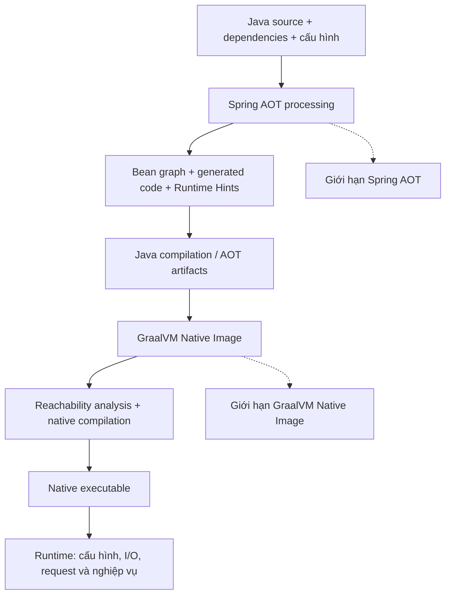
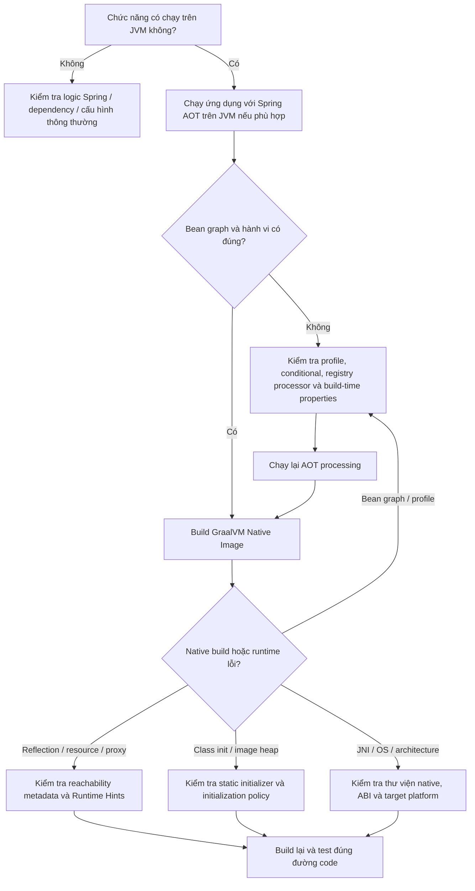

# Phân biệt hạn chế của GraalVM với hạn chế riêng của Spring AOT

## Mục tiêu bài học

Khi chuyển ứng dụng Spring Boot sang **GraalVM Native Image**, một số tính năng có thể hoạt động khác so với khi chạy trên JVM. Lý do thường đến từ hai lớp công nghệ:

- **Spring AOT** phân tích ứng dụng và chuẩn bị bean definitions, mã bootstrap cùng runtime hints ở thời điểm build.
- **GraalVM Native Image** phân tích mã có thể được sử dụng, biên dịch thành executable và áp dụng mô hình closed-world để tạo chương trình native.

Hai lớp này phối hợp với nhau nhưng không phải một. Giới hạn do Spring AOT quyết định bean graph ở build time khác với giới hạn của Native Image khi cần reflection metadata hoặc resource configuration. Nếu không phân biệt được, bạn có thể sửa sai tầng, thêm Runtime Hints cho một lỗi profile, hoặc thay đổi cấu hình Spring trong khi nguyên nhân thật là thư viện tạo class động.

Sau bài học, bạn có thể:

- Phân biệt trách nhiệm và giới hạn của Spring AOT với GraalVM Native Image.
- Nhận diện lỗi thuộc bean graph/build-time configuration hay closed-world/reachability.
- Hiểu các nhóm vấn đề reflection, resource, proxy, class loading, JNI và class initialization.
- Chọn cách xử lý phù hợp bằng cấu hình Spring, Runtime Hints, thay đổi dependency hoặc thiết kế lại.
- Xây dựng quy trình chẩn đoán từ JVM đến AOT và native executable.

## 1. Hai công nghệ, hai nhóm giới hạn

### 1.1. Spring AOT làm gì?

**Spring AOT (Ahead-of-Time processing)** phân tích cấu hình Spring trong một môi trường build chuyên biệt. Spring tạo mô hình bean definitions, đánh giá các điều kiện cấu hình có thể xác định ở thời điểm đó, rồi sinh mã Java và metadata để hỗ trợ khởi tạo `ApplicationContext`.

Những việc Spring AOT có thể chuẩn bị gồm:

- Đăng ký bean definitions và mã khởi tạo context.
- Xử lý cấu hình `@Configuration`, `@Bean`, component scanning và các điều kiện phù hợp.
- Phân tích một số dependency và cấu trúc bean.
- Tạo runtime hints cho reflection, resource, proxy và serialization mà Spring hoặc thư viện tích hợp có thể xác định.
- Sinh mã hỗ trợ bootstrap để giảm công việc cần thực hiện lúc ứng dụng khởi động.

Spring AOT tập trung vào **mô hình ứng dụng Spring**. Nó không phải compiler chuyển Java thành mã máy.

### 1.2. GraalVM Native Image làm gì?

**GraalVM Native Image** nhận bytecode, dependency, mã/metadata AOT và các tùy chọn build để tạo executable native. Trong quá trình này, compiler phân tích phần mã có thể reachable và xác định những thành phần cần giữ trong binary.

Native Image áp dụng mô hình **closed-world**: các class, method, resource và khả năng truy cập động cần thiết phải được biết hoặc đăng ký phù hợp khi build. Một số hành vi vốn linh hoạt trên JVM như reflection tùy ý, nạp plugin từ JAR ngoài sau khi chương trình đã build hoặc sinh class tùy biến lúc chạy cần được xem xét riêng.

Native Image tập trung vào **tập mã và tài nguyên có thể đưa vào executable**. Nó không quyết định thay ứng dụng nên dùng bean nghiệp vụ nào theo profile; phần đó thuộc cấu hình và quá trình AOT của Spring.

### 1.3. Đường đi tổng thể



| Lớp | Câu hỏi chính | Ví dụ giới hạn |
|---|---|---|
| Spring AOT | Bean nào và cấu hình Spring nào được chuẩn bị khi build? | Profile/conditional đã quyết định bean graph; logic đăng ký bean phụ thuộc dữ liệu chỉ có lúc runtime |
| GraalVM Native Image | Mã, resource và khả năng truy cập động nào được giữ trong executable? | Reflection chưa đăng ký, resource chưa đưa vào image, class được nạp động hoặc mã được sinh lúc runtime |
| Cả hai | Thông tin từ framework có được chuyển thành metadata mà native compiler hiểu không? | Proxy hoặc reflection do thư viện tạo ra nhưng không có AOT integration/runtime hints phù hợp |

**Một ứng dụng có thể dùng Spring AOT trên JVM mà không tạo native executable.** Khi đó vẫn có thể gặp giới hạn do bean graph được xác định ở build time, nhưng chưa chịu tất cả giới hạn closed-world của Native Image. Ngược lại, một ứng dụng Java không dùng Spring vẫn có thể gặp vấn đề reflection/resource khi biên dịch bằng Native Image.

## 2. Những giới hạn chủ yếu thuộc GraalVM Native Image

### 2.1. Closed-world và reachability analysis

Trên JVM, class có thể được nạp trong runtime khi ứng dụng cần đến, miễn là class có trong classpath và cơ chế class loading cho phép. Native Image cần phân tích trước tập mã có thể sử dụng để tạo executable. Mã không được xác định là reachable có thể bị loại khỏi binary.

Ví dụ:

```java
String implementation = configuration.getProperty("serializer.class");
Class<?> type = Class.forName(implementation);
Object serializer = type.getDeclaredConstructor().newInstance();
```

Trên JVM, đoạn code có thể tạo instance của class được chỉ định trong cấu hình nếu class có mặt và constructor truy cập được. Với Native Image, compiler cần biết class nào có thể được nạp và constructor nào được gọi qua reflection.

Nếu tên class chỉ được lấy từ một nguồn dữ liệu tùy ý lúc runtime, compiler có thể không xác định được tất cả class cần đưa vào executable. Có hai tình huống khác nhau:

- Class đã có trong application/dependency và được đưa vào image, nhưng truy cập reflection chưa được đăng ký: có thể cần Runtime Hints.
- Class chỉ xuất hiện trong một JAR/plugin được cài thêm sau khi executable đã build: không thể chỉ thêm reflection hint để đưa mã mới vào binary đã tạo; cần build lại với dependency đó hoặc dùng kiến trúc plugin ở process riêng.

**Closed-world không có nghĩa cấm mọi reflection.** Reflection vẫn được hỗ trợ khi class/member cần truy cập được giữ lại và metadata được khai báo phù hợp.

### 2.2. Reflection và metadata

Các thư viện có thể dùng reflection để:

- Tìm constructor và tạo object.
- Đọc/ghi field hoặc gọi method theo tên.
- Phân tích annotation và generic metadata.
- Thực hiện serialization/deserialization.
- Tạo mapper, validator hoặc dependency injection tùy biến.

Native Image cần biết những thao tác reflection nào được dùng. Nếu thiếu metadata, ứng dụng có thể build thất bại hoặc chỉ lỗi khi chạy tới đường code động đó.

Ví dụ, một thư viện tự tạo DTO bằng constructor reflection:

```java
Class<?> type = Class.forName("com.example.dto.PaymentRequest");
Object request = type.getDeclaredConstructor().newInstance();
```

Nếu class và constructor đã có trong binary nhưng chưa được đăng ký, cần bổ sung hint đúng phạm vi. Nếu class không nằm trong build inputs, hint không thể thay thế dependency.

### 2.3. Resource không tự động luôn có trong image

Trên JVM, `ClassLoader.getResource()` hoặc `getResourceAsStream()` thường đọc tài nguyên từ classpath/JAR. Với Native Image, resource cần được nhận diện và đưa vào executable.

Ví dụ:

```java
String template = "invoice-" + request.getLocale() + ".html";
try (InputStream input =
        getClass().getResourceAsStream("/templates/" + template)) {
    // Doc template
}
```

Tên resource được ghép động có thể khiến công cụ không xác định được file nào cần đóng gói. Cần đăng ký pattern hoặc các resource cụ thể theo cách mà Spring/GraalVM hỗ trợ.

Resource nằm ngoài image như file mount, secret volume hoặc file cấu hình bên ngoài vẫn có thể được đọc ở runtime theo filesystem. Cần phân biệt **resource đóng gói trong binary** với **file được triển khai bên ngoài**.

### 2.4. Dynamic proxy và sinh bytecode

Native Image có hỗ trợ một số dạng proxy, nhưng cần biết trước interface và kiểu proxy cần tạo. Những framework tự sinh class bằng Byte Buddy, CGLIB, ASM hoặc compiler Java trong runtime có thể cần hỗ trợ đặc biệt hoặc không tương thích với mô hình native.

Phân biệt:

- **JDK dynamic proxy:** proxy triển khai một tập interface; interface cần được nhận diện/đăng ký.
- **Spring AOP proxy:** Spring AOT có thể chuẩn bị proxy và hints cho nhiều trường hợp framework quản lý được.
- **Class được sinh tùy ý lúc runtime:** compiler không thể mặc định đưa một class chưa biết vào executable chỉ vì ứng dụng gọi API sinh bytecode.

Không phải cứ thấy lỗi proxy là phải thêm reflection hints. Hãy xác định proxy do Spring tạo, do thư viện tạo hay do ứng dụng tự sinh.

### 2.5. Class loading, plugin và ServiceLoader

Một hệ thống JVM có thể tìm implementation từ classpath mở rộng hoặc plugin được cài sau khi ứng dụng phát hành. Native executable thường được tạo với tập class và dependency đã biết tại build time.

Các cơ chế như `ServiceLoader` vẫn có thể được hỗ trợ nếu provider và metadata tương ứng được đưa vào image. Nhưng một plugin JAR được copy vào thư mục sau khi native binary đã build không tự trở thành một phần của executable.

Nếu sản phẩm cần plugin độc lập có thể cài sau khi phát hành, hãy cân nhắc:

- Build lại native executable cho tập plugin được hỗ trợ.
- Dùng registry/extension point tĩnh với danh sách implementation đã biết.
- Chạy plugin trong một JVM/process riêng và giao tiếp qua HTTP, gRPC hoặc message broker.
- Dùng một runtime JVM cho phần thực sự cần nạp plugin tùy ý.

### 2.6. JNI và thư viện native

Ứng dụng có thể gọi C/C++ hoặc thư viện hệ điều hành qua JNI/JNA. Native Image không tự loại bỏ yêu cầu tương thích của những thư viện đó.

Cần kiểm tra:

- Thư viện native có sẵn trong môi trường build và runtime không?
- ABI, libc và phiên bản thư viện có tương thích không?
- OS và kiến trúc CPU của executable có khớp môi trường triển khai không?
- Các method/class dùng JNI đã có metadata cần thiết chưa?

Native executable Linux x86-64 không thể được đổi tên thành `.exe` để chạy trên Windows. Khi dùng container, builder và run image phải phù hợp với kiến trúc, thư viện nền tảng và yêu cầu runtime.

### 2.7. Class initialization và image heap

Native Image có thể khởi tạo class tại build time. Static initializer có thể đọc environment, thời gian, locale hoặc tạo object. Giá trị được tạo khi đó có thể trở thành trạng thái trong image heap.

Đây là giới hạn/cơ chế thuộc **Native Image class initialization**, không phải Spring AOT tự động cố định mọi static field.

Ví dụ:

```java
final class HostInfo {
    static final String HOST = System.getenv("HOSTNAME");
    static final Instant CREATED_AT = Instant.now();
}
```

Nếu class được khởi tạo tại build time, các giá trị có thể phản ánh máy build thay vì máy chạy. Cần xác định class initialization policy, trì hoãn trạng thái động tới runtime hoặc chuyển cấu hình sang bean/runtime properties.

## 3. Những giới hạn chủ yếu thuộc Spring AOT

### 3.1. Bean graph được xác định trong quá trình AOT

Spring AOT phân tích cấu hình và bean definitions trong một môi trường build. Kết quả sinh ra phản ánh tập bean mà Spring nhìn thấy trong lần xử lý đó.

Ví dụ:

```java
@Configuration(proxyBeanMethods = false)
class PaymentConfiguration {

    @Bean
    @Profile("sandbox")
    PaymentGateway sandboxGateway() {
        return new SandboxPaymentGateway();
    }

    @Bean
    @Profile("production")
    PaymentGateway productionGateway() {
        return new ProductionPaymentGateway();
    }
}
```

Nếu AOT build được thực hiện với profile `sandbox`, bean graph được tạo cho biến thể đó sẽ chứa cấu hình sandbox. Chỉ đổi `SPRING_PROFILES_ACTIVE=production` lúc chạy không thể sinh thêm mã đăng ký bean production đã không được đưa vào mô hình AOT.

Với Spring Boot AOT, active profiles dùng khi xử lý AOT cần nhất quán với profiles khi chạy. Tùy phiên bản và cách cấu hình, Spring Boot có thể phát hiện mismatch và báo lỗi khởi động; trong mọi trường hợp, không nên dựa vào việc đổi profile runtime để bổ sung bean đã vắng mặt trong AOT output.

### 3.2. Conditional configuration được đánh giá theo môi trường build

Các điều kiện như:

- `@Profile`
- `@ConditionalOnProperty`
- `@ConditionalOnClass`
- `@ConditionalOnBean`
- `@ConditionalOnMissingBean`

có thể ảnh hưởng tới việc bean definition có được đăng ký hay không. Với AOT, các điều kiện liên quan cấu trúc bean được xử lý trong quá trình phân tích.

Ví dụ:

```java
@Configuration(proxyBeanMethods = false)
class AuditConfiguration {

    @Bean
    @ConditionalOnProperty(
            prefix = "audit",
            name = "enabled",
            havingValue = "true"
    )
    AuditPublisher auditPublisher() {
        return new HttpAuditPublisher();
    }
}
```

Nếu `audit.enabled` quyết định bean có tồn tại, giá trị property cần có trong môi trường AOT để tạo đúng bean graph. Đổi property chỉ ở runtime không thể tự bổ sung bean đã bị loại khỏi mô hình build.

Ngược lại, một property chỉ cung cấp URL, timeout hoặc API key cho bean đã được đăng ký thường có thể đọc lúc runtime. Không phải tất cả property đều bị đóng băng.

### 3.3. Logic đăng ký bean phụ thuộc dữ liệu runtime

Một số ứng dụng dùng `BeanDefinitionRegistryPostProcessor`, `BeanFactoryPostProcessor` hoặc code tùy biến để đăng ký bean dựa trên file, database, endpoint hoặc plugin được phát hiện lúc khởi động.

Ví dụ:

```java
registry.registerBeanDefinition(
        beanName,
        new RootBeanDefinition(resolveImplementationFromDatabase())
);
```

Nếu danh sách implementation chỉ có thể biết khi ứng dụng đang chạy, Spring AOT không thể mặc định tái tạo chính xác bean graph đó khi build offline. Các processor và logic đăng ký bean cần tương thích AOT, có thể chạy trong môi trường build và tạo ra kết quả xác định.

Hãy xem xét:

- Đưa danh sách implementation vào cấu hình build rõ ràng.
- Dùng các bean definitions tường minh và điều kiện Spring có thể phân tích.
- Viết `BeanFactoryInitializationAotProcessor` hoặc `BeanRegistrationAotProcessor` khi cần tích hợp AOT chuyên biệt.
- Chuyển registry động sang dữ liệu runtime được bean đã đăng ký đọc, nếu không cần tạo thêm bean.
- Tách hệ thống plugin động thành process riêng nếu yêu cầu mở rộng sau phát hành là bắt buộc.

### 3.4. Component scanning và classpath được xử lý ở build time

Spring AOT phân tích component/configuration và classpath của lần build. Một JAR được thêm vào thư mục bên ngoài sau khi native executable đã được tạo không tự được component scan và đăng ký thành bean.

Nếu biến thể build có dependency khác nhau, hãy tạo artifact riêng với classpath tương ứng. Nếu chỉ có nhiều cấu hình runtime nhưng bean graph không đổi, hãy dùng `@ConfigurationProperties` hoặc nguồn cấu hình runtime thay vì dựa vào component scan động.

### 3.5. Runtime thay đổi bean definitions

Một ứng dụng có thể có code đăng ký hoặc thay đổi bean definitions trong lúc startup. Với AOT, những thay đổi này cần được thực hiện và phản ánh trong quá trình AOT processing, hoặc được hỗ trợ bởi cơ chế AOT tương ứng.

Không nên giả định rằng mọi thao tác sửa `BeanDefinitionRegistry` sau khi generated code đã được tạo đều được tái hiện trong native executable. Đặc biệt, việc nạp module/plugin rồi đăng ký bean mới dựa trên dữ liệu chỉ có sau deploy cần một thiết kế khác hoặc một quy trình build biến thể.

## 4. Những trường hợp hai lớp cùng tham gia

Một số tính năng không thuộc riêng một lớp. Spring AOT có thể sinh metadata, còn Native Image sử dụng metadata đó để giữ lại thành phần cần thiết.

### 4.1. Reflection

Spring AOT có thể suy ra một số thao tác reflection từ bean model và tích hợp với Runtime Hints. GraalVM Native Image là thành phần áp dụng reachability và metadata khi tạo executable.

Nếu ứng dụng dùng reflection mà Spring không biết, cần khai báo hints. Nếu class không có trong dependency/build inputs, hints cũng không thể thêm class mới vào binary.

### 4.2. Resource

Spring hoặc thư viện tích hợp có thể đăng ký resource hints. Native Image dùng các khai báo đó để đóng gói resource vào executable. Một file cấu hình ngoài được mount lúc runtime là trường hợp khác: nó cần tồn tại trong filesystem và được đọc theo đường dẫn runtime.

### 4.3. Proxy và AOP

Spring AOT có thể chuẩn bị proxy/hints cho bean AOP mà framework quản lý được. Native Image cần biết interface, class và metadata cần cho proxy. Thư viện tự sinh proxy mà không tích hợp AOT có thể cần cấu hình bổ sung hoặc thay đổi cách sử dụng.

### 4.4. Serialization

Spring có thể cung cấp hints cho một số kiểu được framework biết. Nhưng thư viện serialization tự khám phá class, constructor và field lúc runtime vẫn cần metadata phù hợp với Native Image. Hãy xác định chính xác serializer và các kiểu dữ liệu cần giữ.

### 4.5. Bảng phân loại nhanh

| Triệu chứng | Tầng chính cần kiểm tra | Câu hỏi chẩn đoán |
|---|---|---|
| Đổi profile runtime nhưng bean không đổi | Spring AOT | Profile nào được active khi AOT processing? |
| `@ConditionalOnProperty` không tạo bean mong muốn | Spring AOT | Property có đúng lúc AOT build không? |
| Reflection báo thiếu constructor/method | GraalVM Native Image / Runtime Hints | Class đã có trong image và member cần truy cập đã đăng ký chưa? |
| Không đọc được JSON/template đóng gói | GraalVM Native Image / resource hints | Resource có được đưa vào image không? |
| Plugin JAR thêm sau build không được nạp | Native Image và thiết kế AOT | Plugin có nằm trong build inputs và bean graph không? |
| Custom bean registry khác giữa build và runtime | Spring AOT | Registry processor có phụ thuộc dữ liệu runtime không? |
| Spring AOP proxy không được tạo trong native | Cả hai | Spring AOT đã sinh proxy/hints chưa, native image có metadata tương ứng chưa? |
| Static field giữ hostname máy CI | Native Image class initialization | Class có bị khởi tạo ở build time không? |
| JNI library không load được | GraalVM/OS runtime | ABI, kiến trúc và thư viện có tương thích không? |

## 5. Runtime Hints giải quyết điều gì và không giải quyết điều gì?

### 5.1. Khai báo reflection và resource

Spring cung cấp API `RuntimeHints` để mô tả các truy cập động cần thiết. Ví dụ:

```java
import org.springframework.aot.hint.MemberCategory;
import org.springframework.aot.hint.RuntimeHints;
import org.springframework.aot.hint.RuntimeHintsRegistrar;
import org.springframework.aot.hint.TypeReference;

final class PaymentRuntimeHints implements RuntimeHintsRegistrar {

    @Override
    public void registerHints(
            RuntimeHints hints,
            ClassLoader classLoader) {

        hints.reflection().registerType(
                TypeReference.of(PaymentPlugin.class),
                MemberCategory.INVOKE_DECLARED_CONSTRUCTORS,
                MemberCategory.INVOKE_PUBLIC_METHODS
        );

        hints.resources().registerPattern(
                "plugins/payment/*.json"
        );
    }
}
```

Đăng ký registrar:

```java
@Configuration(proxyBeanMethods = false)
@ImportRuntimeHints(PaymentRuntimeHints.class)
class PaymentNativeConfiguration {}
```

Các import và API cần khớp phiên bản Spring Framework/Spring Boot của dự án. Chỉ đăng ký member thật sự cần reflection; không bật toàn bộ quyền truy cập nếu không cần thiết.

### 5.2. Hints không thể sửa mọi lỗi

Runtime Hints có thể giúp Native Image giữ lại metadata và thành phần truy cập động, nhưng không thể:

- Thêm một dependency/JAR mới vào executable đã build.
- Tạo lại bean đã bị loại khỏi bean graph bởi profile/condition trong AOT.
- Làm cho một class không có trong build inputs trở nên reachable.
- Biến lời gọi self-invocation thành lời gọi qua Spring AOP proxy.
- Tự cung cấp thư viện JNI/OS còn thiếu hoặc sửa sai ABI.
- Biến một object được khởi tạo tại build time thành cấu hình runtime mới.

Trước khi thêm hints, hãy xác định lỗi nằm ở metadata truy cập động, bean graph, dependency hay môi trường runtime.

## 6. Ví dụ chẩn đoán theo từng tầng

### 6.1. Trường hợp A: profile không tạo đúng bean

Code:

```java
@Bean
@Profile("production")
PaymentGateway productionGateway() {
    return new ProductionPaymentGateway();
}
```

Triệu chứng: native binary được build khi `sandbox` active, nhưng khi chạy với `production`, bean `ProductionPaymentGateway` không xuất hiện hoặc Spring báo profile mismatch.

Chẩn đoán:

1. Xác nhận `SPRING_PROFILES_ACTIVE` trong tiến trình AOT.
2. Kiểm tra log/task `processAot`.
3. Kiểm tra generated bean registration.
4. Build một biến thể mới với profile `production`.
5. Chạy binary với profile khớp biến thể đã build.

Đây là vấn đề **Spring AOT và bean graph**. Thêm reflection hints cho `ProductionPaymentGateway` không làm bean tự xuất hiện trong context.

### 6.2. Trường hợp B: reflection không tìm thấy constructor

Code:

```java
Class<?> type = Class.forName("com.example.plugin.JsonPaymentPlugin");
Object plugin = type.getDeclaredConstructor().newInstance();
```

Triệu chứng: JVM chạy được nhưng native báo không tìm thấy constructor hoặc không thể truy cập class bằng reflection.

Chẩn đoán:

1. Xác nhận class nằm trong dependency/classpath khi build.
2. Đăng ký class và constructor bằng Runtime Hints hoặc metadata phù hợp.
3. Kiểm tra class có reachable và không bị loại khỏi image.
4. Build lại native executable và chạy đúng đường code đó.

Đây chủ yếu là vấn đề **Native Image reachability/reflection metadata**. Nếu class nằm trong JAR được cài sau build, cần build lại với JAR đó; chỉ thêm hint là chưa đủ.

### 6.3. Trường hợp C: resource có trên JVM nhưng mất trong native

Code:

```java
try (InputStream input =
        getClass().getResourceAsStream("/templates/invoice.html")) {
    // Doc template
}
```

Triệu chứng: JVM tìm thấy resource trong JAR nhưng native executable trả về `null`.

Chẩn đoán:

1. Xác nhận resource đúng vị trí trong `src/main/resources`.
2. Kiểm tra resource có được đóng gói trong JVM artifact.
3. Đăng ký resource pattern bằng Runtime Hints nếu Native Image không nhận diện được.
4. Build lại và test endpoint/đường xử lý sử dụng resource.

Đây là vấn đề **resource inclusion của Native Image**, trừ khi resource vốn không nằm trong build inputs.

### 6.4. Trường hợp D: bean được tạo từ database lúc startup

Một `BeanDefinitionRegistryPostProcessor` đọc database để lấy danh sách loại connector và đăng ký bean theo từng dòng dữ liệu. Trên JVM, database có thể truy cập khi startup; khi AOT build trong CI offline, dữ liệu không có hoặc khác production.

Chẩn đoán:

1. Xác định processor chạy trong giai đoạn nào của AOT.
2. Kiểm tra nó có phụ thuộc database, network hoặc secret không.
3. Nếu tập connector là cố định, đưa danh sách vào cấu hình build rõ ràng.
4. Nếu danh sách cần thay đổi sau deploy, đăng ký một bean registry/service cố định rồi đọc dữ liệu connector lúc runtime, thay vì tạo bean mới theo dữ liệu đó.
5. Nếu plugin phải cài sau phát hành, cân nhắc process riêng hoặc JVM runtime cho phần plugin.

Đây chủ yếu là giới hạn **Spring AOT đối với cấu trúc bean phụ thuộc dữ liệu runtime**, đồng thời có thể phát sinh thêm giới hạn closed-world nếu plugin class không có trong binary.

## 7. Quy trình chẩn đoán từ JVM đến native

Không bắt đầu bằng việc thêm hàng loạt hints. Hãy tái hiện và xác định tầng gây lỗi theo trình tự:



### 7.1. Bằng chứng nên thu thập

| Giai đoạn | Bằng chứng |
|---|---|
| JVM baseline | Test, startup log, bean type, profile và kết quả nghiệp vụ |
| Spring AOT | Active profiles/build properties, generated source, bean registrations, AOT logs |
| Native compilation | GraalVM version, target OS/CPU, reachability/class-init errors, build arguments |
| Native runtime | Stack trace, resource/reflection failure, environment, thread/transaction behavior |
| Container/deployment | Image architecture, shared libraries, mounted files, secrets và runtime configuration |

Giữ cùng source revision và dependency khi so sánh JVM/AOT/native. Nếu thay nhiều biến cùng lúc, sẽ khó xác định nguyên nhân.

## 8. Khi nào nên đổi thiết kế?

| Nhu cầu ứng dụng | Thiết kế phù hợp |
|---|---|
| Chọn một trong vài implementation đã biết | Dùng `@Profile`/conditional và build variant rõ ràng |
| Chỉ thay URL, credential hoặc timeout | Giữ bean graph, cấp cấu hình lúc runtime |
| Reflection trên class đã có trong binary | Đăng ký Runtime Hints chính xác |
| Đọc resource nằm trong image | Đăng ký resource hints hoặc pattern |
| Nạp plugin JAR sau phát hành | Dùng JVM/plugin process hoặc build lại native cho tập plugin |
| Tạo bean từ dữ liệu database lúc startup | Dùng registry/service runtime cố định hoặc tạo biến thể build từ dữ liệu xác định |
| Tạo proxy động từ thư viện | Tìm AOT/native integration; nếu không có, thay đổi cách tạo proxy hoặc thư viện |
| Kết nối JNI/native library | Đóng gói thư viện đúng OS/CPU/ABI và khai báo metadata cần thiết |
| Static state phụ thuộc máy chạy | Chuyển sang runtime initialization hoặc bean/configuration runtime |

Không phải mọi ứng dụng đều phù hợp với native image. Nếu sản phẩm phụ thuộc nặng vào plugin tùy ý, runtime bytecode generation hoặc classpath có thể thay đổi sau deploy, JVM có thể là lựa chọn hợp lý cho phần đó.

## 9. Checklist trước khi kết luận một tính năng không tương thích

- Đã tái hiện vấn đề trên JVM baseline chưa?
- Đã xác định lỗi xuất hiện trong Spring AOT processing, native compilation hay native runtime chưa?
- Bean có được đăng ký trong AOT output không?
- Profile, condition và build-time property có đúng không?
- Class có nằm trong dependency/classpath khi native build không?
- Reflection member cần dùng đã có metadata chưa?
- Resource có nằm trong image hoặc filesystem runtime đúng vị trí không?
- Proxy do Spring quản lý hay thư viện tự tạo?
- Có code sinh bytecode hoặc nạp plugin sau build không?
- Static initializer có đọc thời gian, environment, secret hoặc tài nguyên máy build không?
- JNI/shared library có đúng OS, CPU và ABI không?
- Đã build lại và test đúng đường code trên native executable chưa?

## 10. Bài thực hành

### Bài 1 — Phân loại lỗi

Tạo ba lỗi có chủ đích:

1. Dùng `@Profile` để chọn implementation khác nhau và build AOT với một profile.
2. Dùng `Class.forName()` để tạo một class đã có trong dependency nhưng chưa đăng ký reflection.
3. Đọc resource bằng tên được ghép động.

Với mỗi lỗi, ghi rõ tầng xử lý, log/bằng chứng cần tìm và cách sửa. Không dùng một giải pháp Runtime Hints cho cả ba tình huống.

### Bài 2 — Runtime Hints

Đăng ký constructor/method cần reflection và một resource pattern bằng `RuntimeHintsRegistrar`. Build native, chạy đúng đường code và xác nhận reflection/resource hoạt động.

### Bài 3 — AOT bean graph

Tạo hai bean implementation theo `@Profile("sandbox")` và `@Profile("production")`. Build AOT cho từng profile trong workspace riêng hoặc theo thứ tự có lưu artifact. Xác nhận mỗi binary có đúng implementation và runtime profile khớp.

### Bài 4 — Quyết định kiến trúc

Giả sử ứng dụng cần tải plugin từ một thư mục mà quản trị viên có thể thêm JAR bất kỳ sau khi deploy. Hãy giải thích vì sao Runtime Hints không đủ để thêm mã mới vào native executable đã build. Đề xuất phương án dùng JVM/plugin process hoặc build lại native theo danh sách plugin.

### Câu hỏi tự kiểm tra

1. Spring AOT quyết định điều gì mà GraalVM Native Image không quyết định?
2. Vì sao `@ConditionalOnProperty` có thể làm một bean không xuất hiện trong native variant?
3. Reflection có bị cấm trong Native Image không? Metadata giải quyết phần nào?
4. Vì sao thêm Runtime Hint không thể đưa một JAR plugin mới vào binary đã build?
5. Một lỗi thiếu resource thuộc tầng nào và cần kiểm tra điều gì trước khi thêm hint?
6. Khi nào nên chuyển cấu hình từ static initializer sang `@ConfigurationProperties`?

**Ghi nhớ:** Spring AOT chuẩn bị cấu trúc ứng dụng Spring ở build time; GraalVM Native Image xác định và biên dịch tập mã/tài nguyên có thể chạy trong executable native. Profile, conditional và logic đăng ký bean động thường là vấn đề của AOT. Reflection, resource, proxy, class loading, JNI và class initialization thường là vấn đề của Native Image hoặc phần tích hợp giữa hai lớp. Hãy tìm đúng tầng trước khi chọn cách khắc phục.
