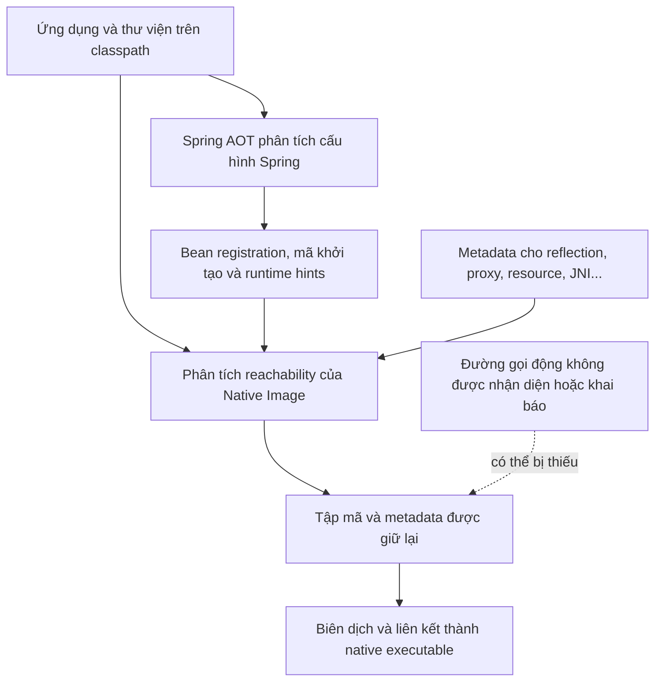

# Giả định thế giới đóng và yêu cầu biết tập lớp khi build

Khi chạy ứng dụng Spring Boot trên JVM, chương trình có thể nạp thêm lớp và phân tích cấu trúc lớp ngay trong lúc chạy. GraalVM Native Image chọn một cách tiếp cận khác: phân tích trước những phần mã có khả năng được sử dụng, biên dịch chúng thành mã máy và đóng gói thành một tệp thực thi native. Cách tiếp cận này dựa trên **giả định thế giới đóng** (*closed-world assumption*).

Hiểu giả định này là nền tảng để sử dụng **Spring AOT (Ahead-of-Time)**, xử lý các trường hợp reflection, tài nguyên và proxy động, cũng như giải thích vì sao một ứng dụng Spring Boot chạy tốt trên JVM vẫn có thể gặp lỗi ở bản native.

## 1. “Thế giới đóng” nghĩa là gì?

Trong ngữ cảnh Native Image, *thế giới* là tập các loại (type), phương thức, trường và hành vi mà chương trình có thể cần khi chạy. **Thế giới đóng** nghĩa là công cụ build giả định rằng tập mã và các hình thức truy cập động cần thiết có thể xác định hoặc được khai báo **trước khi tạo binary**. Trình phân tích bắt đầu từ các điểm vào (*entry points*), lần theo những lệnh gọi và quan hệ mà nó nhận biết, rồi tạo mã native cho phần được xem là có thể đi tới (*reachable*).

Đây là một giả định phục vụ **phân tích khả năng truy cập mã** (*reachability analysis*), không có nghĩa công cụ phải đưa *mọi* lớp trong classpath vào binary. Lớp không được xem là cần thiết có thể bị loại bỏ. Ngược lại, một lớp có nằm trong dependency ở thời điểm build cũng **không bảo đảm** rằng mọi constructor, method hay field của nó sẽ dùng được qua reflection khi chạy.

| Khía cạnh | Spring Boot chạy trên JVM | Spring Boot biên dịch thành Native Image |
| --- | --- | --- |
| Biên dịch mã ứng dụng | Bytecode được JVM thực thi, có thể được JIT tối ưu trong lúc chạy | Phần mã có thể truy cập được biên dịch AOT thành mã máy trước khi chạy |
| Nạp lớp | Class loader có thể nạp thêm lớp từ classpath hoặc nguồn được cấu hình trong lúc chạy | Tập lớp của binary về cơ bản được cố định ở lúc build; không thể coi binary như một JVM có thể thêm JAR tùy ý |
| Reflection | JVM có thể tra cứu lớp và thành viên dựa trên tên lúc chạy | Truy cập reflection động cần được trình phân tích nhận diện hoặc mô tả bằng metadata/hints |
| Mã ít dùng | Vẫn có thể được nạp và thực thi sau này | Mã không được đánh dấu reachable có thể không được đưa vào binary |
| Tài nguyên classpath | Có thể được đọc từ JAR hoặc thư mục có trong classpath khi chạy | Tài nguyên cần được đóng gói vào binary bằng cấu hình phù hợp |

**Điểm cốt lõi:** Native Image cần biết *phạm vi khả năng* của chương trình tại thời điểm build, nhưng chương trình vẫn có thể nhận dữ liệu, chọn nhánh `if`, gọi API mạng và xử lý đầu vào khác nhau trong thời gian chạy. “Đóng” ở đây nói về thế giới mã và metadata cần thiết, không phải dữ liệu nghiệp vụ.

## 2. Native Image tìm những lớp cần giữ lại như thế nào?

Hãy hình dung một đồ thị: các nút là loại, phương thức hoặc thành viên; các cạnh là quan hệ gọi hoặc truy cập. Native Image bắt đầu từ các điểm vào, sau đó mở rộng tập nút có thể đi tới. Một lời gọi trực tiếp như `new InvoiceService()` thường dễ phân tích hơn `Class.forName(name)` khi `name` chỉ được biết lúc chạy.



Quá trình có thể hiểu qua ba phần phối hợp:

1. **Phân tích tĩnh của GraalVM:** tìm các đường gọi và kiểu dữ liệu mà trình biên dịch chứng minh hoặc ước lượng là có thể được sử dụng, kể cả những trường hợp gọi động có thể suy ra tại build time.
2. **Spring AOT:** xử lý trước nhiều thông tin về application context, bean definitions, dependency injection, cấu hình và các thành phần Spring đã được nhận biết; từ đó sinh mã hoặc đăng ký runtime hints mà Native Image có thể sử dụng.
3. **Reachability metadata bổ sung:** mô tả những tương tác khó suy ra từ mã tĩnh, chẳng hạn constructor được gọi bằng reflection theo tên, JDK proxy tạo từ danh sách interface hoặc tệp JSON phải được đọc từ classpath.

Ví dụ, một lời gọi `new EmailSender()` cho thấy rõ loại cần dùng. Nhưng đoạn `Class.forName(configuredClassName)` có thể nhận nhiều tên lớp tùy cấu hình triển khai. Không thể suy ra một cách an toàn tất cả tên lớp từ một chuỗi chỉ có giá trị khi chạy. Công cụ vì thế cần thêm thông tin về **tập lớp và thành viên có thể được truy cập**, thay vì được phép suy đoán hoặc nạp mã chưa từng được build.

### Tập lớp “có thể tới” và tập thành viên “được truy cập động” khác nhau

Một lớp được giữ lại vì có lệnh gọi Java thông thường không đồng nghĩa toàn bộ API reflection của nó được mở. Ví dụ, ứng dụng có thể gọi trực tiếp `new Customer()` nhưng vẫn thiếu khả năng gọi `Customer.class.getDeclaredConstructor().newInstance()` trong một đường chạy chỉ sử dụng reflection động. Vì vậy, khi khai báo hints cần chỉ rõ **loại nào** và **thao tác nào** (gọi constructor, gọi method, truy cập field...) thật sự được dùng.

## 3. Vì sao các cơ chế động dễ gây lỗi?

Ví dụ sau chọn một bộ định dạng theo tên lớp từ cấu hình hoặc request. Interface và implementation được đặt trong **hai tệp Java riêng**, cùng package `com.example.nativeimage`:

```java
// OrderFormatter.java
package com.example.nativeimage;

public interface OrderFormatter {
    String format(String orderCode);
}
```

```java
// UppercaseOrderFormatter.java
package com.example.nativeimage;

public final class UppercaseOrderFormatter implements OrderFormatter {
    public UppercaseOrderFormatter() {}

    @Override
    public String format(String orderCode) {
        return orderCode.toUpperCase(java.util.Locale.ROOT);
    }
}
```

```java
// FormatterFactory.java
package com.example.nativeimage;

public final class FormatterFactory {
    public OrderFormatter createFormatter(String configuredClassName)
            throws ReflectiveOperationException {
        Class<? extends OrderFormatter> type = Class.forName(configuredClassName)
                .asSubclass(OrderFormatter.class);
        return type.getDeclaredConstructor().newInstance();
    }
}
```

Trên JVM, nếu lớp có thể được class loader tìm thấy và constructor có quyền truy cập phù hợp, chương trình có thể khởi tạo nó. Với Native Image, nếu giá trị `configuredClassName` chỉ xuất hiện lúc chạy, trình phân tích không nhất thiết nhận ra `UppercaseOrderFormatter` và constructor sẽ được gọi. Kết quả có thể là lỗi tra cứu lớp hoặc lỗi đăng ký reflection, dù source code và dependency không thay đổi.

Những tình huống tương tự thường gặp trong ứng dụng Spring Boot:

| Cơ chế | Thông tin có thể không suy ra được khi build | Hướng xử lý |
| --- | --- | --- |
| `Class.forName`, `getDeclaredConstructor`, `Method.invoke` | Tên lớp và constructor/method được truy cập động | Đăng ký loại và đúng thành viên reflection bằng runtime hints hoặc metadata |
| Jackson serialize/deserialize kiểu động | DTO, constructor hoặc field chỉ được xác định từ dữ liệu/cấu hình runtime | Ưu tiên kiểu rõ ràng; bổ sung binding/reflection hints cho kiểu chưa được AOT tự nhận biết |
| JDK dynamic proxy | Danh sách interface truyền cho `Proxy.newProxyInstance` | Đăng ký tập interface của proxy; với proxy do Spring quản lý, kiểm tra khả năng tự sinh hints của AOT trước |
| Resource từ classpath | Đường dẫn `.json`, `.xml`, template... được dựng động | Đăng ký resource pattern phù hợp và đưa tệp vào nguồn build |
| Serialization, JNI, tích hợp framework đặc thù | Kiểu và API đặc biệt cần giữ tại runtime | Sử dụng loại reachability metadata tương ứng và kiểm thử đường thực thi thực tế |

Đừng đánh đồng tất cả lỗi native với reflection. Một `.json` không có trong binary sẽ không được sửa bằng cách đăng ký constructor; ngược lại, khai báo resource cũng không cấp quyền truy cập reflection cho DTO.

## 4. Spring AOT giải quyết được gì và khi nào vẫn cần hints?

Spring Boot tích hợp xử lý AOT để biến nhiều hoạt động thường được framework thực hiện trong lúc khởi động thành mã hoặc mô tả được chuẩn bị trước. Chẳng hạn, những bean, controller và cấu hình do Spring quản lý có thể được Spring AOT phân tích để sinh mã khởi tạo và đăng ký hints cần thiết.

Tuy nhiên, AOT không thể luôn biết tên lớp đến từ cơ sở dữ liệu, dữ liệu gửi lên API, plugin cấu hình ngoài, tên tệp tính tại runtime hoặc việc gọi reflection trực tiếp trong mã ứng dụng. **Runtime hints là hợp đồng giữa lập trình viên/framework và quá trình tạo Native Image** về những khả năng động phải có trong binary.

Với ví dụ `UppercaseOrderFormatter`, nếu đây là lớp cần được tạo bằng reflection, có thể đăng ký constructor thông qua `RuntimeHintsRegistrar`:

```java
package com.example.nativeimage;

import org.springframework.aot.hint.MemberCategory;
import org.springframework.aot.hint.RuntimeHints;
import org.springframework.aot.hint.RuntimeHintsRegistrar;
import org.springframework.context.annotation.Configuration;
import org.springframework.context.annotation.ImportRuntimeHints;

final class OrderFormatterHints implements RuntimeHintsRegistrar {
    @Override
    public void registerHints(RuntimeHints hints, ClassLoader classLoader) {
        hints.reflection().registerType(
                UppercaseOrderFormatter.class,
                MemberCategory.INVOKE_PUBLIC_CONSTRUCTORS
        );
    }
}

@Configuration(proxyBeanMethods = false)
@ImportRuntimeHints(OrderFormatterHints.class)
class NativeHintsConfiguration {
}
```

Trong ví dụ này, `UppercaseOrderFormatter` nằm trong package `com.example.nativeimage`, constructor là `public`, và lớp cấu hình được Spring quét hoặc import vào application context. Hints yêu cầu Native Image giữ khả năng **gọi constructor public bằng reflection** của lớp đã đăng ký. Khi có thêm bộ định dạng được hỗ trợ, cần xem xét và khai báo từng loại phù hợp; đăng ký một lớp không cho phép nạp vô hạn những JAR không biết trước.

Tương tự, nếu ứng dụng đọc `rules/discounts.json` bằng `getResourceAsStream()` hoặc qua resource loader, có thể khai báo riêng:

```java
// Đặt trong registerHints(...) khi cần đóng gói tài nguyên này.
hints.resources().registerPattern("rules/discounts.json");
```

Tệp đó phải thật sự tồn tại trong resources của ứng dụng ở thời điểm build, ví dụ `src/main/resources/rules/discounts.json`. Nếu cần một nhóm tệp, hãy đăng ký pattern đủ hẹp và kiểm tra cả các tệp mới. API runtime hints có thể hỗ trợ reflection, resource, proxy và một số dạng metadata khác; hãy dùng loại hint đúng với cách truy cập.

**Khi nào không cần tự khai báo?** Nếu Spring hoặc thư viện đã cung cấp hints phù hợp, việc khai báo lại không đem lại lợi ích. Với controller, repository, bean và các cơ chế phổ biến, trước tiên hãy build và chạy thử bản native. Chỉ bổ sung hints cho hành vi chưa được phát hiện, đặc biệt là mã reflection hoặc tải resource do ứng dụng tự viết. Phạm vi hỗ trợ tự động phụ thuộc vào phiên bản Spring Boot, thư viện và cách sử dụng API.

### Runtime hints khác với cài đặt classpath

Thêm dependency bảo đảm bytecode của thư viện có mặt để công cụ build phân tích; nó **không** bảo đảm mọi loại hoặc thành viên reflection của thư viện được giữ lại. Ngược lại, khai báo hints cho lớp không có trong classpath build cũng không làm lớp đó tự xuất hiện. Để hỗ trợ một tập implementation cố định, phải có cả **mã lớp trong đầu vào build** lẫn **metadata cần thiết cho truy cập động**.

## 5. Khác biệt giữa reachability và class initialization

Hai câu hỏi sau thường bị nhầm lẫn:

- **Reachability:** phương thức, lớp hoặc thành viên này có được giữ và sử dụng trong binary không?
- **Class initialization:** phần khởi tạo tĩnh (`static` field, `static` block) sẽ được thực thi ở thời điểm build hay khi chương trình native chạy?

GraalVM hỗ trợ lựa chọn thời điểm khởi tạo cho những lớp phù hợp; trong một số trường hợp, các tùy chọn như `--initialize-at-run-time` dùng để trì hoãn khởi tạo tĩnh. Nhưng đổi thời điểm khởi tạo **không thay thế** reflection hints, không làm một lớp không reachable tự trở nên reachable, và không biến binary thành môi trường có thể nạp tùy ý các lớp mới.

Ví dụ, nếu `static` block đọc biến môi trường của máy build, đưa giá trị đó vào trạng thái được tạo trước có thể dẫn đến hành vi sai khi chạy container khác. Đây là vấn đề thời điểm khởi tạo hoặc thiết kế cấu hình, cần chẩn đoán riêng với vấn đề thiếu reflection metadata.

## 6. Từ source code đến binary native trong ứng dụng Spring Boot

Về mặt khái niệm, quy trình gồm:

1. **Chuẩn bị đầu vào:** mã ứng dụng, dependencies và cấu hình build; các lớp có thể được sử dụng phải tồn tại trong tập đầu vào này.
2. **Chạy Spring AOT:** thu thập và xử lý thông tin mà Spring hiểu được; sinh mã trợ giúp và những runtime hints tự động.
3. **Phân tích bằng GraalVM Native Image:** kết hợp mã và metadata để tính reachability, xác định thành viên reflection, proxy, tài nguyên và các đặc tính cần thiết.
4. **Biên dịch và liên kết:** tạo native executable hoặc container image chứa chương trình native.
5. **Chạy và kiểm thử bản native:** thực thi các luồng nghiệp vụ, nhất là nhánh gọi lớp động, đọc tài nguyên và serialize dữ liệu thực tế.

Ví dụ lệnh phổ biến trong dự án đã cấu hình Spring Boot và GraalVM Native Build Tools:

```bash
# Maven: profile và goal phụ thuộc cấu hình pom.xml của dự án
./mvnw -Pnative native:compile

# Gradle: khi đã áp dụng plugin native build tools
./gradlew nativeCompile
```

Các lệnh trên minh họa bước build, không phải điều kiện đủ cho một dự án bất kỳ: cần JDK/GraalVM, native build tools và plugin tương thích. Đóng gói bằng buildpacks/container là bước triển khai tiếp theo; dù xây binary trên máy local hay qua image builder, quy tắc closed-world vẫn áp dụng.

Đổi một annotation, thêm dependency hay bổ sung implementation được sử dụng động có thể làm thay đổi đồ thị reachability. Vì vậy **phải build lại** binary để áp dụng mã và metadata mới; việc chép thêm JAR vào container chứa executable không tương đương với mở rộng classpath của JVM.

## 7. Chẩn đoán lỗi liên quan đến closed-world

Ứng dụng chạy được trên JVM hoặc khởi động native thành công chỉ chứng minh những đường đi đã được thực thi. Lỗi do thiếu reachability metadata có thể chỉ xuất hiện khi gọi một endpoint hiếm, chọn một loại DTO mới hoặc kích hoạt một tích hợp theo cấu hình runtime.

| Triệu chứng trong bản native | Câu hỏi cần kiểm tra | Cách xử lý hợp lý |
| --- | --- | --- |
| Không tìm được một lớp khi tên lớp chỉ được xác định lúc chạy | Lớp có thuộc đầu vào build và có được đăng ký cho sử dụng động không? | Xác nhận dependency, khai báo reflection metadata cho tập lớp được hỗ trợ |
| `MissingReflectionRegistrationError` hoặc lỗi gọi constructor/method | Đã đăng ký đúng constructor, method hay field mà đoạn code gọi chưa? | Bổ sung đúng `MemberCategory`/member metadata; tránh đăng ký toàn bộ khi không cần |
| `getResourceAsStream(...)` trả về `null` | Tệp có trong resources của build, và resource pattern có khớp không? | Kiểm tra đường dẫn, đăng ký resource, build lại |
| Lỗi tạo JDK proxy khi chạy nhánh đặc biệt | Những interface của proxy động đã có metadata tương ứng chưa? | Đăng ký proxy interface khi framework chưa tự làm được |
| JVM chạy đúng nhưng native lỗi chỉ với một profile/luồng nghiệp vụ | AOT và kiểm thử đã bao phủ cấu hình, branch và integration tương ứng chưa? | Kiểm thử bản native với cấu hình thực tế, mở rộng hints hoặc thay thiết kế truy cập động |

Quy trình điều tra thực tế:

1. **Tái hiện trên native executable** bằng cùng cấu hình và dữ liệu gây lỗi; xác định thao tác đầu tiên bị hỏng.
2. **Phân loại thao tác:** thiếu loại, thiếu thành viên reflection, resource, proxy, vấn đề class initialization hay lỗi thư viện không tương thích.
3. **Kiểm tra mã và hints do Spring/thư viện cung cấp** trước khi thêm cấu hình trùng lặp.
4. **Bổ sung phạm vi nhỏ nhất đủ dùng**, build lại và kiểm tra cùng đường chạy trên bản native.
5. **Chạy bộ kiểm thử hành vi trên native**, gồm deserialization, lịch trình xử lý nền và đường chạy chỉ kích hoạt ở production nếu có.

Trong các tình huống có nhiều reflection khó quan sát, *GraalVM tracing agent* chạy cùng ứng dụng JVM có thể hỗ trợ ghi nhận metadata từ những đường đã thực thi. Tuy nhiên, metadata được ghi phụ thuộc vào **độ bao phủ của các kịch bản chạy agent**: tác vụ chưa đi qua sẽ chưa được ghi nhận. Agent là công cụ hỗ trợ thu thập thông tin, không phải bảo đảm tự động rằng toàn bộ ứng dụng tương thích.

## 8. Những kết luận dễ nhầm

**“Native Image phải biết tất cả lớp trong thư viện.”** Không đúng. Nó cần biết tập mã và truy cập động cần thiết cho các đường chạy mà ứng dụng hỗ trợ. Đưa mọi lớp, mọi method vào metadata thường làm tăng chi phí build hoặc kích thước binary mà không giải quyết được gốc của vấn đề.

**“Đã dùng Spring AOT thì mọi reflection đều được xử lý.”** Không đúng. Spring AOT xử lý tốt những thông tin nó có thể thấy từ mô hình Spring và sự tích hợp của các thư viện; không thể tự suy ra mọi chuỗi tên lớp hoặc các plugin được chọn từ dữ liệu runtime.

**“Đăng ký reflection là có thể tải bất kỳ plugin mới nào.”** Không đúng. Hints mô tả các loại và thành viên đã biết tại build. Nếu kiến trúc yêu cầu nạp mã Java hoàn toàn mới mà không build lại, cần cân nhắc chạy phần mở rộng trên JVM riêng hoặc giao tiếp qua API/process thay vì xem native executable như class loader mở.

**“Native build thành công chứng minh ứng dụng đúng.”** Không đúng. Build thành công và ứng dụng khởi động là hai tín hiệu cần thiết, còn độ tương thích phụ thuộc vào việc đã kiểm thử được các đường truy cập động cần hỗ trợ.

## 9. Bài tập tự kiểm tra

Giả sử dịch vụ Spring Boot nhận `formatterClassName` từ cấu hình triển khai. Ứng dụng cung cấp hai implementation cố định là `UppercaseOrderFormatter` và `LowercaseOrderFormatter`, rồi tạo implementation bằng reflection để xử lý đơn hàng.

1. Giải thích vì sao `Class.forName(formatterClassName)` có thể chạy trên JVM nhưng thất bại trong native executable.
2. Xác định những lớp và constructor cần đăng ký hints nếu cả hai implementation được chọn ở runtime. Chỉ rõ điều gì xảy ra khi triển khai thêm một implementation mới mà không build lại binary.
3. Nếu implementation đọc `rules/discounts.json` từ classpath, cần bổ sung metadata nào ngoài reflection?
4. Thiết kế kịch bản kiểm thử native bao phủ cả hai giá trị cấu hình và nhánh đọc resource, thay vì chỉ xác minh endpoint health.

**Tiêu chí đạt:** phân biệt được lớp có trong classpath với lớp/thành viên có thể truy cập trong binary, giải thích được vai trò reachability analysis của GraalVM và Spring AOT, và chọn đúng loại metadata khi gặp reflection, proxy hoặc resource động.
