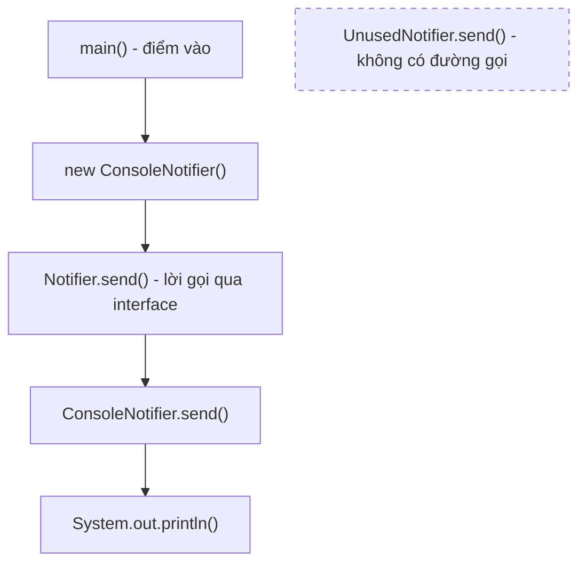
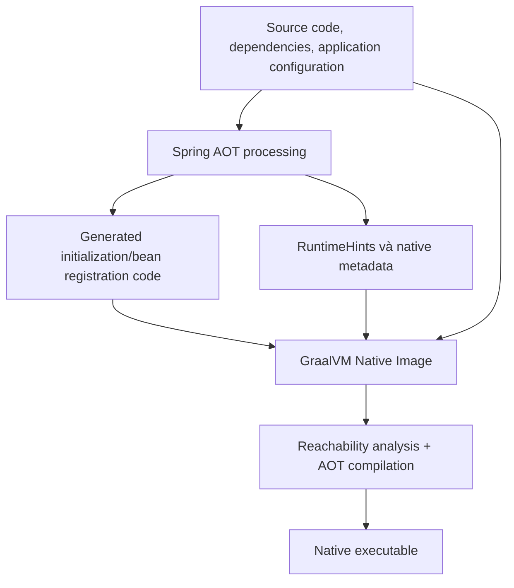

# Phân tích khả năng được gọi từ điểm vào của chương trình

## 1. Vì sao Native Image phải biết đoạn mã nào có thể được gọi?

Khi chạy ứng dụng Java thông thường, JVM có thể nạp lớp, kiểm tra bytecode, biên dịch JIT và tìm thêm mã cần dùng trong suốt thời gian ứng dụng hoạt động. GraalVM Native Image đi theo hướng khác: phân tích ứng dụng tại **thời điểm build**, sau đó biên dịch trước thành tệp thực thi dành cho hệ điều hành và kiến trúc đích (*ahead-of-time compilation*, AOT).

Vì vậy, công cụ build cần trả lời câu hỏi trọng tâm:

> Bắt đầu từ những **điểm vào** đã biết, những lớp, phương thức và nhánh thực thi nào **có khả năng** được sử dụng khi ứng dụng chạy?

Quá trình xác định tập mã có thể được sử dụng này gọi là **reachability analysis** (phân tích khả năng tiếp cận hoặc khả năng được gọi). Đây là một cơ chế nền tảng của GraalVM Native Image. Nó liên quan trực tiếp đến các mục tiêu của Spring Boot Native Image: giảm lượng mã và metadata cần đưa vào tệp thực thi, hỗ trợ khởi động nhanh và thường giảm mức sử dụng bộ nhớ lúc chạy. Kết quả cụ thể vẫn phụ thuộc ứng dụng, thư viện và cấu hình build.

Đặc trưng quan trọng của Native Image là **giả định thế giới đóng** (*closed-world assumption*): tập mã có thể thực thi phải được xác định đủ tại thời điểm tạo image. Một tệp JAR mới hoặc một lớp bất kỳ xuất hiện sau khi build không thể mặc nhiên được nạp và thực thi như trên JVM truyền thống.

Trong module **SPRING_BOOT_NATIVE_IMAGE**, Spring AOT và GraalVM Native Image phối hợp để xử lý vấn đề này. Spring AOT tạo mã khởi tạo và thông tin gợi ý phù hợp với cách Spring sử dụng dependency injection, annotation, reflection, proxy và resource; GraalVM dùng những đầu vào đó cùng bytecode để thực hiện phân tích và biên dịch native.

### Sau bài này, người học có thể

- Giải thích điểm vào, đồ thị lời gọi, phương thức reachable và mã unreachable.
- Dự đoán trường hợp lời gọi trực tiếp được phân tích và trường hợp lời gọi động cần metadata bổ sung.
- Mô tả vai trò của Spring AOT trong quá trình GraalVM Native Image phân tích ứng dụng Spring Boot.
- Đọc tình huống lỗi native do reflection hoặc resource, rồi chọn cách kiểm tra và khắc phục phù hợp.

## 2. Mô hình tư duy: đi từ gốc qua đồ thị lời gọi

Hãy biểu diễn chương trình bằng một **đồ thị lời gọi** (*call graph*): mỗi nút đại diện cho phương thức hoặc thao tác liên quan; một cạnh thể hiện khả năng thao tác ở nút nguồn dẫn đến thực thi nút đích.

1. **Xác định tập gốc (roots):** thông thường có điểm khởi đầu `main()` và các điểm vào hoặc callback khác mà môi trường chạy, thư viện hoặc cấu hình native yêu cầu giữ lại.
2. **Duyệt các lời gọi có thể xảy ra:** từ những phương thức đã reachable, tìm lời gọi trực tiếp, lời gọi ảo qua interface/lớp cha, việc tạo đối tượng, truy cập lớp và những đường gọi khác có thể phân tích được.
3. **Lặp đến khi ổn định:** phương thức mới được đánh dấu reachable có thể làm phát sinh thêm phương thức hoặc kiểu dữ liệu cần phân tích.
4. **Tạo image dựa trên kết quả:** biên dịch mã cần thiết và đưa vào những thành phần runtime/metadata cần dùng. Những phần không thể tiếp cận có thể bị loại bỏ, tùy kết quả phân tích và tối ưu hóa.

Đây là **phân tích khả năng**, không phải bản ghi những hàm thực sự đã chạy trong một lần thử. Nếu có một nhánh điều kiện chỉ được thực hiện vào ngày cuối tháng, trình phân tích vẫn phải xét nhánh đó nếu nó có thể xảy ra. Ngược lại, một phương thức hiện diện trong source code nhưng không có đường nào dẫn đến từ các gốc, và cũng không được yêu cầu giữ lại bằng metadata, có thể không tồn tại trong native executable.

### Ví dụ Java thuần

```java
public class ReachabilityDemo {
    interface Notifier {
        void send(String message);
    }

    static class ConsoleNotifier implements Notifier {
        public void send(String message) {
            System.out.println(message);
        }
    }

    static class UnusedNotifier implements Notifier {
        public void send(String message) {
            System.out.println("unused: " + message);
        }
    }

    public static void main(String[] args) {
        Notifier notifier = new ConsoleNotifier();
        notifier.send("Native Image");
    }
}
```

Trong ví dụ này, `main()` tạo `ConsoleNotifier` và gọi `send()`. Một đồ thị đã lược giản có dạng:



`UnusedNotifier` không được khởi tạo, không được tham chiếu qua cơ chế động khác và không có metadata bắt buộc giữ lại trong chương trình mẫu. Vì vậy, trình phân tích có thể loại mã của nó khỏi image. Đây là ví dụ minh họa logic; tập mã thực tế còn phụ thuộc chi tiết phân tích, các cấu hình đi kèm và những tối ưu hóa sau đó.

### Gọi qua interface có đồng nghĩa với không phân tích được?

**Không.** `notifier.send()` là lời gọi ảo, nhưng Native Image có thể phân tích các kiểu đối tượng có khả năng đi đến vị trí gọi. Trong ví dụ trên, kiểu triển khai được tạo ra là `ConsoleNotifier`. Nếu chương trình có thể tạo nhiều triển khai khác nhau, phân tích phải bảo toàn những đích gọi có thể xảy ra, dù khi chạy thực tế chỉ chọn một triển khai.

Phải phân biệt ba khái niệm:

| Khái niệm | Ý nghĩa | Ví dụ |
|---|---|---|
| **Reachable** | Có đường thực thi tiềm năng xuất phát từ điểm vào hoặc được khai báo để giữ lại | `ConsoleNotifier.send()` |
| **Executed** | Thực sự được chạy trong một lần thực thi cụ thể | Nhánh `if` được chọn theo dữ liệu đầu vào |
| **Included in image** | Mã hoặc metadata tồn tại trong tệp native cuối cùng | Một phương thức reachable có thể được biên dịch, inline hoặc tối ưu hóa thành dạng khác |

Không nên suy ra phương thức đã chạy chỉ vì nó reachable; cũng không nên tìm tên từng phương thức trong binary để kết luận chắc chắn rằng nó đã bị loại bỏ, vì trình biên dịch có thể inline hoặc đổi biểu diễn của nó.

## 3. Điểm vào không chỉ là `main()`

`main()` thường là nơi bắt đầu phân tích ứng dụng, nhưng một hệ thống thực tế còn chứa các thành phần được gọi gián tiếp:

- **Callback của framework:** HTTP handler, listener, scheduled task, hook vòng đời hoặc các đoạn mã được framework gọi khi có sự kiện.
- **Reflection:** tạo instance hoặc gọi phương thức thông qua tên lớp, tên phương thức và metadata tại runtime.
- **Dynamic proxy và cơ chế tạo proxy:** framework tạo đối tượng triển khai interface hoặc lớp trung gian để xử lý transaction, security, interception, v.v.
- **JNI, native callback và các điểm vào đặc biệt:** mã native có thể cần gọi ngược vào Java theo những cách phải được trình build biết trước.
- **Resource và dữ liệu cấu hình:** những tệp được mở bằng đường dẫn hoặc pattern lúc chạy không phải là cạnh gọi phương thức, nhưng cũng phải được đưa vào image nếu ứng dụng cần chúng.

Reachability analysis xử lý những đường gọi mà nó hiểu được từ bytecode và metadata đã cung cấp. Đối với những cơ chế động mà đích gọi chỉ được biết từ dữ liệu lúc chạy, cần có **cấu hình reachability metadata** hoặc một cách thiết kế khác để công cụ build biết những thành phần phải hỗ trợ.

### Lời gọi trực tiếp và lời gọi động

| Dạng gọi | Công cụ build có thể biết gì? | Điều cần lưu ý |
|---|---|---|
| `service.calculate()` | Bytecode và các kiểu đối tượng tiềm năng của `service` | Thường có thể xây dựng cạnh trong call graph |
| `new ReportService()` | Kiểu được tạo trực tiếp | Có đường rõ ràng tới constructor và các thành phần liên quan |
| `Class.forName(name)` | Biết có hoạt động nạp lớp theo tên; có thể không biết giá trị `name` | Tùy việc giá trị và mẫu reflection có xác định tĩnh được hay không |
| `method.invoke(target)` | Biết có reflection, nhưng đích có thể lấy từ cấu hình hoặc dữ liệu runtime | Có thể cần đăng ký phương thức/constructor cần gọi |
| `getResourceAsStream(path)` | Biết thao tác đọc resource, chưa chắc biết đường dẫn runtime | Phải bảo đảm resource cần thiết được đóng gói vào image |
| `Proxy.newProxyInstance(...)` | Biết có tạo JDK proxy, chưa chắc biết bộ interface tại build | Có thể cần khai báo bộ interface của proxy |

**Lưu ý:** không phải mọi lần sử dụng reflection đều cần cấu hình thủ công. GraalVM có thể tự suy ra một số trường hợp khi tên lớp, kiểu hoặc thao tác reflection có thể xác định bằng phân tích tĩnh. Khả năng suy ra phụ thuộc mẫu code, phiên bản GraalVM và cấu hình build. Không nên dựa vào giả định rằng reflection luôn hoạt động hoặc luôn thất bại.

## 4. Spring AOT hỗ trợ GraalVM phân tích ứng dụng Spring Boot như thế nào?

Spring Boot tạo nhiều đối tượng và kết nối chúng bằng cơ chế framework: quét component, injection, cấu hình có điều kiện, mapping HTTP, converter, serialization và proxy. Khi chỉ nhìn vào lời gọi `SpringApplication.run(...)`, công cụ phân tích bytecode không nhất thiết tự hiểu hết những quan hệ vốn được Spring xác định một cách động.

**Spring AOT** giải quyết một phần quan trọng của khoảng cách đó. Trong quá trình build, Spring phân tích cấu hình ứng dụng và bean definitions có thể suy ra trước, sinh mã hỗ trợ khởi tạo ứng dụng và cung cấp `RuntimeHints` về những thành phần cần reflection, resource, serialization hoặc proxy. Sau đó GraalVM Native Image phân tích tập mã và metadata kết hợp này.



Nhờ mã và hints được sinh sẵn, GraalVM có thêm thông tin để nhận diện các đường thực thi và thành phần cần giữ lại. Điều này **không có nghĩa** Spring AOT sẽ biết trước mọi giá trị cấu hình từ môi trường production, mọi tên class lấy từ database hoặc mọi plugin chỉ được chọn khi chạy. Phần ứng dụng sử dụng cơ chế động ngoài phạm vi Spring suy ra được vẫn có thể cần đăng ký hints thủ công.

### Một request HTTP được đưa vào phân tích ra sao?

Ví dụ đơn giản:

```java
@Service
class GreetingService {
    String message(String name) {
        return "Xin chào, " + name;
    }
}

@RestController
class GreetingController {
    private final GreetingService greetingService;

    GreetingController(GreetingService greetingService) {
        this.greetingService = greetingService;
    }

    @GetMapping("/greet")
    String greet(@RequestParam String name) {
        return greetingService.message(name);
    }
}
```

Khi chạy ứng dụng, `main()` không trực tiếp gọi `GreetingController.greet()`. HTTP request đến `/greet` được hệ thống Web MVC định tuyến đến handler. Các thành phần Spring MVC cần thiết và cách Spring khởi tạo, nhận diện hoặc gọi handler phải khả dụng trong image. Spring AOT và các hints do framework cung cấp giúp hỗ trợ những liên kết này.

Có thể hình dung chuỗi xử lý ở mức khái niệm:

```text
Ứng dụng khởi động
    -> Spring ApplicationContext và hạ tầng web
    -> đăng ký / xác định handler cho GET /greet
    -> nhận HTTP request tại runtime
    -> cơ chế gọi handler của Spring MVC
    -> GreetingController.greet(name)
    -> GreetingService.message(name)
```

Đường trên mô tả **luồng hoạt động** để hiểu bài; nó không khẳng định mọi mũi tên đều là một lệnh gọi Java trực tiếp trong call graph. Với cơ chế gọi handler dựa trên reflection hoặc metadata framework, khả năng gọi được phương thức còn phụ thuộc dữ liệu mà Spring AOT/hints đưa vào Native Image.

## 5. Khi phân tích tĩnh không nhìn thấy đích gọi: reflection

Xét một ứng dụng chọn plugin từ giá trị cấu hình khi chạy:

```java
interface Plugin {
    String execute();
}

// Tên lớp lấy từ cấu hình của môi trường triển khai, ví dụ:
// app.plugin.class=com.example.plugins.DefaultPlugin
String className = environment.getRequiredProperty("app.plugin.class");
Class<?> pluginType = Class.forName(className);
Plugin plugin = (Plugin) pluginType.getDeclaredConstructor().newInstance();
String result = plugin.execute();
```

Từ bytecode, GraalVM thấy chuỗi thao tác `Class.forName(...)`, `getDeclaredConstructor()` và `newInstance()`, nhưng có thể **không biết lớp cụ thể** vì tên lớp chỉ xuất hiện trong cấu hình của môi trường chạy. Một bản JVM thông thường có thể tìm lớp trên classpath; native image không mặc nhiên có khả năng nạp thêm bytecode tùy ý từ classpath ở thời điểm runtime.

Giả sử `DefaultPlugin` đã được đóng gói trong ứng dụng tại thời điểm build. Ta có thể cung cấp **Spring RuntimeHints** để GraalVM biết constructor cần được hỗ trợ qua reflection:

```java
import org.springframework.aot.hint.MemberCategory;
import org.springframework.aot.hint.RuntimeHints;
import org.springframework.aot.hint.RuntimeHintsRegistrar;
import org.springframework.context.annotation.Configuration;
import org.springframework.context.annotation.ImportRuntimeHints;

class PluginRuntimeHints implements RuntimeHintsRegistrar {
    @Override
    public void registerHints(RuntimeHints hints, ClassLoader classLoader) {
        hints.reflection().registerType(
            DefaultPlugin.class,
            MemberCategory.INVOKE_DECLARED_CONSTRUCTORS
        );
    }
}

@Configuration(proxyBeanMethods = false)
@ImportRuntimeHints(PluginRuntimeHints.class)
class PluginNativeConfiguration {
}
```

Trong ví dụ, `DefaultPlugin` là lớp do ứng dụng định nghĩa, implement `Plugin`, có constructor phù hợp và phải có trong dependencies khi build. Đăng ký `INVOKE_DECLARED_CONSTRUCTORS` cho phép Spring/GraalVM cung cấp khả năng gọi constructor qua reflection. Nếu ứng dụng còn gọi phương thức bằng `Method.invoke`, cần đăng ký đúng các phương thức đó, ví dụ qua API `registerMethod(...)` hoặc loại `MemberCategory` thích hợp.

**Hai giới hạn cần hiểu rõ:**

1. Hint chỉ mô tả những thành phần **đã có khi build**; nó không biến native executable thành JVM có thể nạp plugin JAR tùy ý sau khi phát hành.
2. Hint phải khớp **đúng thao tác runtime**. Đăng ký constructor không tự động cấp quyền reflection cho mọi field và mọi method của lớp. Những thành phần không cần reflection cũng không nên đăng ký tràn lan.

Một cách thiết kế khác là đăng ký các plugin như Spring beans rồi lựa chọn qua interface hoặc `Map<String, Plugin>`. Khi đó Spring AOT có nhiều thông tin hơn để tạo cấu hình khởi tạo, đồng thời tránh một phần việc tự nạp lớp theo chuỗi tên. Cách này phù hợp nếu tập plugin được biết tại build time.

## 6. Reachability metadata dành cho những gì?

Trong ứng dụng Spring Boot native, cần phân biệt **mã được gọi** với **khả năng truy cập metadata hoặc dữ liệu runtime**. Cùng một đoạn mã có thể chạy nhưng vẫn lỗi khi đến thao tác phản chiếu, nạp resource hoặc tạo proxy.

| Loại | Nhu cầu ở runtime | Cách xử lý phổ biến với Spring AOT |
|---|---|---|
| **Reflection** | Xác định constructor, method, field; tạo đối tượng hoặc gọi qua reflection | `hints.reflection()`; framework hoặc dependency có thể đã đăng ký |
| **Resource** | Đọc template, chứng chỉ, file cấu hình, dữ liệu trong classpath | `hints.resources()` để đăng ký file/pattern cần đóng gói |
| **JDK dynamic proxy** | Tạo proxy cho một tập interface xác định | `hints.proxies()` cho bộ interface cần dùng |
| **Serialization** | Serialize/deserialize các kiểu cần xử lý theo cơ chế hỗ trợ serialization | `hints.serialization()` hoặc metadata thích hợp |
| **JNI** | Trao đổi dữ liệu/gọi phương thức Java từ mã native | Metadata JNI khi ứng dụng hoặc thư viện thực sự sử dụng |

Ví dụ, ứng dụng đọc tài nguyên theo tên trong cấu hình:

```java
String templatePath = environment.getRequiredProperty("app.report-template");
try (InputStream input = getClass().getClassLoader()
        .getResourceAsStream(templatePath)) {
    if (input == null) {
        throw new IllegalStateException("Không tìm thấy template: " + templatePath);
    }
    // Đọc nội dung template.
}
```

Nếu file `templates/report.txt` không được đưa vào native image, đoạn code vẫn có thể reachable nhưng `getResourceAsStream(...)` trả về `null`. Có thể thêm vào registrar nói trên:

```java
hints.resources().registerPattern("templates/report.txt");
```

Việc đăng ký resource **không đồng nghĩa** với đăng ký reflection cho một lớp; tương tự, đăng ký reflection không tự đóng gói tất cả file trong classpath. Mỗi cơ chế có điều kiện riêng. Spring Framework, Spring Boot và nhiều thư viện tương thích native đã cung cấp hints sẵn; chỉ thêm cấu hình khi có nhu cầu thực sự.

## 7. Phân biệt reachability, khởi tạo lớp và tối ưu hóa

Ba giai đoạn/khái niệm dễ bị nhầm lẫn:

**Reachability analysis** trả lời *cái gì có thể cần ở runtime?* Ví dụ, `OrderService.placeOrder()` có thể được gọi từ handler nên phải được xem xét trong tập mã reachable.

**Class initialization** trả lời *static initializer của lớp chạy khi nào?* Native Image có thể xử lý việc khởi tạo một số lớp tại build time và những lớp khác tại runtime theo quy tắc/cấu hình liên quan. Một lớp reachable **không mặc nhiên** được khởi tạo tại build time. Khởi tạo sớm những trạng thái phụ thuộc môi trường runtime (tệp, socket, mật khẩu, thời gian, native handles...) có thể dẫn đến hành vi sai hoặc lỗi build.

**Compiler optimization** trả lời *mã reachable cuối cùng được biểu diễn thế nào?* Trình biên dịch có thể inline phương thức, chuyên biệt hóa lời gọi hoặc loại nhánh được chứng minh không thể chạy. Vì vậy, đồ thị nguồn và mã máy trong binary không cần tương ứng một-một.

Một tình huống thực tế: `PriceCalculator.calculate()` reachable từ API nhưng bị inline vào handler. Không tìm thấy một symbol riêng tên `calculate` trong executable **không đủ** để kết luận nó bị loại bỏ. Cần dùng log/diagnostics của quá trình build và kiểm thử hành vi runtime để đánh giá.

## 8. Thực hành quan sát và kiểm chứng trên ứng dụng Spring Boot

Để thử nghiệm, tạo một Spring Boot project có hỗ trợ Spring AOT/GraalVM Native Build Tools, một endpoint như `/greet` và ít nhất một đường gọi động cần kiểm tra. Máy build phải có toolchain native image phù hợp với hệ điều hành và kiến trúc đích.

### Bước 1: chạy trên JVM để lấy mốc đối chiếu

Khởi động ứng dụng JVM và gọi endpoint bằng nhiều trường hợp dữ liệu. Nếu có plugin, reflection, resource, JSON binding hay proxy, hãy kích hoạt thật sự những nhánh đó. Một ứng dụng chạy ổn trên JVM chỉ xác nhận logic/thiết lập JVM hoạt động, **chưa chứng minh** bản native sẽ đủ metadata.

### Bước 2: build native

Ví dụ lệnh thông dụng khi project đã cấu hình plugin/profile tương ứng:

```bash
# Maven (profile native được cấu hình trong pom.xml)
./mvnw -Pnative native:compile

# Hoặc Gradle (đã áp dụng GraalVM Native Build Tools)
./gradlew nativeCompile
```

Nếu dự án đóng gói container bằng buildpacks, cấu hình native build phù hợp cần được truyền vào quá trình xây image; một image chạy JVM thông thường không tự trở thành native executable. Các lệnh build và chỗ đặt file output phụ thuộc cấu hình Maven/Gradle, phiên bản plugin và hệ điều hành.

Trong log build, tìm những bước phân tích, biên dịch và thông báo liên quan đến unsupported feature, class initialization hoặc metadata. `--verbose` và `--diagnostics-mode` của Native Image có thể cung cấp thêm chi tiết khi cần điều tra, nhưng mức hỗ trợ và cách chuyển flag qua Maven/Gradle phụ thuộc phiên bản công cụ đang dùng.

### Bước 3: thực thi binary và gọi các nhánh đặc trưng

Chạy chương trình native được build và kiểm thử lại **cùng bộ tình huống** như bản JVM: request thông thường, đường xử lý lỗi, cấu hình ngoài, serialize/deserialize, transaction/proxy, resource và plugin. Ưu tiên kiểm thử các nhánh mà framework hoặc ứng dụng gọi gián tiếp.

Ví dụ phân loại kết quả:

| Hiện tượng | Khả năng cần điều tra | Hướng kiểm chứng |
|---|---|---|
| Build native báo không hỗ trợ một thao tác động | Tính năng hoặc thư viện không tương thích trong cấu hình hiện tại | Đọc stack trace, xác định đoạn code/thư viện gây ra; kiểm tra hỗ trợ native và thiết kế thay thế |
| JVM gọi được constructor bằng reflection, native lỗi | Constructor hoặc lớp cần truy cập chưa có metadata phù hợp | Kiểm tra `RuntimeHints`, kiểu và constructor thực tế được gọi |
| Endpoint hoạt động nhưng không đọc được file trong classpath | Resource chưa được đóng gói hoặc đường dẫn sai | Kiểm tra tên/đường dẫn resource và cấu hình `hints.resources()` |
| Chỉ một nhánh HTTP hoặc plugin thất bại | Nhánh đó chưa được kích hoạt khi tạo metadata/thử nghiệm, hoặc có cơ chế động riêng | Tái hiện bằng input cụ thể; rà soát reflection, proxy, serialization và runtime config |
| Build thành công nhưng startup không như kỳ vọng | Đặc điểm ứng dụng, khởi tạo lớp, I/O, cấu hình runtime | Đo riêng startup, RSS/bộ nhớ và tải thực tế; so sánh JVM với native trong điều kiện tương đương |

### Bước 4: dùng tracing agent khi cần tìm thao tác động

GraalVM cung cấp **Native Image tracing agent** để ghi nhận một số thao tác động khi ứng dụng chạy trên JVM. Ví dụ về dạng lệnh:

```bash
java -agentlib:native-image-agent=config-output-dir=./native-config -jar app.jar
```

Sau khi chạy JVM với agent, hãy kích hoạt những request và luồng nghiệp vụ quan trọng để thu thập metadata. Kết quả có thể hỗ trợ chẩn đoán hoặc bổ sung cấu hình native cho thư viện/app. Tuy nhiên, agent chỉ quan sát **những đường đã chạy**; nó không thể tự đoán nhánh chưa được thử. Trong ứng dụng Spring Boot, ưu tiên cơ chế Spring AOT/`RuntimeHints` và xem xét metadata do agent sinh trước khi tích hợp để tránh giữ dư thừa hoặc tạo cấu hình khó bảo trì.

## 9. Một quy trình suy luận khi gặp lỗi reachability

Khi bản JVM chạy tốt nhưng native thất bại, hãy đi từ **thao tác thực tế** thay vì lập tức thêm metadata cho mọi lớp:

1. Xác định thao tác thất bại: tạo đối tượng, gọi method, deserialize JSON, tạo proxy, đọc file hay nạp thư viện native.
2. Xác định giá trị chỉ biết tại runtime: tên class, tên method, danh sách interface, đường dẫn resource hoặc lựa chọn theo cấu hình.
3. Kiểm tra xem Spring AOT hoặc dependency đã khai báo hints cho thành phần đó chưa; kiểm tra cấu hình build có thực sự kích hoạt AOT hay không.
4. Đăng ký **đúng loại metadata và đúng phạm vi** còn thiếu, hoặc sửa thiết kế để đích gọi trở nên rõ ràng tại build time.
5. Build lại native image và chạy test trực tiếp trên binary, bao gồm nhánh lỗi từng xảy ra.

Lưu ý giới hạn quan trọng: reachability analysis có mục tiêu xác định **những gì có thể xảy ra**, chứ không phải đo tần suất sử dụng. Một endpoint được gọi rất ít vẫn có thể cần mã và metadata đầy đủ. Ngược lại, việc benchmark cho thấy chỉ một vài endpoint được gọi nhiều không phải cơ sở để xóa các nhánh hợp lệ khỏi image.

## 10. Bài tập tự kiểm tra

**Tình huống A.** Ứng dụng có `@RestController` nhận request `GET /orders/{id}` và gọi `OrderService.findById(id)`. Trong source không thấy `main()` gọi trực tiếp method của controller. Điều đó có đồng nghĩa method sẽ bị loại khỏi Native Image?

**Gợi ý:** Không. Hạ tầng web của Spring và thông tin do AOT/hints cung cấp có thể làm handler khả dụng trong native image. Cần phân biệt lệnh gọi Java trực tiếp với callback/handler được framework gọi gián tiếp.

**Tình huống B.** Ứng dụng đọc tên `com.example.plugins.FastPlugin` từ một biến môi trường rồi gọi constructor qua reflection. Bản JVM chạy, bản native lỗi. Thêm `FastPlugin.class` vào một danh sách Java thông thường nhưng không sử dụng danh sách đó có bảo đảm giải quyết vấn đề không?

**Gợi ý:** Không bảo đảm. Cần chỉ rõ constructor/method được phản chiếu và metadata tương ứng, hoặc chuyển sang cấu hình plugin được Spring quản lý. Đừng quên class phải sẵn có khi build image.

**Tình huống C.** Một phương thức được inline hoàn toàn trong binary; tên phương thức không còn xuất hiện như symbol riêng. Nó có phải unreachable không?

**Gợi ý:** Không. Reachability và cách trình biên dịch tối ưu hóa mã máy là hai khái niệm khác nhau.

## Kết luận

Reachability analysis là bước GraalVM Native Image xác định tập mã **có khả năng được thực thi**, bắt đầu từ những điểm vào đã biết và mở rộng theo các đường gọi có thể xảy ra. Spring AOT làm rõ nhiều quan hệ do Spring tạo ra bằng cách sinh mã khởi tạo và `RuntimeHints`, giúp Native Image hỗ trợ các handler, bean và thao tác động cần thiết. Khi ứng dụng sử dụng tên lớp, phương thức hoặc resource chỉ xuất hiện tại runtime, lập trình viên phải xác minh khả năng suy luận tĩnh và bổ sung metadata phù hợp nếu cần. Hiểu sự khác nhau giữa *reachable*, *đã thực thi*, *metadata khả dụng* và *mã máy cuối cùng* là chìa khóa để giải thích lỗi tương thích và đánh giá đúng một bản Spring Boot native.
