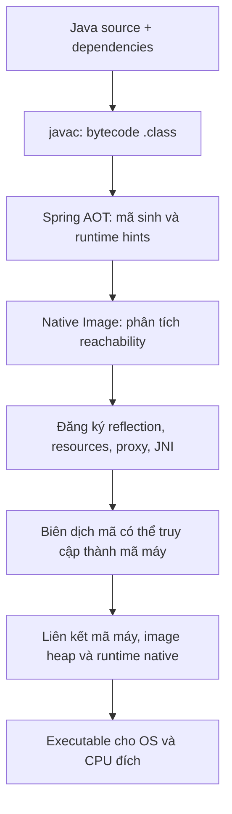

# Biên dịch mã Java và các thành phần runtime vào tệp thực thi

## 1. Native Image thực sự đóng gói những gì?

Trong ứng dụng Spring Boot chạy theo cách truyền thống, Maven hoặc Gradle đóng gói mã Java đã biên dịch thành bytecode (`.class` trong JAR). Khi khởi động, **JVM** nạp lớp, xác minh bytecode, thực thi hoặc biên dịch JIT những đoạn mã được sử dụng, đồng thời cung cấp bộ thu gom rác, quản lý luồng và nhiều dịch vụ runtime khác.

Với **GraalVM Native Image**, công cụ `native-image` phân tích ứng dụng và những thư viện mà nó sử dụng tại **thời điểm build**. Công cụ biên dịch trước (AOT) phần mã có thể truy cập thành mã máy, kết hợp dữ liệu khởi tạo và các thành phần runtime cần thiết để tạo ra **tệp thực thi native cho một hệ điều hành và kiến trúc CPU cụ thể**. Khi chạy, chương trình không cần khởi động một JVM HotSpot riêng để thông dịch bytecode hoặc thực hiện JIT.

Điều này **không có nghĩa** mọi dòng mã của JDK hoặc mọi dependency đều được đưa vào binary. Native Image chọn phần mã có thể truy cập theo kết quả phân tích, cấu hình metadata và quy tắc của công cụ; một số thư viện native của hệ điều hành vẫn có thể được liên kết động.

| Thành phần | Spring Boot chạy trên JVM | Spring Boot Native Image |
|---|---|---|
| Mã ứng dụng | Bytecode trong JAR; có thể được JIT tại runtime | Mã máy đã biên dịch AOT trong executable |
| Thư viện Java, Spring và JDK | Các lớp được nạp khi cần | Phần mã và dữ liệu được xác định là có thể truy cập được đưa vào image |
| Runtime Java | JVM/HotSpot bên ngoài ứng dụng | Runtime gọn của Native Image, thường dựa trên Substrate VM, được liên kết vào executable |
| Reflection, proxy động, resource | JVM có thể nạp/khám phá động nhiều trường hợp | Phải được phân tích hoặc khai báo metadata phù hợp tại build time |
| Kết quả phát hành | JAR cộng môi trường Java phù hợp | Executable native (và những thư viện hệ thống cần thiết) cho nền tảng đích |

## 2. Từ mã nguồn đến executable: các bước chính



### Bước 1 — Biên dịch Java và chuẩn bị Spring AOT

`javac` vẫn tạo bytecode Java trước. Plugin Spring Boot gọi **Spring AOT** để xử lý cấu hình ứng dụng sớm: từ những bean definition và điều kiện cấu hình có thể xác định trong lúc build, Spring sinh mã khởi tạo và cung cấp **runtime hints** cho reflection, resource, proxy hoặc serialization. Những bước này giảm nhu cầu khám phá cấu trúc ứng dụng hoàn toàn động khi chương trình chạy.

Spring AOT và GraalVM Native Image có vai trò khác nhau: **Spring AOT chuẩn bị ứng dụng Spring**, còn **Native Image phân tích toàn bộ đường đi thực thi và biên dịch thành executable**. Không phải mọi hành vi động đều có thể suy ra trong lúc build; ứng dụng vẫn phải cấu hình đầy đủ cho những trường hợp còn lại.

### Bước 2 — Phân tích khả năng truy cập (reachability analysis)

Native Image bắt đầu từ các **điểm vào** của chương trình và những đối tượng, lớp, phương thức được đăng ký thêm. Nó xác định các nhánh mã có thể được gọi, loại có thể được khởi tạo và dữ liệu cần giữ lại, sử dụng phân tích tĩnh theo giả định **closed world**: tại thời điểm tạo image, tập mã và các thành phần động cần sử dụng phải được xác định đủ để biên dịch.

Ví dụ, ứng dụng chỉ gọi `OrderService.calculateTotal()` theo luồng thông thường thì Native Image có thể giữ lại mã của phương thức đó và các lời gọi liên quan. Một `LegacyReportExporter` không thể truy cập từ điểm vào hoặc metadata có thể bị loại khỏi image. Nếu ứng dụng cố tải `LegacyReportExporter` chỉ từ chuỗi cấu hình lúc runtime, việc chạy có thể thất bại vì trình phân tích chưa biết phải đưa lớp đó vào executable.

Phân tích reachability **không chứng minh** mọi đường đi runtime sẽ được kiểm thử. Nó chỉ xác định phạm vi mà công cụ cần biên dịch theo mã và metadata đã biết.

### Bước 3 — Tạo mã máy và liên kết runtime

Graal compiler chuyển các phương thức được chọn thành mã máy cho target CPU. Native Image kết hợp:

- **Mã ứng dụng**: controller, service, repository, lớp cấu hình và những phương thức ứng dụng có thể truy cập.
- **Mã thư viện**: phần cần thiết của Spring Framework, Spring Boot, dependency và thư viện chuẩn Java.
- **Runtime của Native Image**: cấp phát bộ nhớ, garbage collection, quản lý luồng, đồng bộ hóa, xử lý ngoại lệ và những dịch vụ Java được hỗ trợ.
- **Image heap và metadata**: các đối tượng được phép khởi tạo ngay khi build, thông tin kiểu và dữ liệu cần dùng để thực thi.
- **Liên kết nền tảng**: mã native và thư viện hệ thống theo yêu cầu của target.

Kết quả là một executable có thể tự khởi động trên nền tảng tương thích mà không chạy một tiến trình `java -jar` hoặc cần JIT compiler của JVM tại runtime. Tuy nhiên, executable **không hoàn toàn độc lập với hệ điều hành**: chẳng hạn một binary Linux x86-64 không mặc nhiên chạy trên Windows hay Linux ARM64; chế độ liên kết động cũng có thể yêu cầu libc và thư viện tương thích.

## 3. Runtime nào còn tồn tại khi không dùng JVM HotSpot?

Một hiểu nhầm thường gặp là biên dịch native loại bỏ hoàn toàn runtime Java. Thực tế, executable vẫn phải thực hiện các cam kết cốt lõi của ngôn ngữ: quản lý vòng đời đối tượng, thu gom rác, luồng, khóa, xử lý ngoại lệ và các API Java được hỗ trợ.

GraalVM Native Image dùng runtime gọn (thường gọi là **Substrate VM**) để hỗ trợ những tác vụ đó. Do executable đã chứa mã máy được biên dịch trước, nó không dùng cơ chế warm-up/JIT của HotSpot. Đổi lại, khả năng tối ưu động theo hồ sơ tải thực tế có thể khác JVM; hiệu năng xử lý lâu dài **không mặc định nhanh hơn** chỉ vì ứng dụng khởi động nhanh hơn.

Ví dụ khi yêu cầu HTTP tới một Spring `@RestController`, mã xử lý request, chuyển đổi JSON và phần xử lý nghiệp vụ đã được AOT sẽ chạy dưới dạng native machine code. Bộ nhớ cấp phát cho đối tượng request vẫn được runtime native quản lý và giải phóng qua GC.

## 4. Build-time initialization và run-time initialization

Native Image có thể chạy **một số bộ khởi tạo lớp** trong lúc build và lưu trạng thái đối tượng phù hợp vào **image heap**. Điều này giảm việc khởi tạo lại khi executable bắt đầu chạy. Những lớp cần đọc trạng thái của môi trường hiện tại, mở kết nối mạng, tạo khóa ngẫu nhiên, lấy thời gian hoặc giữ native handle không phù hợp để khởi tạo tùy tiện tại build time.

```java
final class PriceRules {
    static final java.math.BigDecimal TAX_RATE =
            new java.math.BigDecimal("0.10");
}
```

Giá trị bất biến như `TAX_RATE` là ví dụ dễ hình dung về dữ liệu có thể chuẩn bị sớm. Ngược lại:

```java
final class RuntimeEnvironment {
    static final String ACTIVE_REGION =
            System.getenv("ACTIVE_REGION");
}
```

Nếu một lớp tương tự `RuntimeEnvironment` bị khởi tạo tại build time, giá trị môi trường của **máy build** có nguy cơ bị đóng băng vào executable. Cần bảo đảm trạng thái phụ thuộc môi trường được đọc vào đúng thời điểm runtime. Native Image có các tùy chọn như `--initialize-at-run-time=<tên-lớp>` và `--initialize-at-build-time=<tên-lớp>`; chỉ áp dụng sau khi hiểu side effect của lớp và các lớp liên quan. Trong Spring Boot, nên ưu tiên cơ chế cấu hình và AOT được hỗ trợ thay vì tự ép khởi tạo hàng loạt lớp.

**Phân biệt:** mã máy của một phương thức được biên dịch tại build time không đồng nghĩa *static initializer* của lớp đó cũng phải chạy tại build time. Đây là hai quyết định riêng.

## 5. Vì sao reflection và resource cần metadata?

Ứng dụng Java thông thường có thể khám phá lớp theo tên string, gọi constructor bằng reflection, tạo proxy hoặc tải resource theo đường dẫn ở runtime. Phân tích tĩnh không luôn nhìn thấy đích thật sự, nhất là khi tên lớp hoặc đường dẫn được lấy từ file cấu hình, dữ liệu nhập hay plugin ngoài.

Ví dụ:

```java
String handlerName = System.getenv("ORDER_HANDLER_CLASS");
Class<?> handlerClass = Class.forName(handlerName);
Object handler = handlerClass.getDeclaredConstructor().newInstance();
```

Nếu giá trị `ORDER_HANDLER_CLASS` chỉ được biết khi chạy, Native Image không thể chắc chắn lớp và constructor nào cần giữ lại. Có thể khai báo **reachability metadata** thích hợp (ví dụ đăng ký reflection) hoặc thiết kế lại thành lựa chọn bean/strategy được Spring AOT nhận biết. Tương tự, những template, chứng chỉ, file cấu hình hay resource được đọc bằng `getResourceAsStream` phải được đưa vào image qua cấu hình resource phù hợp.

Trong ứng dụng Spring Boot, có thể khai báo runtime hints rõ ràng:

```java
import org.springframework.aot.hint.RuntimeHints;
import org.springframework.aot.hint.RuntimeHintsRegistrar;
import org.springframework.aot.hint.MemberCategory;

class OrderHandlerHints implements RuntimeHintsRegistrar {
    @Override
    public void registerHints(RuntimeHints hints, ClassLoader classLoader) {
        hints.reflection().registerType(
                LegacyOrderHandler.class,
                MemberCategory.INVOKE_DECLARED_CONSTRUCTORS
        );
        hints.resources().registerPattern("templates/orders/*.html");
    }
}
```

Đăng ký registrar với `@ImportRuntimeHints(OrderHandlerHints.class)` trên cấu hình Spring phù hợp. `LegacyOrderHandler` ở đây là lớp ứng dụng giả định; ví dụ minh họa ý tưởng đăng ký constructor và resource, không thay thế việc kiểm tra dependency thực tế. Đối với một số thư viện, metadata sẵn có trong hệ sinh thái GraalVM hoặc hints do Spring cung cấp đã xử lý phần lớn trường hợp.

Các công nghệ cần rà soát khi chuyển sang native gồm reflection, dynamic proxy, serialization, JNI, resource loading, classpath scanning và tải mã động. Khả năng tương thích phụ thuộc phiên bản Spring Boot, GraalVM, dependency và cách ứng dụng sử dụng chúng.

## 6. Thực hành build và kiểm tra executable

Ví dụ dưới đây giả định dự án Spring Boot hỗ trợ AOT và có plugin Spring Boot tương ứng. Cần cài **GraalVM JDK có Native Image**, công cụ biên dịch native và thư viện build cần thiết cho hệ điều hành. Tên task có thể khác theo cấu hình và phiên bản plugin.

**Maven** (Spring Boot Maven Plugin):

```bash
./mvnw -Pnative native:compile
```

**Gradle** (GraalVM Native Build Tools được cấu hình):

```bash
./gradlew nativeCompile
```

Thông thường có thể tìm executable dưới `target/` (Maven) hoặc `build/native/nativeCompile/` (Gradle); đường dẫn/tên file cuối cùng phụ thuộc dự án. Chạy executable trên đúng nền tảng build và thử các endpoint cùng đường đi nghiệp vụ quan trọng.

```bash
# Minh họa với Linux/macOS, thay app bằng tên executable thực tế
./target/app

# Đối chiếu với bản JVM của cùng ứng dụng
java -jar target/app.jar
```

Khi đo hai chế độ, dùng cùng profile cấu hình, dữ liệu đầu vào, mức tải và giới hạn tài nguyên; đo riêng **thời gian khởi động**, **thời gian sẵn sàng phục vụ request**, **RSS/bộ nhớ thực tế**, throughput và độ trễ sau warm-up. Những chỉ số đó trả lời các câu hỏi khác nhau: Native Image thường có lợi thế ở startup và mức dùng bộ nhớ trong nhiều ứng dụng, nhưng kết quả thực tế phải được đo trên dịch vụ cụ thể.

Đối với container, có thể dùng quy trình build image hỗ trợ native của Spring Boot hoặc copy executable đã biên dịch vào base image tương thích với libc/architecture. Kiểm tra cả thư viện liên kết động, quyền thực thi, CA certificates, DNS, timezone và các file resource cần tại runtime; không giả định binary chạy trên mọi base image tối giản.

## 7. Tình huống lỗi và cách suy luận từ cơ chế biên dịch

| Hiện tượng | Nguyên nhân có thể | Hướng kiểm tra |
|---|---|---|
| Build Native Image báo lỗi liên quan class initialization | Một lớp chạy static initializer quá sớm, tạo trạng thái không phù hợp với image heap | Xem stack trace, xác định lớp gây side effect, chuyển khởi tạo sang runtime khi cần |
| JVM chạy được nhưng native lỗi `ClassNotFoundException` hoặc reflection | Đích gọi động không được reachability analysis/metadata nhận diện | Kiểm tra runtime hints, metadata của thư viện và đường dẫn gọi động |
| Không thấy template hoặc resource | Tài nguyên không được đưa vào image | Kiểm tra resource patterns và tên đường dẫn được ứng dụng sử dụng |
| Native build thành công nhưng môi trường triển khai lỗi tải thư viện | Khác kiến trúc hoặc thiếu thư viện native liên kết động | Kiểm tra kiến trúc target, libc và dependency của executable |
| Giá trị cấu hình khác mong đợi giữa build và runtime | Trạng thái môi trường có thể đã bị khởi tạo và lưu lúc build | Rà soát static initializer và thời điểm đọc biến môi trường |

Lỗi thường lộ ra ở **một đường đi nghiệp vụ cụ thể**: ứng dụng có thể startup thành công nhưng thất bại khi xử lý loại request ít gặp. Vì vậy phải kiểm thử thực sự những luồng dùng JSON binding, persistence, validation, templates, security, messaging, scheduling và tích hợp bên ngoài.

## 8. Tổng kết cơ chế

Native Image chuyển một ứng dụng Java từ mô hình **bytecode + JVM/JIT khi chạy** sang **mã máy AOT + runtime native đã được liên kết**. Spring AOT hỗ trợ biến nhiều cấu hình động của Spring Boot thành thông tin và mã sinh có thể phân tích trước. Reachability analysis quyết định mã nào cần tồn tại trong executable; reflection, resource và các hành vi động cần metadata chính xác. Image heap và class initialization giúp tối ưu startup nhưng cũng tạo yêu cầu nghiêm ngặt về ranh giới giữa build time và runtime.

Hiểu những thành phần này giúp giải thích cả ưu thế startup/bộ nhớ lẫn nguyên nhân lỗi tương thích khi build, kiểm thử, đóng gói container và vận hành bản Spring Boot native.
