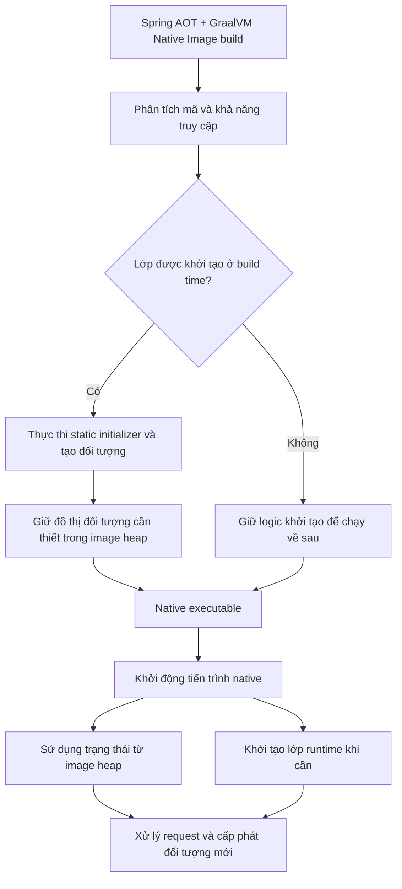

# Image heap và trạng thái đối tượng được tạo trong giai đoạn build

Trong chương **Cơ chế Native Image**, một điểm quan trọng khi biên dịch ứng dụng **Spring Boot** bằng **Spring AOT** và **GraalVM Native Image** là: một số đối tượng Java có thể được tạo ngay lúc biên dịch và trạng thái của chúng được đưa vào tệp native executable. Cơ chế này gọi là **image heap**. Hiểu nó giúp giải thích vì sao native executable khởi động nhanh, vì sao đôi khi dữ liệu có vẻ bị “đóng băng” ở thời điểm build, và vì sao một số thư viện gặp lỗi khi biên dịch native.

Bài học tập trung vào vòng đời của đối tượng, thời điểm khởi tạo lớp, tính đúng đắn của trạng thái và cách kiểm tra trong ứng dụng thực tế. Đây là một mảnh ghép của chủ đề `SPRING_BOOT_NATIVE_IMAGE`: dùng Spring AOT và GraalVM để tạo ứng dụng native, đánh giá thời gian khởi động và bộ nhớ, xử lý vấn đề tương thích, đồng thời đóng gói và vận hành bản native.

## 1. Kết quả cần đạt

Sau bài này, bạn có thể:

- Giải thích **image heap** là gì và phân biệt nó với heap cấp phát khi ứng dụng đang chạy.
- Mô tả quan hệ giữa **class initialization**, các đối tượng còn có thể truy cập và dữ liệu được lưu trong native executable.
- Phân tích trạng thái nào có thể lưu an toàn từ build time và trạng thái nào phải tạo lại ở runtime.
- Thử nghiệm với Spring Boot để quan sát giá trị được tạo ở build time, các thay đổi runtime và hành vi khi khởi động lại tiến trình.
- Khoanh vùng lỗi liên quan đến khởi tạo lớp và image heap, rồi chọn cách khắc phục phù hợp.

## 2. Image heap là gì?

Ở ứng dụng Java chạy trên JVM thông thường, các đối tượng thường được tạo khi tiến trình đang hoạt động, thông qua `new`, factory method, deserialization, dependency injection, v.v. Native Image cho phép **thực hiện trước một phần công việc tại thời điểm build**. Nếu một lớp được khởi tạo trong giai đoạn build, các đối tượng mà trạng thái tĩnh của lớp đó còn tham chiếu đến có thể được ghi vào **image heap** để native executable sử dụng khi chạy.

Có thể hình dung image heap là **ảnh chụp một phần đồ thị đối tượng Java** đã được chuẩn bị sẵn trong quá trình tạo native executable. Khi khởi chạy, chương trình dùng trạng thái được nhúng này mà không nhất thiết phải chạy lại đoạn mã đã tạo ra nó.

Ba khái niệm cần phân biệt:

| Khái niệm | Ý nghĩa | Thời điểm liên quan |
|---|---|---|
| **Build-time heap** | Bộ nhớ đối tượng của quá trình xây dựng native image; nhiều đối tượng chỉ tạm tồn tại để hỗ trợ phân tích và biên dịch. | Khi chạy công cụ `native-image` |
| **Image heap** | Phần trạng thái đối tượng được giữ lại và đóng gói vào native executable, sau khi phân tích đối tượng nào cần có mặt lúc chạy. | Hình thành lúc build, được sử dụng ở runtime |
| **Runtime heap** | Các đối tượng mới được cấp phát trong tiến trình native khi ứng dụng hoạt động. | Khi chạy native executable |

**Không phải mọi đối tượng được tạo trong build-time heap đều có trong image heap.** Đối tượng tạm thời, không còn tham chiếu cần thiết cho runtime, có thể không được giữ lại. Ngược lại, một đối tượng còn có thể truy cập từ trường `static` của lớp đã khởi tạo ở build time là ứng viên điển hình để được đưa vào image heap; kết quả chính xác còn phụ thuộc vào phân tích và tối ưu hóa của Native Image.

### Minh họa dòng đời



Đồ thị trên là mô hình khái niệm. GraalVM có thể loại bỏ, gộp hoặc biểu diễn dữ liệu theo cách tối ưu hơn; không phải mọi phép `new` đều tương ứng với một đối tượng nguyên vẹn trong binary.

## 3. Class initialization quyết định điều gì?

Trong Java, thao tác **khởi tạo lớp** bao gồm thực thi bộ khởi tạo tĩnh và các biểu thức khởi tạo trường tĩnh cần chạy, thường được gọi chung qua phương thức nội bộ `<clinit>`. GraalVM Native Image phân biệt:

**Build-time initialization:** mã khởi tạo lớp chạy trong quá trình tạo native executable. Trạng thái phù hợp, còn cần cho runtime có thể đi vào image heap. Native executable thường không chạy lại `<clinit>` của lớp đó.

**Run-time initialization:** việc khởi tạo lớp được hoãn tới khi native executable chạy. Đối tượng phát sinh từ lần khởi tạo này là trạng thái runtime, không phải ảnh chụp được đưa vào binary tại build time.

Native Image quyết định hoặc suy luận chính sách khởi tạo dựa trên phiên bản công cụ, tính an toàn của mã và các tùy chọn cấu hình. **Không nên mặc định rằng toàn bộ lớp ứng dụng đều được khởi tạo lúc build, hoặc toàn bộ lớp đều được khởi tạo lúc chạy.** Với lớp có trạng thái nhạy cảm, cần xác định rõ chính sách thực tế.

Ví dụ:

```java
package com.example.nativeimage;

import java.time.Instant;
import java.util.ArrayList;
import java.util.List;

public final class StartupState {
    static final Instant INITIALIZED_AT = Instant.now();
    static final List<String> TAGS = new ArrayList<>(List.of("ready"));

    private StartupState() {}
}
```

Nếu `StartupState` được khởi tạo tại **build time**, giá trị `INITIALIZED_AT` phản ánh thời điểm build và đồ thị `Instant`/`ArrayList` còn có thể truy cập có thể nằm trong image heap. Nếu lớp được khởi tạo tại **runtime**, `INITIALIZED_AT` phản ánh thời điểm khởi tạo lớp trong tiến trình đang chạy.

Lưu ý hai sắc thái:

1. `static final` chỉ cố định **tham chiếu trường** sau khi khởi tạo; nó **không làm đối tượng được tham chiếu trở thành bất biến**. `TAGS.add("extra")` vẫn có thể thay đổi danh sách trong một tiến trình, nếu thao tác này được phép và không vướng vấn đề đồng thời.
2. Hằng số tại thời điểm biên dịch, chẳng hạn `static final int LIMIT = 10` hoặc chuỗi literal hằng, có thể được nhúng thẳng vào mã sử dụng; chỉ nhìn thấy `static final` không đủ để kết luận có một đối tượng trong image heap.

### Đối tượng nào thường phù hợp để lưu sẵn?

| Trạng thái | Có thể phù hợp với image heap? | Lý do |
|---|---|---|
| Bảng tra cứu cố định, cấu trúc dữ liệu chỉ đọc | Thường có | Nội dung không phụ thuộc môi trường chạy và không đổi giữa các tiến trình |
| Mẫu biểu thức, dữ liệu cấu hình bất biến đã biết lúc build | Có điều kiện | Chỉ an toàn nếu đúng cho mọi môi trường sẽ dùng binary |
| Đồng hồ hiện tại, timestamp khởi động | Không nên | Build time và startup time là hai thời điểm khác nhau |
| Biến môi trường, đường dẫn máy, hostname, cấu hình deployment | Thường không nên | Có thể khác giữa máy build, máy chạy và từng container |
| Token, mật khẩu, khóa bí mật | Không | Có nguy cơ lưu dữ liệu nhạy cảm vào tệp thực thi và làm sai vòng đời bí mật |
| Socket, luồng, thread, file descriptor, native handle | Không | Tài nguyên gắn với tiến trình hoặc hệ điều hành tại thời điểm tạo |
| Bộ sinh số ngẫu nhiên có trạng thái, cache chứa dữ liệu động | Cần xem xét rất kỹ | Seed/cache có thể sai hoặc bị giữ lại; một số loại đối tượng còn bị Native Image chặn trong image heap |

Một đối tượng **về mặt kiểu dữ liệu** có thể lưu được, nhưng **về mặt ngữ nghĩa** vẫn không nên lưu nếu nội dung của nó phụ thuộc runtime.

## 4. Đi từ object graph đến image heap

Xét ví dụ:

```java
final class Lookup {
    static final Entry ROOT = new Entry("Spring", new Entry("GraalVM", null));

    record Entry(String name, Entry next) {}
}
```

Khi `Lookup` được khởi tạo tại build time và `ROOT` vẫn cần ở runtime, Native Image có thể giữ một **đồ thị đối tượng** gồm `Entry` thứ nhất, `Entry` thứ hai và các `String` tương ứng. Không chỉ biến `ROOT`, mà **những đối tượng còn truy cập được qua các tham chiếu của nó** mới là điều cần quan sát.

```text
Lookup.ROOT
     │
     ▼
Entry(name="Spring") ──next──▶ Entry(name="GraalVM") ──next──▶ null
     │                                  │
     ▼                                  ▼
  "Spring"                           "GraalVM"
```

Ngược lại, đối tượng tạm thời sau không nhất thiết được giữ trong image heap:

```java
static {
    StringBuilder temporary = new StringBuilder("will not be retained");
    temporary.append(" after initialization");
    // Không có tham chiếu nào cần dùng ở runtime giữ lại temporary.
}
```

Các tối ưu hóa như loại bỏ mã hoặc dữ liệu không còn cần thiết có thể làm kết quả thực tế khác sơ đồ. Điểm cần hiểu là **đồ thị tham chiếu còn sống ở runtime**, không phải số lượng lệnh `new` đã chạy trong quá trình build.

### Image heap nằm ở đâu khi ứng dụng chạy?

Thông tin image heap được đóng gói thành dữ liệu trong native executable. Khi hệ điều hành nạp chương trình, runtime Native Image có thể sử dụng các vùng dữ liệu tương ứng, gồm cả vùng có thể ghi và vùng chỉ đọc tùy đối tượng và tối ưu hóa. Những đối tượng cho phép thay đổi vẫn có thể bị sửa tại runtime; không nên hiểu toàn bộ image heap là vùng nhớ bất biến.

Mỗi tiến trình ứng dụng có **trạng thái runtime riêng**. Nếu hai container khởi chạy từ cùng một native executable và cùng một đối tượng image heap ban đầu, thay đổi trạng thái trong container A không tự động xuất hiện trong container B. Hệ điều hành có thể chia sẻ những trang bộ nhớ chỉ đọc giữa các tiến trình, nhưng đó không phải cơ chế chia sẻ đối tượng Java có thể ghi.

Image heap cũng **không đồng nghĩa với toàn bộ bộ nhớ ứng dụng**. Khi đánh giá memory footprint cần tính cả heap runtime, image heap được ánh xạ, stack, dữ liệu native, thư viện và cách hệ điều hành tính bộ nhớ resident; không thể suy ra mức tiết kiệm RAM chỉ từ kích thước tệp thực thi.

## 5. Thực hành: quan sát trạng thái build time trong Spring Boot

Ví dụ dưới đây phù hợp với ứng dụng Spring Boot có hỗ trợ Spring AOT và GraalVM Native Image. Ta tạo một lớp chỉ chứa trạng thái tĩnh và một endpoint đọc trạng thái đó.

**`src/main/java/com/example/nativeimage/BuildState.java`**

```java
package com.example.nativeimage;

import java.time.Instant;
import java.util.ArrayList;
import java.util.List;
import java.util.concurrent.atomic.AtomicInteger;

public final class BuildState {
    public static final Instant CREATED_AT = Instant.now();
    public static final List<String> LABELS = new ArrayList<>(List.of("initial"));
    public static final AtomicInteger REQUESTS = new AtomicInteger(0);

    private BuildState() {}
}
```

**`src/main/java/com/example/nativeimage/NativeInfoApplication.java`**

```java
package com.example.nativeimage;

import org.springframework.boot.SpringApplication;
import org.springframework.boot.autoconfigure.SpringBootApplication;
import org.springframework.web.bind.annotation.GetMapping;
import org.springframework.web.bind.annotation.RestController;

@SpringBootApplication
@RestController
public class NativeInfoApplication {
    public static void main(String[] args) {
        SpringApplication.run(NativeInfoApplication.class, args);
    }

    @GetMapping("/native-state")
    public String state() {
        return "createdAt=" + BuildState.CREATED_AT
                + ", requests=" + BuildState.REQUESTS.incrementAndGet()
                + ", labels=" + BuildState.LABELS;
    }
}
```

Ứng dụng cần dependency `spring-boot-starter-web` và cấu hình công cụ build native phù hợp. Để **chủ động minh họa build-time initialization** cho đúng lớp ví dụ, truyền tùy chọn sau cho Native Image:

```text
--initialize-at-build-time=com.example.nativeimage.BuildState
```

Nếu dùng **Maven** với `org.graalvm.buildtools:native-maven-plugin`, có thể cấu hình trong plugin:

```xml
<configuration>
    <buildArgs>
        <buildArg>--initialize-at-build-time=com.example.nativeimage.BuildState</buildArg>
    </buildArgs>
</configuration>
```

Sau đó dùng lệnh build native theo cấu hình dự án Spring Boot, thường là:

```bash
./mvnw -Pnative native:compile
```

Nếu dùng **Gradle** với GraalVM Native Build Tools, ví dụ trong `build.gradle` (Groovy DSL):

```groovy
graalvmNative {
    binaries {
        main {
            buildArgs.add('--initialize-at-build-time=com.example.nativeimage.BuildState')
        }
    }
}
```

Lệnh build tương ứng:

```bash
./gradlew nativeCompile
```

Các lệnh trên giả định dự án đã cài đặt GraalVM/Native Image, Spring Boot plugin và GraalVM Native Build Tools; đường dẫn executable sinh ra tùy tên dự án và công cụ build. Khi chạy executable, gọi endpoint hai lần:

```bash
curl http://localhost:8080/native-state
curl http://localhost:8080/native-state
```

Kết quả minh họa (thời điểm chỉ là ví dụ):

```text
createdAt=2026-01-05T08:00:00Z, requests=1, labels=[initial]
createdAt=2026-01-05T08:00:00Z, requests=2, labels=[initial]
```

Quan sát cần giải thích:

- `CREATED_AT` được xác định khi native image được build. Chạy executable muộn hơn, hoặc khởi động lại cùng binary, không làm thay timestamp đó.
- `REQUESTS` khởi đầu từ `0` trong image heap nhưng được tăng trong quá trình xử lý request. Khởi động một tiến trình mới từ binary sẽ có một bộ đếm ban đầu riêng.
- `LABELS` là `ArrayList` có thể thay đổi. Việc nó được tạo lúc build **không tự khiến nó chỉ đọc**; nếu logic runtime thêm phần tử, trạng thái thay đổi trong tiến trình đó.

Để so sánh, thay build argument bằng:

```text
--initialize-at-run-time=com.example.nativeimage.BuildState
```

Build lại binary, chạy endpoint và quan sát: lúc này `CREATED_AT` được xác lập khi lớp `BuildState` khởi tạo ở runtime. Nếu khởi động lại tiến trình, timestamp sẽ được tạo lại. Cần **build lại** sau khi đổi tùy chọn vì chính sách initialization là một phần của quá trình tạo native executable.

**Giới hạn của ví dụ:** đây là một thử nghiệm có chủ ý nhằm làm rõ cơ chế. Không nên ép mọi lớp ứng dụng hoặc thư viện vào build-time initialization chỉ để tối ưu khởi động. Một lớp có static initializer gọi tài nguyên runtime có thể không an toàn hoặc khiến build thất bại.

## 6. Trạng thái build time có thể gây ra những lỗi nào?

### 6.1. Dữ liệu cấu hình bị “đóng băng”

```java
final class AppEnvironment {
    static final String REGION = System.getenv("APP_REGION");
}
```

Nếu lớp được khởi tạo tại build time, `REGION` có thể chứa giá trị của **máy build**. Đưa cùng binary vào các môi trường khác nhau sẽ không tự đọc lại `APP_REGION` lúc khởi chạy. Nếu trong giai đoạn build không có biến này, giá trị đã chụp có thể là `null`.

Đối với cấu hình phải thay đổi theo deployment, hãy đọc tại runtime qua cơ chế cấu hình Spring Boot (ví dụ `@ConfigurationProperties` hoặc `Environment`) hoặc một hàm được gọi thực sự lúc chạy. Tránh đặt việc đọc môi trường vào static initializer được khởi tạo trong build. **Không để token, password hoặc private key rơi vào image heap**, bởi dữ liệu có thể tồn tại trong artifact phân phối.

### 6.2. Tài nguyên hệ điều hành không còn hợp lệ

Các đối tượng đại diện cho thread, socket, luồng tệp, file descriptor, timer gắn với tiến trình hay native handle không nên bị giữ từ máy build sang tiến trình mới. Dù một đối tượng Java có tham chiếu hợp lệ trong build process, tài nguyên hệ điều hành mà nó trỏ tới không còn tương ứng ở runtime.

Giải pháp thường là hoãn class initialization, tạo tài nguyên trong vòng đời Spring bean ở runtime, và đóng tài nguyên bằng lifecycle hook phù hợp. Ví dụ connection pool nên được tạo khi ứng dụng thực sự khởi chạy với cấu hình của môi trường đó.

### 6.3. Random seed, cache và tính xác định

Bộ sinh số ngẫu nhiên hoặc cache có thể mang theo seed, dữ liệu đã nạp hay trạng thái phụ thuộc thời điểm build. Một số lớp mang trạng thái như vậy còn bị GraalVM ngăn đưa vào image heap và tạo lỗi biên dịch. Khi cần ngẫu nhiên hoặc dữ liệu động, tạo đối tượng ở runtime và xác định rõ vòng đời của nó.

Không cố “sửa” lỗi chỉ bằng cách đổi cả package sang `--initialize-at-build-time`; điều đó có thể đưa thêm trạng thái không an toàn vào binary. Cần tìm đúng lớp gây ra trạng thái và đúng đối tượng đang được giữ lại.

### 6.4. Hiểu nhầm giữa Spring AOT và image heap

**Spring AOT** phân tích ứng dụng và tạo mã/metadata phục vụ khởi động sớm, giảm nhu cầu suy luận hoặc reflection động khi chạy native. **GraalVM Native Image** tiếp tục thực hiện phân tích, biên dịch ahead of time và có thể khởi tạo một số lớp tại build time.

Việc Spring AOT xử lý bean definitions **không có nghĩa mọi Spring bean đã được tạo sẵn trong image heap**. Phần lớn các bean vẫn được khởi tạo trong tiến trình ứng dụng, theo vòng đời Spring tương ứng. Ví dụ `@PostConstruct` của một bean thông thường được gọi khi bean được tạo ở runtime; không nên suy luận rằng nó chạy lúc build chỉ vì ứng dụng dùng Spring AOT.

Tương tự, **reflection metadata**, **resource metadata** và **image heap** là các cơ chế khác nhau:

| Cơ chế | Mục đích | Ví dụ |
|---|---|---|
| Spring AOT generated code | Tạo sẵn mã cấu hình/khởi tạo để giảm xử lý động | Mã hỗ trợ đăng ký và tạo bean |
| Reachability metadata / Runtime Hints | Giữ thông tin cần cho reflection, serialization, proxy, tài nguyên, JNI | `RuntimeHints.reflection()` hoặc `resources()` |
| Image heap | Mang theo trạng thái đối tượng Java từ build sang runtime | Danh sách tĩnh được khởi tạo ở build time |
| Runtime heap | Cấp phát và chứa đối tượng phát sinh khi chương trình chạy | Đối tượng request, bean được tạo khi startup |

Đăng ký reflection metadata **không tự sửa** vấn đề môi trường bị chụp trong image heap; đổi class initialization **không tự bổ sung** reflection metadata bị thiếu.

## 7. Chẩn đoán lỗi và điều chỉnh chính sách khởi tạo

Khi native build báo lỗi liên quan đến object nằm trong image heap hoặc lớp khởi tạo sai thời điểm, nên đi theo chuỗi suy luận sau:

1. **Xác định loại đối tượng gây lỗi** trong thông báo Native Image, chẳng hạn tài nguyên hệ điều hành hoặc bộ sinh số ngẫu nhiên mà tool không cho lưu vào image heap.
2. **Tìm đường đi tham chiếu và lớp khởi tạo** giữ đối tượng đó, thường là một trường `static` hoặc cache tĩnh. Xem stack trace/diagnostic được công cụ in ra, không chỉ sửa loại đối tượng cuối cùng.
3. **Phân loại trạng thái:** cố định cho mọi tiến trình hay phụ thuộc thời điểm, môi trường, secret hoặc tài nguyên hệ điều hành?
4. **Chọn giải pháp hẹp nhất:** hoãn khởi tạo đúng lớp bằng `--initialize-at-run-time=...`, chuyển dữ liệu động sang runtime, hoặc thiết kế lại static cache để không nắm giữ trạng thái nhạy cảm.
5. **Build lại và kiểm thử** trong môi trường runtime khác môi trường build; chạy nhiều tiến trình nếu trạng thái tĩnh có thể gây sai lệch.

Các tùy chọn Native Image hữu ích:

```text
--initialize-at-run-time=com.example.SomeClass
--initialize-at-build-time=com.example.ImmutableLookup
--trace-object-instantiation=java.security.SecureRandom
```

Hai tùy chọn `--initialize-at-...` thể hiện ý định khởi tạo ở thời điểm nào. Tùy chọn trace giúp điều tra việc tạo một loại đối tượng trong quá trình build, khi được phiên bản GraalVM đang dùng hỗ trợ; có thể tra thêm bằng `native-image --help-extra` và thông báo lỗi thực tế. Tên lớp trong ví dụ phải thay bằng lớp gây lỗi của dự án.

**Ví dụ với lớp đọc biến môi trường:**

```java
// Không phù hợp nếu lớp được khởi tạo tại build time.
final class BadRuntimeConfig {
    static final String API_BASE_URL = System.getenv("API_BASE_URL");
}

// Một phương án đọc khi ứng dụng thực sự hoạt động.
final class RuntimeConfig {
    static String apiBaseUrl() {
        return System.getenv("API_BASE_URL");
    }
}
```

Trong Spring Boot, cơ chế cấu hình của framework thường phù hợp hơn ví dụ `System.getenv()` trực tiếp. Hàm runtime chỉ minh họa **thời điểm đọc trạng thái**; ứng dụng thật nên xử lý giá trị thiếu, kiểm tra định dạng và có thể dùng `@ConfigurationProperties`.

Một lưu ý quan trọng: chuyển một lớp sang runtime initialization có thể tác động đến lớp phụ thuộc hoặc làm lộ xung đột với thư viện khác. Đọc diagnostic mới sau mỗi lần thay đổi và hạn chế áp dụng tùy chọn trên toàn package khi chưa hiểu đồ thị khởi tạo.

## 8. Ảnh hưởng đến hiệu năng, bộ nhớ và container

Image heap tạo cơ hội **trả trước một phần chi phí khởi tạo** trong lúc build. Tại runtime, ứng dụng có thể dùng ngay dữ liệu đã được chuẩn bị, giảm số phép cấp phát và mã khởi tạo phải thực thi. Kết hợp với Spring AOT và mã máy được biên dịch sẵn, đây là một yếu tố có thể giúp Spring Boot Native Image khởi động nhanh và hữu ích với workload cần scale nhanh hoặc chạy trong container.

Tuy nhiên, lợi ích phụ thuộc ứng dụng:

- Image heap lớn có thể làm **binary lớn hơn**, tăng thời gian build hoặc ảnh hưởng vùng nhớ được ánh xạ.
- Đối tượng runtime vẫn cần cấp phát, thu gom rác và đồng bộ như bình thường; không phải toàn bộ workload được đưa trước vào binary.
- Một số trang dữ liệu chỉ đọc có thể được hệ điều hành chia sẻ, trong khi các trang bị ghi phát sinh chi phí riêng cho từng tiến trình; con số RSS còn phụ thuộc hệ điều hành và cách đo.
- Ứng dụng native có thể giảm thời gian startup nhưng vẫn có độ trễ do kết nối database, đọc cấu hình, DNS, HTTP client, khởi tạo bean hoặc tải dữ liệu tại runtime.

Khi đánh giá native so với JVM, dùng cùng một workload và môi trường, phân biệt **startup time**, **thời gian đáp ứng request đầu tiên**, **RSS/working set**, **bộ nhớ heap**, **kích thước image** và **thời gian build**. Không lấy riêng một con số để khẳng định image heap chắc chắn làm giảm tổng mức sử dụng RAM.

Với container, binary được xây dựng một lần thường được đưa qua nhiều môi trường. Do đó, tránh nhúng địa chỉ dịch vụ, credential, hostname hoặc giá trị biến môi trường theo deployment vào class initializer chạy build time. Cấu hình tại thời điểm chạy giúp artifact có thể tái sử dụng và an toàn hơn khi triển khai.

## 9. Bài tập suy luận

**Tình huống 1 — timestamp:** lớp `Metrics` có `static final Instant BOOT_AT = Instant.now()` và được khởi tạo tại build time. Chạy binary vào ngày hôm sau, trường `BOOT_AT` chỉ thời điểm nào?

**Trả lời:** thời điểm build. Nếu muốn biết thời điểm tiến trình thực sự khởi chạy, khởi tạo trường hoặc dịch vụ đo thời gian ở runtime.

**Tình huống 2 — danh sách mutable:** `static final List<String> CACHE = new ArrayList<>()` được đưa vào image heap, request A gọi `CACHE.add("A")`. Request B trong cùng tiến trình có thể nhìn thấy phần tử mới không?

**Trả lời:** có, nếu các request dùng cùng đối tượng và điều kiện đồng bộ/quan sát bộ nhớ được đảm bảo. `final` không khóa nội dung danh sách. `ArrayList` không an toàn cho nhiều luồng ghi/đọc đồng thời nếu không có cơ chế phối hợp. Một tiến trình mới vẫn nhận trạng thái ban đầu từ binary.

**Tình huống 3 — khác môi trường:** CI build image với `PAYMENT_ENDPOINT=https://staging.example` và lớp tĩnh đọc biến này ở build time. Production chạy cùng binary với một giá trị mới. Giá trị nào có thể được sử dụng?

**Trả lời:** giá trị staging đã được ghi lại lúc build. Cần chuyển việc đọc cấu hình sang runtime, kiểm chứng endpoint sau khi deploy và tránh lưu bí mật vào binary.

**Tình huống 4 — lỗi native:** một thư viện tạo `SecureRandom` trong static initializer, rồi Native Image báo có một đối tượng thuộc loại này trong image heap. Có nên đăng ký reflection cho lớp đó không?

**Trả lời:** đăng ký reflection không giải quyết nguyên nhân đối tượng không nên tồn tại trong image heap. Cần truy vết chỗ khởi tạo và thường chuyển class initialization hoặc việc tạo `SecureRandom` sang runtime.

## 10. Checklist áp dụng cho dự án Spring Boot Native Image

- [ ] Xác định lớp nào thực sự được khởi tạo ở build time; không suy luận chỉ từ từ khóa `static`.
- [ ] Tìm các trường tĩnh chứa timestamp, random, environment, secret, kết nối, thread, cache phụ thuộc môi trường.
- [ ] Chỉ giữ trạng thái cố định, an toàn và có thể tái sử dụng trong image heap.
- [ ] Dùng runtime initialization hoặc cơ chế Spring configuration/lifecycle cho trạng thái gắn với từng lần chạy.
- [ ] Phân biệt lỗi class initialization với lỗi thiếu reflection/resource metadata.
- [ ] Kiểm thử ít nhất hai lần khởi động từ cùng binary và một môi trường runtime có cấu hình khác môi trường build.
- [ ] Đo startup, request đầu tiên, RSS và kích thước binary trước khi kết luận về hiệu năng và bộ nhớ.

**Ghi nhớ:** image heap là trạng thái đối tượng được mang từ quá trình **tạo native executable** vào các tiến trình **chạy executable**. Nó giúp giảm công việc lúc khởi động khi trạng thái đó an toàn để tính trước. Ngược lại, bất kỳ trạng thái nào phụ thuộc môi trường, thời gian, bảo mật hoặc tài nguyên hệ điều hành đều cần được đánh giá để khởi tạo đúng tại runtime.
