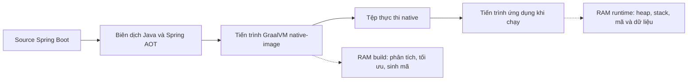

# Phân biệt bộ nhớ của tiến trình build với bộ nhớ ứng dụng native

Trong quá trình tạo **GraalVM Native Image** cho ứng dụng Spring Boot, người học thường thấy lệnh build sử dụng nhiều gigabyte RAM rồi kết luận ứng dụng native cũng sẽ cần từng ấy bộ nhớ khi chạy. Đây là hai giai đoạn khác nhau, với các tiến trình, mục đích và cách đo khác nhau. Hiểu sự khác biệt giúp cấp tài nguyên chính xác cho CI/CD, diễn giải benchmark công bằng và tránh cấu hình sai khi đóng gói container.

## 1. Hai tiến trình, hai ngân sách bộ nhớ

Một dự án Spring Boot dùng **Spring AOT (Ahead-of-Time)** để phân tích cấu hình ứng dụng và tạo mã, metadata cần thiết trước khi biên dịch native. Tiếp đó, công cụ `native-image` phân tích đồ thị các thành phần có thể được gọi, tối ưu và tạo ra tệp thực thi cho hệ điều hành/kiến trúc đích.



| Thuộc tính | Bộ nhớ lúc **build** | Bộ nhớ lúc **runtime** |
|---|---|---|
| Tiến trình chính | JVM chạy `native-image` (và có thể thêm tiến trình Maven/Gradle, compiler, AOT) | Tệp thực thi native đã biên dịch |
| Mục đích | Phân tích tính khả đạt (reachability), phân tích kiểu, tối ưu, sinh mã máy và liên kết | Xử lý HTTP request, logic nghiệp vụ, truy cập dữ liệu, quản lý object |
| Thời điểm | Khi tạo artifact trong máy phát triển hoặc CI | Khi chạy artifact trong máy chủ, container, Kubernetes |
| Chỉ số hữu ích | Peak RSS / peak bộ nhớ toàn bộ nhóm tiến trình build, thời gian build | RSS/PSS, heap đã dùng, peak RSS, thời gian khởi động, tải và độ trễ |
| Cách kiểm soát | Giới hạn RAM của runner/build container, giới hạn heap của trình biên dịch native | Cấu hình heap của ứng dụng, giới hạn memory container, tải ứng dụng |

**Kết luận cần nhớ:** `native-image` dùng 6 GB RAM để *biên dịch* không có nghĩa tệp thực thi native cần 6 GB RAM để *phục vụ request*. Ngược lại, ứng dụng native dùng ít RAM khi khởi động cũng không chứng minh quá trình build sẽ nhẹ.

## 2. Bộ nhớ được tiêu thụ như thế nào trong giai đoạn build?

Trong một lần chạy `mvn -Pnative native:compile` hoặc tác vụ native tương đương của Gradle, hệ thống có thể đồng thời tiêu thụ RAM cho:

1. **Maven/Gradle và các tác vụ Java/Spring AOT:** biên dịch mã Java, xử lý dependency, tạo mã AOT, resource và runtime hints.
2. **GraalVM Native Image builder:** chạy trên JVM, duy trì mô hình chương trình và metadata trong heap của riêng tiến trình build, phân tích reachability và thực hiện tối ưu.
3. **Bộ nhớ native bên ngoài Java heap của builder:** cấu trúc dữ liệu native, linker, thư viện và các tiến trình con có thể làm tổng RSS lớn hơn giá trị `-Xmx`.
4. **Hệ điều hành và hệ thống build:** page cache, daemon, compiler/linker và các công việc khác trên cùng runner.

Do đó, **giới hạn `-Xmx` của builder không phải giới hạn tổng RAM của cả lần build**. Nếu máy CI có memory limit thấp, một build có thể bị hệ điều hành hoặc container OOM-kill ngay cả khi heap của builder chưa đạt mức giới hạn. Dự án lớn, nhiều dependency hoặc cấu hình phân tích phức tạp thường tăng áp lực bộ nhớ và thời gian build; mức tiêu thụ thực tế cần đo thay vì ấn định một con số chung.

Ví dụ, với GraalVM Native Image, có thể truyền tùy chọn JVM cho builder qua `-J`:

```bash
native-image -J-Xmx4g -jar target/app.jar app
```

Lệnh trên chỉ minh họa cách giới hạn heap của **JVM builder**. Với Spring Boot, nên dùng quy trình AOT/native được plugin Maven hoặc Gradle cấu hình sẵn thay vì coi mọi Spring Boot fat JAR đều có thể đưa trực tiếp vào `native-image -jar` mà không cần bước AOT. Nếu plugin hỗ trợ chuyển đối số sang `native-image`, tùy chọn tương ứng cũng có thể được truyền qua cấu hình build.

Khi build bằng Cloud Native Buildpacks, bộ nhớ được sử dụng ở **giai đoạn image build** thuộc môi trường builder; giới hạn bộ nhớ của container ứng dụng sau khi deploy là một ngân sách riêng. Tùy phiên bản builder/buildpack, cách truyền tham số native-image và chính sách tự nhận diện bộ nhớ có thể khác nhau; hãy xem log build để xác nhận tùy chọn thực tế.

## 3. Bộ nhớ của ứng dụng native tại runtime gồm những gì?

Sau khi biên dịch xong, tệp thực thi native chạy trực tiếp trên hệ điều hành, không cần khởi chạy JVM HotSpot để thực thi bytecode như bản JAR truyền thống. Tuy nhiên, **native không đồng nghĩa với không có heap hoặc không có garbage collector**. Ứng dụng vẫn cần cấp phát và thu hồi object theo cơ chế runtime do Native Image cung cấp.

Các thành phần tiêu thụ bộ nhớ ở runtime bao gồm:

- **Java heap của native runtime:** object được cấp phát khi chương trình chạy, cache, đối tượng request/response và các cấu trúc ứng dụng.
- **Image heap:** một số object và dữ liệu được chuẩn bị tại build time, đóng vào image và ánh xạ vào không gian địa chỉ khi chạy. Các trang nhớ có thể được chia sẻ hoặc nạp theo nhu cầu tùy hệ điều hành và cách sử dụng.
- **Native memory:** thread stack, metadata, cấu trúc GC, thư viện native, bộ đệm I/O và vùng cấp phát ngoài heap.
- **Mã thực thi và vùng ánh xạ file:** các trang chứa executable, thư viện dùng chung, tài nguyên được ánh xạ.

Vì vậy, `heap used` **không bằng** RSS của tiến trình. Giá trị RSS có cả nhiều trang nhớ ngoài heap và không nhất thiết phản ánh đầy đủ phần bộ nhớ vật lý riêng của ứng dụng. Nếu so sánh nhiều tiến trình dùng chung trang nhớ, PSS (Proportional Set Size) trên Linux có thể là số đo bổ sung hữu ích.

### Giới hạn heap runtime khác giới hạn heap builder

Giả sử build native được cấu hình `-J-Xmx4g`; giá trị này chỉ áp dụng cho JVM chạy trình biên dịch. Nó **không đặt heap tối đa 4 GB cho ứng dụng được tạo ra**. Nếu muốn điều chỉnh heap runtime, cần dùng các tùy chọn runtime phù hợp với phiên bản GraalVM Native Image, ví dụ:

```bash
./target/app -Xmx256m
```

Trong ví dụ này, `-Xmx256m` là giới hạn heap **khi chạy ứng dụng native**, với điều kiện executable được xây dựng bằng runtime hỗ trợ tùy chọn đó. Nó không giới hạn toàn bộ RSS ở 256 MB. Nếu chạy trong container có memory limit 384 MiB, cần chừa thêm dung lượng cho stack, GC, bộ đệm và native memory; không nên đặt heap bằng toàn bộ giới hạn container. Luôn kiểm tra `./target/app --help` và tài liệu phiên bản Native Image đang sử dụng để xác nhận cách cấu hình.

## 4. Thực hành đo tách biệt trên cùng ứng dụng Spring Boot

Ví dụ một API Spring Boot đơn giản có endpoint `/actuator/health`. Dùng cùng nguồn mã, cấu hình và cùng một máy đo cho hai hình thức thực thi: JAR (HotSpot JVM) và native. Để build ứng dụng bằng Maven, project phải có cấu hình Spring Boot plugin và hỗ trợ native phù hợp.

**Bước 1 — Build native và đo tài nguyên của giai đoạn build (Linux).**

```bash
/usr/bin/time -v ./mvnw -Pnative native:compile
```

Trong kết quả, xem `Maximum resident set size` để tham khảo mức RSS cao nhất của tiến trình được `time` theo dõi. **Chú ý:** tùy công cụ/kiểu tiến trình con, con số này không nhất thiết là đỉnh **tổng** bộ nhớ tất cả Maven, AOT, builder và linker. Nếu cần đánh giá khả năng chạy trên CI, hãy theo dõi peak memory của **toàn cgroup/container build** hoặc nhóm tiến trình tương ứng.

**Bước 2 — Khởi chạy native và đo RSS.**

```bash
./target/app
```

Trong terminal khác, tìm đúng PID của executable và đo:

```bash
ps -o pid,rss,vsz,etime,comm -p <PID>
cat /proc/<PID>/status | grep -E 'VmRSS|VmHWM|VmSize'
```

`rss` trong `ps` thường tính theo KiB; `VmRSS` là RSS hiện tại, còn `VmHWM` là đỉnh RSS của tiến trình. `<PID>` là ký hiệu cần thay bằng PID thật, không gõ nguyên dấu ngoặc nhọn. Trên Windows/macOS, sử dụng công cụ đo tiến trình tương ứng vì `/proc` là giao diện của Linux.

**Bước 3 — Đo ứng dụng JAR trong cùng điều kiện.**

```bash
java -jar target/app.jar
```

Lấy PID Java đang chạy đúng JAR đó, đo RSS và peak RSS bằng cùng công cụ. Khi benchmark, hãy chạy **từng biến thể riêng**, không để hai server tranh cổng hoặc chia sẻ tải. Kiểm tra cùng một endpoint, cùng profile, cùng cấu hình datasource, cùng lượng request và mức concurrency. Đo cả giai đoạn idle sau khởi động lẫn khi phục vụ tải ổn định, vì số liệu idle không thay thế cho số liệu khi tải thực.

**Bước 4 — Lập bảng kết quả.** Dưới đây là bảng **mẫu ghi số liệu**, không phải kết quả benchmark thực nghiệm:

| Phép đo | JAR trên JVM | Native executable |
|---|---:|---:|
| Peak RAM của quá trình build | … MiB | … MiB |
| Thời gian build | … s | … s |
| RSS sau khởi động/ổn định idle | … MiB | … MiB |
| Peak RSS dưới cùng mức tải | … MiB | … MiB |
| Thời gian từ chạy lệnh đến ứng dụng ready | … ms | … ms |
| p95 latency tại cùng throughput | … ms | … ms |

Nếu dùng lệnh `time -v` cho cả quá trình build, ghi rõ phạm vi phép đo (chỉ tiến trình được theo dõi hay toàn bộ nhóm tiến trình). Khi so startup, quy định rõ mốc *ready* như thời điểm endpoint readiness trả thành công, tránh so thời gian xuất log khác nhau.

## 5. Tình huống thực tế: CI thiếu RAM nhưng production chạy nhẹ

Một nhóm triển khai service Spring Boot Native Image trên container chỉ cần vài trăm MiB RSS khi idle. Nhưng job biên dịch native trên runner có 2 GiB RAM liên tục bị OOM-kill. Không có mâu thuẫn: runner đang chạy phân tích và tối ưu toàn chương trình, còn container production chỉ thực thi kết quả đã biên dịch.

Cách xử lý có cơ sở:

1. Xác định tiến trình/cgroup nào bị OOM trong **job build**, đo peak memory của toàn build; phân biệt log báo `Java heap space` với kernel/container OOM-kill.
2. Nếu lỗi do heap của builder, cân nhắc tăng bộ nhớ runner và điều chỉnh heap builder theo hướng dẫn phiên bản GraalVM; nếu do giới hạn cgroup, tính cả overhead ngoài heap.
3. Cân nhắc cache dependency và tách build native thành job riêng có tài nguyên phù hợp; cache giúp thời gian tải/chuẩn bị nhưng không bảo đảm giảm peak RAM của phân tích native.
4. Đặt memory request/limit của **container chạy ứng dụng** bằng kết quả đo runtime dưới tải đại diện, kèm khoảng dự phòng cho đỉnh tải và native memory.

Trong Kubernetes, giới hạn bộ nhớ của pod/container chạy service không tự áp dụng cho job CI đã tạo image. Với Docker multi-stage build, stage chạy compiler và stage cuối chứa executable cũng có yêu cầu RAM khác nhau. Tệp native có thể lớn trên đĩa nhưng điều đó cũng không thể hiện trực tiếp peak RSS lúc build hoặc runtime.

## 6. Những nhầm lẫn thường gặp

| Nhận định | Đánh giá đúng |
|---|---|
| “Build native cần 8 GB nên pod production phải có 8 GB.” | Sai: tài nguyên build và runtime độc lập, cần đo riêng. |
| “Giới hạn `-J-Xmx` cũng giới hạn heap app native.” | Sai: `-J` chuyển tùy chọn cho JVM builder. |
| “Đặt `-Xmx256m` thì RSS chắc chắn dưới 256 MiB.” | Sai: RSS gồm vùng ngoài heap và các ánh xạ bộ nhớ. |
| “Native không còn JVM nên không có GC.” | Sai: native runtime vẫn quản lý heap và thu gom rác. |
| “Chỉ cần đo bộ nhớ khi service vừa khởi động.” | Chưa đủ: cần đo dưới tải, thời gian dài và khi có traffic đột biến. |
| “Image nhỏ hơn luôn dùng ít RAM hơn.” | Không có quan hệ một-một: dung lượng file, memory mapping, heap và RSS khác nhau. |

## 7. Câu hỏi tự kiểm tra

1. Vì sao peak RAM của job `native:compile` không thể dùng trực tiếp làm memory request cho pod chạy ứng dụng?
2. Nếu đặt `-J-Xmx4g` rồi thấy build container dùng hơn 4 GiB RAM, điều này có nhất thiết là cấu hình thất bại không? Giải thích những khoản bộ nhớ khác.
3. Vì sao RSS của ứng dụng native thường cao hơn phần `heap used` được báo cáo?
4. Khi so sánh JAR và native, cần giữ cố định những yếu tố nào để kết luận về mức tiêu thụ bộ nhớ có giá trị?

**Ghi nhớ:** Spring AOT và GraalVM Native Image chuyển nhiều công việc phân tích sang **lúc build** để tạo ứng dụng khởi động nhanh, thường giảm bộ nhớ trong nhiều kịch bản, nhưng hiệu quả thực tế phụ thuộc ứng dụng và tải. Hãy cấp ngân sách riêng cho build và runtime, đồng thời báo cáo đúng chỉ số, điều kiện đo và phiên bản công cụ.
