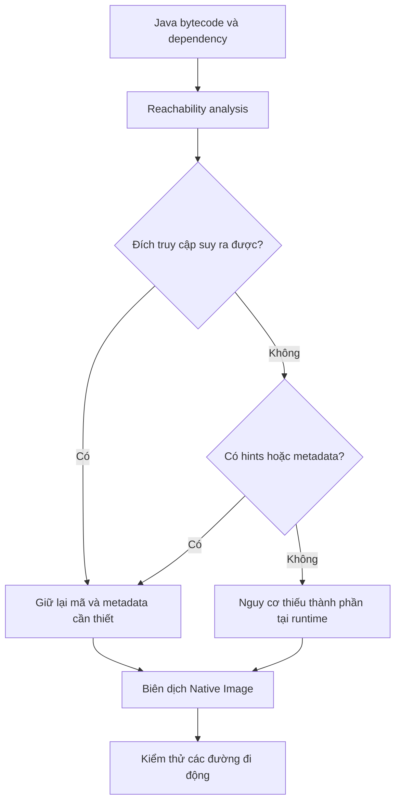

# Truy cập động khiến phân tích tĩnh không suy ra đủ thông tin

## 1. Vấn đề cốt lõi: ứng dụng biết đích gọi khi chạy, trình biên dịch phải biết trước

Khi chạy ứng dụng Java trên JVM, một đoạn mã có thể quyết định **lớp nào cần nạp, constructor nào cần gọi, phương thức nào cần thực thi hoặc tài nguyên nào cần đọc** từ dữ liệu chỉ xuất hiện tại runtime. Chẳng hạn tên lớp có thể đến từ biến môi trường, cấu hình triển khai, bản ghi cơ sở dữ liệu hoặc nội dung yêu cầu HTTP.

Với **Spring Boot Native Image**, Spring AOT hỗ trợ chuẩn bị cấu hình Spring trong giai đoạn build, còn GraalVM Native Image phân tích **reachability** (khả năng truy cập) để biên dịch trước thành executable. Native Image hoạt động theo mô hình *closed world*: những phần mã và metadata mà executable cần phải được biết đủ trong giai đoạn tạo image.

Sự khác biệt nằm ở thời điểm có thông tin:

- **Trên JVM:** chương trình có thể yêu cầu nạp một lớp và khám phá các member bằng reflection ngay lúc chạy, miễn lớp nằm trong classpath/module path và quyền truy cập cho phép.
- **Trong Native Image:** công cụ cần biết trước lớp, member, proxy interface, resource hoặc kiểu serialization liên quan. Những thao tác không thể suy ra từ mã tĩnh cần **reachability metadata** hoặc **runtime hints** để được đưa vào image đúng cách.

Không phải cứ dùng reflection là native thất bại. Những lời gọi reflection có đích hằng và đủ rõ đôi khi được GraalVM nhận diện tự động. Vấn đề xuất hiện khi đích phụ thuộc dữ liệu runtime và công cụ không thể chứng minh các mục tiêu có thể xảy ra.

## 2. Ví dụ từ một ứng dụng Spring Boot

Giả sử hệ thống đơn hàng cho phép chọn thuật toán tính phí theo cấu hình:

```java
public interface FeePolicy {
    long calculate(long subtotal);
}

public final class StandardFeePolicy implements FeePolicy {
    public StandardFeePolicy() {}

    @Override
    public long calculate(long subtotal) {
        return subtotal / 20;
    }
}
```

Lựa chọn lớp bằng tên ở runtime:

```java
String className = System.getenv("FEE_POLICY_CLASS");
Class<?> type = Class.forName(className);
FeePolicy policy = (FeePolicy) type.getDeclaredConstructor().newInstance();
long fee = policy.calculate(100_000);
```

Ở đây, trình biên dịch nhìn thấy các lệnh `Class.forName(className)` và `newInstance()`, nhưng **không biết giá trị của `className`** tại deployment. Kể cả khi `StandardFeePolicy` có trong dependency của build, điều đó chưa bảo đảm constructor được giữ lại và cho phép gọi reflectively.

Một tình huống thường gặp: bản JVM chạy đúng nhưng executable native chỉ lỗi khi môi trường đặt `FEE_POLICY_CLASS` thành tên lớp chưa được đăng ký. Tùy trường hợp, triệu chứng có thể là lỗi tìm lớp, thiếu metadata để tìm constructor, hoặc ngoại lệ khác trong thao tác reflection. Không nên suy đoán tất cả lỗi đều có cùng một thông báo.

## 3. Reachability analysis nhìn thấy gì?

Trình phân tích có thể lần theo các lời gọi trực tiếp:

```java
FeePolicy policy = new StandardFeePolicy();
policy.calculate(100_000);
```

Nó thấy constructor, kiểu thực thi và phương thức liên quan từ bytecode. Nhưng với:

```java
Class<?> type = Class.forName(request.getParameter("implementation"));
```

giá trị tên lớp là dữ liệu bất kỳ được đưa vào runtime, không phải hằng có thể phân tích chắc chắn tại build time.



Sơ đồ cho thấy một nguyên tắc quan trọng: **build thành công không chứng minh mọi truy cập động đều được cấu hình đầy đủ**. Một nhánh chỉ chạy khi nhận loại request đặc biệt có thể chưa từng được gọi trong smoke test.

## 4. Những cơ chế truy cập động cần chú ý

| Cơ chế | Ví dụ | Điều trình phân tích có thể thiếu |
|---|---|---|
| Reflection | `Class.forName(name)`, `getDeclaredConstructor()`, `Method.invoke()` | Lớp, constructor, field hoặc method cần được giữ và cho phép truy cập |
| JDK dynamic proxy | `Proxy.newProxyInstance(loader, interfaces, handler)` | Danh sách interface tạo proxy |
| Resource loading | `getResourceAsStream(path)` | Tệp resource cụ thể hoặc pattern cần đóng gói |
| Serialization | Chuyển JSON sang class được quyết định theo dữ liệu | Constructor, field, accessor hoặc thông tin serialization |
| JNI/FFI | Native library gọi lại Java hoặc truy cập member Java | Các entry point và member được gọi từ native |
| Service discovery | `ServiceLoader.load(service)` hoặc plugin lookup | Provider cần có mặt và metadata phục vụ discovery |
| Tải mã động | Sinh/nạp bytecode hoặc thư viện plugin mới tại runtime | Mã mới chưa tồn tại trong tập mã được biên dịch |

Các dòng trong bảng là **điểm cần kiểm tra**, không có nghĩa tất cả trường hợp đều phải cấu hình thủ công. Spring AOT, thư viện tương thích native và reachability metadata do dependency cung cấp có thể đã đáp ứng một phần hoặc toàn bộ.

**Phân biệt resource với mã:** resource như mẫu email HTML hoặc chứng chỉ có thể được đóng gói nếu khai báo; điều đó không cho phép Native Image tự biên dịch một Java class hoàn toàn mới được tải từ plugin sau khi binary đã phát hành.

## 5. Ba cách xử lý: làm rõ đích, khai báo metadata, hoặc đổi thiết kế

### 5.1. Ưu tiên đăng ký lựa chọn bằng bean Spring

Nếu các thuật toán đã biết khi build, có thể quản lý chúng bằng Spring thay vì chọn class từ chuỗi:

```java
public interface FeePolicy {
    String code();
    long calculate(long subtotal);
}

@Component
final class StandardFeePolicy implements FeePolicy {
    @Override public String code() { return "standard"; }
    @Override public long calculate(long subtotal) { return subtotal / 20; }
}

@Service
final class FeeService {
    private final Map<String, FeePolicy> policies;

    FeeService(List<FeePolicy> implementations) {
        this.policies = implementations.stream()
                .collect(java.util.stream.Collectors.toUnmodifiableMap(
                        FeePolicy::code,
                        java.util.function.Function.identity()));
    }

    long calculate(String code, long subtotal) {
        FeePolicy policy = policies.get(code);
        if (policy == null) {
            throw new IllegalArgumentException("Unknown policy: " + code);
        }
        return policy.calculate(subtotal);
    }
}
```

Spring AOT có thể phân tích các bean và đường đi gọi đã được khai báo khi build. Chuỗi `code` chỉ chọn một đối tượng đã được tạo từ tập hữu hạn, không trực tiếp buộc chương trình gọi một constructor chưa biết bằng reflection.

Giới hạn: nếu ứng dụng thật sự phải nhận plugin Java mới sau triển khai, registry cố định không giải quyết yêu cầu mở rộng động đó. Có thể cần tách plugin thành dịch vụ riêng, xây dựng lại native image khi bổ sung plugin, hoặc cân nhắc giữ JVM cho thành phần này.

### 5.2. Đăng ký reflection bằng Spring RuntimeHints

Khi reflection là yêu cầu hợp lệ và các kiểu có thể xác định lúc build, đăng ký phần cần thiết qua API `RuntimeHints`:

```java
import org.springframework.aot.hint.MemberCategory;
import org.springframework.aot.hint.RuntimeHints;
import org.springframework.aot.hint.RuntimeHintsRegistrar;
import org.springframework.context.annotation.ImportRuntimeHints;

final class FeePolicyHints implements RuntimeHintsRegistrar {
    @Override
    public void registerHints(RuntimeHints hints, ClassLoader classLoader) {
        hints.reflection().registerType(
                StandardFeePolicy.class,
                MemberCategory.INVOKE_DECLARED_CONSTRUCTORS
        );
    }
}

@Configuration
@ImportRuntimeHints(FeePolicyHints.class)
class NativeConfiguration {
}
```

Ví dụ này đăng ký **constructor** của `StandardFeePolicy` để có thể gọi qua reflection. Nó không tự động đăng ký mọi field và method khác. Nếu sử dụng `Method.invoke()` hoặc truy cập field phản chiếu, phải đăng ký những member tương ứng. Chỉ cấp đúng quyền cần dùng để metadata dễ kiểm soát.

Spring AOT thu thập hints lúc build native, rồi cung cấp chúng cho GraalVM Native Image. Hints không thay thế logic ứng dụng: nếu biến môi trường chứa tên class sai, hoặc class hoàn toàn không có trong bộ mã dùng để build, đăng ký class khác không thể sửa lỗi đó.

### 5.3. Khai báo resource, proxy và serialization tương ứng

Resource được đọc theo đường dẫn động có thể được khai báo bằng pattern:

```java
hints.resources().registerPattern("templates/invoice/*.html");
```

Pattern này phải khớp tài nguyên thực có trong classpath lúc build. Với JDK dynamic proxy, dùng cơ chế đăng ký proxy của `RuntimeHints` cho **đúng bộ interface** được dùng; với JSON binding/serialization, đăng ký cấu trúc kiểu và member theo nhu cầu của thư viện cụ thể. Không giả định khai báo reflection constructor là đủ cho mọi framework chuyển đổi dữ liệu.

GraalVM cũng hỗ trợ các dạng reachability metadata của chính Native Image, chẳng hạn cấu hình reflection/resource/proxy tương thích phiên bản công cụ hoặc metadata phân phối cùng thư viện. Trong dự án Spring Boot, nên sử dụng Spring RuntimeHints trước khi duy trì cấu hình riêng, vì hints tích hợp trực tiếp với chu trình Spring AOT.

## 6. Trường hợp đặc biệt: Spring framework có thể biết nhiều hơn Java thuần

Spring Boot thường sử dụng reflection, classpath scanning, proxy và các thuật toán đăng ký bean. Vì vậy, việc chuyển sang native không chỉ đơn giản là biên dịch bytecode. **Spring AOT** xử lý cấu hình Spring trong lúc build và sinh mã cho nhiều thao tác khởi tạo bean, xác định điều kiện cấu hình và đăng ký hints.

Ví dụ, một `@RestController` dùng DTO có thể được hỗ trợ nhờ thông tin mà Spring và framework chuyển đổi JSON thu thập trong quá trình AOT. Nhưng DTO chỉ được quyết định theo tên class đọc từ một bản ghi cơ sở dữ liệu tại runtime có thể nằm ngoài phạm vi Spring AOT nhận biết.

Tương tự, cấu hình thay đổi bean graph theo profile hoặc property cần được cân nhắc ngay lúc build: một số điều kiện cấu hình được đánh giá trước và kết quả có thể ảnh hưởng những bean hiện diện trong native image. Khi vận hành cần phân biệt property được đọc lúc runtime với property đã tác động đến quyết định AOT lúc build.

## 7. Quy trình chẩn đoán khi JVM chạy đúng nhưng Native Image thất bại

1. **Xác định hành động động bị lỗi.** Ghi nhận request, job, loại dữ liệu hoặc cấu hình kích hoạt lỗi; tìm lời gọi `Class.forName`, `getDeclaredMethod`, proxy, resource loader, serializer hay JNI tại đường đi đó.
2. **Kiểm tra đích thật sự tại runtime.** Xác định tên class, chữ ký constructor/method, danh sách interface hoặc đường dẫn resource. Đừng chỉ kiểm tra class có tồn tại trong mã nguồn.
3. **Kiểm tra thành phần được đưa vào image.** Đối chiếu runtime hints và metadata của các thư viện. Nếu đích chưa được mô tả, bổ sung metadata tối thiểu hoặc chuyển thiết kế sang lời gọi/bean tĩnh.
4. **Build lại native image.** Việc sửa hints hoặc thêm class không có hiệu lực trên executable đã biên dịch trước đó.
5. **Chạy kiểm thử kích hoạt đúng đường đi.** Test trên executable native, cùng dữ liệu/cấu hình deployment, không chỉ chạy unit test trên JVM.

Có thể kết hợp smoke test với integration test để bao phủ JSON polymorphism, validation, Jackson customization, template engine, ORM, các message handler, security rule, scheduled job và dependency bên thứ ba. Sử dụng **GraalVM tracing agent** trên bản JVM có thể giúp thu thập một phần metadata từ những đường đi đã được thực thi trong lúc chạy thử. Kết quả tracing không bảo đảm đầy đủ những nhánh chưa chạy, vì vậy phải review và kiểm thử lại sau khi build native.

Bảng chẩn đoán nhanh:

| Triệu chứng | Giả thuyết cần kiểm tra | Thao tác tiếp theo |
|---|---|---|
| `ClassNotFoundException` tại nhánh động | Class được chọn không có trong image hoặc tên không đúng | Xác định tên và reachability metadata |
| `NoSuchMethodException` khi gọi phản chiếu | Constructor/method chưa được đăng ký cho reflection hoặc chữ ký không đúng | Đăng ký đúng member và kiểm tra tham số |
| Resource trả `null` hoặc không tìm thấy | Pattern resource chưa bao phủ đường dẫn | Kiểm tra đường dẫn classpath và resource hints |
| Proxy/serialization lỗi ở một DTO hiếm gặp | Thiếu interface hoặc member/kiểu phục vụ thao tác động | Kiểm tra hints của framework và kiểu cụ thể |
| Chỉ lỗi khi đổi cấu hình triển khai | Đích runtime khác tập được biết ở build time | Xác nhận tập lựa chọn và kế hoạch build lại |

Đôi khi lỗi xuất phát từ bản thân ứng dụng, tên class sai, classloader không phù hợp hoặc bất tương thích phiên bản thư viện; không mặc định mọi ngoại lệ reflection là lỗi Native Image.

## 8. Tác động tới build, container và vận hành

Trong module **SPRING_BOOT_NATIVE_IMAGE**, mục tiêu là biên dịch Spring Boot bằng Spring AOT/GraalVM để đo startup và bộ nhớ, thực hành Maven/Gradle, reflection/resource, kiểm thử tương thích và triển khai container. Truy cập động tác động trực tiếp tới tất cả các bước này.

- **Build Maven/Gradle:** chạy quy trình native sau khi bổ sung runtime hints. Ví dụ Maven `./mvnw -Pnative native:compile` hoặc Gradle `./gradlew nativeCompile` khi đã cấu hình plugin tương ứng; nếu build thành công vẫn phải kiểm thử nhánh động.
- **Container:** đóng gói executable và những thư viện hệ thống cần thiết, bảo đảm resource đã được đưa vào image hoặc được mount dưới dạng file runtime đúng nơi. Thêm một JAR plugin vào container sau build không làm image tự biên dịch được lớp Java mới.
- **Vận hành:** khi cần bổ sung DTO/plugin/handler bằng mã Java, thường phải cập nhật code hoặc metadata, build lại binary, chạy kiểm thử và phát hành bản native mới. Một số cấu hình nghiệp vụ thuần dữ liệu vẫn có thể thay đổi khi chạy nếu code đã hỗ trợ.
- **Đo hiệu năng:** chỉ so sánh bản native đã đáp ứng các đường đi nghiệp vụ với bản JVM tương đương. Việc một native image nhỏ hơn do vô tình bỏ mất handler không được xem là lợi ích bộ nhớ hợp lệ.

Bài thực hành gợi ý: triển khai `FeePolicy` theo cách reflection dựa trên biến môi trường; build bản JVM và native; xác nhận lỗi hoặc hành vi trong bản native khi thiếu metadata; thêm `RuntimeHints` hoặc chuyển sang Spring bean registry; build lại, thử cả hai lựa chọn policy, sau đó đo startup, thời gian đáp ứng và RSS trên cùng môi trường. Kết quả cụ thể phụ thuộc phiên bản công cụ và khả năng tự nhận diện reflection của Native Image nên phải quan sát thay vì mặc định ví dụ sẽ lỗi trên mọi phiên bản.

## 9. Ghi nhớ

**Truy cập động tạo ra khoảng trống thông tin giữa build time và runtime.** Reachability analysis suy ra tốt những lời gọi tĩnh và một số mẫu động đã biết, nhưng không thể tiên đoán mọi giá trị đến từ cấu hình hay request. Spring AOT làm rõ nhiều cấu trúc của Spring Boot; `RuntimeHints` và GraalVM metadata khai báo những thành phần còn thiếu. Với các tập lựa chọn đã biết, thiết kế bean/registry có thể giúp code dễ phân tích và dễ kiểm thử hơn; với plugin mã Java thật sự chỉ xuất hiện sau triển khai, cần thay đổi kiến trúc hoặc quy trình phát hành.

Năng lực quan trọng khi làm Spring Boot Native Image là **xác định chính xác đường đi động, biểu diễn metadata vừa đủ, build lại và kiểm thử executable native thực tế**.
