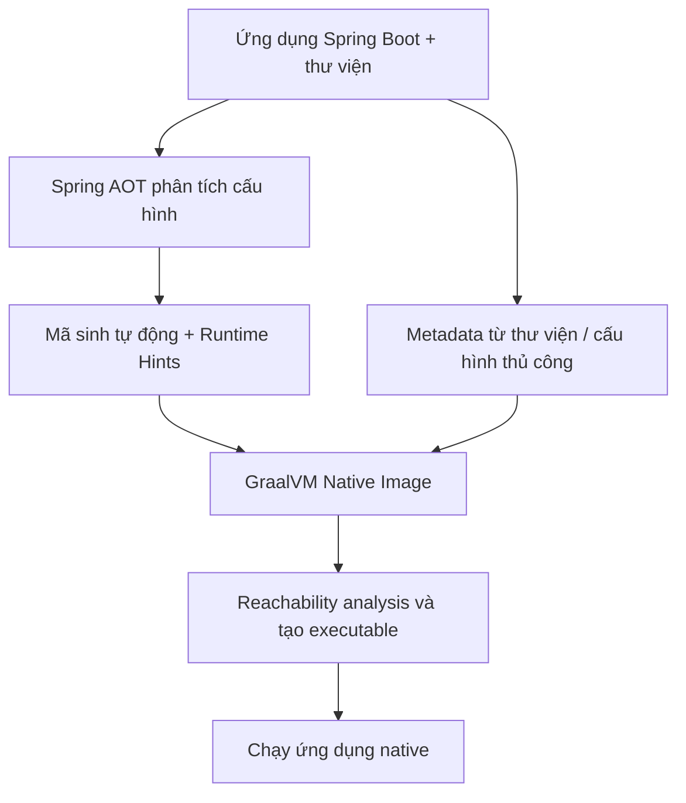

# Vai trò của metadata đối với reflection, tài nguyên, proxy và JNI

## 1. Tại sao Native Image cần metadata?

Khi chạy ứng dụng Spring Boot trên HotSpot JVM, class có thể được nạp và phân tích trong lúc ứng dụng đang chạy. Framework có thể tìm class theo chuỗi tên, đọc annotation bằng reflection, tạo proxy động, mở resource từ classpath hoặc gọi thư viện native thông qua JNI. Khả năng phát hiện động này rất tiện, nhưng tạo thách thức cho **GraalVM Native Image**.

Native Image sử dụng phân tích *closed-world*: trong quá trình build, công cụ cố gắng xác định trước phần mã và dữ liệu có thể được truy cập lúc chạy. Những phần không được nhận diện là khả đạt (*reachable*) có thể bị loại khỏi executable hoặc không được cung cấp đủ thông tin để truy cập động. Vì vậy, đoạn mã chạy tốt trong JVM có thể gây lỗi chỉ khi thực thi bản native.

**Metadata về reachability** mô tả những thành phần cần giữ lại hoặc hành vi động cần hỗ trợ, chẳng hạn class và member được truy cập bằng reflection, resource cần được đóng gói, loại proxy động được tạo, hoặc thành phần liên quan JNI. Metadata không phải là “bật tất cả tính năng Java”; nó bổ sung thông tin mà phân tích tĩnh chưa suy ra được.

Trong module **SPRING_BOOT_NATIVE_IMAGE**, Spring AOT (Ahead-of-Time) là cầu nối quan trọng: framework phân tích nhiều cấu hình Spring lúc build, sinh mã và **Runtime Hints** để GraalVM Native Image có thể biên dịch ứng dụng Spring Boot thành executable native. Mục tiêu của quy trình này là đánh giá thời gian khởi động và bộ nhớ, thực hành build Maven/Gradle, xử lý tương thích, đóng gói container và vận hành bản native.



Một vài thành phần được Native Image tự phát hiện khi lời gọi có cấu trúc tĩnh rõ ràng; vì thế **không phải mọi lời gọi reflection hay mọi resource đều cần khai báo thủ công**. Chỉ thêm metadata cho đường truy cập động chưa được bộ phân tích hoặc AOT xử lý đúng.

## 2. Reflection: biết class nào và cho phép thao tác gì

Reflection cho phép chương trình kiểm tra class, constructor, field, method và gọi các thành phần đó lúc chạy. Ví dụ:

```java
String className = request.getParameter("type");
Class<?> type = Class.forName(className);
Object object = type.getDeclaredConstructor().newInstance();
```

Vì `className` đến từ request, công cụ build khó biết trước class nào sẽ được nạp. Nếu class, constructor hoặc metadata cần thiết không được đăng ký, bản native có thể gặp lỗi liên quan `ClassNotFoundException`, `NoSuchMethodException`, thiếu member hoặc lỗi truy cập reflection tùy tình huống.

Cần phân biệt hai nhu cầu:

- **Introspection**: đọc thông tin kiểu, annotation, constructor, field hoặc method.
- **Invocation/access**: tạo instance, gọi method hay đọc/ghi field bằng reflection.

Đăng ký chỉ kiểu class chưa chắc đủ nếu thư viện cần gọi constructor hoặc method cụ thể. Nên khai báo quyền truy cập tối thiểu đúng với hoạt động thực tế.

### Ví dụ Spring RuntimeHints

Giả sử một plugin của ứng dụng tải lớp `com.example.plugin.EmailChannel` bằng tên nhận từ cấu hình đã kiểm soát. Có thể đăng ký constructor của lớp đó trước thời điểm biên dịch native:

```java
package com.example.nativeapp;

import com.example.plugin.EmailChannel;
import org.springframework.aot.hint.MemberCategory;
import org.springframework.aot.hint.RuntimeHints;
import org.springframework.aot.hint.RuntimeHintsRegistrar;
import org.springframework.context.annotation.Configuration;
import org.springframework.context.annotation.ImportRuntimeHints;

@Configuration
@ImportRuntimeHints(EmailChannelHints.class)
class NativeHintsConfiguration {
}

class EmailChannelHints implements RuntimeHintsRegistrar {
    @Override
    public void registerHints(RuntimeHints hints, ClassLoader classLoader) {
        hints.reflection().registerType(
            EmailChannel.class,
            MemberCategory.INVOKE_DECLARED_CONSTRUCTORS
        );
    }
}
```

Ví dụ minh họa class `EmailChannel` phải tồn tại, và kiểu truy cập phải phù hợp cách plugin thực sự khởi tạo đối tượng. Nếu chỉ cần constructor public thì có thể đăng ký chính xác constructor hoặc lựa chọn `MemberCategory` tương ứng. Tránh đăng ký toàn bộ method/field khi không cần thiết vì có thể làm tăng kích thước image và mở rộng bề mặt truy cập.

## 3. Resource: có trong project chưa chắc có trong executable

Một file dưới `src/main/resources` thường có thể được truy cập qua classpath của ứng dụng Java:

```java
try (var stream = getClass().getResourceAsStream("/templates/invoice.html")) {
    if (stream == null) {
        throw new IllegalStateException("Không tìm thấy template");
    }
    // Đọc nội dung template
}
```

Tuy nhiên, tại build native, công cụ cần biết những file resource nào cần đưa vào executable. Spring AOT và cấu hình thư viện có thể đã cung cấp các khai báo cần thiết; với resource do ứng dụng hoặc plugin đọc động, cần kiểm tra và bổ sung nếu thiếu.

Đăng ký mẫu resource bằng Spring RuntimeHints:

```java
class TemplateHints implements RuntimeHintsRegistrar {
    @Override
    public void registerHints(RuntimeHints hints, ClassLoader classLoader) {
        hints.resources().registerPattern("templates/*.html");
    }
}
```

Sử dụng `@ImportRuntimeHints(TemplateHints.class)` trên một lớp cấu hình Spring để registrar được phát hiện trong quy trình AOT.

**Phân biệt:** resource trong classpath được đưa vào image qua metadata với file ngoài filesystem được mount ở runtime. Ví dụ `/etc/myapp/secrets.yaml` là file triển khai, không phải resource nên đóng gói vào executable. Không đưa secret, chứng chỉ bí mật hay dữ liệu môi trường vào native image. Nên kiểm thử đường dẫn tuyệt đối/tương đối và việc đóng gói resource trong container, vì môi trường làm việc khi chạy native có thể khác lúc phát triển.

## 4. Dynamic proxy: proxy nào được tạo lúc chạy?

Java dynamic proxy tạo đối tượng triển khai một hoặc nhiều interface tại runtime:

```java
interface GreetingClient {
    String hello();
}

GreetingClient client = (GreetingClient) java.lang.reflect.Proxy.newProxyInstance(
    GreetingClient.class.getClassLoader(),
    new Class<?>[]{GreetingClient.class},
    (proxy, method, args) -> "Xin chào!"
);
```

Nếu tập interface của proxy không được xác định trước, quá trình phân tích native có thể không nhận diện đầy đủ proxy cần sinh. Metadata về **JDK dynamic proxy** thường khai báo danh sách interface mà proxy sẽ triển khai. Thứ tự interface có thể có ý nghĩa trong định danh proxy, do đó cần giữ đúng cấu hình được tạo.

Spring RuntimeHints hỗ trợ đăng ký:

```java
class ClientProxyHints implements RuntimeHintsRegistrar {
    @Override
    public void registerHints(RuntimeHints hints, ClassLoader classLoader) {
        hints.proxies().registerJdkProxy(GreetingClient.class);
    }
}
```

Spring AOT tự xử lý nhiều proxy được tạo từ bean configuration và hạ tầng framework. Cần phân biệt **JDK dynamic proxy dựa trên interface** với proxy dựa trên class/bytecode (ví dụ một số cơ chế CGLIB): chúng có cơ chế tạo khác nhau, không thể mặc định giải quyết mọi lỗi proxy bằng cách chỉ khai báo `registerJdkProxy`. Với framework tạo class động lúc runtime, có thể cần cơ chế AOT, cấu hình dành riêng cho thư viện, hoặc thay đổi thiết kế để tạo class từ lúc build.

Ví dụ ứng dụng sử dụng Spring Data repository hoặc AOP: không vội khai báo tất cả proxy bằng tay. Hãy xác định Spring AOT đã xử lý loại bean/proxy đó chưa, sau đó mới bổ sung metadata cho đường tạo proxy tùy biến còn thiếu.

## 5. JNI: ranh giới giữa Java và thư viện native

**JNI (Java Native Interface)** cho phép Java gọi hàm trong thư viện native và mã native tương tác với kiểu, field, method phía Java. Khi biên dịch Native Image, các điểm truy cập kiểu và member từ mã native có thể cần được mô tả trước để runtime giữ lại thông tin cần thiết.

Một trường hợp:

```java
public class NativeCodec {
    static {
        System.loadLibrary("codec");
    }

    public native byte[] compress(byte[] input);
}
```

Các yêu cầu cần kiểm tra độc lập:

1. **Metadata JNI/reachability**: phần class/member mà thư viện native truy cập phải được công cụ biết trước nếu không tự phân tích được.
2. **Binary tương thích**: thư viện `codec` phải được biên dịch đúng hệ điều hành, kiến trúc CPU và ABI của image chạy.
3. **Đóng gói và tìm thư viện**: file `.so`, `.dylib` hoặc `.dll` cần có trong môi trường chạy nếu cơ chế liên kết yêu cầu.
4. **Tương thích native runtime**: không phải mọi cách dùng JNI hoặc thư viện native đều được GraalVM hỗ trợ giống HotSpot; cần kiểm tra phiên bản Native Image và thư viện cụ thể.

**Metadata không tự biến thư viện JNI thành thư viện tương thích và cũng không tự đóng gói binary vào container.** Khi gặp `UnsatisfiedLinkError`, cần xem tên/đường dẫn thư viện, kiến trúc và dependencies của hệ điều hành trước khi suy ra lỗi reachability.

## 6. Đăng ký metadata theo ba lớp

Có ba nguồn bổ trợ thường gặp trong dự án Spring Boot Native Image:

| Nguồn | Phạm vi sử dụng | Khi nào ưu tiên |
|---|---|---|
| **Spring AOT và RuntimeHints** | Phân tích cấu hình Spring, đăng ký reflection, resource, proxy, serialization và các nhu cầu AOT | Ứng dụng Spring Boot, starter hoặc thư viện tích hợp Spring |
| **Metadata GraalVM trong thư viện** | Cấu hình reachability cung cấp cùng dependency | Thư viện đã hỗ trợ Native Image và công bố metadata phù hợp |
| **Metadata tùy chỉnh của ứng dụng** | Bổ sung các đường chạy động chưa được phát hiện | Plugin, reflection theo tên, resource động, proxy/JNI đặc biệt |

Với các phiên bản GraalVM hiện đại, metadata reachability có thể được khai báo trong file cấu hình JSON thống nhất như `META-INF/native-image/<group-id>/<artifact-id>/reachability-metadata.json`, hoặc qua các cấu hình chuyên biệt mà toolchain còn hỗ trợ. Cấu trúc, trường JSON và khả năng tương thích phụ thuộc phiên bản GraalVM; không nên sao chép cấu hình từ một phiên bản khác mà không kiểm tra.

Ví dụ minh họa một đoạn metadata JSON theo định dạng reachability metadata mới (chỉ trích phần liên quan reflection và resource):

```json
{
  "reflection": [
    {
      "type": "com.example.plugin.EmailChannel",
      "methods": [
        { "name": "<init>", "parameterTypes": [] }
      ]
    }
  ],
  "resources": [
    {
      "glob": "templates/*.html"
    }
  ]
}
```

Ví dụ JSON là minh họa về ý tưởng khai báo và cần được đối chiếu với schema GraalVM cụ thể trước khi sử dụng; với Spring Boot, cách viết `RuntimeHintsRegistrar` thường dễ bảo trì và kiểm tra trong hệ sinh thái Spring hơn.

### Hints hoạt động khi nào?

Một `RuntimeHintsRegistrar` chỉ có tác dụng khi thực sự được đưa vào quá trình AOT, chẳng hạn thông qua `@ImportRuntimeHints` hoặc cơ chế đăng ký do thư viện cung cấp. Tạo class registrar mà quên đăng ký sẽ không làm Native Image nhận metadata.

Nếu Spring tự tạo mã cho một bean, metadata bổ sung không nhất thiết phải viết tay. Ngược lại, một lời gọi `Class.forName` theo chuỗi từ database, JSON hoặc cấu hình bên ngoài mà Spring AOT không nhìn thấy có thể cần khai báo riêng.

## 7. Chẩn đoán lỗi metadata bằng quy trình có kiểm soát

Giả sử bản JAR chạy bình thường, nhưng native image khởi động thành công rồi lỗi khi người dùng xuất hóa đơn:

```text
GET /invoices/123/export
→ IllegalStateException: Không tìm thấy template
```

Không nên thêm tùy chọn “giữ lại mọi resource” ngay. Hãy truy ngược đường truy cập thực tế:

1. **Tái hiện lỗi trên executable native** với cấu hình và dữ liệu phù hợp; ghi stack trace, endpoint, class hoặc tên resource thiếu.
2. **Phân loại lỗi**: thiếu reflection member, resource, proxy, JNI/binary, serialization hay lỗi khác. Cùng một endpoint có thể đi qua nhiều cơ chế.
3. **Kiểm tra cơ chế AOT hiện có**: bean có được Spring phát hiện? registrar đã đăng ký? resource nằm ở path classpath đúng? Thư viện có metadata cho đúng phiên bản?
4. **Thêm metadata tối thiểu**, ví dụ `templates/*.html` thay vì mọi file trong project, hoặc constructor cụ thể thay vì toàn bộ member.
5. **Build lại native image**: metadata tác động tới lúc biên dịch, vì vậy sửa JSON hoặc RuntimeHints rồi chỉ restart executable cũ sẽ không giải quyết vấn đề.
6. **Kiểm thử trên artifact mới** với cùng tuyến xử lý, sau đó test cả image container và kiến trúc triển khai thực tế.

Để hỗ trợ phát hiện metadata còn thiếu, có thể dùng **GraalVM Native Image tracing agent** trên JVM chạy các kịch bản thực tế. Agent quan sát các thao tác động đã xảy ra và sinh thông tin cấu hình; sau đó cần rà soát, loại dữ liệu thừa, bổ sung các đường đi chưa được kích hoạt và đưa metadata vào quy trình build phù hợp.

Ví dụ sử dụng agent (cú pháp/chế độ xuất file cần đối chiếu với phiên bản GraalVM):

```bash
java -agentlib:native-image-agent=config-output-dir=target/native-agent-config \
     -jar target/app.jar
```

Sau khi chạy các API nghiệp vụ, tắt ứng dụng để thu thập metadata và kiểm tra kết quả. **Agent chỉ thấy đường code được thực thi trong lúc ghi nhận**; nó không chứng minh toàn bộ ứng dụng đã tương thích native. Việc kết hợp test integration với AOT, test native executable và kiểm thử tải là cần thiết trước khi đưa vào production.

## 8. Liên hệ với Maven, Gradle và container

Trong dự án Spring Boot sử dụng Maven, lệnh điển hình cho native executable là:

```bash
./mvnw -Pnative native:compile
```

Với Gradle và plugin Native Build Tools phù hợp:

```bash
./gradlew nativeCompile
```

Các lệnh trên giả định dự án đã cấu hình plugin Spring Boot và GraalVM Native Build Tools tương thích. Khi chỉnh RuntimeHints hoặc metadata, phải chạy lại bước AOT/native build. Nếu dùng buildpacks, cấu hình và metadata cũng phải có sẵn trong ngữ cảnh build image.

Đừng trộn lẫn ba nhóm sự cố:

- **Thiếu metadata reachability**: một class, method, proxy hoặc resource không được giữ đúng cách.
- **Thiếu thư viện hệ điều hành**: binary native cần shared library hoặc ABI không có trong container.
- **Lỗi cấu hình môi trường**: biến môi trường, file mount, DNS, secret, certificate, quyền ghi hoặc network khác môi trường JAR.

Một image container tối giản có thể gặp lỗi JNI hoặc resource filesystem dù ứng dụng native đã có metadata đúng. Phân loại nguyên nhân trước khi sửa giúp tránh việc mở rộng reachability không cần thiết và làm image tăng kích thước.

## 9. Checklist trước khi chấp nhận bản native

- Các API có reflection, serialization, dynamic proxy, tải template/resource và JNI đã được chạy trong kiểm thử native.
- RuntimeHints được đăng ký vào Spring AOT; metadata của thư viện phù hợp version.
- Resource từ classpath cần thiết có trong image; dữ liệu môi trường và secret được cung cấp lúc chạy.
- Dependency native/JNI phù hợp kiến trúc của executable và base image container.
- Build lại artifact sau khi thay đổi hints và kiểm tra kết quả trên artifact thực tế.
- So sánh startup, RSS, thời gian phản hồi và throughput giữa JAR/native trên cùng workload; không coi thành công biên dịch là bằng chứng hiệu năng và tương thích toàn diện.

## 10. Câu hỏi tự kiểm tra

1. Vì sao `Class.forName` với tên lớp từ cấu hình runtime có thể chạy tốt trên HotSpot nhưng thất bại khi chạy native?
2. Khi nào dùng `hints.reflection()` và khi nào dùng `hints.resources()`? Cho một ví dụ mỗi loại.
3. JDK dynamic proxy khác proxy class-based ở điểm nào và vì sao điều đó ảnh hưởng tới Native Image?
4. Vì sao khai báo metadata JNI đúng vẫn có thể dẫn tới `UnsatisfiedLinkError` khi deploy container?
5. Nếu tracing agent không phát hiện lỗi trong một lượt smoke test, có thể khẳng định tất cả đường chạy production đã đủ metadata không?
6. Khi sửa `RuntimeHintsRegistrar`, tại sao phải build lại executable native?

**Ghi nhớ:** metadata là hợp đồng bổ sung giữa mã Java sử dụng tính năng động và quá trình phân tích trước khi biên dịch của GraalVM. Với Spring Boot, ưu tiên khả năng tự phân tích của Spring AOT, bổ sung Runtime Hints hoặc reachability metadata đúng điểm thiếu, rồi xác minh trên chính native executable và container sẽ vận hành.
