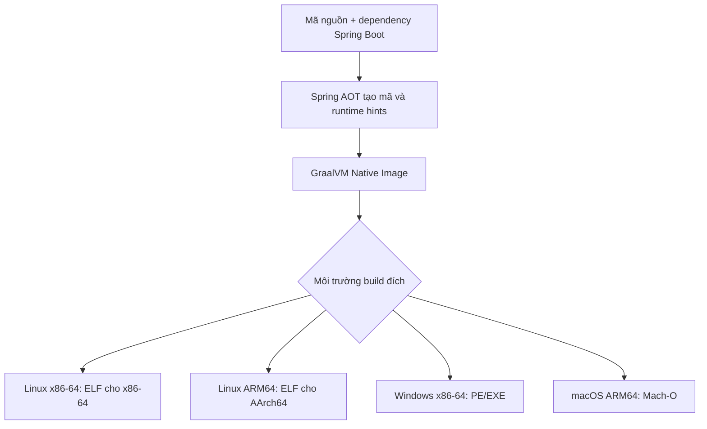
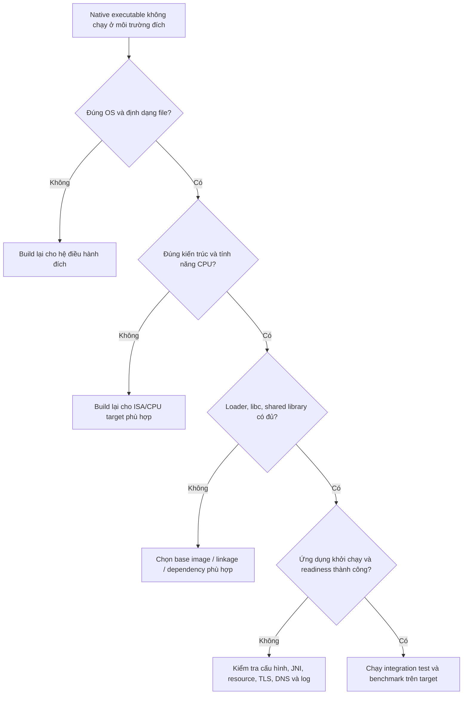

# Phụ thuộc hệ điều hành, kiến trúc CPU và thư viện hệ thống

## 1. Mục tiêu và bối cảnh

Khi biên dịch ứng dụng Spring Boot bằng **Spring AOT** và **GraalVM Native Image**, sản phẩm cuối thường là một tệp thực thi mã máy dành cho **một tổ hợp nền tảng cụ thể**. Ứng dụng có thể khởi động nhanh và sử dụng ít bộ nhớ hơn trong nhiều tình huống, nhưng cách đóng gói native cũng thay đổi cách chúng ta xây dựng, phân phối và triển khai ứng dụng.

Xét tình huống sau:

1. Nhóm phát triển build ứng dụng Spring Boot thành tệp `order-service` trên máy Linux x86-64.
2. Tệp được chép vào container Alpine Linux để giảm kích thước image.
3. Container được triển khai trên node dùng CPU ARM64.
4. Khi chạy, tiến trình không khởi động hoặc báo lỗi về tệp thực thi/thư viện hệ thống.

Trong tình huống này có **ba loại tương thích riêng biệt** cần xác minh:

- **Hệ điều hành và định dạng tệp thực thi:** Linux, Windows và macOS dùng các định dạng và cơ chế tải chương trình khác nhau.
- **Kiến trúc tập lệnh CPU (ISA):** mã máy x86-64 không tự chạy trực tiếp trên ARM64 và ngược lại.
- **ABI và thư viện hệ thống:** một tệp Linux dùng `glibc` và dynamic loader cụ thể có thể không khởi chạy trong môi trường chỉ có `musl` hoặc thiếu thư viện cần thiết.

Sau bài học, bạn có thể xác định đúng nền tảng cần build, hiểu tại sao một Native Image chạy trên máy này nhưng lỗi ở máy khác, chọn runtime image phù hợp và thiết lập kiểm thử trước khi đưa vào production.

## 2. Vì sao Java JAR và Native Image có tính di động khác nhau?

### 2.1. Với Spring Boot JAR

Theo mô hình JVM truyền thống, trình biên dịch tạo bytecode; khi chạy, JVM tương ứng với hệ điều hành và kiến trúc CPU đích sẽ thực thi bytecode đó:

```text
Mã nguồn Spring Boot
        │
        ▼
      JAR
        │
        ├── JVM trên Linux x86-64 ──► Tiến trình Linux
        ├── JVM trên Linux ARM64  ──► Tiến trình Linux
        ├── JVM trên Windows      ──► Tiến trình Windows
        └── JVM trên macOS        ──► Tiến trình macOS
```

Lợi thế là **cùng một JAR** thường có thể chạy trên nhiều nền tảng có JVM tương thích. Tuy nhiên, đây không phải lời bảo đảm tuyệt đối: JAR vẫn có thể chứa thư viện JNI/native, phụ thuộc lệnh hệ điều hành, đường dẫn tệp hoặc khả năng của JVM phiên bản cụ thể.

### 2.2. Với GraalVM Native Image

Khi build native, GraalVM phân tích mã có thể truy cập, biên dịch AOT thành mã máy, rồi liên kết executable theo nền tảng build/target. Spring AOT hỗ trợ chuẩn bị mã khởi tạo và metadata để các tính năng động của Spring hoạt động trong quá trình đó.



Một bản native Linux x86-64 **không tương đương** với bản native Linux ARM64 hoặc Windows x86-64. Tên file có thể giống nhau, nhưng phần mã máy và cách liên kết với hệ điều hành khác nhau.

Native Image có thể chạy **không cần cài một JVM độc lập** trên máy đích; điều đó **không đồng nghĩa** chương trình độc lập với kernel, thư viện C, dynamic loader, kiến trúc CPU hoặc các thành phần hệ thống mà ứng dụng sử dụng.

> Quy tắc thiết kế: xác định **nơi executable sẽ chạy** trước khi thiết kế quy trình build. Tính tương thích của máy phát triển không tự bảo đảm tính tương thích của môi trường production.

## 3. Lớp thứ nhất: hệ điều hành và định dạng executable

Hệ điều hành quản lý tiến trình, bộ nhớ ảo, socket, file descriptor/handle, thread, quyền truy cập và nhiều lời gọi hệ thống. Tệp thực thi native phải được tạo theo định dạng mà trình nạp của hệ điều hành hiểu.

| Nền tảng đích | Định dạng thực thi phổ biến | Đặc điểm cần quan tâm |
|---|---|---|
| Linux | ELF (*Executable and Linkable Format*) | Kernel Linux, kiến trúc CPU, ELF interpreter/dynamic loader nếu liên kết động, libc và các `.so` cần thiết |
| Windows | PE/COFF, thường là `.exe` | Windows API, DLL nhập khẩu và bộ công cụ/liên kết tương thích |
| macOS | Mach-O | Phiên bản macOS hỗ trợ, kiến trúc Intel hoặc Apple Silicon, `.dylib`/framework và quy tắc ký mã nếu có |

Ví dụ:

```bash
# Trên Linux, kiểm tra hệ điều hành kernel và kiến trúc hiện tại
uname -s
uname -m

# Kiểm tra định dạng của executable đã build
file ./target/order-service
```

Trên Linux, `file` thường cho biết tệp có phải **ELF** hay không và được build cho **x86-64** hoặc **aarch64**. Đây là bước kiểm tra nhanh, chưa đủ để chứng minh mọi thư viện runtime đều tương thích.

Nếu đem `order-service.exe` của Windows sang Linux và gọi trực tiếp, Linux không tự hiểu một chương trình Windows PE. Tương tự, executable Mach-O của macOS không trở thành chương trình Linux chỉ bằng cách đổi tên hoặc bỏ phần mở rộng.

### 3.1. Container không thay thế kernel

Docker container thường chia sẻ kernel với host Linux. Vì vậy, đưa tệp native Windows hoặc macOS vào một Linux container **không** biến nó thành chương trình Linux. Linux container cũng không tự chuyển mã máy x86-64 thành ARM64.

Container giúp đóng gói filesystem, thư viện và cấu hình runtime; nó không xóa bỏ điều kiện tương thích giữa executable, CPU và kernel. Với Docker Desktop trên Windows/macOS, Linux container thường chạy trên một môi trường Linux/VM bên dưới; chương trình bên trong vẫn cần executable **Linux**.

## 4. Lớp thứ hai: kiến trúc CPU và tập lệnh

### 4.1. x86-64 và ARM64

CPU thực thi mã máy theo một tập lệnh cụ thể. Các tên sau thường gặp khi build Spring Boot Native Image:

| Nhãn thường thấy | Cách gọi tương đương phổ biến | Nhãn Docker/OCI |
|---|---|---|
| `x86_64` | AMD64, x86-64 | `linux/amd64` khi chạy Linux |
| `aarch64` | ARM64 | `linux/arm64` khi chạy Linux |

**AMD64** không có nghĩa là chỉ chạy trên CPU AMD; nhiều CPU Intel cũng triển khai tập lệnh x86-64. **ARM64/AArch64** là họ tập lệnh khác, phổ biến trên máy chủ ARM, thiết bị nhúng và Apple Silicon.

Ví dụ, một ứng dụng build trên máy `linux/amd64` không thể được kỳ vọng chạy trực tiếp trên `linux/arm64` nếu thiếu cơ chế giả lập/biên dịch tương ứng. Khi cố chạy một executable sai kiến trúc, bạn có thể gặp:

```text
exec format error
```

Thông điệp cụ thể phụ thuộc shell, runtime/container và hệ điều hành. Cũng cần lưu ý `exec format error` có thể xuất hiện do định dạng tệp sai, không chỉ vì CPU.

### 4.2. Cùng kiến trúc chưa chắc cùng tập tính năng CPU

Ngay trong họ x86-64, các đời CPU có thể hỗ trợ những tập lệnh mở rộng khác nhau. Khi chọn cấu hình biên dịch tối ưu cho một máy cụ thể, executable có thể dùng các lệnh mà một máy đời cũ không hỗ trợ.

Ví dụ, dùng tùy chọn GraalVM Native Image kiểu `-march=native` có thể tối ưu cho tính năng của CPU trên máy build. Nếu đưa artifact sang CPU cùng họ nhưng không có những tính năng ấy, chương trình có nguy cơ lỗi với tín hiệu hoặc thông báo dạng:

```text
Illegal instruction
```

Giải pháp là **chọn mức mục tiêu CPU phù hợp với máy cũ nhất được hỗ trợ**, hoặc build riêng theo từng lớp CPU khi có lợi ích đủ lớn. Đừng mặc định rằng mọi máy x86-64 hoặc mọi node ARM64 trong cluster có cùng tập tính năng.

### 4.3. Có thể cross-compile không?

Biên dịch chéo nghĩa là build trên một nền tảng nhưng sinh executable cho nền tảng khác. Trong thực hành Native Image, cách đơn giản và đáng tin cậy thường là **build trên hệ điều hành/kiến trúc tương ứng với đích**, với GraalVM và native toolchain hỗ trợ.

Không nên giả định việc đặt `--platform linux/arm64` trên lệnh Docker hoặc đổi tên output sẽ tự chuyển một binary x86-64 thành ARM64. Quy trình multi-platform có thể dùng native runner cho từng nền tảng, builder từ xa hoặc môi trường giả lập phù hợp; việc biên dịch GraalVM dưới giả lập có thể tốn nhiều CPU/RAM và cần kiểm chứng hỗ trợ của toolchain.

## 5. Lớp thứ ba: ABI, thư viện hệ thống và dynamic loader

Hai executable cùng là Linux x86-64 vẫn có thể khác nhau về cách trao đổi dữ liệu với hệ thống. Đây là lúc **ABI (Application Binary Interface)** và **thư viện liên kết** trở nên quan trọng.

### 5.1. ABI là gì?

ABI quy định những quy ước ở mức nhị phân, chẳng hạn:

- Cách truyền đối số và nhận giá trị trả về trong các lời gọi hàm.
- Cách biểu diễn, căn chỉnh hoặc bố trí một số cấu trúc dữ liệu.
- Tên symbol, cách liên kết và tìm thư viện.
- Quy ước tương tác giữa executable, thư viện và hệ điều hành.

Nếu API mô tả *chương trình có thể gọi chức năng nào*, thì ABI mô tả *hai thành phần nhị phân tương tác với nhau theo quy tắc nào*. Một executable có thể đúng hệ điều hành và đúng CPU, nhưng vẫn lỗi do ABI hoặc phiên bản thư viện không đáp ứng.

### 5.2. `glibc` và `musl` trên Linux

Hai triển khai C standard library phổ biến là:

| Khía cạnh | `glibc` | `musl` |
|---|---|---|
| Môi trường phổ biến | Debian, Ubuntu và nhiều bản phân phối Linux khác | Alpine Linux và các image dựa trên Alpine |
| Đặc điểm liên kết thường gặp | Executable Linux liên kết động tới `glibc` và các thư viện liên quan | Executable có thể liên kết với `musl`, phục vụ những cấu hình runtime gọn hoặc static phù hợp |
| Điều cần lưu ý | Phiên bản symbol và dynamic loader cần tương thích với môi trường đích | Không mặc định tương thích với executable được build cho `glibc` |

Ví dụ: build một ứng dụng trên Ubuntu (dùng `glibc`), sau đó chỉ chép executable vào Alpine (dùng `musl`). Dù cả hai đều là Linux x86-64, executable có thể thiếu **dynamic loader** hoặc symbol/library cần thiết và không chạy được.

Lỗi có thể trông như:

```text
No such file or directory
```

Thông báo này dễ gây nhầm lẫn: tệp `order-service` **có thể đang tồn tại**, nhưng kernel không tìm thấy ELF interpreter được khai báo trong tệp thực thi. Do đó cần kiểm tra cả dynamic loader và những dependency nhị phân, thay vì vội kết luận đường dẫn executable sai.

Ngoài ra, nếu chương trình được build trên hệ thống có phiên bản `glibc` mới hơn môi trường chạy, nó có thể báo lỗi dạng:

```text
version 'GLIBC_2.xx' not found
```

`GLIBC_2.xx` chỉ là dạng thông báo minh họa. Mức phiên bản thực tế phụ thuộc binary và hệ thống. Hướng xử lý là chọn nền tảng build có mức tương thích phù hợp, dùng runtime base image hỗ trợ symbol cần thiết, hoặc cân nhắc cấu hình liên kết khác sau khi kiểm thử.

### 5.3. Liên kết động và liên kết tĩnh

**Liên kết động (dynamic linking)** giữ lại quan hệ với các shared library; khi chạy, dynamic loader phải tìm và nạp các thư viện cần thiết. Ví dụ trên Linux là những file `.so`.

**Liên kết tĩnh (static linking)** đưa các thành phần được hỗ trợ vào executable lúc build, giảm hoặc loại bỏ một số dependency vào shared library ở runtime. GraalVM có hỗ trợ các chế độ static linking phù hợp từng nền tảng và toolchain, chẳng hạn hướng xây dựng executable Linux dùng `musl`.

Tuy nhiên, **static không có nghĩa là không phụ thuộc hệ điều hành**. Executable vẫn phải có mã máy phù hợp CPU và cần kernel đáp ứng các syscall/cơ chế mà nó dùng. Ứng dụng cũng có thể cần dữ liệu CA certificate, timezone, DNS configuration, tệp bên ngoài hoặc thư viện được nạp động khi chạy.

| Khía cạnh | Native liên kết động | Native liên kết tĩnh |
|---|---|---|
| Runtime shared library | Cần đúng những thư viện được khai báo hoặc nạp bổ sung | Có thể giảm đáng kể phụ thuộc shared library |
| Runtime container image | Thường dùng base image có libc và thư viện phù hợp | Có thể dùng image rất gọn nếu mọi phụ thuộc thực tế đã được đáp ứng |
| Cập nhật thư viện | Có thể cập nhật thư viện chia sẻ qua image/hệ thống khi tương thích ABI | Thành phần được liên kết vào executable thường cần build lại để nhận bản vá |
| Kiểm tra tương thích | ABI, dynamic loader, thư viện và symbol | Vẫn phải kiểm tra kernel, CPU, tệp runtime, tính năng native |

Không chọn static hay dynamic chỉ dựa vào mục tiêu giảm kích thước. Hãy xét khả năng cập nhật bản vá, observability, JNI và chính sách container của hệ thống.

## 6. Cách phát hiện thư viện mà executable cần

Sau khi build một executable Linux, các lệnh sau giúp kiểm tra **định dạng, CPU và thư viện**:

```bash
# Xác định loại executable và kiến trúc
file ./target/order-service

# Đọc ELF header; xem machine/kiến trúc
readelf -h ./target/order-service

# Tìm ELF interpreter/dynamic loader (nếu có)
readelf -l ./target/order-service

# Liệt kê các thư viện được ghi vào phần dynamic dependencies
readelf -d ./target/order-service

# Hiển thị thư viện liên kết được resolver tìm thấy trên máy hiện tại
ldd ./target/order-service
```

`readelf -d` có thể hiển thị các mục `NEEDED`, chẳng hạn `libc.so.6`. `readelf -l` có thể hiển thị trường `INTERP` (ví dụ đường dẫn loader dạng `/lib64/ld-linux-x86-64.so.2`). Những đường dẫn này **phụ thuộc bản build**, không phải giá trị cố định cho mọi hệ thống.

**Lưu ý khi dùng lệnh kiểm tra:**

- `ldd` phản ánh khả năng phân giải thư viện **trên máy hiện tại**. Kết quả tốt ở máy build không bảo đảm sẽ tốt ở container production.
- Tránh chạy `ldd` trên executable không đáng tin cậy; với tệp chưa rõ nguồn gốc, ưu tiên phân tích tĩnh bằng `file` và `readelf`.
- `ldd` có thể trả kết quả khác hoặc không hữu ích cho executable đã liên kết tĩnh.
- `readelf -d` chỉ liệt kê dependency được ghi ở mức ELF dynamic section; thư viện nạp sau qua JNI, `dlopen` hoặc logic riêng có thể không xuất hiện ở đây.

Các nền tảng khác dùng công cụ tương ứng:

```bash
# macOS: định dạng executable và những thư viện được liên kết
file ./order-service
otool -L ./order-service
```

```powershell
# Windows (trong Developer Command Prompt/PowerShell có Visual Studio tools):
dumpbin /DEPENDENTS .\order-service.exe
```

Tên và sự sẵn có của các công cụ tùy môi trường. Trước khi sửa ứng dụng Java, nên xác nhận binary có đúng OS/CPU và dependency native đã được đáp ứng.

## 7. Thư viện Java có thể kéo theo phụ thuộc native

Không phải dependency Maven/Gradle nào cũng chỉ chứa bytecode thuần Java. Một số thư viện tích hợp:

- **JNI (Java Native Interface):** gọi hàm từ C/C++ hoặc các thư viện native.
- **JNA hoặc cơ chế tương tự:** giao tiếp với hàm trong thư viện hệ điều hành.
- **I/O theo nền tảng:** transport native, tối ưu mạng, compression, mã hóa hoặc thư viện hệ thống chuyên dụng.
- **Các binary đóng kèm dependency:** có bản riêng cho Linux x86-64, Linux ARM64, Windows và macOS.

Ví dụ, ứng dụng có thể chứa đoạn mã:

```java
public final class NativeMathBridge {
    static {
        System.loadLibrary("fastmath");
    }

    public static native long calculate(long input);
}
```

Đây là ví dụ minh họa, **không phải một chương trình hoàn chỉnh**. Trên Linux, `fastmath` có thể tương ứng với thư viện `libfastmath.so`; trên Windows là `fastmath.dll`; trên macOS có thể là `libfastmath.dylib`, tùy cách đóng gói và cơ chế tải.

Tình huống có thể xảy ra:

1. Ứng dụng Spring Boot dùng JNI và build native thành công trên Linux x86-64.
2. Pipeline chỉ sao chép executable mà thiếu `libfastmath.so`, hoặc mang theo phiên bản ARM64.
3. Một request đi qua `NativeMathBridge` gặp lỗi liên quan việc nạp thư viện.

Khi điều tra, cần kiểm tra **cả executable lẫn binary JNI** có đúng nền tảng, đúng ABI và được đặt ở nơi runtime có thể tải. Những thành phần tải động thường cần cấu hình và kiểm thử riêng; biên dịch AOT không tự biến mọi binary của bên thứ ba thành thành phần độc lập nền tảng.

### 7.1. Phân biệt lỗi native library và lỗi reflection/resource

Spring AOT cung cấp cơ chế khai báo **runtime hints** cho reflection, proxy, resource, serialization hoặc JNI khi cần. Nhưng hai câu hỏi khác nhau:

1. **Metadata/reachability:** trình biên dịch và runtime có biết lớp, method hoặc resource sẽ được sử dụng không?
2. **Tính tương thích nhị phân:** file `.so`, `.dll`, `.dylib` được nạp có thực sự chạy trên OS/CPU/ABI đích không?

Thêm reflection hints có thể giúp thành phần Java được truy cập đúng trong bản native; nó **không sửa được** một thư viện x86-64 khi deploy lên ARM64, hoặc một `.so` yêu cầu `glibc` không có trong container.

## 8. Container: chọn base image tương thích với executable

### 8.1. Ví dụ một Dockerfile có điều kiện rõ ràng

Giả sử `target/order-service` đã được build thành executable **Linux x86-64 liên kết động với `glibc`**. Một Dockerfile tối giản về mặt ý tưởng có thể như sau:

```dockerfile
# Runtime ví dụ dành cho executable Linux liên kết glibc.
# Cần kiểm tra thư viện và phiên bản thực tế bằng readelf/ldd.
FROM debian:bookworm-slim
WORKDIR /app
COPY target/order-service /app/order-service
EXPOSE 8080
ENTRYPOINT ["/app/order-service"]
```

Để image này chạy được, executable phải phù hợp CPU của image/host; có quyền thực thi; các thư viện, loader và dữ liệu runtime mà nó cần phải hiện diện. Với môi trường production, còn cần cấu hình người dùng không có quyền root, chứng chỉ CA, cài đặt cấu hình quan sát và hardening phù hợp.

Nếu chuyển `FROM debian:bookworm-slim` thành `FROM alpine` mà không đổi cách build executable, bạn có thể tạo ra sự không tương thích `glibc`/`musl`. Đổi tên base image không chuyển đổi ABI đã được liên kết trong binary.

### 8.2. Image không có shell và lỗi thiếu tệp runtime

Một executable có thể chạy tốt trên host build nhưng thất bại trong image tối giản vì thiếu:

- **CA certificates:** các luồng TLS tới API hoặc database có thể gặp lỗi xác thực chứng chỉ, tùy cách Java/native runtime và thư viện TLS tìm trust store.
- **Timezone data:** ứng dụng cần chuyển đổi múi giờ hoặc dùng các tên múi giờ có thể khác nhau nếu dữ liệu không được cung cấp như mong đợi.
- **Cấu hình DNS và resolver:** việc phân giải hostname còn phụ thuộc cách môi trường triển khai cung cấp DNS và libc/resolver.
- **Thư viện dùng bởi JNI hoặc nhà cung cấp bảo mật:** chỉ được tải khi code path tương ứng chạy.
- **Quyền file và filesystem:** thiếu quyền đọc cấu hình, ghi file tạm, truy cập certificate hoặc port có thể làm ứng dụng không sẵn sàng.

Những mục này là **phụ thuộc runtime**, dù không nhất thiết hiện trong `readelf -d`.

Khi image `distroless` hoặc `scratch` không có shell và công cụ chẩn đoán, hãy kiểm tra executable ở một **image debug tương thích** hoặc tại bước CI trước khi đóng gói. Đừng mặc định rằng binary native nào cũng đủ điều kiện chạy trong `scratch`.

### 8.3. Định dạng nền tảng của Docker/OCI

Docker và OCI dùng nhãn nền tảng, ví dụ:

```text
linux/amd64
linux/arm64
```

Một image đa kiến trúc (*multi-platform image*) thường có manifest/index trỏ tới các image con cho từng nền tảng. Mỗi image con **phải chứa executable tương ứng**. Một manifest đa nền tảng không thể biến cùng tệp x86-64 thành bản ARM64.

Kiểm tra nền tảng đã công bố:

```bash
docker buildx imagetools inspect registry.example.com/team/order-service:1.0.0
```

Nếu đã xây dựng pipeline tạo đúng binary từng kiến trúc, có thể sử dụng `docker buildx build --platform linux/amd64,linux/arm64 ...` để xuất bản nhiều biến thể. Tuy nhiên, lệnh này **chỉ có ý nghĩa đúng** khi Dockerfile/builder thực sự biên dịch hoặc sao chép artifact dành cho từng nền tảng. Việc build Native Image trong môi trường giả lập hay qua remote builder cần được kiểm thử, đặc biệt về tài nguyên và hỗ trợ toolchain.

## 9. Thiết kế pipeline build Maven/Gradle theo môi trường đích

### 9.1. Chọn ma trận platform trước khi build

Với một dịch vụ Spring Boot cần chạy trên hai loại node Linux, có thể lập ma trận:

| Đích triển khai | Máy hoặc builder xây dựng | Artifact kỳ vọng | Runtime container |
|---|---|---|---|
| `linux/amd64` | Linux x86-64 với GraalVM/toolchain hỗ trợ | ELF x86-64 | Image Linux/amd64 có libc/thư viện phù hợp |
| `linux/arm64` | Linux ARM64 với GraalVM/toolchain hỗ trợ | ELF AArch64 | Image Linux/arm64 có libc/thư viện phù hợp |
| Windows x86-64 | Windows x86-64 với toolchain hỗ trợ | PE/EXE x86-64 | Windows và DLL tương thích |
| macOS ARM64 | macOS ARM64 với toolchain hỗ trợ | Mach-O arm64 | macOS được hỗ trợ và runtime dependencies |

Nếu production chỉ chạy `linux/amd64` thì một artifact cho nền tảng đó có thể đủ. Nếu cluster có cả ARM64, quy trình phải chủ động sản xuất thêm biến thể phù hợp và gắn nhãn chính xác.

### 9.2. Ví dụ lệnh build

Với dự án **đã cấu hình** Spring Boot native và GraalVM Native Build Tools phù hợp:

```bash
# Maven wrapper, profile native đã được cấu hình
./mvnw -Pnative native:compile

# Hoặc Gradle wrapper, plugin native đã được cấu hình
./gradlew nativeCompile
```

Những lệnh trên chạy **tại môi trường build tương ứng**; chúng không hàm ý Maven hoặc Gradle tự động tạo đủ executable Linux, Windows, macOS, amd64 và arm64 từ một máy bất kỳ. Tệp đầu ra và tên artifact thực tế phụ thuộc cấu hình plugin.

Đối với CI/CD, nên lưu kèm mỗi artifact:

- Commit/source revision, phiên bản Spring Boot, JDK/GraalVM và plugin build.
- Hệ điều hành, kiến trúc CPU, toolchain/linker, libc và cấu hình liên kết.
- Kết quả kiểm tra `file`/`readelf` hoặc công cụ tương đương.
- Thông tin base image runtime và kết quả smoke/integration test trên nền tảng đích.

Những thông tin này giúp phân biệt lỗi code ứng dụng với lỗi môi trường khi một version deploy thành công trên một node nhưng thất bại trên node khác.

## 10. Chẩn đoán lỗi thường gặp

| Triệu chứng | Nguyên nhân có thể | Hướng xác minh |
|---|---|---|
| `exec format error` khi tạo container/tiến trình | Sai OS, định dạng executable hoặc kiến trúc CPU | `file`, `readelf -h`, `uname -m`, Docker manifest/platform |
| `No such file or directory` dù executable tồn tại | ELF interpreter/dynamic loader được khai báo không có ở môi trường đích; cũng có thể do sai đường dẫn | `readelf -l`, kiểm tra đường dẫn loader, file permission và filesystem |
| `GLIBC_2.xx not found` | Runtime `glibc` thiếu phiên bản symbol binary yêu cầu | `readelf -d`, kiểm tra libc tại build/runtime, thay base image hoặc build trên mức tương thích phù hợp |
| `error while loading shared libraries: ...` | Shared library trực tiếp hoặc gián tiếp bị thiếu | `ldd` trên môi trường tin cậy tương tự runtime, `readelf -d`, cài/đóng gói dependency |
| `Illegal instruction` | Mã máy dùng tính năng CPU không được hỗ trợ trên node đích | Kiểm tra CPU flags, cấu hình `-march` và build cho mức CPU mục tiêu |
| `UnsatisfiedLinkError` ở nhánh JNI | Không tìm thấy thư viện, sai ABI/kiến trúc, sai symbol hoặc điều kiện tải | Kiểm tra file native, đường nạp, `file` và dependency của thư viện |
| TLS thành công ở máy build nhưng lỗi trong image | Trust store, CA certificates, hostname, đồng hồ hoặc cấu hình TLS khác nhau | Kiểm tra chuỗi chứng chỉ, trust store và môi trường runtime; không vô hiệu hóa kiểm chứng TLS |
| Chạy được local nhưng fail readiness trên Kubernetes | Runtime filesystem, DNS, quyền, kết nối ngoài hoặc giới hạn tài nguyên khác biệt | Ghi logs startup, probes, cấu hình env/secret, memory/CPU limit và network |

Đây là các **giả thuyết chẩn đoán**, không phải ánh xạ một-một. Ví dụ cùng một lỗi JNI có thể đến từ reachability, symbol, thư viện hoặc kiến trúc.

### 10.1. Quy trình tìm nguyên nhân theo thứ tự



Quy trình bắt đầu từ lỗi nhị phân dễ kiểm chứng, rồi mới đi vào hành vi ứng dụng Spring Boot. Nhờ vậy, đội phát triển tránh dành thời gian chỉnh reflection hints khi bản chất lỗi là thiếu dynamic loader hoặc sai kiến trúc.

## 11. Bài thực hành: kiểm tra tính di động của bản Native Image

**Đầu vào:** một dịch vụ Spring Boot đơn giản có endpoint REST, health/readiness endpoint và cấu hình build native bằng Maven hoặc Gradle.

**Yêu cầu:** chuẩn bị một bản native cho nền tảng chạy chính thức; nếu có hai kiến trúc CPU, tạo hai artifact tương ứng. Không cần cố tạo mọi tổ hợp hệ điều hành.

1. **Chụp thông tin build:** ghi phiên bản GraalVM, hệ điều hành, `uname -m` và libc của builder.
2. **Build native:** dùng `./mvnw -Pnative native:compile` hoặc `./gradlew nativeCompile` theo cấu hình dự án.
3. **Kiểm tra binary:** trên Linux, dùng `file`, `readelf -h`, `readelf -l`, `readelf -d`; ghi lại kiến trúc, interpreter và dependency `NEEDED`.
4. **Chạy trực tiếp trên nền tảng build:** kiểm tra server mở cổng, readiness thành công, API trả dữ liệu mong đợi.
5. **Đóng gói container:** dùng base image tương thích với CPU/libc và các dependency của executable; chạy container với điều kiện tài nguyên tương đương production.
6. **Thử trên nền tảng đích:** chạy ít nhất một smoke test và những integration test cần JNI, resource, database, TLS hoặc DNS.
7. **Thực hành chẩn đoán:** cố ý kiểm tra một image sai kiến trúc hoặc một runtime thiếu dependency trong môi trường thử nghiệm; đọc thông báo lỗi và xác định lớp tương thích bị vi phạm.
8. **Thu thập benchmark:** sau khi bảo đảm tương thích, đo thời gian tới readiness, RSS/peak memory, CPU và độ trễ request để so sánh với bản Spring Boot chạy JVM trên cùng môi trường.

### 11.1. Mẫu phiếu kết quả

| Mục kiểm tra | Giá trị cần ghi |
|---|---|
| Nền tảng build | OS, architecture, libc, toolchain |
| Nền tảng chạy | OS/kernel, architecture, runtime image digest |
| Định dạng binary | ELF / PE / Mach-O và CPU target |
| Liên kết | Dynamic/static, loader, thư viện trực tiếp |
| Thành phần native bổ sung | JNI, thư viện transport, crypto/compression nếu có |
| Smoke test | Startup và readiness PASS/FAIL |
| Integration test | Database, TLS, DNS, serialization/resource, JNI PASS/FAIL |
| Startup và RAM | Median/p95 readiness, RSS/peak memory |
| Kết luận | Nền tảng triển khai nào được xác nhận tương thích |

### 11.2. Câu hỏi tự kiểm tra

**Câu 1.** Tại sao một tệp JAR có thể chạy trên Linux ARM64 và Linux x86-64, còn một executable Native Image thường phải build riêng?

*Gợi ý:* JVM cung cấp lớp thực thi bytecode cho từng nền tảng; executable native chứa mã máy dành cho một kiến trúc cụ thể.

**Câu 2.** Vì sao binary Linux x86-64 build trên Ubuntu có thể báo `No such file or directory` khi copy sang Alpine, dù file tồn tại?

*Gợi ý:* kiểm tra ELF interpreter và khác biệt `glibc`/`musl`.

**Câu 3.** Đăng ký Spring AOT runtime hints có sửa được thư viện JNI x86-64 bị đưa lên node ARM64 không?

*Gợi ý:* hints giải quyết khả năng truy cập mã/tài nguyên; không chuyển đổi mã máy hoặc ABI.

**Câu 4.** Một container image khai báo hỗ trợ cả `linux/amd64` và `linux/arm64` cần điều kiện gì với executable bên trong?

*Gợi ý:* mỗi biến thể image cần mang executable và dependency phù hợp nền tảng tương ứng.

## 12. Ghi nhớ khi triển khai

GraalVM Native Image chuyển một phần công việc của Java runtime sang quá trình build bằng Spring AOT và biên dịch mã máy trước. Đổi lại, **đơn vị phát hành không còn là JAR bytecode đa nền tảng**, mà là executable gắn với hệ điều hành, kiến trúc CPU và các giả định về ABI/thư viện của môi trường đích.

Trước khi đưa Spring Boot Native Image vào production, cần xác minh theo thứ tự:

1. **OS và CPU:** đúng định dạng executable, đúng ISA và mức tính năng CPU.
2. **ABI và thư viện:** đúng dynamic loader, libc, các `.so`/`.dll`/`.dylib` và dependency phát sinh qua JNI.
3. **Runtime container:** có chứng chỉ, DNS, timezone, cấu hình và quyền truy cập mà ứng dụng cần.
4. **Nghiệp vụ:** smoke test, readiness và integration test trên **đúng nền tảng đích**.
5. **Hiệu quả:** startup, RSS, CPU và throughput được đo sau khi bản native đã hoạt động chính xác.

Làm chủ các điều kiện tương thích này giúp quá trình thực hành Maven/Gradle, cấu hình reflection/resource, đóng gói container và vận hành bản native trở nên có thể dự đoán, kiểm tra và tái lập.

### Tài liệu chính thức để đọc thêm

- [Spring Boot Reference — GraalVM Native Images](https://docs.spring.io/spring-boot/reference/packaging/native-image/)
- [Spring Framework Reference — Ahead-of-Time Optimizations](https://docs.spring.io/spring-framework/reference/core/aot.html)
- [GraalVM Native Image Documentation](https://www.graalvm.org/latest/reference-manual/native-image/)
- [Docker Docs — Multi-platform builds](https://docs.docker.com/build/building/multi-platform/)
