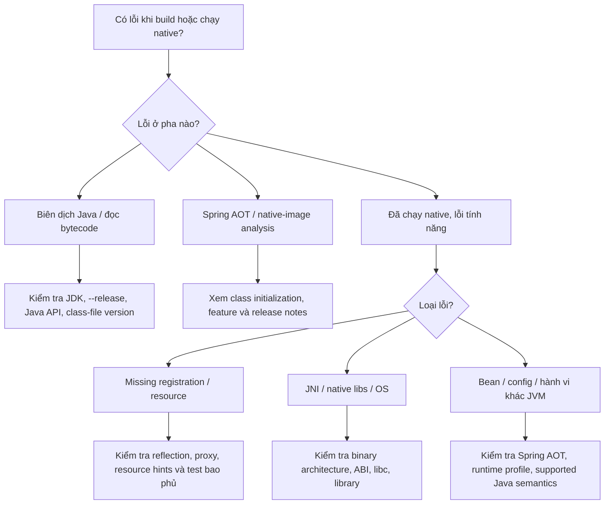

# Giới hạn tương thích Java cần tra cứu theo phiên bản GraalVM

> **Chương: Cơ chế Native Image.** Trong module **SPRING_BOOT_NATIVE_IMAGE**, mục tiêu là biên dịch ứng dụng Spring Boot bằng **Spring AOT** và **GraalVM Native Image**, kiểm tra tính tương thích, rồi đánh giá startup, bộ nhớ, khả năng đóng gói container và vận hành. Bài này tập trung vào câu hỏi nền tảng: **Một tính năng Java chạy được trên JVM có chắc chạy được trong bản native của đúng phiên bản GraalVM đang dùng không?**

## 1. Mục tiêu học tập

Sau bài học, bạn có thể:

1. Giải thích vì sao “hỗ trợ Java 21/25/27” khác với “hỗ trợ đầy đủ Native Image”.
2. Xác định các lớp tương thích phải kiểm tra cùng nhau: Java/JDK, GraalVM, Spring Boot/Spring AOT, Native Build Tools, dependency và hệ điều hành/CPU.
3. Phân loại giới hạn thành **khả năng biên dịch**, **metadata còn thiếu**, **hành vi khác JVM**, **tính năng chưa/không được hỗ trợ** và **vấn đề nền tảng chạy**.
4. Tra cứu tài liệu và release notes **đúng phiên bản**; phát hiện điều kiện thay đổi giữa các bản nâng cấp.
5. Lập thử nghiệm kiểm chứng trước khi quyết định triển khai một Spring Boot Native Image.

## 2. “Tương thích Java” có nhiều nghĩa

Ứng dụng Spring Boot truyền thống được biên dịch thành bytecode và chạy bởi JVM. Khi tạo Native Image, GraalVM phân tích tĩnh mã có thể được gọi và biên dịch phần cần thiết thành executable cho một nền tảng cụ thể. Mô hình **closed-world** buộc quá trình build biết trước phần lớn mã cần có lúc chạy.

Vì vậy, cần phân biệt năm câu hỏi:

| Câu hỏi | Kiểm tra điều gì? | Ví dụ lỗi khi hiểu sai |
|---|---|---|
| **Java language / class file** | JDK dùng để build native có đọc được bytecode, cú pháp và Java API của ứng dụng không? | `UnsupportedClassVersionError`, lỗi `release version ... not supported` |
| **GraalVM Native Image** | Bản GraalVM đó có xử lý được tính năng Java cụ thể trong chế độ native không? | Lỗi phân tích `invokedynamic`, class initialization hoặc tính năng VM đặc thù |
| **Spring Boot / Spring AOT** | Phiên bản Spring có hỗ trợ GraalVM/Native Build Tools được chọn và mô hình bean có phù hợp AOT không? | Bean phụ thuộc `@Profile` / `@ConditionalOnProperty` không hiện diện theo kỳ vọng |
| **Dependency và metadata** | Thư viện có cung cấp reachability metadata, proxy/resource/reflection hints phù hợp không? | `MissingReflectionRegistrationError`, resource không tìm thấy trong binary |
| **Nền tảng triển khai** | Binary tương thích OS, CPU, thư viện C/native, kiến trúc image và cơ chế vận hành không? | `Exec format error`, `UnsatisfiedLinkError` hoặc thiếu thư viện hệ thống |

**Một chương trình Java build thành công trên JVM chỉ xác nhận mức tương thích JVM.** Để nói bản native tương thích, phải build thành công **và** chạy đúng các luồng chức năng quan trọng trên nền tảng đích.

### Phân biệt bốn phiên bản thường bị nhầm

- **Java language/JDK:** ví dụ mã nguồn sử dụng Java 21; cần JDK có thể hiểu cú pháp, API và class-file tương ứng.
- **GraalVM:** bản phân phối và phiên bản Native Image, chẳng hạn một bản GraalVM dựa trên JDK 21 hoặc GraalVM 25. Một số họ phát hành GraalVM mới có cách đánh số riêng; xem cả **`java -version` và `native-image --version`**.
- **Spring Boot:** bản framework tạo cấu trúc bean, mã AOT và hints. Spring Boot hỗ trợ một Java version trên JVM **không tự suy ra** tổ hợp Native Image nào cũng được hỗ trợ.
- **Native Build Tools:** phiên bản plugin Maven/Gradle điều phối `native-image`. Đây là thành phần riêng, không thể suy version của nó từ version Java.

Ngoài ra, các bản thư viện như Jackson, Hibernate, JDBC driver, Netty hoặc SDK bên thứ ba có vòng đời hỗ trợ Native Image độc lập.

## 3. Ví dụ tra cứu có gắn phiên bản

Bảng dưới đây là **ảnh chụp thông tin từ trang System Requirements chính thức**, tại thời điểm biên soạn **23/11/2026**. Nó minh họa vì sao phải mở tài liệu theo phiên bản dự án; không phải ma trận được bảo đảm đúng cho mọi bản phát hành sau này.

| Phiên bản Spring Boot | Java trên JVM theo trang yêu cầu hệ thống | GraalVM Native Image theo trang yêu cầu hệ thống | Native Build Tools được liệt kê |
|---|---|---|---|
| **Spring Boot 3.5.16** | Java 17–25 | GraalVM 22.3 trở lên | 0.10.6 |
| **Spring Boot 4.2.0** | Java 17–27 | GraalVM 25 trở lên | 1.1.18 |

Nguồn: [Spring Boot 3.5 — System Requirements](https://docs.spring.io/spring-boot/3.5/system-requirements.html) và [Spring Boot 4.2 — System Requirements](https://docs.spring.io/spring-boot/4.2/system-requirements.html).

**Cách đọc đúng:** nếu Spring Boot 4.2 cho phép chạy Java 27 trên JVM, không thể tự động dùng một GraalVM Native Image dựa trên **JDK 25** để xử lý class file biên dịch cho **Java 27**. Phải chọn một bộ công cụ native hiểu được mức Java thực tế của mã và được Spring Boot tương ứng hỗ trợ, hoặc điều chỉnh target bytecode/API rồi thử nghiệm lại. Tương tự, việc một bản Native Build Tools xuất hiện trong bảng tài liệu không có nghĩa mọi bản plugin khác chắc chắn không hoạt động; nó là **mốc hỗ trợ cần đối chiếu**.

Một ví dụ khác cho thấy ngay cả **bản vá GraalVM** có thể tác động tới khả năng triển khai: [Release Notes GraalVM 25](https://www.graalvm.org/release-notes/JDK_25/) ghi nhận thay đổi hỗ trợ **macOS x64** ở nhánh 25.0.x. Vì vậy, kiểm tra chỉ “GraalVM 25” là chưa đủ nếu môi trường build là máy macOS Intel.

## 4. Các giới hạn Java phải đọc trong Compatibility Guide

Đây là các **nhóm rủi ro**, không phải bảng khẳng định tất cả tính năng đều bị cấm. Cùng một API có thể cần metadata ở bản này, có tính năng thử nghiệm ở bản khác, hoặc thay đổi mặc định theo release.

### 4.1. Reflection, proxy, serialization và resource

Trên JVM, tên lớp, method hoặc resource có thể được xác định bằng chuỗi lúc chạy:

```java
String handlerName = request.getParameter("handler");
Class<?> handlerClass = Class.forName(handlerName);
Object handler = handlerClass.getDeclaredConstructor().newInstance();
```

Ở Native Image, phân tích tĩnh không thể dự đoán tùy ý chuỗi nhận từ request. Nếu lớp/method/constructor không được phân tích hoặc đăng ký thích hợp, thao tác có thể lỗi khi chạy native. Các nhóm tương tự gồm:

- `java.lang.reflect` và `MethodHandles` được dùng theo tên tính động.
- JDK dynamic proxy với tập interface được chọn tại runtime.
- Java serialization, Jackson binding qua reflection, một số kiểu DTO hoặc polymorphic deserialization.
- Đọc file từ classpath, bundle ngôn ngữ (`ResourceBundle`), `ServiceLoader` và tài nguyên tùy biến.
- JNI, foreign-function access và thư viện native cần biết symbol/type hoặc cấu hình riêng.

**Hướng xử lý:** kiểm tra Spring AOT đã sinh hints chưa, tra reachability metadata của thư viện đúng phiên bản, thêm `RuntimeHintsRegistrar` hoặc tệp metadata **theo schema của GraalVM đang dùng**. Không suy rằng cứ thêm một tệp `reflect-config.json` kiểu cũ là phù hợp với mọi release.

Ví dụ hint Spring có thể tự đăng ký resource và constructor được gọi bằng reflection:

```java
package com.example.nativeapp;

import org.springframework.aot.hint.MemberCategory;
import org.springframework.aot.hint.RuntimeHints;
import org.springframework.aot.hint.RuntimeHintsRegistrar;
import org.springframework.context.annotation.Configuration;
import org.springframework.context.annotation.ImportRuntimeHints;

@Configuration
@ImportRuntimeHints(NativeCompatibilityHints.class)
class NativeCompatibilityConfig {
}

class NativeCompatibilityHints implements RuntimeHintsRegistrar {
    @Override
    public void registerHints(RuntimeHints hints, ClassLoader classLoader) {
        hints.resources().registerPattern("catalog/*.json");
        hints.reflection().registerType(
            InvoiceHandler.class, MemberCategory.INVOKE_DECLARED_CONSTRUCTORS
        );
    }
}

class InvoiceHandler {
    InvoiceHandler() { }
}
```

Đây là **minh họa việc khai báo khả năng cần dùng**, chưa phải cách tự động làm mọi reflection hợp lệ: nếu ứng dụng còn gọi method/field qua reflection, phải đăng ký các phần tử tương ứng. Spring có thể tự sinh nhiều hints cho controller và bean thông thường. Nếu có logic động do thư viện bên thứ ba, cần kiểm tra từng trường hợp.

### 4.2. Nạp lớp hoặc sinh bytecode lúc runtime

Một hệ thống plugin có thể dùng `ClassLoader.defineClass`, proxy được sinh sau khi chạy, bytecode weaving hoặc instrument class. Những khả năng đó không tương đương mặc định với JVM trên mô hình closed-world. Các bản GraalVM mới có thể thử nghiệm một số cơ chế nạp lớp động, nhưng **tình trạng hỗ trợ, cờ bật và giới hạn phải tra theo đúng release**; không kết luận “mọi dynamic class loading đều không thể dùng” và cũng không coi tính năng thử nghiệm là tương thích sản xuất.

Với `invokedynamic`, cũng phải phân biệt: những cách dùng được trình biên dịch Java tạo ra cho **lambda** và **nối chuỗi** là các trường hợp GraalVM có hỗ trợ; call site thay đổi tùy ý tại runtime là vấn đề khác. Đọc chính xác phần *`invokedynamic` and Method Handles* trong compatibility guide thay vì thấy bytecode `invokedynamic` rồi mặc định coi toàn bộ ứng dụng không tương thích.

### 4.3. Khởi tạo lớp tại build time và runtime

Native Image có thể khởi tạo một số lớp trong lúc build để tăng tốc khởi động. Nếu `static` initializer đọc giờ hệ thống, secret, hostname, timezone, file config hoặc tạo đối tượng gắn với tiến trình build, giá trị/đối tượng có thể không phù hợp khi chạy tại môi trường production.

```java
final class EnvironmentSnapshot {
    static final String REGION = System.getenv("APP_REGION");
}
```

Nếu lớp này được khởi tạo lúc build, `REGION` có nguy cơ mang giá trị của **máy build**, không phải container runtime. Tùy phiên bản GraalVM, thứ tự khởi tạo và mặc định có thể thay đổi. Cần kiểm tra hướng dẫn **Class Initialization** của release, dùng `--initialize-at-run-time` hoặc thay thiết kế để đọc cấu hình vào lúc thích hợp. Không thêm tùy tiện `--initialize-at-build-time` cho toàn bộ package chỉ nhằm giảm startup.

### 4.4. Các API và hành vi VM cần kiểm chứng riêng

| Nhóm | Vì sao cần tra cứu theo bản GraalVM? | Cách xác minh |
|---|---|---|
| JVMTI, `javaagent`, instrumentation, bytecode profiler | Công cụ có thể phụ thuộc bytecode, JIT và khả năng thay đổi lớp lúc chạy | Đọc *Debugging and Monitoring* + release notes của Native Image; thử agent cụ thể |
| Threading, finalizer, VM management | Một số API đã lỗi thời hoặc có semantics khác JVM | Đọc *Compatibility Guide* và chạy test về lifecycle/shutdown |
| `sun.misc.Unsafe`, memory layout, JNI | Truy cập bộ nhớ/thư viện native phụ thuộc phân tích và ABI | Kiểm tra metadata, native library, OS/CPU, test trên image thật |
| FFM API, Vector API, preview/incubator JDK features | Hỗ trợ có thể được bổ sung từng bước, chỉ một số nền tảng/flag | Tra release notes đúng JDK/GraalVM, thử build tối giản |
| JCA/crypto providers, TLS | Đăng ký provider, resource, class initialization có thể ảnh hưởng thuật toán khả dụng | Chạy handshake/thuật toán thật ở native và đối chiếu provider |
| `Locale`, timezone, charset, resource bundles | Việc đóng gói dữ liệu và resource có thể khác; image được tạo ở môi trường build | Test locale/timezone/charset yêu cầu trên target image |

Ví dụ: **Java hỗ trợ một JEP** trong JDK phát hành không đồng nghĩa GraalVM Native Image hỗ trợ hoàn chỉnh JEP đó ở mọi platform. Đặc biệt với preview/incubator, cần xem phần mô tả JDK feature, Native Image release notes và trạng thái experimental.

### 4.5. Giới hạn bổ sung do Spring AOT

Spring AOT xác định trước nhiều cấu trúc bean ở build time. Vì vậy, một profile hoặc thuộc tính làm **thay đổi bean nào được tạo** không thể tùy ý hoán đổi sau khi native đã build như ứng dụng JVM thông thường. Cần xác định rõ:

- Các `@Profile`, `@ConditionalOnProperty`, điều kiện auto-configuration có làm thay đổi **tập bean** không?
- Tác động của việc thay `SPRING_PROFILES_ACTIVE` hoặc một thuộc tính `*.enabled` lúc chạy đối với native executable?
- Các giá trị như URL database, credential, port có chỉ được **đọc vào lúc chạy** hay ảnh hưởng quyết định tạo bean lúc build?

Một cấu hình động phục vụ **giá trị của bean** có thể vẫn hoạt động. Cấu hình quyết định **có tạo bean hay không** cần kiểm chứng theo Spring AOT. Đối chiếu [Spring Boot — Introducing GraalVM Native Images](https://docs.spring.io/spring-boot/4.2/reference/packaging/native-image/introducing-graalvm-native-images.html) của đúng nhánh dự án.

## 5. Quy trình tra cứu tương thích có thể lặp lại

### Bước 1 — Ghi lại “bộ định danh” của bản build

Ví dụ trên Linux/macOS (Windows dùng executable tương ứng trong `bin` và lệnh Wrapper `.cmd`):

```bash
java -version
javac -version
native-image --version
./mvnw --version
# Hoặc nếu dự án dùng Gradle:
./gradlew --version
```

Đi kèm thông tin **`JAVA_HOME`, đường dẫn `java`/`native-image` đang được PATH chọn**, cấu hình toolchain, Spring Boot version, Spring Framework, version plugin GraalVM Native Build Tools, danh sách dependency và OS/CPU của môi trường build lẫn runtime. Nếu dùng Buildpacks, cũng ghi **builder image/tag và phiên bản GraalVM/JDK thực tế trong builder**. Java tại máy local có thể khác Java bên trong container build.

Mẫu lưu dấu cấu hình để điều tra:

```text
Spring Boot:          4.2.0
Spring Framework:     <resolved-version>
Source / target Java: <project-value>
Build JDK:            <java -version>
Native Image tool:    <native-image --version>
Native Build Tools:   <resolved-plugin-version>
Dependency nghi vấn:  <group:artifact:version>
OS/architecture:      <build>  ->  <runtime>
Libc / native libs:   <glibc-or-musl-and-required-libs>
Buildpacks builder:   <tag-and-digest-if-used>
```

Các dấu `<...>` là chỗ điền thực tế, không phải kết quả đo mẫu.

### Bước 2 — Mở tài liệu **được khóa phiên bản**

Theo thứ tự hữu ích:

1. **Spring Boot System Requirements đúng nhánh**: Java được hỗ trợ trên JVM, GraalVM yêu cầu cho Native Image, Gradle/Maven và Native Build Tools được liệt kê.
2. **GraalVM Native Image Compatibility Guide đúng release**: đóng/mở tính năng Java, những gì cần metadata, hành vi khác JVM.
3. **GraalVM Reachability Metadata và JSON Schema đúng release**: cú pháp metadata, hỗ trợ reflection, proxy, JNI, resources và lỗi khi thiếu đăng ký.
4. **GraalVM Release Notes theo cả bản lớn và bản vá**: breaking changes, JDK features, tùy chọn experimental, kiến trúc bị thêm/bỏ hỗ trợ.
5. **Tài liệu Spring AOT và thư viện cụ thể**: hints, hạn chế điều kiện bean, vấn đề đã biết; tìm version thư viện trong [GraalVM Reachability Metadata Repository](https://github.com/oracle/graalvm-reachability-metadata).
6. **Supported Platforms và tài liệu container/buildpack**: build host, image OS/CPU, libc, đường dẫn file, cơ chế linking/JNI.

**Không chỉ xem trang `/latest/` rồi suy cho hệ thống đang chạy phiên bản cũ.** Khi có khác biệt giữa documentation và release notes, ưu tiên dữ liệu khớp bản phát hành đang sử dụng và kiểm tra bản vá liên quan.

### Bước 3 — Lập bảng trạng thái từng tính năng

| Tính năng dự án đang dùng | Trên JVM | Native theo release được tra | Việc cần làm |
|---|---|---|---|
| REST controller, Jackson DTO thông thường | Có | Cần xác nhận AOT/binding hints | Build/test request-response JSON |
| Handler lấy bằng tên class từ DB | Có | Phụ thuộc metadata và cách nạp lớp | Đăng ký reflection; test từng handler |
| Template JSON từ `classpath` | Có | Phụ thuộc resource hints | Đăng ký resource và test cả path hiếm |
| JDBC driver dùng thư viện native | Có | Phụ thuộc driver, metadata, JNI và platform | Test connection trên container native |
| `javaagent` biến đổi bytecode lúc chạy | Có thể | Cần kiểm tra giới hạn JVMTI/instrumentation | Đối chiếu release cụ thể; cân nhắc thay công cụ |

Ghi **kết luận, phiên bản được kiểm tra, URL tài liệu, test chứng minh và người sở hữu quyết định**. Chưa chạy test thì ghi **“chưa xác minh”**, không đánh dấu “tương thích”.

## 6. Chẩn đoán khi build hoặc chạy native bị lỗi



| Dấu hiệu | Khả năng ban đầu | Hành động |
|---|---|---|
| `UnsupportedClassVersionError`, `invalid target release` | JDK hoặc mức bytecode không khớp | Xem `java -version`, `javac -version`, toolchain và dependency đang tải |
| `UnsupportedFeatureError`, lỗi analysis hoặc class initialization | Giới hạn của Native Image/release, hoặc lớp khởi tạo ở sai pha | Đọc stack trace và compatibility guide đúng release; làm ví dụ tối thiểu |
| `MissingReflectionRegistrationError`, `MissingResourceRegistrationError` | Metadata còn thiếu | Thêm Spring RuntimeHints/metadata đúng schema; chạy lại nhánh chức năng |
| `ClassNotFoundException`, `NoSuchMethodException`, class/resource không tìm thấy | Dynamic class lookup, reflective access hoặc dependency/resource bị loại | Phân biệt thực sự không tồn tại với tồn tại nhưng chưa đăng ký; kiểm tra reachability |
| `UnsatisfiedLinkError` hoặc `Exec format error` | JNI, thư viện hệ thống hoặc OS/kiến trúc không tương ứng | Kiểm tra thư viện/linking, build target và container runtime |
| JVM chạy đúng nhưng native thiếu bean khi đổi profile | Spring AOT cố định cấu trúc bean từ build | So sánh profile/property lúc build và runtime; thiết kế lại điều kiện nếu cần |

### Thu thập metadata bằng tracing agent

Trong trường hợp cần tìm reflection/resource/proxy khó quan sát, GraalVM cung cấp tracing agent để ghi những truy cập động **trên JVM**. Ví dụ minh họa cho ứng dụng JAR và GraalVM JDK có agent tương ứng:

```bash
java -agentlib:native-image-agent=config-output-dir=./native-metadata \
     -jar target/app.jar
```

Khi ứng dụng chạy, gọi các endpoint và tình huống có tải resource, serialization, plugin, sau đó dừng để agent ghi cấu hình. Một số ứng dụng Spring AOT có thể cần chạy JAR với `-Dspring.aot.enabled=true` sau khi đã tạo artifact AOT phù hợp; xem hướng dẫn tracing agent của **đúng phiên bản Spring Boot**.

**Giới hạn của agent:** nó chỉ ghi những đường thực sự được thực thi; không bao phủ các trường hợp hiếm chưa chạy trong test. Cần xem lại file được sinh, tránh đăng ký quá rộng, đặt metadata tại vị trí dự án/plugin có thể đọc và **chạy lại native executable** để xác minh. Xem [GraalVM — Collect Metadata with the Tracing Agent](https://www.graalvm.org/jdk25/reference-manual/native-image/metadata/AutomaticMetadataCollection/) và [Spring Boot — Advanced Native Images Topics](https://docs.spring.io/spring-boot/4.2/reference/packaging/native-image/advanced-topics.html).

## 7. Thực hành kiểm chứng theo phiên bản

Giả sử đội phát triển có Spring Boot app với controller `/orders`, dependency JSON, JDBC driver và một báo cáo đọc template từ `classpath`. Thực hiện:

1. **Khóa phiên bản** Spring Boot, Java target, GraalVM, Native Build Tools, dependency, OS/CPU và builder image (nếu dùng container).
2. **Chạy bản JVM** với cùng dữ liệu/config; ghi kết quả các API, báo cáo và kết nối database.
3. **Build native** từ đúng mã và cấu hình plugin, ví dụ Maven `./mvnw -Pnative native:compile` hoặc Gradle `./gradlew nativeCompile`. Các lệnh chỉ hợp lệ khi dự án đã tích hợp GraalVM Native Build Tools phù hợp.
4. **Chạy binary** trên hệ điều hành/kiến trúc tương ứng; kiểm tra endpoint, lỗi log, resource, TLS và serialization. Đừng dừng sau khi endpoint `/health` đã trả 200.
5. **Thử tình huống động**: DTO lồng nhau, template chưa dùng trong smoke test, handler được chọn từ dữ liệu, profile/runtime properties, exception path và kết nối lại database.
6. **Đo startup và memory** với điều kiện so sánh JVM/native thống nhất; nếu build lỗi phải sửa hoặc kết luận chưa hỗ trợ trước khi đánh giá lợi ích hiệu năng.
7. **Nâng đúng một thành phần**, ví dụ GraalVM patch hoặc version JDBC driver, rồi chạy lại bộ kiểm thử tương thích. Nếu kết quả khác, lưu release notes và lỗi tái hiện.

Để báo cáo, có thể dùng bảng sau:

| Test | JVM | Native | Bằng chứng |
|---|---|---|---|
| `GET /orders` + JSON binding | Pass/Fail | Pass/Fail | Response và log |
| Kết nối JDBC và query | Pass/Fail | Pass/Fail | Integration test |
| Đọc resource template | Pass/Fail | Pass/Fail | File/bản ghi đầu ra |
| Handler chọn bằng reflection | Pass/Fail | Pass/Fail | Bộ dữ liệu nhiều handler |
| Profile/runtime config | Pass/Fail | Pass/Fail | Các cấu hình được ghi rõ |
| Startup + RSS | Số đo | Số đo | Máy, giới hạn tài nguyên, số lần đo |

**Tiêu chí hoàn thành:** bản native thực hiện đúng các hành vi phải hỗ trợ, không còn nhánh nghiệp vụ chưa test liên quan tới metadata, chạy được trên deployment target và có số đo khách quan cho lợi ích startup/bộ nhớ. Khi một thư viện chưa hỗ trợ, ghi rõ tổ hợp version và lựa chọn: cập nhật metadata/thư viện, thay cách triển khai, hoặc tiếp tục chạy JAR/JVM.

## 8. Câu hỏi tự kiểm tra

1. Vì sao “Spring Boot hỗ trợ Java 27” không đủ để kết luận “GraalVM dùng JDK 25 có thể build Native Image từ bytecode Java 27”?
2. Khác nhau giữa lỗi `UnsupportedClassVersionError` và `MissingReflectionRegistrationError` là gì?
3. Một plugin nạp lớp từ file `.jar` mới sau khi chương trình khởi động; cần tra cứu phần nào trong tài liệu GraalVM?
4. Vì sao tracing agent không thể đảm bảo đã thu thập đủ metadata dù các test hiện tại đều pass?
5. Vì sao một bản nâng cấp GraalVM patch có thể cần kiểm thử lại image dành cho macOS hoặc Linux?
6. Thay đổi `SPRING_PROFILES_ACTIVE` có thể tạo ra loại khác biệt nào với ứng dụng Spring AOT?

## Ghi nhớ

**Đọc đúng phiên bản, phân loại đúng giới hạn, kiểm thử đúng binary.** Khi nghiên cứu Native Image cho Spring Boot, điều quyết định không chỉ là Java có biên dịch được hay không: phải ghép đúng **JDK + GraalVM + Spring Boot/Spring AOT + Native Build Tools + thư viện + nền tảng đích**. Các giới hạn dynamic features, metadata, khởi tạo lớp và công cụ JVM có thể thay đổi theo release; bảng hỗ trợ chỉ cho biết điểm bắt đầu tra cứu. Kết luận tương thích phải dựa trên cả tài liệu phiên bản và thử nghiệm ứng dụng thực tế.

## Tài liệu tham khảo chính thức

- [Spring Boot 3.5 — System Requirements](https://docs.spring.io/spring-boot/3.5/system-requirements.html): mốc Java, GraalVM và Native Build Tools cho nhánh 3.5.
- [Spring Boot 4.2 — System Requirements](https://docs.spring.io/spring-boot/4.2/system-requirements.html): ví dụ khác về thay đổi bộ công cụ hỗ trợ.
- [Spring Boot — Introducing GraalVM Native Images](https://docs.spring.io/spring-boot/4.2/reference/packaging/native-image/introducing-graalvm-native-images.html): hạn chế AOT, closed-world, điều kiện bean.
- [Spring Boot — Advanced Native Images Topics](https://docs.spring.io/spring-boot/4.2/reference/packaging/native-image/advanced-topics.html): custom hints, tracing agent, vấn đề thường gặp.
- [GraalVM for JDK 25 — Native Image Compatibility Guide](https://www.graalvm.org/jdk25/reference-manual/native-image/metadata/Compatibility/): metadata, `invokedynamic`, class initialization và tính năng có hành vi khác JVM.
- [GraalVM for JDK 25 — Reachability Metadata](https://www.graalvm.org/jdk25/reference-manual/native-image/metadata/): metadata theo release, reflection, resources, JNI, proxy.
- [GraalVM — Release Notes](https://www.graalvm.org/release-notes/JDK_25/): thay đổi tính năng, nền tảng và bản vá cụ thể.
- [GraalVM Reachability Metadata Repository](https://github.com/oracle/graalvm-reachability-metadata): metadata cộng đồng cho dependency Java; cần đối chiếu tọa độ và phiên bản thư viện.
