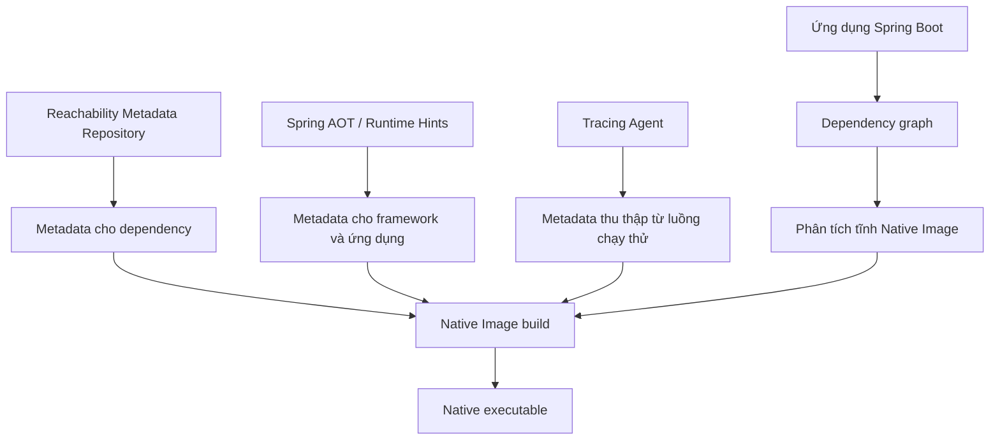

# GraalVM Reachability Metadata Repository và tích hợp Native Build Tools

> **Chương: Thư viện ngoài.** Module **SPRING_BOOT_NATIVE_IMAGE** biên dịch ứng dụng Spring Boot thành GraalVM Native Image bằng Spring AOT. Ứng dụng Spring thường dùng nhiều thư viện bên thứ ba; một số thư viện truy cập reflection, resource, JNI, serialization hoặc proxy theo cách mà phân tích tĩnh không thể nhận diện đầy đủ. Bài học này hướng dẫn sử dụng **GraalVM Reachability Metadata Repository** cùng **GraalVM Native Build Tools** để bổ sung cấu hình cần thiết cho các dependency.

## 1. Mục tiêu học tập

Sau bài học, bạn có thể:

1. Giải thích reachability metadata là gì và vì sao Native Image cần metadata cho một số thư viện.
2. Phân biệt metadata repository, metadata do Native Image Tracing Agent thu thập và Runtime Hints do Spring cung cấp.
3. Mô tả cách Native Build Tools tra metadata theo dependency và version.
4. Cấu hình repository trong Gradle và Maven, bao gồm repository mặc định, local repository và override theo module.
5. Kiểm tra dependency chưa có metadata bằng task/goal có sẵn.
6. Đưa metadata vào JAR khi một công cụ khác hoặc Buildpack chịu trách nhiệm tạo Native Image.
7. Xử lý trường hợp thiếu metadata, metadata sai version và lỗi runtime sau khi native build thành công.

## 2. Vì sao thư viện bên thứ ba cần reachability metadata?

Native Image phân tích mã và dependency trong quá trình build để xác định phần nào của chương trình có thể được sử dụng. Phân tích tĩnh không phải lúc nào cũng suy ra được những truy cập được quyết định động, chẳng hạn:

- Tạo object hoặc gọi method bằng Java Reflection.
- Đọc classpath resource bằng tên được ghép ở runtime.
- Tạo JDK dynamic proxy với danh sách interface được xác định động.
- Truy cập JNI hoặc native library.
- Serialize/deserialize kiểu dữ liệu bằng reflection.
- Nạp class hoặc resource theo tên lấy từ cấu hình, plugin hay dữ liệu bên ngoài.

Ví dụ, thư viện JSON có thể tìm constructor hoặc field của một kiểu bằng reflection:

```java
Class<?> type = Class.forName(configuredClassName);
Constructor<?> constructor = type.getDeclaredConstructor();
Object value = constructor.newInstance();
```

Trên JVM thông thường, những thành phần này có thể được tìm thấy lúc chạy. Với Native Image, nếu build không biết trước constructor và class cần truy cập, chúng có thể bị loại khỏi executable. Khi chạy native, ứng dụng có thể gặp lỗi thiếu registration dù cùng code vẫn chạy bình thường trên JVM.

**Reachability metadata** là cấu hình cho Native Image biết những thành phần động nào cần được giữ lại hoặc cho phép truy cập. Metadata có thể mô tả reflection, resource, proxy, JNI, serialization và các tính năng động khác.



## 3. GraalVM Reachability Metadata Repository là gì?

Đây là repository cộng đồng do hệ sinh thái GraalVM duy trì, chứa metadata đã được đóng góp và kiểm thử cho các thư viện/framework JVM phổ biến. Mục tiêu là giúp những dependency có sử dụng tính năng động hoạt động với Native Image mà mỗi ứng dụng không phải tự viết lại toàn bộ cấu hình.

Metadata thường gắn với tọa độ thư viện và các version đã được hỗ trợ. Một số cấu hình có thể chỉ áp dụng cho một dải version hoặc một metadata version cụ thể. Vì vậy, sự hiện diện của một thư viện trong repository không đồng nghĩa mọi version của thư viện đó đều được hỗ trợ giống nhau.

### 3.1. Metadata repository cung cấp những gì?

| Loại metadata | Mục đích |
|---|---|
| Reflection | Khai báo class, constructor, method, field cần truy cập động |
| Resources | Khai báo classpath resource và resource bundle |
| Dynamic proxy | Khai báo interface cần dùng để tạo proxy |
| JNI | Khai báo thành phần được truy cập qua Java Native Interface |
| Serialization | Khai báo kiểu cần hỗ trợ serialization theo cơ chế Native Image |
| Các tính năng động khác | Bổ sung thông tin theo schema và khả năng của GraalVM release |

Metadata hiện đại có thể được biểu diễn bằng file `reachability-metadata.json`; các dự án hoặc dependency cũ có thể còn sử dụng những file cấu hình riêng như `reflect-config.json`, `resource-config.json` hoặc `proxy-config.json`. Schema và khả năng được hỗ trợ thay đổi theo phiên bản Native Image. Hãy dùng metadata do repository phát hành cùng Native Build Tools tương thích, tránh sao chép file cấu hình cũ mà không kiểm tra schema.

### 3.2. Metadata repository không phải thư viện runtime

Metadata repository cung cấp cấu hình cho quá trình tạo native executable. Nó không:

- Thay thế dependency Java thực tế của ứng dụng.
- Thêm implementation cho thư viện hoặc sửa lỗi logic của thư viện.
- Tự động phát hiện mọi code path động của ứng dụng.
- Bảo đảm tất cả version của dependency đều tương thích.
- Thay thế Spring AOT, Runtime Hints của ứng dụng hoặc kiểm thử Native Image.

Native Build Tools tải và áp dụng metadata trong quá trình build. ZIP repository không phải dependency mà ứng dụng cần nạp trên classpath khi chạy.

## 4. Native Build Tools tích hợp repository như thế nào?

Native Build Tools cung cấp plugin cho Gradle và Maven. Khi tạo native image, plugin sử dụng dependency graph để tra metadata tương ứng trong repository đã cấu hình, sau đó cung cấp metadata cho Native Image builder.

Quy trình khái quát:

1. Gradle/Maven giải quyết dependency và version thực tế.
2. Native Build Tools tra metadata theo tọa độ thư viện.
3. Metadata phù hợp được tải từ repository đã cấu hình hoặc đọc từ repository local.
4. Plugin chuyển metadata vào quá trình `native-image`.
5. Native Image sử dụng metadata cùng phân tích tĩnh để tạo executable.

Trong các phiên bản Native Build Tools hiện hành, metadata repository được bật mặc định. Một số phiên bản cũ yêu cầu bật tường minh; do đó cần kiểm tra tài liệu đúng version plugin đang dùng.

### 4.1. Phân biệt ba loại version

Có ba version khác nhau cần theo dõi:

| Version | Ý nghĩa |
|---|---|
| Native Build Tools plugin version | Version của plugin Gradle/Maven |
| Metadata repository version | Bản phát hành của tập hợp metadata |
| Library version | Version dependency thực tế trong ứng dụng |

Plugin thường chọn repository version mặc định tương thích với bản plugin. Có thể override repository version khi cần. Riêng một module có thể cần metadata version khác nếu repository không có cấu hình riêng cho đúng library version mà nhóm đang dùng và nhóm đã xác minh cấu hình thay thế hoạt động.

Không nhầm `metadataVersion` với version của dependency. Override metadata version không nâng cấp hoặc hạ cấp thư viện; nó chỉ chọn một bộ metadata khác để kiểm tra tương thích.

## 5. Cấu hình với Gradle

Thêm GraalVM Native Build Tools plugin vào `build.gradle`:

```groovy
plugins {
    id "java"
    id "org.graalvm.buildtools.native" version "1.1.19"
}
```

Version trong ví dụ là version minh họa của tài liệu Native Build Tools hiện hành; hãy dùng version phù hợp với GraalVM JDK và Gradle của dự án.

### 5.1. Repository mặc định

Với plugin hiện hành, metadata repository được bật mặc định. Có thể khai báo rõ trong `build.gradle` để người đọc thấy dependency native build sử dụng nguồn metadata nào:

```groovy
graalvmNative {
    metadataRepository {
        enabled = true
    }
}
```

Kotlin DSL (`build.gradle.kts`):

```kotlin
graalvmNative {
    metadataRepository {
        enabled.set(true)
    }
}
```

Nếu cần tắt tra cứu repository để điều tra một vấn đề cụ thể:

```groovy
graalvmNative {
    metadataRepository {
        enabled = false
    }
}
```

Chỉ tắt trong một lần chẩn đoán có chủ đích. Nếu dependency cần metadata mà repository bị tắt, native build hoặc runtime có thể gặp lỗi registration.

### 5.2. Chọn repository version

Có thể override version của metadata repository:

```groovy
graalvmNative {
    metadataRepository {
        version = "1.0.23"
    }
}
```

Giá trị trên chỉ là ví dụ. Hãy chọn một bản repository đã được công bố và phù hợp với Native Image/GraalVM đang sử dụng. Khi pin version, ghi lại lý do thay đổi và chạy lại native tests.

### 5.3. Dùng repository local

Trong môi trường CI không truy cập Internet, hoặc khi cần tái lập build với một bộ metadata đã được kiểm soát, có thể dùng repository local:

```groovy
graalvmNative {
    metadataRepository {
        uri(file("metadata-repository"))
    }
}
```

Thư mục `metadata-repository` phải có cấu trúc repository mà Native Build Tools mong đợi. Có thể lấy bản repository tương ứng từ artifact ZIP trên Maven Central rồi giải nén vào thư mục này. Không trỏ `uri` tới một thư mục chứa file metadata rời rạc không theo cấu trúc repository.

### 5.4. Loại trừ module hoặc override metadata version

Nếu một module có metadata không phù hợp với version đang dùng, có thể loại module khỏi tra cứu:

```groovy
graalvmNative {
    metadataRepository {
        excludes.add("com.example:legacy-client")
    }
}
```

Hoặc ép plugin dùng metadata version cụ thể cho module:

```groovy
graalvmNative {
    metadataRepository {
        moduleToConfigVersion.put("com.example:legacy-client", "3")
    }
}
```

Chỉ override khi đã xác minh metadata đó phù hợp với library version thực tế. Nếu metadata version không tương thích, Native Image có thể build nhưng ứng dụng vẫn lỗi khi đi vào code path động.

### 5.5. Task kiểm tra dependency thiếu metadata

Native Build Tools cung cấp task:

```bash
./gradlew listLibrariesMissingMetadata
```

Task này kiểm tra các dependency runtime bên ngoài trực tiếp trên main runtime classpath, đối chiếu với metadata repository đã cấu hình và tạo báo cáo:

```text
build/reports/native/list-libraries-missing-metadata.json
```

Báo cáo có thể cho biết dependency chưa có metadata và cung cấp liên kết issue đã điền sẵn để nhóm xem xét. Phạm vi task là dependency trực tiếp; nó không thay thế việc kiểm tra dependency bắc cầu hoặc code path động của ứng dụng.

Tùy chọn tự động tạo issue cần được bật có chủ đích. Ví dụ `-PcreateIssues=true` có thể tạo issue trên repository công khai và yêu cầu token phù hợp; không cần bật tùy chọn này trong build thông thường.

## 6. Cấu hình với Maven

Thêm `native-maven-plugin` vào `pom.xml`:

```xml
<plugin>
    <groupId>org.graalvm.buildtools</groupId>
    <artifactId>native-maven-plugin</artifactId>
    <version>1.1.19</version>
    <extensions>true</extensions>
    <configuration>
        <metadataRepository>
            <enabled>true</enabled>
        </metadataRepository>
    </configuration>
</plugin>
```

Các phiên bản Native Build Tools hiện hành bật metadata repository mặc định. Khai báo `enabled` tường minh hữu ích khi muốn thể hiện rõ cấu hình; với plugin cũ, cần kiểm tra version đó có yêu cầu bật thủ công hay không.

### 6.1. Chọn repository version

Có thể chọn version repository cụ thể:

```xml
<metadataRepository>
    <enabled>true</enabled>
    <version>1.0.23</version>
</metadataRepository>
```

Version chỉ là ví dụ. Khi override, cần kiểm tra metadata có chứa cấu hình cho tọa độ và version dependency trong ứng dụng.

### 6.2. Dùng repository ZIP từ URL hoặc repository local

Nếu cần dùng một ZIP repository từ URL:

```xml
<metadataRepository>
    <enabled>true</enabled>
    <url>https://example.org/native/metadata-repository.zip</url>
</metadataRepository>
```

Thay URL ví dụ bằng địa chỉ ZIP thực tế mà tổ chức quản lý.

Để debug hoặc dùng repository đã tải về local:

```xml
<metadataRepository>
    <enabled>true</enabled>
    <localPath>metadata-repository</localPath>
</metadataRepository>
```

`localPath` có thể trỏ tới thư mục đã giải nén hoặc file ZIP repository. Đường dẫn phải tồn tại và có cấu trúc đúng.

### 6.3. Loại trừ module hoặc chọn metadata version riêng

Loại module khỏi việc tra cứu:

```xml
<metadataRepository>
    <enabled>true</enabled>
    <dependencies>
        <dependency>
            <groupId>com.example</groupId>
            <artifactId>legacy-client</artifactId>
            <excluded>true</excluded>
        </dependency>
    </dependencies>
</metadataRepository>
```

Chọn metadata version riêng cho module:

```xml
<metadataRepository>
    <enabled>true</enabled>
    <dependencies>
        <dependency>
            <groupId>com.example</groupId>
            <artifactId>legacy-client</artifactId>
            <metadataVersion>3</metadataVersion>
        </dependency>
    </dependencies>
</metadataRepository>
```

Các giá trị `groupId`, `artifactId` và metadata version cần được thay bằng dependency thật của dự án. Việc loại trừ module chỉ ngừng sử dụng metadata từ repository cho module đó; nó không tạo ra metadata thay thế. Nếu code path cần reflection/resource, nhóm phải cung cấp metadata khác hoặc xác minh thư viện không cần cấu hình bổ sung.

### 6.4. Kiểm tra dependency thiếu metadata

Chạy Maven goal:

```bash
./mvnw native:list-libraries-missing-metadata
```

Goal kiểm tra dependency runtime bên ngoài trực tiếp và ghi báo cáo:

```text
target/native/list-libraries-missing-metadata.json
```

Hãy đọc báo cáo cùng dependency tree và kết quả native test. Một dependency không có trong repository không tự động chứng minh nó không tương thích; có thể thư viện không dùng tính năng động cần metadata hoặc metadata được cung cấp theo cách khác.

## 7. Artifact ZIP và cách đưa metadata vào JAR

Repository cũng được phát hành dưới dạng ZIP trên Maven Central. Tọa độ artifact có dạng:

```xml
<dependency>
    <groupId>org.graalvm.buildtools</groupId>
    <artifactId>graalvm-reachability-metadata</artifactId>
    <version>1.1.19</version>
    <classifier>repository</classifier>
    <type>zip</type>
</dependency>
```

Đây là tọa độ artifact phân phối repository, không phải dependency runtime cần thêm vào ứng dụng Spring Boot. Native Build Tools có thể tự tải và dùng repository khi nó trực tiếp tạo native image.

### 7.1. Khi nào cần đóng gói metadata trong JAR?

Trong một số pipeline, Maven/Gradle chỉ tạo JAR; một công cụ khác mới chuyển JAR đó thành Native Image. Ví dụ:

- Build artifact trong một pipeline, native image được tạo ở pipeline triển khai khác.
- JAR được đưa vào container build bằng Cloud Native Buildpacks/Paketo.
- Một nền tảng build image chỉ nhận JAR và không có cấu hình Native Build Tools của project gốc.

Trong trường hợp đó, metadata đã tải từ repository cần được đưa vào JAR dưới `META-INF/native-image/...` để công cụ phía sau có thể đọc được. Nếu Native Build Tools trực tiếp tạo executable, thông thường không cần thêm bước copy này.

### 7.2. Gradle: collectReachabilityMetadata

Native Build Tools cung cấp task `collectReachabilityMetadata` để tải metadata repository vào thư mục build:

```groovy
tasks.named("jar") {
    from collectReachabilityMetadata
}
```

Khi đóng gói JAR, task sẽ đưa các file metadata vào artifact. Mặc định, metadata repository được dùng trực tiếp trong native image generation; `collectReachabilityMetadata` dành cho trường hợp muốn mang metadata đi cùng JAR để một công cụ khác xử lý.

Có thể kiểm tra JAR sau khi build:

```bash
jar tf build/libs/orders-service.jar
```

Tìm các file nằm dưới `META-INF/native-image/` và xác minh metadata của dependency cần thiết đã được đóng gói.

### 7.3. Maven: add-reachability-metadata

Với Maven, dùng goal `add-reachability-metadata`:

```xml
<plugin>
    <groupId>org.graalvm.buildtools</groupId>
    <artifactId>native-maven-plugin</artifactId>
    <executions>
        <execution>
            <id>add-reachability-metadata</id>
            <goals>
                <goal>add-reachability-metadata</goal>
            </goals>
        </execution>
    </executions>
</plugin>
```

Goal này thêm metadata repository vào JAR để công cụ khác có thể đọc khi tạo Native Image. Hãy kiểm tra cấu hình execution và thứ tự Maven lifecycle của dự án để goal chạy trước bước đóng gói JAR.

## 8. Phối hợp metadata repository với Spring AOT và Tracing Agent

Trong ứng dụng Spring Boot, có thể có ba nguồn metadata bổ sung cho phân tích tĩnh:

| Nguồn | Phạm vi chính | Khi nên dùng |
|---|---|---|
| Spring AOT và Runtime Hints | Spring bean, proxy, reflection/resource mà framework hoặc ứng dụng khai báo | Cấu trúc context và tính năng do Spring quản lý |
| Reachability Metadata Repository | Thư viện bên thứ ba đã có metadata được đóng góp và kiểm thử | Dependency phổ biến trong hệ sinh thái Java |
| Native Image Tracing Agent | Những truy cập động thực tế được quan sát trong lúc chạy ứng dụng/test | Dependency chưa có metadata hoặc code path riêng của ứng dụng |

Ba nguồn này bổ sung cho nhau. Metadata repository không thay thế Spring AOT; Spring AOT cũng không thể suy ra mọi hành vi reflection nội bộ của mọi dependency.

### 8.1. Quy trình khi dependency chưa có metadata

1. Chạy task/goal `listLibrariesMissingMetadata` để tìm dependency chưa được repository hỗ trợ.
2. Kiểm tra version thư viện, issue tương ứng và tài liệu Native Image của nhà cung cấp.
3. Chạy các test/integration scenario có sử dụng dependency với Native Image Tracing Agent.
4. Rà soát metadata do Agent sinh, loại bỏ cấu hình thừa và đặt metadata cần thiết trong `src/main/resources/META-INF/native-image/`.
5. Build lại native executable và chạy native test với các luồng nghiệp vụ thực tế.
6. Nếu metadata phù hợp với nhiều ứng dụng, cân nhắc đóng góp upstream vào Reachability Metadata Repository theo quy trình của dự án.

Agent chỉ ghi nhận những code path thực sự được chạy. Nếu test không thực hiện nhánh plugin, locale, serialization hoặc reflection nào đó, metadata được sinh có thể thiếu. Vì vậy, hãy chạy bộ test có độ bao phủ nghiệp vụ phù hợp và review file được sinh trước khi commit.

### 8.2. Metadata do ứng dụng tự quản lý

Metadata tùy biến của ứng dụng có thể được đặt dưới:

```text
src/main/resources/
  META-INF/
    native-image/
      com.example/
        orders-service/
          reachability-metadata.json
```

Ví dụ minh họa cấu trúc metadata hợp nhất:

```json
{
  "reflection": [
    {
      "type": "com.example.orders.LegacyPayload",
      "allDeclaredConstructors": true
    }
  ],
  "resources": [
    {
      "glob": "schemas/order-*.json"
    }
  ]
}
```

Đây chỉ là ví dụ về cấu trúc; cần xác thực nội dung theo schema của GraalVM Native Image đang dùng. Với ứng dụng Spring, nếu có thể mô tả bằng Spring `RuntimeHintsRegistrar`, hãy ưu tiên API đó để Spring AOT quản lý và chuyển đổi hints. Dùng JSON metadata khi cần chia sẻ cấu hình trực tiếp với Native Image hoặc thư viện không tích hợp Spring.

## 9. Kiểm thử metadata trong native build

Có metadata trong repository chưa đủ để kết luận ứng dụng tương thích. Cần kiểm thử ít nhất ba lớp:

1. **Build-time:** plugin tải được repository, nhận diện dependency và Native Image hoàn tất phân tích.
2. **Native test:** các luồng có reflection, resource, proxy hoặc serialization chạy được trong executable test.
3. **Runtime/container:** ứng dụng khởi động và chạy các nghiệp vụ sử dụng dependency trên môi trường gần production.

Lệnh tổng quát với Gradle:

```bash
./gradlew listLibrariesMissingMetadata
./gradlew nativeCompile
./gradlew nativeTest
```

Lệnh kiểm tra metadata và native test với Maven:

```bash
./mvnw native:list-libraries-missing-metadata
./mvnw -Pnative test
```

Profile `native` và cách gắn goal vào lifecycle cần được cấu hình theo dự án. Native Build Tools Maven plugin hỗ trợ chạy JUnit Platform test bằng native executable; bảo đảm phiên bản Maven Surefire và JUnit Platform tương thích.

### 9.1. Những tình huống cần kiểm tra

- Dependency dùng reflection có thể khởi tạo object và gọi method theo cấu hình.
- Resource động được đọc đúng khi chạy binary.
- JDK proxy hoặc CGLIB proxy cần thiết được tạo thành công.
- Serialization/deserialization hoạt động với các kiểu dữ liệu thực tế.
- JNI/native library được nạp đúng trên OS và kiến trúc triển khai.
- Các nhánh code không chạy trong test thông thường vẫn có metadata cần thiết.
- Ứng dụng chạy với cấu hình runtime khác nhau mà không phụ thuộc giá trị build time.

Khi native build thành công nhưng runtime báo missing registration, hãy bật chế độ báo cáo registration phù hợp với GraalVM release để lấy stack trace, xác định code path và bổ sung metadata hẹp. Không mở rộng metadata toàn package ngay khi gặp lỗi đầu tiên.

## 10. Lỗi thường gặp và cách xử lý

| Triệu chứng | Nguyên nhân có thể | Cách xử lý |
|---|---|---|
| Dependency không có metadata trong báo cáo | Version thư viện chưa được repository hỗ trợ hoặc chưa có đóng góp | Kiểm tra version, issue và hướng dẫn Native Image của thư viện |
| Plugin không tải được metadata repository | Mạng, proxy, repository URL hoặc artifact ZIP không truy cập được | Kiểm tra quyền truy cập Maven Central/URL và thử repository local |
| Metadata được tìm thấy nhưng native runtime vẫn lỗi | Metadata chưa bao phủ code path thực tế hoặc sai metadata version | Chạy Tracing Agent, kiểm tra version và test luồng lỗi |
| Ép metadata version khiến build pass nhưng runtime lỗi | Metadata của version khác không tương thích với library version hiện tại | Bỏ override hoặc kiểm thử kỹ trước khi ghim version |
| Gradle/Maven build trực tiếp chạy được nhưng Buildpack thiếu metadata | Metadata chỉ được dùng trong native build của plugin, chưa nằm trong JAR | Dùng `collectReachabilityMetadata` hoặc `add-reachability-metadata` |
| JAR không có thư mục META-INF/native-image | Goal/task copy metadata chưa chạy hoặc JAR được đóng gói trước bước copy | Kiểm tra lifecycle và nội dung JAR |
| Dependency bắc cầu không được báo cáo | Task missing-metadata chủ yếu quét dependency runtime trực tiếp | Kiểm tra dependency graph và log native build; không dựa riêng báo cáo |
| Metadata trùng hoặc mâu thuẫn | Có cấu hình từ repository, dependency và ứng dụng cùng khai báo | Xác định nguồn, thu hẹp hoặc loại trừ cấu hình không cần thiết |
| Native image lớn lên đáng kể | Metadata đăng ký quá rộng hoặc nhiều tính năng động không cần thiết | Rà soát entry, dùng metadata có điều kiện và kiểm tra reachability |

## 11. Quy trình CI/CD khuyến nghị

Để kết quả build có thể tái lập và dễ điều tra:

1. Pin version Native Build Tools, GraalVM JDK và metadata repository đã được kiểm chứng.
2. Giữ dependency lock/version management ổn định để metadata được tra theo cùng tọa độ.
3. Chạy `listLibrariesMissingMetadata` định kỳ và lưu báo cáo như build artifact.
4. Khi dependency thay version, kiểm tra lại metadata mapping và chạy native test.
5. Không override metadata version nếu chưa có bằng chứng tương thích.
6. Nếu build trong môi trường không có Internet, cache ZIP repository hoặc cung cấp repository local đã được kiểm soát.
7. Nếu một pipeline khác tạo native image từ JAR, nhúng metadata vào JAR và kiểm tra nội dung artifact.
8. Chạy smoke/integration test trên native executable hoặc container cuối cùng trước khi phát hành.

Metadata repository là một phần của đầu vào build, vì vậy cần ghi nhận version repository cùng version dependency trong log hoặc build manifest. Khi kết quả native thay đổi giữa hai pipeline, thông tin này giúp xác định liệu nguyên nhân đến từ code, dependency, GraalVM hay metadata.

## 12. Bài tập thực hành

Giả sử dịch vụ Spring Boot sử dụng ba dependency:

| Dependency | Vai trò | Tình huống cần kiểm tra |
|---|---|---|
| `com.h2database:h2` | Database trong integration test | Driver và cấu hình database khi native test |
| `com.fasterxml.jackson.core:jackson-databind` | JSON binding | Deserialize kiểu được xác định từ cấu hình |
| `com.example:legacy-client` | HTTP client nội bộ | Reflection và resource được tải theo tên |

Thực hiện:

1. Bật GraalVM Native Build Tools và kiểm tra metadata repository.
2. Chạy `listLibrariesMissingMetadata` hoặc `native:list-libraries-missing-metadata`.
3. Đọc báo cáo và xác định dependency nào có metadata, dependency nào còn thiếu.
4. Build native và chạy test có sử dụng cả ba dependency.
5. Với `legacy-client`, dùng Tracing Agent trên các luồng thực tế để thu metadata nếu repository chưa có.
6. Review metadata được sinh, chuyển cấu hình cần thiết vào `META-INF/native-image` hoặc Spring Runtime Hints.
7. Nếu pipeline sử dụng Buildpack nhận JAR, cấu hình bước copy metadata vào JAR.
8. Build container native và chạy smoke test với database, endpoint và cấu hình runtime.

Mẫu báo cáo:

| Hạng mục | Kết quả |
|---|---|
| Native Build Tools version | … |
| GraalVM JDK version | … |
| Metadata repository version | … |
| Dependency có metadata | … |
| Dependency thiếu metadata | … |
| Native build | Pass/Fail |
| Native test | Pass/Fail |
| Metadata do Agent thu thập | … |
| Metadata trong JAR (nếu cần) | Pass/Fail |
| Container smoke test | Pass/Fail |

## 13. Câu hỏi tự kiểm tra

1. Vì sao Native Image cần reachability metadata cho một số dependency?
2. GraalVM Reachability Metadata Repository khác dependency runtime như thế nào?
3. Ba loại version cần phân biệt khi cấu hình metadata repository là gì?
4. Vì sao metadata có thể tồn tại cho một version thư viện nhưng không bảo đảm version khác hoạt động?
5. Native Build Tools Gradle và Maven kiểm tra dependency thiếu metadata bằng task/goal nào?
6. Vì sao báo cáo missing metadata không chứng minh mọi dependency bắc cầu đều đã được kiểm tra?
7. Khi nào cần `collectReachabilityMetadata` hoặc `add-reachability-metadata`?
8. Tracing Agent bổ sung thông tin gì khi repository chưa có metadata?
9. Vì sao cần review metadata do Agent sinh trước khi commit?
10. Spring AOT/Runtime Hints, metadata repository và metadata do ứng dụng tự viết bổ sung cho nhau như thế nào?

## Ghi nhớ

**GraalVM Reachability Metadata Repository cung cấp cấu hình đã được cộng đồng kiểm thử cho nhiều thư viện JVM; Native Build Tools tích hợp repository này vào quá trình tạo Native Image.** Hãy kiểm tra dependency và version, dùng repository mặc định hoặc cấu hình local/override khi có lý do, chạy native tests, bổ sung metadata riêng khi còn thiếu và nhúng metadata vào JAR nếu một công cụ khác tạo native image. Repository giúp giảm công sức cấu hình, nhưng không thay thế Spring AOT, Tracing Agent và kiểm thử trên native executable thực tế.

## Tài liệu tham khảo chính thức

- [GraalVM Reachability Metadata Repository](https://github.com/oracle/graalvm-reachability-metadata): metadata cộng đồng cho thư viện và framework JVM.
- [Native Build Tools — Gradle Plugin](https://graalvm.github.io/native-build-tools/latest/gradle-plugin): cấu hình metadata repository, `listLibrariesMissingMetadata` và `collectReachabilityMetadata`.
- [Native Build Tools — Maven Plugin](https://graalvm.github.io/native-build-tools/latest/maven-plugin.html): `metadataRepository`, `native:list-libraries-missing-metadata` và `add-reachability-metadata`.
- [GraalVM — Reachability Metadata](https://www.graalvm.org/latest/reference-manual/native-image/metadata/): định dạng metadata, schema và các loại đăng ký.
- [GraalVM — Collecting Metadata Automatically](https://www.graalvm.org/latest/reference-manual/native-image/metadata/AutomaticMetadataCollection/): sử dụng Tracing Agent để thu thập metadata.
- [Spring Boot — GraalVM Native Images](https://docs.spring.io/spring-boot/reference/packaging/native-image/introducing-graalvm-native-images.html): Spring AOT và Native Image trong Spring Boot.
