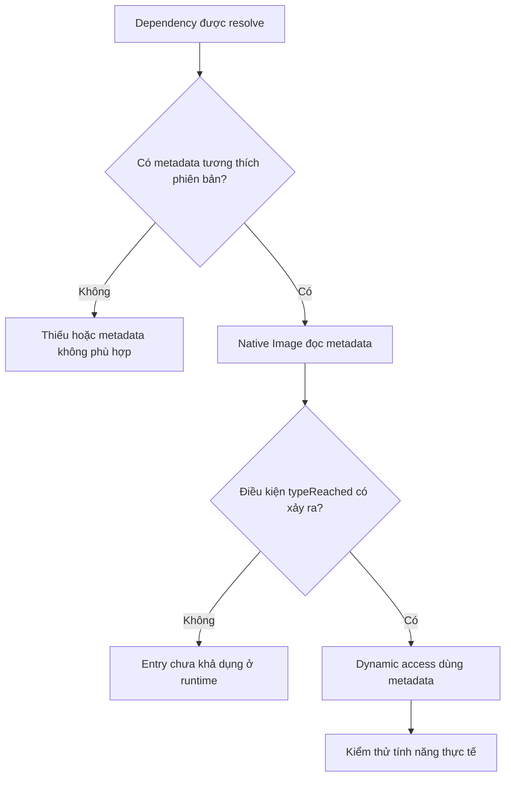

# Metadata có điều kiện và sự phù hợp với phiên bản dependency

> **Chương:** Thư viện ngoài  
> **Module:** `SPRING_BOOT_NATIVE_IMAGE`  
> **Mục tiêu:** Hiểu metadata reachability do thư viện cung cấp hoặc GraalVM Repository bổ sung; đọc điều kiện `typeReached` và phân biệt với điều kiện phiên bản dependency; kiểm tra metadata có áp dụng cho phiên bản thực tế đang resolve hay không; cấu hình Maven/Gradle và kiểm thử thay đổi dependency trong Spring Boot Native Image.

## 1. Vì sao thư viện ngoài cần reachability metadata?

GraalVM Native Image phân tích chương trình ở build time theo mô hình closed world. Compiler có thể lần theo những lời gọi tĩnh, nhưng không thể luôn biết trước class, method, field, proxy hoặc resource sẽ được truy cập bằng tên lấy từ cấu hình, reflection, JNI hay một cơ chế động của thư viện.

Ví dụ, một thư viện codec có thể đọc tên class từ annotation rồi tạo object bằng reflection. Trên JVM thông thường, classloader có thể tìm class trong runtime classpath. Native Image chỉ giữ những thành phần mà phân tích tĩnh hoặc metadata cho biết là cần thiết. Nếu thiếu metadata, native executable có thể build thành công nhưng lỗi khi chức năng codec được gọi.

**Reachability metadata** mô tả những thành phần động cần được giữ trong native image. Metadata có thể đến từ ba nơi:

1. **Thư viện tự đóng gói metadata:** nhà phát triển đặt cấu hình dưới `META-INF/native-image/` trong JAR của thư viện.
2. **GraalVM Reachability Metadata Repository:** bộ sưu tập metadata do cộng đồng và các nhóm duy trì cho những thư viện phổ biến chưa tự đóng gói đủ cấu hình.
3. **Ứng dụng bổ sung metadata:** ứng dụng khai báo RuntimeHints hoặc JSON metadata cho các đường truy cập riêng mà framework và thư viện chưa mô tả.

Spring Boot cung cấp Spring AOT để phân tích application context và sinh các hint cho phần Spring/application mà framework nhận diện được. Spring không thể tự biết mọi hành vi động bên trong mọi dependency bên thứ ba; phần đó cần metadata từ thư viện, repository hoặc ứng dụng. [Spring Boot — Advanced Native Images Topics](https://docs.spring.io/spring-boot/reference/packaging/native-image/advanced-topics.html)

## 2. Metadata mô tả những gì?

Reachability metadata có thể khai báo nhiều loại truy cập động:

| Loại metadata | Ví dụ tình huống | Thiếu metadata có thể gây ra |
|---|---|---|
| Reflection | Tìm class, constructor, method hoặc field theo tên | Không tìm thấy member hoặc báo missing registration |
| Resource | Đọc template, schema, file properties theo đường dẫn | Resource không có trong executable |
| Resource bundle | Nạp message bundle theo locale | Thiếu bản dịch khi chạy native |
| JDK proxy | Tạo proxy cho tập interface được xác định động | Không tạo được proxy class |
| Serialization | Đọc/ghi Java object stream | Serialization runtime thiếu type metadata |
| JNI | Native code tìm class, method hoặc field Java | JNI lookup/access thất bại |
| Foreign Function and Memory API | Truy cập thành phần native theo cơ chế FFM | Thiếu metadata hoặc thông tin truy cập cần thiết |

Metadata không thay thế code của dependency và cũng không làm một thư viện JVM bất kỳ tự động tương thích với Native Image. Nó chỉ khai báo các thành phần động cần thiết mà compiler không thể suy ra đầy đủ.

## 3. Hai ý nghĩa khác nhau của “điều kiện”

Khi nói metadata có điều kiện, cần phân biệt hai câu hỏi:

- **Metadata có được áp dụng khi tính năng nào được dùng không?** Đây là điều kiện reachability trong file metadata, ví dụ `condition.typeReached`.
- **Metadata có phù hợp với phiên bản dependency đang dùng không?** Đây là vấn đề version coverage được quản lý bởi thư viện, metadata repository và build tool.

Hai điều kiện này độc lập. Một entry có `typeReached` đúng vẫn có thể không phù hợp nếu dependency đã đổi cấu trúc class ở phiên bản mới. Ngược lại, metadata đã được kiểm thử với đúng phiên bản dependency nhưng entry có điều kiện runtime không bao giờ được kích hoạt thì chức năng vẫn có thể lỗi.



Vì vậy, khi điều tra lỗi, hãy xác định cả **phiên bản thư viện thực tế** và **điều kiện kích hoạt metadata**.

## 4. Conditional metadata với `typeReached`

Trong schema reachability metadata hiện hành, một entry có thể có trường `condition` với `typeReached`:

```json
{
  "reflection": [
    {
      "condition": {
        "typeReached": "com.vendor.codec.JsonCodec"
      },
      "type": "com.vendor.model.Payload",
      "allDeclaredConstructors": true,
      "allDeclaredMethods": true
    }
  ],
  "resources": [
    {
      "condition": {
        "typeReached": "com.vendor.codec.JsonCodec"
      },
      "glob": "META-INF/vendor-codec/**"
    }
  ]
}
```

Trong ví dụ:

- Metadata reflection cho `Payload` được gắn với đường chạy của `JsonCodec`.
- Resource của codec chỉ cần sẵn sàng khi type điều kiện được reach.
- Nếu tính năng codec không được sử dụng, metadata có điều kiện không nhất thiết phải khả dụng trong runtime đó.
- Khi tính năng được dùng và `JsonCodec` được reach, các entry tương ứng mới có hiệu lực.

Theo tài liệu GraalVM, entry có `typeReached` được đưa vào image khi type điều kiện reachable ở build time, nhưng chỉ khả dụng ở runtime khi type đó thực sự được reached. Type được xem là reached ngay trước khi quá trình khởi tạo class/interface bắt đầu, hoặc khi một subtype của nó được reached. [GraalVM — Conditional Metadata Entries](https://www.graalvm.org/latest/reference-manual/native-image/metadata/)

### 4.1. `ClassName.class` chưa chắc kích hoạt điều kiện

Đây là chi tiết dễ gây lỗi. Việc lấy class literal:

```java
Class<?> codecType = JsonCodec.class;
```

không tự khởi tạo class. Do đó, chỉ có class literal không bảo đảm điều kiện `typeReached` đã xảy ra. Điều kiện thường được kích hoạt khi class initialization bắt đầu hoặc khi subtype được reached theo quy tắc của Native Image.

Khi chọn type điều kiện, hãy dùng một type thực sự đại diện cho tính năng và có thể được khởi tạo trong đường chạy cần metadata. Không chọn một marker class chỉ xuất hiện trong khai báo nhưng không bao giờ được khởi tạo.

### 4.2. Điều kiện không phải bộ lọc phiên bản

`typeReached` không có nghĩa “chỉ áp dụng cho phiên bản 2.x của thư viện”. Nó cũng không có nghĩa “chỉ áp dụng khi Spring profile là production”.

Nó điều khiển thời điểm metadata khả dụng theo reachability của type. Việc metadata có tương thích với JAR phiên bản 2.x hay 3.x phải được xác định riêng bằng version coverage và kiểm thử.

### 4.3. Phân biệt schema cũ và mới

Các thế hệ GraalVM trước đây dùng trường điều kiện `typeReachable`. Schema hiện hành dùng `typeReached`, với semantics runtime gắn với việc type được reached/khởi tạo như mô tả ở trên.

Không tự đổi tên trường trong file metadata cũ rồi cho rằng ý nghĩa tương đương. Hãy kiểm tra schema và tài liệu của phiên bản GraalVM/Native Image đang dùng; repository metadata cũng có thể chứa file theo schema phù hợp với toolchain mục tiêu. [GraalVM — JSON Schema Reference](https://www.graalvm.org/latest/reference-manual/native-image/metadata/)

## 5. Metadata của thư viện và GraalVM Reachability Metadata Repository

Thư viện có thể tự đóng gói metadata trong JAR, thường dưới một đường dẫn dạng:

```text
META-INF/
└── native-image/
    └── com.vendor/
        └── vendor-codec/
            └── reachability-metadata.json
```

Native Image đọc các file `reachability-metadata.json` nằm trong classpath theo convention `META-INF/native-image/<groupId>/<artifactId>/`. Một dependency có thể mang metadata của chính nó; metadata này đi cùng dependency khi dependency được đưa vào native build. [GraalVM — Specifying Metadata with JSON](https://www.graalvm.org/latest/reference-manual/native-image/metadata/)

Nếu thư viện chưa cung cấp metadata, GraalVM Reachability Metadata Repository duy trì cấu hình dùng chung cho các tọa độ thư viện Maven. Native Build Tools có thể tải metadata repository và đưa metadata phù hợp vào native image build. Repository là nguồn cộng đồng duy trì, nên cần kiểm tra chính xác phiên bản thư viện được hỗ trợ thay vì mặc định mọi release đều có metadata tương thích.

Spring Boot cũng dựa vào repository này cho những dependency bên thứ ba chưa tự cung cấp hints. [GraalVM Reachability Metadata Repository](https://github.com/oracle/graalvm-reachability-metadata)

## 6. Metadata version và phiên bản dependency là hai số khác nhau

GraalVM Reachability Metadata Repository tổ chức metadata theo tọa độ thư viện Maven (`groupId:artifactId`). Mỗi artifact có `index.json` mô tả các bản metadata và những phiên bản upstream đã được kiểm thử với từng bản đó.

Ví dụ minh họa rút gọn:

```json
[
  {
    "metadata-version": "1.4.0",
    "tested-versions": ["2.8.1", "2.8.2", "2.9.0"],
    "latest": true
  },
  {
    "metadata-version": "1.2.0",
    "tested-versions": ["2.7.0", "2.7.1"]
  }
]
```

Ý nghĩa:

- `metadata-version` định danh bộ metadata trong repository.
- `tested-versions` liệt kê các phiên bản dependency đã được kiểm tra với bộ metadata đó.
- `latest` đánh dấu bộ metadata mặc định mới nhất cho artifact trong repository.
- Một bộ metadata có thể áp dụng cho nhiều phiên bản thư viện nếu các phiên bản đó đã được kiểm thử.

Các giá trị trên chỉ minh họa cấu trúc, không đại diện cho một thư viện cụ thể.

Không được nhầm `metadata-version` với phiên bản dependency. Ví dụ, metadata version `1.4.0` không có nghĩa nó chỉ dùng được với dependency version `1.4.0`. Ngược lại, việc dependency có phiên bản mới hơn không chứng minh metadata cũ vẫn phù hợp. Hãy tra `tested-versions` của đúng tọa độ và phiên bản đang resolve. [GraalVM Reachability Metadata Repository — README](https://github.com/oracle/graalvm-reachability-metadata)

### 6.1. Version coverage không phải cam kết cho mọi phiên bản tương lai

Nếu repository đã kiểm thử dependency `2.9.0`, không tự suy ra `2.9.1`, `2.10.0` hoặc `3.0.0` đều được hỗ trợ. Một bản phát hành mới có thể:

- Đổi tên hoặc package class nội bộ.
- Thay constructor/method mà metadata đang tham chiếu.
- Chuyển từ reflection sang method handle hoặc cơ chế khác.
- Thay resource path hoặc tên resource bundle.
- Thêm proxy interface hoặc subtype mới.
- Thay đổi cách khởi tạo class hoặc điều kiện kích hoạt tính năng.

Một metadata entry cũ có thể trở nên thừa, thiếu hoặc không còn đúng. Metadata không phải API contract ổn định của dependency.

### 6.2. Metadata repository không quản lý dependency version cho ứng dụng

Repository chỉ cung cấp cấu hình reachability. Nó không nâng cấp JAR, không chọn phiên bản dependency thay cho Maven/Gradle và không sửa dependency conflict.

Ứng dụng vẫn phải quản lý phiên bản bằng Spring Boot dependency management/BOM, version catalog, dependency constraints hoặc lockfile. Sau khi dependency resolver chọn phiên bản cuối cùng, cần kiểm tra metadata coverage cho **phiên bản đã resolve** đó.

## 7. Tích hợp metadata repository với Maven

Khi dùng `spring-boot-starter-parent` và GraalVM Native Build Tools Maven plugin, Spring Boot cung cấp native profile để nối các bước cần thiết cho native build. Profile này có thể chạy Spring AOT processing và cấu hình Native Build Tools tải third-party reachability metadata.

Ví dụ cấu hình plugin:

```xml
<build>
    <plugins>
        <plugin>
            <groupId>org.graalvm.buildtools</groupId>
            <artifactId>native-maven-plugin</artifactId>
        </plugin>
        <plugin>
            <groupId>org.springframework.boot</groupId>
            <artifactId>spring-boot-maven-plugin</artifactId>
        </plugin>
    </plugins>
</build>
```

Build native theo profile:

```bash
./mvnw -Pnative native:compile
```

Hoặc tạo container image bằng Buildpacks:

```bash
./mvnw -Pnative spring-boot:build-image
```

Native profile của Spring Boot starter parent cấu hình AOT processing và goal bổ sung reachability metadata. Nếu không dùng parent này, cần tự cấu hình các execution phù hợp, gồm Spring Boot `process-aot` và Native Build Tools `add-reachability-metadata`. [Spring Boot Maven Plugin — Ahead-of-Time Processing](https://docs.spring.io/spring-boot/maven-plugin/aot.html)

Native Build Tools có cấu hình metadata repository riêng. Có thể khai báo rõ trong plugin configuration:

```xml
<plugin>
    <groupId>org.graalvm.buildtools</groupId>
    <artifactId>native-maven-plugin</artifactId>
    <configuration>
        <metadataRepository>
            <enabled>true</enabled>
        </metadataRepository>
    </configuration>
</plugin>
```

Tài liệu Native Build Tools hiện hành bật metadata repository theo mặc định, nhưng khai báo rõ giúp người đọc biết build phụ thuộc vào nguồn metadata này. Nếu build bị tắt repository hoặc dùng plugin/toolchain cũ, không được giả định metadata cộng đồng đã được tải. [GraalVM Native Build Tools — Maven Plugin](https://graalvm.github.io/native-build-tools/latest/maven-plugin.html)

## 8. Tích hợp metadata repository với Gradle

Khi dùng Spring Boot Gradle plugin, áp dụng GraalVM Native Image plugin để tạo các task AOT/native tương ứng:

```kotlin
plugins {
    id("org.springframework.boot")
    id("io.spring.dependency-management")
    id("org.graalvm.buildtools.native")
}
```

Có thể cấu hình metadata repository:

```kotlin
graalvmNative {
    metadataRepository {
        enabled.set(true)
    }
}
```

Với cấu hình plugin phù hợp, `nativeCompile` và `bootBuildImage` có thể sử dụng AOT output cùng metadata repository:

```bash
./gradlew nativeCompile
./gradlew bootBuildImage
```

Tài liệu Native Build Tools cho biết metadata repository được hỗ trợ và mặc định bật; có thể tắt bằng `enabled = false`/`enabled.set(false)` tùy DSL/version. Nếu build cần metadata từ repository, không tắt tính năng này mà không có nguồn thay thế đã được kiểm chứng. [GraalVM Native Build Tools — Gradle Plugin](https://graalvm.github.io/native-build-tools/latest/gradle-plugin)

### 8.1. Khi JAR được chuyển thành native image ở một pipeline khác

Trong một số pipeline, JAR AOT được build ở job này rồi mới chuyển tới job khác để Buildpacks hoặc một công cụ khác tạo native image. Khi đó cần kiểm tra metadata repository có được mang sang pipeline sau hay không.

Native Build Tools có task `collectReachabilityMetadata` để tải metadata vào thư mục build và có thể cấu hình đưa các file đó vào JAR. Nếu dùng cơ chế này, hãy kiểm tra JAR cuối có chứa metadata ở vị trí mà native builder đọc được. Không giả định metadata tải trong job Maven/Gradle trước đó tự xuất hiện trong mọi artifact được đóng gói lại.

## 9. Xác định phiên bản dependency thực tế đang dùng

Metadata phải khớp với dependency đã được resolver chọn, không chỉ khớp version ghi trong một file cấu hình.

### 9.1. Maven: xem dependency tree

Ví dụ lọc một thư viện cụ thể:

```bash
./mvnw dependency:tree -Dincludes=com.vendor:vendor-codec
```

Nếu ứng dụng dùng BOM hoặc nhiều dependency kéo cùng một artifact, dependency tree cho biết phiên bản cuối cùng được chọn và đường dependency dẫn tới nó. Hãy kiểm tra cả dependency mediation và exclusions nếu phiên bản khác với dự kiến.

### 9.2. Gradle: xem dependency insight

```bash
./gradlew dependencyInsight \
  --dependency vendor-codec \
  --configuration runtimeClasspath
```

Kết quả cho biết phiên bản được chọn, lý do chọn phiên bản và dependency nào yêu cầu nó. Metadata coverage phải đối chiếu với phiên bản của `runtimeClasspath` dùng trong native build.

### 9.3. Kiểm tra tọa độ trong repository

Để tra một thư viện, cần đủ ba thành phần:

```text
groupId:artifactId:resolved-version
```

Ví dụ minh họa:

```text
com.vendor:vendor-codec:2.9.0
```

Tìm đúng artifact trong GraalVM Reachability Metadata Repository, mở `index.json`, rồi kiểm tra phiên bản có nằm trong `tested-versions` tương ứng không. Nếu không có entry hoặc phiên bản không nằm trong tập đã kiểm thử, hãy coi coverage là chưa xác nhận và chạy kiểm thử native của dự án.

## 10. Khi nâng phiên bản dependency, cần kiểm tra lại những gì?

Nâng dependency có thể thay đổi cả bytecode, metadata được đóng gói và các đường chạy động. Không chỉ chạy unit test JVM rồi kết luận native build vẫn tương thích.

Một quy trình nâng version có kiểm soát:

1. Ghi lại tọa độ và phiên bản hiện tại đang resolve.
2. Nâng một dependency hoặc một nhóm nhỏ có liên quan, tránh thay đổi quá nhiều biến trong cùng một lần.
3. Xem lại dependency tree/insight để biết phiên bản cuối cùng.
4. Kiểm tra metadata do thư viện cung cấp và metadata repository cho phiên bản mới.
5. Chạy unit/integration tests trên JVM với những tính năng dùng thư viện đó.
6. Chạy Spring AOT và native compilation bằng toolchain đã khóa.
7. Chạy native executable trên những đường code sử dụng thư viện, gồm reflection/resource/proxy/serialization nếu có.
8. So sánh log, metadata output và hành vi với phiên bản trước.
9. Ghi lại version, toolchain, metadata source và kết quả kiểm thử trong build report.

### 10.1. Ma trận version compatibility

| Dependency version | Metadata source | JVM tests | Native build | Native runtime | Kết luận |
|---|---|---|---|---|---|
| Phiên bản cũ đang phát hành | Thư viện/repository | PASS | PASS | PASS | Baseline đã xác nhận |
| Phiên bản mới có trong `tested-versions` | Repository mới hoặc metadata trong JAR | PASS | PASS | PASS | Có bằng chứng tương thích cho tổ hợp đã test |
| Phiên bản mới chưa có coverage | Metadata cũ hoặc tự bổ sung | PASS | PASS/FAIL | PASS/FAIL | Chưa thể kết luận chỉ từ build |
| Phiên bản major mới | Metadata và API có thể đổi | PASS/FAIL | PASS/FAIL | PASS/FAIL | Cần đánh giá riêng, có thể cần metadata mới |

Không đánh dấu tương thích chỉ vì native compilation thành công. Metadata có thể đủ để compiler tạo executable nhưng một nhánh reflection hoặc resource chưa được chạy vẫn có thể lỗi khi production sử dụng.

## 11. Khi dependency không có metadata hoặc metadata không còn phù hợp

Trước tiên, xác định lỗi đến từ dependency nào và thao tác động nào. Stack trace thường có tên class/library và API liên quan, chẳng hạn reflection, resource lookup, proxy hoặc serialization.

| Dấu hiệu | Khả năng cần điều tra |
|---|---|
| Missing reflection registration | Thiếu class/member hoặc metadata không được đưa vào build |
| Không tìm thấy resource khi chạy native | Resource pattern/path thiếu hoặc metadata không được kích hoạt |
| Proxy creation thất bại | Thiếu JDK proxy metadata hoặc tập interface thay đổi |
| Serialization lỗi | Thiếu serialization metadata hoặc dependency đổi class |
| Chỉ lỗi ở một phiên bản dependency | Metadata chưa được kiểm thử hoặc API nội bộ đã đổi |
| Build tải metadata nhưng vẫn lỗi | Entry không đúng feature, condition không được kích hoạt hoặc đường chạy chưa có trong test |

### 11.1. Dùng Native Image Tracing Agent để tìm đường truy cập thiếu

Spring Boot hướng dẫn có thể chạy ứng dụng JVM với Spring AOT và Native Image tracing agent:

```bash
java -Dspring.aot.enabled=true \
  -agentlib:native-image-agent=config-output-dir=target/native-agent/ \
  -jar target/application.jar
```

Sau khi ứng dụng khởi động, thực hiện các use case sử dụng dependency: parse payload, tải resource, tạo proxy, đọc/ghi dữ liệu hoặc gọi plugin. Khi dừng JVM, agent ghi metadata vào thư mục output.

Agent chỉ ghi nhận những đường code thực sự được chạy trong phiên test. Vì vậy:

- Chạy đủ các use case đại diện, bao gồm nhánh lỗi và cấu hình quan trọng.
- Không coi output agent là danh sách hoàn chỉnh nếu test chưa đi qua mọi tính năng.
- Lọc các entry chỉ phục vụ test framework hoặc mock.
- Kiểm tra metadata sinh ra có thuộc thư viện hay thuộc code ứng dụng.
- Với metadata dành cho thư viện dùng chung, cần kiểm thử trên phiên bản dependency cụ thể và duy trì theo quy trình của thư viện/repository.

Tài liệu Spring Boot mô tả cách dùng tracing agent để tìm hint thiếu và lưu các hint tĩnh dưới `META-INF/native-image/`. Đặt custom hint ở thư mục riêng, tránh trùng vị trí output AOT do Spring sinh. [Spring Boot — Using the Tracing Agent](https://docs.spring.io/spring-boot/reference/packaging/native-image/advanced-topics.html)

### 11.2. Bổ sung metadata cho ứng dụng

Nếu dynamic access thuộc code ứng dụng hoặc một cách tích hợp đặc thù, có thể dùng Spring `RuntimeHintsRegistrar`, `@ImportRuntimeHints` hoặc file JSON tĩnh.

Ví dụ metadata tĩnh:

```json
{
  "reflection": [
    {
      "type": "com.vendor.codec.CustomPayload",
      "allDeclaredConstructors": true,
      "allDeclaredMethods": true
    }
  ]
}
```

Đặt file dưới một thư mục bổ sung, ví dụ:

```text
src/main/resources/META-INF/native-image/com.example/application-additional-hints/reachability-metadata.json
```

Chỉ khai báo member/resource/proxy thực sự cần. Nếu lỗi thuộc một thư viện dùng chung, cân nhắc báo upstream hoặc đóng góp metadata cho GraalVM repository để các ứng dụng khác có thể dùng lại. Đừng duy trì một bản metadata rộng trong ứng dụng nếu dependency đã có bản chính thức phù hợp.

## 12. Bật chế độ kiểm tra metadata nghiêm ngặt

Ở các phiên bản Native Image hỗ trợ, có thể dùng `--exact-reachability-metadata` để phát hiện sớm các truy cập động chưa được đăng ký. Có thể giới hạn chế độ này cho một số package trong lúc chuyển đổi.

Khi chạy ứng dụng test, cờ:

```text
-XX:MissingRegistrationReportingMode=Warn
```

giúp ghi nhận những vị trí thiếu registration. Chế độ `Exit` làm ứng dụng thoát ngay khi gặp lỗi missing registration, hữu ích để test không vô tình bỏ qua lỗi trong khối catch tổng quát.

Các cờ và mức hỗ trợ phụ thuộc phiên bản GraalVM. Hãy kiểm tra tài liệu của Native Image toolchain đang dùng trước khi thêm vào pipeline CI. [GraalVM — Reachability Metadata](https://www.graalvm.org/latest/reference-manual/native-image/metadata/)

## 13. Những nhầm lẫn thường gặp

**“Có metadata cho thư viện nghĩa là mọi version đều dùng được.”** Không đúng. Phải kiểm tra `tested-versions` hoặc bằng chứng tương thích của đúng release.

**“`typeReached` là điều kiện chọn version.”** Không đúng. Nó điều khiển thời điểm metadata khả dụng theo reachability của type trong runtime.

**“Dependency mới hơn vẫn dùng được metadata cũ nếu tên artifact không đổi.”** Không thể mặc định. Nội bộ thư viện có thể đổi class, method, resource hoặc hành vi động.

**“Spring AOT tự sinh mọi hint cho tất cả dependency.”** Không đúng. Spring nhận diện được nhiều đường truy cập của Spring và ứng dụng; third-party library vẫn cần metadata riêng khi có dynamic access mà static analysis không suy ra được.

**“Native build thành công nghĩa là dependency đã tương thích.”** Không đủ. Chỉ các đường chạy đã được phân tích và metadata cần thiết mới được xác nhận; phải thực thi các use case thực tế trên native binary.

**“Tracing Agent chạy một lần là tạo metadata đầy đủ.”** Không đúng. Agent chỉ ghi lại hành vi đã được thực thi trong lần trace.

**“Metadata repository nâng cấp dependency.”** Không đúng. Repository chỉ cung cấp cấu hình reachability; Maven/Gradle vẫn quyết định version của JAR.

## 14. Quy trình kiểm tra dependency trước khi phát hành

Với mỗi dependency có dynamic access hoặc vai trò quan trọng trong ứng dụng native:

1. **Resolve:** ghi lại `groupId:artifactId:version` thực tế từ Maven/Gradle.
2. **Locate metadata:** xác định metadata nằm trong JAR, GraalVM Repository hay do ứng dụng tự khai báo.
3. **Check version coverage:** kiểm tra phiên bản đã resolve có được metadata repository kiểm thử hay chưa.
4. **Check conditions:** xem các entry có `typeReached` không và xác nhận type điều kiện được kích hoạt trong use case.
5. **Build:** chạy Spring AOT và native compilation với phiên bản JDK/GraalVM/Native Build Tools đã khóa.
6. **Exercise:** chạy các tính năng sử dụng dependency trên executable native.
7. **Negative tests:** kiểm tra resource thiếu, input không hợp lệ, nhánh reflection hoặc proxy không được hỗ trợ.
8. **Record:** lưu dependency tree, metadata source, toolchain và kết quả test để lần nâng cấp sau có baseline.

## 15. Checklist metadata và version compatibility

- [ ] Đã phân biệt metadata do dependency đóng gói, metadata repository và custom hints của ứng dụng.
- [ ] Đã xác định đúng tọa độ và phiên bản dependency được resolver chọn.
- [ ] Đã kiểm tra `metadata-version` và `tested-versions` trong repository index.
- [ ] Không nhầm metadata version với dependency version.
- [ ] Đã hiểu `condition.typeReached` là điều kiện reachability runtime, không phải version condition.
- [ ] Schema cũ/mới (`typeReachable` và `typeReached`) được dùng đúng theo phiên bản Native Image.
- [ ] Type điều kiện được khởi tạo trong use case cần metadata.
- [ ] Maven/Gradle Native Build Tools được cấu hình để lấy metadata repository khi cần.
- [ ] Spring Boot AOT và native toolchain dùng phiên bản tương thích.
- [ ] Sau khi nâng dependency, đã chạy lại native build và test trên executable.
- [ ] Tracing Agent được chạy qua các use case đại diện và output được review.
- [ ] Custom metadata chỉ khai báo phần cần thiết và được đặt ở vị trí không xung đột với AOT output.
- [ ] Kết quả test được ghi theo dependency version, metadata source và toolchain.

## 16. Ghi nhớ

Metadata có điều kiện giúp Native Image chỉ cung cấp các khai báo dynamic access khi type liên quan thực sự được reach. Điều kiện `typeReached` mô tả **khi nào metadata có hiệu lực ở runtime**. Nó không mô tả metadata hỗ trợ phiên bản thư viện nào.

Sự phù hợp với dependency version phải được xác minh riêng: xem phiên bản thực tế Maven/Gradle đã resolve, kiểm tra metadata của thư viện hoặc `tested-versions` trong GraalVM Reachability Metadata Repository, rồi chạy AOT/native build và các use case đại diện. Khi dependency thay đổi, hãy kiểm tra lại metadata và hành vi trên native executable trước khi phát hành.

### Tài liệu tham khảo

- [GraalVM Native Image — Reachability Metadata](https://www.graalvm.org/latest/reference-manual/native-image/metadata/)
- [GraalVM Reachability Metadata Repository](https://github.com/oracle/graalvm-reachability-metadata)
- [GraalVM Native Build Tools — Maven Plugin](https://graalvm.github.io/native-build-tools/latest/maven-plugin.html)
- [GraalVM Native Build Tools — Gradle Plugin](https://graalvm.github.io/native-build-tools/latest/gradle-plugin)
- [Spring Boot — Advanced Native Images Topics](https://docs.spring.io/spring-boot/reference/packaging/native-image/advanced-topics.html)
- [Spring Boot Maven Plugin — Ahead-of-Time Processing](https://docs.spring.io/spring-boot/maven-plugin/aot.html)
- [Spring Boot — Introducing GraalVM Native Images](https://docs.spring.io/spring-boot/reference/packaging/native-image/introducing-graalvm-native-images.html)
