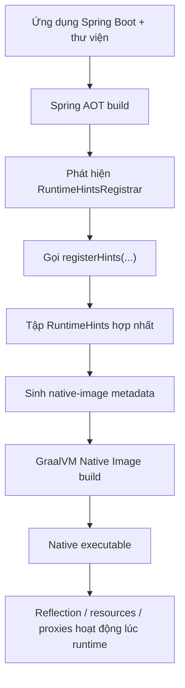

# Đóng góp RuntimeHintsRegistrar cho thư viện dùng chung

## 1. Vì sao thư viện dùng chung phải tự đóng góp runtime hints?

Một thư viện Spring có thể hoạt động tốt trên JVM nhưng gặp lỗi khi ứng dụng tiêu thụ được biên dịch thành GraalVM Native Image. Nguyên nhân thường là thư viện thực hiện thao tác mà Native Image cần biết trước, chẳng hạn reflection, đọc classpath resource, tạo JDK proxy hoặc Java serialization. Ứng dụng tiêu thụ không phải lúc nào cũng nhìn thấy các thao tác nội bộ này để tự khai báo metadata chính xác.

**RuntimeHintsRegistrar** là extension point của Spring Framework cho phép thư viện mô tả các yêu cầu đó bằng API có kiểu. Khi Spring AOT xử lý ứng dụng, registrar đóng góp các hint vào tập RuntimeHints chung; các hint sau đó được chuyển thành metadata mà native-image toolchain sử dụng.

Với module **SPRING_BOOT_NATIVE_IMAGE**, đây là một phần quan trọng của khả năng tương thích thư viện: thư viện nên mang theo mô tả runtime behavior mà nó cần, để mọi ứng dụng sử dụng thư viện có thể nhận được các hint tương ứng trong lúc AOT build.

Bài này thuộc chương **Thư viện ngoài**, tập trung vào:

- Xác định khi nào thư viện cần đóng góp Runtime Hints.
- Triển khai RuntimeHintsRegistrar độc lập, an toàn ở build time.
- Công bố registrar qua @ImportRuntimeHints hoặc META-INF/spring/aot.factories.
- Đóng gói metadata trong JAR để ứng dụng tiêu thụ tự nhận được.
- Xử lý dependency tùy chọn và ClassLoader.
- Kiểm thử registrar, kiểm tra artifact và xác minh native executable.

## 2. RuntimeHintsRegistrar đứng ở đâu trong quy trình Spring AOT?

Spring AOT phân tích ApplicationContext và các thành phần được đăng ký trong lúc build. Những yêu cầu mà framework không thể suy ra từ cấu hình tĩnh có thể được bổ sung qua RuntimeHints.

Một RuntimeHintsRegistrar nhận hai đầu vào:

- RuntimeHints: đối tượng tập hợp các yêu cầu reflection, resource, serialization và proxy.
- ClassLoader: classloader của deployment unit, dùng để kiểm tra kiểu hoặc dependency hiện diện. Tham số này có thể null trong một số môi trường.

Chữ ký cơ bản:

```java
package org.springframework.aot.hint;

public interface RuntimeHintsRegistrar {

    void registerHints(RuntimeHints hints, ClassLoader classLoader);
}
```

Sơ đồ quy trình:



Registrar chạy trong giai đoạn AOT build để mô tả nhu cầu của ứng dụng. Nó không phải callback được gọi mỗi khi ứng dụng khởi động trong production, và cũng không phải nơi thực hiện công việc nghiệp vụ của thư viện.

### 2.1. Phân biệt các loại hint

| Nhóm | API | Khi thư viện cần |
| --- | --- | --- |
| Reflection | `hints.reflection()` | Gọi constructor, method, field hoặc truy cập metadata bằng reflection |
| Resource | `hints.resources()` | Đọc classpath resource theo tên hoặc pattern động |
| JDK proxy | `hints.proxies()` | Tạo proxy runtime cho một tập interface |
| Java serialization | `hints.serialization()` | Dùng cơ chế ObjectInputStream/ObjectOutputStream |

Không đăng ký mọi nhóm hint theo mẫu. Hãy lần theo code thực tế và chỉ mô tả những hoạt động mà thư viện thực sự thực hiện.

## 3. Thiết kế thư viện có hỗ trợ Spring AOT

Giả sử xây dựng thư viện dùng chung `acme-report-client`. Thư viện có các chức năng:

- Đọc schema JSON từ classpath: `com/acme/report/schema/report-v1.json`.
- Tạo DTO `ReportRequest` qua reflection để binding dữ liệu.
- Tạo JDK proxy cho interface `ReportTransport` trong một integration mode.
- Có thể tích hợp thêm một module tùy chọn cung cấp kiểu `LegacyReportPayload`.

Một cấu trúc module có thể tổ chức như sau:

```text
acme-report-core/
  src/main/java/
    com/acme/report/ReportClient.java
    com/acme/report/ReportRequest.java
    com/acme/report/ReportTransport.java
  src/main/resources/
    com/acme/report/schema/report-v1.json

acme-report-spring/
  src/main/java/
    com/acme/report/spring/ReportAutoConfiguration.java
    com/acme/report/spring/aot/ReportRuntimeHints.java
  src/main/resources/
    META-INF/spring/
      aot.factories
      org.springframework.boot.autoconfigure.AutoConfiguration.imports
```

Tách module core và module Spring integration là lựa chọn hữu ích khi thư viện muốn giữ phần API thuần Java nhẹ, không buộc mọi consumer phải phụ thuộc Spring chỉ để dùng model hoặc client cơ bản. Module tích hợp Spring có thể phụ thuộc Spring Core/Context và đóng góp AOT hints.

Nếu toàn bộ thư viện vốn đã phụ thuộc Spring, registrar có thể nằm cùng artifact chính. Dù chọn cách nào, cần bảo đảm artifact chứa registrar và metadata được đưa vào compile/runtime classpath của ứng dụng lúc AOT build.

## 4. Viết một RuntimeHintsRegistrar

Ví dụ registrar cho các kiểu và resource thuộc thư viện:

```java
package com.acme.report.spring.aot;

import com.acme.report.ReportRequest;
import com.acme.report.ReportResponse;
import com.acme.report.ReportTransport;

import org.springframework.aot.hint.MemberCategory;
import org.springframework.aot.hint.RuntimeHints;
import org.springframework.aot.hint.RuntimeHintsRegistrar;

public final class ReportRuntimeHints implements RuntimeHintsRegistrar {

    public ReportRuntimeHints() {
    }

    @Override
    public void registerHints(RuntimeHints hints, ClassLoader classLoader) {
        hints.resources().registerPattern(
            "com/acme/report/schema/report-v1.json"
        );

        hints.reflection().registerType(
            ReportRequest.class,
            MemberCategory.INVOKE_PUBLIC_CONSTRUCTORS,
            MemberCategory.INVOKE_PUBLIC_METHODS
        );

        hints.reflection().registerType(
            ReportResponse.class,
            MemberCategory.INVOKE_PUBLIC_CONSTRUCTORS,
            MemberCategory.INVOKE_PUBLIC_METHODS
        );

        hints.proxies().registerJdkProxy(ReportTransport.class);
    }
}
```

Ý nghĩa:

1. Resource hint bảo đảm schema có thể được tìm thấy trong native executable qua classpath.
2. Reflection hint mô tả constructor và public method mà thư viện gọi động trên DTO.
3. Proxy hint mô tả JDK proxy có interface là `ReportTransport`.
4. Constructor không tham số giúp registrar có thể được tạo khi được đăng ký tĩnh qua metadata.

Các member category trong ví dụ là minh họa cho DTO có public constructor, getter và setter. Nếu thư viện truy cập private field, constructor cụ thể, method có tham số hoặc method khác, hãy đăng ký đúng member cần thiết. Không mở toàn bộ reflection cho một package chỉ để tránh phải tìm chính xác đường gọi.

### 4.1. Resource path phải là classpath path

Nếu resource được đặt tại:

```text
src/main/resources/com/acme/report/schema/report-v1.json
```

thì đường dẫn đăng ký là:

```java
hints.resources().registerPattern(
    "com/acme/report/schema/report-v1.json"
);
```

Không ghi `src/main/resources` vào pattern. Đây là thư mục source, không phải một phần tên resource trên classpath. Resource hint cũng không tạo file ngoài container, không mount volume và không thay thế cấu hình runtime.

### 4.2. Chỉ đăng ký proxy khi thật sự tạo JDK proxy

Nếu thư viện sử dụng `Proxy.newProxyInstance` hoặc một cơ chế tạo JDK dynamic proxy, khai báo các interface mà proxy implement:

```java
hints.proxies().registerJdkProxy(
    ReportTransport.class,
    java.io.Serializable.class
);
```

Danh sách interface phải phản ánh proxy thực tế. Hint này không tạo proxy class cụ thể bằng CGLIB và không thay thế metadata cho target class nếu target cũng được truy cập qua reflection.

### 4.3. Java serialization là một nhu cầu riêng

Nếu thư viện thực sự dùng Java object serialization, đăng ký kiểu cần serialize:

```java
hints.serialization().registerType(ReportSnapshot.class);
```

Không nhầm Java serialization với JSON serialization của Jackson. DTO được Jackson binding thường cần reflection/binding metadata phù hợp; gọi `hints.serialization()` không tự giải quyết yêu cầu đó.

## 5. Công bố registrar qua @ImportRuntimeHints

Cách đăng ký động là đặt `@ImportRuntimeHints` gần component hoặc cấu hình sử dụng các resource/kiểu cần hint:

```java
package com.acme.report.spring;

import com.acme.report.spring.aot.ReportRuntimeHints;
import org.springframework.boot.autoconfigure.AutoConfiguration;
import org.springframework.context.annotation.ImportRuntimeHints;

@AutoConfiguration
@ImportRuntimeHints(ReportRuntimeHints.class)
public class ReportAutoConfiguration {
}
```

Khi `ReportAutoConfiguration` được đưa vào ApplicationContext trong quá trình AOT, Spring phát hiện registrar và gọi `registerHints`.

Nếu thư viện dùng Spring Boot auto-configuration, lớp cấu hình có thể được công bố trong file:

```text
META-INF/spring/org.springframework.boot.autoconfigure.AutoConfiguration.imports
```

Nội dung ví dụ:

```text
com.acme.report.spring.ReportAutoConfiguration
```

Cơ chế này giúp ứng dụng Spring Boot import auto-configuration của thư viện. Nó khác với việc đăng ký registrar toàn cục bằng `META-INF/spring/aot.factories` ở phần tiếp theo.

### 5.1. Khi nào nên chọn @ImportRuntimeHints?

Cách này phù hợp khi:

- Hint chỉ cần thiết nếu một component/auto-configuration cụ thể được đưa vào context.
- Muốn giữ hint gần thành phần sở hữu hành vi runtime.
- Cấu hình có điều kiện và chỉ một số biến thể thư viện cần resource hoặc proxy.
- Muốn tránh đóng góp hint khi tính năng tương ứng không được kích hoạt.

Spring khuyến nghị đặt `@ImportRuntimeHints` gần component cần hint. Nếu component không được đóng góp vào BeanFactory, hint gắn với component đó cũng không cần được đóng góp.

## 6. Công bố registrar tĩnh qua META-INF/spring/aot.factories

Với thư viện dùng chung, có thể đăng ký registrar toàn cục trong artifact bằng file:

```text
src/main/resources/META-INF/spring/aot.factories
```

Nội dung:

```properties
org.springframework.aot.hint.RuntimeHintsRegistrar=\
com.acme.report.spring.aot.ReportRuntimeHints
```

Key là fully qualified name của interface `org.springframework.aot.hint.RuntimeHintsRegistrar`. Value là fully qualified name của lớp triển khai. Registrar cần có constructor không tham số để Spring có thể khởi tạo từ metadata.

Khi artifact được đưa vào classpath lúc AOT processing, Spring có thể phát hiện registrar này và gọi nó để đóng góp hints.

### 6.1. Phân biệt các file metadata dễ nhầm

| File | Mục đích |
| --- | --- |
| `META-INF/spring/aot.factories` | Đăng ký AOT contribution như RuntimeHintsRegistrar |
| `META-INF/spring/org.springframework.boot.autoconfigure.AutoConfiguration.imports` | Công bố Spring Boot auto-configuration |
| `META-INF/spring.factories` | Cơ chế factories truyền thống của Spring; không phải file đăng ký RuntimeHintsRegistrar được mô tả ở đây |
| `META-INF/native-image/...` | Metadata GraalVM Native Image theo định dạng reachability metadata/native-image properties |

Không đặt registrar vào `META-INF/spring.factories` hoặc `AutoConfiguration.imports` với kỳ vọng AOT engine tự hiểu nó như một RuntimeHintsRegistrar. Dùng đúng file và đúng key theo extension point.

### 6.2. Khi nào nên chọn đăng ký tĩnh?

Đăng ký tĩnh phù hợp khi thư viện luôn cần cùng một tập hints bất cứ khi nào artifact đó có mặt trong deployment unit, không phụ thuộc bean nào được bật. Ví dụ, thư viện có một reflection path nội bộ luôn được gọi hoặc resource schema luôn cần trong native executable.

Cân nhắc giữa hai cách:

| Tiêu chí | @ImportRuntimeHints | aot.factories |
| --- | --- | --- |
| Phạm vi | Gắn với bean/configuration được import | Đăng ký toàn cục cho deployment unit |
| Điều kiện kích hoạt | Theo việc component được đưa vào context | Theo artifact/metadata có mặt khi AOT |
| Vị trí | Trên bean hoặc @Bean method | Trong resource metadata của JAR |
| Constructor registrar | Spring xử lý qua annotation | Cần constructor không tham số |
| Trường hợp điển hình | Hint của tính năng cụ thể | Hint hạ tầng luôn cần bởi thư viện |

Chọn một cơ chế làm đường đăng ký chính cho cùng một registrar. Nếu đăng ký cùng registrar ở cả hai nơi, có thể tạo đóng góp lặp và khiến việc chẩn đoán khó hơn. Chỉ dùng cả hai khi thực sự có hai nhóm hint khác nhau với phạm vi khác nhau.

## 7. Hỗ trợ dependency tùy chọn và ClassLoader

Thư viện dùng chung thường hỗ trợ integration module tùy chọn. Ví dụ, module core không phụ thuộc Jackson, nhưng module adapter có thể cung cấp DTO hoặc converter cho Jackson. Registrar không nên tham chiếu trực tiếp kiểu tùy chọn bằng class literal nếu dependency đó có thể vắng mặt.

Thay vào đó, sử dụng ClassLoader được truyền vào và API đăng ký kiểu nếu có:

```java
import java.util.List;

import org.springframework.aot.hint.ExecutableMode;
import org.springframework.aot.hint.RuntimeHints;
import org.springframework.aot.hint.RuntimeHintsRegistrar;
import org.springframework.aot.hint.TypeReference;

public final class OptionalJacksonHints implements RuntimeHintsRegistrar {

    @Override
    public void registerHints(RuntimeHints hints, ClassLoader classLoader) {
        hints.reflection().registerTypeIfPresent(
            classLoader,
            "com.acme.report.jackson.LegacyReportPayload",
            typeHint -> typeHint.withConstructor(
                List.of(),
                ExecutableMode.INVOKE
            )
        );
    }
}
```

`registerTypeIfPresent` chỉ đóng góp hint nếu kiểu có thể được tìm thấy qua classloader được cung cấp. Cách này hữu ích cho integration tùy chọn, nhưng registrar vẫn phải tránh nạp class tùy chọn bằng static field, class literal hoặc import có thể làm kiểu bị resolve quá sớm.

### 7.1. Dùng ClassLoader để kiểm tra resource tùy chọn

Nếu resource chỉ tồn tại khi một module bổ sung được cài đặt, có thể kiểm tra trước khi đăng ký:

```java
@Override
public void registerHints(RuntimeHints hints, ClassLoader classLoader) {
    if (classLoader != null
            && classLoader.getResource("com/acme/report/legacy/schema.json") != null) {
        hints.resources().registerPattern(
            "com/acme/report/legacy/schema.json"
        );
    }
}
```

Đây là kiểm tra sự hiện diện ở build time. Không dùng biến môi trường production, hostname, secret hoặc network request để quyết định hints. Runtime hints phải phản ánh classpath và hành vi có thể biết trong quá trình AOT build.

### 7.2. Không kéo dependency tùy chọn vào registrar chung

Một lỗi thiết kế phổ biến là registrar của core import mọi integration class:

```java
// Tránh thiết kế kiểu này trong artifact core:
import com.acme.report.jackson.LegacyReportPayload;
```

Nếu consumer không dùng integration module, class có thể không tồn tại và việc resolve type sẽ làm build hỏng. Hãy tách registrar theo module tùy chọn, dùng tên class với `registerTypeIfPresent` khi phù hợp, hoặc chỉ đóng góp hints khi integration artifact hiện diện.

## 8. Viết registrar an toàn ở build time

Registrar chạy trong quá trình AOT, vì vậy nên giữ nó đơn giản và có thể lặp lại. Một registrar tốt thường chỉ khai báo metadata và kiểm tra classpath.

Nên:

- Dùng constructor không tham số nếu đăng ký tĩnh.
- Dùng class literal cho kiểu bắt buộc thuộc chính thư viện.
- Dùng `ClassLoader` và `registerTypeIfPresent` cho integration tùy chọn.
- Đăng ký chính xác resource path và member cần thiết.
- Giữ logic xác định, không phụ thuộc môi trường máy build.
- Chia registrar theo tính năng/module nếu danh sách hint lớn.
- Viết unit test cho từng nhóm hint.

Tránh:

- Tạo hoặc refresh ApplicationContext trong `registerHints`.
- Khởi tạo bean nghiệp vụ, mở database connection hoặc gọi HTTP.
- Đọc secret hoặc environment variable của máy build để tạo hint.
- Gọi reflection động để quét toàn bộ package không giới hạn.
- Bắt exception rồi bỏ qua khiến hint quan trọng bị mất.
- Thêm toàn bộ reflection member hoặc toàn bộ resource khi chỉ cần vài mục.
- Dùng static initializer có side effect trong lớp registrar.

`registerHints` có thể được gọi trong các lần AOT build khác nhau. Kết quả nên nhất quán với cùng classpath và cấu hình build; không dựa vào trạng thái mutable hoặc thời điểm gọi.

## 9. Kiểm thử RuntimeHintsRegistrar

Spring cung cấp `RuntimeHintsPredicates` để kiểm tra một `RuntimeHints` có đáp ứng nhu cầu cụ thể hay không. Unit test có thể gọi registrar trực tiếp:

```java
import static org.assertj.core.api.Assertions.assertThat;

import org.junit.jupiter.api.Test;
import org.springframework.aot.hint.RuntimeHints;
import org.springframework.aot.hint.predicate.RuntimeHintsPredicates;

class ReportRuntimeHintsTests {

    @Test
    void registersReportSchema() {
        RuntimeHints hints = new RuntimeHints();

        new ReportRuntimeHints().registerHints(
            hints,
            getClass().getClassLoader()
        );

        assertThat(
            RuntimeHintsPredicates.resource()
                .forResource("com/acme/report/schema/report-v1.json")
        ).accepts(hints);
    }
}
```

Có thể kiểm tra reflection method mà thư viện thực sự gọi:

```java
assertThat(
    RuntimeHintsPredicates.reflection()
        .onMethod(ReportRequest.class, "getReportId")
        .invoke()
).accepts(hints);
```

Test nên mô tả hành vi runtime thực tế. Nếu thư viện chỉ truy cập getter, không cần assert rằng toàn bộ private member đã được mở. Nếu thư viện tạo JDK proxy, bổ sung test predicate cho proxy interface tương ứng theo API của phiên bản Spring đang dùng.

### 9.1. Kiểm thử dependency tùy chọn

Với registrar có `registerTypeIfPresent`, cần hai trường hợp:

1. Classloader có optional dependency: hint cho kiểu tùy chọn được đóng góp.
2. Classloader không có optional dependency: registrar chạy thành công và không cố resolve kiểu bị thiếu.

Có thể tách test thành module core và module integration để mỗi module có classpath riêng. Điều này xác nhận thư viện core không vô tình phụ thuộc vào adapter.

### 9.2. Unit test không thay thế AOT integration test

Gọi trực tiếp `registerHints` chứng minh code registrar tạo ra hint đúng. Nó chưa chứng minh Spring tìm thấy file `META-INF/spring/aot.factories` trong JAR hoặc `@ImportRuntimeHints` được kích hoạt từ auto-configuration thực tế.

Do đó cần thêm một bài kiểm tra ở cấp artifact/application:

- Build JAR thư viện.
- Đưa JAR vào một ứng dụng tiêu thụ tối giản.
- Chạy AOT processing của ứng dụng.
- Kiểm tra metadata được sinh hoặc log AOT để xác nhận registrar đã được phát hiện.
- Build và chạy native executable để kích hoạt đúng đường reflection/resource/proxy của thư viện.

## 10. Kiểm tra JAR và metadata sau khi đóng gói

Một registrar đúng trong source vẫn vô dụng nếu file metadata không được đóng gói vào artifact.

Sau khi build hai artifact Maven:

```bash
jar tf target/acme-report-spring-1.0.0.jar
jar tf ../acme-report-core/target/acme-report-core-1.0.0.jar
```

Trong JAR integration, kiểm tra registrar và file metadata:

```text
META-INF/spring/aot.factories
com/acme/report/spring/aot/ReportRuntimeHints.class
```

Trong JAR core, kiểm tra resource:

```text
com/acme/report/schema/report-v1.json
```

Có thể đọc nội dung file metadata:

```bash
unzip -p target/acme-report-spring-1.0.0.jar META-INF/spring/aot.factories
```

Với Gradle, dùng đường dẫn JAR trong `build/libs` tương ứng. Nếu thư viện được xuất bản qua Maven repository nội bộ, xác nhận đúng version artifact mà ứng dụng consumer đang resolve; không chỉ kiểm tra JAR ở workspace của thư viện.

### 10.1. Kiểm tra từ ứng dụng tiêu thụ

Tạo một ứng dụng nhỏ chỉ phụ thuộc vào artifact đã publish hoặc JAR đã build. Sau đó:

1. Chạy AOT processing.
2. Kiểm tra generated runtime hints hoặc native-image metadata.
3. Xác nhận resource path có trong metadata khi thư viện yêu cầu resource.
4. Xác nhận reflection/proxy metadata cần thiết có mặt.
5. Chạy đường code của thư viện trên native executable.

Tên file output và vị trí metadata sinh ra có thể thay đổi theo phiên bản Spring Boot, Spring Framework và Native Build Tools. Hãy xem output của chính build đó thay vì hardcode một đường dẫn output từ phiên bản khác.

## 11. Đóng gói và phát hành thư viện dùng chung

Khi phát hành thư viện có RuntimeHintsRegistrar, cần xem registrar và metadata là một phần của artifact:

| Thành phần | Yêu cầu |
| --- | --- |
| Registrar class | Có trong JAR, public và có constructor phù hợp với cách đăng ký |
| AOT metadata | File `META-INF/spring/aot.factories` có đúng key/value nếu dùng đăng ký tĩnh |
| Auto-configuration | Nếu dùng `@ImportRuntimeHints` qua auto-config, phải công bố auto-config đúng cách |
| Resource | Resource được registrar tham chiếu phải nằm trong JAR hoặc dependency tương ứng |
| Dependency | Spring Framework baseline tương thích với API mà registrar sử dụng |
| Optional integration | Tách dependency hoặc kiểm tra presence để core không yêu cầu adapter tùy chọn |
| Tests | Có unit test hints và consumer integration test |
| Versioning | Khi thêm/bớt hint hoặc resource, phát hành version mới và cập nhật release notes |

### 11.1. Tương thích phiên bản Spring

`RuntimeHintsRegistrar` có từ Spring Framework 6.0. Nếu thư viện cần hỗ trợ nhiều Spring baseline, hãy xác định phiên bản tối thiểu rõ ràng và biên dịch/test trên baseline đó. Không biên dịch thư viện với API chỉ có ở một phiên bản mới rồi kỳ vọng consumer dùng Spring cũ có thể nạp registrar.

Spring Boot quản lý phiên bản Spring Framework thông qua dependency management. Khi phát hành thư viện Spring Boot integration, nên kiểm tra dependency tree của ứng dụng consumer để xác nhận phiên bản thực tế, đặc biệt khi có nhiều starter kéo các phiên bản khác nhau.

### 11.2. Không nhầm AOT hints với auto-configuration

Auto-configuration quyết định bean/cấu hình nào được đưa vào ApplicationContext. RuntimeHintsRegistrar mô tả metadata cần cho hành vi runtime trong native executable. Hai việc liên quan nhưng khác nhau:

- Auto-configuration có thể import một cấu hình mang `@ImportRuntimeHints`.
- `META-INF/spring/aot.factories` có thể đăng ký registrar tĩnh mà không cần dùng auto-configuration làm điểm vào.
- Đăng ký registrar không tự tạo bean client, không tự bật feature và không tự thêm dependency tùy chọn.

Giữ hai trách nhiệm riêng giúp thư viện dễ kiểm thử và dễ kiểm soát khi consumer chỉ bật một phần chức năng.

## 12. Lỗi thường gặp và cách xử lý

| Triệu chứng | Nguyên nhân cần kiểm tra | Cách xử lý |
| --- | --- | --- |
| Registrar không được gọi | Thiếu `aot.factories` hoặc sai key/value | Kiểm tra path, FQN và nội dung JAR |
| `@ImportRuntimeHints` không có hiệu lực | Configuration/bean chứa annotation không được phát hiện trong AOT context | Kiểm tra component scan, import và điều kiện auto-configuration |
| Chạy JVM tốt nhưng native thiếu resource | Resource không được đóng gói hoặc thiếu resource hint | Kiểm tra JAR, path classpath và predicate |
| Native báo thiếu constructor/method | Reflection hint chưa mô tả đúng member được gọi | Đăng ký member cần thiết hoặc dùng binding hint phù hợp |
| Consumer không có optional dependency thì AOT build lỗi | Registrar resolve trực tiếp kiểu tùy chọn | Dùng `registerTypeIfPresent` và tránh class literal/import tùy chọn |
| Metadata có nhưng hành vi vẫn lỗi | Hint không khớp thao tác thật hoặc thiếu resource/dependency khác | Dùng tracing agent, kiểm tra stack trace và test trên native |
| Hint bị đóng góp lặp | Cùng registrar được đăng ký qua annotation và aot.factories | Chọn một cơ chế cho cùng phạm vi hint |
| Resource hint không tìm thấy file | Dùng source path thay vì classpath path | Bỏ `src/main/resources` khỏi resource pattern |
| Build consumer không thấy metadata mới | Đang resolve version JAR cũ hoặc cache artifact | Kiểm tra dependency tree, version và nội dung artifact đã publish |
| Library hoạt động trên Spring mới nhưng lỗi với baseline cũ | Registrar dùng API chưa có trong Spring baseline của consumer | Chọn baseline hỗ trợ, biên dịch và test theo phiên bản tối thiểu |

## 13. Bài thực hành: phát hành thư viện có runtime hints

**Bối cảnh:** Xây dựng `acme-report-spring` cung cấp `ReportClient`. Client đọc schema JSON từ classpath và dùng reflection để binding `ReportRequest`.

**Các bước thực hiện:**

1. Tạo module core chứa `ReportClient`, `ReportRequest` và resource schema.
2. Tạo module Spring integration phụ thuộc vào Spring Core/Context.
3. Viết `ReportRuntimeHints implements RuntimeHintsRegistrar`.
4. Đăng ký resource schema và đúng constructor/method mà client gọi qua reflection.
5. Chọn công bố qua `@ImportRuntimeHints` trên auto-configuration hoặc `META-INF/spring/aot.factories`.
6. Build JAR và kiểm tra registrar class, metadata và schema resource có trong artifact.
7. Viết unit test bằng `RuntimeHintsPredicates` cho resource và reflection.
8. Tạo consumer sample chỉ phụ thuộc vào artifact đã build, chạy Spring AOT.
9. Build native executable và gọi code path đọc schema/binding DTO.
10. Nếu có optional adapter, chạy thêm consumer không có adapter để xác nhận registrar không resolve kiểu bị thiếu.

**Tiêu chí hoàn thành:**

- Registrar mô tả đúng các hành vi reflection/resource/proxy mà thư viện cần.
- Cơ chế đăng ký được chọn phù hợp với phạm vi hint.
- File metadata nằm đúng vị trí và có key/value chính xác nếu dùng đăng ký tĩnh.
- Optional dependency không làm hỏng consumer không sử dụng integration đó.
- Unit test xác nhận hints được đóng góp.
- JAR cuối cùng chứa registrar, metadata và resource cần thiết.
- Ứng dụng consumer chạy đúng đường code liên quan trên native executable.

## 14. Tổng kết

Thư viện dùng chung có thể tự đóng góp metadata cho Spring AOT bằng cách triển khai `RuntimeHintsRegistrar`. Dùng `@ImportRuntimeHints` khi hint gắn với một bean hoặc cấu hình cụ thể; dùng `META-INF/spring/aot.factories` khi thư viện cần đăng ký registrar tĩnh cho deployment unit. Với đăng ký tĩnh, key là fully qualified name của interface registrar và implementation cần constructor không tham số.

Một registrar đáng tin cậy chỉ mô tả các thao tác runtime thực sự cần thiết, sử dụng ClassLoader để xử lý integration tùy chọn, không tạo side effect trong AOT build và có unit test bằng RuntimeHintsPredicates. Sau đó cần kiểm tra JAR đã đóng gói, chạy AOT trên ứng dụng consumer và xác minh native executable. Như vậy, trách nhiệm tương thích native được phân phối cùng thư viện, thay vì buộc từng ứng dụng tiêu thụ tự đoán các reflection và resource mà thư viện sử dụng.

