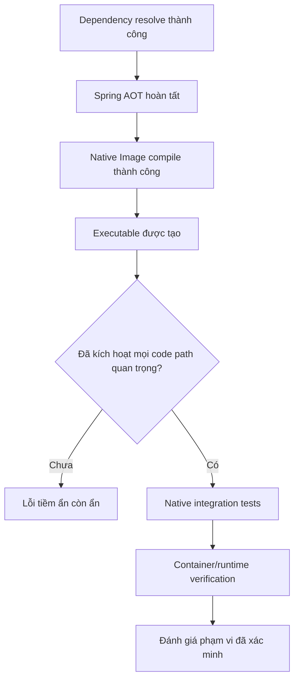

# Không xem dependency đã biên dịch thành công là bằng chứng mọi luồng đều hoạt động

## 1. Build thành công chỉ xác nhận một phần

Khi Spring Boot Native Image build hoàn tất, điều đó cho thấy dependency đã được resolve và các class/code path mà compiler phân tích được không gây lỗi đủ nghiêm trọng để dừng build. Nó **không chứng minh mọi chức năng của thư viện sẽ chạy đúng trong production**.

Nhiều thư viện chỉ thực hiện một số thao tác khi tính năng cụ thể được gọi: đọc template theo tên, nạp provider, tạo proxy, deserialize message, tải native library, chạy migration, xử lý định dạng hiếm hoặc chọn implementation theo profile. Nếu build không thực thi những nhánh đó, lỗi có thể chỉ xuất hiện khi request hoặc job đầu tiên kích hoạt chúng.

Trong module **SPRING_BOOT_NATIVE_IMAGE**, cần đánh giá dependency theo từng feature và code path mà ứng dụng thực sự dùng. Một native build xanh là cột mốc cần thiết; bằng chứng tương thích còn phải bao gồm test runtime trên executable native và container đích.



## 2. Bốn giai đoạn không nên đánh đồng

| Giai đoạn | Điều nó chứng minh | Điều chưa chứng minh |
|---|---|---|
| Dependency resolution | Artifact/version được tìm thấy và đưa vào graph | Class/member/resource động đều dùng được |
| Spring AOT | Context build-time có thể được xử lý và generated output được tạo | Mọi nhánh runtime và plugin đều được kích hoạt |
| Native compilation | GraalVM tạo được executable từ đầu vào đã cung cấp | Mọi endpoint, message type, provider và error path đều chạy đúng |
| Runtime/feature tests | Những kịch bản đã thực thi hoạt động trong môi trường test | Các kịch bản chưa chạy hoặc môi trường khác cũng đúng |

Ví dụ, một thư viện PDF có thể được resolve và native compile thành công. Nhưng endpoint xuất PDF với font nhúng, ảnh SVG hoặc locale hiếm có thể chưa được test. Lỗi thiếu resource hoặc reflection chỉ xuất hiện khi endpoint đó chạy.

Do đó, kết luận nên có phạm vi: “đã xác minh chức năng xuất PDF với font A, locale B trên Linux amd64” thay vì “thư viện PDF tương thích Native Image” nếu chưa kiểm tra toàn bộ feature matrix của nhà cung cấp.

## 3. Vì sao lỗi chỉ xuất hiện khi code path được gọi?

Một số cơ chế hoạt động theo kiểu lazy hoặc conditional:

- Class chỉ được nạp khi endpoint cụ thể được gọi.
- Reflection chỉ chạy khi serializer gặp một subtype ít phổ biến.
- Provider được tìm qua ServiceLoader khi một định dạng được yêu cầu.
- Resource được đọc theo tên template hoặc schema lấy từ dữ liệu.
- Proxy được tạo khi bean hoặc integration cụ thể khởi tạo.
- JNI library chỉ được load khi gọi một thuật toán native.
- Static initializer chỉ chạy khi class được sử dụng.
- Profile/property chỉ bật một nhánh cấu hình.
- Error handling hoặc fallback chỉ chạy khi dependency gặp lỗi.

Một test chỉ gọi health endpoint thường không kích hoạt các nhánh này. Ngay cả việc application context khởi động thành công cũng chưa chứng minh các thao tác lazy đều hoạt động.

## 4. Lập bản đồ feature và code path của dependency

Trước khi viết test, liệt kê cách ứng dụng sử dụng dependency. Ví dụ một thư viện xử lý tài liệu có các feature:

| Feature | Code path cần kích hoạt | Rủi ro cần kiểm tra |
|---|---|---|
| Đọc tài liệu PDF | Parser và font/resource | Resource, reflection |
| Xuất PDF | Renderer, font, image codec | Resource, JNI, provider |
| Đọc ảnh SVG | Parser và extension | Reflection, provider discovery |
| Chọn locale | Message/font bundle | Resource pattern |
| Xử lý file lỗi | Exception/fallback path | Lazy class và error handling |
| Xử lý file lớn | Streaming/temp file | Filesystem, memory, permission |

Bản đồ này phải dựa trên feature thực tế ứng dụng dùng, tài liệu thư viện và code call site. Không cần kiểm thử mọi chức năng của dependency nếu ứng dụng không sử dụng chúng; nhưng phải ghi rõ giới hạn đó.

## 5. Xác minh dependency và phiên bản thực tế

Bắt đầu từ runtime classpath của đúng application module. Với Gradle:

```bash
./gradlew :api-app:dependencies --configuration runtimeClasspath
./gradlew :api-app:dependencyInsight --dependency document-library --configuration runtimeClasspath
```

Với Maven:

```bash
./mvnw dependency:tree
```

Ghi nhận:

- Artifact và resolved version.
- Dependency bắc cầu và exclusions.
- Optional modules/classifiers được chọn.
- Version JDK, Spring Boot, Spring Framework và GraalVM.
- Profile/property có ảnh hưởng đến dependency hoặc feature.
- OS/architecture của native library nếu có.

Một dependency có thể resolve thành công nhưng optional module chứa provider cần thiết lại không nằm trong runtime classpath. Hãy kiểm tra đúng artifact thực sự được đóng gói, không chỉ khai báo trong build file.

## 6. Kiểm tra metadata không đồng nghĩa đã kiểm tra hành vi

Thư viện có thể cung cấp RuntimeHintsRegistrar, reachability metadata hoặc tài liệu Native Image. Đây là tín hiệu hữu ích, nhưng cần xác minh metadata được toolchain tiêu thụ và bao phủ feature đang dùng.

Ví dụ:

- Reflection hint cho constructor không chứng minh method khác được gọi qua reflection cũng có metadata.
- JDK ProxyHints không chứng minh class-based proxy hoặc bytecode generation tùy ý được hỗ trợ.
- Resource hint cho `templates/*.html` không chứng minh mọi schema/font ở thư mục khác được đóng gói.
- Serialization hint cho một DTO không chứng minh mọi subtype trong object graph đều tương thích.
- JNI metadata không bảo đảm native library đúng ABI hoặc có mặt trong run image.

Metadata là đầu vào cho build. Test feature thật mới chứng minh đường thực thi cụ thể hoạt động.

## 7. Thiết kế test theo feature, không chỉ theo startup

Mỗi feature quan trọng nên có ít nhất một test kích hoạt API thực tế của dependency. Test cần đi qua cùng lớp adapter/service mà ứng dụng production gọi, thay vì chỉ kiểm tra class tồn tại.

Ví dụ ứng dụng dùng thư viện tạo báo cáo:

```java
@SpringBootTest
class ReportGenerationNativeIT {

    @Autowired
    ReportService reportService;

    @Test
    void generatesPdfWithConfiguredTemplate() {
        byte[] pdf = reportService.generate(sampleReport());

        assertThat(pdf).isNotEmpty();
        assertThat(pdf).startsWith("%PDF-".getBytes(StandardCharsets.US_ASCII));
    }
}
```

Ví dụ chỉ minh họa hợp đồng kiểm tra; cách kiểm tra signature PDF cần xử lý encoding/bytes phù hợp. Test tốt hơn có thể mở lại file bằng parser và xác nhận nội dung, trang, font hoặc metadata mong đợi.

Không nên chỉ assert “không ném exception”. Hãy xác minh output và side effect có ý nghĩa với nghiệp vụ.

## 8. Ma trận JVM và Native Image

Chạy cùng bộ feature tests trên JVM và executable native. So sánh hành vi, không chỉ exit code.

| Kịch bản | JVM | Native executable |
|---|---|---|
| Feature cơ bản | Pass/Fail | Pass/Fail |
| Lazy initialization | Pass/Fail | Pass/Fail |
| Reflection/subtype | Pass/Fail | Pass/Fail |
| Resource theo tên | Pass/Fail | Pass/Fail |
| Proxy/AOP | Pass/Fail | Pass/Fail |
| Serialization | Pass/Fail | Pass/Fail |
| JNI/native backend | Pass/Fail | Pass/Fail |
| Error/fallback path | Pass/Fail | Pass/Fail |

Bảng là mẫu ghi kết quả. Không đánh dấu pass nếu test không thực sự chạy trên native executable. Nếu một feature không áp dụng, ghi N/A kèm lý do thay vì để trống khiến người đọc hiểu nhầm.

## 9. Test cả đường lỗi và fallback

Một số dependency chỉ đi vào code path khác khi thao tác chính thất bại. Ví dụ:

- Không tìm thấy provider ưu tiên thì fallback sang provider khác.
- Resource chính không tồn tại thì dùng template mặc định.
- Native backend không load được thì chuyển sang Java implementation.
- Parser gặp encoding hoặc format không hợp lệ thì trả lỗi cụ thể.
- Retry chạy sau timeout hoặc connection failure.

Những đường này thường ít được kích hoạt trong smoke test. Tuy nhiên, chúng có thể chứa reflection, resource hoặc provider discovery khác với đường thành công.

Không cố tình làm hỏng môi trường production để test. Dùng fixture, fake service hoặc container test có kiểm soát để tái hiện failure condition và xác minh fallback.

## 10. Profile và cấu hình ảnh hưởng đến feature

Spring AOT xử lý application context với profile/property build-time. Nếu một dependency chỉ được dùng bởi bean có điều kiện, test ở profile khác có thể không tạo bean hoặc không kích hoạt integration đó.

Cần ghi lại:

- Profile dùng trong AOT.
- Property quyết định auto-configuration hoặc feature.
- Property/runtime secret được cấp khi chạy.
- Bean/implementation được chọn.
- Dependency graph của application module.

Nếu bean graph khác nhau theo profile, build/test từng native artifact tương ứng. Nếu chỉ giá trị endpoint/credential khác nhau, giữ cấu trúc bean ổn định và cấp giá trị runtime theo thiết kế. Không kết luận feature đã được test chỉ vì test suite chạy dưới một profile không tạo bean của feature đó.

## 11. Test trên đúng container và nền tảng đích

Native executable có thể chạy trên máy build nhưng thất bại trong container vì khác libc, shared libraries, architecture, filesystem permission hoặc environment.

Kiểm tra tối thiểu:

1. Image đúng digest vừa build.
2. OS và CPU architecture đúng với binary.
3. Run image có shared libraries cần thiết.
4. User container đọc resource và ghi temp file theo yêu cầu.
5. Volume/configuration/secret được mount đúng.
6. Feature test gọi chính dependency trong container.
7. Resource, JNI backend và provider hoạt động ở môi trường đích.

Nếu production dùng Linux ARM64 nhưng CI chỉ test Linux amd64, chưa đủ bằng chứng cho ARM64. Ghi rõ platform đã xác minh và chạy test trên từng target cần phát hành.

## 12. Dùng Tracing Agent như công cụ hỗ trợ

GraalVM Native Image Tracing Agent có thể quan sát một số thao tác động khi chạy ứng dụng trên JVM và sinh metadata gợi ý. Nó hữu ích khi kiểm tra reflection, resource, proxy, serialization hoặc JNI theo code path đã chạy.

Nhưng agent chỉ ghi nhận những gì kịch bản test thực sự thực thi. Nếu test không gọi chức năng xuất PDF, agent không thể tự suy ra resource/font cần cho chức năng đó. Metadata sinh ra cũng cần review để loại cấu hình thừa và kiểm tra đúng version.

Quy trình hợp lý:

1. Chạy test suite JVM có phạm vi feature rõ.
2. Thu thập metadata từ các kịch bản đại diện.
3. Review metadata và so sánh với tài liệu nhà cung cấp.
4. Build Native Image.
5. Chạy lại cùng test suite trên native executable.
6. Bổ sung test cho nhánh chưa được agent quan sát.

Agent hỗ trợ khám phá metadata; nó không thay thế native integration test.

## 13. Điều tra khi build pass nhưng runtime fail

Khi lỗi xuất hiện, ghi lại feature, input, profile, platform và artifact digest trước khi sửa. Sau đó phân loại:

| Lỗi quan sát | Nhóm cần điều tra |
|---|---|
| Class không tìm thấy | Runtime classpath, classloader, reachability |
| Constructor/method reflection lỗi | Member metadata và signature |
| Resource null | Resource path, packaging, hints |
| Proxy creation lỗi | Proxy strategy, AOT support, runtime bytecode generation |
| Serialization exception | Object graph và serialization metadata |
| UnsatisfiedLinkError | JNI library, load path, ABI, JNI metadata |
| Sai giá trị static | Class initialization time |
| Chỉ lỗi với profile cụ thể | AOT profile/property và bean graph |
| Chỉ lỗi trong container | Run image, filesystem, permission, environment |

Tái hiện bằng test nhỏ nhất có thể, nhưng phải giữ nguyên code path gây lỗi. Sau khi thay metadata hoặc dependency, build lại executable và chạy lại test; không dùng kết quả của binary cũ.

## 14. Ghi nhận mức độ xác minh thay vì tuyên bố chung

Một báo cáo dependency nên có phạm vi rõ:

| Trường | Ví dụ nội dung cần ghi |
|---|---|
| Dependency | Artifact và resolved version |
| Feature được dùng | PDF generation, CSV import, native crypto... |
| Metadata | Registrar, reachability metadata, resource/JNI hints |
| JVM tests | Test suite và kết quả |
| Native tests | Feature path đã chạy trên executable |
| Container target | OS, architecture, run image digest |
| Giới hạn | Feature chưa kiểm tra hoặc platform chưa hỗ trợ |
| Artifact identity | Commit, build ID, executable/image digest |

Dùng các trạng thái dự án như:

- **Verified for tested paths**: các code path được liệt kê đã pass trên native/container.
- **Verified with configuration**: pass sau khi bổ sung metadata/cấu hình đã ghi lại.
- **Partially verified**: một số feature/platform chưa được test.
- **Unverified**: mới build thành công, chưa có bằng chứng runtime đủ.
- **Incompatible for current design**: code path bắt buộc dựa vào cơ chế không được hỗ trợ.

Các nhãn này là quy ước quản lý dự án, không phải chứng nhận chính thức từ GraalVM hoặc nhà cung cấp thư viện.

## 15. Checklist trước khi kết luận dependency tương thích

- Đã xác định đúng artifact/version trong runtime classpath.
- Đã liệt kê feature và code path thực sự sử dụng.
- Đã đọc hướng dẫn Native Image của đúng version dependency.
- Đã xác minh metadata được đóng gói và AOT/native build tiêu thụ.
- Test đã kích hoạt lazy, reflection, proxy, resource, serialization hoặc JNI khi có liên quan.
- Đã test cả nhánh lỗi/fallback quan trọng.
- Cùng kịch bản đã chạy trên executable native.
- Container test dùng đúng OS/architecture/run image dự kiến.
- Đã ghi profile, toolchain, artifact digest và giới hạn còn lại.
- Kết luận chỉ bao phủ feature/platform thực sự đã xác minh.

## 16. Câu hỏi tự kiểm tra

1. Native compilation thành công chứng minh điều gì và chưa chứng minh điều gì?
2. Vì sao lazy code path có thể không được kích hoạt khi chỉ test startup?
3. Reflection hint cho constructor có đảm bảo mọi method động hoạt động không?
4. Vì sao cần test cả nhánh lỗi và fallback của dependency?
5. Làm thế nào profile AOT có thể khiến một feature không được kiểm tra?
6. Tracing Agent bỏ sót điều gì nếu test suite không chạy chức năng hiếm?
7. Vì sao kết luận tương thích phải gắn với version, feature, platform và artifact digest?

**Ghi nhớ:** dependency resolve và native compile pass chỉ chứng minh các bước build đã hoàn tất. Chỉ kết luận tương thích trong phạm vi feature/code path đã được kích hoạt và xác minh trên native executable/container đích; ghi rõ những phần chưa được kiểm tra để tránh tuyên bố quá mức.
