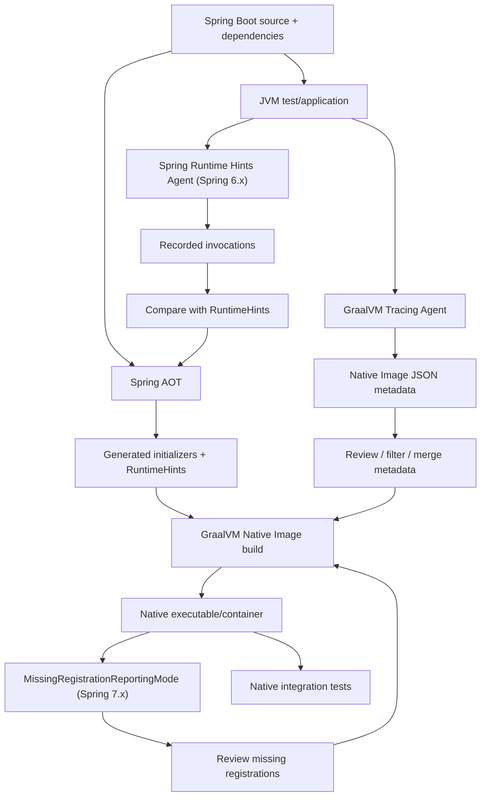

# Phân biệt GraalVM tracing agent với Spring RuntimeHints Agent

## 1. Vì sao có hai agent và chúng giải quyết vấn đề gì?

Khi chuyển ứng dụng Spring Boot sang **GraalVM Native Image**, một số hành vi động không thể được suy ra đầy đủ từ mã nguồn: reflection, đọc resource theo tên, tạo JDK proxy, Java serialization, JNI hoặc một số class được sinh lúc chạy. Native Image cần metadata tương ứng để giữ các class/member/resource và chuẩn bị executable.

Hai công cụ thường được nhắc đến trong quy trình này là:

- **GraalVM Native Image Tracing Agent**: chạy ứng dụng trên JVM có gắn agent để quan sát các thao tác động thực sự xảy ra trong lần chạy đó, sau đó ghi metadata JSON và trong một số chế độ có thể thu thập bytecode của class được định nghĩa động.
- **Spring Runtime Hints Agent**: Java agent trong `spring-core-test`, dùng để quan sát các lời gọi liên quan đến runtime hints trong test JVM và đối chiếu chúng với `RuntimeHints` mà Spring đã đăng ký. Agent này được hỗ trợ từ Spring Framework 6.0 và deprecated for removal từ 7.0.

Cả hai đều giúp tìm ra khoảng trống metadata, nhưng phạm vi quan sát và mục đích khác nhau. GraalVM agent hỗ trợ thu thập metadata ở mức Native Image từ một lần chạy ứng dụng; Spring agent hỗ trợ kiểm tra xem các hints do thư viện hoặc ứng dụng đóng góp có thực sự bao phủ hành vi mà test đã thực hiện hay chưa. Với Spring Framework 7.x, ưu tiên các chế độ missing-registration của GraalVM thay cho agent/recorder Spring đã deprecated.

Sau bài học, bạn có thể:

- Phân biệt mục tiêu, cách chạy, đầu ra và phạm vi của hai agent.
- Dùng GraalVM Tracing Agent để tạo metadata cấu hình ban đầu.
- Dùng Spring Runtime Hints Agent trên Spring Framework 6.x và hiểu lộ trình thay thế trên 7.x.
- Kết hợp hai công cụ với Spring AOT, `RuntimeHintsRegistrar` và native build.
- Hiểu vì sao một lần chạy agent thành công không chứng minh ứng dụng tương thích native trên mọi đường code.

## 2. So sánh nhanh

| Tiêu chí | GraalVM Native Image Tracing Agent | Spring Runtime Hints Agent |
|---|---|---|
| Thuộc về | GraalVM Native Image | Spring Framework, module test `spring-core-test` |
| Mục tiêu | Ghi nhận hành vi động để tạo reachability metadata cho Native Image | Kiểm tra các thao tác động có được khai báo trong Spring `RuntimeHints` hay chưa |
| Chạy ở đâu | JVM chạy ứng dụng hoặc test với `-agentlib:native-image-agent` | Spring 6.x: test JVM với `-javaagent:spring-core-test.jar`; Spring 7.x: ưu tiên build/run native với chế độ missing-registration của GraalVM |
| Quan sát | Reflection, resource, proxy, serialization, JNI, FFM và các trường hợp được agent hỗ trợ | Các invocation được agent Spring hỗ trợ, sau đó so sánh với `RuntimeHints` đã đóng góp |
| Đầu ra chính | JSON metadata theo schema Native Image; có thể có dữ liệu predefined classes trong chế độ thử nghiệm | Báo cáo/kiểm tra về các invocation chưa được khai báo trong RuntimeHints |
| Nơi dùng kết quả | Cấu hình reachability metadata, phân tích và chuyển thành hints phù hợp | Spring 6.x: bổ sung/sửa `RuntimeHintsRegistrar` và giữ test làm regression guard; Spring 7.x: xử lý missing-registration report từ native executable |
| Điểm mạnh | Bao quát hành vi ở mức runtime của một lần chạy ứng dụng, không phụ thuộc Spring | Gắn trực tiếp với hệ thống hints của Spring và kiểm tra được trong test suite |
| Giới hạn chính | Chỉ ghi nhận đường code đã chạy; metadata có thể rộng hoặc thiếu | Agent/recorder Spring deprecated từ 7.0; bản 6.x chỉ quan sát invocation được instrument trong test, không thay thế GraalVM build/test |

**Cách nhớ:** GraalVM Tracing Agent hỏi *“Trong lần chạy này, ứng dụng đã làm những thao tác động nào?”*. Spring Runtime Hints Agent (Spring 6.x) hỏi *“Những thao tác mà test vừa thực hiện đã được khai báo trong RuntimeHints của Spring chưa?”*. Trên Spring 7.x, hãy kiểm tra native executable với missing-registration mode của GraalVM.

## 3. GraalVM Native Image Tracing Agent

### 3.1. Cách hoạt động

Tracing Agent gắn vào JVM khi chạy ứng dụng hoặc test. Agent quan sát những thao tác runtime mà Native Image cần metadata, ví dụ:

- `Class.forName`, `Class.getDeclaredMethod` và các truy cập reflection khác.
- Đọc resource hoặc resource bundle qua API được hỗ trợ.
- Tạo JDK dynamic proxy.
- Java serialization.
- Gọi JNI, Foreign Function and Memory API (FFM) và các thao tác được agent nhận diện.
- Trong chế độ hỗ trợ class definition, ghi nhận bytecode của một số class được sinh động.

Khi ứng dụng kết thúc, agent ghi metadata JSON vào thư mục cấu hình. GraalVM hiện dùng định dạng hợp nhất `reachability-metadata.json`; một số version hoặc thư viện vẫn có thể cung cấp định dạng tách file cũ. Các nhóm metadata thường gặp gồm:

| File | Nội dung |
|---|---|
| `reachability-metadata.json` | Định dạng hợp nhất hiện hành cho các loại metadata động |
| `reflect-config.json` | Định dạng cũ cho class và member cần reflection |
| `resource-config.json` | Định dạng cũ cho resource và resource bundle cần giữ |
| `proxy-config.json` | Định dạng cũ cho tổ hợp interface dùng tạo JDK proxy |
| `serialization-config.json` | Định dạng cũ cho các kiểu dùng Java serialization |
| `jni-config.json` | Định dạng cũ cho các class/member được truy cập qua JNI |
| `predefined-classes-config.json` | Metadata cho predefined classes khi dùng chế độ class-definition phù hợp |

Các file được tạo tùy theo hành vi quan sát được và tính năng/version agent; không phải lần chạy nào cũng sinh đủ mọi file.

### 3.2. Chạy agent bằng `-agentlib`

Ví dụ chạy một ứng dụng Spring Boot JAR trên JVM:

```bash
java \
  -agentlib:native-image-agent=config-output-dir=target/native-agent \
  -jar target/order-service.jar
```

Sau khi ứng dụng khởi động, chạy các kịch bản nghiệp vụ quan trọng: tạo đơn, đọc dữ liệu, xuất hóa đơn, xử lý payment, gọi các integration tùy chọn và xử lý lỗi. Khi kết thúc tiến trình, kiểm tra thư mục `target/native-agent`.

Trên Windows PowerShell, lệnh tương đương:

```powershell
java "-agentlib:native-image-agent=config-output-dir=target/native-agent" -jar target/order-service.jar
```

Nếu muốn quan sát test thay vì khởi động ứng dụng độc lập, có thể truyền `-agentlib` vào JVM chạy test. Với Gradle, ví dụ cấu hình tạm thời:

```groovy
tasks.withType(Test).configureEach {
    jvmArgs '-agentlib:native-image-agent=config-output-dir=build/native-agent'
}
```

Với Maven Surefire, cấu hình `argLine` cho forked test JVM theo đúng cách dự án đang quản lý JVM arguments. Tránh thay thế `argLine` hiện có nếu nó chứa JaCoCo hoặc các agent khác; hãy nối thêm tham số và kiểm tra lệnh thực tế mà Surefire tạo ra.

### 3.3. Gộp dữ liệu từ nhiều kịch bản

Một ứng dụng lớn thường cần nhiều lần chạy agent. Với workflow hiện hành, mỗi tiến trình nên ghi vào một thư mục riêng bằng `config-output-dir`, sau đó gộp các thư mục bằng công cụ `native-image-utils`:

```bash
java \
  -agentlib:native-image-agent=config-output-dir=target/native-agent-run-1 \
  -jar target/order-service.jar

java \
  -agentlib:native-image-agent=config-output-dir=target/native-agent-run-2 \
  -jar target/order-service.jar

native-image-utils generate \
  --input-dir=target/native-agent-run-1 \
  --input-dir=target/native-agent-run-2 \
  --output-dir=target/native-agent-merged
```

Mỗi lần chạy có thể dùng profile hoặc bộ dữ liệu khác nhau. Công cụ `native-image-utils generate` nhận nhiều `--input-dir` và tạo một thư mục metadata hợp nhất. Một số GraalVM phiên bản cũ có công cụ `native-image-configure`; hãy dùng lệnh có trong distribution đang cài và kiểm tra `native-image-utils help` hoặc `native-image-configure help` trước khi tự động hóa.

### 3.4. Các option Tracing Agent thường dùng

| Option | Mục đích |
|---|---|
| `config-output-dir=<dir>` | Ghi metadata của tiến trình vào thư mục chỉ định |
| `caller-filter-file=<file>` | Lọc metadata theo class thực hiện thao tác động (caller) |
| `access-filter-file=<file>` | Lọc metadata theo class/member/resource được truy cập (target) |
| `trace-output=<file>` | Ghi từng thao tác động thành trace JSON để phân tích hoặc chuyển đổi sau |
| `experimental-class-define-support` | Thử thu thập bytecode của class được định nghĩa động để hỗ trợ predefined classes |

`caller-filter-file` và `access-filter-file` có cấu trúc JSON riêng; không dùng một file filter tùy ý theo tên `config-filter-file`. `experimental-class-define-support` là tính năng thử nghiệm, chỉ bật khi thật sự cần thu thập class được sinh động. Các option có thể thay đổi theo GraalVM version; kiểm tra tài liệu của distribution đang cài trước khi đưa vào CI.

Nếu cần xem từng invocation thay vì chỉ nhận metadata đã tổng hợp, có thể ghi trace JSON rồi chuyển thành cấu hình:

```bash
java \
  -agentlib:native-image-agent=trace-output=target/native-agent-trace.json \
  -jar target/order-service.jar

native-image-utils generate \
  --trace-input=target/native-agent-trace.json \
  --output-dir=target/native-agent-from-trace
```

Trace JSON hữu ích khi điều tra nguồn gốc một metadata entry hoặc phân tích thứ tự thao tác. Với workflow build thông thường, `config-output-dir` vẫn là lựa chọn trực tiếp hơn.

## 4. Spring Runtime Hints Agent

### 4.1. Vai trò trong hệ sinh thái Spring

Spring `RuntimeHints` là API mô tả các truy cập động cần được chuẩn bị khi AOT/native build. Ứng dụng hoặc thư viện có thể đóng góp hints qua `RuntimeHintsRegistrar`, `@ImportRuntimeHints`, `@RegisterReflectionForBinding` hoặc các API tương ứng.

Spring Runtime Hints Agent là công cụ test để phát hiện hành vi động mà test thực hiện nhưng `RuntimeHints` chưa mô tả. Nó được cung cấp trong module **`spring-core-test`**; không phải GraalVM agent và không phải một agent để tạo `reflect-config.json` trực tiếp cho native-image builder.

Agent Spring được thiết kế để chạy trong test JVM, quan sát những invocation mà nó hỗ trợ và đối chiếu với hints đã được Spring đăng ký. Khi test thực hiện một thao tác không có hint tương ứng, báo cáo sẽ chỉ ra khoảng trống để người phát triển bổ sung metadata.

### 4.2. Thêm `spring-core-test`

Với Gradle:

```groovy
dependencies {
    testImplementation 'org.springframework:spring-core-test'
}
```

Với Maven:

```xml
<dependency>
    <groupId>org.springframework</groupId>
    <artifactId>spring-core-test</artifactId>
    <scope>test</scope>
</dependency>
```

Nên dùng cùng version/BOM với Spring Framework mà ứng dụng đang chạy. Nếu dự án dùng Spring Boot dependency management, để Boot quản lý version thay vì tự chọn một version `spring-core-test` khác.

### 4.3. Gắn Spring agent vào test JVM trên Spring Framework 6.x

Spring Runtime Hints Agent là Java agent nằm trong JAR `spring-core-test`. Class agent ở package `org.springframework.aot.agent`, còn các annotation và helper dùng trong test nằm trong `org.springframework.aot.test.agent`.

Agent được nạp bằng tùy chọn JVM **`-javaagent`**, không gọi một phương thức `install()` trong test:

```text
-javaagent:/path/to/spring-core-test.jar=+org.springframework,+com.example.orders
```

Khi truyền argument tường minh, hãy liệt kê cả `org.springframework` và package ứng dụng cần quan sát. Mặc định agent chỉ instrument package `org.springframework`; có thể truyền nhiều package, phân tách bằng dấu phẩy, dùng `+` để thêm và `-` để loại trừ.

Với Gradle Groovy DSL, có thể tạo configuration riêng để lấy đúng JAR theo dependency management hiện tại rồi truyền vào từng test JVM:

```groovy
configurations {
    runtimeHintsAgent
}

dependencies {
    runtimeHintsAgent 'org.springframework:spring-core-test'
    testImplementation 'org.springframework:spring-core-test'
}

tasks.withType(Test).configureEach {
    def agentJar = configurations.runtimeHintsAgent.files.find {
        it.name.startsWith('spring-core-test-')
    }
    if (agentJar == null) {
        throw new GradleException('spring-core-test agent JAR was not resolved')
    }
    jvmArgs "-javaagent:${agentJar.absolutePath}=+org.springframework,+com.example.orders"
}
```

Giữ `spring-core-test` cùng version với Spring Framework đang dùng. Cấu hình `Test.jvmArgs` áp dụng cho JVM fork chạy test; chỉ đặt `-javaagent` trên Gradle daemon không đảm bảo agent có mặt trong test process. Nếu Maven Surefire được dùng, thêm cùng tham số `-javaagent:/path/to/spring-core-test.jar=+org.springframework,+com.example.orders` vào `argLine` của forked test JVM và giữ nguyên các agent khác mà dự án đã cấu hình.

### 4.4. Ghi nhận invocation và so sánh với hints

Trên Spring Framework 6.x, `RuntimeHintsRecorder.record(...)` ghi lại các invocation được agent quan sát trong một đoạn code. `RuntimeHintsInvocations.match(hints)` kiểm tra tập invocation đó có được `RuntimeHints` bao phủ hay chưa.

Ví dụ:

```java
package com.example.orders;

public class OrderPlugin {
    public String code() {
        return "orders";
    }
}
```

Registrar của component:

```java
package com.example.orders;

import java.util.List;

import org.springframework.aot.hint.ExecutableMode;
import org.springframework.aot.hint.RuntimeHints;
import org.springframework.aot.hint.RuntimeHintsRegistrar;

class OrderPluginRuntimeHints implements RuntimeHintsRegistrar {
    @Override
    public void registerHints(RuntimeHints hints, ClassLoader classLoader) {
        hints.reflection().registerType(OrderPlugin.class, typeHint ->
                typeHint.withMethod("code", List.of(), ExecutableMode.INVOKE));
    }
}
```

Test thực hiện thao tác reflection trên `OrderPlugin`:

```java
package com.example.orders;

import java.lang.reflect.Method;

import org.junit.jupiter.api.Test;
import org.springframework.aot.hint.RuntimeHints;
import org.springframework.aot.test.agent.EnabledIfRuntimeHintsAgent;
import org.springframework.aot.test.agent.RuntimeHintsInvocations;
import org.springframework.aot.test.agent.RuntimeHintsRecorder;

import static org.assertj.core.api.Assertions.assertThat;

@EnabledIfRuntimeHintsAgent
class OrderRuntimeHintsTests {

    @Test
    void contributedHintsCoverTheReflectionCall() {
        RuntimeHints hints = new RuntimeHints();
        new OrderPluginRuntimeHints().registerHints(hints, getClass().getClassLoader());

        RuntimeHintsInvocations invocations = RuntimeHintsRecorder.record(() -> {
            try {
                Method method = OrderPlugin.class.getMethod("code");
                method.invoke(new OrderPlugin());
            }
            catch (ReflectiveOperationException ex) {
                throw new IllegalStateException(ex);
            }
        });

        assertThat(invocations).match(hints);
    }
}
```

`@EnabledIfRuntimeHintsAgent` chỉ chạy test khi agent đã được nạp vào JVM hiện tại. Nếu test dùng reflection trực tiếp trong package ứng dụng, hãy thêm package đó vào danh sách instrument của agent. Nếu test không có invocation cần kiểm tra, kết quả không chứng minh rằng mọi đường code khác đã được bao phủ.

### 4.5. Thay đổi quan trọng từ Spring Framework 7.0

Từ Spring Framework 7.0, `RuntimeHintsAgent` và `RuntimeHintsRecorder` được đánh dấu **deprecated for removal**. Javadoc khuyến nghị dùng các tùy chọn GraalVM `-XX:MissingRegistrationReportingMode=Warn` và `-XX:MissingRegistrationReportingMode=Exit` để phát hiện metadata thiếu trên native executable. Vì vậy:

- Với Spring Framework 6.x, Spring Runtime Hints Agent là công cụ hữu ích để kiểm tra hints trong test JVM.
- Với Spring Framework 7.x, có thể gặp API cũ trong `spring-core-test` và tài liệu tương thích, nhưng nên ưu tiên chế độ báo missing registration của GraalVM.
- `RuntimeHintsPredicates` vẫn hữu ích để kiểm tra trực tiếp registrar mà không cần Java agent.

Để dùng chế độ kiểm tra missing registration, build native image với exact reachability metadata:

```bash
./gradlew nativeCompile
```

Trong Gradle Native Build Tools, thêm option cho binary `main`:

```groovy
graalvmNative {
    binaries {
        main {
            buildArgs.add('--exact-reachability-metadata')
        }
    }
}
```

Với Maven Native Build Tools, thêm `--exact-reachability-metadata` vào danh sách build arguments của `native-maven-plugin`. Cách cấu hình chi tiết phụ thuộc phiên bản plugin và profile native của dự án.

Sau đó chạy native executable với chế độ cảnh báo:

```bash
./order-service -XX:MissingRegistrationReportingMode=Warn
```

Khi chạy bộ integration test và muốn tiến trình dừng ngay nếu thiếu metadata, dùng:

```bash
./order-service -XX:MissingRegistrationReportingMode=Exit
```

`Warn` giúp liệt kê vị trí thiếu registration mà không kết thúc ngay; `Exit` hữu ích để phát hiện cả trường hợp ứng dụng bắt nhầm `Throwable` rồi che mất lỗi metadata. `--exact-reachability-metadata` được giới thiệu từ GraalVM for JDK 23; các phiên bản cũ có tùy chọn build tương ứng khác. Kiểm tra tài liệu GraalVM đang dùng trước khi áp dụng vào pipeline.

## 5. Hai agent khác nhau về output và workflow

### 5.1. GraalVM agent tạo reachability metadata

Workflow điển hình:

1. Build ứng dụng JVM.
2. Chạy ứng dụng/test với GraalVM Tracing Agent.
3. Thực thi các luồng nghiệp vụ.
4. Thu thập JSON metadata.
5. Review và lọc metadata.
6. Đưa metadata vào native-image build hoặc chuyển những phần thuộc Spring sang `RuntimeHintsRegistrar`.
7. Build và test native executable.

### 5.2. Spring agent kiểm tra chất lượng hints trên Spring Framework 6.x

Workflow điển hình:

1. Viết registrar/hints theo component.
2. Thêm `spring-core-test` vào test classpath.
3. Nạp `spring-core-test.jar` vào test JVM bằng `-javaagent`.
4. Chạy test bao phủ reflection, resource, proxy hoặc serialization.
5. Xem báo cáo invocation chưa được khai báo.
6. Bổ sung hoặc thu hẹp hints trong registrar.
7. Chạy lại test và native integration test.

Với Spring Framework 7.x, thay bước 3–6 bằng quy trình build native với `--exact-reachability-metadata`, sau đó chạy các kịch bản bằng `-XX:MissingRegistrationReportingMode=Warn` hoặc `Exit`. Đây là kiểm tra trên native executable, không phải một lần chạy test JVM có Spring agent.

### 5.3. Sơ đồ phối hợp



Hai agent có thể được dùng bổ sung cho nhau trên Spring Framework 6.x: GraalVM agent hữu ích để khám phá hành vi động rộng của ứng dụng; Spring agent hữu ích để giữ cho metadata Spring được khai báo đúng ở cấp component và được test bảo vệ. Trên Spring Framework 7.x, thay Spring agent cũ bằng missing-registration reporting của GraalVM khi xác minh native executable.

## 6. Khi nào nên dùng agent nào?

| Tình huống | Công cụ nên bắt đầu | Lý do |
|---|---|---|
| Ứng dụng JVM lớn, chưa biết thư viện nào dùng reflection/resource/proxy | GraalVM Tracing Agent | Quan sát hành vi thực tế mà không phụ thuộc Spring |
| Viết một Spring starter có RuntimeHintsRegistrar trên Framework 6.x | Spring Runtime Hints Agent | Xác nhận hints của starter bao phủ invocation của test |
| Một thư viện bên thứ ba dùng reflection động | GraalVM Tracing Agent | Ghi nhận các member thực sự được truy cập trong kịch bản chạy |
| Muốn test regression cho RuntimeHints của component trên Framework 6.x | Spring Runtime Hints Agent + `RuntimeHintsPredicates` | Đưa kiểm tra thiếu hints vào test suite |
| Muốn kiểm tra metadata thiếu trên Framework 7.x | GraalVM exact reachability metadata + missing-registration mode | Báo vị trí thiếu registration khi native executable chạy |
| Ứng dụng có nhiều profile/integration tùy chọn | GraalVM agent và công cụ kiểm tra theo phiên bản Spring | GraalVM agent khám phá hành vi; chọn Spring agent 6.x hoặc missing-registration mode 7.x |
| Có class được sinh động | GraalVM agent với chế độ class-define phù hợp | Có thể thu thập predefined class metadata; Spring agent không thay thế chức năng này |
| Native image build thành công nhưng một endpoint lỗi | GraalVM missing-registration mode + native integration test; dùng Tracing Agent nếu cần khám phá lại trên JVM | Báo vị trí metadata thiếu trên executable và xác nhận behavior cuối cùng |

## 7. Giới hạn và các bẫy thường gặp

### 7.1. Tracing Agent chỉ thấy những gì đã chạy

Nếu agent được chạy với luồng tạo đơn hàng nhưng không chạy luồng xuất hóa đơn, metadata cho thư viện xuất hóa đơn có thể không xuất hiện. Tương tự, agent không tự biết tất cả:

- Profile hoặc feature flag chưa được bật.
- Plugin chỉ cài ở production.
- Nhánh lỗi, retry, timeout hoặc fallback hiếm khi xảy ra.
- Message handler chỉ chạy khi nhận loại message đặc biệt.
- Locale, file resource hoặc schema chỉ dùng trong một nhóm khách hàng.

Vì vậy, cần lập danh sách kịch bản tracing dựa trên use case và cấu hình thực tế. Agent không thay thế test coverage.

### 7.2. Metadata GraalVM có thể quá rộng

Tracing Agent ghi lại những gì xảy ra, không biết toàn bộ metadata nào là tối thiểu. Một lần chạy có thể ghi nhiều method/field hoặc resource hơn mức cần thiết. Review trước khi commit metadata:

- Xác định package/thư viện sở hữu từng entry.
- Loại bỏ entry đến từ test harness hoặc tooling không nằm trong production.
- So sánh với hints Spring đã sinh để tránh khai báo trùng.
- Ưu tiên `RuntimeHintsRegistrar` cho metadata thuộc component Spring.
- Giữ file JSON riêng khi metadata thuộc thư viện không tích hợp Spring hoặc được Native Image tooling quản lý trực tiếp.

### 7.3. Spring Runtime Hints Agent không phải GraalVM compiler

Spring agent chỉ kiểm tra các thao tác mà agent hỗ trợ và trạng thái `RuntimeHints` trong test. Nó không:

- Chạy `native-image`.
- Chứng minh tất cả class/resource đã reachable.
- Chứng minh container image chạy trên OS/CPU đích.
- Tự tạo toàn bộ JSON metadata GraalVM.
- Thay thế native integration test hoặc kiểm thử hiệu năng.

Từ Spring Framework 7.0, `org.springframework.aot.agent.RuntimeHintsAgent` và `RuntimeHintsRecorder` đã deprecated for removal. Đây là thay đổi quan trọng khi nâng Spring Boot 4/Spring Framework 7: hãy ưu tiên kiểm tra native executable bằng `--exact-reachability-metadata` và `-XX:MissingRegistrationReportingMode`, thay vì xây pipeline mới dựa vào Spring agent cũ.

### 7.4. Missing-registration mode là kiểm tra trên native executable

`-XX:MissingRegistrationReportingMode=Warn` và `Exit` được truyền khi chạy native executable. Chúng không phải tham số của Spring test JVM và cũng không tạo file JSON như GraalVM Tracing Agent. Hãy dùng `Warn` để tìm vị trí thiếu metadata trong các kịch bản thực tế, sau đó dùng `Exit` trong integration test để phát hiện lỗi bị code bắt và bỏ qua.

### 7.5. Không nhầm Tracing Agent với Native Image compiler

`native-image-agent` là agent gắn vào JVM để thu thập metadata. Nó không phải tùy chọn của compiler để tự kiểm tra toàn bộ image. Trình biên dịch Native Image vẫn có thể phát hiện thiếu metadata khi build hoặc runtime; log lỗi và native test vẫn là bằng chứng quan trọng.

### 7.6. Cẩn thận với test JVM fork

Gradle Test và Maven Surefire có thể chạy test trong một hoặc nhiều JVM fork. Agent được cài trong JVM của một test không tự động áp dụng cho JVM khác. Nếu cấu hình test song song, cần bảo đảm mỗi fork có agent và thư mục output không bị ghi đè cạnh tranh.

## 8. Quy trình thực hành kết hợp cho Spring Boot

**Bối cảnh:** `order-service` có REST API, xuất hóa đơn, payment adapter tùy chọn và một thư viện cũ dùng reflection. Mục tiêu là thu thập metadata và kiểm tra hints trước khi build Native Image.

### Bước 1 — Chuẩn bị bản JVM có thể chạy test

Build ứng dụng bằng Maven/Gradle như thường lệ. Đảm bảo test suite có các trường hợp cho:

- REST JSON request/response.
- Xuất hóa đơn và đọc template/resource.
- Payment proxy và integration tùy chọn.
- Reflection của thư viện cũ.
- Java serialization nếu ứng dụng thật sự dùng `ObjectInputStream`/`ObjectOutputStream`.

### Bước 2 — Chạy GraalVM Tracing Agent

```bash
java \
  -agentlib:native-image-agent=config-output-dir=build/native-agent \
  -jar build/libs/order-service.jar
```

Gọi các endpoint/kịch bản đã liệt kê. Sau đó kiểm tra JSON files trong `build/native-agent`. Chạy thêm biến thể profile khác trong một lần tracing riêng hoặc merge vào thư mục hợp nhất.

### Bước 3 — Review GraalVM metadata

Phân loại từng entry:

- Metadata reflection/resource/proxy/serialization/JNI thuộc thư viện bên ngoài.
- Metadata có thể thay bằng Spring RuntimeHints API.
- Metadata của test framework, logging hoặc công cụ không có trong production.
- Entry được ghi nhận bởi đường code không còn dùng.

Không đưa toàn bộ file tracing vào source mà không review. Giữ metadata theo module/thư viện và theo đúng schema của GraalVM version đang build.

### Bước 4 — Kiểm tra Spring hints theo phiên bản

Nếu dự án dùng Spring Framework 6.x, thêm `spring-core-test` cùng version, nạp agent vào test JVM bằng `-javaagent` và dùng `RuntimeHintsRecorder` để đối chiếu invocation với registrar. Nếu dự án dùng Spring Framework 7.x, agent/recorder đã deprecated; build với `--exact-reachability-metadata` và chạy native executable với `-XX:MissingRegistrationReportingMode=Warn` hoặc `Exit`.

### Bước 5 — Viết regression test cho hints

Ngoài agent, viết unit test `RuntimeHintsPredicates` cho những metadata quan trọng:

```java
@Test
void registersOrderTemplateResource() {
    RuntimeHints hints = new RuntimeHints();
    new OrderRuntimeHints().registerHints(hints, getClass().getClassLoader());

    assertThat(RuntimeHintsPredicates.resource()
            .forResource("templates/orders/invoice.html"))
            .accepts(hints);
}
```

Test predicate là kiểm tra tĩnh đối với registrar. Trên Spring 6.x, Runtime Hints Agent kiểm tra invocation phát sinh khi test thực thi; trên Spring 7.x, missing-registration mode kiểm tra khi native executable chạy. Ba cách kiểm tra có phạm vi khác nhau và bổ sung cho nhau.

### Bước 6 — Build native và chạy integration test

Chạy native build theo plugin đã cấu hình. Sau khi executable/container image được tạo, chạy đúng các kịch bản ở bước 1. Kiểm tra endpoint, resource, proxy, serialization và integration tùy chọn. Nếu có lỗi, phân loại xem thiếu reachability metadata, Spring hint, thư viện native hay cấu hình runtime.

## 9. Checklist trước khi commit metadata

- [ ] Đã chạy tracing agent với các luồng nghiệp vụ quan trọng.
- [ ] Đã chạy các profile/integration tùy chọn cần hỗ trợ.
- [ ] Đã kiểm tra output JSON theo đúng GraalVM version.
- [ ] Đã loại metadata của test harness hoặc thư viện không có trong production.
- [ ] Đã xác định entry nào thuộc Spring component và có thể chuyển sang RuntimeHints API.
- [ ] Nếu dùng Spring Framework 6.x, đã chạy Spring Runtime Hints Agent trong test JVM; nếu dùng 7.x, đã kiểm tra missing-registration mode trên native executable.
- [ ] Đã bổ sung unit test `RuntimeHintsPredicates` cho registrar quan trọng.
- [ ] Đã kiểm tra Gradle/Maven test fork để agent không bị thiếu ở JVM khác.
- [ ] Đã build Native Image và chạy integration test trên executable/container.
- [ ] Đã kiểm tra kích thước metadata và tránh giữ reflection/resource quá rộng.

## 10. Ghi nhớ

GraalVM Native Image Tracing Agent và Spring Runtime Hints Agent đều hỗ trợ tìm thiếu metadata, nhưng phục vụ hai góc nhìn khác nhau. GraalVM agent quan sát hành vi động trên JVM và tạo reachability metadata theo schema Native Image. Spring agent thuộc `spring-core-test`, giúp kiểm tra các thao tác động trong test có được mô tả bằng `RuntimeHints` của Spring hay chưa.

Với ứng dụng Spring Boot, hãy dùng GraalVM agent để khám phá hành vi của toàn ứng dụng và thư viện bên thứ ba; dùng Spring agent cùng `RuntimeHintsPredicates` để giữ metadata Spring ở cấp component có thể kiểm thử và bảo trì. Sau cả hai bước, native build và integration test vẫn là điều kiện xác nhận cuối cùng.

### Tài liệu tham khảo chính thức

- [GraalVM — Native Image Tracing Agent](https://www.graalvm.org/latest/reference-manual/native-image/metadata/AutomaticMetadataCollection/)
- [GraalVM — Agent Options](https://www.graalvm.org/latest/reference-manual/native-image/metadata/ExperimentalAgentOptions/)
- [GraalVM — Reachability Metadata and Missing Registrations](https://www.graalvm.org/latest/reference-manual/native-image/metadata/)
- [Oracle GraalVM — Troubleshoot Native Image Run-Time Errors](https://docs.oracle.com/en/graalvm/jdk/25i/docs/reference-manual/native-image/guides/troubleshoot-run-time-errors/)
- [Spring Framework — Runtime Hints and AOT](https://docs.spring.io/spring-framework/reference/core/aot.html)
- [Spring Framework — RuntimeHints Javadoc](https://docs.spring.io/spring-framework/docs/current/javadoc-api/org/springframework/aot/hint/RuntimeHints.html)
- [Spring Framework 6.2 — RuntimeHintsAgent Javadoc](https://docs.spring.io/spring-framework/docs/6.2.x/javadoc-api/org/springframework/aot/agent/RuntimeHintsAgent.html)
- [Spring Framework 6.1 — Runtime Hints test agent API](https://docs.spring.io/spring-framework/docs/6.1.19/javadoc-api/org/springframework/aot/test/agent/package-summary.html)
- [Spring Framework 7.0 — RuntimeHintsAgent deprecation](https://docs.spring.io/spring-framework/docs/7.0.0-M8/javadoc-api/org/springframework/aot/agent/RuntimeHintsAgent.html)
- [Spring Framework 7.0 — Deprecated APIs](https://docs.spring.io/spring-framework/docs/7.0.0-M6/javadoc-api/deprecated-list.html)
- [Spring Framework buildSrc — Runtime Hints Agent Gradle plugin](https://github.com/spring-projects/spring-framework/blob/main/buildSrc/README.md)
