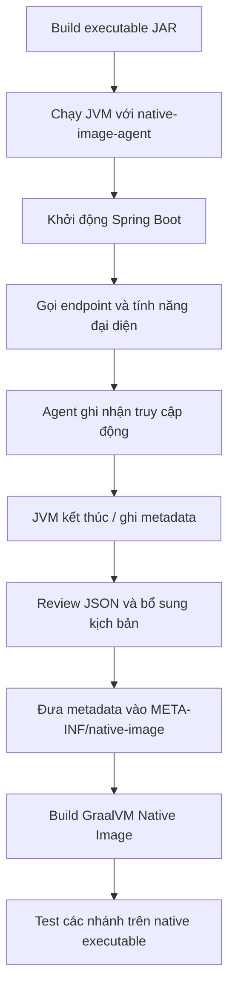

# Chạy ứng dụng với native-image-agent và config-output-dir

## 1. Mục tiêu: thu thập metadata từ hành vi chạy thật

GraalVM Native Image phân tích ứng dụng ở thời điểm build. Các lời gọi được xác định tĩnh thường được xử lý tự động, nhưng một số tính năng động như reflection, dynamic proxy, JNI, serialization hoặc đọc resource theo tên có thể cần **reachability metadata**. Nếu metadata thiếu, ứng dụng có thể build thành công nhưng lỗi khi chạy một nhánh nghiệp vụ cụ thể.

**Tracing Agent** (`native-image-agent`) hỗ trợ phát hiện những truy cập động đã thực sự xảy ra khi ứng dụng chạy trên JVM. Agent ghi nhận hành vi, sau đó sinh các tệp JSON để Native Image có thể sử dụng khi biên dịch.

Trong bài học này, ta tập trung vào cách chạy ứng dụng Spring Boot với:

```text
-agentlib:native-image-agent=config-output-dir=<thư-mục-kết-quả>
```

Tùy chọn `config-output-dir` chỉ định nơi agent ghi metadata. Ta sẽ chạy ứng dụng, gọi các endpoint và tính năng cần kiểm tra, dừng JVM đúng cách, đọc kết quả, bổ sung các kịch bản còn thiếu rồi mới đưa metadata đã review vào quy trình native build.

Bài học thuộc chương **Tracing agent** của module **SPRING_BOOT_NATIVE_IMAGE**. Module sử dụng Spring AOT và GraalVM Native Image để thực hành build Maven/Gradle, cấu hình reflection/resource, kiểm thử tương thích, đóng gói container và vận hành bản native. Tracing Agent là công cụ hỗ trợ thu thập bằng chứng về các truy cập động; nó không thay thế Spring RuntimeHints hoặc việc kiểm thử native executable.

Sau bài học, người học có thể:

- Kiểm tra GraalVM JDK và Native Image Agent trên máy build.
- Gắn agent vào đúng JVM đang chạy ứng dụng Spring Boot.
- Dùng `config-output-dir` để tạo bộ metadata đầu tiên.
- Chạy thêm các kịch bản và dùng `config-merge-dir` để bổ sung metadata.
- Đọc, review và đưa kết quả vào `META-INF/native-image`.
- Kiểm thử native executable để phát hiện nhánh chưa được agent ghi nhận.

## 2. Agent làm gì trong quá trình chạy?

Tracing Agent dùng khả năng quan sát của JVM để ghi lại những truy cập động mà Native Image có thể cần metadata. Tùy code path đã chạy, kết quả có thể mô tả:

| Nhóm | Ví dụ thao tác |
|---|---|
| Reflection | Tra cứu class, constructor, method hoặc field theo tên/chữ ký |
| Resource | Đọc file classpath theo tên hoặc pattern động |
| Dynamic proxy | Tạo proxy từ danh sách interface |
| JNI | Truy cập Java type/member từ native code |
| Serialization | Serialize/deserialize các type cần metadata |
| Các tính năng động khác | Những cấu hình reachability mà agent và phiên bản GraalVM hỗ trợ |

Luồng tổng quát:



Agent quan sát **những gì thực sự xảy ra** trong phiên chạy có gắn agent. Nó không phân tích mọi input có thể xuất hiện trong tương lai và không bảo đảm metadata hoàn chỉnh chỉ sau một lần khởi động.

Ví dụ, nếu ứng dụng có hai serializer được chọn theo property, nhưng phiên chạy agent chỉ dùng serializer JSON, metadata có thể chưa có truy cập động của serializer XML. Muốn bao phủ cả hai, phải thực thi cả hai kịch bản.

## 3. Chuẩn bị GraalVM JDK và ứng dụng

### 3.1. Dùng đúng Java có Native Image Agent

Tracing Agent được phân phối cùng GraalVM Native Image. Hãy xác nhận Java và công cụ Native Image đến từ cùng một GraalVM installation:

```bash
java -version
native-image --version
which java
which native-image
```

Trên Windows PowerShell:

```powershell
java -version
native-image --version
Get-Command java
Get-Command native-image
```

Nếu `native-image` không tồn tại, cài thành phần Native Image cho GraalVM distribution đang dùng theo hướng dẫn của release đó. Nếu chạy ứng dụng bằng một JDK khác không có agent, JVM có thể báo không tìm thấy agent library khi khởi động.

Trong ví dụ, ưu tiên gọi trực tiếp `JAVA_HOME/bin/java` trên Linux/macOS hoặc `JAVA_HOME\bin\java.exe` trên Windows để tránh PATH trỏ nhầm JDK.

### 3.2. Build ứng dụng Spring Boot thành executable JAR

Agent cần được gắn vào **JVM chạy ứng dụng**. Cách dễ kiểm soát nhất là build executable JAR trước, sau đó gọi Java trực tiếp.

Với Maven:

```bash
./mvnw -DskipTests package
```

Với Gradle:

```bash
./gradlew bootJar
```

Xác định đúng file JAR trong `target/` (Maven) hoặc `build/libs/` (Gradle). Nếu project tạo nhiều JAR, chọn Spring Boot executable JAR có dependency được đóng gói, không chọn file `original-*.jar` hoặc test JAR.

### 3.3. Vì sao không gắn agent vào Maven/Gradle một cách tùy tiện?

Lệnh `./mvnw` khởi chạy JVM cho Maven; plugin có thể khởi chạy một JVM khác để chạy ứng dụng. Nếu chỉ thêm `-agentlib` vào `MAVEN_OPTS`, agent có thể quan sát Maven process thay vì Spring Boot process. Kết quả khi đó không đại diện cho code path của ứng dụng.

Cách dùng executable JAR bên dưới làm rõ JVM nào được instrument. Nếu dùng `spring-boot:run` hoặc `bootRun`, phải truyền agent option vào JVM fork chạy ứng dụng theo cơ chế của plugin, không chỉ vào Maven/Gradle daemon.

## 4. Chạy ứng dụng với config-output-dir trên Linux/macOS

Tạo một thư mục kết quả mới cho lần thu thập đầu tiên. Tách thư mục metadata khỏi source code giúp dễ kiểm tra và tránh vô tình dùng kết quả cũ:

```bash
mkdir -p target/native-agent-run-01
"$JAVA_HOME/bin/java" -agentlib:native-image-agent=config-output-dir=target/native-agent-run-01 -Dspring.profiles.active=native-agent -jar target/my-spring-app.jar
```

Thay `my-spring-app.jar` bằng tên JAR thực tế. Nếu ứng dụng không có profile `native-agent`, bỏ property đó hoặc thay bằng profile phù hợp. Profile chỉ là ví dụ để chọn cấu hình cần đo; nó không tự bật Native Image.

**Vị trí tham số rất quan trọng:** `-agentlib:native-image-agent=...` và các JVM option phải đứng trước `-jar`. Mọi đối số sau tên JAR được truyền cho ứng dụng Spring Boot, không còn là JVM option.

Sau khi ứng dụng khởi động, terminal sẽ tiếp tục chạy vì đây là server. Giữ process hoạt động để thực hiện các kịch bản ở phần tiếp theo. Khi đã hoàn tất, dừng ứng dụng bằng shutdown thông thường (ví dụ Ctrl+C và chờ Spring Boot kết thúc). Agent ghi metadata khi JVM thoát; kết thúc cưỡng bức process có thể làm mất dữ liệu chưa được ghi.

### Chạy với periodic write cho server chạy lâu

Nếu không thể dừng server thường xuyên, có thể yêu cầu agent ghi metadata theo chu kỳ:

```bash
"$JAVA_HOME/bin/java" -agentlib:native-image-agent=config-output-dir=target/native-agent-run-01,config-write-period-secs=300,config-write-initial-delay-secs=10 -Dspring.profiles.active=native-agent -jar target/my-spring-app.jar
```

Trong ví dụ, agent bắt đầu ghi sau 10 giây và tiếp tục mỗi 300 giây. Giá trị này chỉ là ví dụ; chọn chu kỳ phù hợp với thời lượng test. Khi JVM kết thúc, agent vẫn hoàn tất việc ghi metadata cuối cùng theo cơ chế của nó.

## 5. Chạy với config-output-dir trên Windows PowerShell

PowerShell có thể chạy cùng executable JAR:

```powershell
$agentConfig = ".\target\native-agent-run-01"
New-Item -ItemType Directory -Force -Path $agentConfig | Out-Null
$java = Join-Path $env:JAVA_HOME "bin\java.exe"
& $java "-agentlib:native-image-agent=config-output-dir=$agentConfig" -Dspring.profiles.active=native-agent -jar .\target\my-spring-app.jar
```

Thay đường dẫn JAR và profile theo dự án. Thư mục output nên được dành riêng cho một lượt thu thập mới. Không trộn metadata từ những build hoặc phiên bản dependency khác nhau nếu chưa có chủ đích.

Nếu Java process chạy như một Windows service hoặc được khởi động từ script khác, hãy xác định đúng process con cần instrument. Đưa agent vào JVM của Gradle/Maven daemon không bảo đảm ứng dụng Spring Boot được quan sát.

## 6. Thực thi các kịch bản đại diện của ứng dụng

Sau khi server chạy với agent, gọi các endpoint hoặc thao tác nghiệp vụ trên đúng môi trường thử nghiệm. Ví dụ:

```bash
curl --fail --silent --show-error -H 'Content-Type: application/json' -d '{"format":"json","locale":"vi"}' http://localhost:8080/api/reports
curl --fail --silent --show-error -H 'Content-Type: application/json' -d '{"format":"xml","locale":"en"}' http://localhost:8080/api/reports
```

Các URL và payload trên là minh họa; thay bằng endpoint và request thực tế của ứng dụng. Đừng chỉ gọi health endpoint rồi kết luận metadata đã đầy đủ.

Lập danh sách code path cần thực thi:

| Nhóm tính năng | Kịch bản cần chạy |
|---|---|
| Reflection | Mỗi implementation/class được chọn từ cấu hình hoặc registry |
| Serialization | Mỗi loại object được serialize/deserialize, gồm các subtype thực tế |
| Resource | Từng locale, template, schema hoặc resource path được tạo động |
| Dynamic proxy | Mỗi tập interface hoặc proxy factory được sử dụng |
| JNI | Mỗi callback, class/member mà native library truy cập |
| Framework integration | Các endpoint dùng validation, binding, expression, mapper hoặc thư viện có metadata riêng |
| Conditional configuration | Các profile/property làm thay đổi bean graph và tính năng |

Đối với một server, thực thi các request bằng dữ liệu không nhạy cảm và tương đương môi trường production. Nếu có batch job, scheduler hoặc message listener, cần kích hoạt chúng trong test harness; khởi động server không đồng nghĩa mọi consumer đã nhận message.

### Phủ cả nhánh thành công và lỗi

Không chỉ chạy happy path. Nếu ứng dụng có fallback serializer, exception handler, retry, plugin không tìm thấy hoặc dữ liệu tùy chọn, hãy kích hoạt các nhánh đó khi chúng có ý nghĩa với sản phẩm. Một số đường reflection/resource chỉ được gọi trong nhánh lỗi hoặc cấu hình hiếm.

Không đưa dữ liệu bí mật, token production hoặc payload chứa thông tin cá nhân vào phiên thu thập chỉ để tăng coverage. Agent thu metadata về truy cập động; dữ liệu nghiệp vụ thử nghiệm vẫn cần tuân theo quy tắc bảo vệ dữ liệu của dự án.

## 7. Đọc metadata sau khi JVM kết thúc

Sau khi dừng ứng dụng bình thường, liệt kê nội dung thư mục:

```bash
find target/native-agent-run-01 -maxdepth 2 -type f
```

Với các bản GraalVM hiện hành, agent có thể tạo file hợp nhất `reachability-metadata.json`. Các release cũ hơn có thể tạo một số file riêng, tùy nhóm truy cập đã quan sát, ví dụ:

- `reflect-config.json`
- `resource-config.json`
- `proxy-config.json`
- `jni-config.json`
- `serialization-config.json`

Không phải mọi file đều xuất hiện trong mọi lượt. Nếu ứng dụng không dùng JNI hoặc proxy động trong các kịch bản đã chạy, agent có thể không tạo cấu hình cho nhóm đó.

Ví dụ cấu trúc rút gọn của metadata reflection:

```json
{
  "reflection": [
    {
      "type": "com.example.report.CsvReport",
      "methods": [
        {
          "name": "render",
          "parameterTypes": [
            "com.example.report.ReportRequest"
          ]
        }
      ]
    }
  ]
}
```

Đây là ví dụ minh họa cấu trúc reachability metadata hợp nhất, không phải kết quả thu thập từ project hiện tại. Dữ liệu thực tế phải lấy từ file agent tạo ra.

### Kiểm tra file có được ghi hay không

Nếu thư mục trống hoặc thiếu file mong đợi:

1. Kiểm tra agent option có đứng trước `-jar` hay không.
2. Kiểm tra app JVM có thực sự chạy bằng GraalVM JDK có Native Image Agent không.
3. Kiểm tra process có kết thúc bình thường để agent flush metadata không.
4. Kiểm tra code path cần thiết có được thực thi hay chưa.
5. Kiểm tra quyền ghi của thư mục output và log khởi động JVM.
6. Nếu dùng periodic write, chờ qua chu kỳ ghi hoặc dừng process đúng cách.

Không tự tạo file JSON rỗng để làm cho build tiếp tục; file rỗng không chứng minh agent đã quan sát được bất kỳ truy cập nào.

## 8. Thu thập nhiều lượt với config-merge-dir

Một lần chạy thường chưa bao phủ hết hành vi. Sau lượt đầu dùng `config-output-dir`, có thể chạy lại ứng dụng với `config-merge-dir` trỏ tới thư mục metadata đã có. Agent sẽ bổ sung các truy cập mới vào cấu hình hiện tại.

Ví dụ lượt đầu chỉ chạy báo cáo JSON, lượt sau chạy XML và PDF:

```bash
# Lượt đầu: tạo bộ metadata ban đầu.
"$JAVA_HOME/bin/java" -agentlib:native-image-agent=config-output-dir=target/native-agent-config -jar target/my-spring-app.jar
```

Sau khi dừng JVM, chạy lượt bổ sung:

```bash
# Lượt tiếp theo: thêm các truy cập mới vào cùng bộ metadata.
"$JAVA_HOME/bin/java" -agentlib:native-image-agent=config-merge-dir=target/native-agent-config -jar target/my-spring-app.jar
```

Trong lượt thứ hai, thực thi các scenario chưa được chạy ở lượt đầu rồi dừng JVM bình thường. `config-merge-dir` phù hợp khi muốn tích lũy metadata qua nhiều phiên chạy; không dùng `config-output-dir` lặp lại trên một thư mục đã có metadata nếu mục tiêu là giữ dữ liệu cũ.

Nếu chạy nhiều JVM song song, không cho chúng cùng ghi vào một thư mục output chung. Dùng `config-output-dir` riêng cho mỗi process, sau đó hợp nhất các bộ cấu hình bằng công cụ `native-image-utils` nếu toolchain đang dùng cung cấp công cụ đó:

```bash
native-image-utils generate --input-dir=target/agent-run-a --input-dir=target/agent-run-b --output-dir=target/agent-config-merged
```

Kiểm tra `native-image-utils help` trong GraalVM distribution đang cài trước khi dùng; cách hợp nhất và công cụ đi kèm có thể khác theo release. Nếu chỉ chạy tuần tự, `config-merge-dir` thường đơn giản hơn.

## 9. Review metadata trước khi đưa vào source

Metadata do agent tạo ra là **đầu vào cần review**, không phải cấu hình production tự động được phê duyệt.

Khi review, kiểm tra:

- Type và member có thuộc ứng dụng/dependency thực sự được triển khai không?
- Có entry chỉ xuất hiện vì test framework, debug endpoint hoặc công cụ phát triển không?
- Có reflection member nào được mở rộng quá mức so với code path cần thiết không?
- Resource pattern có quá rộng, ví dụ bao phủ cả thư mục resource không liên quan?
- Có metadata trùng với hints do Spring hoặc thư viện đã cung cấp không?
- Profile/property và phiên bản dependency khi thu thập có giống cấu hình native build không?
- Có code path quan trọng nào chưa được thực thi?

Agent có caller filter mặc định để loại một số truy cập mà Native Image hỗ trợ trực tiếp. Không tùy tiện tắt built-in filters để làm file metadata “đầy hơn”; cấu hình thu được có thể chứa nhiều entry không cần thiết và khó review hơn.

Nếu một dependency đã cung cấp reachability metadata trong JAR hoặc qua GraalVM Reachability Metadata Repository, hãy kiểm tra trước khi tự thêm cấu hình trùng. Metadata tự sinh nên bổ sung những gì framework/library chưa mô tả.

### Không đồng nhất coverage của agent với coverage nghiệp vụ

Agent không tạo ra một phần trăm coverage chứng minh ứng dụng hoàn chỉnh. Nó chỉ ghi lại những truy cập động đã quan sát. Test suite có thể có line coverage cao nhưng vẫn bỏ sót một plugin được chọn bằng property hiếm; ngược lại, một test framework có thể tạo nhiều metadata không liên quan tới production.

Hãy duy trì danh sách scenario cần chạy và liên kết từng scenario với tính năng động mà nó kiểm chứng.

## 10. Đưa metadata vào dự án Spring Boot

Sau khi review, đưa các file metadata cần thiết vào classpath của ứng dụng, thường dưới:

```text
src/main/resources/
└── META-INF/
    └── native-image/
        └── com.example/
            └── spring-app/
                └── reachability-metadata.json
```

Đường dẫn group/artifact có thể điều chỉnh theo quy ước dự án. GraalVM tìm reachability metadata dưới `META-INF/native-image` trên classpath. Khi Maven/Gradle đóng gói resource, file này sẽ đi cùng executable JAR và được Native Image build tool phát hiện.

Với Maven và Gradle, thư mục resource mặc định thường là `src/main/resources`. Có thể giữ thư mục thu thập trong `target/native-agent-config` hoặc `build/native-agent-config` riêng, review xong mới copy các file cần thiết vào source resources. Không để output thử nghiệm trong source tree rồi vô tình commit mọi file agent tạo ra.

Nếu dùng phiên bản GraalVM cũ tạo các file cấu hình riêng, giữ định dạng được toolchain release đó hỗ trợ. Nếu dùng định dạng hợp nhất `reachability-metadata.json`, kiểm tra schema và version theo tài liệu tương ứng. Không đổi tên file legacy thành `reachability-metadata.json` mà không chuyển đổi cấu trúc JSON.

## 11. Build và kiểm thử Native Image sau khi có metadata

Sau khi metadata đã nằm trong classpath, chạy native build theo cấu hình của dự án. Ví dụ:

```bash
# Maven: dùng profile native đã cấu hình cho Spring AOT/GraalVM.
./mvnw -Pnative native:compile

# Gradle: project đã áp dụng Spring Boot và Native Build Tools.
./gradlew nativeCompile
```

Goal/task thực tế phụ thuộc Spring Boot, GraalVM Native Build Tools và cấu hình Maven/Gradle của project. Có dự án dùng `spring-boot:build-image` hoặc `bootBuildImage` để tạo container image. Điều quan trọng là metadata đã review phải nằm trên classpath của native build.

Sau khi build:

1. Chạy native executable vừa tạo.
2. Gọi lại toàn bộ scenario đã chạy với agent.
3. Bổ sung các test cho nhánh quan trọng mà agent chưa quan sát.
4. Xác nhận reflection, resource, proxy, serialization hoặc JNI hoạt động đúng.
5. Chạy smoke test trong final container image nếu sản phẩm triển khai bằng container.

Nếu JVM chạy được nhưng native executable lỗi, đọc lỗi để xác định metadata còn thiếu hoặc dependency chưa tương thích. Bổ sung đúng hint tại nguồn rồi build lại; không xem việc agent tạo ra một file JSON là bằng chứng native app đã hoạt động.

## 12. Chạy agent trong các quy trình Spring Boot khác

### Dùng Maven spring-boot:run

Spring Boot Maven Plugin có thể fork JVM cho ứng dụng. Nếu muốn gắn agent khi dùng goal `spring-boot:run`, truyền JVM arguments vào process ứng dụng theo cấu hình plugin, ví dụ:

```bash
./mvnw spring-boot:run -Dspring-boot.run.jvmArguments="-agentlib:native-image-agent=config-output-dir=target/native-agent-config"
```

Xác nhận log và process thực tế để bảo đảm agent được nạp vào JVM ứng dụng. Nếu dùng executable JAR, cách ở mục 4 đơn giản hơn và tránh nhầm JVM Maven với JVM ứng dụng.

### Dùng Gradle bootRun

Cấu hình JVM args cho task `bootRun` trong `build.gradle`:

```groovy
tasks.named("bootRun") {
    jvmArgs(
        "-agentlib:native-image-agent=config-output-dir=build/native-agent-config"
    )
}
```

Hoặc chạy task sau khi đã cấu hình. JVM args phải được chuyển tới process chạy ứng dụng. Nếu chỉ thêm agent vào Gradle daemon, agent có thể không quan sát ứng dụng.

### Dùng JAVA_TOOL_OPTIONS

Khi không kiểm soát trực tiếp lệnh khởi chạy Java, có thể truyền agent qua `JAVA_TOOL_OPTIONS`. Cần thận trọng vì biến này được nhiều Java process con kế thừa. Nếu Maven, Gradle và ứng dụng cùng nhận biến, mỗi process có thể ghi dữ liệu riêng; dùng output directory riêng cho từng process theo hỗ trợ của agent, hoặc chọn cách gắn agent trực tiếp vào JVM ứng dụng.

Không đặt `JAVA_TOOL_OPTIONS` ở cấp máy/CI lâu dài chỉ để chạy một phiên thu thập. Hãy giới hạn phạm vi biến cho đúng job hoặc process cần instrument.

## 13. Lỗi thường gặp và cách xử lý

| Triệu chứng | Nguyên nhân có thể | Cách xử lý |
|---|---|---|
| `Could not find agent library native-image-agent` | JVM không dùng GraalVM JDK có agent hoặc Native Image component chưa cài | Kiểm tra `JAVA_HOME`, `java -version`, `native-image --version` |
| App chạy nhưng thư mục output trống | Agent không gắn vào JVM ứng dụng hoặc chưa flush khi process kết thúc | Kiểm tra vị trí option, process con và shutdown |
| Có metadata nhưng thiếu class của plugin | Chưa chạy scenario chọn plugin đó | Chạy thêm scenario và merge bằng `config-merge-dir` |
| Metadata chứa nhiều entry không liên quan | Agent quan sát test/debug/dev paths | Review caller, scenario và access; loại entry không cần |
| Chạy native vẫn báo thiếu reflection | Agent chưa thực thi nhánh đó hoặc hint chưa được đưa vào classpath | Kiểm tra scenario, file metadata và vị trí `META-INF/native-image` |
| Native build không đọc metadata | File đặt ngoài classpath hoặc sai định dạng/version | Đặt trong `src/main/resources/META-INF/native-image` và kiểm tra schema |
| Lượt chạy sau làm mất metadata cũ | Dùng lại `config-output-dir` thay vì merge | Dùng `config-merge-dir` cho các lượt bổ sung |
| Hai JVM ghi đè/đụng nhau | Dùng chung output directory khi chạy song song | Tạo thư mục riêng cho mỗi process rồi hợp nhất |
| Dừng server cưỡng bức làm mất file | Agent chưa kịp flush metadata | Dùng shutdown thông thường hoặc periodic write |
| Chỉ có config resource nhưng thiếu reflection | Các scenario đã chạy không thực hiện reflection cần thiết | Kích hoạt đường reflection hoặc xem hints framework/library |

## 14. Bài tập thực hành

### Bài tập A — Thu metadata cho một Spring Boot endpoint

1. Build executable JAR.
2. Chạy JAR bằng GraalVM JDK với `config-output-dir`.
3. Gọi endpoint có sử dụng serializer hoặc mapper động.
4. Dừng JVM bình thường.
5. Kiểm tra file JSON được sinh ra và xác định entry liên quan tới endpoint.

**Tiêu chí hoàn thành:** có metadata được agent ghi ra và giải thích được code path đã tạo ra entry đó.

### Bài tập B — Merge hai cấu hình

Lượt đầu gọi endpoint JSON. Lượt hai gọi endpoint XML hoặc plugin khác bằng `config-merge-dir`. So sánh metadata trước và sau merge, chỉ ra entry mới và vì sao scenario thứ hai cần thiết.

### Bài tập C — Chạy lại trên Native Image

Đưa metadata đã review vào `src/main/resources/META-INF/native-image`. Build native executable và gọi lại cả hai endpoint. Ghi nhận lỗi nếu có, bổ sung metadata cần thiết rồi build/test lại.

### Bài tập D — Kiểm tra độ bao phủ

Lập danh sách reflection, resource, proxy, serialization và JNI mà ứng dụng sử dụng. Đánh dấu scenario nào đã chạy với agent, scenario nào đã được kiểm thử trên native executable. Giải thích vì sao một lần khởi động thành công không chứng minh toàn bộ metadata đã đủ.

## 15. Checklist trước khi bàn giao metadata

- [ ] Đã xác nhận JVM chạy ứng dụng là GraalVM JDK có Native Image Agent.
- [ ] Agent option nằm trước `-jar` hoặc class name của ứng dụng.
- [ ] Đã chọn thư mục `config-output-dir` riêng cho lượt thu thập đầu tiên.
- [ ] Đã chạy các endpoint, plugin, profile và nhánh nghiệp vụ đại diện.
- [ ] Đã dừng JVM bình thường hoặc bật periodic write khi cần.
- [ ] Đã dùng `config-merge-dir` cho các lượt bổ sung.
- [ ] Đã review file JSON, loại metadata test-only và entry không cần thiết.
- [ ] Đã kiểm tra hints/metadata mà Spring và dependency đã cung cấp.
- [ ] Metadata đã review nằm trong `META-INF/native-image` trên classpath.
- [ ] Đã build Native Image và chạy lại các scenario trên binary.
- [ ] Đã kiểm tra final container image nếu triển khai bằng container.

## Tài liệu tham khảo

- [GraalVM — Configure Native Image with the Tracing Agent](https://www.graalvm.org/latest/reference-manual/native-image/guides/configure-with-tracing-agent/): cách bật `native-image-agent`, `config-output-dir`, `config-merge-dir`, định dạng reachability metadata và giới hạn coverage.
- [GraalVM — Collect Metadata with the Tracing Agent](https://www.graalvm.org/reference-manual/native-image/Agent/): các tùy chọn agent, ghi metadata theo chu kỳ, caller/access filters và hợp nhất kết quả.
- [Spring Boot — Advanced Native Image Topics](https://docs.spring.io/spring-boot/reference/packaging/native-image/advanced-topics.html): kết hợp Spring AOT, RuntimeHints và Native Image.
- [GraalVM Native Build Tools](https://graalvm.github.io/native-build-tools/latest/): cấu hình Maven/Gradle plugin để build native executable.

## Kết luận

Để thu thập metadata cho Spring Boot Native Image, hãy gắn `native-image-agent` vào **JVM thực sự chạy ứng dụng**, dùng `config-output-dir` cho lượt đầu và `config-merge-dir` cho các lượt bổ sung. Thực thi các scenario đại diện, dừng JVM để agent ghi kết quả, review JSON rồi đưa metadata cần thiết vào `META-INF/native-image` trên classpath. Agent chỉ ghi nhận các truy cập động đã chạy, vì vậy phải kết hợp danh sách kịch bản, Spring RuntimeHints, kiểm thử Native Image và kiểm tra final container. Khi làm đủ các bước này, metadata thu được mới có cơ sở để hỗ trợ build và vận hành native executable.
