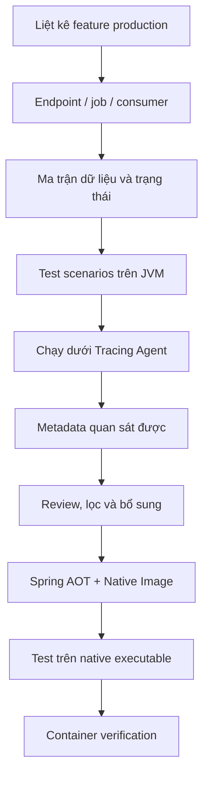

# Thiết kế kịch bản để đi qua các endpoint, dữ liệu và nhánh tích hợp cần hỗ trợ

## 1. Vì sao Tracing Agent cần kịch bản có chủ đích?

GraalVM Native Image Tracing Agent quan sát một ứng dụng chạy trên JVM và ghi nhận một số thao tác động đã thực sự xảy ra, chẳng hạn reflection, resource lookup, JDK proxy, serialization hoặc JNI. Từ những quan sát đó, agent tạo metadata gợi ý để Native Image có thể xử lý các thao tác mà phân tích tĩnh không tự suy ra đầy đủ.

Agent chỉ ghi nhận điều đã được thực thi. Nếu test suite chỉ khởi động Spring Boot và gọi endpoint health, agent không thể tự biết các endpoint tạo PDF, import CSV, xử lý message, chạy migration hoặc nhánh fallback sẽ cần những class, method và resource nào.

Vì vậy, chất lượng metadata sinh ra phụ thuộc trực tiếp vào **kịch bản test**. Cần lập danh sách endpoint, loại dữ liệu, trạng thái nghiệp vụ và nhánh tích hợp cần hỗ trợ; sau đó thiết kế test để đi qua từng đường thực thi có ý nghĩa. Mục tiêu là thu thập metadata có căn cứ và đủ phạm vi, không phải tạo một file cấu hình thật lớn bằng cách chạy ứng dụng một lần.

Trong module **SPRING_BOOT_NATIVE_IMAGE**, quy trình này nằm giữa kiểm thử JVM và build native: chạy ứng dụng dưới Tracing Agent với dữ liệu đại diện, review output, tích hợp metadata vào Spring AOT/Native Image, rồi xác minh lại trên executable native và container đích.



## 2. Agent ghi nhận điều gì và không ghi nhận điều gì?

Tracing Agent theo dõi một số hoạt động động của tiến trình JVM. Tùy GraalVM version và tùy chọn cấu hình, output có thể gồm metadata liên quan tới:

- Reflection: class, constructor, method, field được truy cập qua reflection.
- Resource: resource classpath được tìm hoặc đọc.
- Proxy: JDK dynamic proxy với các interface được tạo.
- Serialization: kiểu được dùng trong các thao tác Java serialization.
- JNI: tương tác JNI được quan sát.

Agent không phải công cụ phân tích mọi khả năng có thể xảy ra trong source code. Nó không thể ghi nhận nhánh chưa chạy, dữ liệu chưa xuất hiện, endpoint chưa gọi hoặc lỗi chỉ xảy ra trên một nền tảng khác. Nó cũng không chứng minh một thư viện tương thích Native Image chỉ vì không có lỗi khi chạy JVM dưới agent.

Một số cơ chế runtime như sinh bytecode tùy ý, compile class mới hoặc instrumentation không thể được biến thành tương thích chỉ bằng cách thu thập metadata. Khi gặp cơ chế như vậy, cần kiểm tra hỗ trợ AOT/native của thư viện và cân nhắc thay đổi thiết kế.

## 3. Bắt đầu bằng danh mục feature production

Trước khi chạy agent, lập danh mục các chức năng ứng dụng thực sự cung cấp. Với Spring Boot, không chỉ liệt kê controller endpoint; cần xét cả background jobs, message consumers, scheduled tasks, event listeners và luồng khởi tạo có điều kiện.

Ví dụ một service xử lý đơn hàng:

| Nhóm | Feature cần kiểm tra | Cách kích hoạt |
|---|---|---|
| HTTP | Tạo đơn hàng | POST request với dữ liệu hợp lệ |
| HTTP | Đọc chi tiết đơn | GET theo ID tồn tại |
| HTTP | Cập nhật trạng thái | PATCH với trạng thái hợp lệ |
| HTTP | Validate request | Gửi thiếu field, sai format |
| HTTP | Xuất hóa đơn | Gọi endpoint tạo PDF |
| Messaging | Nhận event thanh toán | Publish message đại diện |
| Scheduling | Đóng đơn hết hạn | Chạy job với dữ liệu quá hạn |
| Persistence | Migration/schema | Khởi tạo database test |
| Error handling | Provider timeout | Giả lập timeout và kích hoạt fallback |
| Security | Đường truy cập được bảo vệ | Gọi bằng principal/role tương ứng |

Danh mục cần phản ánh cấu hình production và các feature thực sự được phát hành. Không cần kích hoạt endpoint nội bộ hoặc module không được triển khai; nhưng phải ghi rõ phạm vi được loại khỏi native artifact nếu có.

## 4. Tạo ma trận endpoint và nhánh dữ liệu

Một endpoint có thể có nhiều đường đi. Chỉ gọi endpoint một lần với dữ liệu hợp lệ thường không đủ.

Ví dụ endpoint import:

| Biến thể | Dữ liệu | Nhánh cần đi qua |
|---|---|---|
| CSV hợp lệ | UTF-8, header chuẩn, nhiều dòng | Parser chính |
| CSV có dấu tiếng Việt | Ký tự Unicode | Charset/normalization |
| CSV rỗng | Chỉ có header | Empty result |
| CSV thiếu cột | Schema không đầy đủ | Validation error |
| CSV có cột tùy chọn | Trường optional có/không | Mapping condition |
| File lớn | Nhiều dòng | Streaming/buffer |
| File sai định dạng | Nội dung không phải CSV | Parser exception |
| Resource mapping thiếu | Không có mapping file | Fallback/error path |

Ma trận này giúp phân biệt **endpoint coverage** và **branch coverage**. Một endpoint được gọi không đồng nghĩa các nhánh bên trong đã được thực thi.

Không cần liệt kê mọi tổ hợp dữ liệu có thể có. Chọn các lớp tương đương và boundary có ý nghĩa, đặc biệt những biến thể có thể làm phát sinh class, resource, provider hoặc serializer khác.

## 5. Bao phủ các nhánh có ảnh hưởng tới metadata

Ưu tiên các nhánh có thể thay đổi tập class/member/resource được dùng:

- Loại subtype khác nhau trong payload JSON.
- Polymorphic deserialization với discriminator.
- Serializer/mapper chọn implementation theo type.
- Template, schema, font hoặc message bundle được chọn theo tên.
- Plugin/provider được phát hiện theo cấu hình.
- JDK proxy hoặc interceptor chỉ tạo khi bean/feature được dùng.
- Validator tùy chỉnh chỉ chạy với dữ liệu đặc biệt.
- JNI backend chỉ được gọi cho một thuật toán hoặc định dạng cụ thể.
- Fallback chỉ chạy khi service ngoài timeout hoặc trả lỗi.
- Profile/conditional bean chỉ tồn tại trong cấu hình mục tiêu.

Ví dụ cùng một endpoint nhận base type `PaymentMethod`, nhưng payload có thể là `CardPayment`, `BankTransfer` hoặc `WalletPayment`. Nếu chỉ test `CardPayment`, agent có thể không ghi nhận reflection/serialization metadata của hai subtype còn lại.

## 6. Thiết kế dữ liệu đại diện và boundary

Dữ liệu test nên bao phủ:

1. **Giá trị phổ biến**: luồng thường gặp trong production.
2. **Boundary**: min/max, chuỗi rỗng, collection một phần tử hoặc giới hạn kích thước.
3. **Optional/null**: trường bị bỏ qua, null hoặc giá trị mặc định.
4. **Polymorphism**: từng subtype được hỗ trợ.
5. **Locale/encoding**: ngôn ngữ và charset mà ứng dụng công bố.
6. **Lỗi có kiểm soát**: dữ liệu sai định dạng, không tồn tại hoặc vượt giới hạn.
7. **Khối lượng**: dữ liệu nhỏ/lớn nếu làm thay đổi code path hoặc streaming strategy.

Không đưa dữ liệu production nhạy cảm vào trace run nếu không có cơ chế bảo vệ phù hợp. Dùng fixture giả lập đã loại thông tin cá nhân, token và secret. Agent thường ghi metadata về thao tác, nhưng log ứng dụng, exception hoặc test output vẫn có thể chứa dữ liệu đầu vào.

## 7. Bao phủ profile và cấu hình build-time

Spring AOT xử lý application context theo profile/property có hiệu lực lúc AOT. Vì vậy, tracing run cần dùng cấu hình tương ứng với native artifact mục tiêu.

Nếu production build với profile `prod`, chạy trace scenario với profile và dependency graph phù hợp. Nếu một số profile tạo bean graph khác nhau và cần native artifact riêng, chạy kịch bản riêng cho từng artifact.

Cần ghi lại:

- Profile active khi khởi động JVM dưới agent.
- Property bật/tắt feature.
- Bean/implementation được chọn.
- Runtime dependency graph.
- JDK và version thư viện.
- Locale/timezone nếu ảnh hưởng resource hoặc format.
- Các endpoint/job/message consumer đã thực thi.

Không giả định đặt `SPRING_PROFILES_ACTIVE=prod` ở runtime native sẽ tạo lại bean đã bị loại khỏi AOT context. Tracing run trên JVM với profile sai cũng có thể tạo metadata không phản ánh cấu trúc ứng dụng được build.

## 8. Bao phủ message consumer và scheduled job

Không phải mọi code path đều có HTTP endpoint. Với ứng dụng dùng Kafka/RabbitMQ hoặc scheduler, cần kích hoạt chúng có chủ đích.

Ví dụ consumer:

- Message hợp lệ với từng event type.
- Event có optional field hoặc subtype khác.
- Message trùng lặp để kiểm tra idempotency path.
- Message không hợp lệ để kiểm tra dead-letter/error handling.
- Provider lỗi để kiểm tra retry/fallback.

Với scheduled job:

- Có dữ liệu cần xử lý.
- Không có dữ liệu.
- Dữ liệu ở boundary thời gian.
- Một record lỗi trong batch.
- Dependency ngoài timeout hoặc unavailable.

Dùng broker/database test và clock controllable nếu có thể. Không để job chạy theo thời gian ngẫu nhiên trong quá trình trace vì kết quả khó tái lập.

## 9. Bao phủ các nhánh tích hợp bên ngoài

Một integration có thể có nhiều implementation theo cấu hình. Ví dụ ứng dụng gửi email qua SMTP hoặc provider HTTP; lưu file local hoặc object storage; thanh toán qua nhiều gateway.

Hãy test từng implementation được đóng gói trong artifact. Nếu chỉ một provider được chọn trong production profile, ghi rõ những provider khác không nằm trong phạm vi xác minh. Nếu runtime cho phép đổi provider, tất cả provider có thể được chọn phải có trong graph và có test tương ứng.

Đối với lỗi mạng, dùng mock server hoặc test container để tái hiện:

- Thành công.
- Timeout.
- HTTP error.
- Response thiếu field.
- Retry thành công sau lần lỗi.
- Fallback khi provider chính không khả dụng.

Không phụ thuộc hệ thống production thật để tạo trace; test cần lặp lại được và không gây side effect ngoài ý muốn.

## 10. Chạy Tracing Agent với test suite

Cú pháp Tracing Agent phụ thuộc GraalVM version. Một dạng thường gặp khi chạy ứng dụng JVM là:

```bash
java -agentlib:native-image-agent=config-output-dir=build/native-agent-config \
  -jar build/libs/api-app.jar
```

Với Maven, đường dẫn JAR thường nằm dưới `target/`; với Gradle có thể nằm dưới `build/libs/`. Xác định đúng artifact và dùng GraalVM JDK phù hợp.

Có thể cấu hình agent cho một lần chạy ứng dụng rồi gửi các request/test scenario vào process đó. Với integration test, cần cấu hình JVM test process để nạp agent hoặc chạy ứng dụng dưới agent rồi thực thi test client từ process khác. Cách gắn agent vào test task phụ thuộc Gradle/Maven và plugin; kiểm tra command line thực tế của JVM test process.

Không dùng cú pháp trên như cam kết cho mọi GraalVM release. Kiểm tra `native-image-configure`/Tracing Agent documentation và `java -agentlib:native-image-agent=help` của bản cài đặt để xác nhận option hỗ trợ.

## 11. Tổ chức trace run thành các nhóm có thể lặp lại

Thay vì một lần chạy dài không rõ đã làm gì, chia thành nhóm scenario:

| Trace suite | Phạm vi | Ví dụ |
|---|---|---|
| Core API | Endpoint nghiệp vụ chính | create/read/update |
| Validation | Dữ liệu hợp lệ và lỗi | missing, boundary, nested DTO |
| Serialization | JSON subtype và Java serialization nếu dùng | polymorphic payload |
| Resource | Template, SQL, schema, message bundle | mỗi resource family |
| Proxy/AOP | Bean có advisor, transaction, security | gọi qua Spring proxy |
| Integration | Provider và fallback | timeout, retry, error |
| Background | Consumer/job/listener | message và scheduled task |

Các nhóm giúp biết metadata đến từ kịch bản nào và phát hiện khi một suite chưa chạy. Tuy nhiên, output metadata từ nhiều lần chạy có thể cần hợp nhất theo công cụ/phiên bản; không nối file JSON bằng thao tác text thủ công nếu schema yêu cầu merge có cấu trúc.

## 12. Bao phủ reflection và polymorphic data

Nếu thư viện dùng reflection, tạo scenario kích hoạt từng loại truy cập:

- Tạo instance qua constructor.
- Tìm/invoke method nếu ứng dụng sử dụng.
- Đọc/ghi field nếu mapper cần.
- Nạp class theo tên nếu plugin system có dùng.
- Đọc annotation hoặc generic metadata nếu framework dựa vào chúng.

Với JSON polymorphism, test từng subtype được phép. Ví dụ:

```java
sealed interface PaymentCommand
        permits CardCommand, BankCommand, WalletCommand {}

record CardCommand(String token) implements PaymentCommand {}
record BankCommand(String account) implements PaymentCommand {}
record WalletCommand(String walletId) implements PaymentCommand {}
```

Test chỉ với `CardCommand` không bao phủ `BankCommand` và `WalletCommand`. Dùng payload fixture cho từng subtype, xác minh deserialize và hành vi nghiệp vụ. Hints phải phản ánh các subtype thực sự được hỗ trợ; không cho phép class tùy ý từ dữ liệu bên ngoài.

## 13. Bao phủ resource lookup

Tạo scenario đọc từng nhóm resource:

- Template theo tên.
- SQL migration hoặc query file.
- JSON/XML schema.
- Message bundle theo locale.
- Font, certificate public hoặc file dữ liệu mặc định.
- Resource nằm trong dependency JAR.

Nếu resource name được tạo động, test các tên hợp lệ trong allowlist. Một trace run không đọc file sẽ không ghi nhận resource lookup đó.

Phân biệt classpath resource với file filesystem runtime. Resource classpath có thể cần hint để được đóng gói; file mount ngoài cần được cấp trong container và không được đưa vào resource metadata chỉ vì ứng dụng đọc nó.

## 14. Bao phủ proxy và AOP

Nếu ứng dụng dùng Spring AOP, cần gọi method thông qua bean lấy từ Spring context để kích hoạt proxy và advisor. Không tạo target bằng `new` rồi gọi trực tiếp, vì lời gọi đó bỏ qua proxy.

Các scenario nên bao gồm:

- Bean có transaction advice.
- Bean có security/interceptor.
- Method match pointcut.
- Method không match pointcut nếu cần xác nhận ranh giới.
- Exception path trong advice.
- Proxy theo interface và class-based nếu ứng dụng thực sự dùng cả hai.
- Self-invocation nếu nghiệp vụ phụ thuộc hành vi đó.

JDK proxy và class-based proxy là hai cơ chế khác nhau. Tracing JDK proxy không chứng minh thư viện sinh subclass tùy ý được hỗ trợ trong Native Image.

## 15. Bao phủ serialization và JNI

Nếu ứng dụng dùng Java serialization, test round-trip cho các root type và subtype thực tế; kích hoạt custom `writeObject`, `readObject`, `writeReplace` hoặc `readResolve` nếu có. Không serialize Spring bean/proxy chỉ để tăng coverage nếu kiến trúc không hỗ trợ điều đó.

Nếu dependency dùng JNI, phải gọi thật API đi qua native boundary. Chỉ khởi động ứng dụng hoặc tạo bean không bảo đảm native library đã được load. Chạy scenario trong môi trường có đúng OS/architecture và dependency native tương ứng.

Tracing Agent có thể hỗ trợ tạo metadata cho các hoạt động đã quan sát, nhưng không thay thế việc kiểm tra shared library, ABI, run image và permission.

## 16. Review metadata sau trace

Metadata agent sinh ra là bằng chứng về thao tác đã quan sát, không phải cấu hình cuối cùng được chấp nhận tự động.

Review theo các câu hỏi:

1. Class/member/resource/proxy/type nào được ghi nhận?
2. Mỗi entry thuộc feature/test scenario nào?
3. Có entry nào do test framework hoặc tooling tạo ra nhưng không cần trong production không?
4. Có class/resource bắt nguồn từ dữ liệu test không an toàn không?
5. Có entry rộng hơn yêu cầu, ví dụ mở mọi method/field của class không?
6. Có code path production quan trọng chưa xuất hiện trong output không?
7. Metadata có đúng schema và GraalVM version không?
8. Có hints do Spring/framework cung cấp sẵn bị khai báo trùng không?

Không xóa entry chỉ vì tên class không quen thuộc; trước tiên xác định nó đến từ framework/test/runtime. Ngược lại, không giữ mọi entry một cách mù quáng nếu output chứa test-only dependency hoặc class không thuộc sản phẩm.

## 17. Hợp nhất trace output có kiểm soát

Nếu chạy nhiều suite và tạo nhiều thư mục output, dùng công cụ merge/convert metadata được GraalVM version đó hỗ trợ. Tránh ghép JSON thủ công vì có thể tạo key trùng, schema sai hoặc mất cấu trúc.

Lưu lại:

- Lệnh chạy agent và version.
- JVM args và system properties.
- Profile/property ứng dụng.
- Test suite/scenario đã chạy.
- Thời gian và commit.
- Thư mục output tương ứng.
- Công cụ và lệnh merge.
- Kết quả review và metadata được đưa vào build.

Giữ trace output thô như artifact điều tra trong CI nếu cần tái hiện; metadata đã review và được chấp nhận mới là đầu vào chính thức của native build.

## 18. Từ trace metadata tới Native Image

Sau khi review:

1. Đặt metadata vào vị trí được Spring/GraalVM toolchain hỗ trợ.
2. Nếu cần, chuyển các yêu cầu thuộc thư viện/application sang `RuntimeHintsRegistrar` để metadata được quản lý trong Spring AOT.
3. Chạy AOT với đúng profile và dependency graph.
4. Build Native Image.
5. Chạy lại toàn bộ feature tests trên executable.
6. Chạy container integration tests trên target OS/architecture.
7. So sánh lỗi runtime với baseline JVM và cập nhật metadata có căn cứ.

Không coi việc đưa trace JSON vào source tree là bước cuối. Cần xác nhận build tool thực sự tiêu thụ file đó; vị trí và cơ chế discovery phụ thuộc GraalVM/Spring Boot version.

## 19. Coverage có thể đo và coverage không thể suy ra

Coverage của tracing nên được theo dõi theo feature và scenario, không chỉ theo số dòng code hoặc số endpoint đã gọi.

Một bảng theo dõi:

| Feature | Scenario dự kiến | Đã chạy dưới agent | Đã test native | Ghi chú |
|---|---|---|---|---|
| Tạo đơn | Valid + boundary | Yes/No | Yes/No | … |
| Xuất PDF | Font, locale, image | Yes/No | Yes/No | … |
| Import CSV | Unicode, empty, malformed | Yes/No | Yes/No | … |
| Message consumer | Mỗi event type | Yes/No | Yes/No | … |
| Provider fallback | Timeout/error | Yes/No | Yes/No | … |
| Serialization | Mỗi subtype/root type | Yes/No | Yes/No | … |

Agent output không cho biết trực tiếp mọi feature production đã được bao phủ. Coverage phải được đối chiếu với danh mục test do nhóm tự quản lý. Không dùng số lượng entry metadata làm chỉ số chất lượng; nhiều entry có thể chỉ phản ánh test framework hoặc cấu hình quá rộng.

## 20. Tránh các lỗi trong quá trình trace

| Sai lầm | Hệ quả | Cách cải thiện |
|---|---|---|
| Chỉ gọi health endpoint | Bỏ sót feature nghiệp vụ | Lập scenario theo endpoint/job/message |
| Chỉ dùng dữ liệu happy path | Bỏ sót subtype và fallback | Thêm boundary, optional, malformed và error |
| Chạy sai profile | Metadata không khớp bean graph AOT | Đồng bộ profile/property mục tiêu |
| Test không kích hoạt JNI | Không phát hiện native library issue | Gọi API thực sự đi qua JNI |
| Chạy test trên JVM khác version | Kết quả không đại diện toolchain | Dùng đúng JDK/GraalVM và dependency |
| Giữ toàn bộ output agent | Metadata thừa, khó audit | Review và liên kết entry với scenario |
| Tự merge JSON bằng text | Có thể sai schema | Dùng công cụ metadata chính thức |
| Build pass rồi dừng | Chưa xác minh runtime | Chạy native/container feature tests |
| Dùng dữ liệu production nhạy cảm | Rủi ro lộ dữ liệu qua log/fixture | Dùng fixture giả lập và secret-safe setup |

## 21. Ví dụ kế hoạch trace cho một service Spring Boot

Giả sử service cung cấp API tạo hóa đơn, nhận event thanh toán và xuất PDF. Kế hoạch tối thiểu có thể gồm:

1. Khởi động ứng dụng với profile AOT mục tiêu.
2. Gửi request tạo hóa đơn hợp lệ.
3. Gửi request có email sai và field thiếu để kích hoạt validation.
4. Tạo hóa đơn cho từng payment method subtype.
5. Publish event thanh toán thành công và event bị từ chối.
6. Kích hoạt retry/fallback bằng mock provider timeout.
7. Gọi endpoint xuất PDF với từng locale/font được hỗ trợ.
8. Chạy migration/schema initialization nếu ứng dụng dùng.
9. Kích hoạt scheduled task nếu nó thuộc artifact production.
10. Dừng ứng dụng, review metadata, build native và chạy lại các scenario tương tự.

Đây là ví dụ phạm vi; nhóm phải thay bằng feature thực tế của service. Nếu một nhánh không được hỗ trợ trong native artifact, ghi rõ và đảm bảo không có cấu hình production nào vô tình kích hoạt nhánh đó.

## 22. Checklist trước khi chấp nhận trace run

- Danh mục endpoint, job, consumer và event listener đã được lập.
- Mỗi feature có dữ liệu hợp lệ, boundary và lỗi quan trọng.
- Các subtype/polymorphic payload được kích hoạt.
- Profile/property và runtime dependency graph đúng mục tiêu.
- Reflection, resource, proxy, serialization và JNI path liên quan đã được gọi.
- Provider timeout/fallback/error path quan trọng đã được kiểm tra.
- Tracing Agent chạy với đúng GraalVM/JDK version.
- Output được review, không đưa nguyên xi vào build.
- Metadata được tích hợp vào Spring AOT/Native Image theo cơ chế đúng version.
- Native executable và container chạy lại cùng feature scenarios.
- Test report gắn với commit, profile, platform và artifact digest.

## 23. Câu hỏi tự kiểm tra

1. Vì sao Tracing Agent không thể phát hiện metadata cho endpoint chưa được gọi?
2. Khác biệt giữa endpoint coverage và branch/data coverage là gì?
3. Vì sao cần test từng subtype của payload polymorphic?
4. Profile AOT ảnh hưởng thế nào đến metadata và bean graph?
5. Tại sao phải kích hoạt JNI, serialization và fallback path thật sự?
6. Vì sao trace output cần review trước khi dùng trong build?
7. Làm thế nào biết một metadata entry đến từ test framework hay feature production?
8. Bằng chứng nào cần có sau khi trace để kết luận feature đã tương thích Native Image?

**Ghi nhớ:** Tracing Agent chỉ ghi nhận các thao tác động đã xảy ra. Hãy lập ma trận endpoint, dữ liệu, trạng thái và nhánh tích hợp; chạy scenario có chủ đích dưới đúng profile/toolchain; review metadata rồi xác minh lại từng feature trên native executable và container đích.
