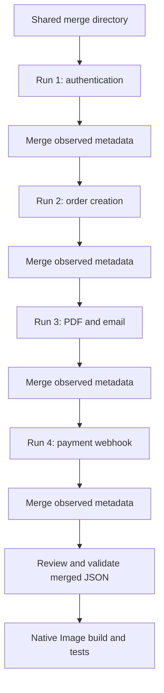

# config-merge-dir khi kết hợp nhiều lượt thu thập

## 1. Vì sao cần hợp nhất nhiều lượt tracing?

GraalVM Native Image dùng mô hình closed-world: các class, member, resource, proxy và khả năng truy cập động cần thiết phải được nhận diện trong quá trình build. Với ứng dụng Spring Boot, không phải mọi đường đi đều được thực thi trong một lần chạy thử. Một lượt test có thể chỉ đi qua đăng nhập; lượt khác mới chạy xuất báo cáo, xử lý thanh toán hoặc tích hợp đối tác.

**Tracing agent** quan sát các thao tác runtime trong một lần chạy JVM và ghi lại metadata tương ứng. Nếu mỗi lần chạy ghi vào một thư mục riêng, nhóm phát triển phải tổng hợp kết quả trước khi dùng làm đầu vào Native Image. Tùy chọn **`config-merge-dir`** hỗ trợ ghi nhận và hợp nhất cấu hình được quan sát qua nhiều lần chạy vào cùng một thư mục cấu hình.

Trong module **SPRING_BOOT_NATIVE_IMAGE**, cách làm này hữu ích khi xây dựng metadata từ nhiều scenario kiểm thử: smoke test, integration test, luồng nghiệp vụ hiếm, profile khác nhau hoặc dữ liệu đầu vào đa dạng.

Điểm cần nhớ: tracing agent chỉ ghi nhận những gì thực sự xảy ra trong các lần chạy được quan sát. Hợp nhất nhiều lượt giúp mở rộng coverage, nhưng không tự chứng minh đã bao phủ mọi đường đi runtime.

## 2. Tracing agent tạo ra những loại cấu hình nào?

Tracing agent được gắn vào JVM bằng tùy chọn agent. Khi ứng dụng thực hiện thao tác động, agent có thể ghi lại metadata tương ứng. Tùy phiên bản GraalVM và những API được sử dụng, thư mục output có thể chứa các file như:

| File cấu hình | Nội dung thường được ghi nhận |
|---|---|
| `reflect-config.json` | Type, constructor, method, field được truy cập qua reflection |
| `resource-config.json` | Resource classpath được truy cập |
| `proxy-config.json` | Tổ hợp interface dùng để tạo dynamic proxy |
| `jni-config.json` | Type/member được truy cập qua JNI |
| `serialization-config.json` | Type được dùng trong Java serialization |
| `predefined-classes-config.json` | Một số class được định nghĩa động, tùy phiên bản/cấu hình |
| File metadata khác | Các khả năng runtime được hỗ trợ bởi GraalVM version đang dùng |

Không phải mọi phiên bản đều tạo toàn bộ file trên. Cấu trúc metadata, schema và tên file có thể thay đổi theo GraalVM release. Hãy kiểm tra output thực tế và tài liệu của đúng version.

Với Spring Boot, nhiều framework/dependency đã cung cấp reachability metadata hoặc RuntimeHints. Tracing output nên được xem là bằng chứng bổ sung từ workload, không mặc định thay thế metadata chính thức của thư viện.

## 3. Phân biệt config-output-dir và config-merge-dir

Hai tùy chọn có mục đích khác nhau:

- **`config-output-dir`**: ghi cấu hình được agent thu thập vào thư mục chỉ định khi lượt chạy kết thúc. Đây là lựa chọn phù hợp khi tạo một bộ output riêng cho một lần chạy.
- **`config-merge-dir`**: hợp nhất cấu hình thu thập được với cấu hình hiện có trong thư mục chỉ định, để nhiều lượt chạy có thể bổ sung metadata vào cùng bộ cấu hình.

Ví dụ chạy riêng một lượt:

```bash
java \
  -agentlib:native-image-agent=config-output-dir=target/native-config/run-login \
  -jar target/orders-service.jar
```

Ví dụ dùng thư mục hợp nhất:

```bash
java \
  -agentlib:native-image-agent=config-merge-dir=target/native-config/merged \
  -jar target/orders-service.jar
```

Ở lượt tiếp theo, chạy lại JVM với cùng `config-merge-dir` để agent bổ sung các entry quan sát được vào bộ cấu hình đã có.

Không nên nhầm merge với việc ghi đè output. Khi cần giữ bằng chứng riêng từng scenario, dùng output directory riêng rồi thực hiện bước tổng hợp có kiểm soát; khi muốn agent cập nhật trực tiếp một bộ cấu hình tích lũy, dùng merge directory theo hướng dẫn của GraalVM version.

## 4. Mô hình hợp nhất nhiều scenario

Giả sử dịch vụ Order API có các luồng:

1. Đăng nhập và xác thực người dùng.
2. Tạo đơn hàng và deserialize JSON.
3. Xuất hóa đơn PDF bằng thư viện bên ngoài.
4. Gửi thông báo email và đọc template.
5. Xử lý webhook thanh toán.
6. Chạy tác vụ nền và tạo proxy/service adapter.

Một lần chạy chỉ thực hiện luồng đăng nhập sẽ không ghi nhận các thao tác reflection/resource/proxy chỉ xuất hiện ở các luồng khác.



Mỗi scenario mở rộng coverage. Nếu tất cả lượt chạy dùng cùng một thư mục merge, agent có thể giữ lại metadata quan sát từ các lượt trước và thêm entry mới.

## 5. Chuẩn bị thư mục merge an toàn

Trước khi thu thập:

- Chọn một thư mục riêng trong build output, ví dụ `target/native-config/merged`.
- Bảo đảm process chạy test có quyền đọc/ghi thư mục.
- Không đặt thư mục merge bên trong thư mục source được đóng gói thành application resource.
- Ghi nhận GraalVM/JDK version và command line dùng để thu thập.
- Quyết định có giữ bộ cấu hình cũ hay bắt đầu một đợt thu thập sạch.
- Nếu metadata là artifact CI, lưu trữ theo commit/branch hoặc build identity.

Ví dụ PowerShell:

```powershell
$configDir = "target/native-config/merged"
New-Item -ItemType Directory -Force -Path $configDir | Out-Null
```

Ví dụ POSIX shell:

```bash
mkdir -p target/native-config/merged
```

Không xóa thư mục merge giữa các scenario nếu mục tiêu là tích lũy kết quả. Nếu cần bắt đầu lại, archive hoặc tạo một thư mục mới theo build identity để giữ được khả năng truy vết.

## 6. Lượt đầu tiên: thu thập metadata nền

Khởi chạy ứng dụng trên JVM với agent và thư mục merge:

```bash
java \
  -agentlib:native-image-agent=config-merge-dir=target/native-config/merged \
  -jar target/orders-service.jar
```

Sau khi ứng dụng khởi động, chạy một nhóm test nền như health check, authentication và đọc cấu hình. Khi process kết thúc bình thường, agent ghi/merge các cấu hình đã thu thập theo cơ chế của phiên bản GraalVM đang dùng.

Với ứng dụng server, cần bảo đảm test thực sự gửi request đến process có agent. Chỉ khởi động rồi dừng ứng dụng sẽ không tự tạo metadata cho các endpoint chưa được gọi.

Nếu test runner và application chạy ở hai JVM process riêng, agent phải được gắn vào process application cần quan sát. Gắn agent chỉ vào Maven Surefire/Failsafe JVM không tự động quan sát một server process được khởi chạy độc lập.

## 7. Các lượt tiếp theo: bổ sung scenario

Giữ nguyên thư mục merge và khởi chạy lại ứng dụng cho các scenario còn thiếu:

```bash
java \
  -agentlib:native-image-agent=config-merge-dir=target/native-config/merged \
  -jar target/orders-service.jar
```

Mỗi process chạy một nhóm integration test khác. Ví dụ:

| Lượt | Scenario | Những thao tác có thể được ghi nhận |
|---|---|---|
| 1 | Authentication | Security metadata, user model, token parsing |
| 2 | Create order | JSON DTO, constructor, validation |
| 3 | PDF export | Template, font/resource, serializer |
| 4 | Payment webhook | Polymorphic payload, partner SDK |
| 5 | Email notification | Mail template, message bundle |
| 6 | Scheduled job | Proxy, reflection trong job framework |

Đây là ví dụ về cách chia coverage; metadata cụ thể phụ thuộc implementation và thư viện. Không giả định một scenario luôn tạo đúng một file JSON hoặc chỉ một loại hint.

Nên chạy các lượt tuần tự khi nhiều process cùng cập nhật một thư mục merge, trừ khi tài liệu GraalVM version xác nhận rõ cơ chế ghi đồng thời an toàn. Chạy tuần tự giúp tránh tranh chấp khi ghi file và dễ truy vết scenario nào làm output thay đổi.

## 8. Giữ riêng output từng lượt hay merge trực tiếp?

Có hai workflow hợp lý.

**Merge trực tiếp:** mọi lượt dùng cùng `config-merge-dir`. Cách này đơn giản khi các lượt chạy tuần tự và mục tiêu là tích lũy metadata vào một thư mục.

**Output riêng rồi tổng hợp:** mỗi scenario dùng `config-output-dir` riêng, sau đó nhóm phát triển review và hợp nhất bằng cơ chế được hỗ trợ trong pipeline. Cách này giúp giữ bằng chứng từng scenario, dễ so sánh và tìm nguồn phát sinh entry.

| Tiêu chí | Merge trực tiếp | Output riêng |
|---|---|---|
| Số thư mục cần quản lý | Một thư mục tích lũy | Một thư mục cho mỗi scenario |
| Truy vết nguồn entry | Khó hơn nếu không lưu log | Dễ đối chiếu theo scenario |
| Tái chạy một scenario | Có thể merge thêm vào bộ hiện tại | Có thể tạo output mới rồi so sánh |
| Quy trình CI | Đơn giản hơn | Cần bước tổng hợp |
| Debug metadata bất thường | Phải so sánh snapshot trước/sau | Có thể xem output từng lượt |

Không nên tự nối JSON bằng thao tác text đơn giản. Metadata có cấu trúc và schema; việc hợp nhất phải giữ đúng định dạng và semantics của Native Image.

## 9. Ví dụ workflow dùng thư mục merge trong CI

Một pipeline có thể chia test theo nhóm nhưng dùng cùng output directory. Ví dụ shell minh họa:

```bash
CONFIG_DIR=target/native-config/merged
mkdir -p "$CONFIG_DIR"

java -agentlib:native-image-agent=config-merge-dir="$CONFIG_DIR" \
  -jar target/orders-service.jar &
APP_PID=$!

# Chạy authentication tests
./scripts/test-auth.sh

kill "$APP_PID"
wait "$APP_PID" || true

java -agentlib:native-image-agent=config-merge-dir="$CONFIG_DIR" \
  -jar target/orders-service.jar &
APP_PID=$!

# Chạy order and payment tests
./scripts/test-orders-and-payment.sh

kill "$APP_PID"
wait "$APP_PID" || true
```

Đây là pseudocode pipeline: script test phải biết base URL, process cần readiness check trước khi gửi request, và việc dừng process cần cho agent cơ hội flush metadata. Trong CI thực tế nên dùng trap/cleanup để dừng server ngay cả khi test thất bại, đồng thời lưu log và exit code riêng.

Không dùng `kill -9` như cách dừng thông thường vì process không có cơ hội thực hiện shutdown hook/flush output. Ưu tiên graceful shutdown qua endpoint hoặc tín hiệu được runtime hỗ trợ.

## 10. Vì sao phải dừng process đúng cách?

Tracing agent thường ghi output khi JVM kết thúc hoặc theo cơ chế flush của phiên bản/cấu hình. Nếu process bị terminate cưỡng bức, file có thể chưa được ghi đầy đủ hoặc dữ liệu mới không được merge.

Trong workflow server test:

1. Khởi động process và chờ readiness.
2. Gửi toàn bộ request của scenario.
3. Đợi request hoàn tất.
4. Gửi tín hiệu graceful shutdown hoặc gọi cơ chế dừng phù hợp.
5. Chờ process kết thúc.
6. Kiểm tra output merge đã được cập nhật trước khi chạy lượt tiếp theo.

Nếu ứng dụng không có endpoint shutdown an toàn, có thể dùng process supervisor hoặc cơ chế quản lý process của test harness. Không bật remote shutdown endpoint rộng trong môi trường production chỉ để phục vụ tracing.

## 11. Kiểm tra nội dung sau mỗi lượt

Sau mỗi scenario, kiểm tra:

- Thư mục merge có file mới hoặc thay đổi không.
- JSON parse được.
- Kích thước file hợp lý, không phải file rỗng.
- Các entry mới có liên quan tới scenario vừa chạy.
- Metadata cũ cần giữ vẫn còn.
- Không có path máy local, dữ liệu nhạy cảm hoặc entry ngoài ý muốn.
- Log cho thấy agent được gắn đúng process.

Có thể dùng công cụ JSON parser/linter để xác minh cú pháp. Không chỉnh tay trực tiếp khi chưa hiểu schema. Nếu cần sửa metadata, thực hiện trong bước review riêng, ghi lại thay đổi và chạy native test xác nhận.

Một file không thay đổi sau scenario không nhất thiết là lỗi: scenario có thể không dùng đường truy cập động mới hoặc thư viện đã được hỗ trợ bằng metadata khác.

## 12. Hợp nhất không đồng nghĩa loại bỏ entry dư thừa

Một bộ config merge thường tích lũy các entry đã quan sát. Nếu test chạy nhiều nhánh hoặc môi trường, output có thể chứa metadata không còn cần cho release cuối. Ví dụ, test fixture có thể kích hoạt serializer cho class chỉ dùng trong test hoặc debug endpoint.

Do đó, sau khi merge cần review:

- Entry thuộc code production hay chỉ test tooling?
- Class/member/resource còn được sử dụng không?
- Entry có được metadata chính thức của dependency cung cấp rồi không?
- Có cấu hình quá rộng do test chạy reflection scan không?
- Có path/resource chỉ tồn tại trên máy CI không?
- Có dữ liệu từ profile hoặc feature không được bật trong production không?

Không xóa entry chỉ vì nó trông ít dùng. Xác minh bằng code path, metadata upstream và native integration tests. Ngược lại, không giữ mọi entry một cách mù quáng nếu chúng chứa thông tin môi trường không phù hợp hoặc làm image tăng không cần thiết.

## 13. Các profile và môi trường khác nhau

Nếu ứng dụng có nhiều profile, cần xác định profile nào đại diện cho cấu trúc bean và runtime path cần phát hành. Ví dụ:

- `local`: dùng mock client và in-memory database.
- `staging`: dùng partner sandbox.
- `production`: dùng adapter và security configuration thật.

Tracing trên profile local không thể tự chứng minh metadata cho tất cả đường đi production. Có thể cần chạy thêm scenario với profile phù hợp trong môi trường an toàn, nhưng không dùng credential production hoặc gửi giao dịch thật.

Nếu profile làm thay đổi bean graph qua `@Profile` hoặc `@ConditionalOnProperty`, metadata được thu thập từ các process khác nhau không tự hợp nhất thành một native image có đầy đủ mọi bean. Tracing config chỉ ghi nhận runtime access; Spring AOT vẫn tạo cấu trúc context theo structural configuration được dùng khi build.

Với nhiều cấu trúc bean, có thể cần build artifact riêng theo profile hoặc thiết kế để các implementation cần thiết cùng tồn tại và được chọn bằng runtime property.

## 14. Tránh dữ liệu nhạy cảm trong tracing output

Tracing output có thể chứa tên class, method, resource path và metadata phản ánh các đường đi đã thực thi. Dù thông thường không nhằm lưu giá trị request/secret, vẫn phải xem xét dữ liệu được ghi và log xung quanh.

Thực hành:

- Chạy tracing bằng test credentials và dữ liệu giả.
- Không dùng request chứa password/token/PII thật.
- Lưu output trong workspace CI có quyền truy cập phù hợp.
- Không commit log hoặc file tạm ngoài metadata cần thiết.
- Review path và resource entries trước khi đưa vào repository.
- Không chia sẻ nguyên bộ tracing directory công khai nếu chưa kiểm tra.

Nếu dùng config filter hoặc include/exclude options, kiểm tra cú pháp theo GraalVM version và xác nhận filter không loại mất metadata cần thiết.

## 15. Kiểm tra và sử dụng output cho native build

Sau khi hoàn tất các lượt thu thập:

1. Dừng mọi process tracing.
2. Kiểm tra JSON và cấu trúc thư mục.
3. Review entry mới, loại metadata không phù hợp theo quy trình có kiểm soát.
4. Đưa thư mục config vào vị trí được Native Build Tools hoặc Native Image nhận diện.
5. Build native executable.
6. Chạy native integration tests cho mọi scenario đã dùng để thu thập.
7. Thử thêm các nhánh không được tracing để đánh giá giới hạn coverage.

Cách đưa metadata vào build phụ thuộc GraalVM version và plugin. Một số phiên bản Native Build Tools tự nhận diện thư mục metadata mặc định; với thư mục tùy chỉnh, cần cấu hình option/metadata location tương ứng. Không giả định mọi thư mục mang tên `merged` sẽ tự động được compiler đọc.

Nếu dùng option `-H:ConfigurationFileDirectories` hoặc cơ chế tương tự, xác nhận tên và trạng thái hỗ trợ trong GraalVM version cụ thể. Ưu tiên cấu hình được tài liệu hiện hành của plugin/Native Image khuyến nghị.

## 16. Lỗi thường gặp khi dùng config-merge-dir

| Triệu chứng | Nguyên nhân có thể | Cách xử lý |
|---|---|---|
| Lượt sau không thêm entry | Scenario không đi qua đường dynamic mới hoặc agent gắn sai process | Kiểm tra request và process có agent |
| Metadata cũ biến mất | Thư mục bị xóa/tạo mới hoặc dùng output mode khác | Kiểm tra lifecycle directory và command line |
| JSON không hợp lệ | Process bị kill cưỡng bức hoặc output bị chỉnh thủ công | Chạy graceful shutdown, khôi phục snapshot và thu thập lại |
| Hai lượt ghi đè/đụng nhau | Chạy song song cùng merge directory không được hỗ trợ | Chạy tuần tự hoặc dùng output directory riêng |
| Config có entry test-only | Test fixture gọi nhánh không dùng production | Review và kiểm tra lại từng entry |
| Native build không nhận metadata | Thư mục merge chưa được cấu hình làm input | Kiểm tra plugin/Native Image config |
| Native vẫn lỗi dù đã merge | Scenario thiếu coverage hoặc lỗi không phải reflection/resource metadata | Tái hiện, kiểm tra loại hints và chạy test bổ sung |
| Image có metadata quá rộng | Thu thập nhiều scenario/test không liên quan | Tách output, lọc/review có kiểm soát và đo lại |

## 17. Bài thực hành: hợp nhất ba lượt thu thập

**Bối cảnh:** dịch vụ Order API có ba luồng chính: tạo đơn, xuất hóa đơn và nhận webhook thanh toán. Mỗi luồng dùng một nhóm dependency khác nhau.

**Bước 1 — Chuẩn bị ứng dụng JVM.** Build executable JAR cùng version source/dependency dự kiến dùng cho native.

**Bước 2 — Tạo merge directory.** Dùng `target/native-config/merged`, ghi lại GraalVM version và command line.

**Bước 3 — Chạy scenario tạo đơn.** Gắn tracing agent vào process ứng dụng, chạy test tạo đơn và dừng process graceful.

**Bước 4 — Chạy scenario xuất hóa đơn.** Khởi động process mới với cùng merge directory, chạy export PDF và email template, sau đó dừng graceful.

**Bước 5 — Chạy webhook.** Khởi động process mới với cùng merge directory, gửi payload các payment event hợp lệ và lỗi.

**Bước 6 — Review metadata.** So sánh output trước/sau từng lượt, kiểm tra JSON, xác nhận entry mới và loại dữ liệu test-only theo bằng chứng.

**Bước 7 — Build native.** Cấu hình build sử dụng metadata đã merge, chạy Spring AOT và GraalVM Native Image.

**Bước 8 — Chạy lại ba scenario trên native.** Dùng cùng fixture, kiểm tra JSON, resource, proxy và các đường reflection. Bổ sung test cho nhánh hiếm mà tracing chưa bao phủ.

Tiêu chí hoàn thành: ba lượt đã đóng góp vào cùng bộ metadata, output hợp lệ và có thể truy vết, native build sử dụng đúng thư mục, cả ba scenario chạy thành công trên executable native.

## 18. Kết luận

`config-merge-dir` giúp tích lũy metadata từ nhiều lần chạy tracing agent vào cùng một thư mục. Cách này hữu ích với Spring Boot có nhiều endpoint, profile hoặc tích hợp mà một lần smoke test không thể bao phủ hết. Để kết quả đáng tin cậy, hãy gắn agent vào đúng JVM process, chạy scenario có chủ đích, dừng process graceful, kiểm tra output sau mỗi lượt và giữ lại lịch sử thu thập.

Hợp nhất chỉ mở rộng những đường đi đã quan sát; nó không bảo đảm đầy đủ mọi runtime path và không thay thế Spring AOT hay metadata chính thức của thư viện. Sau khi review output, cấu hình thư mục làm input cho đúng GraalVM/Native Build Tools version rồi chạy native integration tests trên cùng fixture trước khi phát hành.
