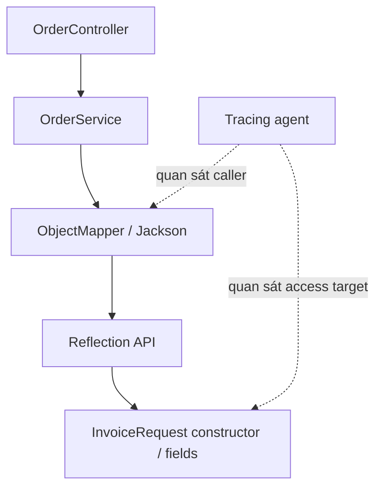
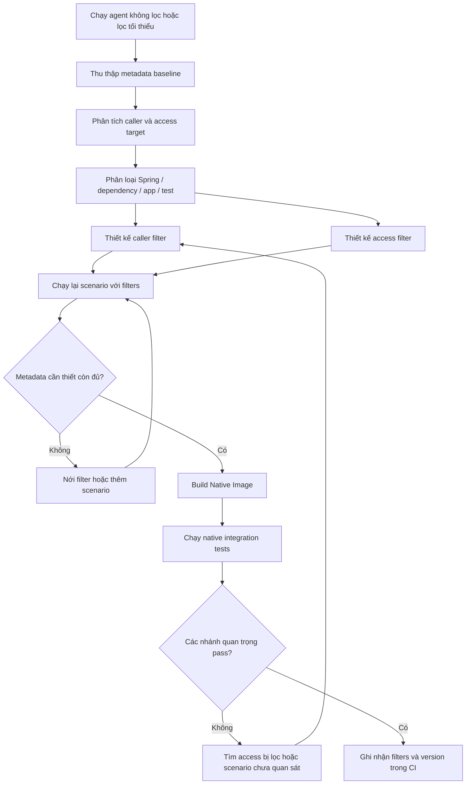

# Caller filter, access filter và loại metadata không thuộc phạm vi ứng dụng

Khi chạy **GraalVM Native Image tracing agent**, agent quan sát những thao tác động thực sự xảy ra trong một lần chạy ứng dụng, chẳng hạn reflection, resource lookup, JDK proxy hoặc serialization. Từ các thao tác đã quan sát, agent sinh metadata để native-image build biết những khả năng cần giữ lại.

Trong một ứng dụng Spring Boot, các thao tác này có thể bắt nguồn từ code nghiệp vụ, Spring Framework, Jackson, JDBC driver hoặc thư viện bên thứ ba. Nếu ghi nhận tất cả mà không lọc, output có thể chứa nhiều metadata không thuộc phạm vi ứng dụng đang điều tra. Nếu lọc quá mạnh, agent có thể bỏ mất một truy cập cần thiết và native executable sẽ lỗi ở nhánh chưa được ghi nhận.

Hai bộ lọc quan trọng giải quyết hai câu hỏi khác nhau:

- **Caller filter:** lớp nào là nguồn gọi của thao tác động cần ghi nhận?
- **Access filter:** kiểu/lớp nào là đối tượng được truy cập động cần ghi nhận?

Hiểu đúng hai phía giúp thu hẹp output mà vẫn giữ metadata cần thiết. Bài học thuộc chương **Tracing agent** của mô-đun `SPRING_BOOT_NATIVE_IMAGE`. Ta sẽ tìm hiểu ý nghĩa caller/access, định dạng filter, built-in filters, cách chạy agent, ví dụ lọc theo package và quy trình xác minh metadata sau khi lọc.

## 1. Tracing agent quan sát điều gì?

Tracing agent là một Java agent chạy cùng ứng dụng trên JVM. Khi code thực hiện một số thao tác động được hỗ trợ, agent ghi nhận thông tin về thao tác đó và có thể sinh metadata tương ứng cho Native Image.

Các loại truy cập thường được ghi nhận gồm:

| Loại truy cập | Ví dụ | Metadata có thể được sinh |
| --- | --- | --- |
| Reflection | `Class.forName`, tìm constructor/method/field bằng reflection | Reflection configuration |
| JNI | Native code truy cập Java type/member qua JNI | JNI configuration |
| JDK dynamic proxy | Tạo proxy từ tập interface | Proxy configuration |
| Resource | Đọc resource classpath theo tên hoặc pattern | Resource configuration |
| Serialization | Dùng cơ chế serialization được agent hỗ trợ | Serialization configuration |
| Predefined/dynamic classes | Một số class được định nghĩa động trong lúc chạy | Metadata tương ứng theo phiên bản/tooling |

Agent ghi nhận những gì đã xảy ra trong lần chạy có gắn agent. Nó không tự suy ra mọi nhánh code chưa được thực thi. Vì vậy, kết quả phụ thuộc vào test suite, request, profile, cấu hình và dữ liệu đã dùng trong lần quan sát.

## 2. Caller và access là hai phía của một thao tác

Hãy xem một đường deserialize JSON:

```java
ObjectMapper mapper = new ObjectMapper();
InvoiceRequest request =
        mapper.readValue(json, InvoiceRequest.class);
```

Trong lúc chạy, Jackson có thể dùng reflection để tìm constructor, setter hoặc field của `InvoiceRequest`.

- **Caller** là code thực hiện thao tác reflection. Trong ví dụ này, lời gọi reflection có thể xuất phát từ package của Jackson.
- **Access target** là kiểu/thành viên mà reflection truy cập. Trong ví dụ này, target là `InvoiceRequest` và các constructor/member liên quan.

Caller filter và access filter giúp kiểm soát hai phía đó. Chúng không có cùng ý nghĩa:

| Filter | Câu hỏi | Ví dụ |
| --- | --- | --- |
| Caller filter | Ai được xem là caller hợp lệ để agent ghi nhận thao tác? | Chỉ ghi nhận thao tác bắt nguồn từ code ứng dụng và các thư viện được chọn |
| Access filter | Những class/type nào được phép xuất hiện như target của truy cập động? | Chỉ giữ target thuộc model ứng dụng và một số target dependency được xác định |
| Built-in caller filter | Có nên bỏ qua một số caller nội bộ phổ biến do GraalVM cung cấp quy tắc sẵn? | Giảm các truy cập nội bộ không hữu ích |
| Built-in heuristic filter | Có nên áp dụng các heuristic filter dựng sẵn của agent? | Giảm một số kết quả không cần thiết theo phiên bản agent |

Một cách ghi nhớ: **caller filter lọc nguồn phát sinh thao tác; access filter lọc đối tượng bị thao tác truy cập**. Khi metadata thiếu, cần kiểm tra xem thao tác đã bị loại bởi một trong hai bộ lọc hay chưa.

## 3. Ví dụ đường gọi qua nhiều lớp

Một request HTTP có thể tạo ra chuỗi gọi như sau:



Nếu caller filter chỉ cho phép `com.example.orders.**`, thao tác reflection do Jackson thực hiện có thể không được tính là caller thuộc phạm vi đó, dù target `InvoiceRequest` là class của ứng dụng.

Nếu access filter chỉ cho phép `com.example.orders.**`, target `InvoiceRequest` có thể được giữ lại, nhưng những target nằm trong dependency mà ứng dụng thực sự cần truy cập động có thể bị loại.

Do đó, không nên hiểu "chỉ lấy metadata của ứng dụng" là "chỉ cho phép package ứng dụng xuất hiện ở cả hai filter". Framework/dependency có thể là caller, còn target là class của ứng dụng; hoặc ứng dụng là caller nhưng target là class trong dependency.

## 4. Caller filter: chọn nguồn gọi cần theo dõi

Caller filter xác định những caller class nào được xem xét khi agent ghi nhận một truy cập động. Nó hữu ích khi một lần chạy tạo ra nhiều kết quả do các framework hoặc thư viện nội bộ thực hiện thao tác mà nhóm đang không muốn đưa vào bộ metadata cần phân tích.

Ví dụ, một ứng dụng có các package:

```text
com.example.orders.**       # code nghiệp vụ
com.example.billing.**      # code nghiệp vụ
com.vendor.codec.**         # thư viện codec
org.springframework.**      # Spring Framework
com.fasterxml.jackson.**   # Jackson
java.**                     # JDK
jdk.**                      # JDK
org.graalvm.**              # GraalVM
```

Nếu mục tiêu là theo dõi các thao tác động do code nghiệp vụ trực tiếp phát sinh, caller filter có thể ưu tiên các package `com.example`. Nhưng nếu Jackson thực hiện reflection trên DTO, caller package của thao tác có thể là `com.fasterxml.jackson`; loại toàn bộ Jackson caller sẽ làm mất bằng chứng về truy cập tới DTO.

Vì vậy, caller filter nên được xây dựng từ **call path thực tế** và mục tiêu metadata, không phải từ danh sách package mà nhóm nghĩ rằng "thuộc ứng dụng".

### 4.1. Filter file theo package

GraalVM Native Image Agent hỗ trợ filter file cho caller và access. Filter file dùng cấu trúc JSON gồm danh sách rules. Ví dụ minh họa một caller filter cho ứng dụng và thư viện codec có thao tác động cần quan sát:

```json
{
  "rules": [
    { "excludeClasses": "java.**" },
    { "excludeClasses": "jdk.**" },
    { "excludeClasses": "org.graalvm.**" },
    { "includeClasses": "com.example.orders.**" },
    { "includeClasses": "com.example.billing.**" },
    { "includeClasses": "com.vendor.codec.**" }
  ]
}
```

Mẫu trên minh họa cách giới hạn caller theo package. Hãy kiểm tra schema filter file của đúng phiên bản GraalVM đang sử dụng trước khi đưa vào CI; các khả năng match class/method và cách xử lý rule phụ thuộc phiên bản agent. Nếu filter dùng cả include và exclude, thứ tự rule và quy tắc ưu tiên phải theo tài liệu của phiên bản đó.

Đừng thêm quy tắc exclude `org.springframework.**` hoặc `com.fasterxml.jackson.**` một cách máy móc. Trước tiên cần xác định framework/dependency có đang thực hiện dynamic access cần metadata cho native build hay không, và phần metadata đó đã được Spring AOT hoặc dependency cung cấp chưa.

## 5. Access filter: chọn target được ghi nhận

Access filter kiểm soát các lớp/kiểu được xem xét ở phía đối tượng bị truy cập động. Nó hữu ích khi agent quan sát nhiều target không thuộc phạm vi metadata đang muốn thu thập.

Ví dụ target có thể gồm:

- DTO và model của ứng dụng.
- Kiểu của thư viện serialization hoặc codec.
- Kiểu nội bộ của framework.
- Kiểu JDK hoặc GraalVM.
- Các class được tìm bằng tên chuỗi hoặc reflection.

Một access filter minh họa cho ứng dụng xử lý đơn hàng và một thư viện codec:

```json
{
  "rules": [
    { "excludeClasses": "java.**" },
    { "excludeClasses": "jdk.**" },
    { "excludeClasses": "org.graalvm.**" },
    { "includeClasses": "com.example.orders.**" },
    { "includeClasses": "com.example.billing.**" },
    { "includeClasses": "com.vendor.codec.model.**" }
  ]
}
```

Filter này nói rằng tập target đang quan tâm gồm model của ứng dụng và một phần model của codec. Nếu codec thực hiện reflection trên class trong package khác, cần đưa target đó vào phạm vi phù hợp.

Access filter không phải cơ chế xác nhận class có nằm trong native image. Nó chỉ điều khiển việc agent ghi nhận access target. Class vẫn phải có trong classpath/build input và được native compiler giữ theo reachability/metadata tương ứng.

### 5.1. Tránh nhầm target class với caller class

Một package có thể xuất hiện ở cả hai phía nhưng vai trò khác nhau. Ví dụ:

- `com.fasterxml.jackson.databind` có thể là caller của reflection.
- `com.example.orders.InvoiceRequest` có thể là target.
- `com.vendor.codec.Payload` có thể là target khi code ứng dụng gọi thư viện codec.
- `com.example.orders.CustomMapper` có thể là caller nếu chính ứng dụng dùng reflection.

Khi quyết định include/exclude, hãy lập bảng caller-target từ log hoặc một luồng chạy nhỏ trước khi viết filter. Điều này giảm nguy cơ loại nhầm target cần thiết.

## 6. Built-in filters và filter do dự án quản lý

Tracing agent có thể cung cấp built-in filters/heuristics để loại một số caller hoặc access không hữu ích. Tên option thường gặp gồm:

- `builtin-caller-filter`
- `builtin-heuristic-filter`

Các built-in filter được duy trì theo GraalVM version. Chúng giúp giảm nhiễu từ một số code nội bộ hoặc những trường hợp agent đã biết, nhưng không thay thế caller/access filter của dự án.

Không nên giả định mọi phiên bản đều có cùng mặc định hoặc cùng phạm vi built-in rules. Kiểm tra option được hỗ trợ trong GraalVM distribution đang dùng và ghi lại lựa chọn trong build script.

| Loại filter | Ai quản lý? | Mục đích |
| --- | --- | --- |
| Built-in caller filter | GraalVM | Giảm caller nội bộ theo quy tắc dựng sẵn |
| Built-in heuristic filter | GraalVM | Áp dụng heuristic loại một số truy cập không cần ghi nhận |
| Caller filter file | Nhóm ứng dụng/thư viện | Chọn nguồn caller phù hợp với mục tiêu |
| Access filter file | Nhóm ứng dụng/thư viện | Chọn target class phù hợp với mục tiêu |

Nếu tắt built-in filters để điều tra sâu, output có thể lớn hơn đáng kể. Nếu bật filter tùy chỉnh quá chặt, output có thể nhỏ nhưng thiếu metadata. Kích thước output không phải thước đo duy nhất cho chất lượng cấu hình.

## 7. Chạy tracing agent với caller/access filter

Ví dụ chạy ứng dụng Spring Boot trên JVM với agent và hai filter file:

```bash
java \
  -agentlib:native-image-agent=config-output-dir=target/agent-config,caller-filter-file=config/native/caller-filter.json,access-filter-file=config/native/access-filter.json \
  -jar target/orders-service.jar
```

Trong đó:

- `config-output-dir` là thư mục agent ghi metadata đã quan sát.
- `caller-filter-file` chỉ tới filter nguồn gọi.
- `access-filter-file` chỉ tới filter target.
- Ứng dụng vẫn chạy trên JVM; đây là bước thu thập metadata, chưa phải native build.

Nếu ứng dụng được khởi động bằng Maven/Gradle hoặc test runner, có thể truyền JVM argument vào process test tương ứng. Đảm bảo agent được gắn vào **JVM thực sự chạy ứng dụng/test**, không chỉ Maven daemon hoặc Gradle daemon khi fork test process khác.

### 7.1. Kiểm tra agent option trước khi chạy dài

Các option và filter schema có thể thay đổi giữa GraalVM releases. Trước khi thêm vào pipeline, kiểm tra tài liệu/help của bản GraalVM đang cài. Khi path có dấu phẩy hoặc ký tự đặc biệt, chú ý cú pháp phân tách option của Java agent; có thể đặt filter file trong đường dẫn đơn giản để tránh lỗi parsing.

Ví dụ kiểm tra toolchain:

```bash
java -version
native-image --version
```

Và xem output help/documentation của đúng Native Image Agent distribution để xác nhận `caller-filter-file`, `access-filter-file` và built-in filter options có mặt.

## 8. Ví dụ Spring Boot: lọc caller nhưng vẫn giữ target DTO

Giả sử endpoint nhận JSON:

```java
@RestController
class InvoiceController {

    private final ObjectMapper objectMapper;

    InvoiceController(ObjectMapper objectMapper) {
        this.objectMapper = objectMapper;
    }

    @PostMapping("/invoices")
    InvoiceResponse create(@RequestBody InvoiceRequest request) {
        // Xử lý nghiệp vụ.
        return new InvoiceResponse(request.number(), "accepted");
    }
}
```

Jackson có thể thực hiện một số thao tác reflection để bind `InvoiceRequest`. Trong luồng này:

| Vai trò | Package/class ví dụ |
| --- | --- |
| Caller của reflection | `com.fasterxml.jackson.databind...` |
| Target được truy cập | `com.example.orders.InvoiceRequest` |
| Code điều phối request | `org.springframework.web...` |
| Controller nghiệp vụ | `com.example.orders.InvoiceController` |

Nếu caller filter chỉ include `com.example.orders.**`, thao tác reflection do Jackson thực hiện có thể không được ghi nhận. Access filter include `com.example.orders.**` vẫn chưa đủ để khôi phục access đã bị caller filter loại.

Có hai hướng:

1. Giữ caller của thư viện thực hiện dynamic access trong caller filter nếu ứng dụng cần agent quan sát thao tác đó.
2. Kiểm tra Spring AOT và dependency metadata đã cung cấp reflection hints cho đường Jackson/Spring MVC này chưa; không thu thập trùng lặp chỉ vì agent có thể ghi nhận.

Điều này cho thấy hai filter phải được thiết kế cùng nhau, dựa trên call path và quyền sở hữu metadata.

## 9. Loại metadata không thuộc phạm vi ứng dụng

Một lần chạy agent có thể sinh metadata cho nhiều thành phần:

- Reflection của code nghiệp vụ.
- Reflection nội bộ framework.
- Resource do thư viện tải.
- Proxy do framework tạo.
- Truy cập từ test framework.
- Metadata do instrumentation, profiler hoặc thư viện hỗ trợ test tạo ra.
- Class chỉ được sử dụng bởi một profile/test scenario không nằm trong production.

Không phải tất cả metadata này đều cần đặt trong cấu hình riêng của ứng dụng. Trước khi loại, phân loại theo nguồn và mục tiêu:

| Metadata quan sát được | Cách xử lý |
| --- | --- |
| Truy cập động của code ứng dụng, chưa được Spring/dependency bao phủ | Giữ và kiểm thử |
| Metadata do Spring AOT đã sinh | Tránh chép trùng vào application config nếu không cần |
| Metadata do dependency đóng gói | Ưu tiên để dependency sở hữu và cập nhật theo version |
| Truy cập nội bộ JDK/GraalVM không liên quan tới app | Xem built-in filter hoặc caller/access filter phù hợp |
| Metadata chỉ xuất hiện do test framework | Xác định có cần cho production binary không |
| Truy cập của thư viện được app sử dụng thực tế | Không loại chỉ vì caller thuộc package bên thứ ba |
| Truy cập của nhánh production chưa được test | Bổ sung scenario chạy agent trước khi kết luận không cần |

Đặc biệt, **package bên thứ ba không đồng nghĩa metadata ngoài phạm vi ứng dụng**. Nếu Jackson, Hibernate, JDBC driver hoặc SDK thực hiện reflection để xử lý model/configuration mà ứng dụng sử dụng, metadata đó có thể là điều kiện để tính năng hoạt động trong native image.

## 10. Quy trình tạo filter an toàn

Nên bắt đầu từ một lần chạy có phạm vi nhỏ, sau đó mới siết filter.

1. Chạy tracing agent với output riêng và built-in settings đã ghi nhận.
2. Thực hiện một scenario có chủ đích, ví dụ request tạo hóa đơn JSON.
3. Xác định caller và access target của các thao tác động quan trọng.
4. Kiểm tra metadata được sinh và phân loại theo Spring, dependency, application, test-only.
5. Tạo caller filter để giảm caller noise nhưng giữ thư viện thực hiện truy cập cần thiết.
6. Tạo access filter để giới hạn target theo mục tiêu, không loại model/dependency target đang dùng.
7. Chạy lại đúng scenario với filter.
8. So sánh metadata trước/sau; xác nhận các entry cần thiết vẫn còn.
9. Mở rộng sang các scenario khác: validation fail, polymorphic JSON, database, serialization, resource, proxy và profile.
10. Build native image và chạy test suite trên executable.



## 11. So sánh output trước và sau khi lọc

Giả sử lần chạy baseline sinh metadata cho nhiều package. Sau khi thêm filters, có thể so sánh số entry và nội dung.

Không chỉ so tổng số file. Hãy kiểm tra:

- DTO của endpoint có còn reflection metadata không?
- Resource template/schema có còn được ghi nhận không?
- Proxy interface ứng dụng sử dụng có còn không?
- JNI access cần thiết có còn không?
- Metadata của dependency quan trọng có bị loại không?
- Các entry chỉ phục vụ test có bị đưa nhầm vào production configuration không?

Ví dụ cấu trúc thư mục:

```text
target/
├── agent-baseline/
│   ├── reflect-config.json
│   ├── resource-config.json
│   └── proxy-config.json
└── agent-filtered/
    ├── reflect-config.json
    ├── resource-config.json
    └── proxy-config.json
```

Tên file/output thực tế tùy phiên bản GraalVM. Một số phiên bản có thể hợp nhất metadata hoặc tạo thêm file cho JNI/serialization/predefined classes. Không xóa file chỉ vì không xuất hiện trong ví dụ.

Có thể dùng công cụ diff để xem thay đổi:

```bash
git diff --no-index target/agent-baseline target/agent-filtered
```

Lệnh này có thể trả exit code khác 0 khi phát hiện khác biệt; đó là hành vi bình thường của diff. Review nội dung thay đổi và xác nhận các target cần thiết không bị loại.

## 12. Filter không thay thế coverage của scenario

Agent chỉ ghi nhận thao tác đã xảy ra. Caller/access filters không khiến agent biết thêm các đường code chưa được chạy.

Ví dụ, một suite chỉ gửi request JSON thông thường có thể không quan sát:

- Deserialization của subtype hiếm.
- Error handler serialize một loại exception tùy biến.
- Resource template chỉ dùng trong một locale.
- JDBC driver gọi reflection ở nhánh metadata discovery.
- JDK proxy chỉ được tạo khi bật một feature.
- Một plugin/serializer chỉ dùng bởi batch job.

Do đó, nếu output thiếu metadata, nguyên nhân có thể là:

1. Scenario chưa thực thi đường code.
2. Caller filter loại caller.
3. Access filter loại target.
4. Framework/dependency đã cung cấp metadata ở nguồn khác.
5. Metadata được sinh nhưng nằm trong file khác hoặc format khác theo version.

Không nên nới filter một cách vô hướng trước khi xác định nguyên nhân. Hãy thêm scenario có chủ đích và xem access có xuất hiện trong baseline hay không.

## 13. Những lỗi thường gặp

| Hiện tượng | Nguyên nhân có thể | Cách điều tra |
| --- | --- | --- |
| Metadata của DTO biến mất sau khi thêm caller filter | Jackson caller không nằm trong phạm vi caller được include | Xem call path và thêm caller dependency cần thiết |
| Metadata của DTO biến mất sau access filter | Target package bị exclude hoặc không match include | Kiểm tra access filter và tên target đầy đủ |
| Output vẫn rất lớn | Filter chưa áp dụng, package pattern quá rộng hoặc nhiều scenario | Kiểm tra agent command, filter path và phân loại caller |
| Output nhỏ bất thường | Include filter quá chặt, bỏ framework/dependency caller | So với baseline và chạy lại scenario |
| Native build lỗi dù agent đã chạy | Agent chưa quan sát nhánh gây lỗi hoặc filter đã loại access | Chạy đúng scenario, so metadata baseline/filtered |
| Metadata test-only đi vào production | Agent chạy test suite rộng và output dùng chung | Tách output theo scenario/profile và review trước khi merge |
| Filter file không được đọc | Path sai, JSON lỗi hoặc schema không tương thích | Kiểm tra working directory, parse JSON và GraalVM version |
| Thay đổi GraalVM làm output khác | Built-in filter, heuristic, metadata schema hoặc agent behavior thay đổi | Pin version và chạy lại baseline trên version mới |
| Metadata trùng với dependency | Dependency đã cung cấp metadata tương tự | Kiểm tra JAR/reachability metadata trước khi giữ bản app copy |

## 14. Quản lý filter trong CI

Filter file là một phần của cấu hình build và nên được quản lý cùng source code:

```text
config/
└── native/
    ├── caller-filter.json
    └── access-filter.json
```

Một pipeline có thể chia các bước:

| Giai đoạn | Hoạt động | Artifact |
| --- | --- | --- |
| JVM scenario run | Chạy agent với filters đã version hóa | Agent config output |
| Review metadata | So sánh với baseline, kiểm tra entry quan trọng | Diff/review report |
| AOT/native build | Chạy Spring AOT và GraalVM build | Native executable |
| Native integration test | Gọi endpoint và các nhánh động quan trọng | Test report |
| Release | Lưu version toolchain và filter cùng build record | Reproducibility metadata |

Không nên để pipeline tự động xóa metadata cũ hoặc ghi đè output chuẩn chỉ vì lần chạy hiện tại không quan sát thấy một access. Agent output là dữ liệu quan sát; việc xóa entry cần review và test để tránh làm mất metadata của scenario hiếm.

Khi nâng GraalVM hoặc Spring Boot:

- Ghi nhận version trước/sau.
- Chạy lại các scenario giống nhau.
- Review khác biệt của generated metadata.
- Kiểm tra built-in filters/agent options.
- Build và test native executable trên đúng target.

## 15. Checklist trước khi chốt caller/access filters

- [ ] Xác định rõ mục tiêu: giảm caller noise, giới hạn target hay tách metadata test khỏi production.
- [ ] Hiểu caller là nguồn gọi và access là target bị truy cập.
- [ ] Kiểm tra package thực tế trong call path trước khi viết rule.
- [ ] Không loại Jackson/framework/dependency caller chỉ vì chúng không thuộc package ứng dụng.
- [ ] Không loại DTO/model/dependency target mà ứng dụng cần reflection hoặc serialization.
- [ ] Xác nhận schema filter file tương thích GraalVM version đang dùng.
- [ ] Ghi nhận built-in caller/heuristic filter settings.
- [ ] Giữ baseline output để so sánh trước/sau.
- [ ] Chạy scenario cho request, error, resource, proxy, serialization và integration paths.
- [ ] Review metadata bị loại, không chỉ đếm file hoặc số dòng.
- [ ] Build native và chạy integration tests sau khi áp dụng filters.
- [ ] Version hóa filter files và toolchain settings trong CI.

### Câu hỏi tự đánh giá

1. Caller filter và access filter khác nhau ở đối tượng nào của một thao tác reflection?
2. Trong luồng Jackson deserialize DTO, vì sao caller có thể thuộc package Jackson nhưng access target thuộc package ứng dụng?
3. Điều gì xảy ra nếu caller filter chỉ include package ứng dụng?
4. Vì sao không nên loại toàn bộ package bên thứ ba khỏi access filter?
5. Built-in caller filter và built-in heuristic filter có vai trò gì?
6. Agent có thể sinh metadata cho nhánh code chưa được thực thi không?
7. Làm thế nào phân biệt metadata bị filter loại với metadata chưa từng được quan sát?
8. Vì sao cần chạy native integration tests sau khi giảm metadata?

## Tài liệu tham khảo

- [GraalVM Native Image — Tracing Agent](https://www.graalvm.org/latest/reference-manual/native-image/metadata/AutomaticMetadataCollection/): cách chạy agent, cấu hình output và thu thập metadata.
- [GraalVM Native Image — Metadata](https://www.graalvm.org/latest/reference-manual/native-image/metadata/): các loại metadata và cách Native Image sử dụng.
- [GraalVM Native Build Tools](https://graalvm.github.io/native-build-tools/): tích hợp native build/test và cấu hình agent trong Maven/Gradle.
- [Spring Framework — AOT Optimizations](https://docs.spring.io/spring-framework/reference/core/aot.html): phần metadata và code do Spring AOT tạo, giúp phân biệt với agent output.

**Kết quả cần đạt:** có thể thiết kế caller filter và access filter dựa trên đúng nguồn gọi và target của thao tác động; loại được metadata ngoài phạm vi mà vẫn giữ các truy cập thực sự cần cho ứng dụng. Filter chỉ là công cụ kiểm soát dữ liệu agent thu thập. Chất lượng cuối cùng phải được xác nhận bằng scenario coverage, review metadata và kiểm thử trên native executable.
