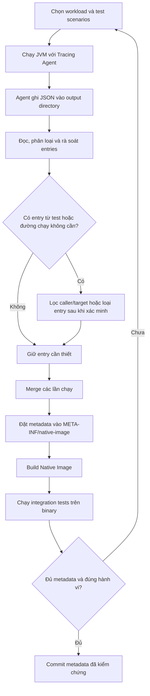

# Rà soát dữ liệu sinh ra và đưa phần cần thiết vào vị trí metadata

**GraalVM Native Image Tracing Agent** ghi nhận những truy cập động mà ứng dụng thực sự thực hiện khi chạy trên JVM, chẳng hạn reflection, dynamic proxy, JNI hoặc đọc resource theo cách mà phân tích tĩnh không thể xác định đầy đủ. Sau một hoặc nhiều lần chạy, agent tạo các file JSON để cung cấp thông tin đó cho Native Image builder.

Các file agent sinh ra là **bằng chứng từ những kịch bản đã chạy**, không phải danh sách metadata hoàn chỉnh cho mọi tình huống production. Chúng có thể chứa entry chỉ phục vụ test framework, mock, dữ liệu thử nghiệm hoặc một nhánh nghiệp vụ ít dùng. Vì vậy, cần đọc, phân loại, lọc, hợp nhất và kiểm thử metadata trước khi đưa vào source control.

Với Spring Boot, còn cần phân biệt metadata do **Spring AOT tự sinh** với metadata tĩnh do nhóm phát triển quản lý. Spring AOT ghi output vào thư mục riêng dưới `META-INF/native-image/{groupId}/{artifactId}/`; các file bổ sung nên nằm trong thư mục riêng để tránh ghi đè hoặc trộn lẫn output được sinh lại mỗi lần build.

## 1. Mục tiêu học tập

Sau bài học, bạn có thể:

- Giải thích Tracing Agent ghi nhận những loại truy cập động nào và giới hạn của dữ liệu được ghi.
- Phân biệt output mới `reachability-metadata.json` với các file cấu hình riêng của những phiên bản GraalVM cũ.
- Đọc và phân loại metadata cho reflection, JNI, proxy, resource, resource bundle và serialization.
- So sánh output giữa nhiều kịch bản chạy, hợp nhất các thư mục agent và xử lý nhiều process.
- Nhận diện entry thừa do JUnit, Mockito, Spring Test, Testcontainers hoặc test fixture tạo ra.
- Dùng caller filter và access filter đúng mục đích.
- Chọn các entry thực sự cần thiết, tránh cấp quyền reflection quá rộng.
- Đưa metadata vào `src/main/resources/META-INF/native-image/` đúng namespace của ứng dụng.
- Build lại Native Image và xác minh metadata bằng integration test trên binary thật.

## 2. Tracing Agent tạo ra dữ liệu gì?

Native Image builder phân tích tĩnh để chỉ giữ lại các phần tử cần thiết. Tuy nhiên, một số truy cập phụ thuộc vào tên class, tên method, dữ liệu runtime hoặc resource path nên không thể được suy ra đầy đủ từ bytecode. Tracing Agent chạy cùng ứng dụng trên JVM để quan sát các truy cập động đó.

Các nhóm metadata thường gặp:

| Nhóm | Ví dụ truy cập | Metadata hỗ trợ |
| --- | --- | --- |
| **Reflection** | `Class.forName`, `getDeclaredMethod`, gọi constructor/method/field qua reflection | Kiểu, constructor, method và field cần được giữ lại |
| **Dynamic proxy** | Tạo JDK proxy từ danh sách interface | Các interface tạo thành proxy |
| **JNI** | Native code tìm Java class, gọi method hoặc đọc field | Kiểu và member được truy cập từ native code |
| **Resources** | Đọc file bằng tên động qua classloader hoặc resource API | Resource path/glob cần được nhúng vào image |
| **Resource bundles** | `ResourceBundle.getBundle(...)` | Bundle name và locale/resource liên quan |
| **Serialization** | Java serialization hoặc các cơ chế cần metadata động | Kiểu cần hỗ trợ serialize/deserialize |
| **FFM** | Truy cập Foreign Function and Memory API theo cách động | Metadata cho các thành phần FFM được hỗ trợ |
| **Predefined classes** | Nạp class bytecode được tạo động | Metadata riêng cho predefined classes; thường là best-effort và không nên tự viết tay |

Không phải mọi phiên bản agent đều sinh cùng một tập file hoặc cùng một schema. Một số phiên bản mới gom metadata vào `reachability-metadata.json`; những phiên bản cũ có thể sinh các file riêng như `reflect-config.json`, `proxy-config.json`, `resource-config.json`, `serialization-config.json` và `jni-config.json`. Hãy dùng schema và công cụ đi kèm đúng phiên bản GraalVM của dự án.

## 3. Quy trình xử lý output sau khi chạy agent

Luồng làm việc tổng quát:



Nên thực hiện theo từng bước có thể truy vết:

1. Chọn kịch bản chạy đại diện cho ứng dụng thật.
2. Ghi output vào một thư mục tạm riêng, không ghi thẳng vào thư mục source resource.
3. Chạy các luồng nghiệp vụ bổ sung để mở rộng coverage.
4. So sánh output, hợp nhất các lần chạy cần thiết.
5. Rà soát từng nhóm metadata và loại dữ liệu test-only đã xác định.
6. Chuyển phần đã kiểm chứng vào namespace metadata của ứng dụng.
7. Build native và chạy lại các luồng đã dùng để thu thập metadata.
8. Thêm các test/nhánh chưa được agent quan sát, sau đó cập nhật metadata nếu phát hiện thiếu.

## 4. Chạy ứng dụng Spring Boot với Tracing Agent

### 4.1. Chạy executable JAR trực tiếp

Giả sử dự án tạo JAR `target/order-service-1.0.0.jar`. Bật Spring AOT khi chạy JAR và gắn agent:

```bash
java -Dspring.aot.enabled=true \
  -agentlib:native-image-agent=config-output-dir=target/native-agent/run-01 \
  -jar target/order-service-1.0.0.jar
```

Lưu ý:

- `-agentlib:native-image-agent=...` phải đứng trước `-jar` hoặc tên main class trong lệnh `java`.
- `-Dspring.aot.enabled=true` yêu cầu Spring sử dụng AOT generated infrastructure đã có trong JAR. Dự án cần được build với AOT trước đó.
- `config-output-dir` là thư mục agent ghi metadata của lần chạy này. Nên dùng thư mục riêng cho từng scenario để dễ so sánh và tránh ghi đè nhầm.
- Agent thường ghi file khi JVM kết thúc. Với ứng dụng server, hãy dừng ứng dụng có kiểm soát sau khi đã thực hiện các request cần thiết.

Sau khi ứng dụng khởi động, gọi các endpoint và thực hiện những luồng cần metadata. Ví dụ:

```bash
curl -fsS http://localhost:8080/actuator/health
curl -fsS http://localhost:8080/api/orders/1001
curl -fsS -X POST http://localhost:8080/api/orders/1002/confirm
```

Các URL chỉ là ví dụ. Hãy thay bằng endpoint thực tế và thực hiện cả nhánh thành công, lỗi validation, xử lý dữ liệu, upload/download, tích hợp ngoài hoặc các tính năng tùy chọn mà ứng dụng có.

### 4.2. Chạy agent qua test suite

Có thể gắn agent vào JVM chạy test để thu thập nhiều luồng tự động và có thể lặp lại. Tuy nhiên, test suite thường chạy thêm code của:

- JUnit/Jupiter và test engine.
- Mockito, Byte Buddy hoặc các công cụ mock.
- Spring Test và test context framework.
- Testcontainers, embedded server hoặc database test.
- Assertion, coverage và test reporting libraries.

Những truy cập này có thể xuất hiện trong output dù production không sử dụng. Vì vậy, test suite là nguồn coverage hữu ích nhưng cần rà soát kỹ. Nếu một thư viện chỉ xuất hiện trong test classpath, đừng tự động đưa mọi entry của nó vào metadata production.

### 4.3. Ứng dụng chạy lâu

Với server không thể dừng sau một kịch bản ngắn, agent hỗ trợ ghi metadata định kỳ:

```bash
java -agentlib:native-image-agent=config-output-dir=target/native-agent/long-run,config-write-period-secs=60,config-write-initial-delay-secs=5 \
  -Dspring.aot.enabled=true \
  -jar target/order-service-1.0.0.jar
```

`config-write-period-secs` phải lớn hơn 0; `config-write-initial-delay-secs` điều khiển thời điểm ghi lần đầu. Cấu hình này hữu ích cho workload kéo dài, nhưng cần quản lý dung lượng và thời gian chạy của agent.

## 5. Đọc cấu trúc output

Với GraalVM hiện hành, output thường có file:

```text
target/native-agent/run-01/
└── reachability-metadata.json
```

Một số phiên bản hoặc workflow cũ có thể tạo:

```text
target/native-agent/legacy-run/
├── reflect-config.json
├── proxy-config.json
├── resource-config.json
├── serialization-config.json
└── jni-config.json
```

Danh sách thực tế phụ thuộc vào phiên bản agent và các loại truy cập đã xảy ra. Không tạo file rỗng cho những nhóm không sử dụng.

### 5.1. Đọc reachability-metadata.json

Metadata hợp nhất dùng một JSON object ở cấp cao nhất. Ví dụ rút gọn:

```json
{
  "reflection": [
    {
      "type": "com.example.legacy.LegacyOrderMapper",
      "methods": [
        {
          "name": "fromMap",
          "parameterTypes": ["java.util.Map"]
        }
      ]
    }
  ],
  "resources": [
    {
      "glob": "templates/invoice/**"
    }
  ]
}
```

Ý nghĩa:

- `reflection` mô tả class/member được truy cập bằng reflection.
- `type` là tên fully qualified của kiểu cần đăng ký.
- `methods` chỉ rõ method và danh sách parameter types để phân biệt overload.
- `resources` mô tả resource path hoặc glob cần được đưa vào native executable.

Đây chỉ là ví dụ cấu trúc. Hãy giữ đúng field mà schema của phiên bản GraalVM hỗ trợ. Không chép một file legacy dạng array của `reflect-config.json` vào `reachability-metadata.json` mà không chuyển đổi schema.

### 5.2. Các entry reflection

Khi rà soát reflection, kiểm tra:

- Class có thực sự được nạp theo tên động không?
- Method có được gọi bằng reflection trong production không?
- Parameter types có đúng với overload thực tế không?
- Constructor có cần thiết cho framework/binder không?
- Field access là đọc, ghi hay chỉ introspection?
- Entry có yêu cầu tất cả declared members dù ứng dụng chỉ dùng một method không?

Ưu tiên khai báo member cụ thể. Các cờ rộng như `allDeclaredMethods`, `allDeclaredFields` hoặc `allDeclaredConstructors` có thể làm metadata lớn và giữ lại nhiều thành phần không cần thiết. Chỉ giữ chúng khi thư viện thực sự cần toàn bộ nhóm member đó.

### 5.3. Proxy metadata

JDK dynamic proxy được tạo từ một danh sách interface theo thứ tự. Kiểm tra các interface agent ghi nhận có đúng với proxy mà ứng dụng thực sự tạo không. Một entry proxy không đồng nghĩa với reflection metadata cho mọi method của implementation class.

Nếu Spring AOT đã tự tạo proxy hints cho Spring infrastructure, output agent có thể trùng lặp. Hãy kiểm tra AOT-generated hints trước khi thêm bản sao tĩnh. Với proxy tự tạo bởi thư viện hoặc code nghiệp vụ, giữ metadata khi native test chứng minh nó cần thiết.

### 5.4. Resource metadata

Agent có thể ghi nhận resource được truy cập theo tên động. Kiểm tra:

- Resource path có tồn tại trong `src/main/resources` hoặc dependency JAR không?
- Có cần toàn bộ thư mục hay chỉ một file cụ thể?
- Glob có quá rộng như `**` hoặc `**/*.properties` không?
- File có được đọc bởi ứng dụng production hay chỉ test?
- Code có xử lý resource dưới dạng stream/URL thay vì giả định nó là file vật lý không?

Ví dụ `templates/invoice/**` phù hợp khi toàn bộ template trong thư mục thực sự được chọn động. Nếu chỉ dùng `templates/invoice/default.html`, khai báo chính xác file đó thường gọn hơn.

### 5.5. JNI, serialization và resource bundles

JNI metadata cần được kiểm tra theo native method hoặc thư viện native thực tế. Nếu JNI gọi Java method/field, chỉ đăng ký kiểu là chưa chắc đủ; phải có member metadata tương ứng.

Serialization metadata nên giữ cho các kiểu thật sự được serialize/deserialize bằng Java serialization hoặc cơ chế yêu cầu metadata tương ứng. JSON binding thông thường của Spring/Jackson có thể được hỗ trợ qua Spring AOT hints; không nên suy ra rằng mọi DTO đều cần thêm Java serialization metadata.

Resource bundle metadata nên khớp base name và locale mà ứng dụng sử dụng. Kiểm tra các bundle được tải động và file properties thực tế trong dependency.

## 6. Rà soát và loại dữ liệu không cần thiết

### 6.1. Dùng bảng phân loại

Khi mở output, lập danh sách entry theo mục đích:

| Nhóm entry | Câu hỏi rà soát | Quyết định |
| --- | --- | --- |
| Application code | Có đường chạy production nào cần truy cập động không? | Giữ nếu cần và đã kiểm chứng |
| Third-party library | Thư viện có tự cung cấp reachability metadata không? | Tránh thêm bản sao; kiểm tra metadata trong dependency |
| Test framework | Caller có phải JUnit/Mockito/Spring Test không? | Lọc hoặc loại nếu chỉ phục vụ test |
| Mock/generated class | Class có tồn tại trong production artifact không? | Thường loại nếu chỉ do test tạo |
| Debug/diagnostic endpoint | Endpoint có được bật trong production không? | Chỉ giữ khi deployment thực sự sử dụng |
| Resource | File có được đọc trong runtime không? | Giữ đúng path/glob cần thiết |
| Reflection rộng | Có thực sự cần toàn bộ member không? | Thu hẹp nếu có thể |
| Proxy | Interface list có khớp proxy thật không? | Giữ chính xác contract |

### 6.2. Phân biệt caller filter và access filter

Tracing Agent hỗ trợ hai loại filter với mục đích khác nhau:

- **Caller filter** lọc theo class chứa lời gọi động. Nó phù hợp khi cần loại các truy cập phát sinh từ test framework hoặc công cụ test.
- **Access filter** lọc theo class/member là đích của truy cập. Nó phù hợp khi muốn loại một số target package/class cụ thể khỏi output.

Không nhầm hai loại này. Nếu JUnit gọi reflection lên một class nghiệp vụ, caller là JUnit nhưng target là class nghiệp vụ. Dùng access filter loại target nghiệp vụ có thể xóa nhầm metadata ứng dụng cần. Trong trường hợp đó, caller filter thường là điểm bắt đầu phù hợp hơn.

Ví dụ caller filter để loại các truy cập phát sinh từ một số package test đã xác định:

```json
{
  "rules": [
    {
      "excludeClasses": "org.junit.**"
    },
    {
      "excludeClasses": "org.mockito.**"
    },
    {
      "excludeClasses": "org.springframework.test.**"
    }
  ]
}
```

Lưu file thành `caller-filter.json` và truyền vào agent:

```bash
java -agentlib:native-image-agent=caller-filter-file=caller-filter.json,config-output-dir=target/native-agent/filtered-run \
  -Dspring.aot.enabled=true \
  -jar target/order-service-1.0.0.jar
```

Ví dụ chỉ để minh họa. Hãy dùng package thực tế quan sát được trong trace; không loại toàn bộ `org.springframework.**` hoặc package ứng dụng chỉ vì chúng xuất hiện trong test.

### 6.3. Khi nào dùng access filter?

Ví dụ access filter loại target package nội bộ chỉ được truy cập bởi công cụ không có trong production:

```json
{
  "rules": [
    {
      "excludeClasses": "com.example.testfixture.**"
    }
  ]
}
```

Truyền bằng `access-filter-file=...`. Vì access filter tác động lên target, mọi truy cập tới target bị loại đều không được ghi, kể cả khi caller là code production. Chỉ dùng sau khi xác minh target thực sự không cần trong native runtime.

### 6.4. Không xóa entry chỉ vì chưa hiểu

Nếu một entry lạ xuất hiện:

1. Tìm class/member/resource đó thuộc dependency nào.
2. Kiểm tra call path hoặc trace output nếu cần.
3. So sánh với output của lần chạy chỉ bật một tính năng.
4. Kiểm tra thư viện có metadata được đóng gói sẵn không.
5. Build native và chạy scenario liên quan trước khi quyết định xóa.

Đừng xóa entry chỉ vì package trông giống framework hoặc thư viện. Một số thư viện production cần reflection nội bộ mà Spring AOT không tự suy ra được.

## 7. Hợp nhất metadata từ nhiều lần chạy

Agent chỉ ghi nhận các đường thực thi đã đi qua. Một lần chạy login không chứng minh các luồng thanh toán, upload, message listener hoặc xử lý lỗi đã có metadata.

### 7.1. Dùng config-merge-dir cho các lần chạy tuần tự

Lần đầu tạo output:

```bash
java -agentlib:native-image-agent=config-output-dir=target/native-agent/merged \
  -Dspring.aot.enabled=true \
  -jar target/order-service-1.0.0.jar
```

Sau đó chạy scenario khác và merge vào thư mục đã có:

```bash
java -agentlib:native-image-agent=config-merge-dir=target/native-agent/merged \
  -Dspring.aot.enabled=true \
  -jar target/order-service-1.0.0.jar
```

`config-merge-dir` bổ sung dữ liệu vào tập configuration hiện có. Dùng cách này khi các process chạy tuần tự và cùng đóng góp vào một bộ metadata.

### 7.2. Dùng output riêng cho nhiều process đồng thời

Không cho nhiều agent process cùng ghi vào một output directory. Hãy tách output:

```bash
java -agentlib:native-image-agent=config-output-dir=target/native-agent/run-api \
  -Dspring.aot.enabled=true -jar target/order-service-1.0.0.jar

java -agentlib:native-image-agent=config-output-dir=target/native-agent/run-worker \
  -Dspring.aot.enabled=true -jar target/order-service-1.0.0.jar
```

Sau khi các process kết thúc, hợp nhất:

```bash
native-image-utils generate \
  --input-dir=target/native-agent/run-api \
  --input-dir=target/native-agent/run-worker \
  --output-dir=target/native-agent/merged
```

Tên công cụ hợp nhất có thể khác theo GraalVM distribution/version; một số bản cũ dùng `native-image-configure`. Kiểm tra `native-image-utils help` hoặc `native-image-configure help` trong toolchain đang cài.

### 7.3. Ghi nhận scenario đã chạy

Nên lưu một bảng coverage bên cạnh ticket/PR hoặc pipeline report:

| Scenario | Process/output | Dynamic feature đã đi qua |
| --- | --- | --- |
| Khởi động và health check | `run-startup` | Spring initialization, resource |
| Đọc order detail | `run-api` | JSON binding, mapper |
| Xác nhận order | `run-confirm` | Reflection/proxy hoặc integration library |
| Nhận message | `run-worker` | Listener, serialization hoặc resource |
| Xử lý lỗi và retry | `run-error` | Exception mapping, proxy/advice |
| Upload/download | `run-file` | Resource và file handling |

Không cần mọi dự án có đủ tất cả scenario. Hãy chọn theo các tính năng thực sự tồn tại trong service.

## 8. Đưa metadata vào đúng vị trí của Spring Boot project

### 8.1. Phân biệt metadata do AOT sinh và metadata tĩnh

Spring Boot AOT có thể tự sinh hints và ghi vào:

```text
META-INF/native-image/{groupId}/{artifactId}/
```

Các file này là output của build. Không chỉnh sửa trực tiếp trong `target/` hoặc thư mục generated tương đương vì lần build tiếp theo có thể tạo lại và ghi đè.

Đối với metadata agent đã rà soát và muốn quản lý bằng source control, Spring Boot khuyến nghị đặt trong một thư mục khác để tránh xung đột, ví dụ:

```text
src/main/resources/
└── META-INF/
    └── native-image/
        └── com.example/
            └── order-service-additional-hints/
                └── reachability-metadata.json
```

Ví dụ này giả định `groupId` là `com.example` và `artifactId` là `order-service`. Hãy thay bằng tọa độ Maven thực tế của dự án.

### 8.2. Chép phần đã duyệt, không chép nguyên thư mục tạm

Thư mục agent tạm có thể chứa:

- Nhiều lần chạy và file output trùng nhau.
- Metadata cho test framework.
- Trace file dùng để điều tra, không phải file cấu hình Native Image.
- Các file chỉ có ý nghĩa với một phiên bản agent.

Chỉ chuyển file metadata đã rà soát vào source resource. Với agent hiện hành, đó thường là `reachability-metadata.json`. Với GraalVM cũ, có thể là các file JSON riêng tương ứng với schema của phiên bản đó.

Không đặt toàn bộ `target/native-agent/` vào `src/main/resources/META-INF/native-image/`. Thư mục source chỉ nên chứa metadata production đã kiểm chứng.

### 8.3. Vì sao dùng thư mục artifactId-additional-hints?

Spring AOT sử dụng namespace riêng theo groupId/artifactId. Đặt metadata tĩnh vào thư mục bổ sung giúp:

- Tránh ghi đè output được AOT sinh lại.
- Phân biệt metadata do Spring tự phát hiện với metadata do nhóm bổ sung.
- Dễ xem xét diff trong pull request.
- Dễ xóa hoặc cập nhật từng bộ hints khi thư viện được nâng cấp.
- Giữ cấu trúc phù hợp khi ứng dụng được đóng gói thành JAR.

Nếu bạn đang phát triển một **thư viện dùng chung**, metadata dành riêng cho thư viện nên được đóng gói trong JAR của chính thư viện dưới namespace `META-INF/native-image/{groupId}/{artifactId}/`. Với metadata chỉ phục vụ một ứng dụng, đặt trong resource của ứng dụng là hợp lý.

## 9. Kiểm tra JSON và build lại Native Image

### 9.1. Kiểm tra file trước khi build

Xác nhận file được đặt đúng:

```bash
find src/main/resources/META-INF/native-image -type f
```

Trên PowerShell:

```powershell
Get-ChildItem src/main/resources/META-INF/native-image -Recurse -File
```

Dùng JSON parser hoặc schema phù hợp để kiểm tra cú pháp. JSON hợp lệ về cú pháp vẫn có thể sai schema, tên class, parameter type hoặc resource path.

### 9.2. Kiểm tra metadata có vào executable JAR

Sau Maven package:

```bash
jar tf target/order-service-1.0.0.jar | grep 'META-INF/native-image'
```

Trên PowerShell:

```powershell
jar tf target/order-service-1.0.0.jar | Select-String 'META-INF/native-image'
```

Xác nhận `reachability-metadata.json` hoặc các file legacy đã được đóng gói. Nếu file không xuất hiện, kiểm tra resource filtering, module được build và đường dẫn source resource.

### 9.3. Build Native Image

Với Maven Native Build Tools:

```bash
./mvnw -Pnative native:compile
```

Với Gradle:

```bash
./gradlew nativeCompile
```

`-Pnative` chỉ dùng nếu dự án đã khai báo Maven profile tương ứng. Với Spring Boot buildpacks, chạy goal `spring-boot:build-image` hoặc task `bootBuildImage` theo cấu hình native của dự án. Dù dùng cách nào, phải kiểm tra log cho thấy metadata directory đã được đưa vào build.

### 9.4. Bật chế độ kiểm tra missing registrations

Với GraalVM mới hỗ trợ exact reachability metadata, có thể build với:

```bash
native-image --exact-reachability-metadata ...
```

Sau đó chạy native executable với:

```bash
./order-service -XX:MissingRegistrationReportingMode=Warn
```

`Warn` giúp phát hiện các truy cập động thiếu đăng ký mà không nhất thiết dừng ngay ở lần đầu. Trong test có thể dùng `Exit` để bảo đảm ứng dụng thoát khi phát hiện missing registration, kể cả khi code vô tình bắt `Throwable`. Các tùy chọn này phụ thuộc phiên bản GraalVM; kiểm tra tài liệu của toolchain trước khi thêm vào pipeline.

Không phải mọi lỗi runtime đều là thiếu metadata. Lỗi cấu hình, native library, TLS, database, resource path hoặc OS/architecture cần được chẩn đoán riêng.

## 10. Kiểm thử metadata sau khi đưa vào source

### 10.1. Chạy lại đúng scenario đã dùng để thu thập

Sau native build, chạy lại các request/test từng được chạy dưới Tracing Agent. Nếu một scenario JVM có thể truy cập reflection nhưng native binary lỗi `MissingReflectionRegistrationError`, metadata chưa được chuyển đúng, thiếu member hoặc không được load vào build.

### 10.2. Chạy scenario chưa từng được trace

Đây là bước quan trọng để phát hiện coverage thiếu. Ví dụ:

- JSON payload có subtype khác.
- Một nhánh lỗi dùng serializer khác.
- Một message listener hiếm khi chạy.
- Một resource chỉ được tải khi chọn locale khác.
- Một proxy chỉ được tạo trong transaction hoặc security path.

Nếu native test thất bại, xác định đúng dynamic access rồi cập nhật metadata. Không nên giải quyết mọi lỗi bằng cách bật toàn bộ reflection cho package lớn.

### 10.3. Kiểm tra kích thước và phạm vi metadata

Sau khi build, theo dõi:

- Số entry reflection/JNI/proxy/resource.
- Số package bị bao phủ.
- Số entry rộng như `allDeclaredMethods`.
- Kích thước metadata và native executable.
- Thời gian native build.

Metadata quá rộng có thể làm tăng số class/member được giữ lại và tăng footprint. Mục tiêu là đủ metadata cho các luồng production, không phải giữ mọi thành phần mà agent từng nhìn thấy.

## 11. Lỗi thường gặp và cách khắc phục

| Triệu chứng | Nguyên nhân có thể | Cách xử lý |
| --- | --- | --- |
| Agent không tạo file | JVM chưa thoát bình thường, option đặt sai vị trí hoặc agent không được nạp | Đặt `-agentlib` trước `-jar`, dừng JVM có kiểm soát và kiểm tra stderr |
| Output thiếu một luồng nghiệp vụ | Agent chỉ ghi nhận code path đã chạy | Thêm scenario/test cho nhánh còn thiếu |
| JSON chứa nhiều entry JUnit/Mockito | Test JVM chạy qua dynamic code của test framework | Dùng caller filter phù hợp và rà soát output |
| Metadata tăng mạnh sau khi chạy integration tests | Testcontainers, mock hoặc test fixture tạo truy cập động | Tách output test và app, lọc caller đã xác định |
| Merge làm mất file hoặc không cập nhật | Dùng sai thư mục, ghi đồng thời hoặc dùng nhầm tool version | Dùng output riêng cho process song song rồi merge bằng tool tương ứng |
| JSON hợp lệ nhưng native build báo schema error | Schema file không khớp phiên bản GraalVM | Dùng schema/toolchain cùng version; không trộn legacy và unified format |
| Native build không thấy metadata | File đặt ngoài classpath hoặc sai `META-INF/native-image` path | Kiểm tra resource trong JAR và classpath build |
| File static bị AOT output ghi đè | Đặt chung namespace với Spring AOT-generated hints | Chuyển sang `{artifactId}-additional-hints` |
| Native vẫn thiếu reflection | Chưa chạy đúng overload/member hoặc metadata bị lọc quá mạnh | Kiểm tra trace/caller filter và bổ sung entry chính xác |
| Resource có trong JAR nhưng native không đọc được | Resource chưa được đăng ký hoặc code giả định URL là file vật lý | Thêm resource metadata cần thiết và dùng stream API |
| Proxy hoạt động trên JVM nhưng native lỗi | Interface proxy chưa được đăng ký hoặc proxy phát sinh ngoài phạm vi AOT | Kiểm tra proxy hints và đường tạo proxy thực tế |
| Thư viện nâng cấp làm metadata cũ sai | API/class/member hoặc resource path đã thay đổi | Trace lại phiên bản mới, review diff và chạy native regression tests |

## 12. Quy trình thực hành tổng hợp

**Bối cảnh:** `order-service` dùng một thư viện cũ để ánh xạ payload bằng reflection, tải template theo tên động và gọi một handler qua JDK proxy. Native build thiếu một số hints.

Thực hiện:

1. Build executable JAR có Spring AOT generated assets.
2. Chạy JAR trên GraalVM JDK với `-Dspring.aot.enabled=true` và `config-output-dir=target/native-agent/run-01`.
3. Gọi endpoint đọc order, endpoint xác nhận order, nhánh lỗi và chức năng tải template.
4. Dừng ứng dụng có kiểm soát để agent ghi JSON.
5. Đọc `reachability-metadata.json` hoặc các file legacy; phân loại reflection, resource và proxy.
6. Chạy thêm worker/message scenario trong output riêng rồi merge với lần chạy đầu.
7. Kiểm tra entry do test framework tạo ra; dùng caller filter nếu cần loại truy cập chỉ phát sinh từ test.
8. Giữ class/method, resource và proxy interface thực sự cần; thu hẹp entry reflection quá rộng.
9. Chuyển metadata đã duyệt vào `src/main/resources/META-INF/native-image/com.example/order-service-additional-hints/`.
10. Kiểm tra JSON, đóng gói JAR và xác nhận metadata xuất hiện trong JAR.
11. Build native bằng Maven/Gradle hoặc buildpacks đã cấu hình.
12. Chạy lại các scenario cũ và bổ sung scenario chưa trace; bật missing-registration reporting nếu GraalVM hỗ trợ.
13. Commit metadata cùng test evidence và ghi lại GraalVM/Spring Boot versions.

**Câu hỏi tự kiểm tra:** Vì sao không nên copy toàn bộ output của Tracing Agent từ integration test vào `src/main/resources/META-INF/native-image/`? Vì agent ghi mọi dynamic access đã xảy ra, bao gồm cả truy cập từ test framework, mock và fixture. Metadata thừa có thể giữ lại thành phần không cần thiết, làm tăng footprint hoặc che khuất việc thiếu coverage production. Cần rà soát và lọc trước khi đưa vào artifact.

## 13. Ghi nhớ

- Tracing Agent ghi nhận dynamic accesses trên JVM; nó chỉ biết những code path đã được thực thi.
- Agent output thay đổi theo GraalVM version: bản mới thường dùng `reachability-metadata.json`, bản cũ có thể dùng các file JSON riêng.
- `config-output-dir` tạo bộ output mới; `config-merge-dir` bổ sung vào bộ đã có; process chạy đồng thời nên ghi output riêng rồi hợp nhất bằng `native-image-utils` hoặc công cụ tương ứng của phiên bản.
- Phân loại metadata cho reflection, proxy, JNI, resource, resource bundle và serialization; chỉ giữ entry cần cho production.
- Caller filter lọc theo nơi phát sinh truy cập; access filter lọc theo target được truy cập. Chọn đúng filter để không loại nhầm metadata ứng dụng.
- Spring AOT có namespace output riêng dưới `META-INF/native-image/{groupId}/{artifactId}/`. Metadata tĩnh bổ sung nên đặt ở namespace khác, ví dụ `{artifactId}-additional-hints`.
- Kiểm tra JSON schema, classpath/JAR contents và native build log trước khi kết luận metadata đã được sử dụng.
- Chạy native regression tests, thêm scenario chưa trace và bật missing-registration reporting khi phiên bản GraalVM hỗ trợ.
- Lưu metadata đã rà soát cùng phiên bản GraalVM, Spring Boot, commit và bằng chứng kiểm thử để dễ cập nhật khi dependency thay đổi.

Khi output được phân loại và đặt đúng namespace, Tracing Agent trở thành công cụ hỗ trợ tìm metadata còn thiếu. Bộ metadata cuối cùng vẫn cần phản ánh các đường chạy production đã xác định và phải được xác minh bằng chính native executable.

## Tài liệu tham khảo chính thức

- [GraalVM — Collect Metadata with the Tracing Agent](https://www.graalvm.org/latest/reference-manual/native-image/metadata/AutomaticMetadataCollection/): cách chạy agent, `config-output-dir`, `config-merge-dir`, filters, trace files và công cụ hợp nhất.
- [GraalVM — Configure Native Image with the Tracing Agent](https://www.graalvm.org/latest/reference-manual/native-image/guides/configure-with-tracing-agent/): ví dụ thu thập, bổ sung metadata và xác minh native executable.
- [GraalVM — Reachability Metadata](https://www.graalvm.org/latest/reference-manual/native-image/metadata/): các loại metadata, JSON schema, classpath location và conditional metadata.
- [Spring Boot — Advanced Native Images Topics](https://docs.spring.io/spring-boot/reference/packaging/native-image/advanced-topics.html): dùng Tracing Agent với Spring AOT, loại dữ liệu test-only và vị trí lưu static hints.
