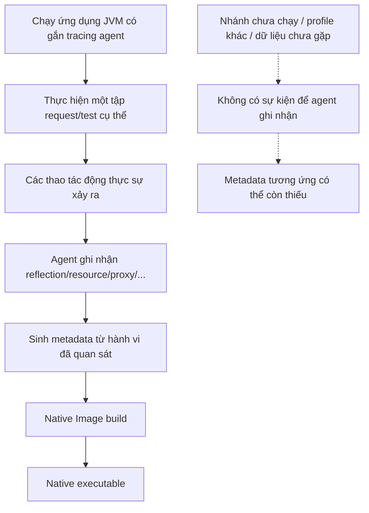
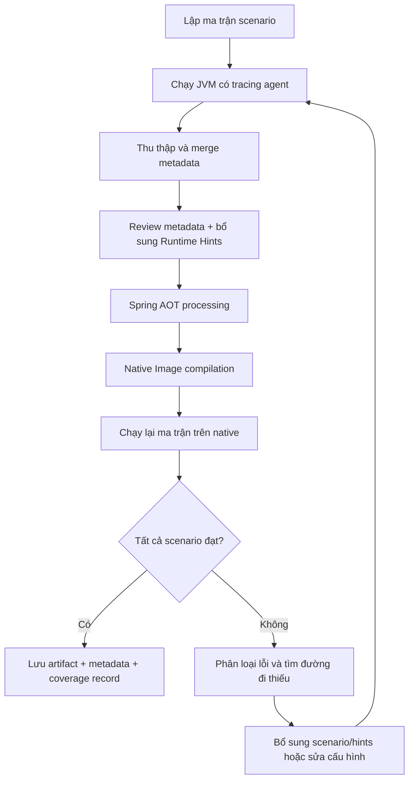

# Giới hạn bao phủ: đường đi không được thực thi có thể vẫn thiếu metadata

## Mục tiêu bài học

**GraalVM Native Image Tracing Agent** quan sát một ứng dụng đang chạy trên JVM và ghi lại một số thao tác động mà Native Image cần biết trước, chẳng hạn reflection, truy cập resource, tạo proxy, JNI hoặc serialization. Các cấu hình được ghi nhận có thể dùng làm đầu vào cho quá trình tạo native executable.

Tuy nhiên, tracing agent chỉ ghi nhận những thao tác thực sự xảy ra trong các lần chạy được gắn agent. Một nhánh code chưa được thực thi, một profile chưa được bật, một locale chưa được dùng hoặc một kiểu dữ liệu chưa xuất hiện trong test có thể vẫn thiếu metadata.

Đây là giới hạn quan trọng nhất khi sử dụng agent: **cấu hình được sinh phản ánh phạm vi thực thi đã quan sát, không phải danh sách đầy đủ mọi hành vi mà ứng dụng có thể thực hiện**.

Bài học này giúp bạn:

- Giải thích agent quan sát gì và không thể suy ra điều gì.
- Nhận diện các nhánh, profile, dữ liệu và tình huống runtime dễ bị bỏ sót.
- Thiết kế ma trận test để mở rộng phạm vi quan sát.
- Thu thập và hợp nhất cấu hình từ nhiều lần chạy.
- Đọc output, bổ sung metadata còn thiếu và xác minh bằng native executable.
- Tránh xem việc agent sinh file thành công là bằng chứng ứng dụng đã tương thích hoàn toàn.

## 1. Tracing agent quan sát điều gì?

### 1.1. Agent ghi nhận thao tác động trong lúc ứng dụng chạy

Native Image cần biết một số khả năng truy cập động để giữ lại class, member và resource cần thiết. Tracing agent được gắn vào tiến trình JVM để theo dõi những API hoặc hoạt động liên quan đến các khả năng đó.

Các nhóm thường được ghi nhận gồm:

- **Reflection:** tìm class, constructor, method, field hoặc gọi member bằng reflection.
- **Resource:** mở resource trong classpath hoặc JAR.
- **Dynamic proxy:** tạo JDK proxy từ một tập interface.
- **JNI:** truy cập class/member hoặc native method qua JNI.
- **Serialization:** dùng các kiểu dữ liệu và thành phần cần metadata serialization.
- **Predefined/dynamic class:** một số dạng class được tạo hoặc nạp động, tùy phiên bản GraalVM và cấu hình agent.

Agent thường sinh các file cấu hình JSON theo từng nhóm. Tên file và định dạng output có thể thay đổi theo phiên bản GraalVM; cần kiểm tra output thực tế của toolchain đang dùng.

### 1.2. Agent không phân tích mọi khả năng trong source code

Agent không phải công cụ đọc toàn bộ source rồi suy luận mọi nhánh có thể chạy. Nó quan sát một tiến trình cụ thể:



Nếu một nhánh điều kiện không được chọn, các thao tác động bên trong nhánh đó không xuất hiện trong output của lần chạy. Agent không thể biết một class name khác sẽ được đọc từ database vào ngày mai nếu class đó chưa từng được nạp trong phiên quan sát.

### 1.3. Static reachability và dynamic metadata là hai việc khác nhau

Native Image vẫn thực hiện reachability analysis trên mã có thể xác định tĩnh. Tracing agent hỗ trợ phát hiện những truy cập mà compiler không thể suy ra đầy đủ chỉ từ phân tích tĩnh.

Vì vậy:

- Mã được gọi trực tiếp qua reference tĩnh có thể được reachability analysis xử lý mà không cần agent ghi reflection hint.
- Một constructor được gọi qua reflection có thể cần metadata dù class đã có trong dependency.
- Agent không thể đưa một JAR plugin mới vào executable nếu JAR đó không có trong build inputs.
- Agent không biến một bean đã bị loại khỏi bean graph bởi Spring AOT thành bean có thể xuất hiện ở runtime.

## 2. Vì sao đường đi chưa thực thi có thể làm thiếu metadata?

### 2.1. Nhánh điều kiện chưa được chọn

Ví dụ:

```java
public PaymentProcessor createProcessor(String provider) throws Exception {
    if ("card".equals(provider)) {
        return new CardPaymentProcessor();
    }

    if ("bank".equals(provider)) {
        Class<?> type =
                Class.forName("com.example.payment.BankPaymentProcessor");
        return (PaymentProcessor) type.getDeclaredConstructor().newInstance();
    }

    throw new IllegalArgumentException("Unsupported provider");
}
```

Nếu các lần chạy gắn agent chỉ dùng provider bằng card, agent không quan sát lời gọi Class.forName và constructor reflection cho BankPaymentProcessor. Metadata của nhánh bank có thể thiếu dù code vẫn nằm trong source và class có trong dependency.

Để quan sát nhánh này, test phải thực sự gọi với provider bằng bank trong tiến trình có gắn agent.

### 2.2. Profile hoặc property khác nhau

Spring Boot có thể tạo tập bean khác nhau theo Profile hoặc ConditionalOnProperty. Nếu agent chỉ chạy với profile sandbox, nó không quan sát các thao tác động chỉ xuất hiện trong production.

Ví dụ, production gateway dùng reflection để nạp SDK provider còn sandbox gateway chỉ trả kết quả giả lập. Chạy agent với sandbox không thể tự sinh metadata cho SDK production.

Với Spring AOT, cần phân biệt hai việc:

- **Bean graph:** profile/conditional ảnh hưởng cấu trúc context và cần được xử lý trong lần AOT build phù hợp.
- **Runtime metadata:** agent quan sát reflection/resource/proxy được thực thi trong từng profile.

Một profile được agent quan sát không thay thế việc tạo AOT/native build cho profile khác.

### 2.3. Dữ liệu đầu vào chưa từng xuất hiện

Các ứng dụng xử lý kiểu dữ liệu dựa trên input thường dễ bỏ sót:

- JSON chỉ chứa một subtype trong test nhưng production có nhiều subtype.
- XML có một element hiếm hoặc namespace khác.
- Resource được chọn theo locale nhưng test chỉ chạy tiếng Việt.
- Tên class serializer/validator/handler được đọc từ database hoặc configuration.
- Message queue chứa event version cũ hoặc schema mới.
- Request lỗi kích hoạt error handler hoặc fallback serializer riêng.

Agent chỉ ghi nhận các kiểu và member thực sự được truy cập trong những lần chạy đó. Một lần test thành công với một DTO không chứng minh mọi subtype có thể deserialize đều đã có metadata.

### 2.4. Tình huống hiếm và vòng đời dài

Một số đường đi chỉ xuất hiện khi:

- Ứng dụng nhận message bất thường hoặc retry sau lỗi.
- Job theo lịch chạy vào một thời điểm nhất định.
- Listener nhận event từ hệ thống ngoài.
- Shutdown hook hoặc cleanup callback được gọi.
- Cache miss, fallback, circuit breaker hoặc failover được kích hoạt.
- Một tác vụ async chạy sau khi request ban đầu đã kết thúc.

Nếu phiên agent dừng trước khi các tác vụ này xảy ra, chúng không được ghi nhận. Với ứng dụng chạy lâu, cần có kế hoạch chờ/drain công việc và thực hiện shutdown có kiểm soát trước khi kết thúc tiến trình.

## 3. Các nhóm metadata thường bị bỏ sót

| Nhóm | Tình huống chưa được quan sát | Hậu quả có thể xảy ra |
|---|---|---|
| Reflection | Nhánh nạp implementation hiếm chưa chạy | Thiếu class, constructor hoặc method metadata |
| Resource | Locale/template/schema chưa được mở | Resource không có trong native image |
| Proxy | Một tổ hợp interface hoặc proxy factory chưa chạy | Không tạo được proxy tương ứng |
| Serialization | Subtype hoặc schema version chưa xuất hiện | Lỗi encode/decode ở native runtime |
| JNI | Native method hoặc callback chưa được gọi | Thiếu metadata hoặc cấu hình JNI |
| Dynamic class | Nhánh sinh/nạp class chưa chạy | Class runtime không có trong executable |
| Error handling | Exception/fallback path chưa kích hoạt | Metadata của error serializer/handler bị thiếu |
| Profile | Agent chỉ chạy một profile | Thiếu truy cập động của profile còn lại |
| Async/scheduled | Tác vụ chưa chạy trước khi agent dừng | Thiếu metadata cho tác vụ nền |

Không phải mọi ứng dụng đều dùng tất cả nhóm trên. Hãy dựa vào thư viện và luồng nghiệp vụ thực tế để chọn trường hợp cần kiểm tra.

## 4. Thiết kế ma trận bao phủ trước khi chạy agent

### 4.1. Lập danh sách đường đi cần quan sát

Trước khi chạy agent, liệt kê các điểm mà ứng dụng sử dụng hành vi động:

1. Các implementation được chọn theo profile/property.
2. Các class được tạo bằng reflection hoặc tên lấy từ cấu hình.
3. Các DTO/subtype được serialize hoặc deserialize.
4. Các resource được chọn theo locale, tenant, loại tài liệu hoặc version.
5. Các proxy được tạo bởi framework/thư viện.
6. Các message, scheduled job, retry và error path.
7. Các tích hợp JNI hoặc thư viện native.

Đừng chỉ lấy danh sách endpoint HTTP. Một endpoint có thể có nhiều nhánh theo role, dữ liệu, trạng thái hoặc lỗi; mỗi nhánh có thể gọi tới một thao tác động khác nhau.

### 4.2. Ma trận test mẫu

Giả sử ứng dụng có payment provider, tài liệu đa ngôn ngữ và message listener:

| Trục kiểm thử | Trường hợp cần chạy | Lý do |
|---|---|---|
| Profile | sandbox, production | Chọn implementation và tích hợp khác nhau |
| Payment provider | card, bank, provider fallback | Quan sát từng nhánh tạo processor |
| Locale | vi, en, locale dự phòng | Mở từng template/resource |
| Serialization | DTO cơ bản, subtype, payload version cũ/mới | Quan sát các kiểu cần serialize |
| Error path | Validation error, provider timeout, retry exhausted | Kích hoạt handler/fallback |
| Background work | Scheduled job, queue listener, async task | Quan sát tác vụ không đi qua HTTP request |
| Lifecycle | Startup, shutdown, cleanup | Kích hoạt khởi tạo và giải phóng tài nguyên |

Đây là ma trận mẫu. Không cần chạy mọi tổ hợp nếu chúng không tồn tại trong ứng dụng; cần ghi rõ tổ hợp nào đã chạy, tổ hợp nào không áp dụng và lý do.

### 4.3. Bao phủ nhánh có chủ đích

Với một tính năng có nhiều nhánh, hãy kiểm tra từng nhánh thay vì chỉ kiểm tra endpoint trả HTTP 200:

```java
switch (document.getFormat()) {
    case "pdf" -> pdfRenderer.render(document);
    case "html" -> htmlRenderer.render(document);
    case "csv" -> csvRenderer.render(document);
    default -> throw new UnsupportedOperationException();
}
```

Nếu chỉ test PDF, agent không quan sát resource, serializer hoặc reflection riêng của HTML và CSV. Cần có test cho từng format được hỗ trợ và ít nhất một test cho nhánh lỗi nếu nhánh đó có logic động.

### 4.4. Giữ điều kiện chạy giống môi trường đích

Kết quả quan sát chỉ hữu ích khi cấu hình test phản ánh cách ứng dụng sẽ chạy:

- Cùng phiên bản ứng dụng và dependency.
- Cùng phiên bản JDK/GraalVM tương thích.
- Profile/property tương ứng.
- Cùng classpath và các module tùy chọn.
- Cùng loại dữ liệu và định dạng message quan trọng.
- Các feature flag liên quan đến cấu trúc bean hoặc đường code.

Không truyền secret production vào môi trường tracing chỉ để tái hiện hành vi. Dùng credential thử nghiệm và endpoint giả lập nếu có thể.

## 5. Chạy tracing agent trên JVM

### 5.1. Chuẩn bị ứng dụng

Agent được gắn vào tiến trình JVM chạy ứng dụng. Cần dùng GraalVM JDK/toolchain có Native Image agent tương thích với phiên bản Native Image sẽ build. Đảm bảo ứng dụng đã được đóng gói và có thể chạy bằng JVM trước khi thu thập.

Ví dụ với Maven:

```bash
./mvnw -DskipTests package

java \
  -agentlib:native-image-agent=config-output-dir=target/native-image-agent/sandbox \
  -Dspring.profiles.active=sandbox \
  -jar target/payment-service.jar
```

Ví dụ với Gradle:

```bash
./gradlew bootJar

java \
  -agentlib:native-image-agent=config-output-dir=build/native-image-agent/sandbox \
  -Dspring.profiles.active=sandbox \
  -jar build/libs/payment-service.jar
```

Tên JAR trong ví dụ cần thay theo artifact thực tế. Sau khi ứng dụng khởi động, chạy test suite hoặc thực hiện các thao tác đại diện cho những đường đi đã lập kế hoạch.

### 5.2. Chạy trên Windows PowerShell

```powershell
java `
  '-agentlib:native-image-agent=config-output-dir=build/native-image-agent/sandbox' `
  '-Dspring.profiles.active=sandbox' `
  -jar build/libs/payment-service.jar
```

Nếu cần biến môi trường:

```powershell
$env:SPRING_PROFILES_ACTIVE = 'sandbox'
java '-agentlib:native-image-agent=config-output-dir=build/native-image-agent/sandbox' `
  -jar build/libs/payment-service.jar
Remove-Item Env:SPRING_PROFILES_ACTIVE
```

Chọn một cách truyền profile nhất quán. Không đặt profile khác nhau đồng thời ở command line và environment mà không hiểu rõ thứ tự ưu tiên của Spring Boot.

### 5.3. Kết thúc phiên quan sát

Agent ghi output khi JVM kết thúc bình thường. Với ứng dụng server, hãy:

1. Chờ các test/request hoàn thành.
2. Chờ queue và async task cần quan sát được xử lý.
3. Dừng scheduled/background activity theo cách kiểm soát được.
4. Gửi tín hiệu shutdown bình thường để Spring thực hiện lifecycle callback.
5. Kiểm tra thư mục output sau khi process kết thúc.

Nếu kill tiến trình đột ngột, một phần cấu hình có thể chưa được ghi hoàn chỉnh. Với ứng dụng chạy dài, có thể dùng tùy chọn ghi định kỳ nếu phiên bản agent hỗ trợ; hãy xem trợ giúp của native-image-agent hoặc tài liệu của đúng GraalVM version trước khi dùng.

## 6. Hợp nhất cấu hình từ nhiều lần chạy

### 6.1. Mỗi lần chạy có thể phát hiện thêm metadata

Một lần chạy sandbox có thể ghi nhận payment mock và các resource sandbox. Lần chạy production có thể bổ sung provider SDK, serializer hoặc proxy khác. Chạy test lỗi có thể bổ sung metadata cho error handler.

Không nên xem output của một lần chạy là bộ cấu hình cuối cùng. Hãy thiết kế cách tích lũy kết quả từ các scenario.

### 6.2. Ghi output lần đầu và merge các lần tiếp theo

Ví dụ tạo cấu hình ban đầu:

```bash
java \
  -agentlib:native-image-agent=config-output-dir=target/native-image-agent/combined \
  -Dspring.profiles.active=sandbox \
  -jar target/payment-service.jar
```

Với các lần chạy tiếp theo, Native Image agent có tùy chọn merge vào thư mục cấu hình đã tồn tại:

```bash
java \
  -agentlib:native-image-agent=config-merge-dir=target/native-image-agent/combined \
  -Dspring.profiles.active=production \
  -jar target/payment-service.jar
```

Ví dụ tiếp tục chạy test cho error path:

```bash
java \
  -agentlib:native-image-agent=config-merge-dir=target/native-image-agent/combined \
  -Dspring.profiles.active=production \
  -jar target/payment-service.jar --test-scenario=provider-timeout
```

Tên tùy chọn agent và hành vi merge cần được xác nhận theo GraalVM version đang dùng. Nếu phiên bản không hỗ trợ config-merge-dir, ghi từng lần chạy vào thư mục riêng rồi dùng quy trình hợp nhất metadata được tài liệu phiên bản đó hỗ trợ. Không ghi đè output trước khi đã lưu lại.

### 6.3. Không trộn cấu hình từ các build không tương thích

Chỉ merge output được tạo từ cùng source revision và toolchain tương thích. Trước khi merge, kiểm tra:

- Phiên bản GraalVM/Native Image.
- Phiên bản ứng dụng và dependency.
- Cấu trúc package/class đã thay đổi hay chưa.
- Profile và classpath của từng lần chạy.
- Cấu hình nào thuộc module/feature không còn được dùng.

Metadata dư thừa có thể làm executable lớn hơn hoặc giữ lại những thành phần không cần thiết. Metadata thiếu lại gây lỗi runtime. Hãy merge có kiểm soát và review diff thay vì giữ mọi output cũ vô thời hạn.

## 7. Đọc và tổ chức output của agent

### 7.1. Các file thường gặp

Tùy phiên bản GraalVM và loại thao tác được quan sát, thư mục output có thể chứa một số file như:

| File | Mục đích |
|---|---|
| reflect-config.json | Class/member cần reflection |
| resource-config.json | Resource cần đóng gói |
| proxy-config.json | Tổ hợp interface cho JDK dynamic proxy |
| jni-config.json | Class/member liên quan JNI |
| serialization-config.json | Kiểu cần hỗ trợ serialization |
| predefined-classes-config.json | Một số class được tạo trước hoặc nạp động |

Danh sách thực tế phụ thuộc phiên bản và tính năng. Không tạo file rỗng chỉ để đủ tên; hãy dùng output do agent sinh hoặc metadata được viết có chủ đích.

### 7.2. Đặt metadata ở vị trí build nhận diện

Sau khi review, đưa cấu hình vào vị trí mà Native Build Tools/Spring Boot plugin và phiên bản Native Image của dự án nhận diện. Một cách tổ chức phổ biến là thư mục metadata dưới META-INF/native-image/ trong resource của module tương ứng.

Ví dụ:

```text
src/main/resources/
└── META-INF/
    └── native-image/
        └── com.example/
            └── payment-service/
                ├── reflect-config.json
                ├── resource-config.json
                ├── proxy-config.json
                └── serialization-config.json
```

Một số phiên bản Spring Boot/Native Build Tools có cơ chế tích hợp và vị trí metadata riêng. Hãy xác minh đường dẫn được plugin sử dụng; không giả định mọi thư mục output agent đều tự động được native build đọc.

### 7.3. Review metadata trước khi commit

Kiểm tra:

- Class/member có thuộc ứng dụng hoặc dependency còn dùng không?
- Reflection access có quá rộng so với nhu cầu thực tế không?
- Resource pattern có bao phủ đúng file và không quá rộng không?
- Proxy interface có đúng tổ hợp cần tạo không?
- Metadata có chứa đường dẫn tuyệt đối, tên máy hoặc dữ liệu riêng của máy developer không?
- Các file có bị ghi đè bởi lần chạy ít bao phủ hơn không?

Không chỉnh tay metadata theo suy đoán. Nếu cần sửa, ghi rõ lý do và kiểm thử native cho đúng đường code.

## 8. Tracing agent không thay thế Runtime Hints

### 8.1. Khi nào cần bổ sung thủ công?

Agent không thể quan sát một thao tác chưa xảy ra. Nếu đã biết một class/member/resource cần thiết nhưng không thể kích hoạt đường đi trong môi trường test, hãy khai báo bằng Spring Runtime Hints hoặc metadata Native Image phù hợp.

Ví dụ:

```java
final class PaymentHints implements RuntimeHintsRegistrar {

    @Override
    public void registerHints(
            RuntimeHints hints,
            ClassLoader classLoader) {

        hints.reflection().registerType(
                TypeReference.of(BankPaymentPlugin.class),
                MemberCategory.INVOKE_DECLARED_CONSTRUCTORS,
                MemberCategory.INVOKE_PUBLIC_METHODS
        );

        hints.resources().registerPattern(
                "payment/schemas/*.json"
        );
    }
}
```

Đăng ký registrar:

```java
@Configuration(proxyBeanMethods = false)
@ImportRuntimeHints(PaymentHints.class)
class PaymentNativeConfiguration {}
```

Đây là ví dụ minh họa; các import/API phải khớp phiên bản Spring Framework của dự án. Chỉ đăng ký member và resource thực sự cần thiết.

### 8.2. Agent và Runtime Hints bổ sung cho nhau

| Cách | Điểm mạnh | Giới hạn |
|---|---|---|
| Tracing agent | Thu thập metadata từ thao tác thực tế, hữu ích với thư viện khó phân tích | Bỏ sót đường đi chưa chạy |
| Spring Runtime Hints | Khai báo rõ ý định truy cập động, có thể review và kiểm thử | Lập trình viên phải biết class/member/resource cần giữ |
| Reachability metadata từ thư viện | Tái sử dụng cấu hình do nhà cung cấp thư viện duy trì | Phụ thuộc phiên bản metadata và library |
| Native Image build/test | Xác minh artifact thực tế | Chỉ phát hiện đường đi được build/test kích hoạt |

Nếu thư viện đã cung cấp reachability metadata tương thích, ưu tiên dùng metadata chính thức của thư viện thay vì tự duy trì bản sao lâu dài. Agent có thể giúp phát hiện phần ứng dụng hoặc tích hợp riêng còn thiếu.

## 9. Xác minh sau khi thu thập metadata

### 9.1. Build thành công chưa chứng minh coverage đầy đủ

Native Image có thể build thành công dù metadata cho một nhánh chưa chạy còn thiếu. Lỗi chỉ xuất hiện khi người dùng gọi tới nhánh đó trong native runtime.

Do đó, sau build phải chạy lại **chính ma trận scenario đã dùng để xác định coverage**, lần này trên native executable/container image.

### 9.2. Quy trình xác minh



### 9.3. Kiểm tra từng nhóm

- **Reflection:** gọi từng implementation được chọn động, constructor và method tương ứng.
- **Resource:** mở từng template, schema, file cấu hình đóng gói và locale được hỗ trợ.
- **Proxy:** khởi tạo bean/aspect có từng tổ hợp interface hoặc proxy mode.
- **Serialization:** encode/decode từng subtype, payload version và error payload.
- **JNI:** chạy chức năng gọi native method trên đúng OS/CPU đích.
- **Profile:** build và chạy từng native variant với profile tương ứng.
- **Background work:** gửi message, chạy scheduled job, retry, async và shutdown callback.

Khi một scenario thất bại, phân biệt lỗi thiếu metadata với lỗi logic ứng dụng, cấu hình bean, thư viện hệ điều hành hoặc profile mismatch. Không phải mọi lỗi native đều được giải quyết bằng cách thêm file agent output.

## 10. Những sai lầm thường gặp

| Sai lầm | Vì sao không đúng | Cách khắc phục |
|---|---|---|
| Chạy agent một lần bằng một request mẫu rồi build native | Chỉ quan sát đường đi của request đó | Thiết kế ma trận scenario theo nhánh và dữ liệu |
| Test chỉ profile sandbox | Không quan sát integration production | Chạy agent riêng cho từng profile/variant cần hỗ trợ |
| Chỉ test payload thành công | Bỏ sót subtype, schema và error handler | Test payload đa dạng và đường lỗi |
| Tắt agent ngay sau startup | Chưa quan sát request, listener, scheduled job | Giữ tiến trình trong suốt phiên test và shutdown có kiểm soát |
| Cho rằng agent tự tìm plugin cài sau build | Plugin chưa nằm trong classpath khi quan sát/build | Đưa plugin vào build inputs hoặc tách process |
| Giữ metadata cũ sau khi dependency thay đổi | Có thể chứa entry lỗi thời hoặc thiếu entry mới | Thu thập lại và review theo source/dependency revision |
| Copy mọi file agent vào source mà không review | Có thể giữ metadata quá rộng hoặc output riêng máy | Review nội dung, đường dẫn và phạm vi truy cập |
| Native build thành công nghĩa là đã tương thích | Đường đi chưa chạy có thể vẫn thiếu metadata | Chạy lại scenario trên native executable |
| Runtime Hints sẽ thay agent hoàn toàn | Hints thủ công cũng có thể thiếu nếu không hiểu luồng động | Kết hợp test, agent, hints và native verification |

## 11. Quy trình thực hành

### Bước 1 — Xác định điểm truy cập động

Tìm các vị trí dùng reflection, resource động, proxy, serialization, JNI, plugin và class loading. Ghi lại profile/property ảnh hưởng tới các điểm này.

### Bước 2 — Lập ma trận scenario

Liệt kê nhánh nghiệp vụ, payload, locale, profile, error path, background job và lifecycle cần quan sát. Đánh dấu trường hợp không áp dụng.

### Bước 3 — Chạy agent trên JVM

Gắn `-agentlib:native-image-agent`, chạy test hoặc thao tác đại diện, chờ background task và shutdown hoàn tất. Lưu output riêng cho từng lần chạy.

### Bước 4 — Merge và review

Hợp nhất output từ các profile/scenario tương thích. Kiểm tra từng loại metadata, loại entry lỗi thời và bổ sung Runtime Hints cho đường đi không thể kích hoạt trong môi trường test nhưng đã biết là cần thiết.

### Bước 5 — Build native

Chạy Spring AOT và Native Image compilation bằng toolchain của dự án. Lưu commit, dependency, GraalVM version, profile, metadata và build arguments.

### Bước 6 — Chạy lại ma trận trên native

Thực hiện cùng scenario trên executable/container image. Khi phát hiện thiếu metadata, thêm scenario hoặc hint tương ứng, build lại và lặp lại kiểm thử liên quan.

### Câu hỏi tự kiểm tra

1. Vì sao tracing agent không thể chứng minh mọi nhánh reflection đã có metadata?
2. Nếu chỉ chạy agent với profile sandbox, điều gì có thể thiếu trong bản production?
3. Một DTO subtype chưa từng xuất hiện trong test có thể gây lỗi gì khi native runtime deserialize payload production?
4. Vì sao một JAR plugin được cài sau khi build không thể được bổ sung chỉ bằng agent config?
5. Khi nào nên dùng `config-merge-dir` và vì sao cần kiểm tra phiên bản GraalVM?
6. Vì sao phải chạy lại ma trận scenario trên native executable dù native build đã thành công?

**Ghi nhớ:** tracing agent là công cụ quan sát động, không phải công cụ chứng minh bao phủ đầy đủ. Mỗi metadata được ghi nhận đều dựa trên một thao tác đã thực thi. Muốn giảm rủi ro thiếu cấu hình, hãy lập ma trận scenario theo profile, nhánh, dữ liệu và lifecycle; merge output có kiểm soát; bổ sung Runtime Hints khi cần; rồi chạy lại cùng ma trận trên native executable.
