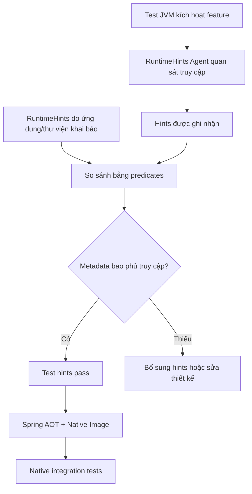

# RuntimeHints Agent trong spring-core-test để ghi nhận truy cập cần hints

## 1. Vì sao cần ghi nhận runtime access khi kiểm thử hints?

Spring AOT và GraalVM Native Image cần metadata cho một số thao tác mà phân tích tĩnh không thể suy ra đầy đủ, chẳng hạn reflection, resource lookup, JDK dynamic proxy và serialization. Ứng dụng hoặc thư viện có thể đăng ký metadata bằng Spring `RuntimeHints`, thường thông qua `RuntimeHintsRegistrar`.

Một khó khăn khi viết hints là xác định chính xác code path nào thực sự truy cập động. Đăng ký quá ít có thể làm native executable lỗi khi chạy một nhánh hiếm; đăng ký quá rộng làm metadata khó kiểm soát và có thể giữ nhiều thành phần không cần thiết.

Spring cung cấp **RuntimeHints Agent** trong artifact kiểm thử `spring-core-test` để quan sát một số thao tác runtime trong lúc test JVM chạy và chuyển chúng thành dữ liệu hints có thể kiểm tra. Cách tiếp cận này giúp viết test dựa trên hành vi quan sát được: chạy code path cần hỗ trợ, lấy hints agent ghi nhận, rồi dùng predicate của Spring để xác nhận metadata đã khai báo bao phủ các truy cập đó.

Agent là công cụ hỗ trợ kiểm thử. Nó chỉ ghi nhận các đường đi đã thực thi trong JVM; nó không tự chứng minh toàn bộ ứng dụng tương thích Native Image, không tự bao phủ nhánh chưa chạy và không thay thế native integration test.



## 2. RuntimeHints Agent và RuntimeHintsPredicates khác nhau thế nào?

Hai thành phần phục vụ hai nhiệm vụ riêng:

- **RuntimeHints Agent** quan sát một số truy cập động trong lúc test thực thi và tạo tập hints phản ánh các thao tác đã thấy.
- **RuntimeHintsPredicates** kiểm tra một tập `RuntimeHints` có chứa quyền truy cập/metadata mong muốn hay không.

Có thể hình dung Agent là nguồn dữ liệu quan sát; predicates là bộ assertion giúp kiểm tra metadata đã khai báo.

| Thành phần | Vai trò | Câu hỏi trả lời |
|---|---|---|
| `RuntimeHintsAgent` | Ghi nhận runtime access đã quan sát | Test vừa chạy đã thực hiện thao tác động nào? |
| `RuntimeHints` | Registry metadata được ứng dụng/thư viện khai báo | Hệ thống yêu cầu Native Image giữ những gì? |
| `RuntimeHintsPredicates` | Assertion trên metadata | Hints đã khai báo có đáp ứng yêu cầu không? |
| Native Image test | Xác minh executable thực tế | Code path có chạy đúng trong binary native không? |

Agent không tự sửa registrar hoặc tự cập nhật cấu hình production. Nhóm phát triển phải phân tích kết quả, bổ sung hints trong đúng nơi và giữ test để ngăn hồi quy.

## 3. Thêm spring-core-test vào test classpath

RuntimeHints Agent thuộc hạ tầng kiểm thử của Spring Core. Thêm `spring-core-test` vào test scope với version tương thích Spring Framework mà ứng dụng đang sử dụng. Với dự án Spring Boot, ưu tiên version được Spring Boot dependency management/BOM quản lý; tránh tự chọn một version Spring Core khác với framework runtime.

Gradle:

```groovy
dependencies {
    testImplementation("org.springframework:spring-core-test")
}
```

Maven:

```xml
<dependency>
    <groupId>org.springframework</groupId>
    <artifactId>spring-core-test</artifactId>
    <scope>test</scope>
</dependency>
```

Ví dụ không ghi version vì thông thường version được quản lý bởi Spring Boot BOM hoặc dependency management của dự án. Nếu project không dùng BOM, cần khai báo version Spring Framework phù hợp và đồng bộ với `spring-core`.

Dependency này chỉ phục vụ test. Không đưa `spring-core-test` vào runtime production chỉ để thu thập hints.

## 4. Ghi nhận một code path trong test

Ví dụ một thư viện dùng reflection để khởi tạo plugin và gọi method:

```java
public class CsvPlugin {
    public CsvPlugin() {
    }

    public String export(String value) {
        return "csv:" + value;
    }
}
```

Code thực hiện truy cập động:

```java
public String exportWithReflection(String className, String value)
        throws ReflectiveOperationException {
    Class<?> type = Class.forName(className);
    Object plugin = type.getDeclaredConstructor().newInstance();

    Method export = type.getMethod("export", String.class);
    return (String) export.invoke(plugin, value);
}
```

Test cần gọi chính code path này khi RuntimeHints Agent đang hoạt động. Cách khởi tạo/lấy agent và API truy vấn hints cần dùng theo phiên bản Spring Framework tương ứng; kiểm tra Javadoc của `spring-core-test` đang resolve trong project trước khi chốt đoạn test. Không tự tạo một `RuntimeHints` rỗng rồi coi đó là dữ liệu agent đã ghi nhận.

Điều quan trọng là test phải thực sự gọi:

- `Class.forName` cho class plugin.
- Constructor lookup và invocation.
- Method lookup và invocation.

Nếu test chỉ tạo object bằng `new CsvPlugin()`, Agent không quan sát được các thao tác reflection trong ví dụ.

## 5. Lấy dữ liệu từ Agent và kiểm tra bằng predicates

Spring Framework cung cấp API kiểm thử hints qua `RuntimeHintsPredicates`. Mẫu assertion thường có dạng:

```java
assertThat(RuntimeHintsPredicates.reflection()
        .onType(CsvPlugin.class)
        .withConstructor(List.of(), ExecutableMode.INVOKE)
        .test(runtimeHints))
    .isTrue();
```

Đoạn trên minh họa predicate kiểm tra constructor invocation trong tập `runtimeHints`. Import và chữ ký builder có thể thay đổi theo Spring Framework version; hãy dùng API thực tế của dependency đã resolve.

Một test hints có ý nghĩa cần phân biệt hai tập dữ liệu:

1. Hints **được khai báo** bởi registrar/configuration của thư viện.
2. Access **được quan sát** bởi Agent trong test.

Mục tiêu là bảo đảm metadata khai báo bao phủ các thao tác cần thiết mà test đã phát hiện. Có thể kiểm tra từng member cụ thể bằng predicate phù hợp hoặc dùng API so sánh/đánh giá hints mà phiên bản Spring cung cấp.

Không dùng assertion chung như “type hint tồn tại” để kết luận mọi constructor, method và field đều có thể truy cập. Hãy kiểm tra đúng operation: introspection, invocation, field get/set, resource, proxy hoặc serialization.

## 6. Ví dụ registrar cần được kiểm tra

Giả sử thư viện muốn hỗ trợ plugin reflection ở trên. Registrar có thể khai báo constructor và public method cần invoke:

```java
public class PluginRuntimeHints implements RuntimeHintsRegistrar {

    @Override
    public void registerHints(RuntimeHints hints, ClassLoader classLoader) {
        hints.reflection().registerType(
            CsvPlugin.class,
            MemberCategory.INVOKE_DECLARED_CONSTRUCTORS,
            MemberCategory.INVOKE_PUBLIC_METHODS
        );
    }
}
```

Đăng ký registrar:

```java
@Configuration
@ImportRuntimeHints(PluginRuntimeHints.class)
class PluginConfiguration {
}
```

Test nên xác minh registrar tạo ra metadata đúng. Nếu code chỉ cần public constructor, có thể chọn category public tương ứng; ví dụ dùng declared constructor chỉ khi thao tác thực tế cần phạm vi đó.

RuntimeHints Agent giúp phát hiện thao tác trong lúc chạy, nhưng không quyết định thay nhóm phát triển rằng phạm vi hints nào là tối thiểu. Sau khi quan sát, hãy thu hẹp metadata theo đúng class/member và kiểm tra lại bằng predicates.

## 7. Resource access cũng cần scenario riêng

Ví dụ service đọc template theo tên:

```java
public String loadTemplate(String name) throws IOException {
    String path = "templates/" + name + ".html";
    try (InputStream input =
            getClass().getClassLoader().getResourceAsStream(path)) {
        if (input == null) {
            throw new FileNotFoundException(path);
        }
        return new String(input.readAllBytes(), StandardCharsets.UTF_8);
    }
}
```

Nếu test chỉ gọi `loadTemplate("invoice")`, Agent chỉ quan sát resource đó. Nó không tự biết `receipt.html` hoặc template locale khác cũng được dùng trong production.

Tạo scenario cho từng resource family hoặc từng tên hợp lệ. Sau đó khai báo resource hints theo pattern hẹp, ví dụ:

```java
hints.resources().registerPattern("templates/*.html");
```

Pattern cần phù hợp với semantics của Spring/GraalVM version và cấu trúc resource thật. Phân biệt classpath resource với file filesystem mount runtime; Agent không biến file ngoài thành resource nhúng.

## 8. Proxy, serialization và JNI cần được kích hoạt đúng cách

RuntimeHints Agent có thể quan sát một số loại truy cập ngoài reflection, tùy phiên bản và khả năng instrumentation:

- JDK dynamic proxy: tạo proxy với đúng tập interface.
- Serialization: serialize/deserialize đúng root type và subtype.
- JNI: gọi thật API đi qua native boundary.
- Resource: đọc resource classpath cụ thể.

Với Spring AOP, lấy bean từ ApplicationContext và gọi method qua bean proxy; không tự tạo target bằng `new` rồi gọi trực tiếp. Với JNI, gọi API thật của dependency; chỉ khởi động application không chứng minh thư viện native đã được load.

Không nhầm JDK proxy metadata với class-based proxy generation. Agent ghi nhận proxy JDK không chứng minh thư viện sinh subclass hoặc bytecode tùy ý được hỗ trợ trong Native Image.

## 9. Agent không bao phủ nhánh chưa chạy

Giả sử serializer hỗ trợ ba subtype `CardPayment`, `BankPayment`, `WalletPayment`. Nếu test chỉ gửi payload Card, Agent chỉ quan sát những thao tác phát sinh từ subtype đó. Metadata cho hai subtype còn lại có thể bị thiếu.

Tương tự, cần test riêng:

- Endpoint và HTTP method quan trọng.
- Payload hợp lệ, boundary, optional/null và malformed.
- Mỗi subtype polymorphic được hỗ trợ.
- Template/schema/message bundle theo tên hoặc locale.
- Provider chính và fallback.
- Consumer, scheduled job và event listener.
- Profile/conditional bean của native artifact mục tiêu.
- Error path có thể kích hoạt class/resource khác.

Agent không cung cấp một tỷ lệ “đã bao phủ toàn bộ ứng dụng”. Coverage phải được quản lý bằng ma trận scenario do nhóm xây dựng.

## 10. Gắn Agent với test process

RuntimeHints Agent cần được kích hoạt trong JVM process thực thi code cần quan sát. Nếu test chạy trong Gradle forked test JVM hoặc Maven Surefire/Failsafe fork, việc gắn agent vào shell process không tự động truyền sang test process.

Một số điểm cần kiểm tra:

- JVM nào thực sự chạy application/test.
- Agent được gắn vào process đó hay chưa.
- Test có chạy trong fork riêng không.
- Output directory có được tạo và ghi được không.
- Agent version có khớp Spring Framework test library không.
- Test process có kết thúc sạch để flush dữ liệu quan sát không.

Cách truyền agent/options phụ thuộc phiên bản Spring/GraalVM và build plugin. Dùng tài liệu/Javadoc của version đang resolve; tránh sao chép JVM argument từ ví dụ cũ mà chưa xác nhận.

## 11. Kiểm tra output và đối chiếu với hints đã khai báo

Sau trace run:

1. Xác nhận output thực sự được tạo và không rỗng.
2. Kiểm tra loại metadata đã ghi nhận.
3. Liên kết từng nhóm access với scenario đã chạy.
4. So sánh với RuntimeHints do registrar khai báo.
5. Xác định member/resource/proxy còn thiếu.
6. Loại bỏ entry chỉ thuộc test framework nếu không cần cho production.
7. Kiểm tra schema và version metadata.
8. Chạy lại test để xác nhận assertion ổn định.

Không sửa trực tiếp output agent rồi coi đó là registrar của thư viện. Nếu metadata cần duy trì trong source code, chuyển phần phù hợp thành RuntimeHints/registrar hoặc cơ chế metadata được framework hỗ trợ và giữ test regression.

## 12. Những điều Agent không thể chứng minh

| Kết quả quan sát | Không thể suy ra |
|---|---|
| Constructor đã được gọi trên JVM | Native Image chắc chắn giữ constructor nếu metadata chưa được tích hợp |
| Resource đã đọc được trên JVM | Resource chắc chắn nằm trong native executable |
| JDK proxy đã được tạo trên JVM | Mọi proxy/class generation đều tương thích native |
| JNI call chạy trên JVM | Native library đúng ABI/có trong container |
| Một subtype deserialize thành công | Tất cả subtype production đều được hỗ trợ |
| Test hints pass | Executable native chắc chắn hoạt động |
| Test startup pass | Endpoint/job/lazy path chưa chạy cũng hoạt động |

Agent hỗ trợ tạo bằng chứng về thao tác đã quan sát; Native Image và container tests mới xác nhận các hành vi trong môi trường đích.

## 13. Quy trình từ RuntimeHints Agent đến native test

Một pipeline gợi ý:

1. Chọn đúng Spring Boot, Spring Framework, JDK và GraalVM version.
2. Thêm `spring-core-test` vào test scope.
3. Xây dựng scenario bao phủ feature, data variant và nhánh tích hợp.
4. Kích hoạt RuntimeHints Agent trong đúng JVM test process.
5. Thu thập hints quan sát được.
6. Đối chiếu với registrar/RuntimeHints đã khai báo bằng predicates.
7. Bổ sung metadata tối thiểu hoặc sửa code path không phù hợp.
8. Chạy Spring AOT với đúng profile và dependency graph.
9. Build Native Image.
10. Chạy lại feature tests trên executable và container target.

Nếu build/native test fail, phân loại lỗi: thiếu dependency, reflection, resource, proxy, serialization, JNI, class initialization hay cơ chế runtime không được hỗ trợ. Không mở rộng hints trước khi biết lỗi thuộc nhóm nào.

## 14. Lỗi thường gặp

| Triệu chứng | Nguyên nhân có thể | Hướng xử lý |
|---|---|---|
| Agent không ghi nhận access | Agent không được gắn vào JVM test process hoặc code path chưa chạy | Kiểm tra process arguments và scenario |
| Output rỗng | Test không thực hiện thao tác động hoặc agent không được khởi tạo đúng | Kiểm tra agent setup/version và test |
| Predicate không pass | Registrar thiếu operation/member hoặc test dùng sai expectation | Xem loại truy cập và API version |
| JVM test pass, native lỗi | Hints chưa được tích hợp hoặc code path khác | Chạy AOT/native và tái hiện scenario |
| Chỉ một subtype hoạt động | Trace run chưa chạy các subtype còn lại | Thêm fixture/test từng subtype |
| Resource thiếu trên native | Resource chưa được đóng gói/hint sai | Kiểm tra JAR, path và resource hints |
| Proxy lỗi dù reflection hints có | Thiếu JDK proxy metadata hoặc dùng runtime bytecode generation | Xác định proxy strategy |
| JNI lỗi trong container | Thiếu native library/ABI không tương thích | Kiểm tra binary và run image |

## 15. Checklist cho test RuntimeHints Agent

- `spring-core-test` dùng version tương thích Spring Framework runtime.
- Agent được kích hoạt trong đúng JVM process chạy scenario.
- Test gọi code path reflection/resource/proxy/serialization/JNI cần hỗ trợ.
- Ma trận endpoint, subtype, dữ liệu boundary và fallback đã được xác định.
- Hints quan sát được được đối chiếu với RuntimeHints khai báo.
- Predicates kiểm tra operation cụ thể, không chỉ kiểm tra type chung.
- Output được review, không đưa nguyên xi vào production.
- Registrar được Spring AOT phát hiện trong application build.
- Native executable chạy lại các feature scenarios.
- Container test dùng đúng OS/architecture/run image.

## 16. Câu hỏi tự kiểm tra

1. RuntimeHints Agent trong spring-core-test giúp quan sát điều gì?
2. Khác biệt giữa RuntimeHints Agent và RuntimeHintsPredicates là gì?
3. Vì sao agent phải được gắn vào đúng JVM process chạy test?
4. Vì sao test một subtype không thể đại diện cho mọi subtype polymorphic?
5. Agent quan sát resource trên JVM có chứng minh resource được đóng gói vào Native Image không?
6. Vì sao JDK proxy access không chứng minh class-based runtime generation tương thích?
7. Làm thế nào chuyển kết quả quan sát thành RuntimeHints có thể duy trì?
8. Những bước nào vẫn phải thực hiện sau khi test hints pass?

**Ghi nhớ:** RuntimeHints Agent giúp ghi nhận các thao tác động đã được test thực thi; predicates giúp kiểm tra metadata đã khai báo có đáp ứng các thao tác đó hay không. Hãy chạy scenario có chủ đích trong đúng JVM test process, review và duy trì hints tối thiểu, rồi xác minh lại trên Spring AOT, native executable và container đích.
