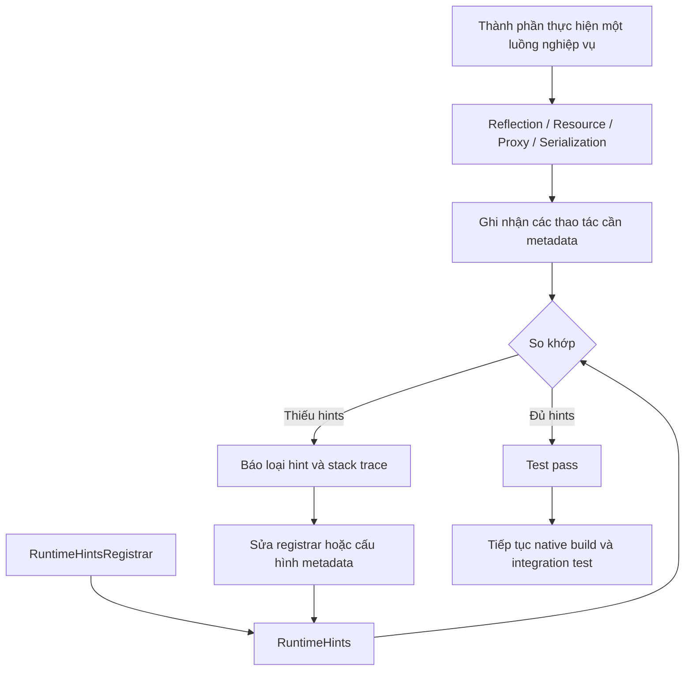

# So khớp các thao tác được ghi nhận với RuntimeHints của thành phần

> **Chương: Kiểm thử hints.** Module **SPRING_BOOT_NATIVE_IMAGE** biên dịch ứng dụng Spring Boot thành GraalVM Native Image bằng Spring AOT. Khi một thành phần dùng reflection, resource, serialization hoặc JDK proxy theo cách phân tích tĩnh không suy ra được, thành phần đó cần khai báo RuntimeHints. Bài học này hướng dẫn kiểm tra hints đã khai báo có bao phủ các thao tác thực tế mà thành phần thực hiện hay không.

## 1. Mục tiêu học tập

Sau bài học, bạn có thể:

1. Giải thích sự khác nhau giữa kiểm tra một hint đã biết và ghi nhận các thao tác cần hint khi code chạy.
2. Dùng RuntimeHintsPredicates để kiểm tra reflection, resource, serialization và proxy.
3. Dùng RuntimeHintsRegistrar của thành phần làm nguồn hints cho unit test.
4. Ghi nhận invocation bằng Runtime Hints Agent và so khớp với RuntimeHints trong Spring Framework 6.x.
5. Đọc báo cáo khi thiếu hint, tìm code path gây ra thao tác và bổ sung metadata chính xác.
6. Chọn cách kiểm tra phù hợp với phiên bản Spring Framework, đặc biệt khi chuyển từ 6.x sang 7.x.
7. Kết hợp unit test hints với native executable test để xác minh hành vi trong môi trường gần production.

## 2. Vì sao cần so khớp thao tác với RuntimeHints?

Một thành phần có thể chạy trên JVM nhưng thất bại trong Native Image nếu nó thực hiện thao tác động mà build chưa biết trước. Ví dụ:

- Tìm class bằng tên chuỗi rồi tạo instance bằng reflection.
- Gọi method hoặc đọc field bằng reflection.
- Tải file classpath theo tên được ghép từ locale hoặc cấu hình.
- Tạo JDK proxy từ một tập interface.
- Serialize một kiểu dữ liệu mà Spring AOT không thể suy ra từ bean definition hoặc endpoint.

RuntimeHints mô tả các quyền truy cập cần thiết cho Native Image. Tuy nhiên, chỉ nhìn vào lớp registrar chưa chứng minh rằng các hints đã đủ. Một registrar có thể bỏ sót constructor, resource, method hoặc interface mà thành phần thật sự dùng.

Có hai mức kiểm tra bổ sung cho nhau:

| Cách kiểm tra | Câu hỏi trả lời | Công cụ |
|---|---|---|
| Kiểm tra predicate | Hint cụ thể mà nhóm dự kiến có được đăng ký không? | RuntimeHintsPredicates |
| So khớp thao tác được ghi nhận | Khi chạy luồng nghiệp vụ, các thao tác cần hint có được RuntimeHints bao phủ không? | Runtime Hints Agent/RuntimeHintsRecorder trong Spring 6.x; GraalVM missing-registration reporting cho native runtime |

Luồng tổng quát:



## 3. RuntimeHints và RuntimeHintsRegistrar

Spring Framework cung cấp RuntimeHints để tập hợp các yêu cầu về:

- Reflection.
- Resource và resource bundle.
- Java serialization.
- JDK dynamic proxy.

Một thành phần có thể đóng góp hints bằng RuntimeHintsRegistrar. Ví dụ, dịch vụ kiểm tra chính tả tải dictionary theo ngôn ngữ:

```java
package com.example.orders.spell;

import java.util.Locale;

import org.springframework.aot.hint.RuntimeHints;
import org.springframework.aot.hint.RuntimeHintsRegistrar;
import org.springframework.context.annotation.ImportRuntimeHints;
import org.springframework.core.io.ClassPathResource;
import org.springframework.stereotype.Component;

@Component
@ImportRuntimeHints(SpellCheckService.SpellCheckRuntimeHints.class)
public class SpellCheckService {

    public ClassPathResource dictionary(Locale locale) {
        return new ClassPathResource(
                "dicts/" + locale.getLanguage() + ".txt");
    }

    static class SpellCheckRuntimeHints implements RuntimeHintsRegistrar {

        @Override
        public void registerHints(RuntimeHints hints, ClassLoader classLoader) {
            hints.resources().registerPattern("dicts/*");
        }
    }
}
```

@ImportRuntimeHints kết nối registrar với Spring AOT. Khi AOT xử lý component, Spring gọi registerHints(...) để thu thập thông tin. Nên đặt annotation gần component cần hints để khi component không được đưa vào bean factory, hints tương ứng cũng không bị đóng góp ngoài ý muốn.

Đối với unit test, có thể gọi registrar trực tiếp để nhận một RuntimeHints độc lập. Cách này giúp kiểm tra nội dung registrar mà không cần khởi động toàn bộ application context.

## 4. Kiểm tra hints đã biết bằng RuntimeHintsPredicates

RuntimeHintsPredicates tạo các Predicate<RuntimeHints> để kiểm tra yêu cầu cụ thể. Đây là cách ngắn gọn khi nhóm đã biết trước những thao tác mà component cần thực hiện.

Thêm dependency test của Spring Core theo đúng version Spring Framework mà ứng dụng sử dụng:

```groovy
dependencies {
    testImplementation("org.springframework:spring-core")
    testImplementation("org.springframework:spring-core-test")
}
```

Với dự án Spring Boot, thường nên để Spring Boot dependency management quản lý version thay vì tự chọn một version spring-core-test khác với spring-core.

### 4.1. Kiểm tra resource

Ví dụ test registrar ở trên:

```java
package com.example.orders.spell;

import org.junit.jupiter.api.Test;
import org.springframework.aot.hint.RuntimeHints;
import org.springframework.aot.hint.predicate.RuntimeHintsPredicates;

import static org.assertj.core.api.Assertions.assertThat;

class SpellCheckRuntimeHintsTests {

    @Test
    void registersDictionaryResources() {
        RuntimeHints hints = new RuntimeHints();
        new SpellCheckService.SpellCheckRuntimeHints()
                .registerHints(hints, getClass().getClassLoader());

        assertThat(RuntimeHintsPredicates.resource()
                .forResource("dicts/en.txt"))
                .accepts(hints);

        assertThat(RuntimeHintsPredicates.resource()
                .forResource("dicts/vi.txt"))
                .accepts(hints);
    }
}
```

Predicate forResource(...) kiểm tra tài nguyên có được bao phủ bởi resource hints đã đăng ký hay không. Nó không mở file và không chứng minh file thật sự có trong JAR. Vì vậy, cần kiểm tra sự tồn tại/nội dung của resource bằng một test khác nếu component phụ thuộc vào file đó.

### 4.2. Kiểm tra reflection

Giả sử component gọi method getVersion() của SpringVersion bằng reflection. Registrar cần khai báo invocation hint:

```java
public class VersionReflectionHints implements RuntimeHintsRegistrar {

    @Override
    public void registerHints(RuntimeHints hints, ClassLoader classLoader) {
        hints.reflection().registerType(SpringVersion.class, typeHint ->
                typeHint.withMethod("getVersion", List.of(), ExecutableMode.INVOKE));
    }
}
```

Với Spring Framework 7.x, có thể kiểm tra method invocation bằng API mới:

```java
assertThat(RuntimeHintsPredicates.reflection()
        .onMethodInvocation(SpringVersion.class, "getVersion"))
        .accepts(hints);
```

Ở Spring Framework 6.x, API predicate thường dùng dạng:

```java
assertThat(RuntimeHintsPredicates.reflection()
        .onMethod(SpringVersion.class, "getVersion")
        .invoke())
        .accepts(hints);
```

Từ Spring Framework 7.0, các predicate kiểu onMethod(...) cũ đã deprecated để chuyển sang onMethodInvocation(...). Hãy dùng API tương ứng với version đang quản lý trong dự án; không trộn các ví dụ 6.x và 7.x vào cùng một source set.

### 4.3. Kiểm tra JDK proxy

Nếu component tạo JDK proxy cho interface OrderGateway, registrar có thể khai báo:

```java
public class OrderGatewayHints implements RuntimeHintsRegistrar {

    @Override
    public void registerHints(RuntimeHints hints, ClassLoader classLoader) {
        hints.proxies().registerJdkProxy(OrderGateway.class);
    }
}
```

Test:

```java
assertThat(RuntimeHintsPredicates.proxies()
        .forInterfaces(OrderGateway.class))
        .accepts(hints);
```

Thứ tự interface có ý nghĩa khi proxy gồm nhiều interface. Test phải truyền đúng tập interface và thứ tự mà component cần tạo.

### 4.4. Kiểm tra serialization

Nếu component dùng Java serialization cho một kiểu Serializable, đăng ký:

```java
hints.serialization().registerType(OrderSnapshot.class);
```

Sau đó kiểm tra:

```java
assertThat(RuntimeHintsPredicates.serialization()
        .onType(OrderSnapshot.class))
        .accepts(hints);
```

Serialization hints ở đây dành cho cơ chế Java serialization mà Spring RuntimeHints mô tả. Không nhầm chúng với reflection hints cho Jackson binding; hai trường hợp có thể cần loại metadata khác nhau.

### 4.5. Kiểm tra nhiều yêu cầu trong một test

Một component có thể cần nhiều loại hints. Có thể gom assertion vào cùng test:

```java
@Test
void registersAllRequiredHints() {
    RuntimeHints hints = new RuntimeHints();
    new OrderComponentRuntimeHints()
            .registerHints(hints, getClass().getClassLoader());

    assertThat(RuntimeHintsPredicates.resource()
            .forResource("schemas/order.json"))
            .accepts(hints);

    assertThat(RuntimeHintsPredicates.proxies()
            .forInterfaces(OrderGateway.class))
            .accepts(hints);

    assertThat(RuntimeHintsPredicates.serialization()
            .onType(OrderSnapshot.class))
            .accepts(hints);
}
```

Mỗi assertion nên tương ứng với một thao tác mà component thực sự cần. Không đăng ký hint rộng chỉ để làm test pass.

## 5. Vì sao predicate chưa đủ?

Predicate kiểm tra những điều mà người viết test đã nghĩ tới. Nếu nhóm quên một thao tác, test vẫn có thể pass dù registrar chưa đầy đủ.

Ví dụ component dùng:

1. ClassUtils.forName(...) để tải class.
2. ClassUtils.getMethod(...) để tìm method.
3. Method.invoke(...) để gọi method.

Nếu test chỉ kiểm tra resource hint, nó không phát hiện thiếu reflection hint. Nếu test chỉ kiểm tra onType(...), nó cũng có thể không chứng minh rằng method cần invoke đã được khai báo đúng mode.

Để phát hiện các yêu cầu mà test chưa dự đoán trước, có thể ghi nhận thao tác thực tế trong luồng chạy rồi so khớp với toàn bộ RuntimeHints của component. Spring Framework 6.x cung cấp Runtime Hints Agent cho mục đích này.

## 6. Ghi nhận thao tác bằng Runtime Hints Agent trong Spring 6.x

spring-core-test có Runtime Hints Agent, một Java agent dùng bytecode transformer để ghi nhận các method invocation liên quan tới metadata. RuntimeHintsRecorder.record(...) thu thập các invocation trong một đoạn code; RuntimeHintsInvocations.match(runtimeHints) kiểm tra chúng có được hints bao phủ hay không.

Agent mặc định chỉ instrument package org.springframework. Nếu component của ứng dụng nằm trong com.example.orders, phải thêm package đó vào cấu hình agent; nếu không, test có thể không ghi nhận thao tác của component.

### 6.1. Cấu hình dependency và Java agent

Thêm spring-core-test cùng version với Spring Framework trong test scope:

```groovy
dependencies {
    testImplementation("org.springframework:spring-core-test")
}
```

Khi chạy test JVM, nạp chính JAR này làm Java agent:

```text
-javaagent:/path/to/spring-core-test.jar=+org.springframework,+com.example.orders
```

Đường dẫn phải trỏ tới file JAR đã được resolve từ dependency spring-core-test. Phần sau dấu bằng là danh sách package cần instrument; dấu + thêm package vào phạm vi theo dõi, dấu - loại package khỏi phạm vi. Chỉ thêm package liên quan để giảm lượng bytecode bị instrument và làm kết quả dễ đọc.

Với Gradle, có thể tạo configuration riêng để lấy đúng JAR làm agent rồi truyền option cho test JVM:

```groovy
configurations {
    runtimeHintsAgent
}

dependencies {
    runtimeHintsAgent("org.springframework:spring-core-test")
}

tasks.withType(Test).configureEach {
    doFirst {
        jvmArgs("-javaagent:${configurations.runtimeHintsAgent.singleFile}=+org.springframework,+com.example.orders")
    }
}
 ```

Gradle sử dụng configuration runtimeHintsAgent để resolve đúng file JAR và truyền file đó vào test JVM. Ví dụ trên giả định dependency management của dự án đã cung cấp version cho spring-core-test. Với Kotlin DSL hoặc cấu hình Gradle khác, giữ nguyên nguyên tắc: agent phải được nạp vào đúng JVM chạy test, không phải chỉ thêm JAR vào compile classpath.

Với Maven Surefire, truyền cùng option vào argLine của forked test JVM. Có thể dùng đường dẫn artifact đã resolve hoặc property được build quản lý:

```xml
<plugin>
    <groupId>org.apache.maven.plugins</groupId>
    <artifactId>maven-surefire-plugin</artifactId>
    <configuration>
        <argLine>
            -javaagent:/path/to/spring-core-test.jar=+org.springframework,+com.example.orders
        </argLine>
    </configuration>
</plugin>
```

Đây là mẫu cấu hình minh họa; thay placeholder bằng đường dẫn thực tế trong môi trường build. Nếu argLine đã được dùng cho JaCoCo hoặc agent khác, phải ghép các option hiện có thay vì ghi đè chúng.

### 6.2. Viết test so khớp invocation

Component thực hiện một thao tác reflection:

```java
package com.example.orders.version;

import java.lang.reflect.Method;

import org.springframework.util.ClassUtils;

public class VersionReader {

    public String readSpringVersion() throws Exception {
        Class<?> type = ClassUtils.forName(
                "org.springframework.core.SpringVersion", null);
        Method method = ClassUtils.getMethod(type, "getVersion");
        return (String) method.invoke(null);
    }
}
```

Registrar đóng góp hint cho method được gọi:

```java
package com.example.orders.version;

import java.util.List;

import org.springframework.aot.hint.ExecutableMode;
import org.springframework.aot.hint.RuntimeHints;
import org.springframework.aot.hint.RuntimeHintsRegistrar;
import org.springframework.core.SpringVersion;

public class VersionReaderRuntimeHints implements RuntimeHintsRegistrar {

    @Override
    public void registerHints(RuntimeHints hints, ClassLoader classLoader) {
        hints.reflection().registerType(SpringVersion.class, typeHint ->
                typeHint.withMethod("getVersion", List.of(), ExecutableMode.INVOKE));
    }
}
```

Test ghi nhận luồng thực thi và so khớp:

```java
package com.example.orders.version;

import org.junit.jupiter.api.Test;
import org.springframework.aot.hint.RuntimeHints;
import org.springframework.aot.test.agent.EnabledIfRuntimeHintsAgent;
import org.springframework.aot.test.agent.RuntimeHintsInvocations;
import org.springframework.aot.test.agent.RuntimeHintsRecorder;

import static org.assertj.core.api.Assertions.assertThat;

@EnabledIfRuntimeHintsAgent
class VersionReaderRuntimeHintsAgentTests {

    @Test
    void registeredHintsCoverRecordedInvocations() {
        RuntimeHints hints = new RuntimeHints();
        new VersionReaderRuntimeHints()
                .registerHints(hints, getClass().getClassLoader());

        RuntimeHintsInvocations invocations = RuntimeHintsRecorder.record(() -> {
            try {
                new VersionReader().readSpringVersion();
            }
            catch (Exception ex) {
                throw new IllegalStateException(ex);
            }
        });

        assertThat(invocations).match(hints);
    }
}
```

@EnabledIfRuntimeHintsAgent chỉ cho test chạy khi agent đã được nạp vào JVM hiện tại; annotation cũng gắn test với JUnit tag RuntimeHints. Nếu test bị skip, điều đó không chứng minh hints đúng. CI cần xác nhận agent đã được cấu hình và các test cần thiết thực sự được thực thi.

Khi thiếu hint, assertion match(hints) thất bại và báo loại hint bị thiếu, method invocation, arguments và stack trace. Stack trace giúp truy ngược từ thao tác được ghi nhận về component đã tạo ra thao tác đó.

### 6.3. Giới hạn của Runtime Hints Agent

- Agent chỉ ghi nhận những thao tác xảy ra trong đoạn code được instrument và chạy qua trong test.
- Agent mặc định instrument package org.springframework; phải thêm package ứng dụng hoặc thư viện cần theo dõi.
- Một nhánh nghiệp vụ không được test chạy sẽ không tạo invocation để kiểm tra.
- Agent chỉ quan sát những API/operation liên quan tới RuntimeHints mà transformer hỗ trợ; nó không chứng minh toàn bộ hành vi ứng dụng đã được kiểm thử.
- Test này chạy trên JVM và không thay thế native executable test.

Hãy gọi đúng luồng nghiệp vụ của component trong recording block. Nếu component có nhiều nhánh như locale, plugin, serializer hoặc resource theo cấu hình, tạo test riêng cho từng nhánh quan trọng.

## 7. Thay đổi từ Spring Framework 7.0

Từ Spring Framework 7.0, RuntimeHintsAgent và RuntimeHintsRecorder đã deprecated để chuyển sang cơ chế missing-registration reporting của GraalVM Native Image. Đây là khác biệt quan trọng khi nâng cấp:

| API/cách làm | Spring Framework 6.x | Spring Framework 7.x |
|---|---|---|
| RuntimeHintsPredicates | Dùng để kiểm tra hint cụ thể | Vẫn dùng; với reflection ưu tiên API onMethodInvocation(...), onFieldAccess(...) mới |
| RuntimeHintsAgent | Cách ghi nhận invocation có mục tiêu | Deprecated, for removal |
| RuntimeHintsRecorder.record(...) | Ghi invocation trong một đoạn code | Deprecated, for removal |
| GraalVM missing-registration reporting | Có thể dùng tùy GraalVM version | Là hướng thay thế được Spring khuyến nghị |

Không bắt đầu một test suite mới trên Spring 7.x bằng cách phụ thuộc vào Runtime Hints Agent cũ nếu GraalVM runtime reporting đã đáp ứng mục tiêu kiểm thử. Với dự án 6.x hiện hữu, agent vẫn có thể hữu ích để kiểm tra registrar trong các unit test có phạm vi hẹp.

## 8. So khớp missing registration bằng GraalVM Native Image

Với GraalVM for JDK 23 trở lên, có thể bật exact reachability metadata ở build time:

```bash
native-image --exact-reachability-metadata -jar target/orders-service.jar
```

Hoặc chỉ bật cho package cần điều tra:

```bash
native-image --exact-reachability-metadata=com.example.orders -jar target/orders-service.jar
```

Sau khi tạo executable, chạy với chế độ cảnh báo để quan sát những vị trí thiếu registration:

```bash
./orders-service -XX:MissingRegistrationReportingMode=Warn
```

Sau khi đã xử lý các cảnh báo, chạy test với chế độ Exit:

```bash
./orders-service -XX:MissingRegistrationReportingMode=Exit
```

Warn báo các thao tác thiếu registration và cho phép ứng dụng tiếp tục; Exit làm process thoát ngay khi gặp missing registration. Chế độ Exit hữu ích trong test vì phát hiện cả trường hợp code bắt Throwable rồi vô tình nuốt lỗi thiếu metadata.

Với GraalVM trước JDK 23, các option tương ứng có thể khác và một số cấu hình được truyền ở build time dưới dạng -H:. Luôn kiểm tra tài liệu của GraalVM đang dùng trước khi đưa option vào pipeline.

### 8.1. Vì sao cần chạy luồng nghiệp vụ thật?

Missing-registration reporting chỉ báo các thao tác đã xảy ra trong process. Nếu test không chạy đường code dùng reflection hoặc resource động, báo cáo sẽ không có dữ liệu về nhánh đó.

Nên chạy:

- Unit/integration test cho các component dùng reflection.
- API test với mọi kiểu DTO/serializer quan trọng.
- Các locale hoặc template/resource thực sự được hỗ trợ.
- Luồng tạo proxy hoặc plugin động.
- Các nhánh xử lý lỗi, fallback và configuration profile.

Kết quả Warn không phải danh sách metadata có thể copy nguyên xi. Hãy xác định thao tác nào thật sự cần hỗ trợ, thêm hint hẹp, build lại và chạy lại test.

## 9. Phân biệt Runtime Hints Agent và GraalVM Tracing Agent

Hai agent có mục tiêu gần nhau nhưng cách dùng khác nhau:

| Đặc điểm | Spring Runtime Hints Agent | GraalVM Native Image Tracing Agent |
|---|---|---|
| Thành phần | spring-core-test | GraalVM Native Image |
| Mục tiêu | Ghi nhận invocation liên quan tới RuntimeHints và so khớp với RuntimeHints object | Thu thập cấu hình metadata từ các thao tác động quan sát được |
| Kết quả | RuntimeHintsInvocations, assertion có stack trace | File JSON metadata cho Native Image |
| Phạm vi | Có thể giới hạn theo package và recording block | Toàn bộ process được chạy với agent và các filter đã cấu hình |
| Phù hợp | Unit test infrastructure/registrar trong Spring 6.x | Khám phá metadata cho dependency hoặc luồng ứng dụng rộng hơn |

GraalVM Tracing Agent không tự biết RuntimeHintsRegistrar nào là của component. Nó thu thập những thao tác cần metadata và xuất JSON. Nhóm phải review kết quả, loại bỏ entry thừa và chuyển thông tin phù hợp vào reachability metadata hoặc Spring Runtime Hints.

## 10. Thiết kế test để tránh false positive

Một test hints tốt phải chứng minh đúng component, đúng luồng và đúng yêu cầu metadata:

1. **Gọi registrar thật.** Không tự viết lại các hint mong đợi ngay trong test rồi so sánh với chính chúng.
2. **Chạy thao tác của component.** Recording block phải gọi code production, không chỉ gọi API reflection/resource trực tiếp từ test.
3. **Instrument đúng package.** Xác nhận package component nằm trong agent include list.
4. **Kiểm tra test thực sự chạy.** Test bị skip do thiếu agent không được tính là pass.
5. **Bao phủ nhánh quan trọng.** Chạy các locale, serializer, plugin hoặc cấu hình tạo ra thao tác khác nhau.
6. **Giữ hint tối thiểu.** Nếu một hint rộng làm test pass nhưng không cần thiết, thu hẹp về member/resource cụ thể.
7. **Kiểm tra native runtime.** Hints được kiểm tra trên JVM vẫn cần xác minh trong executable native.

### 10.1. Đọc lỗi match

Ví dụ lỗi:

```text
Missing "ReflectionHints" for invocation:
java.lang.Class#forName

Arguments:
"com.example.orders.LegacyPayload"

Stack trace:
com.example.orders.PayloadReader.read(PayloadReader.java:42)
com.example.orders.PayloadService.load(PayloadService.java:27)
```

Hãy lần theo stack trace để tìm thao tác động đầu tiên do code ứng dụng hoặc thư viện thực hiện. Sau đó xác định cần hint cho class, constructor, method hay resource nào. Không nhất thiết mọi invocation được báo đều cần thêm metadata nếu thao tác đó không thuộc code path được hỗ trợ hoặc đã được xử lý bằng cơ chế khác.

## 11. Quy trình thực hành hoàn chỉnh

Giả sử DocumentRenderer tải template theo tên và dùng reflection để tạo một formatter:

```java
public String render(String locale, String formatterClassName) {
    Class<?> type = ClassUtils.forName(formatterClassName, null);
    Object formatter = BeanUtils.instantiateClass(type);
    Resource template = new ClassPathResource(
            "templates/" + locale + "/invoice.html");
    // Đọc template và render nội dung.
    return renderDocument(template, formatter);
}
```

Thực hiện:

1. Tạo DocumentRendererRuntimeHints đăng ký resource pattern cho các template được hỗ trợ.
2. Đăng ký reflection hint cho formatter type/constructor mà component dùng.
3. Dùng RuntimeHintsPredicates kiểm tra các hint đã biết.
4. Với Spring 6.x, bật Runtime Hints Agent cho package component, gọi DocumentRenderer.render(...) trong recording block và so khớp bằng match(hints).
5. Với Spring 7.x, dùng --exact-reachability-metadata và chạy native executable với MissingRegistrationReportingMode=Warn.
6. Sửa metadata còn thiếu, chạy lại với Exit.
7. Kiểm tra từng locale, formatter và container image cuối cùng.

Mẫu báo cáo:

| Hạng mục | Kết quả |
|---|---|
| Resource hints đã biết | Pass/Fail |
| Reflection hints đã biết | Pass/Fail |
| Proxy/serialization hints (nếu có) | Pass/Fail |
| Runtime Hints Agent đã nạp (Spring 6.x) | Pass/Fail/Không áp dụng |
| Recorded invocations match | Pass/Fail/Không áp dụng |
| GraalVM Warn không còn missing registration cần xử lý | Pass/Fail |
| GraalVM Exit hoàn tất các test | Pass/Fail |
| Native container smoke test | Pass/Fail |

## 12. Câu hỏi tự kiểm tra

1. RuntimeHintsPredicates kiểm tra điều gì và không kiểm tra điều gì?
2. Vì sao gọi registrar trực tiếp trong test giúp cô lập lỗi khai báo hints?
3. RuntimeHintsRecorder.record(...) ghi nhận thao tác nào?
4. Vì sao package của component phải nằm trong phạm vi instrument của Runtime Hints Agent?
5. @EnabledIfRuntimeHintsAgent có thể làm test bị skip trong trường hợp nào?
6. Vì sao một test predicate pass vẫn có thể bỏ sót hint cần thiết?
7. RuntimeHintsInvocations.match(hints) cung cấp thông tin gì khi assertion thất bại?
8. Từ Spring Framework 7.0, Runtime Hints Agent thay đổi trạng thái ra sao?
9. MissingRegistrationReportingMode=Warn và Exit khác nhau thế nào?
10. Vì sao cần chạy native executable với nhiều luồng nghiệp vụ sau khi unit test hints pass?

## Ghi nhớ

**Kiểm tra predicate xác nhận các hints đã biết; ghi nhận invocation giúp phát hiện những yêu cầu mà nhóm chưa nghĩ tới.** Dùng RuntimeHintsPredicates cho unit test ổn định, dùng Runtime Hints Agent/RuntimeHintsRecorder khi duy trì dự án Spring 6.x, và dùng GraalVM missing-registration reporting làm hướng kiểm tra trên Spring 7.x. Chạy các luồng nghiệp vụ thật, đọc stack trace, bổ sung hints vừa đủ và xác minh lại trên native executable.

## Tài liệu tham khảo chính thức

- [Spring Framework — Ahead of Time Optimizations](https://docs.spring.io/spring-framework/reference/core/aot.html): Runtime Hints, RuntimeHintsPredicates và kiểm thử thao tác được ghi nhận.
- [Spring Framework API — RuntimeHintsPredicates](https://docs.spring.io/spring-framework/docs/current/javadoc-api/org/springframework/aot/hint/predicate/RuntimeHintsPredicates.html): predicate cho reflection, resource, serialization và proxy.
- [Spring Framework API — RuntimeHintsRegistrar](https://docs.spring.io/spring-framework/docs/current/javadoc-api/org/springframework/aot/hint/RuntimeHintsRegistrar.html): hợp đồng đăng ký hints.
- [Spring Framework API — RuntimeHintsRecorder](https://docs.spring.io/spring-framework/docs/6.2.19/javadoc-api/org/springframework/aot/test/agent/RuntimeHintsRecorder.html): ghi nhận invocation trong Spring Framework 6.x.
- [Spring Framework 7.0 — Deprecated API](https://docs.spring.io/spring-framework/docs/7.0.11/javadoc-api/deprecated-list.html): trạng thái deprecated của RuntimeHintsAgent và RuntimeHintsRecorder.
- [GraalVM — Troubleshoot Native Image Run-Time Errors](https://www.graalvm.org/latest/reference-manual/native-image/guides/troubleshoot-run-time-errors/): exact reachability metadata và missing-registration reporting.
- [GraalVM — Reachability Metadata](https://www.graalvm.org/latest/reference-manual/native-image/metadata/): các loại metadata và cách kiểm tra.
