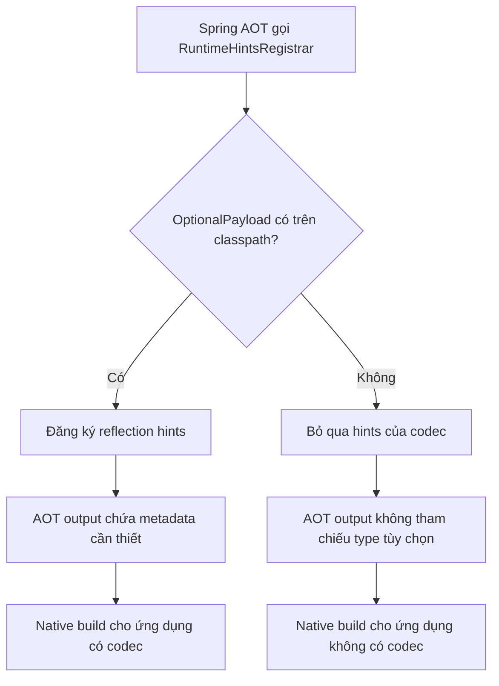

# Kiểm thử registrar khi dependency tùy chọn có hoặc không có trên classpath

> **Chương:** Kiểm thử hints  
> **Module:** `SPRING_BOOT_NATIVE_IMAGE`  
> **Mục tiêu:** Thiết kế `RuntimeHintsRegistrar` an toàn khi thư viện tích hợp là dependency tùy chọn; kiểm tra nhánh có và không có class trên classpath; tránh lỗi liên kết class khi thiếu thư viện; xác minh Spring AOT chỉ sinh metadata phù hợp với cấu hình thực tế.

## 1. Vì sao registrar phải chịu được dependency tùy chọn?

Một starter hoặc integration module thường hỗ trợ thêm một thư viện bên thứ ba nhưng không bắt buộc mọi ứng dụng phải dùng thư viện đó. Ví dụ:

- Integration cho một codec chỉ được thêm khi ứng dụng dùng codec tương ứng.
- Module kết nối cloud chỉ được thêm khi triển khai trên một nhà cung cấp cụ thể.
- Adapter cho thư viện JSON/XML, driver database hoặc client messaging chỉ tồn tại ở một số ứng dụng.
- Extension cung cấp reflection hints cho model hoặc API của dependency ngoài.

Khi thư viện tùy chọn có mặt, registrar phải đăng ký đúng reflection, resource, proxy hoặc serialization hints mà tính năng đó cần. Khi thư viện không có mặt, registrar phải bỏ qua phần metadata đó và ứng dụng vẫn có thể khởi động, phân tích AOT và build native.

Một lỗi phổ biến là registrar tham chiếu trực tiếp class của dependency tùy chọn:

```java
import com.vendor.codec.OptionalPayload;

public class OptionalCodecHints implements RuntimeHintsRegistrar {

    @Override
    public void registerHints(RuntimeHints hints, ClassLoader classLoader) {
        hints.reflection().registerType(
                OptionalPayload.class,
                MemberCategory.INVOKE_PUBLIC_CONSTRUCTORS);
    }
}
```

Đoạn mã này chỉ biên dịch khi `optional-codec` có mặt trên compile classpath. Nếu ứng dụng tiêu thụ integration module mà không kéo thư viện đó vào runtime, quá trình load hoặc thực thi registrar có thể gặp `NoClassDefFoundError` hoặc lỗi liên kết tương tự. Việc dependency được khai báo optional trong Maven không tự làm cho mọi tham chiếu class trong bytecode trở nên an toàn.

**Quy tắc thiết kế:** registrar của integration tùy chọn không nên có tham chiếu kiểu tĩnh tới class chỉ tồn tại trong dependency tùy chọn. Dùng tên class dạng chuỗi, classloader do Spring AOT cung cấp và API đăng ký có điều kiện.

## 2. Hai trạng thái classpath cần kiểm thử

Bài thực hành dùng một integration giả định:

- Module chính: `payment-core`, luôn có trong ứng dụng.
- Module tích hợp: `payment-codec-integration`, chứa registrar.
- Dependency tùy chọn: `vendor-codec`, cung cấp `com.vendor.codec.OptionalPayload`.
- Khi có codec, native image cần reflection metadata để tạo `OptionalPayload`.
- Khi không có codec, không cần metadata cho type đó.



| Trạng thái | Kết quả mong đợi |
|---|---|
| Dependency có mặt | Registrar đăng ký đúng type/member cần reflection |
| Dependency vắng mặt | Registrar không ném exception và không đăng ký hint cho type đó |
| Dependency có mặt nhưng phiên bản không tương thích | Kiểm thử phát hiện thiếu API/member hoặc metadata sai |
| Dependency có mặt nhưng tính năng không được kích hoạt | Hint không gây tác dụng phụ; tính năng vẫn tuân theo điều kiện cấu hình của integration |

Cần test cả hai trạng thái. Chỉ test với dependency có mặt sẽ không phát hiện lỗi liên kết khi người dùng bỏ integration library. Chỉ test với dependency vắng mặt lại không chứng minh nhánh metadata cần thiết đã được đăng ký.

## 3. Không tham chiếu class tùy chọn bằng kiểu Java

Một registrar an toàn nên lưu tên class cần kiểm tra dưới dạng chuỗi:

```java
public final class OptionalCodecRuntimeHints
        implements RuntimeHintsRegistrar {

    private static final String OPTIONAL_PAYLOAD =
            "com.vendor.codec.OptionalPayload";

    @Override
    public void registerHints(RuntimeHints hints, ClassLoader classLoader) {
        hints.reflection().registerTypeIfPresent(
                classLoader,
                OPTIONAL_PAYLOAD,
                MemberCategory.INVOKE_PUBLIC_CONSTRUCTORS,
                MemberCategory.INTROSPECT_PUBLIC_METHODS);
    }
}
```

`ReflectionHints.registerTypeIfPresent(...)` là API của Spring Framework 6+ để đăng ký reflection hint khi type có thể được tải bằng classloader được cung cấp. Nó có overload nhận `MemberCategory...` hoặc một callback `TypeHint.Builder`. [Spring Framework Javadoc — ReflectionHints](https://docs.spring.io/spring-framework/docs/6.2.x/javadoc-api/org/springframework/aot/hint/ReflectionHints.html)

Trong ví dụ, khi `OptionalPayload` có mặt, metadata cho phép gọi public constructor và introspect public methods. Nếu use case cần method invocation hoặc field access cụ thể, hãy khai báo đúng thao tác đó. Không đăng ký toàn bộ member chỉ để tránh phải hiểu nhu cầu thực tế.

### 3.1. Vì sao dùng classloader được truyền vào?

Spring AOT gọi registrar trong một môi trường build có classpath và classloader tương ứng với ứng dụng đang phân tích. Dùng classloader này bảo đảm phép kiểm tra nhìn thấy đúng dependency của build.

Không nên thay bằng:

```java
ClassLoader.getSystemClassLoader()
```

System classloader có thể khác classloader của ứng dụng, test runner, plugin hoặc build tool. Trong một số môi trường, nó có thể không nhìn thấy dependency dù dependency đã có trên application classpath, hoặc nhìn thấy một phiên bản khác.

Cũng không nên dùng `Class.forName(name)` không truyền classloader: overload đó có thể dùng classloader mặc định của caller và khởi tạo class ngoài ý muốn. `registerTypeIfPresent` nhận rõ classloader và thực hiện kiểm tra sự hiện diện trước khi thêm hint.

### 3.2. Dùng `TypeReference` khi chỉ cần tên type

Nếu cần tự kiểm tra hoặc đăng ký type bằng tên, `TypeReference.of("com.vendor.codec.OptionalPayload")` biểu diễn type mà không yêu cầu viết class literal. Tuy nhiên, `registerType(TypeReference, ...)` chỉ ghi nhận metadata; nó không tự xác minh class có tồn tại. Với dependency tùy chọn, dùng `registerTypeIfPresent` thường thể hiện đúng ý định hơn.

## 4. Tách auto-configuration tùy chọn khỏi core module

Nếu integration được phát hành như Spring Boot starter, hãy để auto-configuration được bật có điều kiện bởi class của dependency.

Ví dụ:

```java
@AutoConfiguration
@ConditionalOnClass(name = "com.vendor.codec.OptionalCodec")
@ImportRuntimeHints(OptionalCodecRuntimeHints.class)
public class OptionalCodecAutoConfiguration {
}
```

`@ConditionalOnClass(name = "...")` dùng tên class dạng chuỗi, vì vậy metadata của auto-configuration không cần liên kết trực tiếp tới class tùy chọn. Khi `OptionalCodec` không có trên classpath, auto-configuration không được áp dụng.

Đặt `@ImportRuntimeHints` gần cấu hình hoặc component cần metadata. Spring Framework khuyến nghị đăng ký registrar sát component phụ thuộc vào hints; nếu component không được đưa vào BeanFactory thì hints liên quan cũng không cần được đóng góp. Registrar được phát hiện và gọi trong AOT processing. [Spring Framework Reference — Runtime Hints](https://docs.spring.io/spring-framework/reference/core/aot.html)

### 4.1. Tránh để core configuration kéo dependency tùy chọn

Một cấu trúc module dễ quản lý:

```text
payment-core/
  src/main/java/
    com/example/payment/PaymentService.java

payment-codec-integration/
  src/main/java/
    com/example/payment/codec/OptionalCodecAutoConfiguration.java
    com/example/payment/codec/OptionalCodecRuntimeHints.java

application/
  dependencies:
    payment-core
    payment-codec-integration
    vendor-codec (optional)
```

`payment-core` không biết về `vendor-codec`. Module integration chứa auto-configuration và registrar nhưng không tham chiếu kiểu tĩnh tới class của vendor. Ứng dụng thêm `vendor-codec` khi muốn dùng tính năng.

Tách module như vậy giúp ứng dụng không dùng codec vẫn có thể kéo integration starter mà không bị buộc mang theo toàn bộ dependency runtime. Cần kiểm tra cả dependency declarations và bytecode của integration module, vì chỉ đặt dependency thành optional mà vẫn import class trong registrar không giải quyết được vấn đề.

## 5. Kiểm tra phiên bản dependency trước khi đăng ký member cụ thể

Kiểm tra class có tồn tại chỉ trả lời câu hỏi **type có thể được tải hay không**. Nó không chứng minh phiên bản đang dùng có constructor, method hoặc field mà metadata mong đợi.

Ví dụ `OptionalPayload` tồn tại ở cả version 1.x và 2.x, nhưng constructor hoặc method đã đổi. Nếu registrar đăng ký member không còn tồn tại, native build có thể cảnh báo, thất bại hoặc tạo metadata không có tác dụng tùy thao tác và phiên bản toolchain.

Với API ổn định, có thể đăng ký category ở mức type. Với API thay đổi theo version:

- Ưu tiên adapter hoặc integration module riêng cho từng major version.
- Dùng dependency constraints/BOM để khóa phiên bản đã hỗ trợ.
- Nếu thật sự cần một registrar dùng chung, kiểm tra member cụ thể qua reflection bằng classloader được truyền vào rồi mới đăng ký member tìm được.
- Không suy ra tương thích chỉ từ việc tên class còn tồn tại.

Ví dụ kiểm tra method có chữ ký dựa trên kiểu JDK ổn định:

```java
if (ClassUtils.isPresent(OPTIONAL_PAYLOAD, classLoader)) {
    Class<?> optionalType = ClassUtils.resolveClassName(
            OPTIONAL_PAYLOAD, classLoader);
    Method decode = ReflectionUtils.findMethod(
            optionalType, "decode", byte[].class);
    if (decode != null) {
        hints.reflection().registerMethod(decode, ExecutableMode.INVOKE);
    }
}
```

Đoạn này chỉ phù hợp nếu `decode(byte[])` là API được hỗ trợ và các kiểu tham số/trả về không tạo thêm liên kết tới dependency khác chưa có. Trong code production, cần xử lý trường hợp class không tải được và method signature không khớp theo chính sách tương thích đã công bố.

## 6. Kiểm thử registrar khi dependency có mặt

Unit test cho registrar nên tạo một `RuntimeHints` mới, gọi registrar bằng classloader của test và xác minh đúng metadata đã được thêm.

Ví dụ với JUnit 5 và AssertJ:

```java
class OptionalCodecRuntimeHintsTests {

    private static final String OPTIONAL_PAYLOAD =
            "com.vendor.codec.OptionalPayload";

    private final OptionalCodecRuntimeHints registrar =
            new OptionalCodecRuntimeHints();

    @Test
    void registersHintsWhenOptionalTypeIsPresent() {
        RuntimeHints hints = new RuntimeHints();

        registrar.registerHints(hints, getClass().getClassLoader());

        assertThat(RuntimeHintsPredicates.reflection()
                .onType(TypeReference.of(OPTIONAL_PAYLOAD))
                .withMemberCategory(MemberCategory.INVOKE_PUBLIC_CONSTRUCTORS)
                .test(hints))
                .isTrue();

        assertThat(RuntimeHintsPredicates.reflection()
                .onType(TypeReference.of(OPTIONAL_PAYLOAD))
                .withMemberCategory(MemberCategory.INTROSPECT_PUBLIC_METHODS)
                .test(hints))
                .isTrue();
    }
}
```

`RuntimeHintsPredicates` cho phép kiểm tra hint bằng `TypeReference`, vì vậy test có thể xác minh tên type mà không cần dùng class literal của dependency tùy chọn. Predicate có thể được thu hẹp theo `MemberCategory`, constructor, method hoặc thao tác reflection cụ thể. [Spring Framework Javadoc — ReflectionHintsPredicates](https://docs.spring.io/spring-framework/docs/6.2.x/javadoc-api/org/springframework/aot/hint/predicate/ReflectionHintsPredicates.html)

Điều kiện của test này là `vendor-codec` phải có trên test runtime classpath. Nếu dependency chỉ có ở compile classpath mà không có khi test chạy, registrar sẽ đi vào nhánh vắng mặt và assertion sẽ thất bại. Hãy kiểm tra cấu hình dependency của test thay vì sửa assertion cho qua.

### 6.1. Kiểm tra đúng thao tác, không chỉ kiểm tra type xuất hiện

Nếu registrar đăng ký constructor invocation, hãy assert đúng `INVOKE_PUBLIC_CONSTRUCTORS`. Một hint chỉ có `INTROSPECT_PUBLIC_CONSTRUCTORS` chưa đủ để gọi constructor bằng reflection.

Tương tự:

| Nhu cầu runtime | Điều nên xác minh |
|---|---|
| Tạo instance bằng reflection | Constructor invocation |
| Gọi method theo tên | Method invocation |
| Chỉ liệt kê method | Method introspection |
| Đọc hoặc ghi field | Field access phù hợp |
| Đọc file classpath | Resource pattern |
| Tạo JDK proxy | Proxy hint cho đúng interface set |
| Java object serialization | Serialization hint cho type cần serialize |

Test nên phản ánh chính xác thao tác mà dependency thực hiện. Nếu chỉ xác nhận type hint tồn tại, một cấu hình thiếu member category vẫn có thể lọt qua.

## 7. Kiểm thử registrar khi dependency vắng mặt

Test nhánh vắng mặt phải dùng classloader không thể tải class tùy chọn. Có thể tạo classloader kiểm soát trong unit test:

```java
@Test
void skipsHintsWhenOptionalTypeIsNotVisible() {
    RuntimeHints hints = new RuntimeHints();

    ClassLoader withoutOptionalCodec = new ClassLoader(
            getClass().getClassLoader()) {

        @Override
        protected Class<?> loadClass(String name, boolean resolve)
                throws ClassNotFoundException {
            if (OPTIONAL_PAYLOAD.equals(name)) {
                throw new ClassNotFoundException(name);
            }
            return super.loadClass(name, resolve);
        }
    };

    assertThat(ClassUtils.isPresent(
            OPTIONAL_PAYLOAD, withoutOptionalCodec)).isFalse();

    assertThatCode(() ->
            registrar.registerHints(hints, withoutOptionalCodec))
            .doesNotThrowAnyException();

    assertThat(RuntimeHintsPredicates.reflection()
            .onType(TypeReference.of(OPTIONAL_PAYLOAD))
            .test(hints))
            .isFalse();
}
```

Classloader trên chặn đúng tên type trước khi ủy quyền cho parent. Vì registrar dùng `registerTypeIfPresent` với classloader được truyền vào, nó không thêm reflection hint và không ném `ClassNotFoundException`.

Đây là unit test cho nhánh kiểm tra classloader. Nó hữu ích khi test runtime thông thường vẫn có dependency tùy chọn, nhưng không thay thế một lần chạy với **dependency thực sự bị loại khỏi runtime classpath**. Classloader mô phỏng chỉ chặn tên class được chỉ định; các class liên quan khác vẫn có thể được parent loader cung cấp.

### 7.1. Test trên classpath thực sự không có dependency

Tạo một fixture application hoặc test module riêng chỉ phụ thuộc vào integration module và Spring Core, không khai báo `vendor-codec`. Chạy test/AOT processing trong module đó.

Kết quả cần xác minh:

- Auto-configuration có điều kiện không được kích hoạt.
- Registrar không tạo hint cho `OptionalPayload`.
- Application context vẫn khởi tạo với các bean core.
- Spring AOT hoàn thành mà không gặp lỗi liên kết class.
- Native executable của fixture không có codec vẫn khởi động và chạy use case core.

Đây là kiểm tra mạnh hơn classloader giả lập vì JVM, Spring AOT và build tool đều chạy trên dependency graph thật của ứng dụng.

## 8. Kiểm thử điều kiện auto-configuration riêng với registrar

Có hai cơ chế cần phân biệt:

- `@ConditionalOnClass` quyết định auto-configuration/bean có được đưa vào context hay không.
- `RuntimeHintsRegistrar` đóng góp metadata trong AOT processing khi cấu hình chứa nó được xử lý.

Không nên chỉ dùng một `ApplicationContextRunner` test để kết luận registrar đã sinh hint. Context test thông thường không phải AOT processing.

Ví dụ kiểm tra auto-configuration khi thiếu class:

```java
class OptionalCodecAutoConfigurationTests {

    private final ApplicationContextRunner contextRunner =
            new ApplicationContextRunner()
                    .withConfiguration(
                            AutoConfigurations.of(
                                    OptionalCodecAutoConfiguration.class));

    @Test
    void doesNotActivateOptionalConfigurationWithoutCodec() {
        contextRunner.run(context -> {
            assertThat(context).doesNotHaveBean(
                    "optionalCodecAdapter");
        });
    }
}
```

Test này chỉ xác minh điều kiện cấu hình. Để xác minh registrar, gọi trực tiếp registrar trong unit test hoặc chạy AOT integration test và kiểm tra `RuntimeHints`/metadata đầu ra.

Nếu muốn test nhánh có class, chạy cùng fixture với `vendor-codec` trên runtime classpath và xác minh bean adapter xuất hiện. Hai fixture nên khác nhau ở dependency graph, không dùng một profile runtime để giả lập classpath có/không có.

## 9. Tổ chức test theo dependency graph

Một chiến lược đơn giản là có hai fixture application:

```text
optional-codec-tests/
  hints-with-codec/
    build configuration includes vendor-codec
    tests registrar and codec behavior

  hints-without-codec/
    build configuration excludes vendor-codec
    tests application startup and core behavior
```

| Fixture | Dependency | Kiểm tra |
|---|---|---|
| `hints-with-codec` | Có `vendor-codec` | Registrar thêm hint; adapter được cấu hình; codec chạy được |
| `hints-without-codec` | Không có `vendor-codec` | Không có hint tùy chọn; auto-configuration được bỏ qua; core vẫn chạy |
| `hints-with-old-codec` | Phiên bản cũ được hỗ trợ | Member/API và hints khớp phiên bản cũ |
| `hints-with-new-codec` | Phiên bản mới được hỗ trợ | Member/API và hints khớp phiên bản mới |

Cách tổ chức này giúp CI kiểm tra chính xác những tổ hợp dependency được công bố hỗ trợ. Nếu có nhiều major version, ưu tiên fixture riêng cho từng version hoặc ma trận CI thay vì thay đổi classpath ngẫu nhiên trong cùng một test process.

### 9.1. Maven

Có thể tạo hai module test riêng trong Maven reactor:

- `hints-with-codec` khai báo dependency `vendor-codec` ở test/runtime scope.
- `hints-without-codec` không khai báo dependency đó.

Cả hai cùng phụ thuộc vào `payment-codec-integration`. Vì source của registrar chỉ dùng tên class dạng chuỗi và Spring APIs, module không có codec vẫn compile được.

Nếu dùng Maven profile để bật dependency, hãy chạy riêng từng profile trong CI và kiểm tra effective dependency tree. `optional=true` trong dependency declaration chỉ ảnh hưởng việc truyền dependency tới consumer; nó không tự loại dependency khỏi module khai báo nó.

### 9.2. Gradle

Với Gradle, có thể tạo subproject fixture riêng hoặc cấu hình test task có runtime classpath riêng. Cần chú ý:

- `compileOnly` không đưa dependency vào runtime classpath.
- `runtimeOnly` đưa dependency vào runtime nhưng không cho source test compile trực tiếp với type đó.
- `testImplementation` làm dependency có mặt trong test compile và test runtime.
- Dependency được khai báo ở project cha hoặc convention plugin có thể vô tình khiến fixture “không có dependency” vẫn nhận được JAR.

Hãy kiểm tra `runtimeClasspath` của từng fixture bằng `dependencies` hoặc `dependencyInsight`. Đừng chỉ đọc `build.gradle` rồi giả định dependency đã bị loại.

## 10. Kiểm tra AOT output và native executable

Unit test xác minh logic registrar. Cần thêm kiểm tra ở cấp build để xác nhận Spring AOT thực sự phát hiện registrar và native toolchain nhận metadata.

Với fixture có dependency:

1. Chạy AOT processing.
2. Xác nhận registrar được gọi trong AOT phase.
3. Xác nhận metadata reflection cho type/member tùy chọn có trong output.
4. Build native executable.
5. Chạy use case thực sự dùng codec, chẳng hạn decode payload hoặc tạo DTO qua reflection.

Với fixture không có dependency:

1. Chạy AOT processing trên runtime classpath không có codec.
2. Xác nhận auto-configuration bị bỏ qua.
3. Xác nhận không có reflection hint cho type tùy chọn.
4. Build native executable.
5. Chạy endpoint/use case core và xác nhận ứng dụng không cần codec vẫn hoạt động.

Không dựa cứng vào một đường dẫn output duy nhất vì vị trí AOT sources, classes và resources thay đổi theo phiên bản Spring Boot/plugin. Dùng log của task và artifact metadata thực tế để kiểm tra.

### 10.1. Kiểm tra native runtime quan trọng hơn việc build thành công

Native compilation có thể hoàn tất nhưng tính năng chỉ lỗi khi nhánh optional được gọi. Vì vậy, fixture có codec cần thực thi đúng thao tác động:

- Tạo object bằng constructor reflection nếu codec làm vậy.
- Gọi method theo tên nếu codec dùng reflection.
- Đọc resource schema hoặc mapping file nếu codec cần.
- Tạo JDK proxy nếu thư viện có extension point dạng proxy.
- Serialize/deserialize nếu codec dùng Java serialization.

Fixture không có codec cần kiểm tra startup và các chức năng core. Nó không nên cố gọi API của codec rồi coi lỗi “class not found” là lỗi của ứng dụng nếu tính năng đó được thiết kế là tùy chọn.

## 11. Xử lý dependency có mặt nhưng thiếu dependency bắc cầu

`ClassUtils.isPresent` hoặc `registerTypeIfPresent` kiểm tra khả năng tải type mục tiêu bằng classloader. Tuy nhiên, class có thể tồn tại trong JAR nhưng một dependency bắc cầu mà nó cần lại vắng mặt hoặc sai version.

Ví dụ:

- `OptionalPayload` có mặt nhưng superclass của nó bị thiếu.
- Type tồn tại nhưng method signature tham chiếu một class khác không có.
- Codec có mặt nhưng resource bundle hoặc native library của nó không được đóng gói.
- Hai dependency cùng có class name nhưng phiên bản binary không tương thích.

Do đó, class presence check không thay thế dependency resolution và integration test. Cần kiểm tra toàn bộ dependency closure và chạy tính năng trên đúng runtime classpath. Nếu thư viện có API/ABI thay đổi giữa major versions, dùng module adapter hoặc fixture version-specific.

## 12. Các lỗi thường gặp và cách chẩn đoán

| Triệu chứng | Nguyên nhân có thể | Hướng kiểm tra |
|---|---|---|
| `NoClassDefFoundError` khi AOT | Registrar hoặc auto-configuration tham chiếu class tùy chọn trực tiếp | Tìm import, field, method signature, annotation và class literal trong integration module |
| `ClassNotFoundException` trong registrar | Dùng `Class.forName` không đúng classloader hoặc không kiểm tra sự hiện diện | Dùng classloader do AOT truyền vào và `registerTypeIfPresent` |
| Không có hint khi dependency đã khai báo | Dependency không nằm trên AOT classpath hoặc dùng sai classloader | Xem runtime dependency graph và classloader được truyền vào |
| Hint xuất hiện dù feature không có | Registrar được import toàn cục, không gắn với auto-configuration tùy chọn | Đặt `@ImportRuntimeHints` gần cấu hình/component có điều kiện |
| Có hint nhưng native vẫn lỗi | Thiếu member/resource/proxy hint khác hoặc sai thao tác | Xác minh đúng API mà thư viện gọi |
| Build pass nhưng native runtime lỗi | Use case optional chưa được chạy trong integration test | Chạy feature thật trên executable |
| Chỉ một version dependency lỗi | Metadata/member assumptions không tương thích | Tạo fixture cho từng version được hỗ trợ |
| Test absent pass nhưng ứng dụng thật lỗi | Unit test chỉ dùng filtered classloader, không loại dependency bắc cầu thật | Chạy fixture trên runtime classpath sạch |

## 13. Checklist trước khi phát hành registrar cho dependency tùy chọn

- [ ] Registrar không import hoặc dùng class literal của dependency tùy chọn.
- [ ] Tên class tùy chọn được giữ dưới dạng chuỗi hoặc `TypeReference`.
- [ ] Registrar dùng classloader được Spring AOT truyền vào.
- [ ] `registerTypeIfPresent` hoặc điều kiện tương đương được dùng cho type tùy chọn.
- [ ] Auto-configuration dùng `@ConditionalOnClass(name = "...")` khi cần.
- [ ] `@ImportRuntimeHints` được đặt gần component/auto-configuration cần hints.
- [ ] Nhánh có dependency được test với đúng member categories và thao tác reflection.
- [ ] Nhánh không có dependency không ném exception và không đăng ký hint tùy chọn.
- [ ] Có fixture thực sự không chứa dependency trong runtime classpath.
- [ ] Đã kiểm tra dependency bắc cầu và version compatibility.
- [ ] AOT processing thành công ở cả hai fixture.
- [ ] Native executable có dependency chạy được use case optional.
- [ ] Native executable không có dependency vẫn chạy được use case core.
- [ ] Không dựa vào unit test `RuntimeHintsPredicates` như bằng chứng duy nhất cho native compatibility.

## 14. Ghi nhớ

Một registrar thuộc integration tùy chọn phải hoạt động trong cả hai trạng thái classpath. Khi dependency có mặt, nó đóng góp đúng hints để Native Image giữ những thao tác động cần thiết. Khi dependency vắng mặt, registrar phải bỏ qua type đó mà không gây lỗi liên kết hoặc để lại metadata không cần thiết.

Hãy tránh tham chiếu class tùy chọn bằng kiểu Java, dùng `registerTypeIfPresent` với classloader do Spring AOT cung cấp, đặt registrar sau điều kiện auto-configuration phù hợp và test cả hai dependency graph. Unit test bằng `RuntimeHintsPredicates` giúp xác minh metadata được đăng ký; fixture không có dependency và native integration test mới chứng minh ứng dụng thực sự chịu được cả hai cấu hình.

### Tài liệu tham khảo

- [Spring Framework Reference — Ahead-of-Time Optimizations and Runtime Hints](https://docs.spring.io/spring-framework/reference/core/aot.html)
- [Spring Framework Javadoc — RuntimeHintsRegistrar](https://docs.spring.io/spring-framework/docs/6.2.x/javadoc-api/org/springframework/aot/hint/RuntimeHintsRegistrar.html)
- [Spring Framework Javadoc — ReflectionHints](https://docs.spring.io/spring-framework/docs/6.2.x/javadoc-api/org/springframework/aot/hint/ReflectionHints.html)
- [Spring Framework Javadoc — RuntimeHintsPredicates](https://docs.spring.io/spring-framework/docs/6.2.x/javadoc-api/org/springframework/aot/hint/predicate/RuntimeHintsPredicates.html)
- [Spring Boot Reference — Creating Your Own Auto-configuration](https://docs.spring.io/spring-boot/reference/features/developing-auto-configuration.html)
- [Spring Boot Javadoc — ConditionalOnClass](https://docs.spring.io/spring-boot/docs/current/api/org/springframework/boot/autoconfigure/condition/ConditionalOnClass.html)


