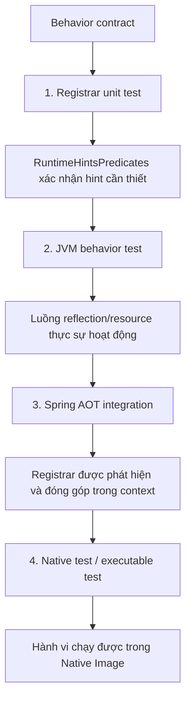
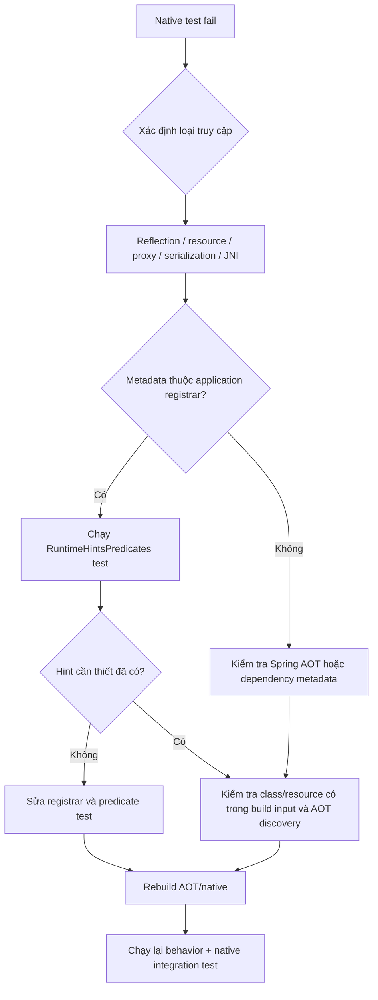

# Giữ kiểm thử gắn với hành vi cần hỗ trợ thay vì lặp lại mọi dòng cấu hình

Runtime Hints giúp GraalVM Native Image giữ lại những khả năng mà phân tích tĩnh không thể suy ra đầy đủ, chẳng hạn reflection, đọc resource, tạo proxy hoặc serialization. Khi ứng dụng Spring Boot dùng Spring AOT, hints có thể đến từ framework, dependency hoặc registrar do chính ứng dụng khai báo.

Một rủi ro khi kiểm thử hints là biến test thành bản sao của file cấu hình: mỗi dòng JSON có một assertion tương ứng, mỗi member được đăng ký đều được kiểm tra, hoặc test phụ thuộc vào tên file generated nội bộ. Những test như vậy dễ pass dù tính năng thực tế vẫn lỗi, đồng thời dễ fail khi Spring/GraalVM thay đổi cách biểu diễn metadata.

Cách kiểm thử bền vững hơn là bắt đầu từ **hành vi mà ứng dụng cần hỗ trợ**. Nếu ứng dụng cần tạo một DTO bằng reflection, kiểm tra hint cho constructor đó và kiểm tra luồng tạo DTO thực tế. Nếu ứng dụng cần đọc template, kiểm tra resource hint và kiểm tra nội dung template được sử dụng. Sau đó chạy AOT/native integration test để xác nhận toàn bộ đường đi hoạt động trong executable.

Bài học thuộc chương **Kiểm thử hints** của mô-đun `SPRING_BOOT_NATIVE_IMAGE`. Ta sẽ xây dựng các lớp kiểm thử theo từng tầng, dùng `RuntimeHintsPredicates` cho registrar của ứng dụng, kiểm tra behavior trên JVM, kiểm tra AOT/native ở mức tích hợp và xác định những gì không nên assert.

## 1. Bắt đầu từ behavior contract

Một hint tồn tại để bảo đảm một hành vi cụ thể vẫn hoạt động trong native image. Vì vậy, câu hỏi đầu tiên không nên là "file JSON có bao nhiêu dòng?" mà là "ứng dụng cần làm được việc gì khi chạy native?".

Ví dụ một chức năng lập hóa đơn có thể cần:

- Tạo một kiểu DTO cũ bằng reflection vì thư viện tích hợp gọi constructor theo metadata.
- Đọc template `templates/invoice.html` từ classpath.
- Đọc message bundle `messages.invoice` theo locale.
- Tạo proxy cho một interface tích hợp nếu thư viện sử dụng JDK dynamic proxy.

Từ các yêu cầu đó, xác định metadata tối thiểu và test tương ứng:

| Hành vi cần hỗ trợ | Hint có thể liên quan | Kiểm thử phù hợp |
| --- | --- | --- |
| Tạo DTO bằng constructor reflection | Reflection constructor hint | Registrar predicate test và test luồng deserialize/tạo DTO |
| Gọi public method qua reflection | Reflection method hint | Predicate test và behavior test gọi đúng method |
| Đọc template classpath | Resource hint | Predicate test và test render/đọc template |
| Đọc resource bundle | Resource bundle hint | Predicate test và test locale thực tế |
| Tạo JDK proxy | Proxy hint | Test proxy invocation và native integration test |
| Native code truy cập Java qua JNI | JNI hint | Test đường JNI trên target native phù hợp |

Không phải mọi tính năng đều cần application hint. Spring AOT hoặc dependency có thể đã cung cấp metadata. Khi đó, ứng dụng vẫn cần kiểm thử hành vi tích hợp, nhưng không nhất thiết phải tạo thêm một registrar chỉ để lặp lại metadata của thư viện.

## 2. Các tầng kiểm thử và câu hỏi mỗi tầng trả lời

Một chiến lược tốt có nhiều tầng. Mỗi tầng kiểm tra một phần khác nhau của contract.



| Tầng | Phạm vi | Không chứng minh được |
| --- | --- | --- |
| Registrar unit test | Lớp registrar thêm đúng loại hint cần thiết | GraalVM đã nhận hint hoặc binary chạy được |
| JVM behavior test | Code nghiệp vụ và đường reflection/resource hoạt động trên JVM | Native Image có đủ metadata |
| Spring AOT integration test | Registrar được Spring phát hiện, AOT xử lý context và sinh output | Tất cả nhánh runtime trong native đều hoạt động |
| Native test | Test được biên dịch/chạy theo native test workflow | Mọi cấu hình container/production đều đúng |
| Native executable smoke/integration test | Binary ứng dụng thực tế chạy các luồng quan trọng | Những scenario chưa chạy hoặc target khác chưa được kiểm tra |

Không cần biến mọi thay đổi thành một bộ test lớn. Hãy chọn tầng tương ứng với rủi ro: registrar mới cần predicate test; thay đổi cách đọc resource cần behavior test; nâng GraalVM hoặc thay metadata cần native integration test phù hợp.

## 3. Kiểm thử registrar bằng RuntimeHintsPredicates

Spring Framework cung cấp `RuntimeHintsPredicates` để kiểm tra một `RuntimeHints` object có chứa khả năng cần thiết hay không. Predicate test phù hợp với registrar do ứng dụng sở hữu vì nó xác nhận **contract metadata** mà registrar phải cung cấp.

Ví dụ ứng dụng cần reflection cho constructor và public methods của `LegacyInvoicePayload`, đồng thời cần resource template:

```java
package com.example.invoice;

public class LegacyInvoicePayload {

    private String invoiceNumber;

    public LegacyInvoicePayload() {
    }

    public String getInvoiceNumber() {
        return invoiceNumber;
    }

    public void setInvoiceNumber(String invoiceNumber) {
        this.invoiceNumber = invoiceNumber;
    }
}
```

Registrar khai báo đúng khả năng được sử dụng:

```java
package com.example.invoice;

import org.springframework.aot.hint.MemberCategory;
import org.springframework.aot.hint.RuntimeHints;
import org.springframework.aot.hint.RuntimeHintsRegistrar;

class InvoiceRuntimeHints implements RuntimeHintsRegistrar {

    @Override
    public void registerHints(RuntimeHints hints, ClassLoader classLoader) {
        hints.reflection().registerType(
                LegacyInvoicePayload.class,
                MemberCategory.INVOKE_DECLARED_CONSTRUCTORS,
                MemberCategory.INVOKE_PUBLIC_METHODS);

        hints.resources().registerPattern("templates/invoice.html");
    }
}
```

Test kiểm tra các hành vi metadata cần thiết:

```java
package com.example.invoice;

import org.junit.jupiter.api.Test;
import org.springframework.aot.hint.MemberCategory;
import org.springframework.aot.hint.RuntimeHints;
import org.springframework.aot.hint.predicate.RuntimeHintsPredicates;

import static org.assertj.core.api.Assertions.assertThat;

class InvoiceRuntimeHintsTests {

    @Test
    void registersHintsRequiredByInvoiceFlow() {
        RuntimeHints hints = new RuntimeHints();
        new InvoiceRuntimeHints().registerHints(
                hints, getClass().getClassLoader());

        assertThat(RuntimeHintsPredicates.reflection()
                .onType(LegacyInvoicePayload.class)
                .withMemberCategory(
                        MemberCategory.INVOKE_DECLARED_CONSTRUCTORS))
                .accepts(hints);

        assertThat(RuntimeHintsPredicates.reflection()
                .onType(LegacyInvoicePayload.class)
                .withMemberCategory(MemberCategory.INVOKE_PUBLIC_METHODS))
                .accepts(hints);

        assertThat(RuntimeHintsPredicates.resource()
                .forResource("templates/invoice.html"))
                .accepts(hints);
    }
}
```

Test này không cần khởi động Spring context hoặc chạy GraalVM. Nó kiểm tra registrar trực tiếp, nhanh và giúp phát hiện khi ai đó xóa nhầm một hint cần thiết.

### 3.1. Test đúng quyền truy cập, không assert toàn bộ object

Không nên viết test chỉ kiểm tra tổng số type/member hints hoặc so sánh toàn bộ object `RuntimeHints` với một snapshot. Ví dụ:

```java
// Dễ giòn: phụ thuộc số lượng và cách framework biểu diễn metadata.
assertThat(hints.reflection().typeHints()).hasSize(1);
```

Một thay đổi hợp lệ có thể thêm hint khác, hợp nhất metadata hoặc thay đổi cách biểu diễn mà behavior contract không đổi. Test nên hỏi liệu constructor cần thiết có thể được truy cập theo metadata hay không, thay vì yêu cầu tổng số entries phải đúng một con số.

Tương tự, tránh so sánh nguyên văn JSON generated. Hãy dùng predicate/API phù hợp để kiểm tra khả năng cần thiết, và dành native integration test để kiểm tra kết quả cuối.

## 4. Gắn registrar với component thật

Một registrar được test trực tiếp vẫn có thể bị quên đăng ký vào Spring AOT. Nếu ứng dụng dùng `@ImportRuntimeHints`, gắn registrar với configuration sở hữu tính năng:

```java
package com.example.invoice;

import org.springframework.context.annotation.Configuration;
import org.springframework.context.annotation.ImportRuntimeHints;

@Configuration(proxyBeanMethods = false)
@ImportRuntimeHints(InvoiceRuntimeHints.class)
class InvoiceNativeConfiguration {
}
```

Khi cấu hình này được import vào ApplicationContext, Spring AOT có thể phát hiện registrar trong quá trình phân tích. Nếu dùng `META-INF/spring/aot.factories` để đăng ký registrar toàn cục, cần có integration test xác nhận discovery qua đúng cơ chế đó.

Một test gọi trực tiếp `new InvoiceRuntimeHints().registerHints(...)` không kiểm tra annotation discovery hoặc factories registration. Đó là lý do test registrar và test tích hợp Spring AOT có mục đích riêng.

## 5. Kiểm thử hành vi reflection trên JVM

Predicate test xác nhận metadata được khai báo. Một behavior test khác xác nhận code thực sự sử dụng đường truy cập mà hint hỗ trợ.

Ví dụ một adapter dùng constructor và setter qua reflection:

```java
package com.example.invoice;

import java.lang.reflect.Constructor;
import java.lang.reflect.Method;

import org.springframework.stereotype.Component;

@Component
class LegacyInvoiceFactory {

    LegacyInvoicePayload create(String invoiceNumber) {
        try {
            Constructor<LegacyInvoicePayload> constructor =
                    LegacyInvoicePayload.class.getDeclaredConstructor();
            LegacyInvoicePayload payload = constructor.newInstance();

            Method setter = LegacyInvoicePayload.class.getMethod(
                    "setInvoiceNumber", String.class);
            setter.invoke(payload, invoiceNumber);

            return payload;
        }
        catch (ReflectiveOperationException ex) {
            throw new IllegalStateException(
                    "Cannot create invoice payload", ex);
        }
    }
}
```

Test theo kết quả nghiệp vụ:

```java
package com.example.invoice;

import org.junit.jupiter.api.Test;

import static org.assertj.core.api.Assertions.assertThat;

class LegacyInvoiceFactoryTests {

    @Test
    void createsPayloadThroughLegacyReflectionPath() {
        LegacyInvoiceFactory factory = new LegacyInvoiceFactory();

        LegacyInvoicePayload payload = factory.create("INV-2026-01");

        assertThat(payload.getInvoiceNumber()).isEqualTo("INV-2026-01");
    }
}
```

JVM thường cho phép reflection mà không cần native metadata, nên test này không thay thế predicate test. Nhưng nó giúp chứng minh code path mà metadata đang hỗ trợ vẫn là một hành vi thực tế của ứng dụng, không phải hint được thêm vào mà không còn ai sử dụng.

Nếu có thể thay reflection bằng constructor call trực tiếp hoặc typed API, cân nhắc thiết kế đơn giản hơn. Hint chỉ cần thiết khi hành vi động là một phần contract cần giữ.

## 6. Kiểm thử resource theo nội dung được sử dụng

Giả sử ứng dụng đọc template classpath:

```text
src/main/resources/
└── templates/
    └── invoice.html
```

Một reader đơn giản:

```java
package com.example.invoice;

import java.io.IOException;
import java.nio.charset.StandardCharsets;

import org.springframework.core.io.ClassPathResource;
import org.springframework.stereotype.Component;

@Component
class InvoiceTemplateReader {

    String read() {
        ClassPathResource resource =
                new ClassPathResource("templates/invoice.html");

        try (var input = resource.getInputStream()) {
            return new String(
                    input.readAllBytes(), StandardCharsets.UTF_8);
        }
        catch (IOException ex) {
            throw new IllegalStateException(
                    "Cannot read invoice template", ex);
        }
    }
}
```

Test nên kiểm tra nội dung có ý nghĩa:

```java
package com.example.invoice;

import org.junit.jupiter.api.Test;

import static org.assertj.core.api.Assertions.assertThat;

class InvoiceTemplateReaderTests {

    @Test
    void readsInvoiceTemplate() {
        String template = new InvoiceTemplateReader().read();

        assertThat(template).contains("Invoice");
        assertThat(template).contains("{{invoiceNumber}}");
    }
}
```

Test JVM xác nhận file có trong classpath và code đọc được. Predicate test xác nhận registrar khai báo resource hint. Native test hoặc native executable test xác nhận file thực sự có trong image và đọc được khi chạy native.

Nếu chỉ assert `resource.exists()`, test có thể chưa xác nhận nội dung hoặc encoding đúng. Hãy assert phần nội dung thuộc contract của template, không khóa toàn bộ file nếu nội dung có thể thay đổi hợp lệ.

## 7. Kiểm thử ResourceBundle theo locale

Nếu ứng dụng hỗ trợ nhiều locale, test nên chạy các locale thực sự được hỗ trợ. Ví dụ:

```text
src/main/resources/
└── messages/
    ├── invoice.properties
    ├── invoice_en.properties
    └── invoice_vi.properties
```

Registrar:

```java
import org.springframework.aot.hint.RuntimeHints;
import org.springframework.aot.hint.RuntimeHintsRegistrar;

class InvoiceBundleHints implements RuntimeHintsRegistrar {

    @Override
    public void registerHints(RuntimeHints hints, ClassLoader classLoader) {
        hints.resourceBundles().registerBundle("messages.invoice");
    }
}
```

Predicate test:

```java
@Test
void registersInvoiceBundle() {
    RuntimeHints hints = new RuntimeHints();
    new InvoiceBundleHints().registerHints(hints, getClass().getClassLoader());

    assertThat(RuntimeHintsPredicates.resourceBundle()
            .forBundle("messages.invoice"))
            .accepts(hints);
}
```

Behavior test:

```java
import java.util.Locale;
import java.util.ResourceBundle;

@Test
void resolvesVietnameseInvoiceMessage() {
    ResourceBundle bundle = ResourceBundle.getBundle(
            "messages.invoice", Locale.forLanguageTag("vi"));

    assertThat(bundle.getString("invoice.title"))
            .isEqualTo("Hóa đơn");
}
```

Các ví dụ cần import `java.util.Locale` và `java.util.ResourceBundle` trong test. Nếu ứng dụng hỗ trợ `vi` và `en`, hãy test cả hai; đừng thêm một assertion riêng cho từng file generated nếu điều cần bảo đảm là người dùng nhận đúng message theo locale.

## 8. Kiểm thử proxy hoặc serialization theo contract

Một số registrar khai báo JDK proxy hoặc serialization hints. Nguyên tắc vẫn giống nhau: test khả năng mà ứng dụng cần dùng, không kiểm tra mọi trường metadata.

Ví dụ proxy, giả sử ứng dụng cần tạo JDK proxy cho interface `InvoiceLookup`:

```java
public interface InvoiceLookup {
    String findStatus(String invoiceNumber);
}
```

Registrar có thể đăng ký proxy:

```java
hints.proxies().registerJdkProxy(InvoiceLookup.class);
```

Test nên gọi method qua proxy và xác nhận kết quả. Predicate API cho proxy có thể khác giữa các phiên bản Spring Framework; dùng API predicate của phiên bản đang cài nếu muốn assert trực tiếp metadata. Dù có predicate, vẫn cần test behavior proxy trên native image khi đây là đường tích hợp quan trọng.

Với serialization, trước tiên xác định cơ chế cụ thể đang dùng. Java serialization, Jackson JSON binding và serialization của một thư viện riêng là các cơ chế khác nhau. Không dùng một hint serialization chung để thay thế test JSON của Jackson. Hãy kiểm thử dữ liệu qua đúng serializer/deserializer thực tế và native executable.

## 9. Kiểm thử Spring AOT discovery và generated output

Registrar unit test không xác nhận Spring đã tìm thấy registrar. Cần một bước tích hợp kiểm tra configuration chứa `@ImportRuntimeHints` hoặc factories registration được đưa vào AOT context.

Với Maven, dự án đã cấu hình Spring Boot Maven Plugin có thể chạy:

```bash
./mvnw clean spring-boot:process-aot
```

Với Gradle:

```bash
./gradlew clean processAot
```

Sau khi AOT chạy, kiểm tra output generated theo đường dẫn plugin đang sử dụng. Ví dụ thường gặp:

```text
target/spring-aot/main/
├── sources/
├── resources/
└── classes/

build/generated/
├── aotSources/
├── aotResources/
└── aotClasses/
```

Không nên viết test gắn chặt vào tên generated class hoặc thứ tự file trong thư mục này. Những chi tiết đó có thể thay đổi theo Spring Boot, Spring Framework hoặc plugin version. Mục tiêu là xác nhận AOT build thành công và registrar được tích hợp vào context.

Nếu cần xác minh metadata output trong một test build-level, hãy kiểm tra **khả năng cụ thể** trong metadata đã sinh, dùng parser/API phù hợp với format và version. Tránh snapshot toàn bộ thư mục generated vì nó thường chứa nhiều metadata do framework và dependency đóng góp.

## 10. Native test và native executable test

JVM test thành công chưa chứng minh native image có đủ metadata. Sau khi registrar và AOT integration test pass, cần chạy native workflow phù hợp.

Với Maven, nếu project đã cấu hình profile native test theo Spring Boot/Native Build Tools:

```bash
./mvnw -PnativeTest test
```

Với Gradle, task native test phụ thuộc plugin và cấu hình dự án; trong cấu hình Spring Boot Native Build Tools phổ biến:

```bash
./gradlew nativeTest
```

Native test biên dịch và chạy test trong môi trường Native Image. Nó giúp phát hiện lỗi reflection/resource/proxy/serialization trong các test đã được chọn.

Ngoài native test, nên có smoke/integration test chạy **native application executable** nếu production triển khai executable đó. Hai đường kiểm thử có thể khác nhau về main application packaging, runtime arguments, file mount, user permissions và network. Ví dụ native executable test cần xác nhận:

- Ứng dụng khởi động và tạo context.
- Endpoint dùng DTO cần reflection trả response đúng.
- Template classpath đọc được.
- Locale quan trọng trả message đúng.
- Tích hợp proxy/JNI/serializer hoạt động nếu ứng dụng sử dụng.

Không đánh dấu native test pass nếu lệnh đã bỏ qua native tests bằng cờ skip. Kiểm tra log để xác nhận native test executable thực sự được build và chạy.

## 11. Tracing agent là nguồn gợi ý, không phải oracle của test

GraalVM tracing agent có thể quan sát các truy cập động trong những scenario được chạy và tạo metadata gợi ý. Kết quả agent hữu ích để tìm những reflection/resource/proxy chưa được khai báo, nhưng nó không thể biết nhánh code chưa thực thi.

Một quy trình phù hợp:

1. Chạy các scenario nghiệp vụ với tracing agent.
2. Review metadata được quan sát.
3. Đối chiếu từng entry với behavior contract và metadata do Spring/dependency đã cung cấp.
4. Bổ sung test cho behavior thực sự cần hỗ trợ.
5. Khai báo hints tối thiểu nếu thiếu.
6. Chạy lại native tests.

Không nên biến toàn bộ agent output thành test snapshot. Agent có thể ghi nhận các thao tác do framework, test framework hoặc dependency thực hiện; số lượng entry thay đổi theo version và scenario. Test cần tập trung vào behavior ứng dụng sở hữu.

## 12. Tránh test trùng trách nhiệm của dependency

Nếu một thư viện đã cung cấp Runtime Hints hoặc Reachability Metadata cho chính nó, ứng dụng không cần sao chép toàn bộ metadata vào registrar riêng rồi viết test cho từng member của thư viện.

| Tình huống | Test thuộc phạm vi nào? | Việc ứng dụng nên kiểm tra |
| --- | --- | --- |
| Application registrar khai báo constructor DTO riêng | Application | Predicate test cho đúng constructor/method cần dùng |
| Jackson cung cấp metadata cho cơ chế nội bộ | Jackson/Spring integration | HTTP JSON behavior trên native |
| JDBC driver cung cấp metadata cho driver | Driver | Kết nối và query thực tế trên native |
| Spring AOT tự sinh metadata cho bean graph | Spring integration | Context startup và endpoint behavior |
| Dependency thiếu metadata, ứng dụng tạm bổ sung workaround | Application tạm thời | Test workaround theo version và ghi rõ điều kiện gỡ bỏ |

Nếu workaround được thêm vào ứng dụng vì dependency thiếu metadata, hãy giới hạn phạm vi và ghi nhận dependency version. Khi nâng dependency có metadata upstream, xem xét loại bỏ workaround và test riêng để tránh metadata cũ che lỗi hoặc giữ quyền truy cập không còn cần thiết.

## 13. Những assertion nên tránh

| Assertion dễ giòn | Vì sao không phù hợp | Thay thế |
| --- | --- | --- |
| So sánh toàn bộ JSON generated với snapshot | Format, thứ tự và metadata framework có thể đổi | Predicate test cho khả năng cần thiết |
| Assert tổng số reflection entries | Một hint mới hợp lệ làm test fail | Assert constructor/method/resource cụ thể |
| Assert tên generated class nội bộ | Tên là chi tiết triển khai | Kiểm tra AOT build và native behavior |
| Test mọi dòng dependency metadata trong app | Trùng trách nhiệm của dependency | Test tính năng ứng dụng sử dụng |
| Chỉ chạy JVM test rồi kết luận native tương thích | JVM không cần cùng metadata | Chạy native test/executable |
| Chỉ chạy tracing agent và tin toàn bộ output | Agent chỉ quan sát scenario đã chạy | Review theo behavior contract và test coverage |
| Assert file resource tồn tại nhưng không đọc nội dung | Không kiểm tra encoding hoặc nội dung cần thiết | Đọc resource và assert phần contract |

## 14. Ví dụ ma trận test theo behavior

Một ứng dụng invoice có thể duy trì ma trận nhỏ:

| Behavior | Registrar test | JVM behavior | Native test/executable |
| --- | --- | --- | --- |
| Tạo LegacyInvoicePayload bằng reflection | Có | Có | Có |
| Đọc invoice template | Có | Có | Có |
| Đọc message tiếng Việt | Có | Có | Có |
| Gọi proxy InvoiceLookup | Nếu app registrar cung cấp hint | Có | Có |
| Jackson bind request DTO | Chỉ khi app tự khai báo hint | HTTP integration | HTTP integration |
| Kết nối JDBC driver | Không test metadata nội bộ driver trong app | Repository integration | Native DB integration |

Ma trận giúp tránh hai cực đoan: chỉ kiểm tra metadata mà không chạy behavior, hoặc chạy behavior trên JVM mà không kiểm tra native metadata. Không phải mỗi dòng đều cần một test class riêng; có thể gom nhiều behavior liên quan trong cùng integration test.

## 15. Quy trình điều tra khi native test thất bại

Khi một test chỉ fail trên native, đi theo trình tự:

1. Xác định thao tác thất bại: reflection, resource, proxy, serialization, JNI hay context initialization.
2. Xác định class/member/resource target thực tế trong stack trace.
3. Kiểm tra ứng dụng có sở hữu hành vi đó hay Spring/dependency đã cung cấp metadata.
4. Nếu là application registrar, chạy predicate test để xác nhận hint được khai báo.
5. Kiểm tra registrar có được Spring AOT phát hiện và context có được cấu hình đúng profile/property không.
6. Xác minh class/resource thực sự có trong build input; hint không thể thêm dependency hoặc file không tồn tại.
7. Chạy native test tối thiểu tái hiện lỗi.
8. Sau khi sửa, chạy lại behavior test và native test liên quan.



Không thêm hàng loạt hints để làm test pass nếu chưa xác định target. Hint quá rộng có thể che lỗi thiết kế, giữ metadata không cần thiết và làm khó bảo trì.

## 16. Checklist cho bộ kiểm thử hints

- [ ] Mỗi application hint gắn với một behavior contract có thật.
- [ ] Registrar có unit test bằng `RuntimeHintsPredicates`.
- [ ] Predicate test chỉ kiểm tra constructor/member/resource/bundle cần thiết.
- [ ] Có behavior test cho đường reflection/resource thực tế.
- [ ] Registrar được gắn vào Spring qua `@ImportRuntimeHints` hoặc cơ chế discovery đã chọn.
- [ ] AOT integration build chạy được với cấu hình/profile dự kiến.
- [ ] Không snapshot toàn bộ generated JSON/source hoặc phụ thuộc tên generated class.
- [ ] Metadata do dependency sở hữu không bị sao chép và test trùng trong application.
- [ ] Tracing agent output được review theo scenario, không được coi là oracle.
- [ ] Native test thực sự chạy native executable test.
- [ ] Native application executable được smoke/integration test nếu production dùng executable đó.
- [ ] Sau khi nâng Spring/GraalVM/dependency, chạy lại các behavior test quan trọng.
- [ ] Workaround metadata có phạm vi, version và điều kiện gỡ bỏ rõ ràng.

### Câu hỏi tự đánh giá

1. Vì sao `RuntimeHintsPredicates` test không thể thay thế native integration test?
2. Nếu registrar khai báo constructor reflection cho DTO, assertion nào gắn với behavior tốt hơn: kiểm tra constructor predicate hay kiểm tra tổng số type hints?
3. Vì sao resource test nên đọc và kiểm tra nội dung thay vì chỉ assert file tồn tại?
4. Một test gọi trực tiếp registrar có kiểm tra được `@ImportRuntimeHints` discovery không?
5. Vì sao không nên snapshot toàn bộ generated `reflect-config.json`?
6. Nếu Jackson đã cung cấp metadata cho DTO binding, ứng dụng nên test điều gì?
7. Tracing agent không quan sát được nhánh code nào, và điều đó ảnh hưởng ra sao đến test coverage?
8. Khi nào cần kiểm tra native test executable và khi nào cần thêm smoke test cho native application executable?

## Tài liệu tham khảo

- [Spring Framework — Runtime Hints](https://docs.spring.io/spring-framework/reference/core/aot.html): RuntimeHints API, registrar và kiểm thử hints.
- [Spring Framework — RuntimeHintsPredicates API](https://docs.spring.io/spring-framework/docs/current/javadoc-api/org/springframework/aot/hint/predicate/RuntimeHintsPredicates.html): predicate để kiểm tra reflection, resource và các loại hints được hỗ trợ.
- [Spring Boot — Testing Native Applications](https://docs.spring.io/spring-boot/reference/packaging/native-image/testing-native-applications.html): cách chạy test với native image.
- [GraalVM Native Image — Tracing Agent](https://www.graalvm.org/latest/reference-manual/native-image/metadata/AutomaticMetadataCollection/): thu thập metadata từ các scenario đã chạy.

**Kết quả cần đạt:** xây dựng được bộ kiểm thử chứng minh những hành vi cần metadata vẫn hoạt động trên native image. Test registrar kiểm tra contract hints của ứng dụng; behavior test xác nhận đường code thật; AOT/native integration test xác nhận toàn bộ quá trình. Nhờ đó, bộ test bảo vệ điều người dùng cần mà không bị khóa vào từng dòng cấu hình hoặc chi tiết generated output.
