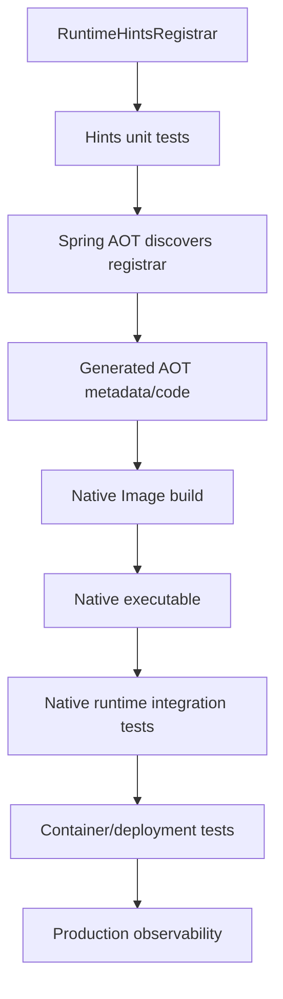

# Phân biệt kiểm thử hints đạt với bằng chứng ứng dụng native chạy đúng

## 1. Vì sao hai kết quả này không giống nhau?

Trong Spring Boot Native Image, RuntimeHints mô tả các khả năng runtime mà GraalVM Native Image cần giữ lại, chẳng hạn reflection, resource, resource bundle, proxy, serialization hoặc JNI. Một unit test có thể xác nhận registrar đã đăng ký đúng metadata, nhưng điều đó chỉ chứng minh nội dung của đối tượng `RuntimeHints` trong test.

Để ứng dụng chạy đúng, còn nhiều bước phải thành công: Spring AOT phải phát hiện registrar; Native Image phải nhận metadata; executable phải được tạo với đúng classpath và dependency; runtime phải đi qua đúng đường nghiệp vụ; file, locale, native library và cấu hình phải có mặt trong môi trường triển khai.

Vì vậy, cần phân biệt hai kết luận:

- **Hints test đạt:** các khai báo metadata mà test kiểm tra đã được đăng ký đúng.
- **Ứng dụng native chạy đúng:** executable native thực sự khởi động và xử lý các scenario được kiểm thử trong điều kiện runtime đã xác định.

Kết quả thứ nhất là một bằng chứng cần thiết trong nhiều dự án, nhưng không thay thế kết quả thứ hai. Bài học này xây dựng mô hình kiểm thử nhiều lớp cho module **SPRING_BOOT_NATIVE_IMAGE**, giúp đọc kết quả chính xác và tránh tuyên bố native compatibility chỉ từ một unit test.

## 2. Chuỗi bằng chứng từ registrar đến production behavior

Một đường đi kiểm chứng đầy đủ gồm nhiều lớp:



Mỗi lớp trả lời một câu hỏi riêng:

| Lớp | Câu hỏi được trả lời |
|---|---|
| Registrar unit test | Registrar có khai báo entry mong muốn không? |
| Spring AOT collection | Registrar có được phát hiện trong ApplicationContext build không? |
| Native Image build | Compiler có tạo executable từ cấu hình và metadata đó không? |
| Native runtime test | Code path thực tế có hoạt động trong native process không? |
| Container test | Binary, filesystem, libraries, user và config có đúng trong image triển khai không? |
| Production monitoring | Hành vi có ổn định với workload và dữ liệu thực tế không? |

Không bỏ qua một lớp rồi suy ra lớp tiếp theo đã đạt. Ví dụ, unit test pass không chứng minh registrar được import; build pass không chứng minh endpoint có thể deserialize mọi subtype JSON.

## 3. Hints unit test chứng minh điều gì?

Spring cung cấp `RuntimeHintsPredicates` để kiểm tra các khai báo trong `RuntimeHints`. Ví dụ reflection:

```java
@Test
void registersInvoiceConstructor() throws Exception {
    RuntimeHints hints = new RuntimeHints();

    new InvoiceHints().registerHints(
            hints, getClass().getClassLoader());

    assertThat(RuntimeHintsPredicates.reflection()
            .onConstructor(
                    Invoice.class.getDeclaredConstructor())
            .test(hints))
            .isTrue();
}
```

Test chứng minh registrar đã thêm metadata phù hợp với predicate cho constructor đó. Nó không chứng minh:

- Spring AOT đã tìm thấy registrar.
- Native Image compiler đã nhận metadata từ đúng nguồn.
- Class được đưa vào image theo mọi đường truy cập.
- Code runtime thật sự gọi đúng constructor.
- Dependency khác không có thêm reflection target bị thiếu.
- Executable hoạt động trong container production.

Nếu test tạo `RuntimeHints` mới rồi gọi registrar trực tiếp, nó còn không kiểm tra cơ chế `@ImportRuntimeHints` hoặc cách đăng ký registrar của thư viện.

## 4. Phân biệt kiểm thử trực tiếp registrar và kiểm thử AOT discovery

Có hai câu hỏi riêng:

**Kiểm thử trực tiếp registrar:** gọi `registerHints()` trong unit test và xác nhận entry. Cách này nhanh, cô lập, dễ chỉ ra sai path hoặc member.

**Kiểm thử AOT discovery:** khởi chạy quy trình Spring AOT trên ApplicationContext thực tế, trong đó registrar phải được phát hiện qua `@ImportRuntimeHints` hoặc cơ chế đăng ký tương ứng. Cần xác nhận cấu hình chứa registrar thuộc đúng context được xử lý.

Ví dụ cấu hình:

```java
@Configuration(proxyBeanMethods = false)
@ImportRuntimeHints(InvoiceHints.class)
class InvoiceNativeConfiguration {
}
```

Nếu `InvoiceNativeConfiguration` không được component scan/import vào ApplicationContext AOT, unit test registrar vẫn pass nhưng Spring AOT không thu thập hint.

Để kiểm chứng discovery, chạy đúng Maven/Gradle AOT task của dự án và xem log/generated output theo cơ chế của phiên bản Spring Boot. Không dựa vào việc source có annotation để kết luận registrar đã được gọi.

## 5. Native Image build pass chứng minh điều gì?

Build native thành công chứng minh compiler đã hoàn thành việc phân tích và tạo executable với inputs, arguments và metadata của lần build đó. Đây là mốc quan trọng, nhưng không chứng minh mọi code path chạy đúng.

Một số vấn đề chỉ xuất hiện lúc runtime:

- Reflection target được chọn theo dữ liệu chưa có trong build test.
- Resource pattern thiếu một file hiếm dùng.
- Locale bundle chỉ thiếu ở ngôn ngữ ít được kiểm thử.
- Proxy được tạo với interface combination hoặc thứ tự khác.
- Native library không có trong runtime container.
- Environment hoặc file external khác máy build.
- Serialization gặp subtype chưa được bao phủ.
- Class initialization đọc giá trị bị đóng băng hoặc phụ thuộc runtime.

Build pass là bằng chứng về khả năng tạo artifact; nó không phải bằng chứng đầy đủ về behavior.

## 6. Native runtime test phải chạy executable native thật

Để chứng minh một code path hoạt động trên Native Image, cần thực thi code path đó trong process native. Có thể dùng native test mode được plugin hỗ trợ hoặc khởi chạy executable và gửi request qua HTTP.

Ví dụ chạy binary:

```bash
./orders-service
```

Sau đó gửi request:

```bash
curl -i \
  -H "Content-Type: application/json" \
  --data-binary @src/test/resources/orders/valid-order.json \
  http://localhost:8080/api/orders
```

Test phải kiểm tra response status, schema, field quan trọng và side effect mong đợi. Một lệnh `./orders-service` khởi động rồi thoát thành công chỉ là smoke test startup; nó không chứng minh endpoint, serializer hoặc resource path hoạt động.

Với service chạy liên tục, test harness cần readiness check, gửi scenario, thu response và dừng process graceful. Không dùng một khoảng sleep cố định làm bằng chứng server đã sẵn sàng.

## 7. Bằng chứng phù hợp theo từng loại hints

Mỗi loại metadata cần một runtime scenario tương ứng:

| Loại hints | Unit/predicate test | Bằng chứng native runtime |
|---|---|---|
| Reflection | Predicate xác nhận type/member đã đăng ký | Thực thi đúng đường reflection, tạo object/gọi method/đọc field |
| Resource | Predicate xác nhận path/pattern | Đọc và parse đúng file classpath |
| Resource bundle | Predicate xác nhận base name | Nạp message ở các locale cần hỗ trợ |
| JDK proxy | Predicate xác nhận interface combination | Tạo proxy thật, kiểm tra interface order và gọi method |
| Serialization | Predicate/metadata test theo API hỗ trợ | Serialize/deserialize payload thật, gồm subtype cần dùng |
| JNI | Kiểm tra type/access hints | Load native library, gọi JNI và kiểm tra callback |
| Dynamic proxy/AOP | Kiểm tra proxy metadata | Khởi tạo context và gọi bean qua proxy/advice |

Không dùng một endpoint đơn giản để đại diện cho mọi loại hints nếu endpoint đó không đi qua các cơ chế tương ứng.

## 8. Ví dụ: reflection hint pass nhưng native vẫn lỗi

Registrar:

```java
final class InvoiceHints implements RuntimeHintsRegistrar {
    @Override
    public void registerHints(
            RuntimeHints hints, ClassLoader classLoader) {
        hints.reflection().registerType(
                Invoice.class,
                MemberCategory.INVOKE_PUBLIC_CONSTRUCTORS);
    }
}
```

Unit test xác nhận constructor có thể pass. Nhưng thư viện thực tế có thể gọi thêm:

```java
Method method = Invoice.class.getDeclaredMethod(
        "setCode", String.class);
method.invoke(invoice, "INV-100");
```

Nếu method không được đăng ký và không được framework/dependency metadata khác bao phủ, native runtime có thể lỗi khi gọi setter. Unit test chỉ kiểm tra constructor nên không phát hiện thiếu method.

Cách xử lý:

1. Đọc stack trace native và xác định member thực tế.
2. Xác minh thư viện có metadata chính thức chưa.
3. Đăng ký method cụ thể hoặc category phù hợp nếu cần.
4. Bổ sung predicate test cho method.
5. Chạy lại Spring AOT và native build.
6. Gọi đúng đường nghiệp vụ trong native integration test.

Không mở toàn bộ declared methods chỉ để làm mất lỗi nếu chỉ một method được dùng.

## 9. Ví dụ: resource hint pass nhưng resource runtime vẫn thiếu

Registrar:

```java
hints.resources().registerPattern(
        "schemas/order-*.json");
```

Predicate test có thể xác nhận pattern đã đăng ký. Tuy nhiên, native runtime vẫn có thể không đọc được file nếu:

- File chỉ nằm trong `src/test/resources`, không thuộc artifact production.
- Path thực tế khác chữ hoa/thường.
- Pattern không khớp resource path đã đóng gói.
- Registrar không được AOT thu thập.
- File là external filesystem file nhưng code lại truy cập bằng classloader.
- Resource được cung cấp bởi dependency chưa được đưa vào build inputs.

Runtime test phải mở resource từ chính service production và parse nội dung. Kiểm tra `InputStream != null` là bước đầu; nên xác minh schema/content có thể sử dụng và xử lý đúng khi thiếu file.

## 10. Ví dụ: proxy hint pass nhưng proxy thực tế khác metadata

Một test có thể xác nhận:

```java
hints.proxies().registerJdkProxy(
        OrderOperations.class,
        Auditable.class);
```

Nhưng Spring AOP hoặc proxy factory thực tế có thể tạo proxy với interface bổ sung, hoặc thứ tự khác:

```java
new Class<?>[] {
    Auditable.class,
    OrderOperations.class
}
```

Một hint cho danh sách có thứ tự `[OrderOperations, Auditable]` không nên được coi là tự động bao phủ danh sách đảo thứ tự. Hơn nữa, interface cuối cùng có thể thay đổi do advisor/introduction.

Native integration test cần lấy proxy thật từ ApplicationContext hoặc dùng đúng factory production, kiểm tra:

```java
assertThat(proxy.getClass().getInterfaces())
        .containsExactly(
                OrderOperations.class,
                Auditable.class);
```

Sau đó gọi method trên từng interface và xác minh advice/behavior. Chỉ test predicate không xác nhận proxy được tạo hoặc Spring AOP hoạt động đúng.

## 11. Cùng dữ liệu và cấu hình giữa JVM và native

Khi so sánh JVM với native, cần chạy cùng fixture và cùng contract. Nếu dữ liệu khác nhau, kết quả không thể chỉ ra khác biệt do runtime.

Giữ nhất quán:

- JSON request/response fixtures.
- Classpath resources và bundle files.
- Locale và timezone.
- Spring profiles và structural properties đã dùng khi AOT.
- Runtime properties, external config và mounted files.
- Database fixtures hoặc test doubles.
- Dependency versions và source revision.
- HTTP headers, content type và expected outcomes.

Tạo một bộ test contract dùng chung cho cả hai process. Không copy/paste payload thành hai phiên bản riêng, vì chúng dễ lệch khi API thay đổi.

Nếu property dùng `@ConditionalOnProperty` làm thay đổi bean graph, cần build native theo structural value tương ứng. Đổi environment sau khi executable đã tạo không tự thêm bean bị loại trong AOT.

## 12. Thiết kế native integration test theo scenario

Chia test theo cơ chế và nghiệp vụ:

| Scenario | Đường đi cần thực thi |
|---|---|
| Tạo đơn hàng | JSON deserialize, validation, serialize response |
| Xuất hóa đơn | Template/resource, font hoặc thư viện PDF |
| Đổi locale | Resource bundle và message interpolation |
| Gọi service có AOP | JDK proxy/CGLIB proxy, transaction/advice |
| Gọi SDK đối tác | Reflection, serialization hoặc JNI |
| Đọc schema theo version | Resource pattern và runtime selection |
| Webhook nhiều subtype | Polymorphic JSON và subtype reachability |
| Scheduled job | Bean lifecycle, proxy và resource runtime |

Không cần mọi dự án có tất cả scenario. Chọn theo dependency và đường đi thật của ứng dụng. Với mỗi scenario, lưu input, expected output và điều kiện môi trường để tái lập.

## 13. Readiness, process lifecycle và thu thập kết quả

Native executable có thể startup nhanh nhưng test harness vẫn phải đợi server sẵn sàng. Một workflow đáng tin cậy:

1. Khởi chạy executable native và lưu stdout/stderr.
2. Poll readiness endpoint với deadline và backoff hợp lý.
3. Nếu process exit trước readiness, đánh dấu test fail và lưu log.
4. Gửi cùng HTTP fixtures như JVM test.
5. Kiểm tra status, response schema, headers và side effects.
6. Gửi graceful shutdown hoặc dừng process theo test harness.
7. Lưu exit code và logs.

Nếu dùng Spring Boot Actuator, chỉ expose readiness endpoint cần thiết trong môi trường test. Không bật management endpoint nhạy cảm trên network công khai.

Không dùng `curl` trả HTTP 200 duy nhất làm bằng chứng toàn ứng dụng đúng. Endpoint health thường không đi qua JSON binding, proxy hoặc resource mà nghiệp vụ sử dụng.

## 14. Kiểm thử trong runtime container đích

Một binary có thể chạy trên máy build nhưng lỗi trong container do:

- Thiếu shared library hoặc native library.
- Khác glibc/musl hoặc architecture.
- File resource/config không được copy hoặc mount.
- CWD khác dự kiến.
- User không có quyền đọc file hoặc bind port.
- Environment variables, locale hoặc timezone khác.
- Container memory/CPU limit thấp hơn môi trường local.

Native integration test trong container cần dùng cùng runtime base image hoặc image tương đương production. Kiểm tra user, working directory, mount và network policy. Nếu ứng dụng phụ thuộc file external, mount fixture vào đúng destination path và xác minh process đọc được.

Test container là bằng chứng về packaging/runtime environment; nó bổ sung cho test native process trên máy build.

## 15. Đánh giá coverage: đã test gì và chưa test gì?

Tracing agent, RuntimeHintsPredicates và integration tests đều có phạm vi riêng. Không có một công cụ nào tự chứng minh mọi đường đi.

Lập coverage matrix:

| Capability | Hint registered | AOT discovered | Native scenario executed | Container verified |
|---|---:|---:|---:|---:|
| Invoice constructor reflection | PASS/FAIL | PASS/FAIL | PASS/FAIL | PASS/FAIL |
| Order schema resource | PASS/FAIL | PASS/FAIL | PASS/FAIL | PASS/FAIL |
| Vietnamese message bundle | PASS/FAIL | PASS/FAIL | PASS/FAIL | PASS/FAIL |
| Order JDK proxy | PASS/FAIL | PASS/FAIL | PASS/FAIL | PASS/FAIL |
| Partner JNI callback | PASS/FAIL | PASS/FAIL | PASS/FAIL | PASS/FAIL |

Đánh dấu `NOT APPLICABLE` cho capability không dùng trong ứng dụng và ghi lý do. Không đánh dấu PASS chỉ vì một test khác bao phủ cùng class nhưng không đi qua cơ chế tương ứng.

Coverage cần gắn với scenario, fixture và commit cụ thể. Khi dependency hoặc code path thay đổi, đánh giá lại các hàng bị ảnh hưởng.

## 16. Phân loại kết quả và cách báo cáo

Dùng trạng thái tách biệt để tránh kết luận quá mức:

| Trạng thái | Ý nghĩa |
|---|---|
| Hints unit tests PASS | Registrar khai báo đúng những entry đã assert |
| AOT discovery PASS | Quy trình AOT đã phát hiện/thu thập registrar được kiểm tra |
| Native build PASS | Compiler tạo executable thành công |
| Native runtime scenario PASS | Scenario cụ thể chạy đúng trên executable native |
| Container scenario PASS | Scenario chạy đúng trong runtime image/môi trường container đã kiểm tra |
| Production validation PASS | Workload và vận hành thực tế đáp ứng tiêu chí đã theo dõi |

Báo cáo nên nói rõ phạm vi. Ví dụ: “Reflection, resource và proxy predicate tests pass; native executable build thành công; ba HTTP scenario được kiểm tra trong container staging.” Không rút gọn thành “Native Image hoàn toàn tương thích” nếu chưa có bằng chứng cho mọi integration và workload.

## 17. Khi native test fail dù hints test pass

Điều tra theo thứ tự:

1. Xác nhận test đang chạy đúng executable native mới build, không phải JAR/JVM.
2. Xác nhận Spring AOT dùng đúng profile/property.
3. Kiểm tra registrar có được phát hiện trong AOT.
4. Xác định lỗi nằm ở reflection, resource, bundle, proxy, serialization, JNI hay external environment.
5. So sánh runtime input/config với JVM test.
6. Kiểm tra stack trace gốc và compiler diagnostics.
7. Bổ sung test cho member/path/interface/locale thực tế.
8. Sửa metadata hoặc cách tích hợp tối thiểu.
9. Build lại và chạy regression scenario liên quan.

Nếu hints predicate pass nhưng AOT không thu thập registrar, sửa cơ chế đăng ký. Nếu AOT thu thập và build pass nhưng runtime thiếu file external, sửa mount/path. Nếu lỗi là native library loader, kiểm tra ABI/architecture. Không dùng thêm reflection hints để chữa mọi lỗi native.

## 18. Bài thực hành: chứng minh một tính năng chạy đúng trên native

**Bối cảnh:** Order API dùng reflection để tạo handler, đọc JSON schema từ classpath, nạp message bundle tiếng Việt và tạo proxy triển khai hai interface.

**Bước 1 — Viết registrar.** Đăng ký constructor/method reflection, schema resource pattern, bundle base name và JDK proxy interface list.

**Bước 2 — Viết hints unit tests.** Dùng `RuntimeHintsPredicates` xác nhận từng entry cụ thể; kiểm tra đúng base name và thứ tự interface.

**Bước 3 — Kiểm tra AOT discovery.** Gắn registrar qua `@ImportRuntimeHints`, chạy AOT và xác minh cấu hình thuộc ApplicationContext được xử lý.

**Bước 4 — Build native.** Ghi lại source revision, GraalVM/JDK/plugin versions, profile và build arguments.

**Bước 5 — Viết native runtime scenarios.** Gọi handler bằng đường reflection, parse schema, lấy message locale vi và tạo proxy thật rồi gọi method.

**Bước 6 — Chạy cùng fixtures trên JVM.** Lưu expected status, JSON output, message và proxy behavior.

**Bước 7 — Chạy native executable.** Dùng đúng fixtures và runtime properties; so sánh kết quả theo contract.

**Bước 8 — Chạy container.** Dùng runtime image đích, user và mount tương đương; lặp các scenario quan trọng.

**Bước 9 — Báo cáo coverage.** Đánh dấu riêng hints, AOT discovery, native runtime và container verification; ghi rõ scenario chưa được kiểm tra.

Tiêu chí hoàn thành: hints tests pass; AOT đã thu thập registrar; native executable build thành công; các scenario cụ thể chạy đúng trên native; kết quả container được xác nhận và phạm vi coverage được ghi rõ.

## 19. Kết luận

Kiểm thử hints đạt và chứng minh ứng dụng native chạy đúng là hai mức bằng chứng khác nhau. Unit test với `RuntimeHintsPredicates` xác nhận registrar khai báo metadata; AOT test xác nhận registrar được thu thập; native build xác nhận compiler tạo executable; native runtime và container tests mới xác minh các đường nghiệp vụ cụ thể hoạt động trong môi trường chạy.

Với Spring Boot Native Image, hãy xây test theo từng capability và scenario, dùng cùng fixture/config cho JVM và native, kiểm tra executable thật, rồi ghi rõ coverage đã đạt. Một báo cáo chính xác nêu được test nào pass, artifact nào được chạy và môi trường nào đã xác minh; nó không suy rộng một vài predicate hoặc smoke test thành bảo đảm tương thích toàn diện.
