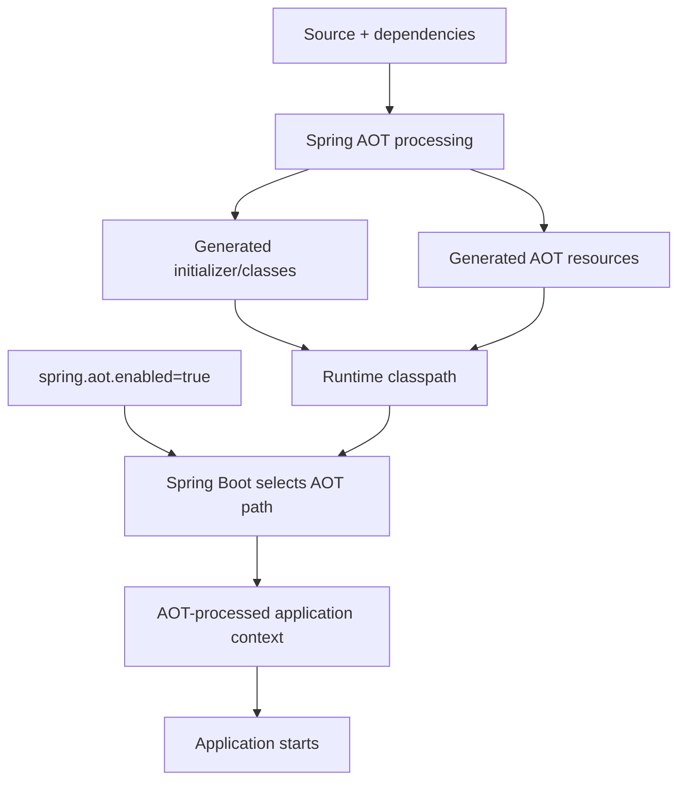

# spring.aot.enabled và điều kiện classpath phải chứa kết quả AOT

## 1. Hai điều kiện để chạy ứng dụng đã xử lý AOT

Spring AOT xử lý application context trong giai đoạn build để phân tích bean definitions, tạo mã khởi tạo và sinh các tài nguyên cần thiết cho lần chạy. Khi khởi động ứng dụng, Spring Boot có thể sử dụng kết quả đã sinh thay cho một số bước phân tích cấu hình thông thường.

Để chạy theo đường AOT, cần đồng thời thỏa mãn hai điều kiện:

1. **Bật chế độ AOT lúc runtime** bằng property `spring.aot.enabled=true`.
2. **Đưa kết quả AOT vào runtime classpath**: generated initializer/classes và tài nguyên metadata tương ứng phải được build, đóng gói và có thể tải bởi ứng dụng.

Property không tự sinh code AOT. Nếu bật property nhưng generated classes/resources không có trong classpath, ứng dụng không thể sử dụng initializer đã tạo. Ngược lại, chỉ có generated output nhưng không kích hoạt chế độ AOT thì ứng dụng có thể vẫn đi theo đường khởi tạo thông thường.

Trong module **SPRING_BOOT_NATIVE_IMAGE**, đây là điều cần nắm khi kiểm thử ứng dụng Spring Boot sau AOT trên JVM trước khi build GraalVM Native Image. Việc xác minh riêng hai điều kiện giúp phân biệt lỗi cấu hình runtime với lỗi build/packaging output.



## 2. spring.aot.enabled có vai trò gì?

Property `spring.aot.enabled` cho Spring Boot biết ứng dụng đang chạy với kết quả AOT đã được chuẩn bị. Khi property được bật, Spring Boot sử dụng cơ chế AOT application context initializer được đăng ký trong generated metadata, thay vì thực hiện toàn bộ quá trình cấu hình bean theo cách thông thường.

Ví dụ chạy ứng dụng JVM đã được xử lý AOT:

```bash
java -Dspring.aot.enabled=true -jar application.jar
```

Hoặc dùng command-line property của Spring Boot:

```bash
java -jar application.jar --spring.aot.enabled=true
```

Cả hai cách đều đặt property trong tiến trình ứng dụng. Có thể dùng environment variable theo quy tắc relaxed binding:

```bash
SPRING_AOT_ENABLED=true java -jar application.jar
```

Với executable native, cấu hình property cũng có thể được truyền lúc khởi chạy nếu ứng dụng cần chế độ AOT tương ứng. Tuy nhiên, native executable được tạo từ quá trình AOT/Native Image có pipeline và generated artifacts riêng; hãy làm theo cấu hình Spring Boot/GraalVM của đúng phiên bản.

Property này là một công tắc chọn đường khởi tạo ở runtime. Nó không thay thế tác vụ `processAot`, không tải generated source từ thư mục build một cách tự động và không bổ sung class bị thiếu vào artifact.

## 3. Kết quả AOT gồm những gì?

AOT output không chỉ là một file cấu hình. Tùy phiên bản Spring Boot/Spring Framework và build plugin, kết quả có thể gồm:

- **Generated Java source**: mã khởi tạo application context, bean registrations và các thành phần được sinh từ cấu hình.
- **Compiled generated classes**: bytecode được biên dịch từ source AOT.
- **Generated resources/metadata**: thông tin đăng ký initializer và các tài nguyên phục vụ khởi tạo.
- **Runtime hints**: reflection, resource, proxy, serialization và các yêu cầu runtime khác do Spring AOT thu thập.

Tên thư mục và cách đóng gói khác nhau theo Gradle/Maven plugin version. Ví dụ Gradle thường dùng các thư mục dưới `build/generated/aotSources` và `build/generated/aotResources`; source được biên dịch thành output classes riêng hoặc được tích hợp vào task graph của plugin. Không nên tự hard-code đường dẫn generated nội bộ nếu plugin đã cung cấp task và classpath chính thức.

Điều quan trọng là **runtime classpath cuối cùng phải chứa compiled AOT classes và generated resources**. Có source file trong thư mục generated nhưng chưa compile/packaging thì JVM không thể load class đó.

## 4. Quy trình AOT với Gradle

Với Spring Boot Gradle Plugin, tác vụ AOT thường được gọi là `processAot`. Tác vụ này khởi tạo context trong build process và sinh source/resource cần thiết.

Các bước minh họa:

```bash
./gradlew clean
./gradlew processAot
```

Sau đó kiểm tra task graph và output của plugin:

```bash
./gradlew tasks --all
./gradlew :app:processAot
```

Tên project `:app` chỉ là ví dụ; dùng đúng application module trong multi-project build. Plugin có thể tạo thêm task compile/package để đưa generated output vào artifact. Chạy task packaging được cấu hình cho AOT thay vì chỉ copy thư mục generated bằng tay.

Trong một số cấu hình, task `bootJar` hoặc task native compilation phụ thuộc vào AOT tasks và tự đưa output vào artifact. Hành vi cụ thể phụ thuộc Spring Boot Gradle Plugin version và cách project cấu hình. Xác nhận bằng task dependencies, log và nội dung archive thực tế.

## 5. Quy trình AOT với Maven

Với Spring Boot Maven Plugin, mục tiêu AOT được thực hiện qua goal `process-aot`. Ví dụ:

```bash
./mvnw spring-boot:process-aot
```

Goal này cần chạy với đúng module, profile và property mục tiêu. Trong multi-module Maven project, thực hiện tại application module hoặc chọn đúng project bằng các tùy chọn Maven tương ứng.

Sau đó chạy lifecycle package/native theo cấu hình plugin của dự án. Đừng giả định chỉ chạy goal AOT là đã tạo một JAR hoàn chỉnh có generated classes. Kiểm tra các bước compile/package và nội dung artifact cuối.

Gradle và Maven có cách tổ chức task/lifecycle khác nhau; không trộn đường dẫn generated output của Gradle vào hướng dẫn Maven hoặc ngược lại.

## 6. Classpath phải chứa generated classes và resources

Classpath là tập vị trí mà classloader sử dụng để tìm class và resource. Với ứng dụng AOT, classpath phải bao gồm:

1. Application classes thông thường.
2. Compiled classes sinh từ Spring AOT.
3. Generated resources/metadata AOT.
4. Runtime dependencies cần thiết của ứng dụng.

Nếu generated class tồn tại trong build output nhưng không có trong runtime classpath, Spring không thể nạp initializer. Nếu initializer class có nhưng metadata đăng ký initializer không được đóng gói, Spring Boot có thể không tìm thấy điểm khởi tạo AOT. Nếu resources thiếu, quá trình khởi tạo hoặc code path sau đó có thể thất bại.

Ví dụ mô hình classpath:

```text
runtime classpath
  ├── application classes
  ├── generated AOT classes
  ├── generated AOT resources
  ├── Spring Boot / Spring Framework
  └── application runtime dependencies
```

Không nên tự thêm toàn bộ thư mục source generated vào classpath. JVM cần bytecode đã compile và resource được đặt đúng vị trí tương ứng.

## 7. Vì sao chỉ bật property không đủ?

Xét lệnh:

```bash
java -Dspring.aot.enabled=true -jar application.jar
```

Nếu `application.jar` được đóng gói từ build thường, không có AOT initializer/classes/resources, property vẫn bật đường AOT nhưng output cần thiết có thể không tồn tại. Kết quả thường là lỗi không tìm thấy initializer hoặc lỗi khởi tạo context tùy version/cấu hình.

Tương tự, chạy:

```bash
java -jar application.jar
```

với một artifact có generated AOT output nhưng không bật property có thể không sử dụng đường khởi tạo AOT như mong muốn.

Vì vậy, khi kiểm tra lỗi, không chỉ nhìn command line. Cần xác nhận cả:

- Property hiệu lực trong process.
- Artifact nào đang được chạy.
- Artifact có chứa generated output không.
- Runtime classpath có thể tải initializer/resources không.

## 8. Kiểm tra artifact bằng công cụ JAR

Với executable JAR, dùng:

```bash
jar tf build/libs/application.jar
```

Với Maven, artifact thường nằm trong `target/`; với Gradle thường nằm trong `build/libs/`. Tên và đường dẫn tùy cấu hình.

Tìm các generated classes/resources do Spring Boot plugin đóng gói. Tên initializer và metadata phụ thuộc phiên bản, vì vậy đừng yêu cầu một tên class cố định từ ví dụ trên Internet. Hãy đối chiếu output của chính build hiện tại.

Nếu artifact là executable Boot JAR, class application và dependency có thể nằm trong cấu trúc archive riêng (ví dụ thư mục `BOOT-INF`). Dùng `jar tf` để kiểm tra nội dung; khi cần kiểm tra classpath thực tế lúc chạy, xem cách Spring Boot loader thiết lập classloader.

## 9. Xác minh classpath lúc runtime

Có thể kiểm tra runtime classpath bằng cách log classloader hoặc chạy diagnostic test trong đúng cấu hình. Ví dụ:

```java
ClassLoader loader =
    Thread.currentThread().getContextClassLoader();

Enumeration<URL> resources =
    loader.getResources("META-INF/spring/aot.factories");

while (resources.hasMoreElements()) {
    System.out.println(resources.nextElement());
}
```

Đây là minh họa tìm resource metadata; tên resource/metadata thực tế phải phù hợp phiên bản Spring đang dùng. Không coi việc tìm thấy một file metadata bất kỳ là bằng chứng toàn bộ generated output đã có mặt. Cần xác nhận class initializer được tải và context thực sự chạy theo AOT.

Có thể kiểm tra class cụ thể nếu biết tên từ generated output:

```java
Class.forName(
    "com.example.Application__ApplicationContextInitializer",
    false,
    loader
);
```

Tên class ở đây chỉ minh họa. Dùng tên thực tế được tạo bởi build của project; không hard-code ví dụ vào code production.

## 10. Kiểm thử AOT-processed application trên JVM

Trước khi Native Image compilation, kiểm thử output AOT trên JVM giúp tách lỗi Spring AOT khỏi lỗi riêng của GraalVM Native Image.

Một kịch bản kiểm thử:

1. Build output AOT.
2. Đóng gói hoặc chạy application với classpath có generated classes/resources.
3. Đặt `spring.aot.enabled=true`.
4. Khởi động application context.
5. Xác minh bean, profile, conditional configuration và behavior nghiệp vụ.
6. Gọi các endpoint/job quan trọng.
7. So sánh kết quả với baseline JVM thông thường.

Không phải mọi Spring Boot version đều cung cấp cùng một task chạy AOT application trực tiếp. Kiểm tra task/goal của plugin đang dùng và cách project đóng gói generated output. Tránh tự tạo classpath bằng cách nối các thư mục nội bộ nếu plugin đã quản lý việc này.

Ví dụ integration assertion:

```java
@SpringBootTest(properties = "spring.aot.enabled=true")
class AotContextTest {

    @Autowired
    ApplicationContext context;

    @Test
    void loadsExpectedService() {
        assertThat(context.getBean(PaymentService.class))
            .isNotNull();
    }
}
```

Đoạn test chỉ hữu ích khi test runtime classpath thực sự chứa AOT output. Thêm property vào một test chạy trên classpath thường không tự biến test đó thành AOT test. Phải cấu hình task/test runtime classpath để dùng generated output đúng cách.

## 11. Profile và property phải nhất quán

Spring AOT xử lý application context trong một môi trường build-time. Các điều kiện như `@Profile`, `@ConditionalOnProperty`, classpath condition và bean registration có thể ảnh hưởng tới generated bean graph.

Ví dụ nếu AOT được tạo với profile `prod`, cần kiểm tra profile/property mà build process thực sự nhận. Chỉ đặt profile khi chạy ứng dụng không bảo đảm một bean bị loại khỏi AOT context sẽ xuất hiện trở lại.

Đối với AOT testing:

- Dùng đúng profile đã chọn cho artifact.
- Dùng đúng dependency graph/runtime classpath.
- Ghi nhận property ảnh hưởng bean graph.
- Kiểm tra bean quan trọng có trong generated context.
- Nếu cần bean graph khác nhau, build/test artifact AOT riêng.

Property `spring.aot.enabled` chỉ kích hoạt sử dụng kết quả AOT; nó không thay đổi quyết định bean đã được thực hiện trong lúc AOT.

## 12. AOT classpath khác native runtime metadata

Không nhầm generated AOT classes/resources với mọi loại metadata Native Image:

| Thành phần | Vai trò |
|---|---|
| Generated AOT classes | Mã khởi tạo context được sinh |
| Generated AOT resources | Metadata/resource để Spring tìm initializer và cấu hình |
| RuntimeHints | Mô tả reflection, resource, proxy, serialization... |
| GraalVM reachability metadata | Đầu vào cho Native Image analysis |
| Native executable | Binary được tạo từ AOT output và dependency |

AOT output phải có mặt để Spring sử dụng context đã xử lý. Runtime hints được GraalVM dùng để giữ các thành phần cần thiết khi biên dịch native. Có generated initializer không có nghĩa reflection/resource hints đã đầy đủ; hai phần cần được kiểm tra riêng.

## 13. Quan hệ với Native Image build

Khi build Native Image, Spring Boot plugin/Native Build Tools phối hợp AOT processing và GraalVM compilation theo task graph/lifecycle. Không nên tự chạy AOT một lần với profile/classpath khác rồi tái sử dụng output cho native build khác.

Quy trình tổng quát:

```text
Source + runtime dependencies
        |
        v
Spring AOT processing
        |
        +--> generated sources/classes
        +--> generated resources
        +--> RuntimeHints
        |
        v
Native Image analysis and compilation
        |
        v
Native executable
```

Native executable không chạy trên classpath JVM thông thường giống JAR. Tuy nhiên, generated AOT output vẫn là đầu vào quan trọng để Native Image phân tích và tạo binary. Sau build, cần kiểm thử chính executable chứ không suy luận từ việc các thư mục generated tồn tại.

## 14. Lỗi thường gặp

| Triệu chứng | Nguyên nhân có thể | Cách kiểm tra |
|---|---|---|
| Bật property nhưng không tìm thấy AOT initializer | Artifact thiếu generated classes/resources | Kiểm tra task AOT, package và JAR contents |
| AOT output tồn tại nhưng ứng dụng chạy như context thường | Property không có hiệu lực hoặc artifact không dùng output | Kiểm tra environment/arguments và startup path |
| Generated class không load được | Chưa compile hoặc không nằm trên runtime classpath | Kiểm tra compiled output và packaging |
| Metadata initializer không được tìm thấy | Generated resources không được đóng gói đúng | Kiểm tra archive và resource path |
| JVM thường chạy, AOT JVM lỗi | AOT context khác cấu hình hoặc bean graph | Kiểm tra profile/property/condition |
| AOT JVM pass, native fail | Reachability/reflection/resource/proxy/JNI metadata thiếu | Phân loại lỗi Native Image |
| Chỉ một profile chạy được | Artifact được AOT với bean graph của profile đó | Build/test artifact riêng hoặc thiết kế bean graph ổn định |
| Test có property nhưng không dùng AOT output | Test runtime classpath vẫn là output thường | Kiểm tra task graph và test classpath |

## 15. Checklist xác minh spring.aot.enabled và classpath

- Đã chạy AOT task/goal của đúng application module.
- Generated source đã được compile thành class.
- Generated resources/metadata đã được tạo.
- Artifact/runtime classpath chứa generated classes và resources.
- Property `spring.aot.enabled=true` có hiệu lực trong đúng process.
- Initializer được phát hiện và application context khởi tạo theo AOT.
- Profile/property/dependency graph khớp với mục tiêu build.
- AOT-processed application được kiểm thử trên JVM khi toolchain hỗ trợ.
- Native Image được build từ output AOT đúng.
- Native executable và container được test bằng feature scenarios thực tế.

## 16. Câu hỏi tự kiểm tra

1. `spring.aot.enabled=true` điều khiển điều gì khi Spring Boot khởi động?
2. Vì sao bật property không tự tạo generated initializer?
3. Runtime classpath cần chứa những thành phần AOT nào?
4. Khác biệt giữa generated source và compiled generated class là gì?
5. Vì sao chỉ tìm thấy một file metadata không đủ chứng minh AOT output hoàn chỉnh?
6. Profile/property build-time ảnh hưởng thế nào tới generated bean graph?
7. RuntimeHints khác generated AOT initializer ở vai trò nào?
8. Cần những bước nào để xác minh artifact thực sự sử dụng AOT output?

**Ghi nhớ:** `spring.aot.enabled` bật đường sử dụng AOT ở runtime; generated initializer, classes và resources phải được build và có trong runtime classpath. Hãy xác minh property, artifact và classpath cùng lúc, kiểm thử AOT context trên JVM khi phù hợp, rồi build và chạy Native Image từ đúng output AOT.
