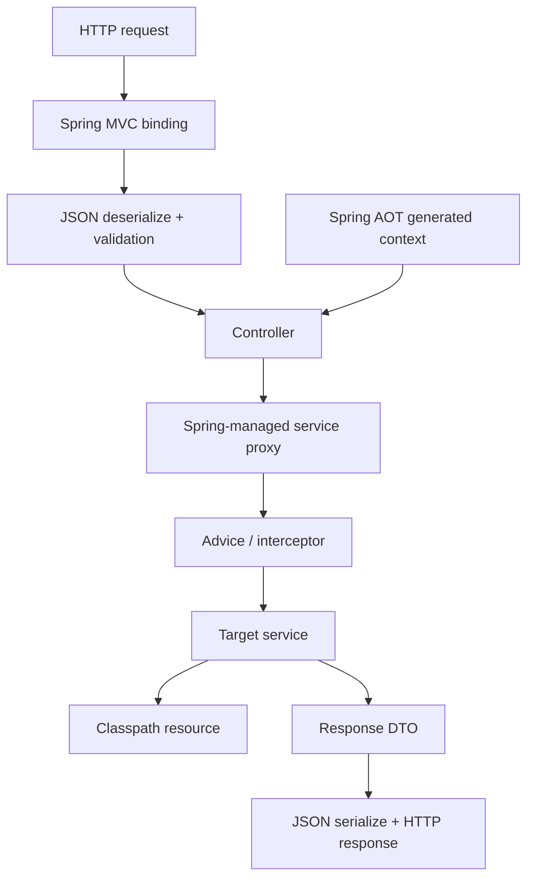

# Kiểm thử HTTP, JSON, tài nguyên và các proxy trong chế độ AOT

## 1. Mục tiêu của kiểm thử tích hợp AOT

Một ứng dụng Spring Boot sau khi xử lý AOT cần giữ đúng hành vi từ HTTP endpoint tới service và các thành phần phụ trợ. Kiểm thử cần gửi request, bind JSON vào DTO, chạy validation, đọc resource classpath, gọi bean qua proxy và kiểm tra response.

Với **Spring AOT**, application context được phân tích trong build time và mã khởi tạo cùng metadata được sinh ra. Khi chạy ứng dụng đã xử lý AOT trên JVM, Spring Boot cần được bật chế độ AOT và runtime classpath phải chứa generated classes/resources tương ứng. Khi build GraalVM Native Image, output AOT là đầu vào để compiler tạo executable.

Bài này tập trung vào bốn phần thường gặp:

- **HTTP**: routing, request binding, status code và exception handling.
- **JSON**: serialize/deserialize DTO, subtype, enum, date/time và validation.
- **Resource**: đọc template/schema/message bundle từ classpath.
- **Proxy**: gọi service qua Spring AOP proxy, transaction hoặc interceptor.

Cần phân biệt test MockMvc/WebTestClient trong JVM với test gửi HTTP tới process native. Test JVM giúp kiểm tra application behavior và AOT context theo cấu hình phù hợp; test native xác minh binary, runtime metadata, resource và môi trường triển khai.



## 2. Chuẩn bị một vertical slice có thể kiểm thử

Tạo endpoint nhỏ gồm request DTO, controller, service và resource:

```java
public record CreateInvoiceRequest(
    @NotBlank String customerId,
    @NotNull @Positive BigDecimal amount,
    @NotNull Currency currency
) {}

public record InvoiceResponse(
    String invoiceId,
    String customerId,
    BigDecimal amount,
    Currency currency,
    String templateVersion
) {}
```

Controller:

```java
@RestController
@RequestMapping("/api/invoices")
class InvoiceController {

    private final InvoiceService invoiceService;

    InvoiceController(InvoiceService invoiceService) {
        this.invoiceService = invoiceService;
    }

    @PostMapping
    ResponseEntity<InvoiceResponse> create(
            @Valid @RequestBody CreateInvoiceRequest request) {
        InvoiceResponse response = invoiceService.create(request);
        return ResponseEntity.status(HttpStatus.CREATED).body(response);
    }
}
```

Service là Spring bean và có thể được proxy:

```java
@Service
class InvoiceService {

    private final TemplateCatalog templates;

    InvoiceService(TemplateCatalog templates) {
        this.templates = templates;
    }

    @Transactional
    public InvoiceResponse create(CreateInvoiceRequest request) {
        String version = templates.defaultTemplateVersion();
        return new InvoiceResponse(
            UUID.randomUUID().toString(),
            request.customerId(),
            request.amount(),
            request.currency(),
            version
        );
    }
}
```

Ví dụ dùng `@Transactional` để minh họa proxy; trong ứng dụng thật cần transaction manager và persistence phù hợp. Nếu không có transaction infrastructure, bỏ annotation hoặc cấu hình test database.

## 3. Kiểm thử HTTP bằng MockMvc trên JVM

MockMvc chạy request qua Spring MVC infrastructure trong test process mà không cần mở socket HTTP thật. Đây là cách nhanh để xác minh routing, JSON binding, validation và exception mapping.

```java
@SpringBootTest
@AutoConfigureMockMvc
class InvoiceHttpTest {

    @Autowired
    MockMvc mockMvc;

    @Test
    void createsInvoice() throws Exception {
        mockMvc.perform(post("/api/invoices")
                .contentType(MediaType.APPLICATION_JSON)
                .content("""
                    {
                      "customerId": "C-100",
                      "amount": 125.50,
                      "currency": "USD"
                    }
                    """))
            .andExpect(status().isCreated())
            .andExpect(content().contentTypeCompatibleWith(
                MediaType.APPLICATION_JSON))
            .andExpect(jsonPath("$.customerId").value("C-100"))
            .andExpect(jsonPath("$.currency").value("USD"))
            .andExpect(jsonPath("$.invoiceId").isNotEmpty());
    }
}
```

Test này kiểm tra request đi qua Spring MVC và response được serialize thành JSON. Cần có static imports, Jackson, Spring Test và validation dependencies theo project.

MockMvc không kiểm tra network stack, port binding, container ingress hay HTTP server runtime trong native executable. Vì vậy, nó không thay thế native HTTP integration test.

## 4. Kiểm tra request binding và lỗi JSON

Tạo các trường hợp request riêng:

| Trường hợp | Ví dụ | Kết quả cần xác minh |
|---|---|---|
| JSON hợp lệ | Đủ field và đúng kiểu | HTTP 201 |
| Thiếu field bắt buộc | Không có `customerId` | HTTP 400 hoặc lỗi nghiệp vụ đã quy định |
| Sai kiểu dữ liệu | `amount` là object/string không hợp lệ | HTTP 400 |
| Enum không tồn tại | `currency: "XYZ_UNKNOWN"` | HTTP 400 hoặc mapping lỗi đã định nghĩa |
| JSON malformed | Thiếu dấu ngoặc/quote | HTTP 400 |
| Field null | `amount: null` | Validation violation |
| Field boundary | Amount bằng 0 hoặc số âm | Validation violation |

Không chỉ assert status code nếu API có error contract. Kiểm tra error code, field path và message theo schema response của ứng dụng. Nếu dùng `@ControllerAdvice`, test phải kích hoạt đúng exception handler.

Jackson có thể sử dụng constructor/record metadata, annotation, custom serializer/deserializer hoặc polymorphic type handling. Nếu một subtype chỉ được chọn qua discriminator lúc runtime, test từng subtype mà ứng dụng công bố hỗ trợ.

## 5. Kiểm thử JSON serialization và deserialization

Test trực tiếp `ObjectMapper` giúp tách lỗi JSON mapping khỏi HTTP routing:

```java
@SpringBootTest
class InvoiceJsonTest {

    @Autowired
    ObjectMapper objectMapper;

    @Test
    void roundTripsResponse() throws Exception {
        InvoiceResponse source = new InvoiceResponse(
            "INV-1",
            "C-100",
            new BigDecimal("125.50"),
            Currency.USD,
            "v1"
        );

        String json = objectMapper.writeValueAsString(source);
        InvoiceResponse restored =
            objectMapper.readValue(json, InvoiceResponse.class);

        assertThat(restored).isEqualTo(source);
    }
}
```

Ví dụ giả định record và kiểu dữ liệu có equality phù hợp. Với class thông thường, so sánh field hoặc dùng AssertJ recursive comparison theo quy ước dự án.

Bổ sung test cho:

- Date/time và timezone.
- BigDecimal scale/precision.
- Enum và custom naming strategy.
- Optional/null/missing fields.
- Nested DTO và collection.
- Custom serializer/deserializer.
- Polymorphic subtype được hỗ trợ.
- Unknown fields theo chính sách ObjectMapper.

Nếu ứng dụng dùng nhiều `ObjectMapper` hoặc module Jackson tùy biến, test mapper được Spring cấu hình cho HTTP. Một mapper tự tạo trong test có thể không phản ánh cấu hình runtime.

## 6. Kiểm thử validation qua HTTP

Khi controller nhận `@Valid @RequestBody`, Spring MVC bind JSON rồi kích hoạt Bean Validation:

```java
@Test
void rejectsInvalidInvoice() throws Exception {
    mockMvc.perform(post("/api/invoices")
            .contentType(MediaType.APPLICATION_JSON)
            .content("""
                {
                  "customerId": " ",
                  "amount": 0,
                  "currency": "USD"
                }
                """))
        .andExpect(status().isBadRequest());
}
```

Test cần xác nhận validation xảy ra trước khi service xử lý. Có thể inject mock/spy ở ranh giới phù hợp hoặc dùng recorder để xác minh service không được gọi khi request invalid.

Nếu dùng custom constraint, nested DTO hoặc container element constraints, tạo payload tương ứng để kích hoạt từng validator. Test một DTO hợp lệ không chứng minh mọi custom validator và nested branch hoạt động.

## 7. Kiểm tra resource classpath được endpoint sử dụng

Ví dụ cấu trúc resource:

```text
src/main/resources/
  templates/
    invoice.html
  config/
    invoice-schema.json
```

Resource loader:

```java
@Component
class TemplateCatalog {

    private final ResourceLoader resourceLoader;

    TemplateCatalog(ResourceLoader resourceLoader) {
        this.resourceLoader = resourceLoader;
    }

    String defaultTemplateVersion() {
        Resource resource = resourceLoader.getResource(
            "classpath:templates/invoice.html");

        try (InputStream input = resource.getInputStream()) {
            return readVersion(input);
        } catch (IOException ex) {
            throw new IllegalStateException(
                "Cannot read invoice template", ex);
        }
    }

    private String readVersion(InputStream input) throws IOException {
        String content = new String(
            input.readAllBytes(), StandardCharsets.UTF_8);
        return extractVersion(content);
    }
}
```

Đây là ví dụ minh họa; `extractVersion` là logic ứng dụng cần triển khai. Classpath resource được đọc qua stream. Không dùng `Resource.getFile()` để giả định resource bên trong JAR hoặc Native Image là file có thể truy cập bằng filesystem.

Test riêng resource:

```java
@SpringBootTest
class InvoiceTemplateTest {

    @Autowired
    TemplateCatalog templates;

    @Test
    void loadsDefaultTemplate() {
        assertThat(templates.defaultTemplateVersion()).isEqualTo("v1");
    }
}
```

Nếu resource được chọn theo tên runtime, test mọi tên hợp lệ trong allowlist và đăng ký resource hints theo pattern hẹp khi cần. Test endpoint chỉ đọc một template không chứng minh các template khác đã được đóng gói.

## 8. Kiểm thử Spring proxy qua bean thật

Để xác minh proxy, phải lấy bean từ Spring ApplicationContext. Không dùng `new InvoiceService(...)` rồi gọi trực tiếp, vì cách đó bỏ qua proxy do Spring tạo.

```java
@SpringBootTest
class InvoiceProxyTest {

    @Autowired
    InvoiceService invoiceService;

    @Test
    void serviceIsProxiedWhenAdviceApplies() {
        assertThat(AopUtils.isAopProxy(invoiceService)).isTrue();
    }
}
```

Assertion này chỉ xác nhận bean là AOP proxy. Để chứng minh advice thực thi, thêm side effect quan sát được, ví dụ test recorder/interceptor hoặc xác minh transaction behavior qua database transaction thật.

Kiểm tra proxy strategy khi hợp đồng yêu cầu:

```java
assertThat(AopUtils.isJdkDynamicProxy(invoiceService)
        || AopUtils.isCglibProxy(invoiceService))
    .isTrue();
```

Không hard-code loại proxy nếu ứng dụng không yêu cầu strategy cụ thể. Nếu dùng class-based proxy, class/method cần intercept phải đáp ứng giới hạn subclass/override. Nếu dùng JDK proxy, caller cần làm việc qua interface phù hợp.

## 9. Kiểm tra proxy có thực sự intercept request path

Một request HTTP có thể đi qua controller rồi gọi service proxy. Test nên chứng minh advice chạy trên đúng đường này, không chỉ gọi service trong một test khác.

Có thể dùng test-only aspect hoặc recorder:

```java
@Aspect
@TestComponent
class AdviceRecorder {
    private final AtomicInteger calls = new AtomicInteger();

    @Around("execution(* com.example.invoice.InvoiceService.create(..))")
    Object record(ProceedingJoinPoint joinPoint) throws Throwable {
        calls.incrementAndGet();
        return joinPoint.proceed();
    }

    int calls() {
        return calls.get();
    }
}
```

Ví dụ cần bảo đảm test aspect được đăng ký trong test context và pointcut khớp bean thực tế. Sau khi gửi request, assert recorder được gọi đúng số lần.

Với transaction, kiểm tra commit/rollback bằng dữ liệu database sau request. Với security, gửi request theo principal/role và xác nhận access policy. Với retry, dùng mock server để tạo lỗi rồi xác minh số lần gọi. Hãy kiểm tra tác dụng của advice, không chỉ sự tồn tại của proxy object.

## 10. Phân biệt AOT test với test JVM thông thường

Một test có property `spring.aot.enabled=true` nhưng chạy trên runtime classpath thông thường không tự trở thành AOT test. Để xác minh AOT mode, cần:

1. Chạy Spring AOT processing cho đúng application module.
2. Compile generated AOT source thành class.
3. Đóng gói generated resources/metadata theo cơ chế plugin.
4. Đảm bảo test/application runtime classpath sử dụng output AOT.
5. Bật `spring.aot.enabled=true` trong process đó.
6. Xác minh AOT initializer thực sự được nạp và context khởi tạo.

Tên task và cách chạy AOT-processed application phụ thuộc Spring Boot Gradle/Maven Plugin version. Gradle thường có `processAot`; Maven có goal `spring-boot:process-aot`. Kiểm tra task graph/lifecycle và tài liệu version đang dùng. Không giả định chỉ thêm property vào `@SpringBootTest` là đủ.

Một số phiên bản/plugin có hỗ trợ test AOT riêng hoặc task xử lý AOT cho test context; tên và khả năng phụ thuộc version. Nếu project không cung cấp cách chạy test context AOT trực tiếp, ghi rõ phạm vi test và xác minh native executable ở bước tiếp theo.

## 11. Chạy HTTP test trên executable native

Native HTTP test cần khởi chạy executable như một process riêng rồi gửi request qua socket thật. Điều này kiểm tra thêm embedded server, port, startup, serialization runtime và cấu hình process.

Ví dụ chạy binary Gradle:

```bash
./build/native/nativeCompile/api-app
```

Tên và đường dẫn chỉ là ví dụ; kiểm tra output của task build. Trên Windows, executable có thể có đuôi `.exe`; Maven thường đặt output dưới `target/`.

Gửi request:

```bash
curl -i \
  -H "Content-Type: application/json" \
  -d '{"customerId":"C-100","amount":125.50,"currency":"USD"}' \
  http://localhost:8080/api/invoices
```

Kiểm tra status, content type, response JSON và side effect trong database/test service. Cần có cách chờ process sẵn sàng (readiness probe hoặc poll health endpoint) thay vì sleep cố định. Dọn process và port sau test.

Test này xác nhận HTTP server trong native process thực sự nhận request. MockMvc trên JVM không kiểm tra được phần socket/server native này.

## 12. Tổ chức test theo từng lớp

| Lớp test | Công cụ gợi ý | Mục tiêu |
|---|---|---|
| DTO/JSON | ObjectMapper test | Serialization/deserialization |
| Validation | Validator hoặc MockMvc | Constraint metadata và error mapping |
| MVC | MockMvc | Routing, binding, status, controller advice |
| Resource | ResourceLoader/ClassLoader test | Classpath path và nội dung |
| Proxy | Spring context + AopUtils + recorder | Proxy strategy và advice |
| AOT JVM | Runtime classpath có AOT output | Generated initializer và context |
| Native HTTP | Process executable + HTTP client | Server, JSON, resource, proxy trên binary |
| Container | Test container/deployment smoke | OS, permission, config, volume, network |

Các lớp test nhỏ giúp định vị lỗi: JSON test fail thì kiểm tra mapper; resource test fail thì kiểm tra packaging/hints; proxy test fail thì kiểm tra AOP; native HTTP fail nhưng MockMvc pass thì điều tra server/runtime/container.

## 13. Ma trận dữ liệu và hành vi cần bao phủ

| Scenario | HTTP/JSON | Resource | Proxy/AOP | Kết quả |
|---|---|---|---|---|
| Request hợp lệ | Deserialize DTO | Đọc template | Advice chạy | 201 + JSON |
| Thiếu customerId | Validation | Không cần đọc | Service không được gọi | 400 |
| Amount âm | Validation | Không cần đọc | Service không được gọi | 400 |
| Currency không hỗ trợ | Enum/mapping error | Không cần đọc | Service không được gọi | 400 |
| Template thiếu | Request hợp lệ | Resource error | Advice theo thiết kế | Error response |
| Database lỗi | Request hợp lệ | Có thể đọc template | Transaction rollback | 5xx/định nghĩa |
| Nhiều request | Serialize mỗi response | Resource lookup | Advice mỗi lần | Không rò trạng thái |

Điền kết quả riêng cho JVM thường, AOT-processed JVM nếu toolchain hỗ trợ, native executable và container. Không đánh dấu pass nếu scenario không được chạy ở môi trường tương ứng.

## 14. Kiểm tra profile và cấu hình AOT

AOT bean graph được tạo từ điều kiện/profile có hiệu lực trong quá trình build. Nếu controller/service/resource integration chỉ tồn tại dưới profile cụ thể, test cần dùng cấu hình tương ứng với artifact mục tiêu.

Ghi nhận:

- Profile active lúc `processAot`.
- Property điều khiển auto-configuration/bean condition.
- Runtime dependency graph.
- Các controller, service và proxy được tạo.
- Resource patterns được dùng.
- Property runtime như port, datasource endpoint và secret được cấp khi chạy.

Không kỳ vọng đổi profile lúc runtime sẽ tự tạo bean đã bị loại khỏi AOT output. Nếu cần các bean graph khác nhau, cân nhắc build/test artifact AOT riêng cho từng cấu hình.

## 15. Chẩn đoán lỗi theo lớp

| Triệu chứng | Nhóm nguyên nhân | Cách kiểm tra |
|---|---|---|
| HTTP 404 | Mapping/controller không có trong context | Component scan, profile, AOT bean graph |
| HTTP 400 ngoài dự kiến | JSON binding/validation/enum | Request payload, ObjectMapper, exception handler |
| JSON thiếu field hoặc sai format | Serializer/deserializer config | Mapper thực tế và DTO metadata |
| Resource trả null/IOException | Resource không có trong image hoặc sai path | JAR contents, ResourceHints |
| Advice không chạy | Bean không proxy, pointcut không match, self-invocation | AopUtils, recorder, proxy strategy |
| AOT initializer không được tìm thấy | Generated class/resource không có trên runtime classpath | AOT task, packaging, artifact contents |
| JVM pass, native fail ở reflection | Thiếu reachability/reflection metadata | Stack trace và RuntimeHints |
| Local native pass, container fail | OS/architecture, permission, env, volume | Image digest, run image và runtime user |

Phân loại lỗi trước khi thêm hints. Reflection hints không sửa được controller bị loại khỏi AOT bean graph; resource hints không sửa được filesystem mount sai; JDK ProxyHints không sửa được class-based bytecode generation không được hỗ trợ.

## 16. Chạy kiểm thử trong container

Sau khi native executable hoạt động local, build container bằng Dockerfile hoặc Cloud Native Buildpacks theo cấu hình dự án. Test trong image cuối:

- Process chạy bằng user dự kiến.
- Port được expose và mapping đúng.
- HTTP request/response hoạt động.
- Resource classpath có trong image.
- File ngoài/secret được mount đúng.
- Temporary directory writable nếu framework/dependency cần.
- Database/broker test endpoint truy cập được.
- Readiness và graceful shutdown hoạt động.
- Native library đúng OS/architecture/ABI nếu dependency sử dụng JNI.

Nếu container bật read-only root filesystem, cấp writable volume riêng cho các thư mục cần ghi. Template classpath chỉ đọc không nên bị code cố sửa tại chỗ.

## 17. Checklist nghiệm thu HTTP/JSON/resource/proxy trong AOT

- AOT processing chạy trên đúng application module/profile.
- Generated classes và resources có trong runtime classpath.
- `spring.aot.enabled=true` có hiệu lực khi chạy AOT-processed application.
- HTTP routing và status code được kiểm thử.
- JSON request/response, enum, date/time, subtype và malformed payload được kiểm tra.
- Bean Validation và exception mapping hoạt động.
- Resource classpath được đọc qua stream và có metadata khi cần.
- Service proxy được lấy từ Spring context và advice được xác minh bằng side effect.
- AOT-processed JVM test được chạy khi toolchain hỗ trợ.
- Native executable nhận HTTP request thật và trả response đúng.
- Container test xác minh platform, permission, configuration và external dependencies.
- Kết quả gắn với commit, toolchain version và artifact/image digest.

## 18. Câu hỏi tự kiểm tra

1. MockMvc xác minh được những phần nào và không xác minh được phần nào của native HTTP server?
2. Vì sao bật `spring.aot.enabled=true` trong test chưa đủ chứng minh test đang dùng generated AOT output?
3. Làm thế nào kiểm tra JSON subtype chỉ xuất hiện trong một nhánh runtime?
4. Vì sao classpath resource nên được đọc qua InputStream thay vì giả định là File?
5. Làm thế nào chứng minh một HTTP request đã đi qua Spring AOP advice?
6. Vì sao `AopUtils.isAopProxy` chưa đủ chứng minh advice thực sự chạy?
7. Khi native HTTP test fail nhưng MockMvc pass, cần điều tra những lớp nào?
8. Những bằng chứng nào cần ghi lại trước khi chấp nhận AOT/native artifact?

**Ghi nhớ:** kiểm thử AOT cần xác minh generated context thực sự được sử dụng, sau đó chạy request qua toàn bộ đường HTTP → JSON/validation → proxy/service → resource → response. MockMvc giúp kiểm tra Spring MVC trên JVM; chỉ native HTTP và container integration tests mới xác nhận binary cùng môi trường triển khai thực tế.
