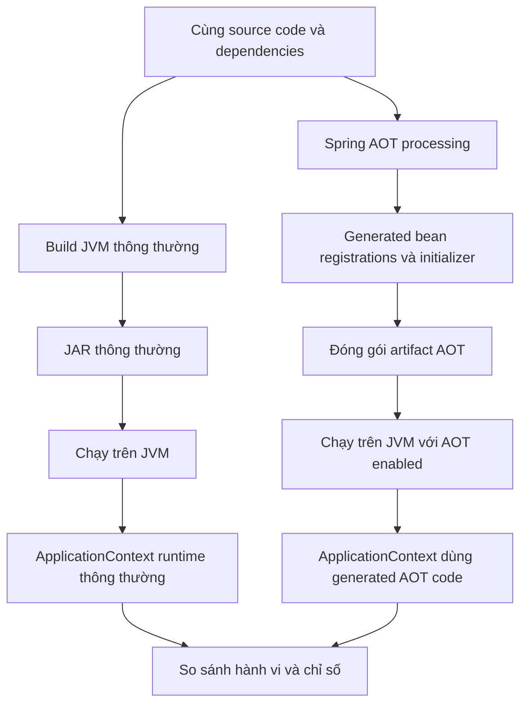

# So sánh hành vi ứng dụng JVM thông thường với JVM AOT

## Mục tiêu bài học

Spring Boot có thể chạy trên JVM theo hai cách khởi tạo context khác nhau:

- **JVM thông thường:** Spring đọc cấu hình và xây dựng `ApplicationContext` theo cơ chế runtime thông thường.
- **JVM AOT:** Spring sử dụng mã bootstrap và metadata đã được tạo trong bước Ahead-of-Time processing, nhưng ứng dụng vẫn chạy trên JVM.

So sánh hai cách chạy giúp xác định liệu quá trình AOT có giữ nguyên hành vi nghiệp vụ, dependency injection, cấu hình, proxy và tích hợp của ứng dụng hay không. Đây là bước kiểm tra hữu ích trước khi chuyển sang GraalVM Native Image.

Lưu ý: **JVM AOT trong bài này là ứng dụng Spring đã được xử lý AOT nhưng vẫn chạy trên JVM.** Nó không phải native executable và cũng không có nghĩa JVM đã biên dịch toàn bộ ứng dụng thành mã máy trước khi chạy. Khi chạy trên JVM, bytecode vẫn được JVM thực thi và có thể được JIT compiler tối ưu.

Sau bài học, bạn có thể:

- Phân biệt quá trình khởi tạo context thông thường và context dùng generated AOT code.
- Thiết lập hai lần chạy có cùng source, dependency và cấu hình runtime để so sánh.
- Kiểm tra bean graph, dependency injection, conditional configuration và profile.
- So sánh transaction, AOP proxy, resource, serialization và các luồng nghiệp vụ.
- Đo startup, bộ nhớ và hành vi runtime mà không đưa ra kết luận sai từ một phép đo đơn lẻ.
- Chẩn đoán khác biệt do AOT build-time configuration hoặc do lỗi ứng dụng.

## 1. Phân biệt JVM thông thường và JVM AOT

### 1.1. JVM thông thường

Khi ứng dụng Spring Boot khởi động theo cách thông thường, Spring đọc cấu hình, quét component, xử lý configuration class, đánh giá condition và đăng ký bean definitions trong runtime. Sau đó, container tạo các singleton cần thiết và hoàn tất quá trình refresh context.

Một số quyết định được thực hiện khi ứng dụng khởi động:

- Component nào được phát hiện qua component scanning.
- Bean nào được đăng ký từ `@Configuration` và `@Bean`.
- Điều kiện `@Profile`, `@ConditionalOnProperty`, `@ConditionalOnClass` và các điều kiện khác có thỏa mãn không.
- Dependency nào được inject vào từng bean.
- Proxy và interceptor nào cần được tạo.

Đây là mô hình linh hoạt của Spring trên JVM. Những thành phần phụ thuộc cấu hình runtime có thể được xác định khi context được xây dựng.

### 1.2. JVM AOT

Với Spring AOT, một bước xử lý được chạy trước khi ứng dụng được đóng gói. Spring phân tích application context trong môi trường build, tạo bean registrations và generated code phục vụ khởi tạo context.

Khi chạy artifact AOT trên JVM, Spring sử dụng các thành phần đã sinh thay cho một phần xử lý cấu hình động thông thường. JVM vẫn thực thi ứng dụng; khác biệt nằm ở cách Spring chuẩn bị và khởi tạo context.

Sơ đồ khái quát:



### 1.3. Những gì giống nhau và khác nhau

| Nội dung | JVM thông thường | JVM AOT |
|---|---|---|
| Runtime engine | JVM | JVM |
| Đầu vào | Bytecode và dependency | Bytecode, dependency và generated AOT artifacts |
| Khởi tạo Spring context | Phân tích cấu hình trong runtime | Sử dụng mã đăng ký/initializer đã sinh |
| Bean graph | Được xác định khi context khởi động | Các quyết định AOT có thể được cố định từ môi trường AOT processing |
| Cấu hình runtime | Được đọc theo cơ chế Spring thông thường | Vẫn đọc được các giá trị runtime phù hợp; cấu hình ảnh hưởng bean graph cần tương thích với lần AOT |
| JIT compilation | Có thể xảy ra | Có thể xảy ra |
| Native executable | Không | Không |

JVM AOT vẫn có thể dùng JIT compilation trong lúc chạy. Vì vậy, không nên gọi kết quả so sánh này là “JVM đã bỏ JIT” hoặc xem nó như phép so sánh trực tiếp giữa JVM và native executable.

### 1.4. Vì sao cần so sánh trước khi build native?

Nếu ứng dụng đã sai hành vi ở JVM AOT, build thành native thường không giải quyết được vấn đề đó. Ngược lại, nếu JVM thông thường và JVM AOT có hành vi tương đương nhưng native executable gặp lỗi, phạm vi điều tra sẽ tập trung hơn vào reachability, reflection, resource, proxy, JNI hoặc class initialization của Native Image.

So sánh JVM thông thường với JVM AOT giúp tách biệt:

- Sai khác do Spring AOT xử lý bean/configuration.
- Lỗi logic hoặc cấu hình vốn có của ứng dụng.
- Lỗi chỉ xuất hiện khi chuyển từ JVM sang Native Image.

## 2. Những quyết định nào có thể thay đổi trong AOT?

### 2.1. Bean graph và conditional configuration

Các điều kiện quyết định bean có được đăng ký hay không có thể được đánh giá trong AOT processing. Ví dụ:

```java
@Configuration(proxyBeanMethods = false)
class PaymentConfiguration {

    @Bean
    @Profile("sandbox")
    PaymentGateway sandboxGateway() {
        return new SandboxPaymentGateway();
    }

    @Bean
    @Profile("production")
    PaymentGateway productionGateway() {
        return new ProductionPaymentGateway();
    }
}
```

Nếu AOT processing chạy với profile `sandbox`, generated bean graph phản ánh cấu hình sandbox. Không thể kỳ vọng chỉ đổi `SPRING_PROFILES_ACTIVE=production` khi chạy artifact AOT sẽ tự sinh thêm bean production đã không có trong mô hình được chuẩn bị.

Với Spring Boot AOT, active profiles dùng trong AOT processing cần phù hợp với profiles lúc chạy. Tùy phiên bản và cách cấu hình, Spring Boot có thể phát hiện profile mismatch và báo lỗi. Dù có cơ chế kiểm tra nào, nguyên tắc vận hành vẫn là tạo artifact AOT riêng khi cần bean graph khác nhau.

### 2.2. Phân biệt cấu trúc bean và giá trị cấu hình runtime

Không phải mọi property đều bị cố định trong AOT:

| Property | Ảnh hưởng | Cách kiểm thử |
|---|---|---|
| `spring.profiles.active` dùng để chọn bean | Có thể làm thay đổi bean graph | Build AOT theo profile và chạy với profile tương ứng |
| `feature.audit.enabled` dùng trong `@ConditionalOnProperty` | Có thể làm bean xuất hiện/biến mất | Đặt giá trị trước AOT processing |
| URL database | Thường chỉ là giá trị runtime | Dùng URL khác nhau khi chạy hai artifact tương đương |
| API key hoặc password | Giá trị nhạy cảm runtime | Cấp từ secret manager, không đưa vào AOT build |
| Timeout hoặc connection limit | Thường là giá trị runtime | Thay đổi property lúc chạy và xác nhận bean nhận giá trị mới |

Ví dụ cấu hình runtime:

```java
@ConfigurationProperties(prefix = "payment.provider")
public record PaymentProviderProperties(
        URI baseUrl,
        Duration timeout
) {}

@Configuration(proxyBeanMethods = false)
@EnableConfigurationProperties(PaymentProviderProperties.class)
class PaymentProviderConfiguration {

    @Bean
    PaymentProviderClient paymentProviderClient(
            PaymentProviderProperties properties) {
        return new PaymentProviderClient(
                properties.baseUrl(),
                properties.timeout()
        );
    }
}
```

Trong ví dụ này, `baseUrl` và `timeout` có thể được bind từ nguồn cấu hình runtime. Bean `PaymentProviderClient` vẫn cần được đăng ký trong bean graph của AOT artifact.

### 2.3. Bean registration tùy biến

Ứng dụng có thể dùng `BeanDefinitionRegistryPostProcessor`, `BeanFactoryPostProcessor` hoặc cơ chế registry riêng để đăng ký bean. Nếu logic này phụ thuộc file/database/network chỉ có khi deploy, kết quả AOT có thể không giống runtime context thông thường.

Với thành phần tùy biến, cần xác định:

- Processor chạy trong giai đoạn AOT hay runtime?
- Nó có tạo ra kết quả xác định trong môi trường build không?
- Nó có được Spring AOT hỗ trợ hoặc có AOT contribution tương ứng không?
- Dữ liệu runtime chỉ thay đổi giá trị hay làm phát sinh bean definition mới?

Nếu danh sách connector cần thay đổi sau deploy, cân nhắc đăng ký một registry/service cố định rồi đọc cấu hình connector lúc runtime. Nếu thực sự cần bean graph khác nhau, hãy tạo các biến thể AOT riêng.

## 3. Chuẩn bị phép so sánh công bằng

### 3.1. Giữ các yếu tố đầu vào giống nhau

Để kết quả có ý nghĩa, hai lần chạy cần dùng:

- Cùng commit source code.
- Cùng phiên bản Java và Spring Boot.
- Cùng dependency versions và classpath.
- Cùng OS/CPU, container base image nếu có.
- Cùng profile và property ảnh hưởng bean graph.
- Cùng dữ liệu thử nghiệm và dịch vụ phụ thuộc.
- Cùng giới hạn CPU/memory và cách khởi chạy.

Chỉ thay đổi cách bootstrap: JVM thông thường hoặc JVM AOT.

### 3.2. Dùng hai artifact riêng

Không ghi đè JAR thường bằng JAR AOT hoặc ngược lại. Đặt tên output khác nhau để có thể kiểm tra, chạy lại và lưu log độc lập:

| Biến thể | Artifact ví dụ |
|---|---|
| JVM thường | `payment-service-jvm.jar` |
| JVM AOT | `payment-service-aot.jar` |

Tên file chỉ là quy ước. Cách cấu hình output phụ thuộc Maven/Gradle và Spring Boot plugin của dự án.

### 3.3. Ghi lại môi trường thử nghiệm

Lưu các thông tin sau cho mỗi lần chạy:

- Commit SHA và dependency lock/version report.
- Java vendor/version và JVM arguments.
- Spring Boot version và build tool version.
- Profile và property liên quan bean graph.
- CPU quota, memory limit và container image.
- Số lần chạy warm-up, số lần đo và thời gian quan sát.
- Startup time, RSS/heap, throughput, latency và kết quả chức năng.

Nếu hai lần chạy dùng JVM arguments khác nhau, hãy ghi rõ. Ví dụ `-Xms`, `-Xmx`, GC hoặc JIT flags có thể ảnh hưởng phép đo.

## 4. Tạo artifact JVM AOT

### 4.1. Với Gradle

Spring Boot Gradle plugin cung cấp task `processAot` để xử lý ứng dụng và sinh AOT assets. Ví dụ:

```bash
./gradlew clean processAot
```

Sau đó đóng gói artifact theo lifecycle và cấu hình của dự án:

```bash
./gradlew bootJar
```

Việc đưa generated AOT classes/resources vào artifact phụ thuộc cấu hình Spring Boot Gradle plugin và cách dự án tích hợp task. Hãy xem log task, output generated và nội dung JAR để xác nhận artifact thật sự chứa AOT assets. Không coi việc `processAot` kết thúc thành công là bằng chứng `bootJar` đã đóng gói đúng chúng.

### 4.2. Với Maven

Spring Boot Maven plugin cung cấp goal `spring-boot:process-aot`:

```bash
./mvnw spring-boot:process-aot
```

Sau khi AOT processing, đóng gói artifact bằng lifecycle/plugin configuration của dự án:

```bash
./mvnw package
```

Nếu dự án dùng Maven profile riêng cho AOT/native, bật đúng profile đã cấu hình. Kiểm tra output generated và nội dung JAR để bảo đảm generated classes/resources được compile và package. Không giả định mọi Maven project tự động bind AOT processing vào `package`.

### 4.3. Chạy artifact trên JVM

Chạy artifact JVM thông thường:

```bash
java -jar payment-service-jvm.jar
```

Chạy artifact đã được xử lý AOT trên JVM:

```bash
java -Dspring.aot.enabled=true -jar payment-service-aot.jar
```

`spring.aot.enabled=true` yêu cầu Spring Boot sử dụng AOT-generated initialization khi chạy. Chỉ dùng cờ này với artifact đã chứa AOT-generated assets phù hợp. Nếu bật trên JAR thông thường không có generated assets, ứng dụng có thể không khởi động đúng.

Với Windows PowerShell:

```powershell
java -jar .\payment-service-jvm.jar
java -Dspring.aot.enabled=true -jar .\payment-service-aot.jar
```

Nếu dự án dùng tên JAR khác, thay bằng đường dẫn thực tế. Có thể chạy hai biến thể trong hai process riêng và lưu log riêng để so sánh.

### 4.4. Không nhầm JVM AOT với Native Image

| Cách chạy | Lệnh khởi chạy minh họa | Runtime |
|---|---|---|
| JVM thường | `java -jar app.jar` | JVM, Spring khởi tạo context thông thường |
| JVM AOT | `java -Dspring.aot.enabled=true -jar app-aot.jar` | JVM, Spring dùng generated AOT initialization |
| Native Image | `./app` hoặc chạy container native | Native executable, không cần JVM để chạy ứng dụng |

Phép so sánh trong bài chỉ tập trung hai dòng đầu. Native Image là bước tiếp theo và cần một bộ kiểm thử riêng.

## 5. Kiểm tra bean graph và dependency injection

### 5.1. Tạo báo cáo bean

Một cách thực tế để so sánh là xuất danh sách bean theo tên và kiểu từ context. Ví dụ:

```java
@Component
class BeanInventoryReporter implements ApplicationRunner {

    private final ConfigurableApplicationContext context;

    BeanInventoryReporter(ConfigurableApplicationContext context) {
        this.context = context;
    }

    @Override
    public void run(ApplicationArguments args) {
        ConfigurableListableBeanFactory factory =
                context.getBeanFactory();

        Arrays.stream(context.getBeanDefinitionNames())
                .sorted()
                .forEach(name -> {
                    Class<?> type = factory.getType(name);
                    System.out.printf(
                            "%s -> %s%n",
                            name,
                            type == null ? "<unknown>" : type.getName()
                    );
                });
    }
}
```

Đặt cùng reporter trong hai artifact và lưu output thành hai file. So sánh danh sách theo tên bean, kiểu dự đoán và các bean nghiệp vụ quan trọng.

Không yêu cầu hai danh sách bean luôn giống từng dòng. Một số bean infrastructure hoặc generated initializer có thể khác do cơ chế bootstrap. Tập trung vào bean nghiệp vụ, adapter, repository, controller, integration và các dependency mà use case cần.

### 5.2. Kiểm tra bean theo kiểu và qualifier

Ngoài danh sách tên, kiểm tra các hợp đồng quan trọng:

```java
PaymentGateway gateway =
        context.getBean(PaymentGateway.class);

assertThat(gateway).isInstanceOf(SandboxPaymentGateway.class);

assertThat(context.getBeansOfType(ProductionPaymentGateway.class))
        .isEmpty();
```

Lặp lại assertion cho từng profile/variant. Nếu một interface có nhiều implementation, kiểm tra `@Primary`, `@Qualifier` và bean ambiguity.

### 5.3. Kiểm tra condition và profile

Với mỗi cấu hình có điều kiện, ghi lại:

- Profile dùng khi AOT processing.
- Property quyết định condition và giá trị tại build time.
- Bean mong đợi xuất hiện hoặc vắng mặt.
- Profile/property runtime khi chạy artifact.

Ví dụ:

| Điều kiện | Giá trị khi AOT | Bean mong đợi |
|---|---|---|
| `@Profile("sandbox")` | `sandbox` active | Sandbox gateway |
| `@Profile("production")` | `production` active | Production gateway |
| `audit.enabled=true` | true | Audit publisher có mặt |
| `audit.enabled=false` | false | Audit publisher vắng mặt |

Nếu bean graph khác ngoài dự kiến, kiểm tra AOT build inputs trước khi sửa business logic.

### 5.4. Kiểm tra dependency injection

Bean có mặt chưa đủ chứng minh wiring đúng. Chạy các luồng khởi tạo và xác nhận:

- Constructor injection nhận đúng implementation.
- Qualifier/primary resolution giống mong đợi.
- Optional dependency và `ObjectProvider` hoạt động đúng.
- Circular dependency không xuất hiện do khác biệt cấu hình.
- Lazy bean được khởi tạo khi use case gọi tới.
- FactoryBean, scoped bean và proxy được tạo đúng.

Một số bean lazy chỉ được tạo khi truy cập. Vì vậy, startup thành công không chứng minh toàn bộ dependency graph của các đường nghiệp vụ đã được kiểm tra.

## 6. So sánh hành vi nghiệp vụ và tích hợp

### 6.1. Dùng cùng bộ contract test

Chạy cùng một bộ test trên hai artifact. Mỗi test nên xác nhận kết quả nghiệp vụ quan sát được, không phụ thuộc vào cách Spring khởi tạo bean.

Các nhóm test nên có:

- HTTP endpoint và status/body/header.
- Validation, exception mapping và error response.
- Database read/write và transaction rollback.
- Cache hit/miss/eviction.
- Message publish/consume và retry.
- Scheduler, async execution và shutdown callback.
- Serialization/deserialization của từng subtype.
- Resource/template theo locale và định dạng.

Ưu tiên dependency giả lập hoặc môi trường tích hợp riêng để hai lần chạy không ghi dữ liệu trùng vào production.

### 6.2. Transaction và AOP proxy

Kiểm tra các method có `@Transactional`, `@Async`, `@Cacheable`, `@Retryable` hoặc custom aspect. Ví dụ:

```java
@SpringBootTest
class PaymentTransactionTests {

    @Autowired
    PaymentService paymentService;

    @Autowired
    PaymentRepository paymentRepository;

    @Test
    void rollsBackWhenPaymentFails() {
        assertThatThrownBy(() ->
                paymentService.payAndFail(testPayment())
        ).isInstanceOf(PaymentFailedException.class);

        assertThat(paymentRepository.findByReference("test-ref"))
                .isEmpty();
    }
}
```

Đây là ví dụ minh họa; fixture, repository và exception cần được định nghĩa trong dự án. Chạy cùng test trên JVM thường và JVM AOT để kiểm tra transaction boundary và rollback.

Nếu test chỉ gọi một method nội bộ qua `this`, self-invocation có thể bỏ qua proxy ở cả hai cách chạy. Đừng quy kết hiện tượng đó là regression của AOT; hãy kiểm tra đường đi của lời gọi.

### 6.3. Resource và serialization

Kiểm tra các file được đóng gói trong JAR AOT và cách ứng dụng truy cập chúng. Spring AOT có thể tạo hints cho một số resource, nhưng phép so sánh JVM AOT chưa thay thế kiểm tra resource inclusion của native image.

Đối với serialization, chạy test với:

- Từng DTO và subtype được hỗ trợ.
- Payload version cũ/mới.
- Field optional hoặc null.
- Enum/format đặc biệt.
- Payload lỗi và error response.

Nếu JVM thường và JVM AOT đều hoạt động, nhưng native executable thất bại khi reflection hoặc resource, cần tiếp tục điều tra metadata của Native Image.

## 7. Đo startup, bộ nhớ và hiệu năng

### 7.1. Đo thời gian sẵn sàng phục vụ

Đừng chỉ đo thời gian từ lúc gõ lệnh đến khi process xuất hiện. Ứng dụng có thể đã chạy nhưng chưa sẵn sàng nhận request. Nên đo ít nhất hai mốc:

- **Process startup:** thời gian từ khi khởi chạy process tới khi JVM báo ứng dụng đã khởi động.
- **Readiness:** thời gian từ khi khởi chạy tới khi health/readiness endpoint trả trạng thái sẵn sàng.

Nếu ứng dụng expose Spring Boot Actuator, có thể polling endpoint readiness từ script benchmark. Giữ nguyên health check và timeout cho cả hai biến thể.

Một ví dụ đo thủ công trên Linux:

```bash
START=$(date +%s%3N)
java -jar payment-service-jvm.jar &
PID=$!

until curl -fsS http://localhost:8080/actuator/health/readiness >/dev/null; do
  sleep 0.1
done

END=$(date +%s%3N)
echo "readiness_ms=$((END - START))"
kill "$PID"
wait "$PID"
```

Đây là script minh họa; endpoint readiness phải được bật và cấu hình đúng. Trong benchmark tự động, hãy chọn port riêng hoặc dừng process trước khi chạy biến thể tiếp theo để tránh hai ứng dụng tranh cùng port.

### 7.2. Đo bộ nhớ

Không dùng một con số heap duy nhất để đại diện cho toàn bộ memory footprint. Ghi riêng:

- JVM heap đã cấp phát và heap đang sử dụng.
- Process RSS/working set.
- Metaspace và code cache khi cần.
- Memory limit/container memory nếu chạy trong container.

Trên Windows có thể xem working set của process bằng PowerShell:

```powershell
Get-Process -Name java |
    Select-Object Id, CPU, WorkingSet64, PrivateMemorySize64
```

Trên Linux, có thể dùng ps, /usr/bin/time -v hoặc số liệu cgroup/container. Dùng cùng công cụ và cùng thời điểm lấy mẫu cho cả hai biến thể.

Giữ -Xms, -Xmx, GC và container memory limit giống nhau. Nếu JVM AOT có heap nhỏ hơn nhưng RSS lớn hơn, cần báo cáo cả hai thay vì chọn chỉ số có lợi.

### 7.3. Phân biệt startup và steady-state

JVM AOT vẫn chạy trên JVM và vẫn có thể JIT compile các hot method. Do đó, tách phép đo thành:

| Giai đoạn | Điều cần đo |
|---|---|
| Cold start | Thời gian process đến readiness, memory ban đầu |
| Warm-up | Thời gian và số request để JVM đạt trạng thái ổn định |
| Steady-state | Throughput, p50/p95 latency, CPU và memory |
| Shutdown | Thời gian dừng và việc hoàn tất lifecycle callback |

Không lấy một request đầu tiên làm đại diện cho throughput ổn định. Chạy warm-up giống nhau và đo nhiều lần.

### 7.4. Lặp lại và dùng thống kê phù hợp

Thực hiện nhiều lần chạy độc lập cho từng biến thể. Báo cáo median và khoảng dao động; với latency request, thêm p95/p99 nếu phù hợp. Không kết luận từ một lần chạy vì CPU scheduling, filesystem cache, JIT và tải hệ thống có thể làm kết quả dao động.

Nếu mục tiêu là so sánh cold start, hãy kiểm soát trạng thái cache và process trước mỗi lần chạy. Nếu mục tiêu là steady-state, dùng cùng thời gian warm-up và cùng workload.

### 7.5. Không suy diễn kết quả JVM AOT thành kết quả Native Image

JVM AOT có thể giảm một phần chi phí phân tích cấu hình Spring khi khởi động. Tuy nhiên, nó vẫn có JVM runtime, class loading, JIT và garbage collector của JVM.

Native Image có mô hình memory, startup và compilation khác. Không dùng kết quả JVM AOT để tuyên bố native executable sẽ có cùng startup time, RSS hoặc throughput.

## 8. Ma trận kiểm thử so sánh

### 8.1. Ma trận tối thiểu

| Nhóm | JVM thường | JVM AOT | Tiêu chí đạt |
|---|---|---|---|
| Startup | Khởi động JAR thường | Khởi động JAR có AOT enabled | Context ready, không có lỗi bootstrap |
| Bean graph | Kiểm tra inventory | Kiểm tra inventory | Bean nghiệp vụ và implementation mong đợi |
| Configuration | Đọc runtime properties | Đọc runtime properties | URL, timeout và giá trị cấu hình đúng |
| Dependency injection | Gọi use case | Gọi cùng use case | Đúng implementation, không ambiguity |
| Transaction | Test commit/rollback | Test cùng commit/rollback | Dữ liệu và rollback giống nhau |
| AOP/cache/async | Test advisor | Test cùng advisor | Advice hoạt động theo thiết kế |
| Resource | Mở template/schema | Mở cùng resource | Kết quả đọc và xử lý giống nhau |
| Serialization | Encode/decode payload | Encode/decode cùng payload | Kết quả tương đương |
| HTTP/message | Contract test | Cùng contract test | Status, payload và side effect đúng |
| Shutdown | Dừng process | Dừng process | Callback và cleanup hoàn tất |

### 8.2. So sánh kết quả theo ý nghĩa

Một số khác biệt không nhất thiết là lỗi:

- Tên generated bean hoặc bean infrastructure có thể khác.
- Số lượng bean nội bộ phục vụ bootstrap có thể khác.
- Thời gian startup và memory có thể khác do cách khởi tạo.
- Thứ tự log hoặc thứ tự khởi tạo không được bảo đảm nếu ứng dụng không khai báo ordering.

Những khác biệt cần xem là regression nếu chúng làm thay đổi:

- Kết quả nghiệp vụ hoặc dữ liệu được ghi.
- Bean implementation/qualifier mà use case phụ thuộc.
- Transaction boundary, retry, cache hoặc async behavior.
- HTTP contract, event schema hoặc resource nội dung.
- Cấu hình runtime được kỳ vọng thay đổi giữa các lần triển khai.

### 8.3. Lưu kết quả có thể tái lập

Một bảng báo cáo ngắn nên có:

| Chỉ số | JVM thường | JVM AOT | Ghi chú |
|---|---:|---:|---|
| Readiness median | ... | ... | ms, số lần chạy |
| RSS tại readiness | ... | ... | MiB |
| Heap used sau warm-up | ... | ... | MiB |
| Throughput | ... | ... | requests/second |
| p95 latency | ... | ... | ms |
| Contract tests | ... | ... | pass/fail |
| Bean graph assertions | ... | ... | pass/fail |

Điền số liệu đo được từ cùng môi trường. Không dùng số ước lượng hoặc kết quả từ máy khác để hoàn thiện bảng.

## 9. Chẩn đoán khi hai biến thể khác hành vi

### 9.1. AOT artifact không khởi động được

Kiểm tra theo thứ tự:

1. Artifact có thật sự chứa generated AOT classes/resources không?
2. Thuộc tính **spring.aot.enabled=true** có được truyền vào đúng process không?
3. Active profiles runtime có khớp profile dùng khi AOT processing không?
4. Build-time properties có tạo bean graph mong muốn không?
5. Có bean registration processor hoặc custom condition không tương thích AOT không?
6. Generated sources có được compile và package đúng không?

Không thêm Runtime Hints để sửa lỗi thiếu generated initializer hoặc profile mismatch; đó là vấn đề build/AOT wiring.

### 9.2. JVM thường chạy nhưng JVM AOT thiếu bean

Xem lại profile, property, classpath và condition tại thời điểm AOT processing. Nếu bean phụ thuộc dữ liệu chỉ có khi runtime, quyết định xem nên:

- Tạo AOT variant khác với đầu vào build phù hợp.
- Giữ bean registry cố định và đọc dữ liệu runtime trong service.
- Viết AOT contribution cho thành phần tùy biến.
- Tách phần plugin động sang process riêng.

### 9.3. Bean có mặt nhưng hành vi khác

Kiểm tra:

- Bean được inject có đúng implementation/qualifier không?
- Proxy có được tạo và lời gọi có đi qua proxy không?
- Có self-invocation bỏ qua advice không?
- Có lazy bean hoặc factory bean chỉ được tạo trong một luồng chưa test không?
- Có side effect hoặc thứ tự khởi tạo mà ứng dụng đang phụ thuộc ngầm không?

Đặc biệt, self-invocation là giới hạn proxy-based AOP trên cả JVM thông thường lẫn JVM AOT; không tự động xem đó là lỗi do AOT.

### 9.4. JVM AOT đúng nhưng Native Image sai

Nếu cả hai biến thể JVM có hành vi tương đương nhưng native executable lỗi, chuyển hướng điều tra sang:

- Reflection/serialization metadata.
- Resource inclusion.
- Dynamic proxy hoặc bytecode generation.
- Class initialization và image heap.
- JNI, shared library, OS/CPU/ABI.
- Thư viện chưa có reachability metadata hoặc native support.

JVM AOT là bước kiểm chứng Spring AOT; nó không thay thế native build và native runtime tests.

## 10. Quy trình thực hành hoàn chỉnh

### Bước 1 — Tạo baseline JVM

Build JAR thông thường, chạy với profile/property đã chọn và lưu startup log, bean inventory cùng kết quả contract test.

### Bước 2 — Tạo artifact AOT

Chạy task **processAot** bằng Gradle hoặc goal **spring-boot:process-aot** bằng Maven. Đóng gói theo plugin configuration và xác minh generated assets nằm trong artifact.

### Bước 3 — Chạy JVM AOT

Khởi chạy artifact AOT với **-Dspring.aot.enabled=true** và profile khớp với AOT processing. Lưu log, bean inventory và kết quả test.

### Bước 4 — So sánh chức năng

Chạy cùng contract test, transaction, AOP, resource, serialization, HTTP/message và lifecycle tests trên hai biến thể. Điều tra mọi khác biệt ảnh hưởng kết quả nghiệp vụ.

### Bước 5 — Đo hiệu năng

Đo readiness, memory, warm-up và steady-state trong cùng môi trường. Chạy lặp lại, ghi median/percentile và lưu JVM arguments.

### Bước 6 — Tiến tới Native Image

Chỉ sau khi JVM AOT đạt các kiểm tra cần thiết, build native executable và chạy lại ma trận test trên native. Khi native khác JVM AOT, điều tra metadata/reachability và khả năng tương thích thư viện.

### Câu hỏi tự kiểm tra

1. JVM AOT khác JVM thông thường ở bước nào nếu cả hai vẫn dùng cùng JVM runtime?
2. Vì sao không thể đổi profile lúc runtime để bổ sung bean đã không có trong AOT-generated bean graph?
3. Những property nào thường có thể giữ ở runtime mà không cần build AOT variant mới?
4. Vì sao cần xác minh generated AOT assets đã được đóng gói vào JAR trước khi chạy với **spring.aot.enabled=true**?
5. Self-invocation có phải giới hạn riêng của JVM AOT không? Vì sao?
6. Vì sao startup time và steady-state throughput cần được đo riêng?
7. Nếu JVM thường và JVM AOT đều đạt nhưng native thất bại khi đọc resource, cần kiểm tra tầng nào?

**Ghi nhớ:** so sánh JVM thông thường với JVM AOT là cách xác minh Spring AOT trong khi giữ nguyên JVM runtime. Giữ cùng source, dependency, profile và workload; kiểm tra bean graph, cấu hình, hành vi nghiệp vụ và chỉ số vận hành. Khi hai biến thể tương đương, bạn có cơ sở tốt hơn để chuyển sang kiểm thử GraalVM Native Image, nhưng vẫn cần chạy đầy đủ native tests vì Native Image có các giới hạn riêng.
