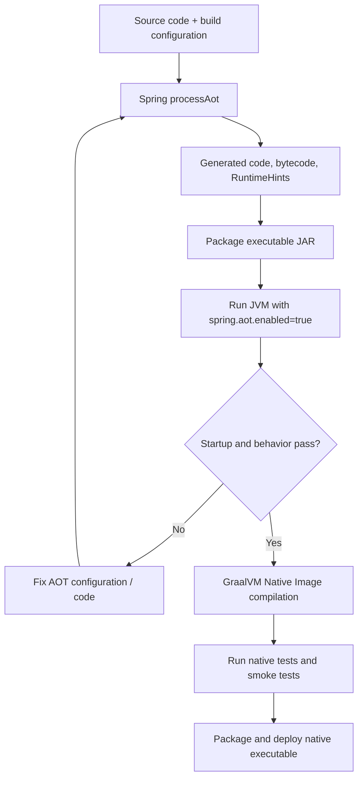

# Dùng JVM AOT để rút ngắn vòng lặp tìm lỗi trước native build

## 1. Vì sao nên chạy AOT trên JVM trước khi biên dịch native?

Spring Boot Native Image có một bước quan trọng trước GraalVM compilation: **Spring AOT processing**. Ở bước này, Spring khởi tạo mô hình `ApplicationContext` trong môi trường build, phân tích các bean sẽ được đăng ký và sinh mã khởi tạo, bytecode hỗ trợ cùng RuntimeHints. GraalVM Native Image sau đó sử dụng những đầu ra này để phân tích reachability và tạo executable.

Native Image compilation thường tốn nhiều thời gian và tài nguyên hơn một lần chạy ứng dụng trên JVM. Nếu chỉ phát hiện lỗi cấu hình bean, generated initializer hoặc một callback AOT không tương thích sau khi đã biên dịch native, vòng sửa lỗi sẽ dài hơn.

Spring Boot cho phép chạy chính ứng dụng đã được AOT processing trên **JVM thông thường** bằng system property `spring.aot.enabled=true`. Nhờ đó, nhóm có thể kiểm tra mã khởi tạo được sinh ra, startup context và các endpoint trên JVM trước khi đầu tư thời gian cho Native Image compilation.

Bài học này thuộc chương **Kiểm thử AOT** của module **SPRING_BOOT_NATIVE_IMAGE**. Module thực hành biên dịch Spring Boot thành GraalVM Native Image bằng Spring AOT, đánh giá thời gian khởi động và bộ nhớ, cấu hình Maven/Gradle, reflection/resource, kiểm thử tương thích, đóng gói container và vận hành bản native. Ở đây, ta dùng JVM AOT như một vòng xác minh trung gian để phát hiện sớm vấn đề trong cấu hình AOT.

Sau bài học, người học có thể:

- Phân biệt chạy JVM thông thường, chạy JVM với AOT generated code và chạy native executable.
- Tạo JAR có chứa output của Spring AOT bằng Maven hoặc Gradle.
- Bật AOT runtime mode bằng `spring.aot.enabled=true`.
- Kiểm tra startup, bean graph và các luồng nghiệp vụ trên JVM AOT.
- Nhận biết giới hạn của cấu hình được quyết định tại build time.
- Xác định lỗi nào có thể phát hiện trên JVM AOT và lỗi nào vẫn cần native build/test.

## 2. Ba chế độ chạy cần phân biệt

| Chế độ | Cách khởi tạo Spring context | Có cần GraalVM Native Image compilation? | Mục đích |
|---|---|---:|---|
| JVM thông thường | Spring xử lý cấu hình và bean lúc runtime | Không | Phát triển và kiểm thử thông thường |
| JVM AOT | Dùng mã khởi tạo và quyết định Spring đã sinh ở build time | Không | Kiểm tra AOT output và hành vi ứng dụng với bean graph cố định |
| Native executable | Dùng AOT output đã được GraalVM biên dịch thành binary | Có | Kiểm thử và vận hành sản phẩm native |

Luồng làm việc:



JVM AOT dùng cùng output Spring AOT mà native build sẽ tiêu thụ. Nếu AOT generated code có lỗi, thiếu bean definition hoặc không thể khởi tạo context, ta có thể phát hiện trước khi chạy compiler native.

**JVM AOT không phải Native Image giả lập.** Ứng dụng vẫn chạy bằng JVM và vẫn có JIT/runtime của Java. Chế độ này không kiểm tra binary native, OS dynamic linker, libc, JNI ABI hoặc các lỗi chỉ xuất hiện khi chạy executable do GraalVM tạo ra.

## 3. Spring AOT sinh ra những gì?

Trong quá trình AOT processing, Spring tạo các đầu ra tùy thuộc cấu hình và loại bean của ứng dụng:

- **Java source code:** mã khởi tạo bean và khôi phục trạng thái BeanFactory theo cách có thể xác định trước.
- **Bytecode:** chẳng hạn bytecode cho một số dynamic proxy.
- **RuntimeHints:** thông tin reflection, resource, serialization, JDK proxy và các truy cập động khác.
- **AOT test context initializers:** với các test sử dụng Spring TestContext Framework được hỗ trợ, Spring có thể sinh initializer để dựng test ApplicationContext đã tối ưu.

Mục tiêu của AOT là chuyển một phần công việc khám phá và quyết định thường xảy ra lúc runtime sang build time. Vì vậy, generated code phản ánh classpath và environment mà Spring nhìn thấy khi AOT processing.

Khi chạy JVM AOT, Spring sử dụng generated initializer thay cho quy trình khám phá context thông thường ở những phần đã được AOT xử lý. Dòng log thường cho biết ứng dụng đang chạy ở chế độ AOT-processed, ví dụ:

```text
Starting AOT-processed MyApplication ...
```

Nếu JAR được chạy với `spring.aot.enabled=true` nhưng thiếu generated output, ứng dụng không thể tự sinh lại output đó ở runtime. Hãy kiểm tra bước `processAot`, cấu hình plugin và nội dung JAR.

## 4. Build và chạy JVM AOT với Maven

### 4.1. Dùng Spring Boot native profile

Nếu dự án dùng `spring-boot-starter-parent`, Spring Boot cung cấp Maven profile `native`. Profile này cấu hình execution `process-aot` khi Spring Boot Maven Plugin được khai báo trong project. Vì plugin thường nằm trong `pluginManagement`, hãy bảo đảm nó được áp dụng trong `build/plugins`:

```xml
<build>
    <plugins>
        <plugin>
            <groupId>org.springframework.boot</groupId>
            <artifactId>spring-boot-maven-plugin</artifactId>
        </plugin>
    </plugins>
</build>
```

Ta có thể dùng chính JAR được tạo từ profile này để chạy AOT trên JVM. Nếu project cũng cấu hình Native Build Tools execution gắn vào lifecycle `package`, hãy tách hoặc bỏ execution đó trong vòng kiểm tra JVM AOT để tránh vô tình khởi chạy native compilation.

Build:

```bash
./mvnw -Pnative package
```

Sau khi build thành công, tìm executable JAR trong thư mục `target/`. Ví dụ trên PowerShell:

```powershell
Get-ChildItem target -Filter "*.jar"
```

Trên Linux/macOS có thể dùng `find target -maxdepth 1 -name '*.jar'`. Nếu project tạo nhiều JAR, chọn Spring Boot executable JAR, không chọn test JAR hoặc file `original-*.jar`.

Chạy JAR trên JVM với AOT mode:

```bash
java -Dspring.aot.enabled=true -jar target/my-application.jar
```

Thay `my-application.jar` bằng tên file thực tế. JVM option `-Dspring.aot.enabled=true` phải đặt trước `-jar`.

### 4.2. Nếu không dùng Spring Boot parent

Nếu dự án không kế thừa `spring-boot-starter-parent`, profile `native` không tự xuất hiện. Có thể khai báo execution `process-aot` cho Spring Boot Maven Plugin:

```xml
<build>
    <plugins>
        <plugin>
            <groupId>org.springframework.boot</groupId>
            <artifactId>spring-boot-maven-plugin</artifactId>
            <executions>
                <execution>
                    <id>process-aot</id>
                    <goals>
                        <goal>process-aot</goal>
                    </goals>
                </execution>
            </executions>
        </plugin>
    </plugins>
</build>
```

Cấu hình plugin version phải đồng bộ với Spring Boot version mà dự án sử dụng. Nếu dự án dùng Native Build Tools để tạo binary, cấu hình plugin native riêng theo tài liệu tương ứng; mục tiêu của bước này là tạo JAR có AOT output để kiểm tra trên JVM.

Có thể gọi goal AOT trực tiếp khi cần điều tra riêng bước xử lý:

```bash
./mvnw spring-boot:process-aot
```

Goal này tạo generated sources/classes/resources trong build output của Maven. Để chạy JAR, vẫn cần đóng gói đúng các output AOT vào archive; chỉ chạy `process-aot` không có nghĩa file JAR hiện tại tự được cập nhật nếu lifecycle đóng gói chưa chạy.

## 5. Build và chạy JVM AOT với Gradle

Với Gradle, nếu chỉ muốn chạy ứng dụng đã AOT-processed trên JVM mà không cần cấu hình Native Image compilation, áp dụng plugin `org.springframework.boot.aot` trực tiếp.

Ví dụ Groovy DSL:

```groovy
plugins {
    id 'org.springframework.boot' version '<spring-boot-version>'
    id 'java'
}

apply plugin: 'org.springframework.boot.aot'
```

Với Kotlin DSL:

```kotlin
plugins {
    id("org.springframework.boot") version "<spring-boot-version>"
    java
}

apply(plugin = "org.springframework.boot.aot")
```

Các placeholder version cần được thay bằng Spring Boot version đang dùng. Khi GraalVM Native Image plugin đã được áp dụng, Spring Boot AOT plugin được áp dụng tự động; nếu mục tiêu chỉ là kiểm tra JVM AOT, có thể dùng plugin AOT trực tiếp như ví dụ trên.

Chạy AOT processing và đóng gói:

```bash
./gradlew processAot bootJar
```

Sau đó chạy JAR:

```bash
java -Dspring.aot.enabled=true -jar build/libs/my-application.jar
```

Tên file thực tế phụ thuộc `archiveFileName`, version và cấu hình project. Nếu build script có custom source set hoặc task, kiểm tra output của `processAot` và xác nhận `bootJar` đã đưa generated classes/resources vào archive.

### 5.1. Dùng bootRun trong quá trình phát triển

Có thể truyền system property cho `bootRun`:

```groovy
tasks.named("bootRun") {
    systemProperty "spring.aot.enabled", "true"
}
```

Tuy nhiên, runtime classpath của `bootRun` phải chứa output được tạo bởi `processAot`. Nếu task graph của dự án chưa liên kết AOT output vào `bootRun`, hãy dùng JAR đã đóng gói ở ví dụ trên để kiểm tra kết quả chắc chắn hơn.

## 6. Chọn environment và profile tại thời điểm AOT

AOT processing chuẩn bị BeanFactory ở build time. Những điều kiện quyết định bean nào tồn tại sẽ được đánh giá trong bước này. Ví dụ:

- `@Profile("production")` quyết định cấu hình profile nào được đưa vào bean graph.
- `@ConditionalOnProperty` quyết định bean có được đăng ký hay không.
- `@Conditional` tùy chỉnh có thể quyết định sự hiện diện của bean dựa trên classpath hoặc Environment.
- Classpath và dependency có sẵn tại build time được dùng để xác định cấu hình.

Vì vậy, không thể build AOT với profile `dev` rồi kỳ vọng chuyển sang profile `production` lúc chạy JVM AOT sẽ tạo ra bean production chưa được sinh trong build output.

Với Maven, cấu hình profile cho `process-aot` trong Spring Boot Maven Plugin:

```xml
<plugin>
    <groupId>org.springframework.boot</groupId>
    <artifactId>spring-boot-maven-plugin</artifactId>
    <executions>
        <execution>
            <id>process-aot</id>
            <goals>
                <goal>process-aot</goal>
            </goals>
            <configuration>
                <profiles>
                    <profile>production</profile>
                </profiles>
            </configuration>
        </execution>
    </executions>
</plugin>
```

Với Gradle, cấu hình task `ProcessAot`:

```groovy
tasks.withType(
    org.springframework.boot.gradle.tasks.aot.ProcessAot
).configureEach {
    args("--spring.profiles.active=production")
}
```

Hãy build lại AOT output nếu đổi profile hoặc property làm thay đổi bean graph. Các property chỉ ảnh hưởng giá trị cấu hình của bean đã tồn tại có thể vẫn được cung cấp lúc runtime, miễn là chúng không thay đổi quyết định tạo bean hoặc cấu trúc đã được AOT cố định.

## 7. Dùng JVM AOT để kiểm tra những gì?

JVM AOT đặc biệt hữu ích cho những lỗi liên quan đến Spring context và generated initialization code.

| Hạng mục | Kiểm tra trên JVM AOT | Ví dụ |
|---|---|---|
| Context startup | Có thể kiểm tra | Generated initializer có dựng được ApplicationContext không |
| Bean registration | Có thể kiểm tra | Bean nào có mặt, bean nào bị điều kiện loại bỏ |
| Dependency injection | Có thể kiểm tra | Constructor injection, qualifier, circular dependency |
| Auto-configuration | Có thể kiểm tra | Cấu hình tự động có tạo bean như mong đợi |
| AOT callbacks | Có thể kiểm tra | Callback xử lý BeanFactory có tạo output hợp lệ |
| RuntimeHints generation | Có thể kiểm tra output build | Registrar có đóng góp hint cần thiết |
| REST/API behavior | Có thể kiểm tra | Endpoint, validation, serialization trên JVM AOT |
| Business workflow | Có thể kiểm tra | Luồng service, repository, transaction trên JVM AOT |

Ví dụ, một test có thể xác nhận bean quan trọng tồn tại trong context:

```java
@SpringBootTest
class AotContextSmokeTests {

    @Autowired
    ApplicationContext applicationContext;

    @Test
    void shouldRegisterReportService() {
        assertThat(applicationContext.getBean(ReportService.class))
            .isNotNull();
    }
}
```

Test này minh họa cách kiểm tra context; cần import JUnit, Spring Test và AssertJ theo dependency của project. Khi chạy cùng JAR AOT với `spring.aot.enabled=true`, test hoặc smoke test có thể kiểm tra generated context đã cung cấp bean cần thiết hay chưa.

### Kiểm tra endpoint bằng HTTP

Nếu ứng dụng là web service, có thể khởi chạy JAR AOT và gọi các endpoint bằng `curl`, Postman hoặc integration test client:

```bash
curl --fail --silent --show-error http://localhost:8080/actuator/health

curl --fail --silent --show-error \
  -H "Content-Type: application/json" \
  -d '{"reportType":"monthly"}' \
  http://localhost:8080/api/reports
```

Endpoint và payload là ví dụ; thay bằng API thực tế. Kiểm tra response, status code, log và các dependency bên ngoài. Đừng chỉ xác nhận process khởi động thành công.

## 8. Kiểm thử AOT cho Spring TestContext

Ngoài AOT processing của ứng dụng, Spring còn hỗ trợ AOT cho integration test dùng Spring TestContext Framework. Spring phát hiện test context, refresh context ở build time và tạo `ApplicationContextInitializer` tương ứng. Khi chạy test ở AOT runtime mode, TestContext Framework có thể dùng context đã tối ưu.

Các test phù hợp thường dùng JUnit Jupiter hoặc JUnit 4 với Spring TestContext annotations, ví dụ `@SpringBootTest`, `@ContextConfiguration`. Một context có cấu hình duy nhất được xử lý và lưu initializer tương ứng.

Một số điểm cần lưu ý:

- Test phải dùng context loader hỗ trợ AOT; các context loader do Spring Framework và Spring Boot cung cấp đã hỗ trợ.
- Custom `ContextLoader` cần triển khai `AotContextLoader`.
- Custom `TestExecutionListener` cần triển khai `AotTestExecutionListener` để tham gia AOT processing.
- `@ContextHierarchy` không được hỗ trợ trong AOT mode.
- `@DisabledInAotMode` có thể loại test class hoặc method không phù hợp khỏi AOT mode.
- Bean graph của test context cũng bị cố định theo cấu hình lúc AOT processing.

Trong Gradle, task `processTestAot` tạo initializer cho test context phù hợp. Trong Maven, Spring Boot Maven Plugin cung cấp goal `process-test-aot`. Cách kết nối các task này với native test phụ thuộc plugin/version. Mục tiêu của bài học là dùng JVM AOT để kiểm tra ứng dụng; native test vẫn là một bước riêng nếu muốn kiểm tra test suite trong GraalVM executable.

## 9. Quy trình feedback loop trước native build

Có thể tổ chức vòng kiểm tra theo các bước sau:

1. **Chạy test JVM thông thường:** xác nhận logic nghiệp vụ và cấu hình runtime cơ bản hoạt động.
2. **Build Spring AOT:** chạy `process-aot` qua Maven hoặc Gradle.
3. **Đóng gói JAR có AOT output:** bảo đảm generated classes/resources nằm trong archive.
4. **Chạy JVM AOT:** bật `spring.aot.enabled=true`.
5. **Chạy smoke/integration tests:** kiểm tra bean graph, API, serialization, resource và các nhánh cấu hình đã chọn.
6. **Đối chiếu kết quả:** nếu JVM thường pass nhưng JVM AOT fail, tập trung vào điều kiện build time, generated code, RuntimeHints hoặc callback AOT.
7. **Sửa và lặp lại:** sửa cấu hình/code, chạy lại `process-aot` và JVM AOT.
8. **Build Native Image:** chỉ chuyển sang GraalVM compilation sau khi vòng kiểm tra AOT trên JVM đạt.
9. **Test native executable:** chạy lại smoke/integration tests trên binary native và final container image.

Luồng này giúp phân loại lỗi:

- **JVM thường fail:** thường là lỗi logic, dependency, cấu hình runtime hoặc Spring context cơ bản.
- **JVM thường pass nhưng JVM AOT fail:** nghi ngờ AOT restrictions, bean graph build-time, generated initializer, RuntimeHints hoặc callback AOT.
- **JVM AOT pass nhưng native executable fail:** nghi ngờ Native Image reachability, JNI, reflection/resource metadata, class initialization, native library, ABI hoặc khác biệt runtime native.

## 10. Những giới hạn cần biết khi chạy JVM AOT

JVM AOT hữu ích nhưng không đại diện cho mọi điều kiện runtime.

### Classpath cố định

Classpath phải được xác định đầy đủ tại build time. Không nên thêm JAR/plugin tùy ý lúc chạy rồi kỳ vọng AOT context tự phát hiện chúng. Nếu danh sách dependency thay đổi, cần build lại AOT output.

### Bean graph cố định

Các bean được quyết định ở build time. Profile và property làm thay đổi sự tồn tại của bean phải được chọn trước khi AOT processing.

Ví dụ, nếu `@ConditionalOnProperty(name = "feature.export.enabled")` quyết định có tạo `ExportService` hay không, property đó cần có giá trị phù hợp lúc build. Chỉ đổi property lúc chạy không thể tạo bean đã bị loại khỏi generated context.

### Một số cấu hình động không được hỗ trợ

Các kiểu đăng ký bean phụ thuộc instance runtime hoặc singleton đăng ký thủ công qua BeanFactory có thể không được chuyển đổi AOT. Hãy dùng bean definition có kiểu cụ thể và cấu hình có thể xác định ở build time.

### JVM AOT không kiểm tra Native Image compiler

JVM AOT không xác nhận rằng GraalVM có thể biên dịch tất cả code, rằng native executable có đúng architecture hoặc rằng dynamic linker tìm được thư viện native. Những việc đó vẫn phải được kiểm tra trong native build và runtime test.

## 11. Những lỗi thường gặp và cách xử lý

| Triệu chứng | Nguyên nhân có thể | Cách xử lý |
|---|---|---|
| JVM báo không tìm thấy AOT initializer | JAR chưa chứa generated AOT output | Chạy lại `process-aot` và đóng gói JAR |
| App chạy nhưng log vẫn là regular startup | Chưa bật `spring.aot.enabled=true` hoặc option đặt sau `-jar` | Đặt JVM property trước `-jar` |
| Build AOT fail vì thiếu bean/dependency | Điều kiện build time hoặc classpath không phù hợp | Kiểm tra dependency và environment khi `processAot` chạy |
| JVM thường pass nhưng JVM AOT thiếu bean | Profile/property đã chọn sai lúc AOT | Cấu hình profile/property cho process AOT rồi build lại |
| Thay profile lúc chạy không thay đổi bean graph | Profile đã được quyết định khi build | Tạo AOT artifact riêng cho từng bean graph cần hỗ trợ |
| Generated code không được đưa vào JAR Gradle | Task graph hoặc cấu hình AOT plugin không đúng | Kiểm tra `processAot`, `bootJar` và archive contents |
| TestContext AOT không xử lý một test | Test loader/listener tùy chỉnh chưa hỗ trợ AOT hoặc cấu hình không được hỗ trợ | Kiểm tra `AotContextLoader`, `AotTestExecutionListener`, `@ContextHierarchy` |
| JVM AOT pass nhưng native build fail | Lỗi ở reachability metadata hoặc GraalVM/toolchain | Đọc Native Image build report, bổ sung đúng hints |
| JVM AOT pass nhưng container fail | Thiếu thư viện native, sai architecture hoặc runtime image | Kiểm tra final image và chạy test trên đúng nền tảng |

## 12. Bài tập thực hành

### Bài tập A — Chạy ứng dụng AOT trên JVM

1. Dùng Maven `-Pnative package` hoặc Gradle `processAot bootJar`.
2. Xác nhận executable JAR có generated AOT output.
3. Chạy JAR với `-Dspring.aot.enabled=true`.
4. Quan sát log AOT-processed startup.
5. Gọi một endpoint quan trọng và xác nhận response.

**Tiêu chí hoàn thành:** ứng dụng khởi động bằng AOT generated code trên JVM và endpoint hoạt động.

### Bài tập B — Phát hiện sai lệch bean graph

Tạo một bean được điều khiển bởi `@ConditionalOnProperty`. Build AOT với property bật, sau đó chạy JVM AOT. Thử đổi property lúc runtime và quan sát bean graph. Tiếp tục build AOT với property tắt và so sánh kết quả.

**Câu hỏi:** vì sao thay property lúc runtime không thể thêm bean chưa được đóng góp vào generated context?

### Bài tập C — So sánh ba chế độ

Chạy cùng một test scenario ở ba chế độ: JVM thường, JVM AOT và Native Image. Ghi lại startup success, endpoint result, lỗi context và thời gian chạy. Không dùng kết quả JVM AOT thay cho native runtime validation.

### Bài tập D — Tạo feedback loop trong CI

Tạo các job theo thứ tự: unit/integration test trên JVM, Spring AOT processing, JVM AOT smoke test, Native Image build và native smoke test. Ghi log riêng từng giai đoạn để khi lỗi xuất hiện có thể xác định nó thuộc bước nào.

## 13. Checklist trước khi chuyển sang native build

- [ ] Build tool đã thực hiện Spring AOT processing.
- [ ] Executable JAR chứa generated AOT classes/resources.
- [ ] Đã chạy JAR với `spring.aot.enabled=true`.
- [ ] Log xác nhận ứng dụng chạy bằng AOT-processed initializer.
- [ ] Bean graph và các điều kiện profile/property đúng với cấu hình build.
- [ ] Smoke test và integration test quan trọng đã pass trên JVM AOT.
- [ ] Đã kiểm tra resource, serialization, reflection và proxy ở các luồng cần thiết.
- [ ] Đã ghi lại các giới hạn hoặc test bị loại khỏi AOT mode.
- [ ] Đã xử lý lỗi AOT trước khi bắt đầu native compilation.
- [ ] Đã lên kế hoạch test riêng cho native executable và container.

## Tài liệu tham khảo

- [Spring Boot Reference — Ahead-of-Time Processing With the JVM](https://docs.spring.io/spring-boot/reference/packaging/aot.html): cách build JAR có AOT output và chạy bằng `spring.aot.enabled=true`, cùng các giới hạn runtime.
- [Spring Boot Gradle Plugin — Ahead-of-Time Processing](https://docs.spring.io/spring-boot/gradle-plugin/aot.html): plugin `org.springframework.boot.aot`, task `processAot` và `processTestAot`.
- [Spring Boot Maven Plugin — Ahead-of-Time Processing](https://docs.spring.io/spring-boot/maven-plugin/aot.html): goal `process-aot`, `process-test-aot` và native profile.
- [Spring Framework Reference — Ahead of Time Optimizations](https://docs.spring.io/spring-framework/reference/core/aot.html): AOT engine, generated code, RuntimeHints và các giới hạn bean graph.
- [Spring Framework Reference — Ahead of Time Support for Tests](https://docs.spring.io/spring-framework/reference/testing/testcontext-framework/aot.html): AOT processing và runtime support cho integration test.

## Kết luận

Chạy ứng dụng Spring Boot với `spring.aot.enabled=true` trên JVM là một bước kiểm tra hữu ích trước GraalVM Native Image compilation. Cách này giúp xác minh generated initializer, bean graph và luồng nghiệp vụ bằng JVM với chi phí phản hồi thấp hơn native build. Để kết quả có ý nghĩa, JAR phải chứa AOT output, profile và property ảnh hưởng đến bean graph phải được chọn đúng khi build, và các scenario quan trọng phải được chạy lại trên JVM AOT. Khi vòng kiểm tra này đạt, tiếp tục native build và kiểm thử binary/container riêng để phát hiện các vấn đề chỉ xuất hiện trong môi trường native.
