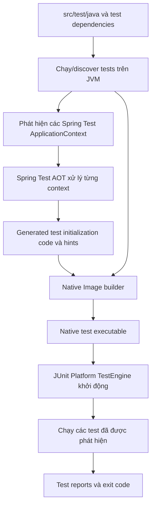
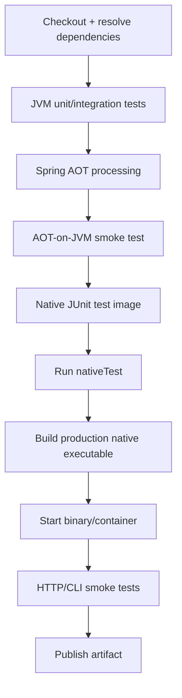

# Native Build Tools và cách chạy JUnit bên trong native executable

Kiểm thử ứng dụng Spring Boot trên JVM vẫn là cách nhanh và thuận tiện nhất để phát triển phần lớn unit test và integration test. Tuy nhiên, một số lỗi chỉ xuất hiện sau khi biên dịch thành **GraalVM Native Image**: thiếu reflection hints, resource không được đóng gói, proxy không tạo được, thư viện phụ thuộc class loading động hoặc mã khởi tạo AOT không hoạt động như mong đợi.

**GraalVM Native Build Tools** cung cấp khả năng biên dịch chính bộ test thành native executable rồi chạy JUnit bên trong executable đó. Với Spring Boot, Spring Test AOT còn phân tích các test context, tạo mã khởi tạo tương ứng và đưa JUnit TestEngine cùng danh sách test được phát hiện vào native test image.

Điều này tạo ra một lớp kiểm thử riêng: test code và application code thực sự chạy dưới mô hình Native Image. Nó bổ sung cho JVM tests và kiểm thử black-box trên executable ứng dụng đã đóng gói.

## 1. Mục tiêu học tập

Sau bài học, bạn có thể:

- Phân biệt JVM tests, kiểm thử Spring AOT trên JVM, native JUnit tests và kiểm thử ứng dụng native qua HTTP/CLI.
- Giải thích cách JUnit Platform TestEngine được đưa vào native test executable.
- Cấu hình GraalVM Native Build Tools cho Gradle và Maven.
- Chạy Gradle task **nativeTest** và Maven profile **nativeTest**.
- Hiểu vai trò của **process-test-aot** và các test ApplicationContext đã được AOT xử lý.
- Viết test tương thích native bằng JUnit 5 và Spring Test.
- Xử lý khác biệt phiên bản JUnit Platform, Maven Surefire và Native Build Tools.
- Chẩn đoán lỗi thiếu metadata, test discovery, native-image toolchain và môi trường CI.
- Xây dựng chiến lược CI cân bằng giữa tốc độ JVM tests và độ tin cậy của native tests.

## 2. Có những lớp kiểm thử nào?

Không nên xem mọi lệnh chạy test là tương đương. Spring Boot Native Image có thể được kiểm tra theo nhiều lớp:

| Lớp kiểm thử | Cách chạy | Điều được xác minh | Chi phí tương đối |
| --- | --- | --- | --- |
| **JVM tests** | JUnit chạy trên JVM thông thường | Logic nghiệp vụ, validation, repository, web layer và integration theo test setup | Thấp |
| **Spring AOT trên JVM** | Chạy ứng dụng JAR có AOT generated code với system property spring.aot.enabled=true | Mã khởi tạo do Spring AOT sinh và cấu hình container đã chuẩn bị | Thấp đến trung bình |
| **Native JUnit tests** | JUnit test classes được biên dịch và chạy trong native test executable | Test code, Spring Test context và dynamic access trong môi trường Native Image | Cao |
| **Native application tests** | Khởi chạy executable ứng dụng, gọi HTTP/CLI hoặc kiểm tra hành vi từ process khác | Startup, cấu hình runtime, network, filesystem, health endpoint và hành vi đóng gói | Cao |

Spring Boot khuyến nghị tiếp tục chạy phần lớn test trên JVM để có vòng lặp phát triển nhanh, sau đó tập trung native testing vào những phần dễ khác biệt. Native JUnit tests thường phù hợp với CI, nightly build hoặc release validation hơn là bắt buộc chạy sau mỗi lần sửa một method nhỏ.

### 2.1. Kiểm tra Spring AOT trên JVM

Spring AOT tạo mã để khôi phục cấu hình ApplicationContext trong native runtime. Có thể kiểm tra mã này trên JVM trước khi trả chi phí biên dịch native:

```bash
java -Dspring.aot.enabled=true -jar target/order-service.jar
```

JAR phải chứa AOT generated code. Với Maven, cần build qua profile **native** của Spring Boot parent; với Gradle, cần áp dụng GraalVM Native Image plugin để AOT processing được cấu hình. Nếu ứng dụng khởi động thành công ở chế độ này, bạn đã kiểm tra được một phần lỗi AOT mà chưa cần build native executable.

Kiểm thử AOT trên JVM **không chứng minh** reflection, proxy, resource hoặc serialization metadata đã đầy đủ cho GraalVM. Native test và native application test vẫn cần thiết.

## 3. JUnit chạy bên trong native executable như thế nào?

Native Build Tools không chỉ chạy JUnit trên JVM rồi đổi tên báo cáo thành native. Plugin biên dịch test classes và phần test runtime cần thiết thành một native executable. Với Spring Test, quy trình còn có bước AOT riêng cho các ApplicationContext được test sử dụng.

Quy trình khái quát:



Các bước quan trọng:

1. Build tool phát hiện test classes và test engine trên JUnit Platform.
2. Spring Test phân tích các test để tìm những ApplicationContext cần dùng.
3. Spring AOT xử lý từng context và tạo assets cần thiết.
4. GraalVM biên dịch application code, test code, test engine và generated assets thành native test executable.
5. Khi executable chạy, JUnit TestEngine khởi động và thực thi các test đã được đăng ký.

Nhờ đó, **@SpringBootTest**, các test slice và các cơ chế Spring Test thông thường vẫn có thể được dùng trong native tests. Phạm vi hỗ trợ cụ thể vẫn phụ thuộc phiên bản Spring Boot, JUnit engine, Native Build Tools và các thư viện test đi kèm.

### 3.1. Native test executable khác application executable

**nativeTest** tạo binary phục vụ chạy test. Binary đó có test classes và JUnit runtime. Nó không phải executable production được tạo bởi **nativeCompile** hoặc **native:compile**.

Vì vậy:

- Native JUnit test xác minh test code và application code chạy được trong Native Image.
- Native application test xác minh executable production khởi động và xử lý request như một ứng dụng đã triển khai.
- Cả hai đều cần thiết nếu muốn kiểm tra từ test method bên trong cho tới hành vi của artifact cuối cùng.

## 4. Yêu cầu trước khi chạy native tests

Trước khi cấu hình build:

- Cài GraalVM JDK tương thích với Java version và Native Build Tools version của dự án.
- Xác nhận lệnh **native-image** có trong GraalVM installation được build tool chọn.
- Cài C compiler và native toolchain phù hợp với hệ điều hành/kiến trúc build host.
- Dùng JUnit Platform với phiên bản được plugin hỗ trợ.
- Bảo đảm các test dependencies có thể chạy trong Native Image.
- Chuẩn bị database, message broker, container runtime hoặc service ngoài nếu test cần chúng.

Native Image compilation thường tốn CPU, RAM và thời gian hơn JVM test. CI runner cần đủ bộ nhớ; nếu build bị kill do thiếu RAM, hãy điều chỉnh runner hoặc giảm số native image builds chạy đồng thời.

### 4.1. Phiên bản JUnit và TestEngine

Native Build Tools hiện hỗ trợ JUnit Platform; tài liệu plugin nêu mức tối thiểu JUnit 5.8.1 (JUnit Platform 1.8.1). Plugin hỗ trợ rõ JUnit Jupiter và JUnit Vintage. TestEngine khác có thể dùng được nếu engine và ngôn ngữ test tương thích Native Image, nhưng có thể cần cấu hình native riêng.

Với Maven, Maven Surefire cần từ phiên bản 3.0.0 trở lên để chạy native tests. JUnit Platform Launcher phải tương thích với các engine như Jupiter hoặc Vintage. Nếu launcher và engine lệch phiên bản, lỗi có thể xuất hiện trong bước test discovery trước khi test method chạy.

Nên để Spring Boot dependency management quản lý phiên bản JUnit khi có thể. Tránh khai báo nhiều phiên bản junit-platform-engine, junit-platform-launcher và Jupiter độc lập.

## 5. Cấu hình Gradle

### 5.1. Áp dụng plugin

Ví dụ **build.gradle** dùng Groovy DSL:

```groovy
plugins {
    id 'java'
    id 'org.springframework.boot' version '4.2.0'
    id 'org.graalvm.buildtools.native' version '1.1.19'
}

dependencies {
    testImplementation 'org.springframework.boot:spring-boot-starter-test'
}

tasks.named('test') {
    useJUnitPlatform()
}
```

Phiên bản trong ví dụ minh họa cách khai báo. Hãy đồng bộ phiên bản Spring Boot, GraalVM JDK, Gradle và Native Build Tools theo compatibility matrix của dự án. **spring-boot-starter-test** cung cấp JUnit Jupiter và các thư viện test Spring thường dùng.

Khi GraalVM Native Image plugin được áp dụng, Spring Boot Gradle plugin tự cấu hình các task AOT dành cho test. Bạn không cần tự viết một main class để gọi JUnit engine.

### 5.2. Chạy nativeTest

Chạy:

```bash
./gradlew nativeTest
```

Plugin tạo native image từ test source set và thực thi các test ở chế độ native. Theo tài liệu Native Build Tools, tests cũng cần được thực thi trên JVM trước khi chạy native để phục vụ quá trình test discovery và chuẩn bị.

Các task chính:

| Task | Chức năng |
| --- | --- |
| **test** | Chạy JUnit trên JVM |
| **nativeTestCompile** | Biên dịch test source set thành native test executable |
| **nativeTest** | Chạy test executable ở chế độ native |
| **nativeCompile** | Biên dịch executable chính của ứng dụng |
| **nativeRun** | Chạy executable chính đã được tạo |

Có thể chạy riêng **nativeTestCompile** để xác minh test image có biên dịch được hay không. Sau đó chạy **nativeTest** để thực thi test trong binary.

### 5.3. Tinh chỉnh native test image

Có thể cấu hình riêng binary tên **test**:

```groovy
graalvmNative {
    binaries {
        test {
            buildArgs.addAll('--verbose', '-O0')
        }
    }
}
```

- **--verbose** cung cấp thêm log từ Native Image builder.
- **-O0** giảm tối ưu hóa, có thể hữu ích khi điều tra lỗi hoặc debug native test.
- Không nên giữ **-O0** như lựa chọn mặc định cho production executable chỉ vì test image đang dùng cấu hình này.

### 5.4. Tạo native binary cho integration test source set riêng

Nếu dự án có source set **integTest**, có thể đăng ký native test binary riêng:

```groovy
graalvmNative {
    registerTestBinary('integTest') {
        usingSourceSet(sourceSets.integTest)
        forTestTask(integTest)
    }
}
```

Plugin tạo các task:

- **nativeIntegTestCompile**: biên dịch source set integTest thành native executable.
- **nativeIntegTest**: chạy các test của source set đó ở native mode.

Cách này hữu ích khi muốn tách unit tests và integration tests, hoặc chỉ chạy một nhóm test native có chi phí cao. Cần cấu hình source set, dependency và test task JVM tương ứng trước khi đăng ký native binary.

## 6. Cấu hình Maven

### 6.1. Dùng Spring Boot starter parent

Nếu dự án dùng **spring-boot-starter-parent**, parent cung cấp profile **nativeTest** để kết hợp cấu hình Spring Boot và Native Build Tools.

Ví dụ các plugin cần được khai báo trong module ứng dụng:

```xml
<parent>
    <groupId>org.springframework.boot</groupId>
    <artifactId>spring-boot-starter-parent</artifactId>
    <version>4.2.0</version>
    <relativePath/>
</parent>

<dependencies>
    <dependency>
        <groupId>org.springframework.boot</groupId>
        <artifactId>spring-boot-starter-test</artifactId>
        <scope>test</scope>
    </dependency>
</dependencies>

<build>
    <plugins>
        <plugin>
            <groupId>org.springframework.boot</groupId>
            <artifactId>spring-boot-maven-plugin</artifactId>
        </plugin>

        <plugin>
            <groupId>org.graalvm.buildtools</groupId>
            <artifactId>native-maven-plugin</artifactId>
            <extensions>true</extensions>
        </plugin>

        <plugin>
            <groupId>org.apache.maven.plugins</groupId>
            <artifactId>maven-surefire-plugin</artifactId>
        </plugin>
    </plugins>
</build>
```

Parent quản lý nhiều phiên bản plugin và dependency. Nếu không dùng parent, cần quản lý phiên bản tương thích cho Spring Boot Maven Plugin, Native Build Tools và Surefire.

Chạy native tests:

```bash
./mvnw -PnativeTest test
```

Profile **nativeTest** cấu hình **process-test-aot** của Spring Boot Maven Plugin và goal **test** của Native Build Tools Maven Plugin. Cần khai báo cả hai plugin để profile có thể áp dụng cấu hình cho module.

### 6.2. Nếu không dùng Spring Boot starter parent

Bạn cần tự cấu hình hai execution chính:

- Spring Boot Maven Plugin: goal **process-test-aot** để xử lý các test ApplicationContext.
- Native Build Tools Maven Plugin: goal **test** để biên dịch và chạy JUnit trong native executable.

Goal **test** của Native Build Tools được bind vào Maven test phase hoặc phase phù hợp với pipeline. Cấu hình cũng cần dùng test classpath đúng, tương thích JUnit Platform và Surefire. Spring Boot parent đã cung cấp các mặc định phù hợp, bao gồm cách dùng raw classpath thay cho repackaged application JAR trong native test image.

Không nhầm profile **native** với **nativeTest**:

| Maven profile | Mục đích |
| --- | --- |
| **native** | AOT processing và build executable chính của ứng dụng |
| **nativeTest** | AOT processing cho test context và chạy JUnit trong native test executable |

Tên profile và cách bind goal phụ thuộc cấu hình parent/plugin của dự án. Hãy kiểm tra effective POM nếu lệnh không kích hoạt execution mong đợi.

### 6.3. Các cờ điều khiển native test

Native Build Tools cung cấp các cờ riêng:

| Cờ | Hành vi |
| --- | --- |
| **-DskipNativeTests** | Bỏ qua việc tạo và chạy native test image; JVM tests vẫn có thể chạy |
| **-DskipTestExecution** | Vẫn build native test image nhưng không thực thi test executable |
| **-DskipTests** | Bỏ qua JVM tests và native tests |

Ví dụ chỉ chạy JVM tests:

```bash
./mvnw -PnativeTest -DskipNativeTests test
```

Ví dụ build native test image để điều tra mà chưa chạy:

```bash
./mvnw -PnativeTest -DskipTestExecution test
```

Ví dụ bỏ qua toàn bộ tests:

```bash
./mvnw -PnativeTest -DskipTests package
```

Không dùng **-DskipTests** khi mục tiêu là kiểm chứng native test execution; cờ này bỏ qua cả hai lớp test.

## 7. Viết JUnit tests có thể chạy trong native image

### 7.1. Unit test thuần Java

Test logic độc lập thường dễ chạy trong native mode:

```java
import org.junit.jupiter.api.Test;

import static org.junit.jupiter.api.Assertions.assertEquals;

class OrderCodeGeneratorTests {

    @Test
    void normalizesOrderCode() {
        assertEquals("ORD-1001", OrderCodeGenerator.normalize(" ord-1001 "));
    }
}
```

Test này không khởi tạo Spring context, không dùng reflection tùy biến và không phụ thuộc service ngoài. Đây là nhóm test tốt để bắt đầu khi xác nhận native JUnit pipeline.

### 7.2. SpringBootTest

Spring Test hỗ trợ AOT cho test context. Ví dụ:

```java
import org.junit.jupiter.api.Test;
import org.springframework.beans.factory.annotation.Autowired;
import org.springframework.boot.test.context.SpringBootTest;

import static org.assertj.core.api.Assertions.assertThat;

@SpringBootTest
class OrderServiceNativeTests {

    @Autowired
    OrderService orderService;

    @Test
    void createsAnOrder() {
        Order order = orderService.createOrder("customer-1001");

        assertThat(order.id()).isNotBlank();
        assertThat(order.customerId()).isEqualTo("customer-1001");
    }
}
```

Spring AOT phát hiện context cần cho test, tạo assets khởi tạo và đưa chúng vào native test image. Các test slice như **@WebMvcTest** cũng có thể được dùng khi phù hợp với phiên bản Spring Boot và cấu hình test.

### 7.3. Hạn chế side effect trong constructor và static initializer

Test native vẫn cần tuân thủ các nguyên tắc Native Image:

- Tránh class loading theo tên động nếu chưa có metadata.
- Tránh runtime bytecode generation hoặc instrumentation mà Native Image không hỗ trợ.
- Khai báo reflection, proxy, resource và serialization hints cho đường chạy thực sự cần.
- Không phụ thuộc file nằm trên máy developer mà không được đóng gói.
- Không giả định filesystem, timezone, locale hoặc environment giống JVM test host.
- Đưa endpoint, credentials và thông tin service ngoài vào cấu hình test rõ ràng.

Một test dùng thư viện mock có khả năng tạo class lúc runtime có thể chạy trên JVM nhưng thất bại trong native image. Hãy xác minh khả năng tương thích của test library; khi cần, dùng fake/stub có kiểu cụ thể hoặc cấu hình native metadata phù hợp.

## 8. Những gì native tests kiểm tra được và chưa thay thế

Native JUnit tests đặc biệt hữu ích để phát hiện:

- Thiếu reflection registration khi framework tìm constructor, method hoặc field.
- Resource hoặc resource bundle không được đưa vào image.
- Proxy interface hoặc serialization metadata chưa đầy đủ.
- Static initialization khác với JVM.
- Spring Test AOT generated context không khởi tạo đúng.
- Code phụ thuộc vào class loading hoặc runtime behavior không tương thích Native Image.

Tuy nhiên, native JUnit executable chưa tự động chứng minh:

- Docker image production có đúng entrypoint, user, filesystem và native libraries.
- Container có kết nối được database, broker, DNS, TLS hoặc secret provider.
- Health/readiness endpoint hoạt động khi process chạy như service.
- Cấu hình production và runtime environment được truyền đúng.
- Executable production có thể khởi động và phục vụ request dưới tải thực tế.

Vì vậy, hãy kết hợp native JUnit với kiểm thử executable production:

1. Build application native executable hoặc native container image.
2. Khởi chạy binary/container trong môi trường tương tự deployment.
3. Gọi endpoint qua HTTP client hoặc chạy CLI command thật.
4. Kiểm tra health, readiness, database, TLS, resource, shutdown và log.
5. Thu thập startup time, memory footprint và exit code.

## 9. Tích hợp native tests vào CI

Native compilation tốn thời gian và tài nguyên. Không nhất thiết chạy toàn bộ test suite native ở mọi commit. Một chiến lược thực tế:

| Thời điểm | Bộ kiểm thử | Mục tiêu |
| --- | --- | --- |
| Mỗi commit/PR | JVM unit tests và phần lớn JVM integration tests | Feedback nhanh, phát hiện lỗi logic |
| PR có thay đổi AOT/native config | JVM tests + Spring AOT trên JVM + chọn native tests | Kiểm tra phần thay đổi có rủi ro |
| Nightly | Native JUnit suite đã chọn | Phát hiện lỗi metadata và runtime native |
| Release candidate | Native JUnit + native application/container smoke tests | Xác minh artifact gần production |
| Sau nâng cấp GraalVM/Spring Boot | Native suite rộng hơn và so sánh build output | Phát hiện thay đổi toolchain/metadata |

Ví dụ pipeline:



Nên lưu lại:

- Java/GraalVM version và Native Build Tools version.
- Spring Boot, Gradle/Maven và JUnit Platform versions.
- Lệnh build, active profile và native-image build arguments.
- Test reports của JVM và native execution.
- Native test executable/build log khi cần điều tra.
- Commit SHA và checksum của production executable/container image.

## 10. Troubleshooting

| Triệu chứng | Nguyên nhân có thể | Hướng xử lý |
| --- | --- | --- |
| Không có task **nativeTest** trong Gradle | Chưa áp dụng GraalVM Native Image plugin hoặc plugin không tương thích | Kiểm tra plugins block và task list |
| Maven không chạy native tests | Chưa bật **nativeTest**, thiếu plugin hoặc goal **test** chưa được bind | Kiểm tra parent/profile/effective POM và khai báo hai plugin |
| Native Image builder không tìm thấy | Gradle/Maven đang dùng JDK thường thay vì GraalVM có native-image | Kiểm tra toolchain, JAVA_HOME, GRAALVM_HOME và native-image --version |
| Không phát hiện JUnit tests | Test engine/launcher không có trên test classpath hoặc test bị skip | Kiểm tra JUnit Platform dependencies và cấu hình Surefire |
| Maven báo Test configuration file wasn't found | Surefire hoặc JUnit Platform launcher không tương thích | Dùng Surefire từ 3.0.0 và đồng bộ launcher với engine |
| Lỗi OutputDirectoryProvider not available | JUnit Platform engine và launcher lệch phiên bản | Dùng một JUnit BOM/version line nhất quán |
| JVM test qua nhưng native test báo thiếu reflection | Metadata chưa đủ cho đường truy cập động | Thêm runtime hints hoặc kiểm tra metadata agent; chạy lại native test |
| Test context AOT thất bại | Test ApplicationContext có cấu hình động hoặc generated test assets thiếu | Kiểm tra process-test-aot, profiles/properties và context customizers |
| Test dùng mock thất bại trong native mode | Thư viện mock cần runtime code generation/instrumentation | Xác minh support, dùng fake/stub hoặc cấu hình native phù hợp |
| Native test không kết nối được database/broker | Service ngoài không chạy hoặc endpoint/credential khác môi trường | Khởi tạo dependency test và truyền cấu hình runtime cho native process |
| Không có test trong một Maven module | Module không có test hoặc profile đã loại test | Điều chỉnh failNoTests cho module phù hợp |
| Native test build quá lâu hoặc hết RAM | Test image lớn, tối ưu hóa cao hoặc nhiều native builds đồng thời | Chia suite, dùng -O0 để debug, giới hạn concurrency và cấp đủ RAM |
| Test image chạy được nhưng app binary lỗi | Native test executable và production executable có cấu hình/entrypoint khác | Chạy thêm native application smoke test trên binary production |

## 11. Bài thực hành tổng hợp

**Bối cảnh:** **order-service** có **OrderService**, REST controller và Spring Data repository. Bạn muốn xác nhận JUnit có thể chạy bên trong native executable.

Thực hiện:

1. Viết một unit test thuần Java cho **OrderCodeGenerator**.
2. Viết **@SpringBootTest** kiểm tra **OrderService** tạo order.
3. Xác nhận cả hai test chạy thành công bằng JVM test task.
4. Áp dụng GraalVM Native Image plugin và JUnit Platform dependencies.
5. Với Gradle, chạy **./gradlew nativeTest**; với Maven dùng Spring Boot parent, chạy **./mvnw -PnativeTest test**.
6. Xác nhận build tool thực hiện test discovery, Spring test AOT processing và native test compilation.
7. Kiểm tra test report và exit code từ native executable.
8. Nếu thiếu metadata, xác định đúng reflection/resource/proxy cần thiết rồi bổ sung hints.
9. Build production native executable riêng.
10. Chạy executable và gọi endpoint tạo order bằng HTTP client.
11. Chạy lại cùng test trên một CI runner sạch để phát hiện phụ thuộc máy developer.
12. Đưa native tests vào nightly/release pipeline và lưu toolchain versions cùng reports.

**Câu hỏi tự kiểm tra:** Vì sao **nativeTest** thành công chưa đủ để khẳng định production container hoạt động đúng? Vì native test executable chứa test engine và test code, có thể dùng context/entrypoint khác với application executable. Cần chạy thêm binary production trong container và kiểm tra các tích hợp runtime như HTTP, TLS, database, filesystem và health endpoint.

## 12. Ghi nhớ

- JVM tests vẫn nên là nền tảng cho phần lớn quá trình phát triển vì chạy nhanh và có IDE support tốt.
- Spring AOT trên JVM với **spring.aot.enabled=true** kiểm tra generated initialization code nhưng không thay thế Native Image tests.
- Native Build Tools biên dịch test classes và JUnit Platform TestEngine thành native test executable.
- Spring Test AOT phát hiện các ApplicationContext cần thiết, xử lý chúng và tạo assets cho native test image.
- Gradle dùng **nativeTest**; **nativeTestCompile** chỉ tạo native test image. Có thể đăng ký native binary riêng cho integration-test source set.
- Maven có thể dùng profile **nativeTest** của **spring-boot-starter-parent**; profile kết hợp **process-test-aot** và goal **native:test**.
- Maven cần JUnit Platform tương thích và Surefire từ 3.0.0; tránh lệch phiên bản launcher/engine.
- **-DskipNativeTests** chỉ bỏ native tests, **-DskipTestExecution** build nhưng không chạy test image, còn **-DskipTests** bỏ cả JVM và native tests.
- Native JUnit tests phát hiện lỗi metadata và hành vi nội bộ; kiểm thử production executable/container vẫn cần cho cấu hình runtime và tích hợp ngoài.
- Đưa native tests vào CI theo mức rủi ro, thường chạy nightly hoặc trước release để cân bằng thời gian build và độ tin cậy.

Khi kết hợp JVM tests, Spring AOT validation, native JUnit tests và smoke tests trên application executable, bạn có thể phát hiện lỗi theo từng lớp và biết rõ lỗi xuất hiện ở mã nghiệp vụ, generated context, metadata Native Image hay môi trường triển khai.

## Tài liệu tham khảo chính thức

- [Spring Boot — Testing GraalVM Native Images](https://docs.spring.io/spring-boot/how-to/native-image/testing-native-applications.html): chiến lược JVM/AOT/native testing, Spring Test AOT, Maven nativeTest profile và Gradle nativeTest.
- [Spring Boot Maven Plugin — Ahead-of-Time Processing](https://docs.spring.io/spring-boot/maven-plugin/aot.html): goal process-test-aot và profile Maven native testing.
- [GraalVM Native Build Tools — Gradle Plugin](https://graalvm.github.io/native-build-tools/latest/gradle-plugin): nativeTest, nativeTestCompile, test binary options và additional test suites.
- [GraalVM Native Build Tools — Maven Plugin](https://graalvm.github.io/native-build-tools/latest/maven-plugin): JUnit Platform support, Surefire/JUnit compatibility và các cờ điều khiển native test execution.
