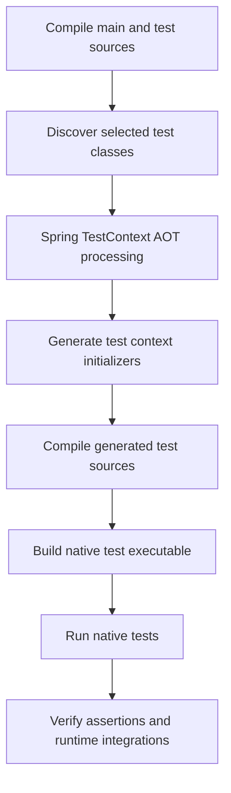

# Spring TestContext AOT phát hiện, xử lý và sinh context cho bài kiểm thử

## 1. Vì sao Spring TestContext cần AOT riêng?

Spring TestContext Framework tạo ApplicationContext cho các bài kiểm thử dựa trên metadata của test class. Metadata này có thể đến từ `@ContextConfiguration`, `@SpringBootTest`, `@WebMvcTest`, `@DataJpaTest`, `@ActiveProfiles`, `@TestPropertySource`, `@DynamicPropertySource`, `@TestConfiguration` và các custom `ContextCustomizerFactory`.

Trên JVM, TestContext có thể xây dựng context linh hoạt trong lúc test chạy. Với GraalVM Native Image, context cần được chuẩn bị trước để compiler phân tích và tạo executable. Spring TestContext AOT thực hiện một quy trình riêng: phát hiện các test class được chọn, xác định cấu hình context tương ứng, xử lý context customization trong phạm vi được hỗ trợ và sinh mã khởi tạo để context có thể được tạo trong môi trường AOT/native.

Trong module **SPRING_BOOT_NATIVE_IMAGE**, cần hiểu TestContext AOT như một phần của build pipeline. Nó không đơn giản là chạy lại test JVM với một cờ khác. Quá trình này phải biết test nào cần hỗ trợ, context nào được sử dụng và những cấu hình nào cần được cố định để có thể sinh initializer.

Bài học đi theo chuỗi: discovery test class → phân tích metadata → tạo context model → sinh initializer/attributes → biên dịch native test → chạy test trên executable.

## 2. TestContext AOT xử lý những đầu vào nào?

Spring TestContext Framework xây context từ một tập metadata. Các đầu vào phổ biến:

| Đầu vào | Vai trò |
|---|---|
| Test class | Lớp kiểm thử cần tạo context |
| Context configuration | Chỉ định configuration class, initializer hoặc location |
| Boot test annotation | Xác định cách khởi chạy ứng dụng và loại context |
| Active profiles | Chọn profile và configuration tương ứng |
| Test property sources | Bổ sung/ghi đè property cho context test |
| Context customizers | Tùy chỉnh context trước khi refresh |
| Context loader | Cách tạo ApplicationContext |
| Parent context | Quan hệ context phân cấp nếu có |
| Bean overrides/mocks | Thay thế bean phục vụ test theo cơ chế framework/version |
| Test configuration | Bean/configuration chỉ dùng trong test |

TestContext AOT cần phân tích cấu hình đủ ổn định để tạo context khi build. Những đầu vào phụ thuộc dữ liệu chỉ có lúc test chạy hoặc tạo cấu trúc context tùy ý có thể không tương thích với quá trình sinh mã.

## 3. Phân biệt test discovery với test execution

Có hai hoạt động khác nhau:

- **Test discovery cho AOT:** build tool tìm những test class cần xử lý và chuyển metadata của chúng vào quy trình Spring TestContext AOT.
- **Test execution:** test method thực sự chạy, thực hiện assertion và tương tác với ApplicationContext.

AOT discovery không có nghĩa test method đã được chạy. Ngược lại, một bài test pass trên JVM không bảo đảm test class đó đã được chọn trong AOT processing.

Ví dụ, Maven Surefire hoặc Gradle test task có thể phát hiện test để chạy JVM. Spring TestContext AOT có thể dùng một tập test class và task riêng để sinh context initializer. Phải kiểm tra build lifecycle của dự án để biết task nào thực hiện mỗi việc.

## 4. Cách TestContext nhận diện metadata của test class

TestContext Framework đọc annotation trên test class và các superclass/enclosing configuration theo quy tắc của framework. Ví dụ:

```java
@SpringBootTest
@ActiveProfiles("native-test")
@TestPropertySource(properties = {
        "orders.feature.enabled=true"
})
class OrderServiceIntegrationTest {
}
```

Từ class này, framework có thể xác định:

- Dùng Spring Boot để tạo context.
- Profile `native-test` được kích hoạt.
- Property test được bổ sung.
- Boot application/configuration cần được tìm và nạp.
- Các customizers/initializers liên quan cần được áp dụng.

TestContext AOT phân tích metadata đó để chuẩn bị context. Việc phát hiện chính xác còn phụ thuộc test class có được đưa vào danh sách AOT test classes và có nằm trong phạm vi cấu hình build hay không.

Chỉ có annotation trên source file không đủ; test class phải được compile và được build tool/plugin cung cấp cho AOT processor.

## 5. Những annotation test thường gặp

| Annotation | Ý nghĩa trong context test |
|---|---|
| `@SpringBootTest` | Tạo context dựa trên Spring Boot application |
| `@ContextConfiguration` | Chỉ định nguồn cấu hình hoặc context loader |
| `@ActiveProfiles` | Cố định profile cho context |
| `@TestPropertySource` | Cung cấp property source cho test |
| `@WebMvcTest` | Tạo slice context tập trung vào MVC |
| `@DataJpaTest` | Tạo slice context tập trung vào JPA |
| `@Import` | Thêm configuration/component vào context |
| `@TestConfiguration` | Khai báo cấu hình bổ sung dành cho test |
| `@DynamicPropertySource` | Đăng ký property động thông qua method tĩnh |
| `@DirtiesContext` | Đánh dấu context cần loại khỏi cache sau test |

Không phải mọi annotation đều có cùng mức hỗ trợ trong AOT/native test ở mọi phiên bản. Đặc biệt, custom context loader, context customizer hoặc property được tính từ trạng thái runtime cần được kiểm tra theo Spring Framework/Spring Boot version.

## 6. Từ test class đến generated ApplicationContext initializer

Ở mức khái niệm, TestContext AOT thực hiện các bước:

1. Nhận danh sách test class cần xử lý.
2. Đọc metadata test và xác định cấu hình context.
3. Tạo hoặc chuẩn bị ApplicationContext phù hợp cho phân tích.
4. Xử lý bean definitions, customizers và cấu hình trong phạm vi hỗ trợ.
5. Sinh mã Java để khởi tạo context tương ứng.
6. Ghi metadata liên kết test class với initializer được sinh.
7. Build test/native artifact sử dụng initializer đó khi chạy.

Mã được sinh cho phép Native Image nhìn thấy cấu trúc context và các lời gọi khởi tạo trong build graph. Compiler có thể phân tích reachability của bean và dependency thay vì phải dựa hoàn toàn vào cơ chế khám phá động lúc test chạy.

Tên class, package và thư mục generated output là chi tiết triển khai có thể thay đổi theo Spring version và build plugin. Không nên viết code ứng dụng phụ thuộc trực tiếp vào tên generated initializer nội bộ nếu framework không cam kết đó là API công khai.

## 7. Generated initializer có vai trò gì?

Một initializer được sinh đại diện cho cấu hình context của test class hoặc nhóm context tương ứng. Khi test chạy trong AOT mode, TestContext có thể dùng initializer này để tạo context đã được chuẩn bị.

Minh họa ý tưởng:

```java
// Pseudocode minh họa, không phải generated source cố định
final class OrderServiceTestContextInitializer {

    void initialize(GenericApplicationContext context) {
        // Đăng ký bean definitions và cấu hình đã được AOT chuẩn bị
    }
}
```

Đây chỉ là mô hình khái niệm. Generated code thực tế do Spring AOT tạo ra và có cấu trúc riêng theo phiên bản. Không tự tạo một class giả định tên như trên rồi mong TestContext tự phát hiện.

Initializer giúp giảm phụ thuộc vào một số bước introspection/runtime processing. Nó không biến toàn bộ test environment thành static: test method vẫn chạy, assertion vẫn được thực thi và các dependency runtime như database/container vẫn cần được cung cấp.

## 8. AOT attributes và dữ liệu gắn với test

Một số cấu hình test cần dữ liệu được chuẩn bị trong pha AOT và đọc lại lúc test execution. Spring TestContext AOT có cơ chế attributes để lưu những giá trị phù hợp cho quá trình này. Cụ thể API và cách truy cập phụ thuộc phiên bản Spring Framework.

Điểm quan trọng là phân biệt:

- Metadata cấu trúc cần thiết để tạo context.
- Runtime data do test cung cấp khi thực thi.
- Giá trị chỉ có thể biết sau khi container/service test khởi động.
- Secret hoặc endpoint tạm thời không nên bị đóng băng vào generated artifact.

Ví dụ, một Testcontainers database có port ngẫu nhiên chỉ tồn tại lúc test execution. Không nên giả định AOT build có thể biết port đó trước. Thay vào đó, cần dùng cơ chế được TestContext/native testing hỗ trợ để cung cấp runtime property, hoặc thiết kế integration test với endpoint có thể cấu hình khi chạy.

Không lưu credential hoặc dữ liệu nhạy cảm vào generated attributes/source. Generated output có thể được đóng gói và lưu trong CI artifact.

## 9. Profile và property phải nhất quán giữa AOT và test runtime

TestContext AOT cần tạo context theo cấu hình structural đã chọn. Ví dụ:

```java
@SpringBootTest
@ActiveProfiles("native-test")
@TestPropertySource(properties = {
        "payment.provider=stub",
        "search.enabled=false"
})
class PaymentFlowNativeTest {
}
```

Nếu `payment.provider` hoặc `search.enabled` được dùng trong condition để chọn bean, giá trị đó ảnh hưởng bean graph. AOT phải xử lý context với cùng giá trị structural.

Một property khác như `inventory.base-url` có thể chỉ là runtime value được inject vào bean đã tồn tại. Giá trị URL có thể được cung cấp khi test chạy nếu thiết kế ứng dụng không dùng nó để quyết định bean registration.

Trước khi chạy AOT, lập bảng:

| Property | Cách sử dụng | Thời điểm cần cố định |
|---|---|---|
| `spring.profiles.active` | Chọn configuration | AOT/context creation |
| `payment.provider` | `@ConditionalOnProperty` | AOT/context creation |
| `search.enabled` | Quyết định bean có tồn tại | AOT/context creation |
| `inventory.base-url` | Giá trị inject vào client | Runtime nếu bean graph không đổi |
| `test.datasource.url` | Kết nối test database | Runtime nếu endpoint được cung cấp sau khi database sẵn sàng |

Nếu test JVM và AOT dùng property khác nhau, hai context có thể không tương đương. Cần kiểm tra nguồn property thực sự đến process AOT, không chỉ nhìn annotation trên test class.

## 10. Context cache và nhiều test class

Spring TestContext Framework có cơ chế cache ApplicationContext để tránh tạo lại context cho các test class có cùng cấu hình. Các test class có metadata khác nhau có thể tạo context khác nhau.

Trong AOT, mỗi context configuration cần được xử lý theo cơ chế framework. Nếu test suite có quá nhiều biến thể profile/property/customizer, số context cần phân tích và generated output có thể tăng.

Nên nhóm test theo context có chủ đích:

- Dùng chung profile và structural properties khi cùng bean graph.
- Tách test class khi thật sự cần configuration khác.
- Tránh mỗi test class tự tạo một biến thể property không cần thiết.
- Hạn chế custom context customizer chỉ để thay đổi cấu trúc tùy ý.
- Ghi lại context configurations được AOT xử lý.

Không cố gộp các test có bean graph khác nhau vào cùng context chỉ để giảm số initializer. Điều đó có thể làm test không còn phản ánh cấu hình cần kiểm tra.

## 11. Test slice và full ApplicationContext

Spring Boot test slice như `@WebMvcTest` hoặc `@DataJpaTest` tạo context nhỏ hơn full `@SpringBootTest`. Chúng giúp kiểm tra một tầng, nhưng có cấu hình auto-configuration và bean graph riêng.

Ví dụ:

```java
@WebMvcTest(OrderController.class)
class OrderControllerTest {
}
```

Test này không tạo toàn bộ application context như `@SpringBootTest`. Nếu mục tiêu là kiểm tra native executable của ứng dụng đầy đủ, cần thêm integration test trên full context hoặc black-box HTTP test.

Nếu muốn dùng test slice trong native test workflow, xác nhận phiên bản Spring Boot/Spring Framework và plugin hỗ trợ loại test đó. Không suy luận rằng mọi test slice chạy được trên JVM đều tự động được TestContext AOT hỗ trợ tương đương trong native.

## 12. Context customizers và cấu hình động

TestContext cho phép mở rộng quá trình tạo context bằng customizers, initializers và property suppliers. Các extension này có thể làm context phụ thuộc logic Java tùy ý.

Ví dụ `@DynamicPropertySource` thường dùng để đăng ký URL/port của container:

```java
@DynamicPropertySource
static void databaseProperties(DynamicPropertyRegistry registry) {
    registry.add("spring.datasource.url",
            postgres::getJdbcUrl);
}
```

Giá trị supplier chỉ có thể trả về endpoint khi container đã chạy. Do đó phải phân biệt việc AOT phân tích cấu trúc context với việc runtime cung cấp giá trị động. Một số kiểu customizer/initializer có thể không được hỗ trợ trong AOT nếu chúng yêu cầu thực thi logic không thể mô tả hoặc sinh mã phù hợp.

Khi gặp lỗi, xác định customizer có thay đổi bean graph hay chỉ cung cấp runtime value. Nếu chỉ là runtime endpoint, dùng cơ chế test support phù hợp để cung cấp ở runtime. Nếu nó tạo bean definitions tùy ý dựa trên dữ liệu không biết lúc build, cần đơn giản hóa cấu hình hoặc tách test khỏi AOT/native scope.

## 13. Các test không phù hợp với AOT/native mode

Một số test dựa trên khả năng động hoặc thay đổi cấu trúc context tùy ý có thể không chạy được trong AOT/native mode. Ví dụ:

- Test tự tạo ApplicationContext bằng logic tùy biến ngoài TestContext support.
- Custom context loader phụ thuộc classpath scan động.
- Context customizer sinh bean definitions từ dữ liệu chỉ có khi test method chạy.
- Test dựa vào nạp plugin class mới sau khi executable được build.
- Test thay đổi profile/property structural sau khi AOT đã tạo initializer.
- Test dùng framework mocking/bytecode generation không tương thích native.

Không phải mọi test có `@MockBean` hoặc dynamic property đều mặc nhiên không tương thích; support thay đổi theo Spring Boot version và cơ chế bean override. Hãy kiểm tra đúng phiên bản, chạy test riêng và đọc lỗi cụ thể trước khi loại test.

Spring Framework có annotation như `@DisabledInAotMode` trong các phiên bản hỗ trợ, cho phép đánh dấu test class cần bỏ qua trong AOT mode với lý do phù hợp. Chỉ dùng khi test thật sự không thể hỗ trợ trong native workflow; không dùng để che lỗi cấu hình hoặc bỏ qua test quan trọng mà không có phương án thay thế.

## 14. Chạy TestContext AOT qua build tool

Spring Boot và Native Build Tools có task/goal riêng cho AOT processing và native tests. Tên chính xác phụ thuộc phiên bản và plugin được cấu hình.

Với Gradle, dự án có thể cung cấp task liên quan như `processTestAot` và `nativeTest` khi plugin/version hỗ trợ. Với Maven, Spring Boot Maven Plugin có goal xử lý AOT test trong các phiên bản tương ứng; native test execution còn phụ thuộc Native Build Tools và cấu hình dự án.

Không sao chép lệnh từ project khác mà chưa xác nhận task tồn tại:

```bash
./gradlew tasks --all
./mvnw help:describe -Dplugin=org.springframework.boot:spring-boot-maven-plugin
```

Sau đó kiểm tra lifecycle thực tế, plugin version và tài liệu cùng version. Một build có thể chạy AOT processing tự động như dependency của native task, hoặc yêu cầu gọi task riêng. Log phải chứng minh test AOT processing đã diễn ra.

## 15. Phân biệt processAot và processTestAot

Spring Boot AOT cho ứng dụng và TestContext AOT cho test có mục tiêu khác nhau:

| Quy trình | Đối tượng xử lý | Kết quả |
|---|---|---|
| Application AOT | ApplicationContext của ứng dụng | Generated application initialization |
| Test AOT | Context configurations của test classes | Generated test context initializers/metadata |
| Native application build | Application output + AOT output | Native application executable |
| Native test build/run | Test code và test AOT support theo plugin | Test executable/test runtime tương ứng |

Một application AOT build pass không chứng minh TestContext AOT đã xử lý test classes. Ngược lại, test AOT pass không thay thế application AOT khi tạo executable production.

Kiểm tra log và task graph để xác định cả hai pipeline có chạy khi dự án yêu cầu hay không.

## 16. Kiểm tra generated test output

Sau khi TestContext AOT chạy, kiểm tra generated source/resource trong thư mục build output do plugin/version sử dụng. Các câu hỏi:

- Test class dự kiến có được đưa vào AOT processing không?
- Có initializer/metadata tương ứng cho context không?
- Profile/property được ghi nhận đúng không?
- Có cảnh báo hoặc test class bị loại không?
- Customizer/initializer nào gây lỗi hoặc không được hỗ trợ?
- Generated source có được compile vào đúng test/native build output không?

Đường dẫn generated output có thể khác giữa Maven và Gradle, cũng như giữa các Spring version. Dùng task output/log để xác định vị trí thực tế. Không sửa generated file bằng tay; hãy sửa test metadata hoặc cấu hình nguồn rồi chạy lại AOT.

## 17. Kiểm thử context sau khi sinh initializer

Sau AOT processing, cần chạy test bằng chế độ sử dụng generated context initializer mà plugin/framework cung cấp. Mục tiêu là xác nhận context được tạo từ output AOT, không phải chỉ chạy lại context JVM bình thường.

Các bước kiểm tra:

1. Xác định task/test mode đang bật AOT.
2. Kiểm tra log cho biết AOT-generated initializer được dùng.
3. Chạy test class có profile/property cố định.
4. Assert bean bắt buộc tồn tại và bean không mong muốn vắng mặt.
5. Gọi service/endpoint để kiểm tra dependency wiring.
6. Xác minh test không âm thầm fallback sang context loader JVM thông thường.

Nếu plugin có task riêng cho native test, hãy chạy task đó sau khi AOT generation thành công. Nếu chỉ chạy `test` trên JVM, kết quả không chứng minh test đang dùng native executable hoặc generated initializer.

## 18. Native test execution và TestContext AOT

Native test cần một executable được build với test code và các context initializer/metadata cần thiết. Khi test chạy, framework vẫn thực hiện test method và assertion, nhưng context được chuẩn bị theo AOT model.

Một workflow khái quát:



Tên task và mức tự động hóa khác nhau theo build tool/plugin version. Để kiểm chứng native thật, xác nhận test đang chạy bằng native executable, không chỉ JVM test task.

Các dependency ngoài như Testcontainers, database, message broker hoặc service mock vẫn cần runtime environment phù hợp. Native test không tự cung cấp database/container chỉ vì context initializer đã được sinh.

## 19. Chẩn đoán lỗi TestContext AOT

| Triệu chứng | Nguyên nhân có thể | Hướng kiểm tra |
|---|---|---|
| Test class không có generated initializer | Không được discovery hoặc không nằm trong AOT test set | Kiểm tra test source set, include/exclude và task |
| JVM test pass nhưng AOT processing fail | Context customization không được hỗ trợ hoặc metadata không ổn định | Xác định customizer/initializer và property |
| Generated context thiếu bean | AOT dùng profile/condition khác | Kiểm tra structural inputs |
| AOT pass nhưng native test startup fail | Runtime dependency/resource/JNI hoặc initialization issue | Đọc native stack trace và runtime environment |
| Dynamic property không có giá trị | Supplier chỉ sẵn sàng sau khi container khởi động | Kiểm tra lifecycle và runtime property binding |
| Test slice không chạy native | Loại context/test support chưa tương thích | Kiểm tra version support, thay bằng integration test phù hợp |
| Test bị bỏ qua trong AOT mode | Có `@DisabledInAotMode` hoặc exclusion | Xác minh lý do và test thay thế |
| Test chạy nhưng không dùng generated context | Sai task/mode hoặc fallback JVM | Kiểm tra log và test execution path |

Không kết luận lỗi nằm ở TestContext AOT chỉ từ một stack trace startup. Phân biệt discovery, context preparation, generated source compilation, native image build và runtime execution.

## 20. Bài thực hành: sinh context cho OrderServiceIntegrationTest

**Bối cảnh:** Order API có profile `native-test`, mock payment gateway và một property bật/tắt search integration. Mục tiêu là sinh context cho test và chạy trên native.

**Bước 1 — Chuẩn hóa test metadata.** Tạo `@SpringBootTest`, `@ActiveProfiles("native-test")` và property structural cố định trên test class.

**Bước 2 — Xác định context contract.** Liệt kê bean phải có, bean phải vắng và implementation được inject vào service.

**Bước 3 — Chạy JVM context test.** Dùng `@SpringBootTest` để xác nhận profile, condition, bean wiring và behavior cơ bản.

**Bước 4 — Cấu hình TestContext AOT.** Xác định task/goal đúng phiên bản Spring Boot, thêm test class vào AOT processing và truyền đúng structural properties.

**Bước 5 — Kiểm tra generated output.** Xác nhận test class được xử lý, initializer/metadata được sinh và source generated được compile.

**Bước 6 — Chạy test bằng AOT context.** Dùng test mode/plugin support tương ứng, xác minh context được tạo từ generated initializer.

**Bước 7 — Build và chạy native tests.** Chạy native test task hoặc workflow native tương ứng; xác nhận process thực thi là native test executable.

**Bước 8 — Kiểm tra integration runtime.** Cấp database/service test, dynamic endpoint và resource cần thiết; chạy các assertion cùng fixture.

**Bước 9 — Ghi nhận giới hạn.** Ghi test class không được hỗ trợ, lý do loại và integration/black-box test thay thế.

Tiêu chí hoàn thành: test class được discovery; context metadata được xử lý với profile/condition cố định; generated initializer được tạo và dùng; native test executable chạy assertion; external dependencies được cung cấp đúng lifecycle.

## 21. Kết luận

Spring TestContext AOT phát hiện các test class được chọn, phân tích metadata context và sinh initializer/metadata để context có thể được tạo trong AOT/native mode. Quá trình này phụ thuộc vào test annotations, profiles, property sources, context customizers và build tool/plugin version.

Hãy phân biệt test discovery với test execution, application AOT với test AOT, và JVM context test với native test execution. Cố định structural inputs, xác nhận generated output được tạo và sử dụng, rồi chạy native test executable với runtime dependencies phù hợp. Khi một test dựa trên cấu trúc context động không thể hỗ trợ, ghi rõ giới hạn và tạo test thay thế cho behavior quan trọng thay vì coi một lần JVM test pass là bằng chứng native compatibility.
