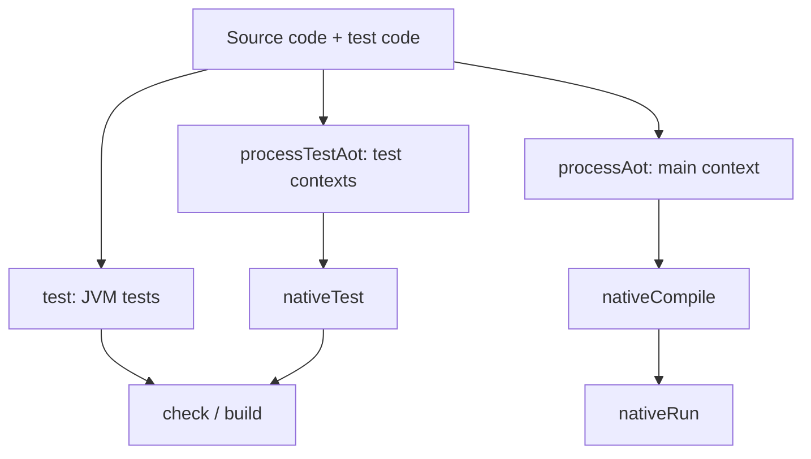
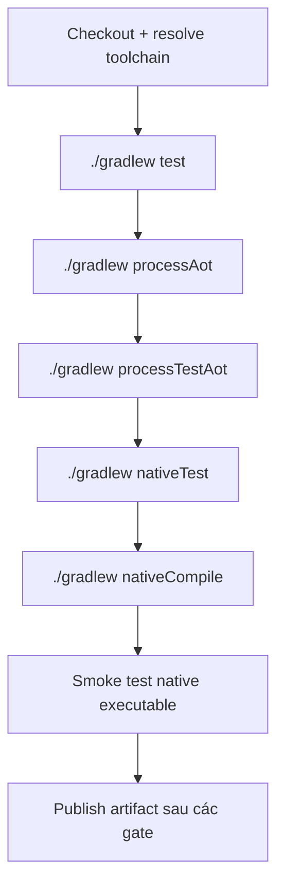
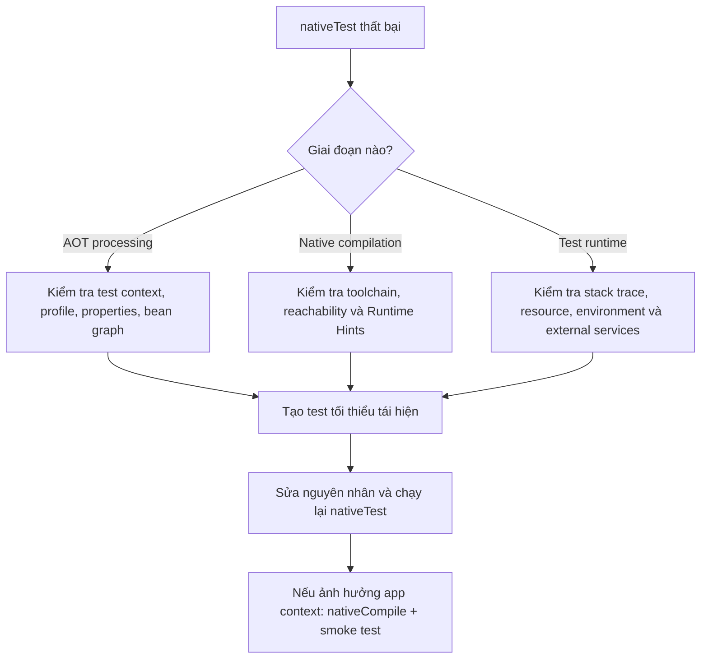

# processTestAot, nativeTest và các tác vụ liên quan trong Gradle

Khi kiểm thử Spring Boot trên GraalVM Native Image, chạy bộ test JVM thành công là chưa đủ. JVM có thể thực hiện reflection hoặc đọc resource mà không cần metadata native tương ứng; native executable chỉ hoạt động với những class, member và resource được giữ lại trong quá trình build.

Trong Gradle, các tác vụ có vai trò khác nhau:

- `processAot` chuẩn bị ApplicationContext của ứng dụng chính.
- `processTestAot` chuẩn bị các ApplicationContext được sử dụng trong test.
- `nativeCompile` tạo native executable của ứng dụng.
- `nativeTest` biên dịch và chạy test trong môi trường Native Image.
- `nativeRun` chạy native executable của ứng dụng.

Hiểu đúng ranh giới giữa các tác vụ giúp xác định test đang kiểm tra điều gì, vì sao một test pass trên JVM nhưng fail trên native, và cần chạy bước nào khi thay đổi test configuration hoặc Runtime Hints.

Bài học thuộc chương **Kiểm thử native** của mô-đun `SPRING_BOOT_NATIVE_IMAGE`. Ta sẽ cấu hình Gradle Native Build Tools, phân biệt AOT main/test, xem task graph, chạy `nativeTest`, kiểm tra executable bằng `nativeRun` và xây dựng pipeline có thể chẩn đoán khi test thất bại.

## 1. Bản đồ các tác vụ Gradle

Spring Boot Gradle Plugin và GraalVM Native Build Tools bổ sung các task cho hai giai đoạn khác nhau: chuẩn bị context AOT và biên dịch/chạy native image.

| Task | Plugin/công cụ cung cấp | Vai trò |
| --- | --- | --- |
| `test` | Gradle Java plugin | Chạy unit test và integration test trên JVM |
| `processAot` | Spring Boot Gradle Plugin | Phân tích ApplicationContext chính và sinh AOT assets |
| `processTestAot` | Spring Boot Gradle Plugin | Phân tích các test ApplicationContext và sinh AOT assets cho test |
| `bootJar` | Spring Boot Gradle Plugin | Đóng gói ứng dụng thành executable JAR |
| `nativeCompile` | GraalVM Native Build Tools | Biên dịch native executable của ứng dụng |
| `nativeRun` | GraalVM Native Build Tools | Chạy native executable đã build |
| `nativeTest` | GraalVM Native Build Tools | Biên dịch và chạy test bằng Native Image |
| `check` | Gradle Java plugin | Gom các kiểm tra verification được gắn vào lifecycle |
| `build` | Gradle Base/Java plugin | Build project và chạy các verification task được nối vào lifecycle |

Tên task và cách các plugin nối dependency có thể thay đổi theo phiên bản. Hãy xác nhận task graph của dự án thực tế bằng `tasks --all` và `--dry-run`, thay vì suy luận chỉ từ tên task.



Sơ đồ mô tả vai trò logic, không khẳng định mọi project đều có dependency task graph giống hệt. Plugin có thể tự nối các task; cấu hình custom có thể thay đổi quan hệ đó.

## 2. Cấu hình plugin Gradle

Một project Spring Boot dùng Groovy DSL có thể khai báo các plugin như sau:

```groovy
plugins {
    id 'java'
    id 'org.springframework.boot' version '3.x.y'
    id 'io.spring.dependency-management' version '1.x.y'
    id 'org.graalvm.buildtools.native' version '0.x.y'
}

group = 'com.example'
version = '1.0.0'

java {
    toolchain {
        languageVersion = JavaLanguageVersion.of(21)
    }
}

dependencies {
    implementation 'org.springframework.boot:spring-boot-starter-web'
    testImplementation 'org.springframework.boot:spring-boot-starter-test'
}

tasks.named('test') {
    useJUnitPlatform()
}
```

Các chuỗi phiên bản `3.x.y`, `1.x.y` và `0.x.y` là chỗ điền phiên bản tương thích mà project đã chọn. Không dùng nguyên các chuỗi minh họa này trong build thực tế. Spring Boot, Gradle, GraalVM JDK và Native Build Tools cần nằm trong ma trận phiên bản được hỗ trợ.

Nếu dùng Kotlin DSL, cấu trúc tương đương:

```kotlin
plugins {
    java
    id("org.springframework.boot") version "3.x.y"
    id("io.spring.dependency-management") version "1.x.y"
    id("org.graalvm.buildtools.native") version "0.x.y"
}

tasks.test {
    useJUnitPlatform()
}
```

Native Build Tools cần GraalVM Native Image toolchain tương thích. Kiểm tra JDK đang được Gradle sử dụng, không chỉ JDK mặc định trong terminal:

```bash
./gradlew --version
java -version
native-image --version
```

Gradle daemon có thể tiếp tục sử dụng JDK từ lần khởi động trước. Nếu vừa đổi JAVA_HOME/toolchain, dừng daemon rồi chạy lại để tránh nhầm môi trường:

```bash
./gradlew --stop
./gradlew --version
```

## 3. Phân biệt processAot và processTestAot

Hai task cùng dùng Spring AOT nhưng phân tích hai context khác nhau.

### 3.1. processAot: context của ứng dụng chính

`processAot` khởi tạo context theo cấu hình ứng dụng được cung cấp cho AOT, xử lý component scanning, configuration, auto-configuration và condition, rồi sinh source/resources cần thiết để tái tạo context.

Task này quan tâm tới những gì ứng dụng cần khi chạy production: bean definitions, factory/registration code và runtime hints mà Spring hoặc các AOT contribution cung cấp.

Chạy riêng:

```bash
./gradlew processAot
```

Task này không chạy toàn bộ test suite và không tự tạo native executable. Nó chuẩn bị đầu vào cho bước build native.

### 3.2. processTestAot: context được sử dụng bởi test

Test Spring thường tạo ApplicationContext khác context production. Ví dụ:

- Test dùng `@SpringBootTest` với profile `test`.
- Test khai báo `@TestConfiguration` hoặc `@Import` test fixture.
- Test thay bean bằng mock hoặc test-specific implementation.
- Test có property source, active profile hoặc context customizer riêng.

`processTestAot` phân tích các test context này và sinh AOT assets cho test. Nhờ đó, test có thể được biên dịch/chạy trong môi trường native với cấu trúc context phù hợp.

Chạy riêng:

```bash
./gradlew processTestAot
```

Không nhầm test AOT với test native: `processTestAot` chuẩn bị context, còn `nativeTest` thực thi test trong Native Image.

### 3.3. So sánh nhanh

| Câu hỏi | `processAot` | `processTestAot` |
| --- | --- | --- |
| Context nào được phân tích? | Main application context | Test application contexts |
| Bean test fixture có được xét không? | Không phải mục tiêu chính | Có, nếu thuộc test context được phát hiện |
| Thay đổi test profile có ảnh hưởng? | Không nhất thiết | Có thể ảnh hưởng trực tiếp |
| Tạo native executable? | Không | Không |
| Thay thế `nativeTest`? | Không | Không |

Một test pass trong JVM không có nghĩa test context đã được chuẩn bị cho native. Khi test phụ thuộc cấu hình đặc thù, hãy kiểm tra `processTestAot` và môi trường AOT của test.

## 4. Xác nhận task graph của project

Trước khi chạy một pipeline dài, kiểm tra Gradle có nhận biết các task cần thiết:

```bash
./gradlew tasks --all
```

Tìm các task:

- `processAot`
- `processTestAot`
- `nativeCompile`
- `nativeRun`
- `nativeTest`

Xem task cụ thể:

```bash
./gradlew help --task processTestAot
./gradlew help --task nativeTest
```

Kiểm tra những task sẽ được thực thi mà chưa chạy chúng:

```bash
./gradlew nativeTest --dry-run
```

`--dry-run` hữu ích để xem dependency graph. Nếu cần biết task nào thực sự chạy hoặc bị up-to-date, dùng:

```bash
./gradlew nativeTest --info
```

Không tự thêm `dependsOn("processTestAot")` chỉ vì muốn thấy task xuất hiện trong log. Trước tiên xem plugin version đã tự nối task chưa. Nếu task graph không có AOT test processing nhưng test yêu cầu AOT context, kiểm tra tài liệu đúng phiên bản và cấu hình integration phù hợp. Một dependency tự thêm sai có thể tạo vòng phụ thuộc hoặc chạy AOT với sai classpath.

## 5. Tạo một test context có thể phân tích AOT

Ví dụ một ứng dụng có service và test dùng Spring Boot context:

```java
package com.example.orders;

import org.springframework.stereotype.Service;

@Service
public class OrderService {

    public String status(String orderId) {
        return "accepted:" + orderId;
    }
}
```

Test:

```java
package com.example.orders;

import org.junit.jupiter.api.Test;
import org.springframework.beans.factory.annotation.Autowired;
import org.springframework.boot.test.context.SpringBootTest;

import static org.assertj.core.api.Assertions.assertThat;

@SpringBootTest
class OrderServiceContextTests {

    @Autowired
    OrderService orderService;

    @Test
    void loadsServiceFromApplicationContext() {
        assertThat(orderService.status("ORD-100"))
                .isEqualTo("accepted:ORD-100");
    }
}
```

Đây là một test context đơn giản: bean được lấy từ Spring context và gọi theo behavior contract. Khi chạy `processTestAot`, Spring phân tích cấu hình test để chuẩn bị context phù hợp.

Đối với test thực tế, cần xem xét:

- `@ActiveProfiles` và property sources mà test sử dụng.
- `@TestConfiguration`, `@Import` và bean override.
- Dynamic property sources hoặc giá trị chỉ có khi test runtime.
- Testcontainers, random port và service bên ngoài.
- Mock framework hoặc thư viện dùng proxy/reflection.
- Các test cần filesystem/network mà native test environment không cung cấp.

Không phải mọi test JVM đều phù hợp chạy native. Chia test theo mục tiêu: test thuần logic có thể chạy JVM; test context/serialization/hints quan trọng cần native coverage; test cần môi trường đặc biệt phải được cấu hình rõ.

## 6. Profile và property trong test AOT

Test context có thể dùng profile riêng:

```java
import org.springframework.boot.test.context.SpringBootTest;
import org.springframework.test.context.ActiveProfiles;

@SpringBootTest
@ActiveProfiles("test")
class OrderRepositoryTests {
    // ...
}
```

Nếu profile ảnh hưởng bean graph, cần bảo đảm AOT processing và test execution dùng cùng giả định. Một bean được loại bởi `@Profile` hoặc `@ConditionalOnProperty` khi AOT sẽ không tự xuất hiện chỉ vì runtime test truyền một property khác.

Có thể đặt property test trong annotation:

```java
import org.springframework.boot.test.context.SpringBootTest;

@SpringBootTest(properties = {
        "feature.audit.enabled=true",
        "app.rules.source=classpath:test-rules.json"
})
class AuditContextTests {
    // ...
}
```

Hoặc dùng file `application-test.yaml` trong test resources. Chọn một nguồn cấu hình có thể tái lập, và xác minh nó được đọc trong cả AOT processing lẫn native test.

Nếu dùng task configuration để truyền arguments cho AOT, kiểm tra API của task ở phiên bản Spring Boot đang dùng. Không sao chép cấu hình từ một phiên bản Gradle plugin khác mà không kiểm tra task type và input thực tế.

## 7. Chạy nativeTest

Sau khi cấu hình GraalVM Native Build Tools và test source set, chạy:

```bash
./gradlew nativeTest
```

Task này biên dịch test suite thành native test executable và chạy các test trong môi trường Native Image. Nó có thể mất thời gian đáng kể vì phải thực hiện native compilation; lần chạy sau có thể nhanh hơn nếu Gradle build cache và incremental state còn hợp lệ.

Native test giúp phát hiện những vấn đề mà JVM test không thể phát hiện, ví dụ:

- Reflection thiếu metadata.
- Resource không được đóng gói.
- Proxy hoặc serialization cần metadata.
- Một số class/constructor không được giữ.
- Khác biệt khi khởi tạo Spring test context trong native runtime.

Đọc log để xác nhận test executable đã được build và chạy. Một task bị skip, disabled hoặc không có test được phát hiện không được xem là native test pass.

### 7.1. Chạy một nhóm test nhỏ trước

Khi đang điều tra lỗi, giảm phạm vi test theo cách Gradle hỗ trợ cho task/plugin version đang dùng. Với JVM test, ví dụ:

```bash
./gradlew test --tests "com.example.orders.OrderServiceContextTests"
```

Native test task không nhất thiết nhận mọi option filter giống Gradle `Test` task ở tất cả phiên bản Native Build Tools. Kiểm tra `help --task nativeTest` trước khi dùng `--tests` hoặc filter tùy chỉnh. Nếu plugin không hỗ trợ lọc như mong muốn, tách test source set hoặc tạo nhóm test riêng theo cấu hình build.

Không bắt đầu bằng toàn bộ native test suite khi chỉ cần xác minh một registrar mới. Hãy chạy registrar unit test/JVM behavior test trước, rồi native test tối thiểu có ý nghĩa.

## 8. Phân biệt nativeTest với nativeCompile và nativeRun

Ba task này kiểm tra ba mục tiêu khác nhau:

| Task | Artifact được tạo/chạy | Câu hỏi được trả lời |
| --- | --- | --- |
| `nativeTest` | Native executable chứa test code/test runner | Các test được chọn có chạy được trong Native Image không? |
| `nativeCompile` | Native executable của ứng dụng | Ứng dụng production có biên dịch thành native executable không? |
| `nativeRun` | Chạy executable của ứng dụng | Ứng dụng native có khởi động và xử lý luồng smoke test không? |

Chạy lần lượt:

```bash
./gradlew nativeCompile
./gradlew nativeRun
```

`nativeTest` không thay thế `nativeCompile`: test executable và main application executable có mục đích/đầu vào khác nhau. Ngược lại, `nativeCompile` thành công cũng không chứng minh test suite đã chạy trong native.

`nativeRun` thường chạy ứng dụng với cấu hình runtime được task/plugin thiết lập. Nếu cần test endpoint hoặc database thật, có thể chạy binary trong terminal/container riêng rồi dùng HTTP client hoặc integration test harness để kiểm tra. Không dựa vào việc process in "Started" là đủ kết luận mọi chức năng hoạt động.

## 9. Chọn các task theo mục tiêu

Một số chuỗi lệnh thường dùng:

**Kiểm tra test logic trên JVM:**

```bash
./gradlew test
```

**Kiểm tra main AOT:**

```bash
./gradlew processAot
```

**Kiểm tra test AOT:**

```bash
./gradlew processTestAot
```

**Chạy native test suite:**

```bash
./gradlew nativeTest
```

**Build và chạy ứng dụng native:**

```bash
./gradlew nativeCompile
./gradlew nativeRun
```

**Chạy verification lifecycle:**

```bash
./gradlew check
```

`check` chỉ chạy những verification task được gắn vào lifecycle. Đừng giả định `check` tự chạy `nativeTest` trong mọi project. Nếu CI cần native test, gọi task rõ ràng hoặc cấu hình lifecycle có chủ đích sau khi kiểm tra task graph.

## 10. Kiểm tra output AOT và native test

Output directory thay đổi theo Gradle/Spring Boot plugin version và cấu hình project. Một số vị trí thường gặp:

```text
build/
├── generated/
│   ├── aotSources/
│   ├── aotResources/
│   └── aotClasses/
├── native/
│   └── ...
└── ...
```

Không dựa vào cây thư mục mẫu để kết luận task không chạy. Dùng log `--info`, task output và Gradle task properties để xác định nơi output được ghi.

Khi cần kiểm tra:

1. `processAot` có tạo output main context không?
2. `processTestAot` có xử lý test context không?
3. `nativeTest` có compile test executable không?
4. Native test report có ghi test thực sự được thực thi không?
5. Executable có được tạo cho đúng OS/architecture không?

Có thể tìm tên class/bean trong generated source để điều tra, nhưng không nên viết test phụ thuộc vào tên generated class hoặc số lượng file cụ thể. Generated output là công cụ chẩn đoán; behavior contract mới là điều cần bảo vệ lâu dài.

## 11. Test context có dependency ngoài

Native test có thể gặp khó khăn khi test phụ thuộc dịch vụ ngoài hoặc tài nguyên chỉ có trong môi trường CI.

Ví dụ:

- Testcontainers cần Docker daemon và image tương thích.
- Test dùng random port cần tránh giả định port cố định.
- Test gọi API ngoài cần credentials/network.
- Test phụ thuộc filesystem path của máy phát triển.
- Test dùng mock framework tạo proxy/reflection động.
- Test phụ thuộc thread, process hoặc native library riêng.

Hướng xử lý:

- Dùng service container/test fixture có thể tái lập trong CI.
- Inject endpoint/credentials qua runtime test configuration.
- Dùng port động và lấy port thực tế từ test context.
- Tránh gọi dịch vụ production trong AOT processing.
- Nếu một test không có ý nghĩa trong native, phân loại rõ và chạy ở JVM test suite; vẫn giữ native coverage cho các đường production quan trọng.
- Với test yêu cầu JNI/native dependency, cung cấp đúng thư viện theo OS/architecture của runner.

Không tắt toàn bộ native tests chỉ vì một test tích hợp cần môi trường đặc biệt. Tách nhóm test và ghi rõ lý do để phần kiểm tra native còn lại vẫn chạy.

## 12. Ví dụ task flow trong CI

Một pipeline Gradle có thể tổ chức theo thứ tự:



Đây là flow khái niệm. Trong project thật, một task có thể kéo task khác theo dependency graph; nếu vậy, tránh chạy lại cùng bước một cách không cần thiết. Dùng `--dry-run` và build scan/log để biết task nào được thực thi, task nào up-to-date và task nào bị skip.

Một cấu hình CI có thể tách nhanh và chậm:

| Job | Công việc | Khi chạy |
| --- | --- | --- |
| JVM verification | `test`, `check` | Mỗi pull request |
| AOT verification | `processAot`, `processTestAot` | Khi thay đổi configuration, bean, test context hoặc framework |
| Native tests | `nativeTest` | Pull request quan trọng hoặc nightly tùy chi phí |
| Native app build | `nativeCompile` | Release candidate hoặc khi cần xác minh native artifact |
| Runtime smoke | Chạy executable/container và gọi endpoint | Trước release |

Nếu thời gian native compilation dài, có thể dùng cache và phân tầng pipeline, nhưng không bỏ native tests khỏi mọi chu kỳ release.

## 13. Những lỗi thường gặp

| Hiện tượng | Nguyên nhân cần kiểm tra | Hướng xử lý |
| --- | --- | --- |
| Không tìm thấy `processTestAot` | Spring Boot plugin không được áp dụng hoặc version/cấu hình không cung cấp task | Kiểm tra plugins block và `tasks --all` |
| Không tìm thấy `nativeTest` | Native Build Tools plugin chưa áp dụng hoặc plugin version không tương thích | Kiểm tra plugin ID/version và Gradle task list |
| `processTestAot` fail khi khởi tạo context | Test profile/property/fixture hoặc side effect chạy trong AOT | Kiểm tra log, active profiles và test configuration |
| JVM test pass nhưng nativeTest fail | Thiếu reflection/resource/proxy metadata hoặc native-only behavior | Đọc native stack trace, kiểm tra hints và dependency metadata |
| nativeTest không chạy test nào | Test filter/source set/engine chưa được nhận diện | Kiểm tra task input, test engine và report |
| nativeTest build rất lâu | Native compilation tốn tài nguyên hoặc không có cache | Chạy test scope nhỏ, kiểm tra toolchain/cache và runner |
| nativeCompile pass nhưng nativeRun fail | Runtime config, file, port, loader path hoặc service dependency thiếu | Chạy binary với cấu hình tương tự production và xem log |
| nativeTest pass nhưng ứng dụng native lỗi | Test executable không bao phủ main application packaging/runtime | Chạy nativeCompile và smoke/integration test executable |
| Task AOT chạy sai profile | AOT process và test runtime dùng config khác nhau | Đồng bộ test profile/property và kiểm tra task arguments |
| Task bị skip hoặc UP-TO-DATE | Input không đổi hoặc task graph không bao gồm task mong muốn | Xem `--info`, `--dry-run`, outputs và task dependencies |

## 14. Quy trình điều tra nativeTest thất bại

Khi `nativeTest` fail, đừng vội thêm Runtime Hints cho mọi class. Hãy đi theo chuỗi:

1. Xác định test fail ở compile, native image generation hay lúc chạy executable.
2. Xem lỗi đầu tiên trong log; các lỗi sau có thể chỉ là hậu quả.
3. Nếu fail ở AOT, kiểm tra test context, profile, property và bean definitions.
4. Nếu fail ở native compile, kiểm tra reachability, reflection/resource/proxy/serialization metadata và toolchain.
5. Nếu fail khi chạy test, kiểm tra native stack trace, resource path, environment và dependency ngoài.
6. Chạy test tương ứng trên JVM để xác định lỗi nghiệp vụ hay khác biệt native.
7. Tạo test tối thiểu tái hiện lỗi và sửa đúng nguyên nhân.
8. Chạy lại native test liên quan, sau đó chạy main native executable nếu thay đổi ảnh hưởng production context.



## 15. Checklist cho Gradle native testing

- [ ] Spring Boot Gradle Plugin và GraalVM Native Build Tools được áp dụng với phiên bản tương thích.
- [ ] Gradle đang dùng GraalVM JDK/toolchain đúng target.
- [ ] `test` chạy JVM suite thành công.
- [ ] `processAot` xử lý được main application context.
- [ ] `processTestAot` xử lý đúng test contexts và test profile.
- [ ] Task graph của `nativeTest` được xác nhận bằng `--dry-run` hoặc `--info`.
- [ ] Native test thực sự compile và chạy test, không bị skip hoặc không tìm thấy test.
- [ ] Test fixtures, properties, profiles và external services có cấu hình tái lập.
- [ ] Runtime Hints chỉ được bổ sung khi xác định đúng dynamic access còn thiếu.
- [ ] Native test report được lưu và kiểm tra.
- [ ] `nativeCompile` được chạy khi cần xác minh main executable.
- [ ] `nativeRun` hoặc smoke test executable/container kiểm tra luồng runtime quan trọng.
- [ ] CI ghi nhận OS/architecture/GraalVM/Gradle/Spring Boot versions của artifact.

### Câu hỏi tự đánh giá

1. `processAot` và `processTestAot` phân tích hai loại ApplicationContext nào?
2. Vì sao `processTestAot` không thay thế `nativeTest`?
3. `nativeTest` khác `nativeCompile` ở artifact được tạo và mục tiêu kiểm thử như thế nào?
4. Khi nào cần dùng `--dry-run` và `--info` để kiểm tra task graph?
5. Vì sao một test context dùng `@ActiveProfiles("test")` cần được cấu hình nhất quán trong AOT processing và native test?
6. Vì sao nativeTest pass chưa chứng minh main application executable đã chạy đúng trong container production?
7. Nếu nativeTest không chạy test nào, cần kiểm tra những yếu tố nào trước khi kết luận pass?
8. Khi một test phụ thuộc Testcontainers hoặc native library, cần chuẩn bị gì cho runner CI?

## Tài liệu tham khảo

- [Spring Boot Gradle Plugin — AOT tasks](https://docs.spring.io/spring-boot/gradle-plugin/aot.html): các task `processAot` và `processTestAot`, cấu hình AOT trong Gradle.
- [Spring Boot — Testing Native Applications](https://docs.spring.io/spring-boot/reference/packaging/native-image/testing-native-applications.html): kiểm thử ứng dụng và test với native image.
- [GraalVM Native Build Tools — Gradle Plugin](https://graalvm.github.io/native-build-tools/latest/gradle-plugin.html): task `nativeCompile`, `nativeRun`, `nativeTest` và cấu hình plugin.
- [Gradle — Task Execution](https://docs.gradle.org/current/userguide/command_line_interface.html#sec:task_execution): xem task graph, `--dry-run`, `--info` và điều khiển task execution.

**Kết quả cần đạt:** biết chọn và phối hợp đúng `processAot`, `processTestAot`, `nativeTest`, `nativeCompile` và `nativeRun`; xác minh task graph thực tế của Gradle; và kiểm tra cả test executable lẫn ứng dụng native. Khi native test thất bại, có thể phân loại lỗi theo AOT processing, native compilation hoặc runtime để sửa đúng nguyên nhân thay vì thêm metadata tràn lan.
