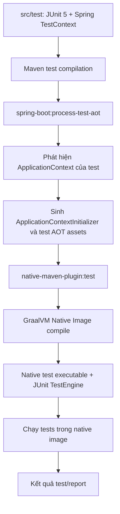

# Profile `nativeTest` và cấu hình test AOT tương ứng trong Maven

## 1. Vì sao cần một profile riêng để kiểm thử native?

Khi phát triển Spring Boot Native Image, phần lớn unit test và integration test vẫn nên chạy trên JVM. JVM cho tốc độ build nhanh, dễ debug và tận dụng tốt IDE. Tuy nhiên, một số lỗi chỉ xuất hiện khi ứng dụng chạy bằng mã khởi tạo AOT hoặc khi được biên dịch thành executable native: thiếu reflection/resource metadata, proxy không tương thích, khác biệt class initialization hoặc thư viện native không hoạt động như mong đợi.

Spring Boot và GraalVM Native Build Tools hỗ trợ chạy **JUnit Platform tests bên trong native image**. Với Maven, `spring-boot-starter-parent` cung cấp profile tên chính xác là **`nativeTest`**. Profile này liên kết hai bước:

1. Spring Boot Maven Plugin chạy `process-test-aot` để phân tích các test dùng Spring TestContext Framework và sinh mã khởi tạo context.
2. GraalVM Native Build Tools Maven Plugin chạy goal `test` để tạo test executable native và thực thi các test bên trong executable đó.

Vì vậy, `nativeTest` là profile dành cho kiểm thử test suite trong native image. Nó có mục tiêu khác với profile `native`, vốn thường dùng để xử lý AOT ứng dụng và build native executable của ứng dụng.

Sau bài học, bạn có thể:

- Cấu hình hai plugin cần thiết trong Maven module.
- Kích hoạt `nativeTest` bằng `mvn test -PnativeTest`.
- Hiểu vai trò của `process-test-aot` và Native Build Tools goal `test`.
- Tự khai báo hai execution nếu dự án không dùng `spring-boot-starter-parent`.
- Phân biệt JVM tests, JVM chạy mã AOT, và native tests.
- Xử lý các cờ bỏ qua test, phiên bản JUnit/Surefire và các vấn đề trong multi-module build.

## 2. Ba cấp độ kiểm thử cần phân biệt

Không phải mọi bài test trong dự án đều cần chạy thành native executable. Một quy trình cân bằng thường có ba cấp độ:

| Cấp độ | Cách chạy | Mục tiêu |
|---|---|---|
| JVM test thông thường | Maven Surefire chạy test trên JVM, dùng cấu hình runtime thông thường | Bao phủ nghiệp vụ rộng, feedback nhanh, debug dễ |
| JVM với Spring AOT-generated code | Đóng gói output AOT rồi chạy JVM với `-Dspring.aot.enabled=true` | Kiểm tra mã khởi tạo AOT và các điều kiện đã được chốt ở build time |
| Native test | `nativeTest` kích hoạt AOT test processing và Native Build Tools biên dịch/chạy test executable | Kiểm tra hành vi trong môi trường GraalVM Native Image thực tế |

Spring Boot khuyến nghị tiếp tục chạy phần lớn test trên JVM để giảm thời gian phát triển. Native tests có thể tập trung vào các khu vực khác biệt và chạy trong CI, ví dụ một lần mỗi ngày hoặc trên các nhánh release.

### 2.1. Luồng xử lý của native test



Trong quá trình này, Spring phân tích các test JUnit 5 sử dụng Spring TestContext Framework để tìm các `ApplicationContext` cần thiết. AOT xử lý từng context và sinh `ApplicationContextInitializer` tương ứng. Native Build Tools sau đó đưa test cùng JUnit `TestEngine` đã chọn vào executable native; khi executable chạy, test engine thực thi các test đã được phát hiện.

## 3. Điều kiện để dùng profile `nativeTest`

### 3.1. Kế thừa `spring-boot-starter-parent`

Profile `nativeTest` được định nghĩa sẵn trong `spring-boot-starter-parent`. Dự án cần dùng đúng parent version tương thích với Spring Boot plugin và dependency management hiện tại.

Ví dụ phần parent trong `pom.xml` (thay version bằng version Spring Boot mà dự án đang sử dụng):

```xml
<parent>
    <groupId>org.springframework.boot</groupId>
    <artifactId>spring-boot-starter-parent</artifactId>
    <version>4.2.0</version>
    <relativePath/>
</parent>
```

Spring Boot 3.3 cũng đã có hỗ trợ `process-test-aot` và profile `nativeTest`; hãy dùng tài liệu đúng minor version nếu dự án đang ở Boot 3.x. Không nâng parent chỉ để lấy profile mà chưa kiểm tra JDK, GraalVM và dependency compatibility của ứng dụng.

### 3.2. Khai báo hai plugin trong module ứng dụng

Profile của parent chỉ cấu hình execution cho các plugin được khai báo. Module cần chạy native tests phải khai báo cả:

- `org.springframework.boot:spring-boot-maven-plugin`
- `org.graalvm.buildtools:native-maven-plugin`

Ví dụ cấu hình tối thiểu:

```xml
<build>
    <plugins>
        <plugin>
            <groupId>org.springframework.boot</groupId>
            <artifactId>spring-boot-maven-plugin</artifactId>
        </plugin>

        <plugin>
            <groupId>org.graalvm.buildtools</groupId>
            <artifactId>native-maven-plugin</artifactId>
            <extensions>true</extensions>
        </plugin>
    </plugins>
</build>
```

`<extensions>true</extensions>` bật các lifecycle extension của Native Build Tools Maven Plugin. Dùng version plugin do Spring Boot hoặc dependency/plugin management của dự án quản lý, tránh khai báo version không tương thích với GraalVM đang cài.

### 3.3. Chạy native tests

Sau khi khai báo parent và hai plugin, chạy:

```bash
./mvnw test -PnativeTest
```

Nếu máy không có Maven Wrapper:

```bash
mvn test -PnativeTest
```

`-PnativeTest` kích hoạt profile có phân biệt chữ hoa/thường. Lệnh trên thực hiện test theo Maven lifecycle, đồng thời kích hoạt AOT test processing và Native Build Tools native test execution được parent cấu hình.

Không nhầm với:

```bash
./mvnw -Pnative package
```

Lệnh `-Pnative package` thường dùng để xử lý AOT cho ứng dụng và build native executable ứng dụng. Lệnh `-PnativeTest test` dùng để build và chạy **test executable** native.

## 4. `process-test-aot` làm gì?

### 4.1. AOT xử lý test context

`spring-boot:process-test-aot` gọi Spring AOT engine trên các JUnit 5 tests dùng Spring TestContext Framework. Ví dụ:

```java
package com.example.orders;

import org.junit.jupiter.api.Test;
import org.springframework.beans.factory.annotation.Autowired;
import org.springframework.boot.test.context.SpringBootTest;

import static org.assertj.core.api.Assertions.assertThat;

@SpringBootTest
class OrderApplicationTests {

    @Autowired
    OrderService orderService;

    @Test
    void createsOrder() {
        Order order = orderService.create("SKU-100", 2);
        assertThat(order.id()).isNotBlank();
    }
}
```

Hoặc một test slice:

```java
package com.example.orders;

import org.junit.jupiter.api.Test;
import org.springframework.beans.factory.annotation.Autowired;
import org.springframework.boot.test.autoconfigure.web.servlet.WebMvcTest;
import org.springframework.test.web.servlet.MockMvc;

import static org.springframework.test.web.servlet.request.MockMvcRequestBuilders.get;
import static org.springframework.test.web.servlet.result.MockMvcResultMatchers.status;

@WebMvcTest(OrderController.class)
class OrderControllerTests {

    @Autowired
    MockMvc mockMvc;

    @Test
    void returnsOrder() throws Exception {
        mockMvc.perform(get("/api/orders/ORD-100"))
                .andExpect(status().isOk());
    }
}
```

Spring TestContext Framework cung cấp thông tin về cấu hình context, test class, customizer và các annotation liên quan. AOT engine dùng thông tin đó để sinh initializer cho context. Native test sau đó khởi tạo context thông qua mã đã sinh.

### 4.2. Thư mục output của `process-test-aot`

Theo Spring Boot Maven Plugin, các output mặc định nằm dưới `${project.build.directory}/spring-aot`:

| Thư mục | Nội dung |
|---|---|
| `spring-aot/main/classes` | Generated main classes |
| `spring-aot/test/classes` | Generated test classes |
| `spring-aot/test/sources` | Generated test sources |
| `spring-aot/test/resources` | Generated test resources |

Các đường dẫn cụ thể có thể thay đổi theo plugin version hoặc cấu hình `generatedClasses`, `generatedSources`, `generatedResources`, `generatedTestClasses`.

### 4.3. Các test nào được AOT xử lý?

Hỗ trợ tập trung vào **JUnit 5 tests sử dụng Spring TestContext Framework**. Những test thuần JUnit không tạo Spring context vẫn có thể được đưa vào native test image qua JUnit Platform, nhưng không có Spring context để `process-test-aot` sinh initializer.

Các kiểu test Spring thường gặp:

- `@SpringBootTest` cho context ứng dụng.
- `@WebMvcTest`, `@WebFluxTest` và các test slice khác.
- `@DataJpaTest`, `@JdbcTest` hoặc slice dữ liệu tương ứng.
- Test dùng `@ContextConfiguration`, `@Import`, `@TestConfiguration` và các annotation TestContext được hỗ trợ.

Native test cần JUnit Platform và test engine tương thích. Native Build Tools hỗ trợ JUnit Jupiter và JUnit Vintage; engine khác có thể cần native configuration riêng. Tối thiểu được tài liệu Native Build Tools hiện hành nêu là JUnit 5.8.1 / JUnit Platform 1.8.1.

### 4.4. Test context và cấu hình được cố định tại build time

Trong AOT, `BeanFactory` được chuẩn bị khi build. Các điều kiện tạo bean, profile và thuộc tính ảnh hưởng đến bean graph được đánh giá ở thời điểm đó. Do đó:

- Một profile cần thiết cho test context phải được chọn khi `process-test-aot` chạy.
- Không thể kỳ vọng thay đổi profile lúc chạy native test sẽ tạo lại một bean đã bị loại khỏi AOT context.
- Các test cần cấu hình context khác nhau phải được phát hiện thành những context riêng biệt trong quá trình test AOT.
- Không nên phụ thuộc vào việc nạp classpath hoặc thêm bean tùy ý sau khi native test image đã được build.

Nếu cần kiểm thử nhiều cấu hình bean graph, hãy tạo các test context/biến thể build riêng để mỗi cấu hình được AOT xử lý rõ ràng.

## 5. Cấu hình thủ công khi không dùng `spring-boot-starter-parent`

Nếu dự án kế thừa parent nội bộ hoặc dùng `spring-boot-dependencies` BOM thay vì `spring-boot-starter-parent`, profile `nativeTest` không tự xuất hiện. Khi đó cần tự cấu hình execution tương đương.

Ví dụ dưới đây cho thấy hai execution cần thiết trong profile Maven:

```xml
<profiles>
    <profile>
        <id>nativeTest</id>
        <build>
            <plugins>
                <plugin>
                    <groupId>org.springframework.boot</groupId>
                    <artifactId>spring-boot-maven-plugin</artifactId>
                    <executions>
                        <execution>
                            <id>process-test-aot</id>
                            <goals>
                                <goal>process-test-aot</goal>
                            </goals>
                        </execution>
                    </executions>
                </plugin>

                <plugin>
                    <groupId>org.graalvm.buildtools</groupId>
                    <artifactId>native-maven-plugin</artifactId>
                    <extensions>true</extensions>
                    <executions>
                        <execution>
                            <id>test-native</id>
                            <phase>test</phase>
                            <goals>
                                <goal>test</goal>
                            </goals>
                        </execution>
                    </executions>
                </plugin>
            </plugins>
        </build>
    </profile>
</profiles>
```

Đây là khung cấu hình cần điều chỉnh theo phiên bản plugin. Nếu không có Boot parent, bạn cũng cần tự chịu trách nhiệm về các cấu hình mặc định mà parent vốn cung cấp, chẳng hạn classpath thô cho Native Build Tools, kiểm tra GraalVM phù hợp và reachability metadata của thư viện bên thứ ba. Đọc tài liệu Native Build Tools cho version đang dùng trước khi hoàn thiện profile.

Kích hoạt vẫn bằng:

```bash
./mvnw -PnativeTest test
```

Nếu muốn xác minh riêng từng bước trong quá trình cấu hình, có thể gọi goal AOT trực tiếp:

```bash
./mvnw -PnativeTest spring-boot:process-test-aot
```

Và gọi native test goal:

```bash
./mvnw -PnativeTest native:test
```

Thông thường nên dùng lệnh lifecycle `test` để Maven điều phối đúng thứ tự và chạy cả các bước liên quan.

## 6. Tương thích Maven Surefire và JUnit Platform

Native Build Tools dùng JUnit Platform để khám phá test và đóng gói test engine vào native test executable. Các phiên bản cần tương thích với nhau.

### 6.1. Maven Surefire

Native Build Tools Maven Plugin yêu cầu Maven Surefire Plugin từ **3.0.0 trở lên** để chạy native tests theo chế độ được hỗ trợ hiện hành.

Ví dụ cấu hình plugin:

```xml
<build>
    <plugins>
        <plugin>
            <groupId>org.apache.maven.plugins</groupId>
            <artifactId>maven-surefire-plugin</artifactId>
            <version>3.5.4</version>
        </plugin>
    </plugins>
</build>
```

Hãy để Spring Boot parent quản lý version nếu dự án đã dùng parent. Con số trong ví dụ chỉ minh họa cách khai báo; chọn version tương thích với Boot, Maven và JUnit Platform của dự án.

### 6.2. `junit-platform-launcher`

Native test image dùng JUnit Platform launcher để phát hiện và đăng ký các test engine/test được chọn. Nếu Surefire quá cũ (trước 3.0 M4) hoặc dependency tree chứa các version JUnit Platform không đồng bộ, native test có thể lỗi khi discovery.

Ví dụ dependency bổ sung khi thật sự cần:

```xml
<dependency>
    <groupId>org.junit.platform</groupId>
    <artifactId>junit-platform-launcher</artifactId>
    <scope>test</scope>
</dependency>
```

Không tự chọn version tùy ý. Dùng version được JUnit BOM hoặc Spring Boot dependency management quản lý và bảo đảm tương thích với `junit-jupiter-engine`/`junit-vintage-engine` trên test classpath.

### 6.3. Kiểm tra dependency tree

Nếu native test báo lỗi liên quan launcher/engine, kiểm tra:

```bash
./mvnw dependency:tree \
  -Dincludes=org.junit.platform,org.junit.jupiter,org.junit.vintage
```

Tìm các version `junit-platform-launcher`, `junit-platform-engine`, `junit-jupiter-engine` và `junit-vintage-engine`. Những thành phần này cần cùng một dòng tương thích.

## 7. Chạy native tests có chọn lọc

Native compilation mất nhiều thời gian và tài nguyên hơn JVM test. Có thể phân chia test theo mục tiêu:

| Lệnh | Hành vi |
|---|---|
| `./mvnw test` | Chạy JVM tests thông thường |
| `./mvnw -PnativeTest test` | Chạy JVM test lifecycle và native test execution được profile cấu hình |
| `./mvnw -PnativeTest -DskipNativeTests test` | Giữ JVM tests, bỏ phần thực thi native tests |
| `./mvnw -PnativeTest -DskipTestExecution test` | Vẫn build native test image nhưng không chạy test executable |
| `./mvnw -PnativeTest -DskipTests test` | Bỏ thực thi test JVM và native tests |
| `./mvnw -PnativeTest -Dmaven.test.skip=true test` | Bỏ test compilation; Spring Boot không xử lý test AOT khi regular tests bị skip theo property này |

Hai cờ `-DskipNativeTests` và `-DskipTestExecution` thuộc Native Build Tools; kiểm tra plugin version vì hành vi/option có thể thay đổi. Trong giai đoạn chuyển đổi, `-DskipTestExecution` hữu ích để xác nhận native test image có thể được tạo trước khi xử lý các lỗi phát sinh khi chạy.

### 7.1. Tổ chức native tests trong CI

Một pipeline thực tế có thể chia thành:

1. Pull request: compile + JVM unit/integration tests.
2. Pull request hoặc nhánh chính: chạy ứng dụng JVM bằng AOT-generated code để phát hiện lỗi initializer sớm.
3. Nightly hoặc release: chạy `nativeTest` trên các test slice/luồng quan trọng.
4. Release candidate: chạy native integration tests trên container và OS/CPU đích.

Không nhất thiết chuyển toàn bộ test suite sang native image. Chọn các test có giá trị phát hiện lỗi đặc thù native và giữ phần còn lại chạy nhanh trên JVM.

### 7.2. Native test executable và output directory

Native Build Tools Maven Plugin ghi native test executable và report trong output directory của plugin, mặc định thường là `${project.build.directory}`. Nếu có nhiều native test execution hoặc nhiều profile tạo các test image khác nhau, hãy dùng `outputDirectory` riêng cho từng biến thể.

Ví dụ:

```xml
<plugin>
    <groupId>org.graalvm.buildtools</groupId>
    <artifactId>native-maven-plugin</artifactId>
    <configuration>
        <outputDirectory>${project.build.directory}/native-tests</outputDirectory>
    </configuration>
</plugin>
```

Không dùng `-H:Path` để thay đổi thư mục output của native test. Tùy chọn đó có thể di chuyển file do Native Image tạo ra nhưng không cập nhật thư mục mà Maven plugin dùng để chạy executable và ghi test report. Dùng `outputDirectory` hoặc property `-DoutputDir=...` theo tài liệu plugin.

## 8. Multi-module Maven project

Trong dự án nhiều module, không phải module nào cũng là ứng dụng Spring Boot hoặc có test cần chạy native. Chỉ khai báo hai plugin trong module ứng dụng cần native testing.

Ví dụ cấu trúc:

```text
order-platform/
  pom.xml                  # parent / dependency management
  order-domain/
    pom.xml                # domain library, JVM tests
  order-service/
    pom.xml                # Spring Boot application + nativeTest
  order-contract-tests/
    pom.xml                # contract tests riêng
```

Profile có thể được kích hoạt từ root reactor, nhưng module chỉ chạy các execution tương ứng nếu plugin đã được khai báo và cấu hình trong module đó. Nếu native plugin được quản lý ở parent `pluginManagement`, module cần khai báo plugin trong `<plugins>` để opt-in.

Nếu native plugin được áp dụng rộng cho nhiều module nhưng chỉ một số module có native tests, cấu hình `failNoTests` phù hợp:

- Đặt `failNoTests=false` ở cấu hình chung cho module không có native test.
- Override `failNoTests=true` trong module bắt buộc phải có native tests để tránh build xanh giả khi không tìm thấy test nào.

Không nên tắt `failNoTests` toàn reactor nếu có module ứng dụng mà thiếu test là lỗi cần phát hiện.

## 9. Kiểm tra mã AOT trên JVM trước native test

Native test không phải cách duy nhất để kiểm tra Spring AOT. Có thể build ứng dụng với AOT-generated code rồi chạy trên JVM để nhận feedback nhanh hơn trước khi biên dịch native.

Với Maven, build AOT output bằng profile `native`:

```bash
./mvnw -Pnative package
```

Sau đó chạy JAR với:

```bash
java -Dspring.aot.enabled=true -jar target/order-service.jar
```

Điều này yêu cầu JAR đã chứa mã AOT được sinh. Spring Boot sẽ dùng AOT-generated initialization code thay cho việc xử lý context theo đường runtime thông thường. Nếu ứng dụng khởi động thành công ở chế độ này, độ tin cậy tăng lên rằng generated code hoạt động, nhưng vẫn chưa chứng minh native image compile và runtime hoàn toàn thành công.

Có thể chạy integration test bên ngoài ứng dụng đang chạy, ví dụ dùng `WebClient` gọi endpoint hoặc kiểm tra response HTML. Đây là cách kiểm tra giao tiếp qua process boundary trong khi application chạy với AOT code trên JVM.

## 10. Chẩn đoán lỗi thường gặp

| Triệu chứng | Nguyên nhân có thể | Hướng xử lý |
|---|---|---|
| Maven báo không có profile `nativeTest` | Dự án không kế thừa `spring-boot-starter-parent` hoặc parent version chưa cung cấp profile | Tự khai báo profile và hai execution `process-test-aot`/`test` |
| Chỉ chạy JVM tests, không có native test image | Thiếu `native-maven-plugin`, thiếu execution hoặc profile chưa active | Kiểm tra `mvn help:active-profiles`, plugin declaration và lệnh `-PnativeTest` |
| `process-test-aot` không sinh output | Test không dùng Spring TestContext, test compile bị skip hoặc cấu hình test không được phát hiện | Kiểm tra test engine, `maven.test.skip`, annotation TestContext và log AOT |
| `maven.test.skip=true` làm test AOT không chạy | Property này bỏ qua cả việc xử lý test | Bỏ property khi cần native tests; chỉ dùng cờ skip phù hợp mục tiêu |
| Native test báo không tìm thấy test | Surefire quá cũ, thiếu launcher hoặc JUnit Platform version lệch nhau | Dùng Surefire 3.0.0+, align launcher và engine |
| `OutputDirectoryProvider not available` | JUnit Platform launcher và engine không cùng version tương thích | Kiểm tra dependency tree và quản lý version bằng Boot/JUnit BOM |
| Native test build được nhưng runtime lỗi | Thiếu reflection/resource/proxy/serialization hints hoặc khác biệt native runtime | Thu thập metadata, bổ sung hints và chạy lại native integration test |
| Test context dùng profile sai | Profile/condition đã được đánh giá tại build time | Chọn profile khi `process-test-aot` chạy hoặc tạo test context/biến thể riêng |
| Module không có test làm reactor fail | Native plugin đang `failNoTests=true` ở module không cần native test | Điều chỉnh `failNoTests` riêng cho module đó |
| Native test executable không được tìm thấy sau khi đổi output | Dùng `-H:Path` làm lệch output path plugin quản lý | Dùng `<outputDirectory>` hoặc `-DoutputDir` |
| Build quá lâu trên mọi pull request | Chạy native compile quá thường xuyên cho toàn test suite | Giữ phần lớn test trên JVM; chạy native tests chọn lọc trong CI/nightly |

## 11. Bài thực hành: cấu hình `nativeTest` cho `order-service`

**Bối cảnh:** `order-service` là Spring Boot application dùng Maven, JUnit 5 và Spring TestContext. Bạn cần chạy `@SpringBootTest` và `@WebMvcTest` trong native image.

### Bước 1 — Kiểm tra parent và plugin

- Xác nhận `pom.xml` kế thừa `spring-boot-starter-parent`.
- Khai báo `spring-boot-maven-plugin`.
- Khai báo `native-maven-plugin` với extension phù hợp.
- Kiểm tra JDK/GraalVM và Maven Surefire version.

### Bước 2 — Tạo test dùng Spring TestContext

Tạo ít nhất một `@SpringBootTest` kiểm tra service và một test slice như `@WebMvcTest` kiểm tra controller. Đảm bảo test chạy được trên JVM trước.

### Bước 3 — Chạy nativeTest

```bash
./mvnw test -PnativeTest
```

Theo dõi log để xác nhận `process-test-aot` chạy trước Native Build Tools `test`, sau đó GraalVM compile và thực thi test executable.

### Bước 4 — Kiểm tra generated output

Kiểm tra thư mục `target/spring-aot/test` và output directory của Native Build Tools. Xác nhận có generated context initializer/test assets và native test executable.

### Bước 5 — Thử các chế độ skip

```bash
# Chỉ chạy JVM tests, không chạy native tests
./mvnw -PnativeTest -DskipNativeTests test

# Tạo native test image nhưng không thực thi nó
./mvnw -PnativeTest -DskipTestExecution test
```

So sánh thời gian và output để hiểu giai đoạn nào đang được bỏ qua.

### Bước 6 — Chạy trong CI

Đưa native tests vào job riêng hoặc lịch nightly. Lưu test reports và log Native Image để có thể chẩn đoán lỗi metadata. Chạy trên runner có GraalVM phù hợp và tài nguyên đủ cho native compilation.

### Phiếu kết quả

| Hạng mục | Kết quả cần ghi |
|---|---|
| Spring Boot version | _(ghi)_ |
| Parent | `spring-boot-starter-parent` / custom parent |
| Native Build Tools version | _(ghi)_ |
| Maven Surefire version | _(ghi)_ |
| JUnit Platform version | _(ghi)_ |
| `process-test-aot` | PASS/FAIL |
| Native test image build | PASS/FAIL |
| `@SpringBootTest` native | PASS/FAIL |
| Test slice native | PASS/FAIL |
| CI duration | _(ghi)_ |

## 12. Ghi nhớ

Trong Maven, profile `nativeTest` do `spring-boot-starter-parent` cung cấp giúp phối hợp `spring-boot:process-test-aot` với goal `test` của GraalVM Native Build Tools. Module cần khai báo cả Spring Boot Maven Plugin và Native Build Tools Maven Plugin; lệnh chạy là `mvn test -PnativeTest`.

Nếu không kế thừa Boot parent, hãy tự cấu hình hai execution tương ứng. Native test xử lý các JUnit 5 tests dùng Spring TestContext Framework bằng cách sinh context initializer ở build time, biên dịch test engine và test thành native executable, rồi thực thi chúng trong executable. Giữ phần lớn test chạy trên JVM để feedback nhanh và dùng native tests có chọn lọc trong CI. Luôn kiểm tra version Surefire/JUnit, các cờ skip và cấu hình profile được đánh giá tại AOT build time.

### Tài liệu tham khảo chính thức

- [Spring Boot — Testing GraalVM Native Images](https://docs.spring.io/spring-boot/how-to/native-image/testing-native-applications.html)
- [Spring Boot — Maven Plugin: Ahead-of-Time Processing](https://docs.spring.io/spring-boot/maven-plugin/aot.html)
- [Spring Boot 3.3 — Maven Plugin AOT Processing](https://docs.spring.io/spring-boot/3.3/maven-plugin/aot.html)
- [Spring Boot — Ahead-of-Time Processing](https://docs.spring.io/spring-boot/how-to/aot.html)
- [GraalVM Native Build Tools — Maven Plugin](https://graalvm.github.io/native-build-tools/latest/maven-plugin.html)
- [GraalVM Native Build Tools — Maven End-to-End Guide](https://graalvm.github.io/native-build-tools/latest/end-to-end-maven-guide.html)
