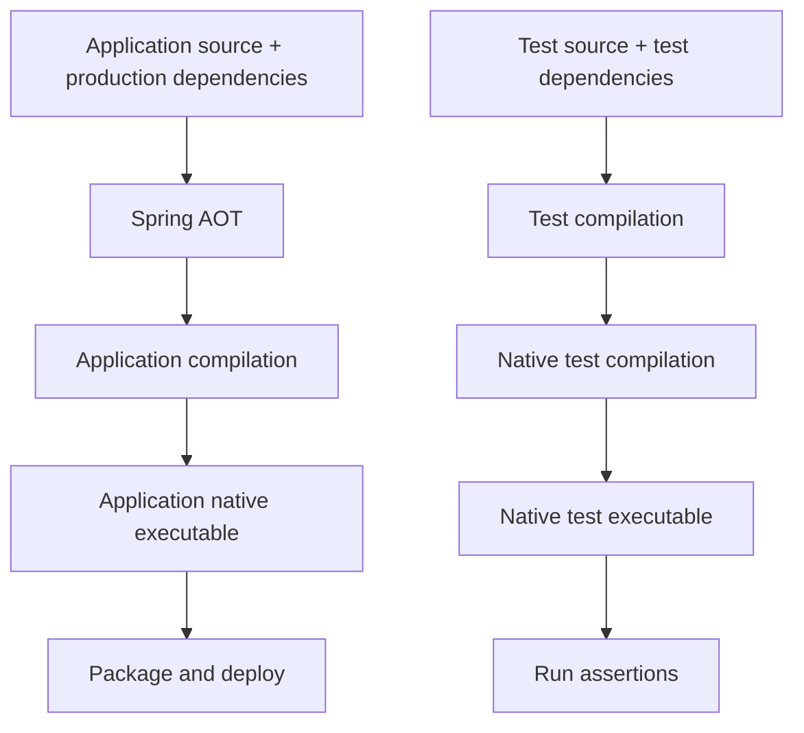

# Phân biệt binary chứa bộ kiểm thử với binary ứng dụng dùng để triển khai

## 1. Hai loại executable có mục đích khác nhau

Trong quy trình Spring Boot Native Image, cần phân biệt **native test executable** với **application executable**. Cả hai đều có thể được biên dịch thành binary native, nhưng chúng phục vụ hai mục đích khác nhau:

- **Native test executable** được tạo để chạy test code và xác minh hành vi ứng dụng/thư viện trong môi trường Native Image. Nó có thể chứa test framework, test fixtures, mock, assertion và mã kiểm thử.
- **Application executable** được tạo từ application runtime để triển khai. Nó chứa mã ứng dụng và runtime dependencies cần thiết cho production, không nên mang theo test framework hoặc test-only fixtures.

Một native test pass là bằng chứng quan trọng rằng các test đã chạy được trong môi trường native. Nó không biến test binary thành artifact production và không chứng minh application binary đã được đóng gói đúng.

Trong module **SPRING_BOOT_NATIVE_IMAGE**, mục tiêu cuối cùng là tạo executable Spring Boot dùng để chạy dịch vụ, kiểm thử tương thích, đóng gói container và vận hành. Vì vậy, cần quản lý riêng task tạo test executable và task tạo application executable, đồng thời xác minh chính artifact sẽ phát hành.



## 2. Application executable chứa gì?

Application executable là chương trình được khởi chạy trong môi trường production. Với Spring Boot Native Image, pipeline thường gồm:

1. Resolve application runtime dependencies.
2. Chạy Spring AOT để phân tích application context và tạo generated sources/resources cùng Runtime Hints.
3. Compile application và generated code.
4. GraalVM Native Image phân tích reachability và tạo binary.
5. Đóng gói binary cùng các thành phần runtime cần thiết vào container hoặc artifact triển khai.

Application executable phải khởi động được như dịch vụ thực tế, nhận cấu hình runtime, mở port, kết nối dependency ngoài và xử lý request/job theo hợp đồng sản phẩm.

Các dependency chỉ phục vụ test như JUnit, Mockito, AssertJ, test fixtures và test containers không nên được kéo vào application runtime chỉ vì test task cần chúng. Build tool thường tách compile/runtime classpath với test classpath; cần giữ ranh giới này rõ ràng.

## 3. Native test executable chứa gì?

Native test executable được tạo từ test source cùng test runtime dependencies và application code cần thiết để chạy test. Nó có thể bao gồm:

- Test engine và test launcher.
- Assertion libraries.
- Mocking libraries.
- Test fixtures và sample data.
- Embedded database hoặc test support.
- Spring Test context và test configuration.
- Application classes và dependencies được test sử dụng.

Một số test framework dùng generated test launcher hoặc test-specific entry point. Tên file, output directory và cách khởi chạy phụ thuộc GraalVM Build Tools, Spring Boot plugin và cấu hình build.

Không nên suy ra application executable có cùng nội dung chỉ vì native test binary chứa application classes. Test image có thể có classpath và reachability khác hẳn production image.

## 4. Gradle: phân biệt task native test và native application

Với Gradle, tên task phụ thuộc plugin và version. Trong nhiều cấu hình dùng GraalVM Native Build Tools, có task dành cho native test compilation và task dành cho application native compilation, thường gặp là:

```bash
./gradlew test
./gradlew nativeTest
./gradlew nativeCompile
```

Ý nghĩa khái quát:

- `test` chạy test trên JVM.
- `nativeTest` biên dịch/chạy test theo native test pipeline khi plugin và project đã cấu hình.
- `nativeCompile` tạo application native executable từ main runtime source set.

Tên task, task dependency và behavior cần xác minh bằng project thực tế:

```bash
./gradlew tasks --all
./gradlew help --task nativeTest
./gradlew help --task nativeCompile
```

Trong multi-project build, gọi task trên đúng application module, ví dụ `:api-app:nativeTest` và `:api-app:nativeCompile`. Không chạy nhầm task của library module hoặc module chỉ chứa test fixtures.

`nativeTest` có thể phụ thuộc vào native test compilation và toolchain riêng; không phải dự án nào cũng có task này nếu plugin chưa được áp dụng/cấu hình. Nếu task không tồn tại, kiểm tra plugin configuration và tài liệu đúng version, không tự đặt tên task thay thế.

## 5. Maven: phân biệt native tests và application build

Với Maven, các goal/profile native phụ thuộc vào plugin được project cấu hình. Spring Boot Maven Plugin và GraalVM Native Build Tools Maven Plugin có thể tham gia các giai đoạn khác nhau.

Thông thường:

- Maven Surefire chạy unit tests trên JVM.
- Maven Failsafe chạy integration tests trên JVM trong integration-test/verify lifecycle.
- Native test support (nếu plugin/version hỗ trợ và project đã cấu hình) tạo/chạy test native.
- Native application goal/profile tạo executable của ứng dụng.

Không có một goal native-test duy nhất áp dụng cho mọi cấu hình Maven. Kiểm tra plugin và profile thực tế:

```bash
./mvnw help:effective-pom
./mvnw help:all-profiles
./mvnw help:describe -Dplugin=org.graalvm.buildtools:native-maven-plugin
```

Đọc phần executions, goals, profiles và classifiers. Xác định chính xác lệnh nào tạo test binary và lệnh nào tạo application binary. Đừng suy luận mục đích từ tên file output một cách đơn lẻ.

## 6. Vì sao native test binary không phải artifact production?

Test executable thường chứa code không thuộc ứng dụng production. Nếu phát hành nhầm binary test, có thể gặp:

- Test runner/launcher thay thế application main entry point.
- Test dependencies và fixtures làm tăng kích thước hoặc bề mặt thành phần.
- Binary chạy test rồi kết thúc thay vì mở server.
- Test configuration dùng mock/fake hoặc dữ liệu mặc định không phù hợp production.
- Entrypoint, environment assumptions và command khác ứng dụng thật.
- Các test-only resources hoặc credentials giả bị đóng gói ngoài ý muốn.

Ngược lại, application executable có thể không chứa test runner và không chạy test suite khi khởi động. Đây là hành vi mong muốn đối với artifact triển khai.

## 7. Kiểm tra nội dung và hành vi của từng binary

Không chỉ dựa vào tên file. Hãy kiểm tra:

1. Task/goal nào đã tạo file?
2. Main entry point hoặc test launcher là gì?
3. File được tạo từ main source set hay test source set?
4. Runtime classpath nào được dùng?
5. Có test engine/assertion/mock libraries không?
6. Application executable có mở đúng port và xử lý health/readiness không?
7. Native test executable có chạy assertions rồi trả exit code đúng không?

Có thể xem task output và build log, liệt kê file generated trong build/target directory, sau đó chạy từng binary theo mục đích của nó. Với ELF, có thể dùng công cụ như `file` để xác định loại binary; nhưng công cụ đó không đủ để kết luận binary là app hay test. Phải kết hợp nguồn task và hành vi chạy.

## 8. Kiểm tra application executable bằng smoke test

Sau khi chạy application native, xác minh process hoạt động như service:

```bash
./build/native/nativeCompile/api-app
```

Đường dẫn và tên chỉ là ví dụ; dùng output thực tế của task `nativeCompile`. Khi process đã sẵn sàng, gửi HTTP request:

```bash
curl -i http://localhost:8080/actuator/health
```

Nếu ứng dụng không dùng Spring Boot Actuator hoặc health endpoint khác, thay bằng endpoint phù hợp. Smoke test nên xác nhận:

- Process không thoát ngay sau startup.
- Port lắng nghe đúng.
- Readiness/health trả kết quả mong đợi.
- Endpoint nghiệp vụ có thể xử lý request.
- External dependencies được kết nối theo cấu hình test/production phù hợp.
- Shutdown signal được xử lý đúng.

Không chạy binary application như test runner và không coi exit code 0 của một test executable là bằng chứng server đã khởi động.

## 9. Chạy native test executable

Native test executable thường chạy test suite rồi kết thúc. Kết quả cần xem là test report, số test pass/fail/skipped và process exit code.

Ví dụ khái quát:

```bash
./gradlew nativeTest
```

Plugin có thể tạo executable trung gian và launcher quản lý cách chạy; không nhất thiết cần tự gọi file binary trực tiếp. Hãy dùng task được plugin cung cấp để bảo đảm đúng arguments, working directory và test reporting.

Native test có thể chạy chậm hơn JVM test do quá trình compile native. Vì vậy, thường dùng JVM unit tests thường xuyên và native test ở CI/stage phù hợp, tập trung vào các tính năng có rủi ro AOT/Native Image.

## 10. Những gì native test xác minh tốt

Native test hữu ích để phát hiện các vấn đề khi test code được compile và chạy dưới Native Image, ví dụ:

- Reflection metadata thiếu trong code path test đã kích hoạt.
- Resource classpath không được đóng gói.
- Serialization hoặc proxy metadata thiếu.
- Runtime behavior khác giữa JVM và native.
- Một số vấn đề JNI hoặc class initialization được test gọi.
- Logic test/production dùng chung không tương thích với native runtime.

Nhưng native test chỉ xác minh code path mà test thực sự thực thi. Nếu không có test cho endpoint hiếm, provider fallback hoặc một subtype JSON, native test không thể tự chứng minh các nhánh đó hoạt động.

## 11. Những gì native test không tự chứng minh

Native test pass không tự động chứng minh:

- Application executable đã được tạo đúng.
- Application main entry point hoạt động.
- HTTP server mở port và xử lý request thật.
- Container production có đủ shared libraries hoặc đúng ABI.
- Production configuration/secrets/volume đúng.
- Mọi endpoint, scheduled job và message consumer đều tương thích.
- Application startup time, memory hoặc throughput đạt mục tiêu.
- Test binary có thể được phát hành làm service.

Do đó cần ít nhất hai loại bằng chứng riêng: test report của native tests và smoke/integration test trên application executable.

## 12. Phân biệt các artifact trong pipeline

| Artifact | Nguồn tạo | Mục đích | Có triển khai làm service? |
|---|---|---|---|
| JVM test classes | Test compilation | Chạy test trên JVM | Không |
| JVM test reports | Surefire/Gradle Test | Báo cáo test | Không |
| Native test executable | Native test task | Chạy test trong native runtime | Không |
| Native test reports/logs | Native test task/runner | Bằng chứng test | Không |
| Application native executable | Native application compile | Chạy ứng dụng | Có |
| Application container image | Dockerfile/Buildpacks | Phân phối và chạy app | Có |

Tên và vị trí artifact phụ thuộc build tool. Tổ chức pipeline nên lưu test report như bằng chứng CI và publish riêng application binary/container image.

## 13. Tránh đóng gói test dependencies vào application image

Gradle tách configuration như `implementation`, `runtimeOnly`, `testImplementation` và `testRuntimeOnly`. Test dependencies nên ở test configurations.

Maven dùng scope như `compile`, `runtime`, `test` và `provided`. Dependency có scope `test` không nên xuất hiện trong application runtime artifact.

Kiểm tra runtime dependency graph và nội dung JAR/image sau package. Nếu một thư viện chỉ được dùng trong test nhưng vô tình khai báo ở runtime scope, chuyển về test scope khi đúng về mặt kiến trúc.

Với container, xác minh Dockerfile hoặc Buildpacks đóng gói đúng application executable. Không copy wildcard từ thư mục build nếu thư mục đó có cả test binary, reports hoặc executable trung gian.

## 14. Ví dụ Dockerfile dùng đúng application binary

Một Dockerfile minh họa:

```dockerfile
FROM debian:bookworm-slim
WORKDIR /app
COPY build/native/nativeCompile/api-app /app/api-app
EXPOSE 8080
ENTRYPOINT ["/app/api-app"]
```

Đây chỉ là ví dụ cho binary Linux tương thích với base image. Đường dẫn nguồn phải trỏ đúng output application compile, không trỏ vào native test output. Base image cần phù hợp libc/shared library của binary và yêu cầu runtime.

Nếu dùng Cloud Native Buildpacks, cấu hình Spring Boot plugin để tạo image từ application artifact/native executable theo đúng chế độ native. Kiểm tra buildpack log và image entrypoint để xác nhận process được khởi chạy là ứng dụng.

Không copy native executable build trên Windows/macOS vào Linux container; native binary phải được tạo cho target OS/architecture phù hợp.

## 15. CI pipeline nên có hai nhánh xác minh

Một pipeline thực tế có thể tổ chức:

1. **JVM tests**: nhanh, chạy unit/integration tests thường xuyên.
2. **Native tests**: biên dịch và chạy test suite chọn lọc trên native runtime.
3. **Native application build**: tạo application executable riêng.
4. **Application smoke test**: chạy binary, chờ readiness và gọi HTTP endpoint.
5. **Container build**: đóng gói application binary.
6. **Container integration test**: gọi endpoint trong image cuối, kiểm tra user/port/config/volume.
7. **Publish**: chỉ publish application image/binary sau khi các gate cần thiết pass.

Có thể chạy native test và native application build song song nếu không tranh chấp output/cache và runner có đủ tài nguyên. Tuy nhiên, không được dùng chung tên/path artifact gây ghi đè hoặc nhầm lẫn.

## 16. Checklist trước khi phát hành

- Task tạo native test và task tạo application native đã được xác định riêng.
- Native test report có kết quả và exit code rõ.
- Application executable được tạo từ main application source set.
- Application binary khởi động như service và không chạy test launcher.
- HTTP smoke test trên application executable pass.
- Runtime dependency graph không chứa test-only libraries ngoài ý muốn.
- Container entrypoint trỏ đúng application binary.
- Image target OS/architecture/libc phù hợp.
- Container integration test xác minh health và endpoint nghiệp vụ.
- Artifact được định danh bằng version/commit/digest.
- CI lưu test report riêng với application artifact.

## 17. Câu hỏi tự kiểm tra

1. Native test executable khác application executable ở mục đích và thành phần nào?
2. Vì sao native test pass không chứng minh application binary đã được đóng gói đúng?
3. Gradle task nào thường dùng cho native tests và task nào tạo application executable?
4. Vì sao tên file hoặc phần mở rộng không đủ để phân loại binary?
5. Native test có xác minh HTTP server mở port như production không?
6. Làm thế nào ngăn test dependencies lọt vào application runtime image?
7. Vì sao container phải copy đúng application output và đúng target platform?
8. Cần những gate nào trước khi publish application image?

**Ghi nhớ:** native test executable là công cụ chạy assertions; application native executable là chương trình phục vụ production. Hãy quản lý riêng task, classpath, output và test report; sau khi native tests pass vẫn phải chạy smoke/integration test trên đúng application binary và container image sẽ phát hành.
