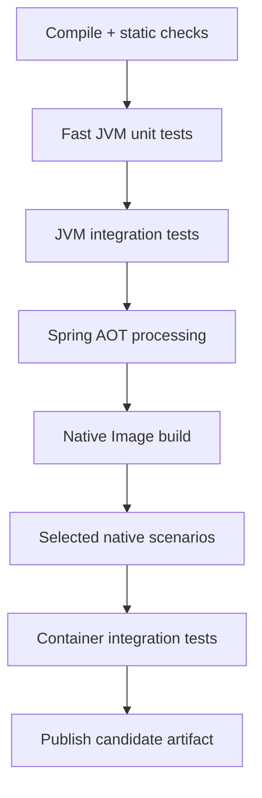

# Giữ phần lớn kiểm thử nhanh trên JVM và chọn đường đi quan trọng cho native

## 1. Vì sao không nên chạy toàn bộ test bằng Native Image?

Kiểm thử là một phần quan trọng khi chuyển Spring Boot sang GraalVM Native Image. Tuy nhiên, build và chạy test bằng native thường tốn nhiều thời gian, CPU và bộ nhớ hơn so với chạy test trên JVM. Nếu mọi unit test đều phải đi qua native compilation, vòng phản hồi của developer và CI có thể chậm đáng kể.

Phần lớn lỗi nghiệp vụ thông thường không phụ thuộc vào cách JVM hay Native Image thực thi: tính toán giá trị, quy tắc validation, mapping thuần, xử lý trạng thái và thuật toán có thể được kiểm tra nhanh trên JVM. Native Image tạo ra những rủi ro riêng ở các đường truy cập như reflection, resource, proxy, serialization, JNI, class initialization và cấu hình AOT. Những đường đi này cần được kiểm chứng trên executable native.

Chiến lược hiệu quả cho module **SPRING_BOOT_NATIVE_IMAGE** là giữ bộ test JVM rộng và nhanh, sau đó chọn một tập scenario native đại diện cho các capability có rủi ro cao và các luồng nghiệp vụ quan trọng. Mục tiêu là có phản hồi nhanh trong quá trình phát triển nhưng vẫn có bằng chứng rằng artifact native thực sự chạy đúng.

## 2. Hai lớp test phục vụ hai mục tiêu

| Lớp kiểm thử | Mục tiêu chính | Ví dụ |
|---|---|---|
| JVM test suite | Kiểm tra logic rộng, nhanh, dễ debug | Unit test, mapper, validation, service, repository, Spring integration |
| Native test suite | Xác minh hành vi phụ thuộc Native Image và artifact thật | Reflection, resource, proxy, JSON polymorphism, JNI, startup, container |

JVM suite thường chiếm số lượng test lớn nhất. Native suite tập trung vào những đường đi mà JVM không thể chứng minh thay cho native.

Điều này không có nghĩa mọi test JVM đều có thể bỏ qua native. Một luồng nghiệp vụ quan trọng có thể cần một native integration test ngay cả khi nó không dùng reflection trực tiếp, vì nó kết hợp nhiều thành phần và cấu hình runtime.

## 3. Phân loại test theo rủi ro

Trước khi chọn test native, phân loại test hiện có:

- **Logic thuần:** không khởi tạo Spring context, không dùng reflection/resource động. Ưu tiên JVM unit test.
- **Spring wiring:** kiểm tra bean, condition, profile, configuration properties. Kiểm tra trên JVM; AOT/native thêm scenario cho cấu trúc quan trọng.
- **Integration với thư viện:** serializer, ORM, HTTP client, PDF, SDK, proxy, JNI. Chọn đường native theo rủi ro của dependency.
- **Runtime packaging:** file external, native library, filesystem, locale, permission, container. Phải kiểm tra trong native/runtime image.
- **Business critical flow:** thanh toán, tạo đơn, phân quyền, xử lý webhook. Chọn ít nhất một scenario native end-to-end cho mỗi nhóm rủi ro đáng kể.

Một test có thể thuộc nhiều nhóm. Hãy chọn dựa trên cơ chế có khả năng khác biệt giữa JVM và Native Image, mức độ ảnh hưởng khi lỗi và độ khó phát hiện sau deploy.

## 4. Những test thường nên giữ trên JVM

Các test sau thường có giá trị cao khi chạy nhanh trên JVM:

| Loại test | Vì sao phù hợp JVM |
|---|---|
| Pure unit tests | Kiểm tra logic không phụ thuộc runtime metadata |
| Domain model/business rules | Tập trung vào behavior nghiệp vụ |
| Validation rules | Kiểm tra constraint và boundary values |
| Mapper/converter | Kiểm tra dữ liệu vào/ra |
| Algorithm tests | Dễ chạy nhiều dữ liệu và edge cases |
| Repository tests với test database | Tập trung SQL/ORM behavior, trừ khi cần xác minh native-specific integration |
| Controller tests với MockMvc | Kiểm tra routing, binding, validation nhanh |
| Contract tests của client/server | Kiểm tra schema và error behavior trên JVM |

JVM test không phải bằng chứng native compatibility. Nó là lớp nền để kiểm tra logic rộng, giúp native test không phải lặp lại hàng nghìn trường hợp thuần nghiệp vụ.

Nếu một thư viện có behavior đặc biệt trên native, bổ sung native scenario tương ứng thay vì chuyển toàn bộ test của module sang native.

## 5. Những đường đi nên ưu tiên kiểm thử trên native

Tập native nên ưu tiên các capability dễ bị ảnh hưởng bởi closed-world và AOT:

| Capability | Native scenario cần có |
|---|---|
| Reflection | Tạo object/gọi member qua đúng thư viện thực tế |
| Classpath resources | Đọc template/schema/config resource được đóng gói |
| Resource bundles | Nạp locale quan trọng |
| JDK proxy/Spring AOP | Tạo proxy thật, gọi method và xác nhận advice |
| JSON serialization | Deserialize/serialize DTO, record, subtype và custom serializer |
| JNI | Load native library, gọi native method và callback nếu có |
| Class initialization | Khởi động với environment khác môi trường build |
| Spring AOT context | Khởi tạo context theo profile/condition phát hành |
| Dynamic access của dependency | Chạy đúng API/feature ứng dụng sử dụng |
| Container runtime | Kiểm tra file, permission, ABI, user và network |

Không phải ứng dụng nào cũng dùng mọi capability. Đánh dấu những mục không áp dụng và ghi lý do; không tạo native test giả chỉ để lấp bảng.

## 6. Chọn test native theo ma trận rủi ro

Có thể chấm điểm từng scenario theo ba yếu tố:

- **Mức độ ảnh hưởng:** nếu lỗi xảy ra, tác động tới nghiệp vụ hoặc khách hàng lớn đến đâu?
- **Khác biệt runtime:** đường đi có sử dụng reflection, resource, proxy, JNI, class initialization hoặc dynamic behavior không?
- **Độ khó phát hiện:** lỗi có thể chỉ xuất hiện ở một locale, payload hiếm, profile hoặc container environment không?

Ví dụ ma trận:

| Scenario | Ảnh hưởng | Native-specific risk | Ưu tiên native |
|---|---|---|---|
| Tính tổng đơn hàng | Trung bình | Thấp | JVM là chính |
| Deserialize payment subtype | Cao | Cao | Cao |
| Đọc invoice template | Cao | Cao nếu resource động | Cao |
| Gọi SDK JNI | Cao | Rất cao | Bắt buộc nếu dùng |
| Chọn implementation qua condition | Cao | AOT structural | Cao |
| Format chuỗi đơn giản | Thấp | Thấp | JVM là chính |
| Locale tiếng Việt/Anh | Trung bình/cao | Resource bundle | Chọn locale hỗ trợ chính |
| Health endpoint đơn giản | Thấp | Thấp | Native smoke test có thể đủ |

Điểm số chỉ hỗ trợ thảo luận. Nhóm cần xác định rủi ro theo dependency và cách ứng dụng sử dụng, không áp dụng một ngưỡng cứng cho mọi dự án.

## 7. Giữ một bộ fixture dùng chung

Để tránh JVM và native test kiểm tra hai dữ liệu khác nhau, đặt fixture ở một vị trí chuẩn:

```text
src/test/resources/contract/
├── orders/
│   ├── valid-order.json
│   ├── invalid-order.json
│   └── payment-card.json
├── schemas/
│   └── order-v1.json
└── rules/
    └── standard-discount.json
```

JVM test có thể dùng fixture để kiểm tra nhiều trường hợp. Native integration test chọn các fixture đại diện cho các đường đi quan trọng và sử dụng đúng file đó.

Với resource thuộc production, đặt file trong `src/main/resources`; không nhầm test fixture với resource cần được đóng gói trong executable. Có thể dùng cùng nội dung fixture nhưng phải giữ đúng source set và đường truy cập cho mục đích test.

Không copy/paste payload thành hai bộ riêng. Khi contract thay đổi, một bộ fixture chung giúp hai runtime luôn được so sánh trên cùng dữ liệu.

## 8. Thiết kế native test theo luồng nghiệp vụ, không chỉ smoke test

Một smoke test thường chỉ xác nhận executable khởi động hoặc health endpoint trả lời. Điều đó chưa đi qua JSON binding, validation, proxy, resource và dependency thực tế.

Một native scenario có giá trị nên đi qua đường nghiệp vụ đại diện. Ví dụ tạo đơn hàng:

1. Gửi JSON request qua HTTP.
2. Deserialize vào request DTO.
3. Chạy nested validation.
4. Gọi service và repository.
5. Gọi payment adapter qua proxy nếu có.
6. Đọc rule/template/resource cần thiết.
7. Serialize response.
8. Xác nhận status, response schema và side effect.

Không nhất thiết mọi native test phải end-to-end. Có thể kết hợp một số native-focused integration tests theo capability và một vài flow black-box có giá trị cao. Mục tiêu là mỗi rủi ro native đáng kể có bằng chứng phù hợp.

## 9. Ví dụ phân chia test cho Order API

Giả sử Order API có các thành phần: tính giá, JSON API, payment SDK, invoice template và message bundle.

| Test | JVM | Native | Lý do |
|---|---:|---:|---|
| Tính discount theo tier | Rộng | Không cần lặp mọi case | Logic thuần |
| Boundary quantity/price | Rộng | Một số scenario qua API | Logic và validation |
| DTO binding cơ bản | Rộng | Có | Xác minh Jackson/native |
| Polymorphic payment payload | Có | Có | Subtype metadata |
| Payment SDK callback JNI | Có nếu JVM test được | Có | JNI/library behavior |
| Đọc invoice template | Có | Có | Resource packaging |
| Message tiếng Việt | Có | Có | Bundle locale |
| AOP transaction/security | Có | Có | Proxy/context behavior |
| Endpoint health | Có thể | Có thể dùng smoke | Startup/readiness |
| Full business flow | Có | Một số flow quan trọng | Tích hợp tổng thể |

JVM suite có thể chạy hàng trăm hoặc hàng nghìn test. Native suite chỉ cần tập trung vào những đường đi tạo ra bằng chứng bổ sung, nhưng phải bao phủ các integration có rủi ro cao.

## 10. Cấu trúc source set và test task

Giữ test theo mục tiêu rõ ràng giúp CI chọn đúng task:

```text
src/
├── main/
│   ├── java/
│   └── resources/
└── test/
    ├── java/
    │   ├── unit/
    │   ├── integration/
    │   └── nativecontract/
    └── resources/
        └── contract/
```

Đây là cách tổ chức minh họa. Maven/Gradle không tự hiểu các thư mục con là test source set riêng nếu chưa cấu hình. Có thể dùng package naming, JUnit tags, Gradle test suites hoặc Maven Surefire/Failsafe includes/excludes để phân nhóm.

Ví dụ JUnit tag:

```java
@Tag("native-contract")
@SpringBootTest
class OrderNativeContractTest {
}
```

Tag giúp chọn test ở JVM hoặc native test workflow nếu plugin/harness hỗ trợ. Nhưng gắn tag không tự chuyển test sang native; cần cấu hình task tương ứng và xác nhận process thực thi là native executable.

## 11. CI pipeline theo tầng

Một pipeline thực tế có thể tổ chức:



Mỗi tầng có chi phí và mục tiêu khác nhau:

- JVM unit tests chạy thường xuyên, cho phản hồi nhanh.
- JVM integration tests kiểm tra wiring và integration behavior rộng.
- Spring AOT xác nhận context có thể được phân tích và sinh mã.
- Native build kiểm tra khả năng biên dịch executable.
- Native scenarios xác minh các đường đi phụ thuộc Native Image.
- Container tests kiểm tra runtime packaging và môi trường gần production.

Có thể chạy JVM unit tests trên mọi commit, còn native build/test trên pull request chính hoặc nhánh tích hợp tùy thời gian build. Với ứng dụng rủi ro cao, native build cần là required check trước merge/release.

## 12. Phân biệt native build với native test task

Một số plugin cung cấp task riêng để biên dịch/chạy test native. Tên task và mức hỗ trợ phụ thuộc version. Ví dụ Gradle Native Build Tools có thể cung cấp `nativeTest` khi test configuration được bật.

Trước khi dùng:

```bash
./gradlew tasks --all
```

Với Maven, kiểm tra goal/plugin đã cấu hình và lifecycle của project:

```bash
./mvnw help:describe -Dplugin=org.graalvm.buildtools:native-maven-plugin
```

Không giả định task tồn tại chỉ vì tài liệu của version khác có nhắc đến. Đọc log để xác nhận test được build thành native executable và thực thi bằng binary đó.

Nếu không dùng native test task, có thể khởi chạy native application rồi chạy black-box HTTP contract suite từ process test riêng. Cách này thường phù hợp với kiểm tra packaging và service behavior.

## 13. Tránh lặp toàn bộ test suite trong native

Không nên chuyển toàn bộ test JVM sang native chỉ để tăng coverage một cách hình thức. Một số test không tạo thêm bằng chứng mới:

- Nhiều test tính toán thuần với dữ liệu khác nhau.
- Test getter/setter hoặc mapping đơn giản không dùng reflection.
- Test thuật toán đã có coverage rộng trên JVM.
- Test mock nhỏ không khởi tạo context hoặc runtime integration.
- Test lặp cùng một endpoint nhưng không đi qua capability khác.

Thay vào đó, chọn test đại diện cho mỗi capability và các edge case có rủi ro native cụ thể. Ví dụ, một native test cho mỗi subtype JSON quan trọng có thể hữu ích hơn việc chạy lại hàng trăm test tính toán discount thuần.

Tuy nhiên, nếu lỗi có thể phụ thuộc dữ liệu cụ thể hoặc thư viện serializer, chọn đủ payload để bao phủ các subtype/branch production thực sự sử dụng.

## 14. Test profile và structural properties

Native executable được tạo từ cấu trúc AOT đã chọn. Vì vậy, native test cần dùng profile/condition tương ứng với artifact.

Ví dụ:

```java
@SpringBootTest
@ActiveProfiles("native-test")
@Tag("native-contract")
class PaymentNativeTest {
}
```

Nếu `native-test` chọn mock gateway hoặc tắt integration qua `@ConditionalOnProperty`, hãy xác định test đang chứng minh điều gì. Test dùng mock có thể xác minh proxy/JSON/context, nhưng không chứng minh SDK production hoặc native library thật hoạt động.

Với các integration production quan trọng, cần test thêm trong môi trường sandbox có cấu hình tương ứng. Không đưa credentials production vào CI native test.

## 15. Quản lý external dependency trong native tests

Native test có thể cần database, broker, HTTP stub hoặc native library. Cần quyết định dependency đó chạy ở đâu và được cung cấp như thế nào:

- Dùng Testcontainers nếu phiên bản/plugin và runtime environment hỗ trợ.
- Dùng service container trong CI với endpoint ổn định.
- Dùng WireMock/mock server cho HTTP contract khi phù hợp.
- Dùng database fixture có thể reset giữa các test.
- Cung cấp native library đúng architecture/ABI.
- Mount external config/resource vào đúng đường dẫn.
- Đặt timeout và readiness check rõ ràng.

Không nên để native test phụ thuộc dịch vụ developer local hoặc endpoint không ổn định. Ghi lại version image/service và dữ liệu fixture để test có thể tái lập.

## 16. Xử lý test không tương thích native

Một số test dùng mock framework, bytecode generation, dynamic class loading hoặc context customization có thể không chạy được trong native mode. Cần phân loại:

1. Test chỉ kiểm tra logic và đã được bao phủ trên JVM: giữ ở JVM.
2. Test quan trọng nhưng framework test không hỗ trợ native: tạo native integration/black-box test thay thế.
3. Test kiểm tra capability native nhưng cần chỉnh thiết kế: thay dynamic mechanism bằng đường tĩnh hoặc bổ sung metadata.
4. Test không thể chạy native vì dependency thực sự không tương thích: ghi giới hạn và kiểm tra ranh giới dịch vụ/alternative integration.

Không dùng annotation bỏ qua test chỉ để làm native test task xanh mà không ghi lý do và test thay thế. Một test bị skip không phải bằng chứng behavior đã được xác minh.

## 17. Đo thời gian và chi phí của từng tầng

Theo dõi thời gian để nhận ra pipeline bị chậm ở đâu:

| Chỉ số | JVM suite | Native build/test |
|---|---|---|
| Compile time | Thường ngắn hơn | Có thêm AOT/native compilation |
| Test execution | Phù hợp chạy nhiều case | Có thể nhanh khi binary đã có, nhưng build tốn kém |
| CPU/RAM CI | Dễ dự đoán hơn | Native compiler có thể cần nhiều tài nguyên |
| Feedback loop | Nhanh, chạy thường xuyên | Chậm hơn, chọn lọc |
| Coverage mục tiêu | Logic và integration rộng | Runtime-specific và high-risk paths |

Ghi nhận build time, test time, cache hit, peak memory và tỷ lệ flaky. Nếu native build quá chậm, tối ưu incremental/cache hoặc phân nhóm native tests; không loại bỏ test quan trọng chỉ để giảm pipeline duration.

## 18. Coverage matrix cho quyết định test

Dùng một bảng liên kết rủi ro với test và bằng chứng:

| Capability/risk | JVM coverage | Native coverage | Lý do chọn |
|---|---|---|---|
| Business pricing rules | Nhiều unit cases | Một flow đại diện | Logic thuần |
| JSON polymorphism | Nhiều fixtures | Các subtype quan trọng | Reachability/Jackson |
| Reflection SDK | Unit/integration | Gọi API thực tế | Dynamic member access |
| Classpath templates | JVM resource test | Render template trên binary | Resource inclusion |
| Resource bundles | Locale tests | Locale chính | Bundle metadata |
| JDK proxy/AOP | Context tests | Tạo proxy và gọi advice | Proxy hints/AOT |
| JNI bridge | JVM integration nếu khả thi | Native callback thật | JNI metadata/library |
| Container filesystem | JVM path tests | Container test | Runtime packaging |

Đánh dấu `N/A` nếu ứng dụng không dùng capability. Với mỗi native test, ghi test class/scenario, fixture, binary revision và môi trường chạy. Điều này giúp tránh native coverage chỉ tồn tại trên giấy.

## 19. Quy trình chọn lọc test native cho mỗi thay đổi

Khi một pull request thay đổi code hoặc dependency:

1. Xác định package/module và đường nghiệp vụ bị ảnh hưởng.
2. Kiểm tra thay đổi có đụng reflection, resource, proxy, serialization, JNI, class initialization hoặc AOT configuration không.
3. Chạy JVM unit/integration tests liên quan.
4. Chạy hints predicate tests nếu metadata thay đổi.
5. Chạy AOT processing nếu cấu trúc context hoặc registrar thay đổi.
6. Chạy native scenario liên quan và các smoke/contract flow bắt buộc.
7. Chạy full native suite theo lịch hoặc trước release.
8. Cập nhật coverage matrix khi capability/dependency thay đổi.

Nếu thay đổi chỉ là thuật toán thuần, không cần chạy toàn bộ native suite cho mỗi lần sửa. Nếu nâng version serializer hoặc SDK JNI, native test tương ứng phải được chạy vì risk profile đã thay đổi.

## 20. Bài thực hành: thiết kế hai tầng test cho Order API

**Bối cảnh:** Order API có pricing logic, JSON polymorphic payment, payment SDK JNI, invoice template, resource bundle và Spring AOP.

**Bước 1 — Lập inventory.** Ghi test hiện tại và capability mà từng test bao phủ.

**Bước 2 — Giữ JVM suite rộng.** Bao phủ pricing boundaries, validation, mapper, service logic, repository và controller behavior.

**Bước 3 — Chọn native scenarios.** Chọn tạo order qua JSON, mỗi payment subtype quan trọng, gọi JNI SDK, render invoice, nạp locale chính và gọi service qua proxy.

**Bước 4 — Chuẩn hóa fixture.** Dùng cùng request, schema, template và locale data cho hai runtime.

**Bước 5 — Tạo test grouping.** Dùng JUnit tags/source set hoặc task riêng; cấu hình build tool rõ ràng để native task thực sự chạy binary native.

**Bước 6 — Xây CI tiers.** Chạy JVM suite thường xuyên, AOT/native build và selected native scenarios trên pull request hoặc nhánh tích hợp; chạy container suite trước release.

**Bước 7 — Ghi coverage.** Đánh dấu capability nào có JVM/native/container evidence, test nào chưa được hỗ trợ và phương án thay thế.

**Bước 8 — Đo pipeline.** Ghi thời gian, peak memory, flaky rate và native coverage để điều chỉnh tập test.

Tiêu chí hoàn thành: JVM suite giữ được độ rộng và tốc độ; native suite kiểm tra các capability/risk quan trọng; cùng fixture được sử dụng; CI phân tầng rõ; mọi test bị bỏ qua có lý do và bằng chứng thay thế.

## 21. Kết luận

Chiến lược kiểm thử tốt cho Spring Boot Native Image không yêu cầu chạy mọi unit test bằng native. Hãy giữ phần lớn test logic và integration nhanh trên JVM, rồi chọn native scenarios cho những đường đi có rủi ro riêng như reflection, resource, proxy, JSON polymorphism, JNI, class initialization, AOT context và container runtime.

Một bộ JVM test rộng phát hiện lỗi nghiệp vụ nhanh; native test chọn lọc xác nhận các giả định mà JVM không thể chứng minh. Dùng fixture chung, ma trận coverage, task CI rõ ràng và native executable thật để mỗi kết quả có ý nghĩa. Khi thay đổi dependency hoặc capability, cập nhật tập native test tương ứng thay vì chạy lặp toàn bộ suite một cách máy móc.
