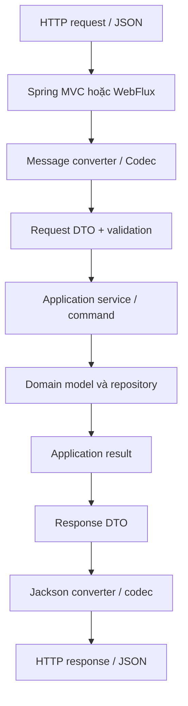

# Spring MVC, WebFlux và các lớp dữ liệu tại biên HTTP

## 1. Biên HTTP trong ứng dụng Spring Boot

Một ứng dụng Spring Boot thường nhận dữ liệu từ HTTP, chuyển dữ liệu đó thành lời gọi nghiệp vụ, rồi trả kết quả về cho client. Phần tiếp giáp này là **biên HTTP (HTTP boundary)**. Nó bao gồm controller hoặc handler, request/response DTO, JSON serialization/deserialization, validation, message converter hoặc codec, xử lý lỗi và các kiểu dữ liệu dùng trong request/response.

Khi biên HTTP chạy trên GraalVM Native Image, cần bảo đảm những kiểu dữ liệu được tạo hoặc truy cập động vẫn có metadata phù hợp. Các framework Spring đã cung cấp nhiều hỗ trợ AOT cho cơ chế MVC, WebFlux và Jackson; tuy nhiên, DTO được chọn qua type id động, generic lồng nhau, custom serializer hoặc reflection riêng của ứng dụng vẫn cần được kiểm tra trong native executable.

Bài này thuộc chương **Tích hợp ứng dụng** của module **SPRING_BOOT_NATIVE_IMAGE**. Mục tiêu là:

- Phân biệt luồng xử lý HTTP của Spring MVC và Spring WebFlux.
- Thiết kế request/response DTO tại biên HTTP.
- Hiểu vai trò của message converter, codec, Jackson và validation.
- Chuyển đổi DTO sang application command/domain model và kết quả trả về.
- Nhận diện reflection/binding metadata cần cho Native Image.
- Kiểm thử endpoint và serialization trên JVM lẫn native executable.

## 2. Tách HTTP DTO khỏi domain và persistence model

HTTP payload là hợp đồng giữa ứng dụng và client. Nó có thể thay đổi theo version API, cách đặt tên JSON, yêu cầu validation hoặc quyền truy cập. Domain model biểu diễn quy tắc nghiệp vụ; persistence entity biểu diễn cách lưu trữ. Ba loại model có vòng đời và trách nhiệm khác nhau.

Một luồng xử lý nên có dạng:



Ví dụ API tạo đơn hàng:

```java
public record CreateOrderLineRequest(
    @NotBlank String sku,
    @Positive int quantity
) {
}

public record CreateOrderRequest(
    @NotBlank String customerId,
    @NotEmpty List<@Valid CreateOrderLineRequest> lines
) {
}

public record OrderResponse(
    UUID id,
    String status
) {
}
```

Request DTO phản ánh dữ liệu client được phép gửi. Response DTO chỉ công bố dữ liệu API muốn trả về. Application service có thể nhận command riêng:

```java
public record CreateOrderCommand(
    String customerId,
    List<CreateOrderLine> lines
) {
}

public record CreateOrderLine(
    String sku,
    int quantity
) {
}
```

Controller hoặc mapper chuyển request DTO thành command. Application service thực thi nghiệp vụ và trả kết quả để mapper tạo response DTO. Không nên trả thẳng JPA entity ra HTTP: điều đó làm API phụ thuộc cấu trúc database, dễ lộ field nội bộ và có thể kéo theo lazy-loading ngoài transaction.

### 2.1. Vì sao không dùng một class cho mọi tầng?

| Model | Trách nhiệm | Thay đổi thường do |
| --- | --- | --- |
| Request DTO | Hợp đồng input, tên JSON, validation | API client và version endpoint |
| Response DTO | Hợp đồng output, field được phép công bố | API contract và yêu cầu hiển thị |
| Application command/result | Dữ liệu use case | Quy trình nghiệp vụ |
| Domain model | Quy tắc và trạng thái nghiệp vụ | Quy tắc domain |
| Persistence entity | Mapping bảng, khóa và quan hệ | Schema và chiến lược lưu trữ |

Có thể dùng Java record cho DTO bất biến khi Jackson version và cấu hình ứng dụng hỗ trợ. Với class thông thường, constructor, getter/setter và annotation Jackson cần phù hợp với cách deserialize được chọn. Hãy test đúng mapper mà Spring Boot sử dụng.

## 3. Spring MVC xử lý request và response như thế nào?

Spring MVC chạy trên Servlet API. Với controller annotation, Spring tìm handler method phù hợp, đọc request body qua `HttpMessageConverter`, gọi controller, rồi ghi response body qua converter tương ứng.

Ví dụ controller:

```java
@RestController
@RequestMapping("/api/orders")
class OrderController {

    private final OrderApplicationService orders;

    OrderController(OrderApplicationService orders) {
        this.orders = orders;
    }

    @PostMapping
    ResponseEntity<OrderResponse> create(
            @Valid @RequestBody CreateOrderRequest request) {

        CreateOrderCommand command = new CreateOrderCommand(
            request.customerId(),
            request.lines().stream()
                .map(line -> new CreateOrderLine(
                    line.sku(), line.quantity()
                ))
                .toList()
        );

        OrderResult result = orders.create(command);

        OrderResponse response =
            new OrderResponse(result.id(), result.status());

        return ResponseEntity
            .created(URI.create("/api/orders/" + result.id()))
            .body(response);
    }
}
```

Với JSON, Spring Boot thường cấu hình Jackson converter. Converter đọc bytes thành object, áp dụng ObjectMapper, sau đó controller nhận DTO đã deserialize. Khi trả DTO, converter serialize object thành JSON và đặt content type phù hợp.

Các annotation thường gặp:

- `@RequestBody`: đọc request body qua message converter.
- `@ResponseBody` hoặc `@RestController`: ghi giá trị trả về qua message converter.
- `@PathVariable`: bind path segment.
- `@RequestParam`: bind query/form parameter.
- `@RequestHeader`: bind header.
- `@ModelAttribute`: bind request parameter vào object.
- `@RequestPart`: đọc một phần multipart request.

Không phải mọi dữ liệu đều đi qua Jackson. Path variable, query parameter và form field có thể được chuyển đổi bằng Spring ConversionService hoặc cơ chế binding tương ứng.

### 3.1. MVC và công việc blocking

Spring MVC phù hợp với mô hình Servlet và thường dùng cho ứng dụng đồng bộ, nơi controller gọi service, repository hoặc JDBC theo kiểu blocking. Một request thường được xử lý trên servlet request thread; khi gọi JDBC đồng bộ, thread đó chờ kết quả I/O.

Có thể dùng `CompletableFuture`, reactive return type hoặc async Servlet API trong MVC, nhưng điều đó không biến toàn bộ stack thành non-blocking. Nếu phần lớn dependency vẫn là JDBC blocking, WebFlux không tự làm chúng non-blocking.

## 4. Spring WebFlux xử lý request và response như thế nào?

Spring WebFlux là web stack reactive, có thể chạy trên server non-blocking như Reactor Netty. Nó dùng `HttpMessageReader` và `HttpMessageWriter`, thường được cấu hình thông qua `ServerCodecConfigurer`, để đọc và ghi body. Với JSON, Jackson được tích hợp qua codec như Jackson JSON decoder/encoder.

Controller có thể nhận object trực tiếp:

```java
@RestController
@RequestMapping("/api/orders")
class ReactiveOrderController {

    private final OrderReactiveService orders;

    ReactiveOrderController(OrderReactiveService orders) {
        this.orders = orders;
    }

    @PostMapping
    Mono<ResponseEntity<OrderResponse>> create(
            @Valid @RequestBody CreateOrderRequest request) {

        CreateOrderCommand command = mapToCommand(request);

        return orders.create(command)
            .map(result -> {
                OrderResponse response =
                    new OrderResponse(result.id(), result.status());

                return ResponseEntity
                    .created(URI.create("/api/orders/" + result.id()))
                    .body(response);
            });
    }
}
```

Hoặc body có thể được biểu diễn bằng reactive type:

```java
@PostMapping
Mono<OrderResponse> create(
        @Valid @RequestBody Mono<CreateOrderRequest> request) {

    return request.flatMap(body ->
        orders.create(mapToCommand(body))
    ).map(this::toResponse);
}
```

Với `Mono<T>`, body được đọc và phát ra khi được subscribe trong pipeline. Với `Flux<T>`, ứng dụng có thể xử lý stream phần tử, phù hợp với một số định dạng hoặc endpoint streaming. Chọn kiểu trả về dựa trên yêu cầu backpressure và streaming; không bọc mọi object trong Mono chỉ để gọi ứng dụng là reactive.

### 4.1. Functional endpoints

WebFlux còn hỗ trợ functional routing qua `RouterFunction` và `HandlerFunction`. Ví dụ:

```java
@Bean
RouterFunction<ServerResponse> orderRoutes(OrderHandler handler) {
    return RouterFunctions.route()
        .POST("/api/orders", handler::create)
        .build();
}
```

Handler có thể đọc body qua `ServerRequest.bodyToMono(CreateOrderRequest.class)` và tạo response qua `ServerResponse.body(...)`. Khi dùng functional endpoints, test cần kích hoạt đúng handler và body type; không giả định việc đăng ký controller annotation tự bao phủ mọi route function.

### 4.2. Reactive không có nghĩa mọi dependency đều non-blocking

Nếu WebFlux handler gọi JDBC, `Thread.sleep`, filesystem API blocking hoặc một SDK blocking, event-loop thread có thể bị chặn. Hãy dùng driver/client reactive tương ứng hoặc cô lập lời gọi blocking trên scheduler phù hợp. GraalVM Native Image không tự chuyển API blocking thành non-blocking; native compilation chỉ thay đổi cách đóng gói và thực thi chương trình.

## 5. Chọn MVC hay WebFlux

| Tiêu chí | Spring MVC | Spring WebFlux |
| --- | --- | --- |
| Nền tảng server | Servlet API | Reactive runtime, thường là Netty hoặc Servlet container hỗ trợ |
| Mô hình xử lý | Chủ yếu imperative/blocking | Reactive, non-blocking khi toàn bộ I/O hỗ trợ |
| Đọc/ghi body | `HttpMessageConverter` | `HttpMessageReader` / `HttpMessageWriter`, codecs |
| JSON | Jackson converter | Jackson encoder/decoder |
| Kiểu trả về phổ biến | DTO, `ResponseEntity<T>`, `Callable`, `CompletableFuture` | DTO, `Mono<T>`, `Flux<T>`, `ResponseEntity<Mono<T>>` |
| Phù hợp | Ứng dụng CRUD, JDBC/JPA, service đồng bộ | I/O concurrent, streaming, reactive data/client |
| Rủi ro chính | Thread bị giữ khi I/O blocking | Event loop bị block nếu gọi API blocking |

Nếu classpath có cả Spring MVC và WebFlux starter, Spring Boot thường chọn MVC làm web application type mặc định. Chỉ thêm cả hai khi có chủ đích và đã xác định stack nào phục vụ HTTP server. Với Native Image, lựa chọn MVC hay WebFlux vẫn là quyết định kiến trúc; native compilation không tự làm cho hai stack tương đương.

## 6. JSON binding với Jackson

Jackson chuyển JSON thành object và ngược lại. Một DTO đơn giản có thể dùng record:

```java
public record CustomerRequest(
    @JsonProperty("customer_id") String customerId,
    @JsonProperty("display_name") String displayName
) {
}
```

Với class mutable:

```java
public class CustomerResponse {

    private UUID id;
    private String displayName;

    public CustomerResponse() {
    }

    public UUID getId() {
        return id;
    }

    public void setId(UUID id) {
        this.id = id;
    }

    public String getDisplayName() {
        return displayName;
    }

    public void setDisplayName(String displayName) {
        this.displayName = displayName;
    }
}
```

Lưu ý khi thiết kế JSON contract:

- Dùng `@JsonProperty` khi tên JSON khác tên property Java.
- Dùng `@JsonCreator`/`@JsonProperty` cho constructor-based deserialization nếu cần.
- Quy định rõ cách xử lý field không biết, field thiếu và giá trị null.
- Chọn format ngày giờ thống nhất, ví dụ ISO-8601.
- Dùng enum logical value ổn định; tránh phụ thuộc tên enum nội bộ nếu API cần tương thích dài hạn.
- Với polymorphic JSON, dùng type id có allowlist và đăng ký subtype rõ ràng.
- Không bật Jackson default typing rộng cho JSON từ client không tin cậy.

Không tạo `new ObjectMapper()` riêng trong controller hoặc service. Hãy dùng mapper do Spring Boot cấu hình để giữ các module, naming strategy, date/time settings, custom serializer và các customizer của ứng dụng.

### 6.1. Generic response và type erasure

Java generic bị type erasure ở runtime. Khi đọc một payload có cấu trúc như `List<OrderResponse>`, client cần truyền thông tin generic đầy đủ cho decoder. Với WebClient, có thể dùng `ParameterizedTypeReference`:

```java
ParameterizedTypeReference<List<OrderResponse>> responseType =
    new ParameterizedTypeReference<>() {};

Mono<List<OrderResponse>> response = webClient.get()
    .uri("/api/orders")
    .retrieve()
    .bodyToMono(responseType);
```

Với MVC controller, generic return type trong method signature thường cung cấp metadata cho converter. Trong Native Image, bảo đảm concrete DTO trong generic collection được nhận diện và kiểm thử trên native executable, đặc biệt khi type được chọn qua cấu hình hoặc reflection.

## 7. Validation ở biên HTTP

Validation giúp từ chối payload không hợp lệ trước khi chạy nghiệp vụ. Với Jakarta Bean Validation:

```java
public record CreateOrderRequest(
    @NotBlank String customerId,
    @NotEmpty List<@Valid CreateOrderLineRequest> lines
) {
}

public record CreateOrderLineRequest(
    @NotBlank String sku,
    @Positive int quantity
) {
}
```

Trong Spring MVC:

```java
@PostMapping
OrderResponse create(
        @Valid @RequestBody CreateOrderRequest request) {
    // Gọi application service sau khi validation thành công.
}
```

Trong WebFlux:

```java
@PostMapping
Mono<OrderResponse> create(
        @Valid @RequestBody Mono<CreateOrderRequest> request) {
    return request.flatMap(this::createOrder);
}
```

Validation lồng nhau cần `@Valid` ở property/collection element phù hợp. Constraint annotation chỉ có ý nghĩa khi validation provider được cấu hình và được gọi trong luồng binding.

Validation lỗi thường được chuyển thành HTTP 400 theo exception handling của framework hoặc ứng dụng. Hãy định nghĩa response lỗi ổn định, không trả stack trace hoặc thông tin nội bộ.

### 7.1. Custom constraint và validator

Nếu ứng dụng định nghĩa `@ValidSku` với `ConstraintValidator` riêng, hãy kiểm tra:

- Constraint annotation có gắn đúng field/record component không.
- Validator được tạo bởi cơ chế tích hợp Spring/validation provider.
- Dependency của validator được inject đúng.
- Native executable chạy được validator cho cả request hợp lệ và không hợp lệ.

Các validator/constraint của thư viện chuẩn thường có metadata hỗ trợ đi kèm. Với custom validator hoặc cơ chế tự tạo bằng reflection, bổ sung runtime hints nếu native test chứng minh thiếu metadata; tránh đăng ký toàn bộ package validation theo phỏng đoán.

## 8. Xử lý lỗi HTTP thống nhất

Spring MVC và WebFlux đều hỗ trợ `@ControllerAdvice`/`@RestControllerAdvice` cùng `@ExceptionHandler` cho controller-based endpoints. Có thể dùng `ProblemDetail` để trả lỗi theo cấu trúc thống nhất:

```java
@RestControllerAdvice
class ApiExceptionHandler {

    @ExceptionHandler(OrderNotFoundException.class)
    ResponseEntity<ProblemDetail> handleNotFound(
            OrderNotFoundException exception) {

        ProblemDetail problem = ProblemDetail.forStatusAndDetail(
            HttpStatus.NOT_FOUND,
            exception.getMessage()
        );
        problem.setTitle("Order not found");

        return ResponseEntity.status(HttpStatus.NOT_FOUND).body(problem);
    }
}
```

Không đưa stack trace, SQL, filesystem path hoặc secret vào detail gửi client. Có thể ghi chi tiết nội bộ vào log với correlation id và trả thông báo an toàn ở biên HTTP.

Với WebFlux functional endpoints, có thể xử lý lỗi trong handler bằng `onErrorResume` hoặc cấu hình error handling phù hợp. Dù dùng cơ chế nào, response schema cần nhất quán giữa các endpoint và được test trên native.

## 9. Multipart và dữ liệu không phải JSON

Không phải request body nào cũng là JSON. Upload file thường dùng `multipart/form-data`.

Trong Spring MVC:

```java
@PostMapping(path = "/documents", consumes = MediaType.MULTIPART_FORM_DATA_VALUE)
DocumentResponse upload(
        @RequestPart("metadata") @Valid DocumentMetadata metadata,
        @RequestPart("file") MultipartFile file) {

    return documentService.store(metadata, file);
}
```

Trong WebFlux, file part được biểu diễn bằng `FilePart`:

```java
@PostMapping(path = "/documents", consumes = MediaType.MULTIPART_FORM_DATA_VALUE)
Mono<DocumentResponse> upload(
        @RequestPart("metadata") Mono<DocumentMetadata> metadata,
        @RequestPart("file") FilePart file) {

    return metadata.flatMap(value ->
        documentService.store(value, file)
    );
}
```

`MultipartFile` và `FilePart` có lifecycle và API khác nhau. WebFlux thường dùng file part và reactive transfer; tránh đọc toàn bộ file lớn vào memory nếu có thể stream tới storage.

Với Native Image, file do client upload là dữ liệu runtime, không phải classpath resource cần ResourceHints. Cần kiểm tra giới hạn kích thước, quyền truy cập, tên file, content type và cách lưu file. Không tin tên file do client gửi và không ghép trực tiếp nó thành đường dẫn filesystem.

## 10. Tích hợp HTTP DTO với application service và persistence

Controller nên làm nhiệm vụ chuyển đổi dữ liệu và điều phối. Transaction và quy tắc nghiệp vụ nên nằm ở application service/domain layer.

Ví dụ service đồng bộ:

```java
@Service
class OrderApplicationService {

    private final OrderRepository repository;

    OrderApplicationService(OrderRepository repository) {
        this.repository = repository;
    }

    @Transactional
    OrderResult create(CreateOrderCommand command) {
        Order order = Order.create(
            command.customerId(),
            command.lines()
        );

        Order saved = repository.save(order);

        return new OrderResult(saved.getId(), saved.getStatus().name());
    }
}
```

Với WebFlux, nếu dùng reactive database driver, service có thể trả `Mono<OrderResult>` hoặc `Flux<OrderResult>`. Không bọc lời gọi JPA/JDBC blocking trong Mono rồi xem đó là reactive end-to-end. Nếu buộc tích hợp blocking dependency, cô lập nó khỏi event loop và xác định rõ giới hạn concurrency.

Native Image không làm thay đổi ranh giới transaction hoặc mapping dữ liệu. Tuy nhiên, ORM, JDBC driver, database client và entity model có thể có yêu cầu native metadata riêng. Không đăng ký JPA entity như HTTP DTO chỉ vì cả hai cùng được serialize ở một nơi; xác định đường truy cập thật sự của từng tầng.

## 11. Cấu hình message converter và WebFlux codec

Khi cần thêm custom JSON converter hoặc codec, hãy mở rộng cấu hình do Spring Boot quản lý thay vì tự tạo toàn bộ stack từ đầu.

Với MVC, có thể dùng `WebMvcConfigurer` và `extendMessageConverters(...)` để bổ sung hoặc điều chỉnh converter mà vẫn giữ các converter mặc định. Cẩn thận với `configureMessageConverters(...)`: cấu hình này có thể thay thế danh sách converter mặc định nếu không chủ động thêm lại.

Với WebFlux, có thể dùng `WebFluxConfigurer.configureHttpMessageCodecs(...)` hoặc Spring Boot `CodecCustomizer` để cấu hình decoder/encoder. Cùng một ObjectMapper nên được dùng nhất quán giữa server và client nếu hợp đồng JSON cần giống nhau.

Nếu custom converter/codec tạo serializer, deserializer, subtype hoặc DTO qua reflection, hãy mô tả các kiểu đó bằng runtime hints khi AOT không tự nhận diện. Kiểm tra cả server endpoint lẫn HTTP client tiêu thụ payload.

## 12. Runtime hints cho HTTP data binding trong Native Image

Spring AOT phân tích bean definitions, controller mappings, cấu hình và các thành phần framework được phát hiện. Spring Boot cũng cung cấp nhiều native hints cho hạ tầng web và thư viện tích hợp. Dù vậy, không nên giả định mọi kiểu xuất hiện trong JSON động đều được suy ra tự động.

Với DTO được dùng qua reflection/binding, có thể đăng ký:

```java
import org.springframework.aot.hint.annotation.RegisterReflectionForBinding;
import org.springframework.context.annotation.Configuration;

@Configuration(proxyBeanMethods = false)
@RegisterReflectionForBinding({
    CreateOrderRequest.class,
    CreateOrderLineRequest.class,
    OrderResponse.class
})
class HttpBindingConfiguration {
}
```

Annotation này yêu cầu Spring đóng góp reflection metadata phục vụ binding cho các kiểu đã nêu. Dùng cho DTO mà code/framework cần introspect hoặc tạo qua binding nhưng không được AOT phát hiện đầy đủ.

Cần xem xét thêm trong các trường hợp:

- DTO/subtype được chọn qua JSON type discriminator.
- Model lồng nhau hoặc kiểu collection element được chọn động.
- Custom Jackson serializer/deserializer hoặc TypeIdResolver.
- Reflection tự viết bằng `Class.forName`, `getDeclaredConstructor`, `Method.invoke` hoặc field access.
- Model đến từ thư viện bên ngoài chưa cung cấp reachability metadata phù hợp.
- Constructor private, factory method hoặc immutable model có cách tạo đặc biệt.

Không đăng ký reflection cho toàn bộ package DTO một cách mặc định. Bắt đầu từ đường code và model cụ thể, sau đó kiểm tra hints và native behavior.

### 12.1. Hints không thay thế HTTP contract hoặc resource runtime

Reflection hint chỉ mô tả khả năng truy cập kiểu/member. Nó không:

- Thêm field còn thiếu vào JSON.
- Sửa tên property hoặc format ngày giờ.
- Bật validation nếu provider chưa được cấu hình.
- Mount file upload hoặc file cấu hình vào container.
- Làm một subtype mới xuất hiện trong binary đã build.
- Chuyển JDBC blocking thành reactive I/O.

Khi lỗi xảy ra, phân loại lỗi ở tầng JSON mapping, validation, business logic, persistence hay native metadata trước khi bổ sung hint.

## 13. Kiểm thử biên HTTP trên JVM và native executable

Một bộ kiểm thử tốt cần đi qua đúng converter/codec mà production dùng.

| Lớp test | Nội dung cần xác minh |
| --- | --- |
| DTO unit test | Mapping DTO sang command/result và quy tắc validation |
| Jackson test | Serialize/deserialize request/response, enum, date/time, nested DTO |
| MVC integration test | `@RequestBody`, `@Valid`, status, headers và response JSON |
| WebFlux integration test | Codec, `Mono`/`Flux`, streaming và error mapping |
| Persistence integration test | Transaction và mapping sang entity/repository |
| Native executable test | Các luồng trên chạy được trong binary native |

Với MVC, có thể dùng MockMvc cho integration test trên JVM. Với WebFlux, dùng WebTestClient để kiểm tra controller/codec. Các test này chưa tự chứng minh native compatibility; cần chạy ứng dụng native và gửi HTTP request thật tới process đó hoặc dùng native test harness được cấu hình đúng.

Ví dụ kiểm thử qua WebTestClient:

```java
webTestClient.post()
    .uri("/api/orders")
    .contentType(MediaType.APPLICATION_JSON)
    .bodyValue("""
        {
          "customerId": "cust-100",
          "lines": [
            { "sku": "SKU-1", "quantity": 2 }
          ]
        }
        """)
    .exchange()
    .expectStatus().isCreated()
    .expectBody()
    .jsonPath("$.status").isEqualTo("CREATED");
```

Chạy cùng kịch bản trên native executable và kiểm tra:

1. Payload hợp lệ được deserialize đúng.
2. Payload sai validation nhận HTTP 400 theo contract.
3. Field thiếu/null được xử lý đúng như cấu hình Jackson.
4. DTO lồng nhau và collection được binding đầy đủ.
5. Response có status, header và JSON schema mong đợi.
6. Custom serializer/deserializer hoặc polymorphic subtype hoạt động.
7. Multipart upload hoạt động nếu endpoint hỗ trợ.
8. Application service và persistence client hoạt động trong native runtime.

Không chỉ kiểm tra native build thành công hoặc process khởi động. Một DTO có thể chỉ lỗi khi một endpoint hoặc một loại payload cụ thể được gọi.

Ví dụ build executable khi dự án đã cấu hình Spring AOT và Native Build Tools:

```bash
./mvnw -Pnative native:compile
./target/<application-name>
```

Với Gradle:

```bash
./gradlew nativeCompile
./build/native/nativeCompile/<application-name>
```

Tên executable và đường dẫn output phụ thuộc artifact name, plugin version và cấu hình build. Khi kiểm thử HTTP, khởi chạy binary rồi gửi cùng bộ request đã dùng cho JVM tới port của process native.

## 14. Lỗi thường gặp khi tích hợp MVC/WebFlux với Native Image

| Triệu chứng | Nguyên nhân có thể | Hướng xử lý |
| --- | --- | --- |
| JVM nhận JSON nhưng native lỗi tạo DTO | DTO/member chưa có binding metadata | Kiểm tra AOT hints, dùng `@RegisterReflectionForBinding` cho kiểu cần thiết |
| Một subtype JSON không được tạo | Type id chưa ánh xạ hoặc subtype chưa được giữ lại | Dùng allowlist subtype, đăng ký rõ và test từng type id |
| Field response bị thiếu | Jackson visibility, naming strategy hoặc getter không khớp | Kiểm tra ObjectMapper và JSON contract |
| Request hợp lệ bị HTTP 400 | Constraint hoặc nested `@Valid` chưa đúng | Kiểm tra validation annotation và provider |
| MVC converter không dùng custom mapper | Converter bị thay thế hoặc cấu hình sai thứ tự | Mở rộng converter mặc định và kiểm tra mapper được dùng |
| WebFlux codec không thấy custom module | Codec dùng ObjectMapper khác | Cấu hình codec qua Spring Boot và test bằng WebTestClient |
| WebFlux latency tăng bất thường | Blocking call trên event loop | Dùng reactive client/driver hoặc cô lập blocking work |
| Upload file native không hoạt động | Multipart config, giới hạn hoặc filesystem runtime sai | Kiểm tra codec/resolver, quyền ghi và mount volume |
| API trả JPA entity gây lỗi lazy loading | HTTP boundary phụ thuộc persistence session | Map sang response DTO trong application layer |
| Native endpoint chỉ lỗi với generic payload | Concrete generic element hoặc subtype không được nhận diện | Kiểm tra type token, DTO hints và native test |
| Lỗi chỉ xuất hiện ở một HTTP client | RestClient/WebClient có mapper/codec khác server | Test từng client và cấu hình converter/codec tương ứng |

## 15. Bài thực hành: xây dựng endpoint tạo đơn hàng cho MVC hoặc WebFlux

**Bối cảnh:** Một API nhận JSON tạo đơn hàng, kiểm tra dữ liệu, gọi application service và trả `OrderResponse`. Hãy chọn MVC nếu stack dữ liệu chủ yếu blocking; chọn WebFlux nếu các client/database cần dùng đều hỗ trợ reactive I/O.

**Các bước:**

1. Tạo request DTO, nested line DTO và response DTO.
2. Thêm validation cho customer id, SKU và quantity.
3. Tạo command/result riêng cho application layer.
4. Viết application service xử lý nghiệp vụ và repository.
5. Tạo MVC controller với `@RequestBody` hoặc WebFlux controller/functional handler.
6. Kiểm tra Jackson naming, date/time và error response.
7. Thêm `@RegisterReflectionForBinding` cho DTO cần binding nếu AOT không tự phát hiện.
8. Viết unit test cho mapper/validation và integration test qua MockMvc hoặc WebTestClient.
9. Build native executable bằng Maven hoặc Gradle theo cấu hình dự án.
10. Gửi payload hợp lệ, payload sai và payload có nested collection tới native HTTP server.
11. Nếu có custom codec, polymorphism hoặc multipart, thêm test native cho từng nhánh.
12. So sánh status, header, JSON response và kết quả nghiệp vụ giữa JVM với native.

**Tiêu chí đạt:**

- Chọn đúng MVC hoặc WebFlux theo mô hình I/O của ứng dụng.
- HTTP DTO tách khỏi domain/persistence model.
- Request được deserialize và validate đúng.
- Response JSON ổn định theo API contract.
- Runtime hints chỉ bao phủ kiểu thực sự cần binding/reflection.
- Test xác minh cả HTTP boundary và application service.
- Native executable xử lý được các payload hợp lệ, không hợp lệ và nested DTO.
- Không dùng blocking dependency trên WebFlux event loop.

## 16. Tổng kết

Spring MVC và Spring WebFlux cung cấp hai cách xử lý HTTP khác nhau: MVC dùng Servlet stack và `HttpMessageConverter`; WebFlux dùng reactive stack cùng `HttpMessageReader`/`HttpMessageWriter` và codec. Cả hai có thể dùng Jackson cho JSON, validation cho request DTO và exception handler để chuẩn hóa response lỗi.

Ở biên HTTP, hãy giữ request/response DTO riêng với domain và persistence model. Spring AOT hỗ trợ nhiều phần của web stack, nhưng kiểu dữ liệu được chọn động hoặc truy cập qua reflection riêng vẫn cần được xác minh và có thể cần `@RegisterReflectionForBinding`. Kiểm thử bằng đúng MVC converter hoặc WebFlux codec trên JVM, sau đó gửi request tới native executable để chứng minh toàn bộ luồng HTTP, binding, validation và persistence hoạt động trong môi trường triển khai.

