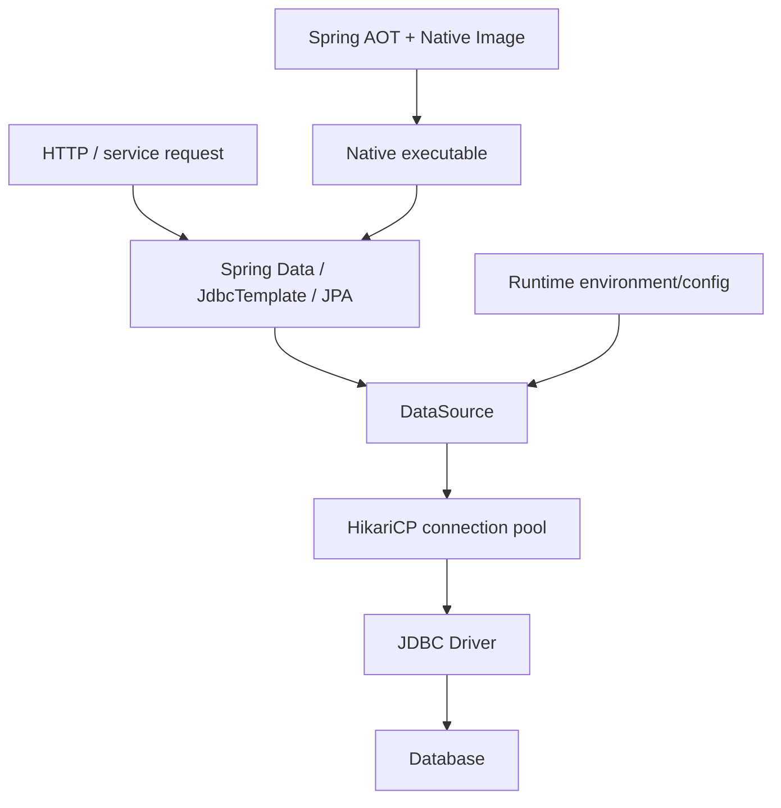

# JDBC, driver, connection pool và cấu hình kết nối runtime

## 1. JDBC trong ứng dụng Spring Boot Native Image

JDBC là API chuẩn của Java để ứng dụng làm việc với cơ sở dữ liệu quan hệ. Một ứng dụng Spring Boot thường dùng Spring JDBC, Spring Data JPA hoặc thư viện truy cập dữ liệu khác ở phía trên JDBC. Ở tầng thấp hơn, **JDBC driver** triển khai giao thức cụ thể của database như PostgreSQL, MySQL, MariaDB, SQL Server hoặc Oracle.

Khi chuyển sang GraalVM Native Image, cần xác minh cả chuỗi kết nối:

1. Driver đúng phiên bản có trong runtime dependency graph.
2. Driver được phát hiện và khởi tạo theo cách tương thích AOT/Native Image.
3. Datasource nhận URL, username, password và TLS options từ cấu hình runtime.
4. Connection pool tạo, kiểm tra, tái sử dụng và đóng connection đúng vòng đời.
5. Native executable có thể kết nối tới database trong môi trường container thực tế.

Một ứng dụng có thể compile thành công nhưng chỉ lỗi khi lấy connection đầu tiên, chạy migration hoặc thực hiện query. Vì vậy, build pass không thay thế integration test kết nối database trên native executable.

Trong module **SPRING_BOOT_NATIVE_IMAGE**, mục tiêu là tạo executable Spring Boot gọn, khởi động nhanh và vận hành được. JDBC cần được đánh giá theo đúng driver/version, database target, authentication/TLS và cấu hình triển khai.



## 2. Các thành phần trong đường truy cập dữ liệu

| Thành phần | Trách nhiệm |
|---|---|
| Spring JDBC / Spring Data JPA | API truy cập dữ liệu, transaction integration và mapping |
| DataSource | Cung cấp JDBC Connection cho ứng dụng |
| Connection pool | Quản lý tập connection mở và tái sử dụng |
| JDBC driver | Chuyển JDBC calls thành giao thức database |
| Database | Lưu trữ và thực thi query/transaction |
| Migration tool | Quản lý schema version nếu ứng dụng dùng Flyway/Liquibase |

Spring Boot thường auto-configure DataSource khi có JDBC driver và cấu hình datasource phù hợp. HikariCP là connection pool phổ biến được Spring Boot sử dụng mặc định khi có mặt và không có pool khác được chọn.

Native Image không thay đổi hợp đồng JDBC ở tầng ứng dụng, nhưng quá trình AOT/Native Image phải xử lý được cách driver và thư viện phụ trợ nạp class, resource, service provider hoặc native library.

## 3. Chọn JDBC driver và kiểm tra khả năng tương thích

Không có một kết luận chung rằng mọi JDBC driver đều tương thích giống nhau. Khả năng tương thích phụ thuộc:

- Database vendor và driver version.
- Spring Boot/Spring Framework version.
- JDK và GraalVM Native Image version.
- Driver dùng reflection, resource lookup, service loading hay JNI như thế nào.
- TLS provider, authentication plugin và native transport có được sử dụng không.
- OS/CPU architecture và shared libraries của container.

Ưu tiên driver version được database vendor hỗ trợ và có tài liệu Native Image hoặc reachability metadata khi cần. Kiểm tra release notes của driver, Spring Boot dependency management và GraalVM compatibility information trước khi nâng version.

Ví dụ dependency PostgreSQL trong Gradle:

```groovy
dependencies {
    runtimeOnly("org.postgresql:postgresql")
    implementation("org.springframework.boot:spring-boot-starter-jdbc")
}
```

Maven:

```xml
<dependency>
    <groupId>org.springframework.boot</groupId>
    <artifactId>spring-boot-starter-jdbc</artifactId>
</dependency>
<dependency>
    <groupId>org.postgresql</groupId>
    <artifactId>postgresql</artifactId>
    <scope>runtime</scope>
</dependency>
```

Ví dụ version được quản lý bởi Spring Boot BOM. Nếu dự án không dùng BOM, khai báo version driver rõ ràng và tương thích với database server.

Driver thuộc runtime classpath, không phải chỉ test classpath. Nếu driver chỉ được khai báo trong test scope, test JVM có thể chạy nhờ cấu hình khác nhưng application artifact sẽ không có driver.

## 4. Kiểm tra dependency graph của application module

Với Gradle:

```bash
./gradlew :api-app:dependencies --configuration runtimeClasspath
./gradlew :api-app:dependencyInsight --dependency postgresql --configuration runtimeClasspath
```

Với Maven:

```bash
./mvnw dependency:tree
```

Xác minh:

- Driver có trong runtime classpath của đúng application module.
- Version được resolve đúng như mong muốn.
- Không bị exclusion hoặc conflict version.
- Driver không bị khai báo nhầm ở test scope.
- Driver và database-specific modules cần thiết đều được đóng gói.
- Không kéo theo nhiều driver không cần thiết nếu ứng dụng chỉ dùng một database.

Nếu dùng nhiều database, ghi rõ datasource nào dùng driver nào và datasource nào là primary. Không giả định một driver có thể kết nối mọi database chỉ vì tất cả đều triển khai JDBC API.

## 5. Cấu hình datasource bằng property runtime

Thông tin kết nối thường thay đổi giữa local, test, staging và production. Không hard-code URL, username hoặc password trong source code hay static field.

Ví dụ application configuration:

```yaml
spring:
  datasource:
    url: ${DB_URL:jdbc:postgresql://localhost:5432/invoice}
    username: ${DB_USERNAME:invoice_app}
    password: ${DB_PASSWORD:}
    driver-class-name: org.postgresql.Driver
    hikari:
      maximum-pool-size: 12
      minimum-idle: 2
      connection-timeout: 3000
      validation-timeout: 1000
      max-lifetime: 1500000
      idle-timeout: 600000
```

Đây là cấu hình minh họa; giá trị pool phải được chọn theo tải và giới hạn database. Password mặc định rỗng chỉ phù hợp local/test khi môi trường cung cấp giá trị an toàn; production phải cấp secret thực tế và fail fast nếu thiếu.

Cấp biến môi trường khi chạy:

```bash
DB_URL="jdbc:postgresql://db.internal:5432/invoice" \
DB_USERNAME="invoice_app" \
DB_PASSWORD="secret-from-secret-manager" \
./app
```

Trong production, secret nên được cấp qua secret manager hoặc cơ chế secret của nền tảng triển khai. Tránh ghi password vào command history, image layer, build args, source control hoặc log.

## 6. Cấu hình runtime khác với build-time AOT

Spring AOT xử lý bean graph và các điều kiện cấu hình trong quá trình build. Giá trị kết nối như database host, port, username và password thường là **runtime configuration**.

Phân biệt:

- Driver class và dependency phải có trong artifact lúc build.
- Bean/DataSource structure phải được Spring AOT xử lý theo cấu hình build phù hợp.
- URL, credential, pool size và timeout có thể được cung cấp lúc chạy theo thiết kế.
- Profile/condition quyết định bean nào tồn tại có thể ảnh hưởng AOT bean graph; không nên kỳ vọng đổi profile runtime sẽ tạo bean đã bị loại khi AOT.

Giữ cấu trúc datasource ổn định nếu có thể, rồi cấp giá trị môi trường lúc chạy. Nếu từng profile tạo một bean graph khác nhau, cần build/test artifact tương ứng và ghi rõ profile được dùng khi AOT.

## 7. HikariCP connection pool hoạt động ra sao?

Mở một TCP/database session cho mỗi request rất tốn thời gian và tài nguyên. Connection pool giữ một số connection để tái sử dụng:

1. Service yêu cầu connection từ DataSource.
2. Pool trả một connection đang rảnh hoặc tạo connection mới nếu còn capacity.
3. Transaction/query sử dụng connection.
4. Khi ứng dụng đóng connection handle, pool thường trả connection về pool thay vì đóng physical connection ngay.
5. Pool kiểm tra tuổi thọ/validity và đóng connection khi cần.

HikariCP là pool phổ biến trong Spring Boot JDBC/JPA. Các property thường dùng:

| Property | Ý nghĩa |
|---|---|
| `maximum-pool-size` | Số connection tối đa trong pool |
| `minimum-idle` | Số connection idle mục tiêu |
| `connection-timeout` | Thời gian chờ lấy connection từ pool |
| `validation-timeout` | Thời gian chờ kiểm tra connection |
| `idle-timeout` | Thời gian connection idle trước khi có thể bị loại |
| `max-lifetime` | Tuổi thọ tối đa của connection trong pool |
| `keepalive-time` | Chu kỳ giữ connection sống nếu được cấu hình |

Tên property Spring Boot được bind từ Hikari configuration. Xác minh với Hikari version được Spring Boot quản lý.

## 8. Chọn pool size dựa trên database và concurrency

Không đặt `maximum-pool-size` lớn chỉ vì server có nhiều CPU. Mỗi connection tiêu thụ tài nguyên ở cả application và database. Tổng connection của tất cả replica phải nằm trong giới hạn database.

Ví dụ có 4 replica, mỗi replica pool tối đa 12 connection:

```text
4 replicas × 12 connections = tối đa 48 database connections
```

Còn phải tính connection dành cho migration, monitoring, admin, batch job và các service khác. Nếu database chỉ cho phép 60 connection, cấu hình 48 có thể để lại quá ít headroom.

Hãy dựa trên:

- Số replica tối đa khi autoscaling.
- Concurrency và thời gian query thực tế.
- Database connection limit.
- CPU/memory của database.
- Transaction duration và tỷ lệ connection được giữ lâu.
- Các workload batch/scheduled job.

Đo pool saturation, acquisition latency, active/idle/pending connections và query latency. Pool quá nhỏ gây chờ; pool quá lớn có thể làm database quá tải và tăng context switching.

## 9. Connection timeout, query timeout và transaction timeout

Đây là các loại timeout khác nhau:

- **Pool connection timeout**: thời gian chờ lấy connection từ pool.
- **Driver connect timeout**: thời gian thiết lập kết nối tới database.
- **Socket/network timeout**: thời gian chờ I/O qua mạng.
- **Query timeout**: thời gian cho phép một statement thực thi.
- **Transaction timeout**: giới hạn thời gian transaction theo framework/configuration.

Đặt một timeout không tự cấu hình các timeout còn lại. Nếu connection pool hết connection, query timeout không giải quyết được việc chờ lấy connection. Nếu network bị treo, pool acquisition timeout không nhất thiết giới hạn thời gian driver đang tạo physical connection.

Chọn giá trị phù hợp SLA, retry policy và timeout của gateway/service upstream. Tránh retry vô hạn hoặc retry mọi lỗi SQL; một số lỗi không transient và retry có thể nhân tải lên database.

## 10. Connection lifecycle và transaction

Dùng Spring transaction abstraction để quản lý transaction:

```java
@Service
class InvoiceRepositoryService {

    private final JdbcTemplate jdbcTemplate;

    InvoiceRepositoryService(JdbcTemplate jdbcTemplate) {
        this.jdbcTemplate = jdbcTemplate;
    }

    @Transactional
    public void markPaid(String invoiceId) {
        jdbcTemplate.update(
            "update invoice set status = ? where id = ?",
            "PAID",
            invoiceId
        );
    }
}
```

Spring quản lý transaction thông qua transaction manager và DataSource. Với JDBC, `JdbcTemplate` hỗ trợ quản lý resource và giải phóng connection theo cơ chế Spring. Nếu dùng JDBC thuần, phải đóng Connection, Statement và ResultSet bằng try-with-resources.

Không giữ connection trong static field hoặc cache toàn cục. Không truyền connection qua thread tùy ý; transaction context thường gắn với thread/execution model của framework. Với async/reactive processing, dùng cơ chế phù hợp thay vì giả định JDBC connection có thể chia sẻ an toàn.

## 11. Driver discovery và cấu hình driver class

Spring Boot thường suy luận driver từ JDBC URL hoặc auto-configuration khi driver có trên classpath. Có thể chỉ định:

```yaml
spring:
  datasource:
    driver-class-name: org.postgresql.Driver
```

Khai báo driver class rõ ràng có thể giúp cấu hình dễ đọc, nhưng không thay thế dependency. Nếu class không có trong runtime classpath, property không tự thêm driver vào artifact.

Một số driver dùng JDBC service provider discovery qua `META-INF/services/java.sql.Driver`; một số cơ chế có thể dùng class loading/initialization. Native Image cần xử lý các resource/class discovery mà driver yêu cầu. Ưu tiên driver có hỗ trợ Native Image và metadata chính thức. Chỉ thêm reflection/resource hints khi có bằng chứng từ tài liệu hoặc lỗi native cụ thể.

Không thêm hints đại trà cho mọi class của driver. Việc đó có thể giữ metadata thừa và che khuất nguyên nhân thực như driver version không hỗ trợ hoặc resource không được đóng gói.

## 12. TLS và xác thực database

Production thường yêu cầu TLS và cơ chế xác thực. Cấu hình phụ thuộc driver/database vendor:

- JDBC URL hoặc driver properties cho TLS mode.
- Truststore/CA certificate được cung cấp an toàn.
- Client certificate/private key nếu mutual TLS.
- IAM/cloud database token hoặc authentication plugin.
- Rotation credential và reconnect policy.

Không tắt certificate verification để chữa lỗi TLS. Đảm bảo trust material được cấp runtime theo cách phù hợp; certificate public có thể là resource/file cấu hình, còn private key và secret phải được quản lý như secret. Nếu driver dùng native crypto/JNI, xác minh thêm library/ABI và hỗ trợ Native Image.

Không đưa credential hoặc private key vào Native Image build-time static state. Thay đổi secret nên có cơ chế refresh/restart phù hợp với pool và driver.

## 13. Migration tool và datasource startup

Flyway/Liquibase có thể chạy migration khi application context khởi động. Điều đó khiến datasource connection được tạo trước khi có HTTP request đầu tiên.

Khi kiểm thử native, xác minh:

- Migration tool và database driver có tương thích version.
- Migration resource được đóng gói.
- Database đã sẵn sàng trước khi app chạy migration.
- Credential/permission đủ để thực hiện DDL.
- Migration failure khiến ứng dụng fail theo chính sách mong muốn.
- Migration chỉ chạy ở instance/role phù hợp trong môi trường nhiều replica.

Native build thành công không chứng minh migration chạy được. Hãy chạy integration test với database thật hoặc Testcontainers trên native executable/container theo khả năng của môi trường test.

## 14. Kiểm thử JDBC trên JVM và Native Image

Một bộ test nên bao phủ:

| Scenario | Mục tiêu |
|---|---|
| Datasource khởi tạo | Driver được load và cấu hình được bind |
| Lấy connection | Network/authentication hoạt động |
| Query đơn giản | JDBC driver thực thi SQL |
| Transaction commit | Dữ liệu được commit |
| Transaction rollback | Dữ liệu không được ghi khi lỗi |
| Pool saturation | Acquisition timeout và metrics đúng |
| Database unavailable | Startup/retry/fail behavior đúng |
| TLS/authentication | Truststore và credential được dùng |
| Migration | Schema được tạo/cập nhật |
| Reconnect | Connection cũ được loại và kết nối mới hoạt động |

JVM test:

```java
@SpringBootTest
class JdbcIntegrationTest {

    @Autowired
    JdbcTemplate jdbcTemplate;

    @Test
    void executesQuery() {
        Integer result = jdbcTemplate.queryForObject(
            "select 1", Integer.class);
        assertThat(result).isEqualTo(1);
    }
}
```

Test này cần database endpoint sẵn sàng hoặc Testcontainers. Nó chứng minh query trên JVM, chưa chứng minh native binary có thể kết nối.

Sau đó chạy native executable, cung cấp cùng cấu hình runtime và gọi endpoint/test path thực sự dùng JDBC. Nếu native test framework được cấu hình, chạy native tests tương ứng; đồng thời vẫn cần application executable smoke/integration test.

## 15. Chạy database trong container integration test

Có thể dùng Testcontainers hoặc database service riêng trong CI. Đảm bảo:

- Database image/tag cố định và phù hợp driver.
- Port/hostname mà native process nhìn thấy là chính xác.
- Credentials test không dùng production secret.
- Database readiness được kiểm tra trước test.
- Test data được reset hoặc cô lập.
- Native application chạy trong network có thể truy cập database container.
- Container app có CA/truststore và file mount cần thiết.

Nếu native executable chạy trong container riêng, `localhost` trỏ về chính container ứng dụng, không phải database container. Dùng service DNS/network alias của môi trường test.

## 16. Đóng gói native application cùng JDBC runtime

JDBC driver thường là Java bytecode và được đưa vào Native Image executable trong quá trình compile. Nếu driver cần native library hoặc thư viện hệ thống, phải bảo đảm chúng có mặt và tương thích trong image cuối.

Với Dockerfile, ví dụ đơn giản:

```dockerfile
FROM debian:bookworm-slim
WORKDIR /app
COPY build/native/nativeCompile/api-app /app/api-app
USER 10001
EXPOSE 8080
ENTRYPOINT ["/app/api-app"]
```

Đây chỉ là ví dụ. Run image cần tương thích với binary và shared library dependencies. Nếu driver cần CA certificates, timezone data hoặc thư viện hệ thống, cài/copy theo hướng dẫn. Cấp quyền cho user container đọc CA/config và ghi thư mục temp nếu cần.

Với Cloud Native Buildpacks, kiểm tra builder/run image, native buildpack support và dependency libraries trong image cuối. Không giả định thư viện có trong builder sẽ tự xuất hiện trong run image.

## 17. Quan sát connection pool trong production

Theo dõi các chỉ số:

- Active connections.
- Idle connections.
- Pending threads/requests chờ connection.
- Connection acquisition time.
- Connection creation time.
- Connection timeout count.
- Query latency và transaction duration.
- Database-side connection count và slow query.

Spring Boot Actuator/Micrometer có thể expose pool metrics nếu dependencies/configuration phù hợp. Chỉ expose metrics qua endpoint được bảo vệ; không để thông tin connection URL/username/password xuất hiện trong log hoặc metric labels.

Native Image không làm pool sizing tự động tối ưu. Benchmark dưới tải gần production và điều chỉnh theo tổng số replica/database capacity.

## 18. Lỗi thường gặp

| Triệu chứng | Nguyên nhân có thể | Hướng xử lý |
|---|---|---|
| `Failed to determine a suitable driver class` | Driver thiếu hoặc URL không hợp lệ | Kiểm tra runtime dependency và JDBC URL |
| `No suitable driver` | Driver không được load/đăng ký hoặc URL không khớp | Kiểm tra driver version, service metadata và URL |
| `ClassNotFoundException` cho driver | Driver không nằm trong runtime classpath | Sửa dependency scope/package |
| `UnsatisfiedLinkError` | Driver phụ thuộc native library thiếu/sai ABI | Kiểm tra OS/architecture và shared libraries |
| Connection refused | DB host/port sai hoặc DB chưa sẵn sàng | Kiểm tra network/DNS/readiness |
| Authentication failed | Credential, role hoặc auth plugin sai | Kiểm tra secret và database grants |
| TLS handshake failure | Truststore/certificate/protocol không phù hợp | Kiểm tra CA, TLS mode và driver properties |
| Pool timeout | Pool hết connection hoặc query giữ connection lâu | Kiểm tra leak, transaction và pool sizing |
| Migration thất bại lúc startup | DB chưa sẵn sàng, thiếu quyền hoặc resource migration | Kiểm tra readiness, credentials và migration files |
| JVM pass, native fail | Metadata/driver/native library khác biệt | Xác minh hỗ trợ driver và chạy native integration test |

Không giải quyết `No suitable driver` bằng cách thêm reflection hints một cách mù quáng. Trước tiên xác nhận driver có trong artifact, URL đúng và cơ chế JDBC service discovery hoạt động.

## 19. Checklist trước khi phát hành

- JDBC driver đúng vendor/version có trong runtime classpath.
- Spring Boot/Spring Data/JDBC dependencies tương thích.
- Datasource URL và credentials được cấp lúc runtime.
- Không hard-code secret trong source, image hoặc build output.
- Pool size phù hợp tổng replica và database connection limit.
- Connect/query/transaction timeout được phân biệt và cấu hình.
- TLS/truststore/authentication được kiểm thử.
- Driver AOT/Native Image support và metadata được xác minh.
- Migration resources và startup behavior được kiểm tra.
- Native executable thực hiện query/transaction trên database test.
- Container dùng đúng network, CA, user và runtime libraries.
- Pool metrics và database connection usage được quan sát.

## 20. Câu hỏi tự kiểm tra

1. Vai trò của JDBC driver khác DataSource và connection pool như thế nào?
2. Vì sao driver phải có trong runtime classpath của application module?
3. `spring.datasource.url` và credential nên được cấp ở giai đoạn nào?
4. HikariCP quản lý connection lifecycle ra sao?
5. Vì sao tổng pool size phải tính theo số replica và database connection limit?
6. Connection timeout khác driver connect timeout và query timeout thế nào?
7. Khi driver dùng service loading hoặc JNI, cần xác minh gì cho Native Image?
8. Vì sao JVM query test pass chưa chứng minh native executable kết nối database thành công?

**Ghi nhớ:** JDBC driver, DataSource và connection pool là ba phần khác nhau của đường truy cập database. Hãy đưa đúng driver vào runtime artifact, cấp URL/secret/TLS ở runtime, cấu hình pool theo capacity toàn hệ thống và kiểm thử query, transaction, migration trên chính native executable/container đích.
