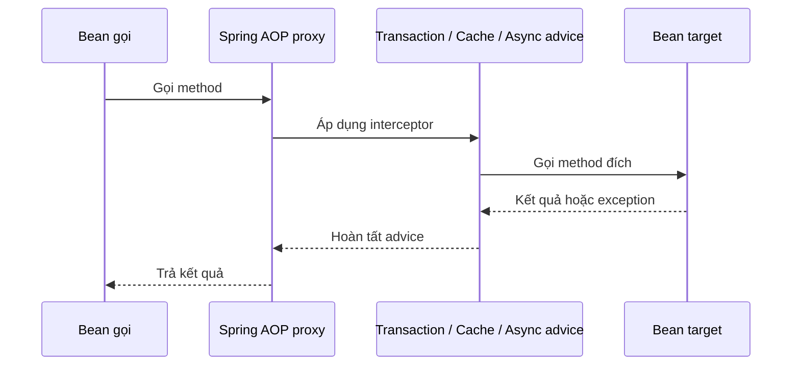
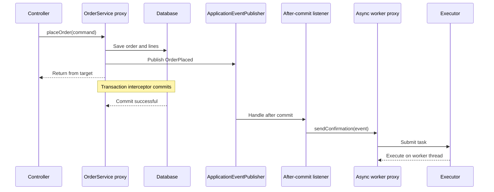

# Giao dịch, cache và xử lý bất đồng bộ qua AOP

## Mục tiêu bài học

Trong ứng dụng Spring Boot, transaction, cache và xử lý bất đồng bộ thường được bật bằng annotation như `@Transactional`, `@Cacheable`, `@CacheEvict` và `@Async`. Spring áp dụng các hành vi này thông qua AOP advice, thường được gắn vào bean bằng proxy.

Khi đưa ứng dụng sang **GraalVM Native Image**, các ranh giới proxy và vòng đời tài nguyên cần được kiểm tra kỹ. Spring AOT có thể chuẩn bị mã và metadata cho nhiều proxy do framework quản lý, nhưng không thay đổi ngữ nghĩa của lời gọi Java. Self-invocation vẫn có thể bỏ qua advice; transaction imperative vẫn gắn với thread hiện tại; executor và cache provider vẫn cần được khởi tạo, quản lý trong runtime.

Bài học này sử dụng một luồng đặt hàng để kết hợp ba cơ chế:

- Transaction ghi đơn hàng và dữ liệu liên quan một cách nhất quán.
- Cache được cập nhật hoặc vô hiệu hóa theo trạng thái đã commit.
- Notification được xử lý bất đồng bộ sau khi transaction thành công.

Sau bài học, bạn có thể:

- Giải thích cách Spring AOP áp dụng transaction, cache và async advice.
- Thiết kế transaction boundary rõ ràng và xử lý rollback đúng.
- Chọn cache key, cache provider và thời điểm eviction phù hợp.
- Tạo executor có giới hạn và quản lý lỗi của tác vụ async.
- Tránh self-invocation và hiểu vì sao transaction không tự truyền sang thread async.
- Kiểm thử các cơ chế này trên JVM AOT và native executable.

## 1. Ba cơ chế cùng sử dụng Spring AOP

### 1.1. Proxy là điểm vào của advice

Spring thường tạo proxy cho bean có method cần advice. Khi bean khác gọi method qua reference được Spring inject, proxy có thể chạy interceptor trước/sau khi gọi target.



Ba annotation có mục tiêu khác nhau:

| Annotation | Advice thực hiện | Kết quả mong muốn |
|---|---|---|
| `@Transactional` | Mở/tham gia transaction, commit hoặc rollback | Nhóm thao tác dữ liệu có ranh giới nhất quán |
| `@Cacheable` / `@CachePut` / `@CacheEvict` | Đọc, ghi hoặc xóa cache quanh lời gọi | Giảm truy vấn lặp và kiểm soát dữ liệu cache |
| `@Async` | Gửi lời gọi tới executor | Tách công việc khỏi thread gọi |

Annotation không tự động bao quanh mọi lời gọi Java. Với proxy mode, advice chỉ chạy khi lời gọi đi qua proxy và thỏa điều kiện của advisor.

### 1.2. Self-invocation bỏ qua proxy

Ví dụ:

```java
@Service
class OrderService {

    public void placeOrder(Order order) {
        this.persist(order);
    }

    @Transactional
    public void persist(Order order) {
        // Ghi don hang
    }
}
```

Khi caller gọi `placeOrder()` qua proxy, target được thực thi. Sau đó `this.persist(order)` gọi trực tiếp method trên cùng đối tượng; lời gọi không quay lại proxy. Transaction advice của `persist()` vì vậy không được kích hoạt bởi self-invocation.

Giới hạn này cũng áp dụng cho cache và async. Chuyển từ JDK proxy sang class-based proxy không tự sửa được self-invocation. Cách dễ bảo trì thường là tách phần cần advice thành collaborator bean và gọi qua dependency được Spring inject.

### 1.3. Điều kiện để proxy hoạt động

- Bean phải do Spring quản lý.
- Caller phải gọi qua reference proxy.
- Method và loại proxy phải tương thích với interception.
- Advisor tương ứng phải được bật và có cấu hình hợp lệ.
- Không được gọi method cần advice bằng self-invocation.

Với class-based proxy, class/method final không thể được override để chèn advice. Với JDK dynamic proxy, caller thường tương tác qua interface mà proxy triển khai. Hãy kiểm tra kiểu proxy và method thực tế thay vì chỉ kiểm tra annotation tồn tại.

## 2. Quản lý transaction với `@Transactional`

### 2.1. Cấu hình transaction manager

Spring Boot thường tự cấu hình transaction management khi có dependency và transaction manager phù hợp, ví dụ JDBC/JPA. Với cấu hình thủ công, có thể bật transaction management bằng `@EnableTransactionManagement` và cung cấp `PlatformTransactionManager` tương ứng.

Ví dụ với JDBC:

```java
@Configuration(proxyBeanMethods = false)
class DatabaseConfiguration {

    @Bean
    PlatformTransactionManager transactionManager(
            DataSource dataSource) {
        return new DataSourceTransactionManager(dataSource);
    }
}
```

Nếu ứng dụng dùng JPA, thường sử dụng transaction manager do Spring Boot/JPA cấu hình. Không tạo thêm transaction manager thứ hai nếu chưa có chủ đích về nhiều datasource hoặc nhiều transaction boundary.

### 2.2. Đặt transaction tại ranh giới use case

Một service method đại diện cho một use case thường là vị trí rõ ràng để đặt transaction:

```java
@Service
class OrderApplicationService {

    private final OrderRepository orderRepository;
    private final OrderLineRepository lineRepository;

    OrderApplicationService(
            OrderRepository orderRepository,
            OrderLineRepository lineRepository) {
        this.orderRepository = orderRepository;
        this.lineRepository = lineRepository;
    }

    @Transactional
    public OrderId createOrder(CreateOrderCommand command) {
        Order order = Order.create(command.customerId());
        orderRepository.save(order);

        for (CreateOrderLine line : command.lines()) {
            lineRepository.save(OrderLine.from(order, line));
        }

        return order.id();
    }
}
```

Nếu bất kỳ thao tác ghi nào ném exception phù hợp với rollback rule, transaction interceptor rollback toàn bộ transaction. Caller chỉ nhận kết quả sau khi lời gọi qua proxy hoàn tất; transaction commit diễn ra khi interceptor kết thúc thành công.

Đặt transaction trên method điều phối giúp các thao tác repository cùng tham gia một boundary. Nếu chỉ đánh dấu một method helper được gọi nội bộ bằng `this`, transaction có thể không được mở như mong đợi.

### 2.3. Quy tắc rollback mặc định

Theo mặc định, `@Transactional` rollback khi method ném `RuntimeException` hoặc `Error`. Checked exception không tự động rollback theo quy tắc mặc định.

Nếu nghiệp vụ yêu cầu rollback khi một checked exception xảy ra, khai báo rõ:

```java
@Transactional(rollbackFor = PaymentDeclinedException.class)
public void capturePayment(PaymentCommand command)
        throws PaymentDeclinedException {
    // Xu ly va ghi ket qua thanh toan
}
```

Không bắt exception rồi nuốt nó nếu transaction cần rollback. Nếu cần chuyển đổi exception, hãy bảo đảm exception được ném ra phù hợp với rollback policy hoặc đánh dấu rollback-only bằng API transaction khi có lý do rõ ràng.

### 2.4. Propagation và isolation

Một số thuộc tính thường gặp:

| Thuộc tính | Ý nghĩa |
|---|---|
| `Propagation.REQUIRED` | Tham gia transaction hiện có hoặc tạo transaction mới |
| `Propagation.REQUIRES_NEW` | Tạm treo transaction hiện có và tạo transaction riêng |
| `Propagation.MANDATORY` | Yêu cầu caller đã có transaction |
| `Propagation.NEVER` | Không cho phép chạy trong transaction |
| `Isolation.READ_COMMITTED` | Không đọc dữ liệu chưa commit của transaction khác |
| `readOnly = true` | Gợi ý transaction chỉ đọc cho provider/driver phù hợp |
| `timeout` | Giới hạn thời gian transaction theo hỗ trợ của transaction manager |

Chọn propagation/isolation dựa trên yêu cầu dữ liệu. Không dùng `REQUIRES_NEW` chỉ để tránh lỗi transaction; nó thay đổi tính nguyên tử và có thể làm dữ liệu audit/side effect commit dù transaction ngoài rollback.

### 2.5. Transaction imperative gắn với thread

Với transaction manager imperative như JDBC/JPA, Spring thường gắn transaction resource vào thread hiện tại. Các repository được gọi trong cùng thread có thể tham gia transaction đang hoạt động.

Khi chuyển công việc sang thread khác bằng `@Async`, transaction imperative của thread gọi không tự truyền sang thread executor. Nếu tác vụ async cần transaction riêng, hãy đặt `@Transactional` trên method của async worker; lời gọi đó sẽ mở transaction trong thread async nếu worker được proxy đúng cách.

Reactive transaction dùng Reactor Context và reactive transaction manager, có quy tắc khác với transaction imperative. Không chuyển một reactive flow sang executor tùy ý rồi giả định transaction context sẽ được giữ nguyên.

## 3. Cache bằng Spring Cache

### 3.1. Bật cache và chọn CacheManager

Có thể bật annotation-driven caching bằng `@EnableCaching`:

```java
@Configuration(proxyBeanMethods = false)
@EnableCaching
class CacheConfiguration {}
```

Spring Boot có thể tự cấu hình cache manager dựa trên provider có trong classpath. Nếu không có provider cụ thể, một số cấu hình đơn giản có thể dùng cache mặc định phù hợp cho phát triển; ứng dụng production nên chọn provider và chính sách lưu trữ rõ ràng.

Ví dụ dùng cache manager do ứng dụng cung cấp:

```java
@Configuration(proxyBeanMethods = false)
@EnableCaching
class ProductCacheConfiguration {

    @Bean
    CacheManager cacheManager() {
        return new ConcurrentMapCacheManager("products");
    }
}
```

`ConcurrentMapCacheManager` phù hợp cho ví dụ đơn giản và cache trong bộ nhớ của một process. Nó không chia sẻ dữ liệu giữa nhiều instance và không thay thế Redis, Caffeine hoặc cache provider production có eviction/TTL/metrics phù hợp.

### 3.2. Dùng `@Cacheable` cho dữ liệu đọc

```java
@Service
class ProductQueryService {

    private final ProductRepository repository;

    ProductQueryService(ProductRepository repository) {
        this.repository = repository;
    }

    @Cacheable(
            cacheNames = "products",
            key = "#productId"
    )
    public ProductView findById(String productId) {
        return repository.findViewById(productId)
                .orElseThrow(ProductNotFoundException::new);
    }
}
```

Khi cache có entry cho key, Spring có thể trả kết quả từ cache mà không gọi method target. Khi chưa có entry, method được thực thi và kết quả được lưu theo cấu hình cache.

Chọn key phải phản ánh mọi yếu tố làm thay đổi kết quả. Nếu kết quả phụ thuộc tenant, locale hoặc quyền truy cập, key chỉ gồm product ID có thể trả dữ liệu của ngữ cảnh khác. Tránh cache dữ liệu nhạy cảm dùng chung giữa người dùng.

### 3.3. Dùng `@CachePut` và `@CacheEvict`

`@CachePut` luôn thực thi method rồi cập nhật cache bằng kết quả; `@Cacheable` có thể bỏ qua method khi cache hit. Không đặt hai annotation này trên cùng method nếu chưa hiểu rõ tương tác.

Ví dụ cập nhật:

```java
@CachePut(cacheNames = "products", key = "#result.id")
public ProductView update(ProductCommand command) {
    return productRepository.update(command);
}
```

Ví dụ xóa:

```java
@CacheEvict(cacheNames = "products", key = "#productId")
public void delete(String productId) {
    productRepository.deleteById(productId);
}
```

Mặc định, eviction xảy ra sau khi method thực thi thành công. Có thể dùng `beforeInvocation = true` khi thực sự muốn xóa cache ngay cả khi method ném exception, nhưng cần cân nhắc khả năng dữ liệu trong DB vẫn chưa thay đổi.

### 3.4. Cache và transaction cần nhất quán

Một rủi ro phổ biến là cache được cập nhật trước khi transaction database commit. Nếu transaction rollback sau đó, cache có thể chứa dữ liệu chưa từng được commit.

Hãy xác định thứ tự và semantics của transaction advice với cache advice; thứ tự advisor có thể ảnh hưởng thời điểm thao tác cache. Với dữ liệu cần nhất quán, có thể:

- Chỉ phát tín hiệu cập nhật/xóa cache sau khi transaction commit.
- Dùng transaction-aware cache integration nếu provider hỗ trợ và semantics đáp ứng yêu cầu.
- Dùng event/outbox sau commit để cập nhật cache hoặc phát thông điệp.
- Thiết kế cache có TTL và khả năng tái nạp từ nguồn dữ liệu chuẩn.

Không giả định `@CacheEvict` tự động đồng bộ với transaction DB trong mọi cache provider.

### 3.5. Cache object và Native Image

Cache manager và cache entry thường là trạng thái runtime, nên tạo trong vòng đời ứng dụng chứ không giữ cache mutable trong static field được khởi tạo ở build time.

Nếu cache provider dùng reflection, proxy, serialization hoặc resource động, cần kiểm tra hỗ trợ AOT/Native Image của đúng phiên bản provider. Spring AOT có thể cung cấp hints cho thành phần framework biết; metadata của thư viện ngoài phụ thuộc tích hợp của thư viện hoặc reachability metadata đi kèm.

Đối với distributed cache như Redis, endpoint/credential nên được cấp runtime. Native Image không làm Redis tự xuất hiện trong binary; dịch vụ cache vẫn cần được triển khai và kết nối như một dependency bên ngoài.

## 4. Xử lý bất đồng bộ bằng `@Async`

### 4.1. Bật async execution

Spring có thể bật async method execution bằng `@EnableAsync`:

```java
@Configuration(proxyBeanMethods = false)
@EnableAsync
class AsyncConfiguration {
}
```

Khi một bean method có `@Async` được gọi qua proxy, Spring gửi lời gọi tới executor thay vì chạy body trên thread gọi.

### 4.2. Cấu hình executor có giới hạn

Không nên để executor production dùng số thread và queue không giới hạn. Cấu hình ví dụ:

```java
@Configuration(proxyBeanMethods = false)
@EnableAsync
class AsyncConfiguration {

    @Bean("notificationExecutor")
    ThreadPoolTaskExecutor notificationExecutor() {
        ThreadPoolTaskExecutor executor =
                new ThreadPoolTaskExecutor();
        executor.setCorePoolSize(4);
        executor.setMaxPoolSize(8);
        executor.setQueueCapacity(200);
        executor.setThreadNamePrefix("notification-");
        executor.setWaitForTasksToCompleteOnShutdown(true);
        executor.setAwaitTerminationSeconds(30);
        return executor;
    }
}
```

Giới hạn pool/queue phải dựa trên thời gian xử lý, tải, CPU và giới hạn downstream. Queue quá lớn có thể giữ nhiều object trong memory; queue quá nhỏ có thể khiến task bị từ chối khi tải tăng.

`ThreadPoolTaskExecutor` là Spring-managed bean nên lifecycle shutdown có thể được container quản lý. Đừng tự tạo executor trong static field hoặc quên đóng executor tự quản lý.

### 4.3. Trả về Future hoặc CompletableFuture

```java
@Service
class NotificationWorker {

    @Async("notificationExecutor")
    public CompletableFuture<Void> sendOrderConfirmation(
            OrderPlaced event) {
        notificationClient.send(event);
        return CompletableFuture.completedFuture(null);
    }
}
```

Caller nhận `CompletableFuture` và có thể kết hợp/quan sát kết quả. Nếu method trả về `void`, exception phát sinh trong async task không được trả trực tiếp về caller; cần cấu hình `AsyncUncaughtExceptionHandler` hoặc cơ chế ghi nhận lỗi tương ứng.

Không gọi `join()` hoặc `get()` ngay sau mỗi lời gọi nếu mục tiêu là không chặn request thread. Hãy chọn rõ chính sách timeout, retry, cancellation và cách báo lỗi.

### 4.4. Async không kế thừa transaction của caller

Ví dụ không nên giả định transaction được truyền sang worker:

```java
@Service
class OrderService {

    private final NotificationWorker worker;

    OrderService(NotificationWorker worker) {
        this.worker = worker;
    }

    @Transactional
    public void placeOrder(Order order) {
        orderRepository.save(order);
        worker.sendOrderConfirmation(
                new OrderPlaced(order.id())
        );
    }
}
```

Worker chạy trên thread khác. Nó không tham gia transaction imperative của `placeOrder()`. Nếu worker đọc dữ liệu trước khi transaction commit, nó có thể không nhìn thấy dữ liệu vừa ghi hoặc xử lý một đơn hàng sau đó bị rollback.

Giải pháp tốt hơn là chỉ gửi sự kiện sau commit, rồi để worker xử lý độc lập. Nếu worker cần transaction, đặt transaction boundary riêng trên worker method.

### 4.5. Self-invocation làm mất async

Đoạn sau không chạy async như mong đợi:

```java
@Service
class ReportService {

    public void generate() {
        this.generateAsync();
    }

    @Async
    public CompletableFuture<Void> generateAsync() {
        buildReport();
        return CompletableFuture.completedFuture(null);
    }
}
```

Lời gọi `this.generateAsync()` không đi qua proxy. Tách `generateAsync()` sang bean worker riêng hoặc gọi qua collaborator proxy. Với async, đây là vấn đề đặc biệt dễ bỏ sót vì code vẫn chạy thành công nhưng chạy trên thread hiện tại.

## 5. Kết hợp transaction, cache và async trong một luồng nghiệp vụ

### 5.1. Mục tiêu luồng đặt hàng

Một use case đặt hàng có thể cần:

1. Ghi đơn hàng và các dòng hàng trong một transaction.
2. Sau khi commit, vô hiệu hóa cache của thông tin bị thay đổi.
3. Sau khi commit, gửi notification bất đồng bộ.

Sơ đồ:



Sự kiện được publish bên trong transaction, nhưng listener chỉ xử lý khi transaction commit thành công. Nếu transaction rollback, listener phase `AFTER_COMMIT` không chạy.

`@TransactionalEventListener` mặc định yêu cầu có transaction đang hoạt động tại thời điểm publish event. Nếu event được publish ngoài transaction, listener sẽ không chạy trừ khi bật `fallbackExecution = true`. Chỉ bật fallback khi nghiệp vụ thực sự muốn xử lý cả trường hợp không có transaction.

Sau commit, transaction đã hoàn tất nhưng một số transaction resource có thể vẫn được đồng bộ trong callback lifecycle. Nếu listener cần ghi thêm dữ liệu vào database, hãy dùng transaction mới một cách tường minh (ví dụ collaborator có `@Transactional(propagation = Propagation.REQUIRES_NEW)`) thay vì giả định thao tác ghi sẽ được commit vào transaction vừa kết thúc.

### 5.2. Service phát sự kiện trong transaction

```java
public record OrderPlaced(String orderId) {}

@Service
class OrderApplicationService {

    private final OrderRepository orderRepository;
    private final ApplicationEventPublisher events;

    OrderApplicationService(
            OrderRepository orderRepository,
            ApplicationEventPublisher events) {
        this.orderRepository = orderRepository;
        this.events = events;
    }

    @Transactional
    public String placeOrder(CreateOrderCommand command) {
        Order order = Order.create(command);
        orderRepository.save(order);

        events.publishEvent(new OrderPlaced(order.id()));
        return order.id();
    }
}
```

Việc publish event không tự gửi email hoặc gọi API ngoài. Nó chỉ thông báo trong process; listener có thể đăng ký nhận sự kiện ở phase phù hợp.

### 5.3. Xử lý sau commit và gọi worker qua proxy

```java
@Component
class OrderPlacedListener {

    private final NotificationWorker worker;
    private final OrderCacheInvalidator cacheInvalidator;

    OrderPlacedListener(
            NotificationWorker worker,
            OrderCacheInvalidator cacheInvalidator) {
        this.worker = worker;
        this.cacheInvalidator = cacheInvalidator;
    }

    @TransactionalEventListener(phase = TransactionPhase.AFTER_COMMIT)
    public void afterCommit(OrderPlaced event) {
        cacheInvalidator.evictOrderRelatedData(event.orderId());
        worker.sendOrderConfirmation(event);
    }
}
```

Cache invalidator và worker là bean khác, nên lời gọi có thể đi qua proxy của từng bean. Listener được gọi sau commit; cache eviction và việc submit async task bắt đầu sau khi transaction thành công.

Ví dụ cache invalidator:

```java
@Service
class OrderCacheInvalidator {

    @CacheEvict(cacheNames = "orders", key = "#orderId")
    public void evictOrderRelatedData(String orderId) {
        // Method co the khong can body; advice thuc hien eviction
    }
}
```

Ví dụ worker:

```java
@Service
class NotificationWorker {

    private final NotificationClient client;

    NotificationWorker(NotificationClient client) {
        this.client = client;
    }

    @Async("notificationExecutor")
    public CompletableFuture<Void> sendOrderConfirmation(
            OrderPlaced event) {
        client.sendOrderConfirmation(event.orderId());
        return CompletableFuture.completedFuture(null);
    }
}
```

Trong hệ thống cần bảo đảm event không mất khi process dừng ngay sau commit, in-process event listener chưa đủ. Hãy dùng transactional outbox hoặc cơ chế messaging bền vững: ghi outbox record trong cùng transaction, sau đó publisher riêng gửi message và đánh dấu đã xử lý.

### 5.4. Transaction riêng trong worker khi cần

Nếu worker phải đọc/ghi database, có thể đặt transaction riêng trên method async:

```java
@Async("notificationExecutor")
@Transactional
public CompletableFuture<Void> processNotification(
        OrderPlaced event) {
    notificationLogRepository.save(
            NotificationLog.started(event.orderId())
    );
    notificationClient.sendOrderConfirmation(event.orderId());
    return CompletableFuture.completedFuture(null);
}
```

Method này cần được gọi qua proxy async; transaction advice sẽ được áp dụng trong thread worker nếu advisor/configuration được thiết lập phù hợp. Không dựa vào transaction của caller. Với thao tác gọi hệ thống ngoài, cân nhắc timeout, retry và idempotency vì database transaction không thể rollback side effect đã gửi ra ngoài.

## 6. Spring AOT và Native Image cần kiểm tra gì?

### 6.1. Proxy được Spring AOT chuẩn bị

Spring AOT có thể phân tích các bean và advisor do Spring quản lý, sinh mã/hints hỗ trợ proxy và bootstrap. Những annotation tiêu chuẩn như transaction, cache và async thường được hỗ trợ trong các cấu hình framework tương thích.

Tuy vậy, hãy kiểm tra:

- Bean có được phát hiện và đăng ký trong AOT context không?
- Transaction manager, cache manager và executor có được tạo như dự kiến không?
- Proxy được tạo theo interface hay class-based proxy?
- Method cần advice có thể được intercept không?
- Custom advisor, custom proxy factory hoặc thư viện bên ngoài có AOT/native integration không?

### 6.2. Native Image không sửa lỗi thiết kế proxy

Native compilation không biến self-invocation thành lời gọi qua proxy. Nếu `this.method()` bỏ qua advice trên JVM, nó vẫn có thể bỏ qua advice trong native executable.

Native Image còn có các yêu cầu riêng nếu thư viện dùng reflection, dynamic proxy, serialization hoặc class generation. Spring AOT có thể cung cấp hints cho thành phần framework biết; custom integration cần metadata phù hợp.

Không thêm Runtime Hints để sửa:

- Transaction boundary đặt sai method.
- Async worker được gọi bằng self-invocation.
- Cache eviction xảy ra trước thời điểm dữ liệu commit.
- Executor không có capacity hoặc không được shutdown đúng.

Đó là vấn đề thiết kế hoặc runtime lifecycle, không phải thiếu reflection metadata.

### 6.3. Tài nguyên phải được tạo ở runtime

Cache manager, executor, connection pool và client tới dịch vụ ngoài thường cần gắn với runtime environment. Tránh khởi tạo chúng trong static initializer có thể chạy ở build time.

Hãy dùng Spring bean lifecycle để tạo và đóng tài nguyên. Endpoint, credential, queue name, pool size và timeout nên được cấp từ cấu hình runtime nếu không quyết định bean graph.

### 6.4. Provider và dependency phải tương thích

Native Image không đảm bảo mọi cache provider, database driver, transaction integration hoặc notification client đều tương thích tự động. Kiểm tra:

- Provider có reachability metadata hoặc Spring AOT integration phù hợp không?
- Có dùng reflection để tạo serializer, proxy hoặc connection factory không?
- Có dùng JNI/shared library không?
- TLS, DNS, filesystem và network có hoạt động trong target image không?
- Có hỗ trợ đóng executor/connection pool khi shutdown không?

Nếu provider không hỗ trợ native, cân nhắc thay provider, bổ sung metadata đã kiểm chứng hoặc tách integration đó sang process phù hợp.

## 7. Kiểm thử transaction, cache và async

### 7.1. Test rollback

Một test cần chứng minh dữ liệu không còn sau khi use case ném exception:

```java
@SpringBootTest
class OrderTransactionTests {

    @Autowired
    OrderApplicationService service;

    @Autowired
    OrderRepository repository;

    @Test
    void rollsBackOrderWhenUseCaseFails() {
        assertThatThrownBy(() ->
                service.placeOrder(commandThatFailsAfterSave())
        ).isInstanceOf(OrderCreationException.class);

        assertThat(repository.findByReference("test-order"))
                .isEmpty();
    }
}
```

Fixture và repository method cần được định nghĩa trong dự án. Tránh đánh dấu chính test method là `@Transactional` nếu điều đó làm che transaction boundary của service. Kiểm tra dữ liệu sau khi service proxy đã trả exception.

### 7.2. Test cache hit và eviction

Dùng spy/mock repository hoặc counter để xác nhận method target không chạy lại khi cache hit:

```java
@SpringBootTest
class ProductCacheTests {

    @Autowired
    ProductQueryService queryService;

    @MockBean
    ProductRepository repository;

    @Test
    void returnsCachedProductOnSecondCall() {
        given(repository.findViewById("p-1"))
                .willReturn(Optional.of(productView("p-1")));

        queryService.findById("p-1");
        queryService.findById("p-1");

        then(repository).should(times(1))
                .findViewById("p-1");
    }
}
```

API mock annotation có thể khác theo phiên bản Spring Boot; dùng cơ chế mock/spy được dự án hỗ trợ. Bổ sung test eviction sau update/delete và test key phân biệt tenant/locale nếu dữ liệu phụ thuộc các yếu tố đó.

### 7.3. Test async completion

Với async method trả về `CompletableFuture`, chờ kết quả trong test với timeout:

```java
@SpringBootTest
class NotificationWorkerTests {

    @Autowired
    NotificationWorker worker;

    @MockBean
    NotificationClient client;

    @Test
    void submitsNotificationToAsyncWorker() {
        CompletableFuture<Void> result =
                worker.sendOrderConfirmation(
                        new OrderPlaced("order-1")
                );

        assertThatCode(() -> result.get(5, TimeUnit.SECONDS))
                .doesNotThrowAnyException();

        then(client).should()
                .sendOrderConfirmation("order-1");
    }
}
```

Test này xác nhận future hoàn tất và client được gọi; nếu cần chứng minh thực sự chạy trên thread khác, ghi nhận thread name hoặc dùng latch/queue để so sánh với caller thread. Không dùng sleep cố định nếu có thể chờ Future hoặc synchronization primitive.

### 7.4. Test event chỉ chạy sau commit

Tạo integration test cho hai tình huống:

- Transaction commit: listener `AFTER_COMMIT` được gọi và worker được submit.
- Transaction rollback: listener không gửi notification và không evict cache theo event đó.

Nếu dùng in-process event, test cần đợi async task hoàn thành trước khi assert side effect. Nếu dùng outbox, xác nhận outbox record commit cùng dữ liệu nghiệp vụ và publisher có thể retry an toàn.

### 7.5. Chạy cùng test trên JVM AOT và native

Một ma trận tối thiểu:

| Kiểm tra | JVM thường | JVM AOT | Native executable |
|---|---|---|---|
| ApplicationContext startup | Có | Có | Có |
| Transaction commit/rollback | Có | Có | Có |
| Cache hit/put/evict | Có | Có | Có |
| Async executor/thread | Có | Có | Có |
| Event after commit | Có | Có | Có |
| Shutdown executor/client | Có | Có | Có |
| Reflection/provider integration | Theo nhu cầu | Theo nhu cầu | Bắt buộc cho đường dùng dynamic |

JVM AOT giúp xác minh generated Spring context và proxy. Chỉ chạy native executable mới xác minh đầy đủ tương thích Native Image của provider, metadata và thư viện.

## 8. Vận hành và quan sát trong production

### 8.1. Theo dõi transaction

Theo dõi:

- Tỷ lệ rollback và exception theo use case.
- Transaction duration và timeout.
- Connection pool active/idle/pending.
- Deadlock, lock wait và lỗi database.
- Các thao tác ghi thành công nhưng side effect sau commit thất bại.

Không log thông tin nhạy cảm hoặc payload chứa secret khi điều tra transaction.

### 8.2. Theo dõi cache

Theo dõi hit/miss ratio, eviction, size, TTL, lỗi kết nối và độ trễ provider. Đặt giới hạn dung lượng/TTL phù hợp; tránh cache tăng không giới hạn theo key đầu vào tùy ý.

Với nhiều instance, xác định cache local hay distributed. Cache local có thể khác nhau giữa instance; nếu cần nhất quán, cần invalidation/event strategy phù hợp.

### 8.3. Theo dõi async executor

Theo dõi:

- Active thread và pool size.
- Queue depth và thời gian chờ.
- Task completion/failure/rejection.
- Task duration và downstream latency.
- Số task còn lại khi shutdown.

Nếu queue đầy, cần chính sách rejection rõ ràng. Không dùng CallerRunsPolicy một cách vô thức vì nó có thể khiến request thread thực thi công việc vốn được dự định chạy async.

### 8.4. Shutdown và độ bền của công việc

Executor có thể chờ task hoàn tất trong giới hạn timeout, nhưng process/container vẫn có thể bị dừng cưỡng bức. Nếu notification hoặc message không được phép mất, dùng durable queue/outbox và xử lý idempotent.

Native executable vẫn cần graceful shutdown, readiness/liveness phù hợp và giới hạn thời gian dừng của orchestrator. Không xem việc binary khởi động nhanh là lý do bỏ qua lifecycle management.

## 9. Lỗi thường gặp và cách xử lý

| Triệu chứng | Nguyên nhân có thể | Hướng xử lý |
|---|---|---|
| `@Transactional` không mở transaction | Self-invocation, bean không qua proxy hoặc thiếu transaction manager | Kiểm tra proxy và đặt boundary ở method được gọi từ bên ngoài |
| Checked exception không rollback | Rollback rule mặc định không bao gồm checked exception | Khai báo `rollbackFor` hoặc policy phù hợp |
| Worker async không thấy dữ liệu vừa ghi | Task chạy trước khi transaction commit | Phát event sau commit hoặc dùng outbox |
| Worker async không có transaction | Transaction imperative không truyền qua thread | Đặt transaction riêng trên worker method |
| `@Async` chạy trên caller thread | Self-invocation hoặc async chưa được bật | Tách worker bean, kiểm tra `@EnableAsync` và proxy |
| Async exception không được caller thấy | Method trả `void` hoặc future không được quan sát | Trả Future/CompletableFuture và xử lý lỗi |
| Cache giữ dữ liệu cũ sau update | Thiếu eviction/update hoặc key không đầy đủ | Thiết kế key và invalidation theo use case |
| Cache chứa dữ liệu chưa commit | Cache advice chạy trước DB commit | Evict/update sau commit hoặc dùng transaction-aware strategy |
| Native build thiếu proxy/provider metadata | Custom proxy hoặc thư viện dùng reflection chưa có hints | Kiểm tra AOT integration/reachability metadata |
| Native app không kết nối cache/database | Sai endpoint/secret/network hoặc native library | Kiểm tra runtime config, TLS, DNS, ABI và provider |
| Task mất khi process restart | Chỉ dùng in-memory executor/event | Dùng queue/outbox bền vững và retry idempotent |

## 10. Quy trình thực hành

### Bước 1 — Tạo transaction boundary

Viết service use case có `@Transactional`, lưu order và order lines. Thêm test commit/rollback, kiểm tra dữ liệu sau khi service proxy hoàn tất.

### Bước 2 — Thêm cache

Bật caching, cấu hình CacheManager và thêm `@Cacheable` cho truy vấn đọc. Kiểm tra hit, miss, eviction và key theo tenant/locale nếu có.

### Bước 3 — Thêm async worker

Cấu hình executor có giới hạn. Tách notification worker thành bean riêng, dùng `@Async` và trả về `CompletableFuture`. Kiểm tra thread, completion và exception.

### Bước 4 — Phối hợp sau commit

Publish event trong transaction, xử lý bằng `@TransactionalEventListener(AFTER_COMMIT)`, rồi gọi cache invalidator và async worker qua proxy. Nếu cần bảo đảm không mất event, triển khai outbox.

### Bước 5 — Kiểm thử AOT và native

Chạy test trên JVM thông thường, JVM AOT và native executable. So sánh transaction, cache, async, event, resource và shutdown. Bổ sung hints chỉ khi lỗi thực sự thuộc reflection/resource/proxy metadata.

### Bước 6 — Quan sát và vận hành

Ghi nhận transaction duration/rollback, cache hit/miss, executor queue/rejection và shutdown. Đặt timeout, retry, idempotency và capacity theo đặc tính tải.

### Câu hỏi tự kiểm tra

1. Vì sao `@Transactional` và `@Async` cùng có mặt trên một luồng nhưng transaction của thread gọi không tự truyền sang worker?
2. Vì sao nên phát notification sau commit thay vì gọi hệ thống ngoài ngay trong transaction?
3. Khi nào dùng `@CachePut`, khi nào dùng `@CacheEvict`, và điều gì xảy ra nếu cache thay đổi trước khi DB commit?
4. Vì sao self-invocation có thể khiến `@Async` chạy đồng bộ?
5. Vì sao executor cần queue/pool có giới hạn và graceful shutdown?
6. Spring AOT giúp gì cho proxy, và những vấn đề nào vẫn cần kiểm tra riêng trên Native Image?
7. Khi nào in-process event không đủ và cần transactional outbox?

**Ghi nhớ:** transaction bảo vệ dữ liệu trong một boundary; cache cần phản ánh dữ liệu đã commit; async worker chạy trên thread riêng và không tự nhận transaction imperative của caller. Thiết kế các ranh giới này qua bean/proxy rõ ràng, quản lý cache/executor trong runtime lifecycle, phát side effect sau commit và kiểm thử lại trên native executable. Spring AOT hỗ trợ chuẩn bị proxy nhưng không sửa self-invocation, transaction semantics hay độ bền của tác vụ.
