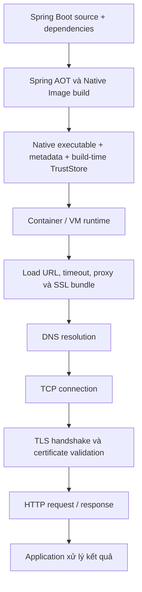

# HTTP client, TLS, truststore và kết nối tới dịch vụ ngoài

Ứng dụng Spring Boot thường phải gọi API của payment gateway, identity provider, dịch vụ vận chuyển, hệ thống nội bộ hoặc đối tác. Khi chuyển sang **GraalVM Native Image**, các lời gọi HTTP vẫn diễn ra lúc ứng dụng chạy, nhưng client implementation, TLS provider, certificate store, resource và cấu hình mạng phải tương thích với native executable.

Spring Boot cung cấp `RestClient` cho luồng gọi đồng bộ và `WebClient` cho ứng dụng reactive. **SSL Bundles** giúp quản lý truststore, keystore và chứng chỉ theo tên để tái sử dụng cho nhiều client. GraalVM Native Image có thêm quy tắc riêng về HTTPS và default TrustStore: mặc định, builder capture TrustStore từ máy build và nhúng vào executable. Vì vậy, một binary chạy được trên máy developer chưa chắc kết nối được với dịch vụ nội bộ trong container production.

## 1. Mục tiêu học tập

Sau bài học, bạn có thể:

- Chọn `RestClient`, `WebClient` hoặc HTTP Service Interface theo mô hình ứng dụng.
- Cấu hình base URL, connect timeout, read timeout, proxy và HTTP client implementation.
- Phân biệt truststore, keystore, server authentication và mutual TLS.
- Cấu hình SSL Bundle bằng JKS/PKCS12 hoặc PEM.
- Dùng `RestClientSsl` và `WebClientSsl` để áp dụng trust material cho outbound HTTP client.
- Hiểu ảnh hưởng của GraalVM Native Image tới HTTPS, security provider và default TrustStore.
- Phân biệt TrustStore được capture lúc build với truststore được nạp từ file lúc runtime.
- Kiểm thử kết nối HTTPS trong JVM, native executable và container cuối cùng.
- Chẩn đoán lỗi DNS, timeout, proxy, certificate chain, hostname verification và thiếu native metadata.

## 2. Kết nối HTTP trong Native Image hoạt động ở thời điểm nào?

GraalVM Native Image biên dịch code và metadata thành executable. Các lời gọi HTTP đến dịch vụ ngoài vẫn được thực hiện khi native process chạy. Native Image không đóng gói sẵn network route, DNS record, firewall rule, service endpoint hoặc credentials của môi trường triển khai.

Điều này tạo ra ba lớp cần kiểm tra:

1. **Build:** client implementation, protocol support, security provider, resource và metadata cần thiết phải được Native Image nhận diện.
2. **Runtime:** executable phải đọc được URL, proxy, trust material, timeout và credentials từ cấu hình của process.
3. **Network environment:** container/VM phải resolve DNS, mở được outbound connection và tin cậy certificate chain của server.



Một build thành công chỉ chứng minh Native Image builder tạo được executable. Nó chưa chứng minh executable có thể resolve hostname, xác thực certificate, mở kết nối hoặc gọi được API trong network production.

## 3. Chọn HTTP client trong Spring Boot

### 3.1. RestClient cho API đồng bộ

Nếu ứng dụng không dùng Spring WebFlux hoặc Project Reactor cho luồng reactive, Spring Boot khuyến nghị `RestClient`. API này dùng phong cách fluent, imperative và được cấu hình qua `RestClient.Builder` do Spring Boot cung cấp.

```java
import org.springframework.stereotype.Service;
import org.springframework.web.client.RestClient;

@Service
public class PartnerClient {

    private final RestClient restClient;

    public PartnerClient(RestClient.Builder builder) {
        this.restClient = builder
            .baseUrl("https://partner.example")
            .build();
    }

    public PartnerOrder findOrder(String orderId) {
        return restClient.get()
            .uri("/api/orders/{id}", orderId)
            .retrieve()
            .body(PartnerOrder.class);
    }
}
```

Nên inject builder đã được auto-configure thay vì gọi `RestClient.create()` một cách tùy tiện. Builder của Spring Boot có thể mang theo message converters, request factory và các customizer của ứng dụng. `RestClient.create()` không áp dụng auto-configuration hoặc `RestClientCustomizer`.

### 3.2. WebClient cho luồng reactive

Nếu ứng dụng dùng Spring WebFlux và cần non-blocking I/O, dùng `WebClient`:

```java
import reactor.core.publisher.Mono;
import org.springframework.stereotype.Service;
import org.springframework.web.reactive.function.client.WebClient;

@Service
public class ReactivePartnerClient {

    private final WebClient webClient;

    public ReactivePartnerClient(WebClient.Builder builder) {
        this.webClient = builder
            .baseUrl("https://partner.example")
            .build();
    }

    public Mono<PartnerOrder> findOrder(String orderId) {
        return webClient.get()
            .uri("/api/orders/{id}", orderId)
            .retrieve()
            .bodyToMono(PartnerOrder.class);
    }
}
```

Spring Boot ưu tiên các `ClientHttpConnector` theo dependency có trên classpath: Reactor Netty, Jetty Reactive HTTP Client, Apache HttpClient và JDK HttpClient. Nếu có nhiều implementation, client được chọn theo thứ tự ưu tiên của phiên bản Spring Boot đang dùng.

Không chọn WebClient chỉ vì nó có tên mới hoặc cho rằng nó luôn nhanh hơn. Reactive client phù hợp khi luồng xử lý thực sự non-blocking và toàn bộ pipeline sử dụng reactive API. Nếu gọi `block()` ở mọi nơi, lợi ích reactive bị giảm và việc quản lý thread trở nên khó hiểu hơn.

### 3.3. HTTP Service Interface

Spring hỗ trợ khai báo HTTP contract bằng interface có `@HttpExchange`, `@GetExchange`, `@PostExchange` và các annotation tương ứng. Spring Boot có thể import các interface này bằng `@ImportHttpServices`.

```java
import org.springframework.web.service.annotation.GetExchange;
import org.springframework.web.service.annotation.HttpExchange;
import org.springframework.web.bind.annotation.PathVariable;

@HttpExchange
public interface PartnerOrdersApi {

    @GetExchange("/api/orders/{id}")
    PartnerOrder findOrder(@PathVariable("id") String id);
}
```

Khai báo group trong application:

```java
import org.springframework.boot.SpringApplication;
import org.springframework.boot.autoconfigure.SpringBootApplication;
import org.springframework.web.service.registry.ImportHttpServices;

@SpringBootApplication
@ImportHttpServices(
    group = "partner",
    types = PartnerOrdersApi.class
)
public class OrderApplication {
    public static void main(String[] args) {
        SpringApplication.run(OrderApplication.class, args);
    }
}
```

Đưa URL ra cấu hình:

```properties
spring.http.serviceclient.partner.base-url=${PARTNER_API_URL:https://partner.example}
spring.http.serviceclient.partner.connect-timeout=2s
spring.http.serviceclient.partner.read-timeout=5s
```

HTTP Service groups cũng có thể dùng chung timeout, SSL bundle, default headers và client customization. Đây là lựa chọn phù hợp khi ứng dụng có nhiều API client cần cùng một policy.

## 4. Quản lý endpoint, timeout và proxy

### 4.1. Không hard-code endpoint production

Đặt endpoint trong cấu hình:

```properties
partner.api.base-url=${PARTNER_API_URL:https://partner.example}
```

Hoặc dùng HTTP Service client group properties:

```yaml
spring:
  http:
    serviceclient:
      partner:
        base-url: ${PARTNER_API_URL:https://partner.example}
```

Nhờ đó, cùng một native executable có thể gọi endpoint staging hoặc production theo cấu hình runtime. URL không nên được đọc trong static initializer hoặc đóng dấu vào build metadata nếu endpoint cần thay đổi theo deployment.

### 4.2. Cấu hình connect timeout và read timeout

Connect timeout giới hạn thời gian thiết lập kết nối. Read timeout giới hạn thời gian chờ dữ liệu phản hồi theo cơ chế của HTTP client được chọn. Timeout không giống nhau giữa các client implementation, vì vậy hãy xác minh semantics của connector thực tế.

Spring Boot hỗ trợ cấu hình chung:

```properties
spring.http.clients.connect-timeout=2s
spring.http.clients.read-timeout=5s
```

Hoặc cấu hình riêng cho một HTTP Service group:

```properties
spring.http.serviceclient.partner.connect-timeout=2s
spring.http.serviceclient.partner.read-timeout=5s
```

Với `RestClient`, có thể dùng `HttpClientSettings` và `ClientHttpRequestFactoryBuilder` để kết hợp SSL bundle với timeout:

```java
import java.time.Duration;
import org.springframework.boot.http.client.ClientHttpRequestFactoryBuilder;
import org.springframework.boot.http.client.HttpClientSettings;
import org.springframework.boot.ssl.SslBundles;
import org.springframework.context.annotation.Bean;
import org.springframework.context.annotation.Configuration;
import org.springframework.http.client.ClientHttpRequestFactory;

@Configuration(proxyBeanMethods = false)
class PartnerHttpConfiguration {

    @Bean
    ClientHttpRequestFactory partnerRequestFactory(SslBundles sslBundles) {
        HttpClientSettings settings = HttpClientSettings
            .ofSslBundle(sslBundles.getBundle("partner"))
            .withReadTimeout(Duration.ofSeconds(5));

        return ClientHttpRequestFactoryBuilder.detect().build(settings);
    }
}
```

Sau đó gắn request factory vào `RestClient.Builder`. Nếu cần connect timeout, cookie handling hoặc redirect policy, dùng cấu hình chung `spring.http.clients` hoặc API tương ứng của builder/client implementation.

Ví dụ ghép request factory đã cấu hình vào client:

```java
@Bean
RestClient partnerRestClient(
        RestClient.Builder builder,
        ClientHttpRequestFactory partnerRequestFactory) {
    return builder
        .baseUrl("https://partner.example")
        .requestFactory(partnerRequestFactory)
        .build();
}
```

### 4.3. Proxy và egress

Một số môi trường yêu cầu outbound traffic đi qua HTTP proxy. Spring Boot có thể cấu hình client builder bằng `ProxySelector`:

```java
import java.net.ProxySelector;
import org.springframework.boot.http.client.ClientHttpRequestFactoryBuilder;
import org.springframework.context.annotation.Bean;
import org.springframework.context.annotation.Configuration;

@Configuration(proxyBeanMethods = false)
class ProxyConfiguration {

    @Bean
    ClientHttpRequestFactoryBuilder<?> clientHttpRequestFactoryBuilder(
            ProxySelector proxySelector) {
        return ClientHttpRequestFactoryBuilder.jdk()
            .withHttpClientCustomizer(
                builder -> builder.proxy(proxySelector)
            );
    }
}
```

Đối với WebClient, có thể cấu hình `ClientHttpConnectorBuilder` tương ứng. Không giả định mọi thư viện HTTP đều tự đọc `HTTP_PROXY` hoặc `HTTPS_PROXY`; hãy kiểm tra behavior của implementation và cấu hình proxy rõ ràng.

Trong container/Kubernetes, xác minh:

- DNS có resolve được hostname dịch vụ không?
- Network policy, firewall và security group có cho outbound tới port cần thiết không?
- Proxy có resolve được hostname đích không?
- Egress gateway có yêu cầu CA riêng không?
- Runtime container có route tới private endpoint hoặc service mesh không?

Build Native Image trên máy có internet không đồng nghĩa native process trong production có quyền truy cập internet.

## 5. TLS, truststore và keystore

### 5.1. Truststore và keystore khác nhau

| Thành phần | Chứa gì? | Dùng để làm gì? |
| --- | --- | --- |
| **Truststore** | CA certificate hoặc server certificate được tin cậy | Client xác minh danh tính server trong TLS handshake |
| **Keystore** | Certificate và private key của chính ứng dụng | Ứng dụng chứng minh danh tính của mình, thường trong mutual TLS |
| **TrustManager** | Chính sách và dữ liệu xác thực certificate chain | Quyết định certificate của peer có được tin cậy không |
| **KeyManager** | Chọn key/certificate của client hoặc server | Cung cấp certificate khi TLS handshake yêu cầu |

Trong HTTPS thông thường:

1. Client mở kết nối tới hostname của server.
2. Server gửi certificate chain.
3. Client xác minh chữ ký, chain tới CA tin cậy, thời hạn và hostname.
4. TLS handshake hoàn tất rồi mới truyền HTTP request.

Truststore giúp xác minh server. Keystore chỉ cần khi client phải trình certificate của chính nó, chẳng hạn đối tác yêu cầu **mutual TLS (mTLS)**.

### 5.2. Không tắt certificate validation

Không dùng TrustManager chấp nhận mọi certificate, hostname verifier luôn trả `true` hoặc cấu hình tắt xác minh TLS để làm cho request chạy được. Những cách này biến kết nối mã hóa thành kết nối không xác thực và mở đường cho man-in-the-middle.

Nếu gặp `PKIX path building failed`, hãy kiểm tra CA chain và truststore. Nếu gặp hostname mismatch, kiểm tra URL hostname có nằm trong Subject Alternative Name của certificate. Nếu certificate hết hạn, cập nhật certificate ở server hoặc CA chain đúng quy trình.

## 6. Cấu hình SSL Bundle trong Spring Boot

Spring Boot cung cấp SSL Bundles để gom trust material, keystore, truststore, protocol và thông tin liên quan thành một bundle có tên. Client có thể lấy bundle đó để cấu hình TLS.

### 6.1. Truststore dạng JKS hoặc PKCS12

Ví dụ dùng truststore PKCS12 chứa CA nội bộ hoặc certificate của đối tác:

```yaml
spring:
  ssl:
    bundle:
      jks:
        partner:
          truststore:
            location: ${PARTNER_TRUSTSTORE_LOCATION:file:/run/secrets/partner-truststore.p12}
            password: ${PARTNER_TRUSTSTORE_PASSWORD}
            type: PKCS12
```

`location` có thể là `classpath:` nếu truststore được đóng gói trong application resources, hoặc `file:` nếu file được mount vào runtime container. Với truststore nhạy cảm, thường nên mount từ secret volume và lấy password từ secret provider/environment thay vì commit password vào source.

### 6.2. Truststore dạng PEM

Nếu đối tác cung cấp CA certificate dạng PEM:

```yaml
spring:
  ssl:
    bundle:
      pem:
        partner:
          truststore:
            certificate: file:/run/secrets/partner-ca.crt
```

Spring Boot cũng hỗ trợ certificate PEM trực tiếp hoặc nội dung Base64 bắt đầu bằng `base64:`. Dùng file mount khi cần quản lý certificate độc lập với application image.

### 6.3. Mutual TLS với client certificate

Khi đối tác yêu cầu mTLS, bundle cần cả truststore và keystore:

```yaml
spring:
  ssl:
    bundle:
      jks:
        partner:
          truststore:
            location: file:/run/secrets/partner-truststore.p12
            password: ${PARTNER_TRUSTSTORE_PASSWORD}
            type: PKCS12
          keystore:
            location: file:/run/secrets/client-identity.p12
            password: ${PARTNER_KEYSTORE_PASSWORD}
            type: PKCS12
          key:
            alias: order-service-client
```

Truststore chứa CA để xác minh server; keystore chứa client identity. Private key phải được bảo vệ như secret. Đảm bảo certificate client còn hạn, có Extended Key Usage phù hợp và alias trỏ tới đúng key entry.

## 7. Gắn SSL Bundle vào RestClient và WebClient

### 7.1. RestClient với RestClientSsl

Spring Boot cung cấp `RestClientSsl`, cho phép áp dụng SSL bundle lên `RestClient.Builder`:

```java
import org.springframework.boot.restclient.autoconfigure.RestClientSsl;
import org.springframework.context.annotation.Bean;
import org.springframework.context.annotation.Configuration;
import org.springframework.web.client.RestClient;

@Configuration(proxyBeanMethods = false)
class PartnerClientConfiguration {

    @Bean
    RestClient partnerRestClient(
            RestClient.Builder builder,
            RestClientSsl ssl) {
        return builder
            .baseUrl("https://partner.example")
            .apply(ssl.fromBundle("partner"))
            .build();
    }
}
```

Tên `partner` phải khớp tên bundle đã khai báo dưới `spring.ssl.bundle`. Trong ứng dụng thật, base URL nên lấy từ cấu hình runtime hoặc HTTP Service group.

### 7.2. WebClient với WebClientSsl

Với ứng dụng reactive:

```java
import org.springframework.boot.webclient.autoconfigure.WebClientSsl;
import org.springframework.context.annotation.Bean;
import org.springframework.context.annotation.Configuration;
import org.springframework.web.reactive.function.client.WebClient;

@Configuration(proxyBeanMethods = false)
class ReactivePartnerClientConfiguration {

    @Bean
    WebClient partnerWebClient(
            WebClient.Builder builder,
            WebClientSsl ssl) {
        return builder
            .baseUrl("https://partner.example")
            .apply(ssl.fromBundle("partner"))
            .build();
    }
}
```

`WebClientSsl` cấu hình SSL cho `ClientHttpConnector` mà WebClient đang sử dụng. Connector có thể là Reactor Netty, Jetty, Apache hoặc JDK client tùy dependency và cấu hình. Khi đổi connector, phải kiểm tra lại SSL settings, timeout, proxy và khả năng native của implementation.

## 8. GraalVM Native Image và HTTPS

### 8.1. HTTPS support và URL protocol handlers

Native Image có option `--enable-https` để bật HTTPS support cho URL protocol handlers. Option này đặc biệt liên quan khi code sử dụng `URL`, `URLConnection` hoặc cơ chế dựa trên URL protocol handler.

```bash
native-image --enable-https ...
```

Có thể bật HTTP bằng `--enable-http` khi cần protocol handler tương ứng. Không nên mặc định thêm tất cả protocol hoặc mọi security service nếu ứng dụng không dùng chúng.

Điểm cần phân biệt: `--enable-https` không tự cấu hình truststore, không thêm CA nội bộ, không mở network policy và không đảm bảo mọi HTTP client library đã có đủ metadata. Với `RestClient`/`WebClient`, hãy xác định connector thực tế và kiểm tra build output, native test cùng TLS handshake trên executable.

### 8.2. Security providers

TLS phụ thuộc các API bảo mật Java và provider tương ứng. Native Image có thể tự nhận diện phần lớn đường chạy phổ biến, nhưng một số ứng dụng dùng provider hoặc thuật toán bổ sung có thể cần cấu hình build phù hợp.

Khi gặp lỗi liên quan provider hoặc thuật toán:

1. Xác định provider class và thuật toán mà client thực sự dùng.
2. Kiểm tra GraalVM build output và security report.
3. Đọc tài liệu Native Image của đúng GraalVM version.
4. Chỉ bổ sung provider cần thiết bằng option phù hợp, chẳng hạn `-H:AdditionalSecurityProviders=...` khi được yêu cầu.

Không dùng `--enable-all-security-services` như cách chữa chung cho mọi lỗi TLS. Nó có thể làm binary lớn hơn và đưa thêm security services không cần thiết vào executable.

### 8.3. Default TrustStore được capture lúc build

GraalVM Native Image mặc định capture default TrustStore từ host trong lúc build và nhúng nội dung certificate vào executable. TrustStore mặc định thường dựa trên root certificate file của JDK được dùng để build.

Hệ quả:

- Binary build trên máy developer có CA nội bộ có thể tin cậy endpoint mà binary build trên CI sạch không tin.
- Thay đổi CA store của container sau build không tự cập nhật TrustStore đã được capture vào executable.
- Build cùng source trên hai máy có TrustStore khác nhau có thể tạo ra hành vi TLS khác nhau.

Để có build reproducible, dùng build host có CA store được kiểm soát và ghi nhận rõ nguồn trust material. Với CA riêng của từng đối tác, SSL Bundle là cách rõ ràng để cấu hình truststore riêng cho client.

### 8.4. Thay đổi default TrustStore tại runtime

Native Image cho phép cấu hình default TrustStore lúc chạy bằng các system properties:

- `javax.net.ssl.trustStore`
- `javax.net.ssl.trustStoreType`
- `javax.net.ssl.trustStoreProvider`
- `javax.net.ssl.trustStorePassword`

Khi đặt bất kỳ property nào trong danh sách này lúc runtime, Native Image cũng yêu cầu `javax.net.ssl.trustStore` phải được đặt và trỏ tới file certificate store có thể truy cập. Nếu chỉ đặt type/password/provider mà không có file truststore hợp lệ, executable có thể ném `UnsupportedFeatureError`.

Ví dụ:

```bash
./order-service \
  -Djavax.net.ssl.trustStore=/run/secrets/runtime-truststore.p12 \
  -Djavax.net.ssl.trustStoreType=PKCS12 \
  -Djavax.net.ssl.trustStorePassword="$TRUSTSTORE_PASSWORD"
```

Đường dẫn phải tồn tại bên trong container và process phải có quyền đọc. Nếu không đặt các property này, Native Image sử dụng default TrustStore được capture trong lúc build.

Lưu ý: default TrustStore của JSSE và SSL Bundle do Spring Boot quản lý là hai cơ chế cấu hình có thể dùng riêng. Khi client sử dụng SSL Bundle cụ thể, hãy xác minh client đang nhận bundle đó thay vì cho rằng thay đổi global `javax.net.ssl.trustStore` sẽ tự áp dụng lên mọi client implementation.

## 9. Resource, metadata và cấu hình runtime

### 9.1. Truststore đóng gói trong classpath

Nếu SSL Bundle tham chiếu:

```yaml
spring:
  ssl:
    bundle:
      jks:
        partner:
          truststore:
            location: classpath:certificates/partner-truststore.p12
            password: ${PARTNER_TRUSTSTORE_PASSWORD}
            type: PKCS12
```

Hãy xác nhận file được đóng gói trong application JAR và resource access được hỗ trợ trong native image. Spring AOT có thể cung cấp hints cho nhiều thành phần framework; nếu một thư viện tải resource theo tên động ngoài phạm vi AOT, cần đăng ký resource metadata phù hợp.

Không giả định một resource nằm trong JAR sẽ tự động trở thành file vật lý bên cạnh executable. Nên dùng API resource/stream mà framework cung cấp thay vì ép resource thành `File` nếu resource có thể nằm bên trong archive hoặc native image.

### 9.2. Truststore mount ở filesystem

Với `file:/run/secrets/...`, runtime container cần:

- Mount file đúng vị trí.
- Có quyền đọc cho UID/GID chạy ứng dụng.
- Cấp password qua secret mechanism.
- Cập nhật file và restart/reload client theo cơ chế hỗ trợ.
- Không copy private key hoặc truststore production vào image layer nếu không có chủ đích.

### 9.3. Đừng snapshot endpoint hoặc secret trong static initializer

Tránh các kiểu:

```java
final class PartnerRuntime {
    static final String URL = System.getenv("PARTNER_API_URL");
    static final String TOKEN = System.getenv("PARTNER_API_TOKEN");
}
```

Nếu class được khởi tạo ở build time, endpoint hoặc token có thể bị đóng băng vào image heap. Đọc cấu hình bằng Spring `Environment`, `@ConfigurationProperties` hoặc bean được tạo trong runtime. Secret nên được cấp qua secret manager hoặc mounted secret, không được nhúng vào binary.

## 10. Test kết nối ngoài trước và sau native build

### 10.1. Test client logic trên JVM

Dùng mock server như WireMock hoặc MockWebServer để kiểm tra:

- Request path, query, headers và body.
- Mapping response thành DTO.
- Xử lý HTTP 4xx/5xx.
- Connect/read timeout.
- Retry và backoff.
- Behavior khi server đóng kết nối hoặc trả response không hợp lệ.

JVM tests nhanh và phù hợp để xác minh logic client. Tuy nhiên, mock server không thay thế test certificate chain hoặc TLS stack thực tế.

### 10.2. Test TLS bằng CA kiểm thử

Tạo CA và certificate cho local test server, sau đó chỉ đưa CA kiểm thử vào truststore test. Kiểm tra:

1. Client kết nối thành công khi server certificate được trust.
2. Client thất bại khi CA không có trong truststore.
3. Client thất bại khi hostname không khớp SAN.
4. Client thất bại khi certificate hết hạn hoặc chain không hợp lệ.
5. Với mTLS, server từ chối client không có certificate hoặc dùng certificate sai.

Không dùng certificate production private key trong test suite. Không tắt hostname verification để làm test xanh.

### 10.3. Test native executable

Sau khi build native:

```bash
./mvnw -Pnative native:compile
```

Hoặc:

```bash
./gradlew nativeCompile
```

Khởi chạy executable và gọi test endpoint HTTPS. Dùng cùng CA/test server để so sánh JVM và native behavior. Nếu lỗi, ghi nhận:

- GraalVM version và Java version.
- HTTP client implementation thực tế.
- Native Image build arguments.
- Truststore location/type.
- Certificate chain và hostname.
- Full exception/cause, không chỉ thông báo ngoài cùng.

### 10.4. Test trong final container image

Native executable có thể chạy trên máy build nhưng lỗi trong container do thiếu CA file, quyền filesystem, DNS, proxy, native shared library hoặc outbound network policy.

Chạy đúng container image cuối:

```bash
docker run --rm \
  --env PARTNER_API_URL=https://partner.test.internal \
  --env PARTNER_TRUSTSTORE_PASSWORD="$PARTNER_TRUSTSTORE_PASSWORD" \
  --mount type=bind,src="$PWD/certs/partner-truststore.p12",dst=/run/secrets/partner-truststore.p12,readonly \
  order-service:native
```

Sau đó gọi endpoint của ứng dụng hoặc chạy integration test từ một container khác. Kiểm tra CA bundle, timezone, DNS, proxy, UID/GID và certificate path bên trong image.

## 11. Timeout, retry và xử lý lỗi dịch vụ ngoài

### 11.1. Timeout phải có giới hạn

Một lời gọi không có timeout phù hợp có thể giữ thread hoặc request context quá lâu khi dịch vụ ngoài bị treo. Chọn timeout dựa trên latency budget của request cha:

- Connect timeout: giới hạn thời gian mở socket.
- Read timeout: giới hạn thời gian chờ dữ liệu.
- Overall request deadline: giới hạn tổng thời gian xử lý nếu client/resilience layer hỗ trợ.
- Pool acquisition timeout: giới hạn thời gian chờ connection từ pool nếu dùng pooling client.

Nếu API A gọi API B rồi gọi database, timeout của từng bước phải nằm trong deadline tổng. Đặt read timeout 30 giây cho mọi request không phải giải pháp mặc định.

### 11.2. Retry chỉ cho thao tác an toàn

Retry có thể hữu ích với lỗi mạng tạm thời, HTTP 429 hoặc một số lỗi 5xx. Nhưng retry POST tạo thanh toán hoặc đơn hàng có thể thực hiện nghiệp vụ hai lần nếu server đã xử lý request nhưng response bị mất.

Khi retry:

- Xác định method/idempotency của API.
- Dùng idempotency key nếu dịch vụ hỗ trợ.
- Giới hạn số lần retry và tổng thời gian.
- Dùng exponential backoff và jitter.
- Tôn trọng `Retry-After` khi API cung cấp.
- Không retry lỗi xác thực, certificate hoặc request validation như lỗi mạng tạm thời.

### 11.3. Phân loại lỗi

| Lỗi | Ý nghĩa thường gặp | Hướng xử lý |
| --- | --- | --- |
| `UnknownHostException` | DNS không resolve được hostname | Kiểm tra DNS, service name, namespace và resolver trong container |
| `ConnectException` | Không mở được TCP connection | Kiểm tra port, route, firewall, network policy và service availability |
| `SocketTimeoutException` | Connect/read vượt timeout | Xem latency dịch vụ, timeout và pool saturation |
| `SSLHandshakeException` | TLS handshake thất bại | Kiểm tra protocol, cipher, certificate chain, truststore và mTLS |
| `PKIX path building failed` | Không tìm được chain tới CA được trust | Bổ sung đúng CA vào truststore/SSL bundle |
| `No subject alternative DNS name matching` | Hostname không khớp certificate SAN | Dùng hostname đúng hoặc cấp certificate đúng SAN |
| `UnsupportedFeatureError` liên quan TrustStore | Runtime truststore properties thiếu file hợp lệ hoặc feature chưa được hỗ trợ | Đặt `javax.net.ssl.trustStore` trỏ file có thể đọc và kiểm tra GraalVM version |
| `Unsupported protocol https` hoặc URL protocol error | HTTPS URL handler chưa được bật | Kiểm tra việc dùng URL/URLConnection và `--enable-https` |
| `NoSuchAlgorithmException` | Security provider/algorithm không có trong image | Xác định provider cần thiết và cấu hình Native Image phù hợp |
| HTTP 401/403 | Token, scope, client certificate hoặc authorization không đúng | Kiểm tra credentials, mTLS identity và policy phía server |
| HTTP 429 | Bị giới hạn tốc độ | Giảm concurrency, backoff và tôn trọng `Retry-After` |

## 12. Security và bảo vệ outbound client

Kết nối ra dịch vụ ngoài cũng là một bề mặt bảo mật của ứng dụng.

- Chỉ dùng HTTPS với certificate validation được bật.
- Không ghi access token, private key, password hoặc toàn bộ authorization header vào log.
- Quản lý token theo runtime secret mechanism và rotate theo chính sách.
- Không cho phép người dùng tùy ý cung cấp URL nếu ứng dụng có thể bị SSRF.
- Hạn chế outbound destinations bằng firewall, proxy hoặc `InetAddressFilter` phù hợp.
- Kiểm tra redirect policy; không để redirect chuyển credentials sang host không tin cậy.
- Giới hạn response size và thời gian xử lý để tránh resource exhaustion.
- Chỉ retry các thao tác an toàn và giới hạn concurrency.
- Giữ CA bundle được cập nhật và có quy trình xử lý certificate expiry/rotation.

Spring Boot cung cấp `InetAddressFilter` để giới hạn IP đích cho một số HTTP client builders. Nếu client đi qua proxy, filter ở ứng dụng chỉ kiểm soát địa chỉ proxy mà ứng dụng kết nối tới; proxy server vẫn phải có policy riêng cho địa chỉ đích.

## 13. Troubleshooting trong GraalVM Native Image

| Triệu chứng | Nguyên nhân có thể | Cách kiểm tra |
| --- | --- | --- |
| JVM gọi HTTPS thành công nhưng native lỗi protocol | URL protocol handler chưa được enable | Xác định có dùng `URL`/`URLConnection`; thử `--enable-https` |
| Native build thành công nhưng TLS handshake lỗi | Security provider hoặc thuật toán không có trong image | Đọc cause chain, kiểm tra provider và Native Image security configuration |
| Native binary tin CA khác với container/JVM | Default TrustStore được capture từ build host | Kiểm tra CA store của build host và runtime properties |
| Runtime báo `UnsupportedFeatureError` khi đặt truststore type/password | Có property `trustStore*` nhưng thiếu `javax.net.ssl.trustStore` hợp lệ | Đặt đầy đủ path và bảo đảm file tồn tại, đọc được |
| SSL Bundle không tìm thấy truststore | Sai classpath/file location hoặc resource không được đóng gói | Kiểm tra application JAR, mount và quyền đọc |
| RestClient và WebClient có behavior khác | Hai client đang dùng connector implementation khác | Kiểm tra auto-detection và cấu hình connector |
| Lỗi chỉ xảy ra trong Kubernetes | DNS, egress, service mesh, proxy hoặc CA khác máy local | Test từ đúng pod/container và namespace |
| Certificate hợp lệ nhưng hostname verification thất bại | URL host không có trong SAN | Kiểm tra SAN và DNS name mà client sử dụng |
| Client certificate không được gửi | Keystore/alias hoặc mTLS configuration sai | Kiểm tra key entry, alias, chain và server request |
| Connection bị treo lâu | Timeout chưa cấu hình hoặc pool cạn | Đặt connect/read timeout, kiểm tra pool và request deadline |
| Retry làm phát sinh đơn hàng/thanh toán trùng | Retry thao tác không idempotent | Dùng idempotency key và policy retry an toàn |
| Native executable thiếu metadata khi parse response | DTO/serializer hoặc thư viện dùng reflection động | Kiểm tra Spring AOT hints và reachability metadata của dependency |

## 14. Quy trình triển khai HTTP client/TLS cho Native Image

1. **Chọn client API:** dùng RestClient cho imperative code, WebClient cho reactive flow hoặc HTTP Service Interface cho contract rõ ràng.
2. **Externalize endpoint:** lấy base URL từ Spring configuration hoặc service group properties.
3. **Đặt timeout:** xác định connect/read timeout và deadline tổng theo latency budget.
4. **Chọn HTTP implementation:** xác minh Apache, Jetty, Reactor Netty hay JDK client được Boot auto-detect.
5. **Xác định TLS mode:** server authentication thông thường hay mutual TLS.
6. **Cấu hình SSL Bundle:** dùng JKS/PKCS12 hoặc PEM; phân biệt truststore và keystore.
7. **Chọn nguồn trust material:** default TrustStore được capture khi build, SSL Bundle trong classpath hoặc file secret mount ở runtime.
8. **Kiểm tra Native Image options:** chỉ bật HTTPS URL handler hoặc provider bổ sung khi client implementation và build output yêu cầu.
9. **Chạy JVM tests:** kiểm tra request/response, status, timeout, retry và certificate behavior.
10. **Build native executable:** xác minh metadata, SSL bundle resource và Native Image logs.
11. **Test native binary:** thực hiện TLS handshake với CA kiểm thử và gọi API thật trong môi trường an toàn.
12. **Test final container:** xác minh DNS, egress, proxy, CA file, secret mount, quyền filesystem và shutdown.
13. **Theo dõi production:** ghi metrics về latency, timeout, connection errors, TLS failures và HTTP status; loại bỏ credentials khỏi logs.

## 15. Bài thực hành tổng hợp

**Bối cảnh:** `order-service` gọi `partner-api` để xác nhận vận đơn. Đối tác dùng HTTPS với CA riêng và yêu cầu client certificate. Ứng dụng sẽ được triển khai bằng GraalVM Native Image trong Kubernetes.

Thực hiện:

1. Tạo `PartnerClient` dùng `RestClient.Builder`.
2. Đưa base URL vào `PARTNER_API_URL` và cấu hình connect/read timeout.
3. Tạo SSL Bundle `partner` với truststore PKCS12 chứa CA của đối tác.
4. Thêm keystore PKCS12 chứa client certificate/private key nếu đối tác bật mTLS.
5. Inject `RestClientSsl` và áp dụng `ssl.fromBundle("partner")` cho client.
6. Viết JVM integration test dùng local HTTPS server với CA kiểm thử.
7. Xác nhận request thành công khi CA/client certificate đúng và thất bại khi certificate không hợp lệ.
8. Build Spring Boot Native Image; chỉ thêm `--enable-https` hoặc provider option nếu đường client thực tế cần.
9. Chạy native executable và lặp lại TLS tests.
10. Đóng gói container, mount truststore/keystore từ secret volume và cấp password qua secret environment.
11. Chạy smoke test từ đúng container/network namespace của deployment.
12. Kiểm tra metrics, timeout, retry và log để bảo đảm không lộ secret.

**Câu hỏi tự kiểm tra:** Vì sao một native executable build trên máy developer có thể gọi HTTPS thành công nhưng container production lại gặp lỗi xác thực certificate? Vì Native Image mặc định có thể capture default TrustStore của build host vào executable. Build host và runtime environment có CA khác nhau; cần kiểm soát TrustStore được capture hoặc cấu hình SSL Bundle/runtime truststore phù hợp với deployment.

## 16. Ghi nhớ

- `RestClient` phù hợp với imperative API; `WebClient` dành cho reactive flow. Cả hai nên được tạo từ builder do Spring Boot auto-configure.
- HTTP client implementation được chọn theo dependency và cấu hình; cần xác minh connector thực tế vì TLS, timeout và native compatibility phụ thuộc implementation.
- Truststore xác minh server certificate; keystore chứa client identity/private key, thường dùng cho mutual TLS.
- Spring Boot SSL Bundles gom JKS/PKCS12 hoặc PEM trust material và có thể áp dụng qua `RestClientSsl` hoặc `WebClientSsl`.
- Base URL, timeout, proxy, certificate và secret phải được quản lý theo môi trường runtime.
- GraalVM `--enable-https` liên quan URL protocol handler; nó không tự cấu hình CA, network route hoặc mọi HTTP client library.
- Native Image mặc định capture default TrustStore từ build host. Nếu đặt runtime `javax.net.ssl.trustStore*`, phải cung cấp `javax.net.ssl.trustStore` trỏ tới file có thể đọc.
- JVM test không thay thế native executable test và final container test. Cần xác minh DNS, egress, proxy, TLS handshake, certificate chain và quyền đọc secret.
- Không tắt certificate/hostname verification; không log credentials; chỉ retry các thao tác an toàn.

Khi HTTP client, SSL Bundle, truststore và network runtime được cấu hình rõ, cùng một Spring Boot Native Image có thể kết nối an toàn tới dịch vụ ngoài ở nhiều môi trường mà không phụ thuộc ngầm vào CA store hoặc cấu hình mạng của máy build.

## Tài liệu tham khảo chính thức

- [Spring Boot — Calling REST Services](https://docs.spring.io/spring-boot/reference/io/rest-client.html): RestClient, WebClient, HTTP client detection, SSL support, timeout, proxy và HTTP Service Interface.
- [Spring Boot — SSL](https://docs.spring.io/spring-boot/reference/features/ssl.html): SSL Bundles, JKS/PKCS12, PEM, SslBundles và cách áp dụng trust material.
- [GraalVM Native Image — Certificate Management](https://www.graalvm.org/latest/reference-manual/native-image/dynamic-features/CertificateManagement/): default TrustStore capture, runtime javax.net.ssl.trustStore* và certificate behavior.
- [GraalVM Native Image — Troubleshoot Run-Time Errors](https://www.graalvm.org/jdk25/reference-manual/native-image/guides/troubleshoot-run-time-errors/): HTTPS URL protocol, security providers và missing metadata.
- [GraalVM Native Image — Security Considerations](https://www.graalvm.org/latest/security-guide/native-image/): security implications of native executables and certificate handling.
