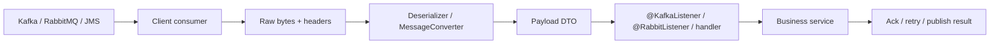

# Messaging, scheduled task và các lớp thông điệp được chuyển đổi động

## 1. Vì sao messaging và scheduled task cần được kiểm tra riêng trong Native Image?

Một ứng dụng Spring Boot thường không chỉ nhận HTTP request. Nó có thể nhận message từ Kafka, RabbitMQ hoặc JMS; chuyển byte payload thành DTO; gọi listener; gửi message tiếp theo; và chạy các tác vụ định kỳ bằng `@Scheduled`. Các luồng này có nhiều điểm mà class hoặc method được lựa chọn gián tiếp thông qua annotation, message header, serializer, converter hoặc cấu hình.

Trên JVM, class metadata và reflection thường sẵn có trong lúc chạy. GraalVM Native Image phân tích reachability tại build time và giả định tập code, classpath cùng bean graph đã được xác định. Một message chứa type identifier, một converter tạo DTO theo tên class hoặc một listener gọi method bằng reflection có thể cần metadata bổ sung nếu Spring hay thư viện không tự cung cấp.

Điều này không có nghĩa mọi ứng dụng dùng Kafka, RabbitMQ hay `@Scheduled` đều cần tự viết reflection hints. Spring Boot, Spring Framework và nhiều integration project đã đóng góp AOT/native hints cho các use case phổ biến. Việc của nhóm phát triển là hiểu luồng chuyển đổi, xác định phần nào framework đã hỗ trợ, phần nào là custom code và kiểm thử đúng các nhánh payload thực tế.

Bài học này thuộc chương **Tích hợp ứng dụng** của module **SPRING_BOOT_NATIVE_IMAGE**. Module hướng dẫn biên dịch Spring Boot thành GraalVM Native Image bằng Spring AOT, đánh giá thời gian khởi động và bộ nhớ, thực hành build Maven/Gradle, cấu hình reflection/resource, kiểm thử tương thích, đóng gói container và vận hành bản native. Bài này tập trung vào messaging, scheduled task và các lớp thông điệp được chuyển đổi động.

Sau bài học, người học có thể:

- Mô tả đường đi của một message từ broker tới listener và converter.
- Phân biệt payload type cố định với payload polymorphic được chọn từ header.
- Đăng ký reflection/binding hints cho các DTO được chuyển đổi động.
- Nhận biết AOT hints mà Spring Kafka, Spring AMQP và Spring Integration cung cấp.
- Kiểm tra listener, message gateway và `@Scheduled` trên native executable.
- Thiết kế test cho broker, scheduler, retry và các nhánh lỗi.

## 2. Ba lớp cần phân tích trong một luồng messaging

Một message thường đi qua ba lớp độc lập:

1. **Transport:** broker và client library nhận/gửi byte hoặc frame.
2. **Message envelope:** Spring biểu diễn message cùng headers, routing key, topic, partition, delivery metadata.
3. **Payload conversion:** converter/deserializer biến byte hoặc object trung gian thành kiểu dữ liệu mà listener xử lý.

Luồng inbound tổng quát:



Native Image có thể gặp yêu cầu khác nhau ở từng lớp:

| Lớp | Ví dụ vấn đề AOT/native | Cách kiểm tra |
|---|---|---|
| Transport | Client library hoặc dependency native không tương thích | Kiểm tra reachability metadata và smoke test kết nối broker |
| Envelope | Framework tạo `Message`, headers hoặc proxy động | Xem hints do integration framework cung cấp |
| Payload conversion | Jackson/Avro/JSON converter tạo DTO bằng reflection | Kiểm tra type mapping và binding hints |
| Listener invocation | Framework tìm method theo annotation hoặc tên method | Kiểm tra AOT hints; với một số POJO endpoint cần `@Reflective` |
| Error handling | Retry/DLQ converter hoặc exception payload có type khác | Chạy cả nhánh lỗi và xác nhận các DTO đó được hỗ trợ |

Đừng gộp mọi lỗi thành “thiếu reflection”. `ClassNotFoundException`, `MessageConversionException`, lỗi xác thực type header, lỗi kết nối broker và `MissingReflectionRegistrationError` có nguyên nhân khác nhau. Đọc exception đầu tiên và xác định lỗi xảy ra trước hay sau khi payload được chuyển đổi.

## 3. Tập class nào được biết tại build time?

Spring AOT cần classpath và bean graph có thể xác định tại build time. Điều đó không cấm ứng dụng xử lý nhiều loại message. Ứng dụng có thể nhận nhiều loại event khác nhau miễn là tập class hợp lệ đã có trong classpath và các truy cập động cần thiết được mô tả.

Ví dụ, một topic có thể nhận hai loại event:

```java
public interface DomainEvent {
}

public record OrderCreated(
    String orderId,
    List<OrderLine> lines
) implements DomainEvent {
}

public record PaymentCaptured(
    String paymentId,
    String orderId,
    long amountInCents
) implements DomainEvent {
}

public record OrderLine(String sku, int quantity) {
}
```

Hai class payload cùng các nested type đều được biết khi build. Listener có thể xử lý theo interface hoặc nhận từng DTO cụ thể tùy converter:

```java
@Component
public class DomainEventListener {

    public void handle(DomainEvent event) {
        if (event instanceof OrderCreated created) {
            handleOrder(created);
        }
        else if (event instanceof PaymentCaptured captured) {
            handlePayment(captured);
        }
        else {
            throw new IllegalArgumentException("Unsupported event type");
        }
    }

    private void handleOrder(OrderCreated event) {
        // ...
    }

    private void handlePayment(PaymentCaptured event) {
        // ...
    }
}
```

Nếu ứng dụng dùng reflection để tạo subtype theo type header, hãy giới hạn header vào allow-list các loại event được hỗ trợ. Không nên lấy tên class tùy ý từ message bên ngoài rồi gọi `Class.forName()` để khởi tạo bất kỳ class nào. Việc đó vừa làm metadata khó xác định, vừa tạo rủi ro bảo mật khi nguồn message không đáng tin cậy.

### Phân biệt type được chọn động và class được tải động

| Tình huống | Có phù hợp với Native Image? | Điều cần làm |
|---|---|---|
| Chọn `OrderCreated` hoặc `PaymentCaptured` từ một allow-list cố định | Có | Đảm bảo hai type có mặt trong classpath và có binding hints phù hợp |
| Chọn converter theo cấu hình cố định khi build | Có | Cấu hình bean/converter trong AOT environment |
| Message header chứa token `order-created`, ánh xạ tới DTO cố định | Có | Dùng type mapping hoặc registry tường minh |
| Message header chứa tên class bất kỳ rồi tải class từ JAR ngoài | Không phù hợp với closed-world Native Image | Thiết kế lại thành allow-list hoặc tách plugin thành process riêng |
| Thêm một loại event mới đã có trong source nhưng chưa build lại | Chưa | Build lại AOT/native để đưa class và metadata mới vào image |

## 4. Message converter và DTO được tạo bằng reflection

`MessageConverter` thường chuyển đổi giữa `org.springframework.messaging.Message<?>`, message của broker và payload Java. Với JSON, converter có thể dùng Jackson để tạo DTO từ byte array. Jackson có thể cần constructor, accessor, field, annotation metadata hoặc creator tùy kiểu DTO và cấu hình `ObjectMapper`.

Spring AOT tự động suy luận hints cho nhiều trường hợp phổ biến, nhưng không thể luôn biết mọi subtype được chọn từ message header, cấu hình riêng hoặc custom converter. Khi payload class không được framework suy ra, hãy đăng ký binding hints tường minh.

### 4.1. Dùng @RegisterReflectionForBinding

Với DTO dùng để serialize/deserialize bằng Jackson hoặc binder tương tự, có thể dùng `@RegisterReflectionForBinding` trên cấu hình ứng dụng:

```java
import org.springframework.aot.hint.annotation.RegisterReflectionForBinding;
import org.springframework.context.annotation.Configuration;

@Configuration(proxyBeanMethods = false)
@RegisterReflectionForBinding({
    OrderCreated.class,
    OrderLine.class,
    PaymentCaptured.class
})
public class EventBindingHints {
}
```

Annotation này yêu cầu Spring đóng góp reflection hints cần cho binding của các type đã liệt kê. Nếu DTO chứa nested type, generic payload hoặc custom serializer/deserializer, hãy xác minh các type đó cũng được xử lý.

Với một tập type lớn hoặc được chia theo module, có thể tạo `RuntimeHintsRegistrar` và gắn bằng `@ImportRuntimeHints` gần converter/bean sử dụng chúng. Chỉ đăng ký các type có thể xuất hiện trong message hợp lệ.

### 4.2. Không nhầm JSON binding với Java serialization

JSON conversion bằng Jackson và Java native serialization (`ObjectInputStream`/`ObjectOutputStream`) là hai cơ chế khác nhau.

- Jackson thường cần reflection/binding hints cho DTO và các member liên quan.
- Java serialization cần serialization hints cho type thực sự được serialize/deserialize.
- Một message chỉ chứa byte array hoặc String không tự động cần reflection hint cho một DTO chưa bao giờ được tạo.
- Một message có header type không đồng nghĩa toàn bộ classpath cần được mở reflection.

Nếu integration framework dùng Java serialization cho payload hoặc message store, hãy đăng ký đúng serialization types theo hướng dẫn của framework và phiên bản đang dùng. Không dùng `RuntimeHints.serialization()` để thay thế Jackson binding hints.

## 5. Kafka: type mapping và @KafkaListener

Spring for Apache Kafka hỗ trợ serializer/deserializer riêng và lớp chuyển đổi ở tầng Spring Messaging. Với JSON, `JacksonJsonSerializer` và `JacksonJsonDeserializer` có thể đưa type information vào record headers. Deserializer dùng type mapping để ánh xạ token trong header tới class tương ứng.

Ví dụ cấu hình một tập event được phép:

```yaml
spring:
  kafka:
    bootstrap-servers: localhost:9092
    producer:
      properties:
        spring.json.type.mapping: orderCreated:com.example.events.OrderCreated,paymentCaptured:com.example.events.PaymentCaptured
    consumer:
      group-id: billing
      properties:
        spring.json.trusted.packages: com.example.events
        spring.json.type.mapping: orderCreated:com.example.events.OrderCreated,paymentCaptured:com.example.events.PaymentCaptured
```

Trong ví dụ, producer và consumer dùng cùng type mapping: sender ghi token `orderCreated` hoặc `paymentCaptured` vào type header; consumer ánh xạ token đó tới hai DTO đã biết. Cấu hình `trusted.packages` giới hạn package được phép deserialize. Chỉ đưa package của DTO tin cậy vào allow-list; không dùng wildcard cho message đến từ nguồn không được kiểm soát.

Listener ví dụ:

```java
@Component
public class OrderListener {

    @KafkaListener(topics = "orders")
    public void onOrder(OrderCreated event) {
        // Xử lý OrderCreated đã được deserialize.
    }
}
```

Nếu cùng topic chứa nhiều loại event, thiết kế listener và converter để phân biệt các loại đó rõ ràng. Có thể dùng listener method riêng theo DTO, một interface/envelope chung hoặc custom converter có allow-list. Không giả định một method nhận `Object` sẽ tự động giải quyết mọi type và generic payload trong Native Image.

### Kiểm tra AOT hints của Spring Kafka

Spring for Apache Kafka cung cấp Spring AOT native hints cho các use case phổ biến, bao gồm cả các class được sinh bởi Avro dùng trong `@KafkaListener`. Trước khi thêm registrar thủ công, hãy kiểm tra phiên bản Spring Kafka đang dùng và những hints mà framework đã đóng góp.

Có một giới hạn quan trọng: `spring-kafka-test`, cụ thể là `EmbeddedKafkaBroker`, không được hỗ trợ trong native images theo tài liệu Spring Kafka hiện hành. Có thể tiếp tục dùng Embedded Kafka để kiểm thử JVM; với native executable, nên kiểm tra consumer/producer bằng broker chạy riêng trong môi trường integration test phù hợp.

Nếu dùng Avro, Protobuf hoặc schema registry, phải kiểm tra generated classes, schema resources, custom serializer/deserializer và thư viện runtime của đúng version. Framework hints không thay thế kiểm tra compatibility của client và schema registry.

## 6. RabbitMQ/AMQP: @RabbitListener và converter

Spring AMQP cung cấp abstraction `MessageConverter` cho cả chiều gửi và nhận. Với JSON, có thể cấu hình converter Jackson để chuyển body thành DTO. Spring AMQP hiện cung cấp AOT native hints cho các ứng dụng dùng thư viện này; custom converter, payload class hoặc extension riêng vẫn cần được kiểm chứng. Chọn converter theo major version: Spring AMQP 4.x dùng `JacksonJsonMessageConverter` dựa trên Jackson 3; các nhánh 3.x thường dùng `Jackson2JsonMessageConverter` dựa trên Jackson 2.

Ví dụ cấu hình converter:

```java
@Configuration(proxyBeanMethods = false)
public class RabbitConfiguration {

    @Bean
    JacksonJsonMessageConverter rabbitMessageConverter() {
        return new JacksonJsonMessageConverter();
    }
}
```

Listener nhận payload có kiểu cụ thể:

```java
@Component
public class RabbitOrderListener {

    @RabbitListener(queues = "orders")
    public void receive(OrderCreated event) {
        // Xử lý event đã được converter tạo.
    }
}
```

Với nhiều loại payload, có thể dùng type mapping hoặc custom type mapper để ánh xạ token/header tới tập DTO đã được cho phép. Tránh để header do producer không tin cậy cung cấp một tên class tùy ý. Kiểm tra cấu hình trusted package/type mapper theo version Spring AMQP và Jackson đang dùng; tên property và API có thể thay đổi giữa các release.

### Kiểm tra listener và error path

Một luồng AMQP thường có nhiều đường chạy ngoài happy path:

- Payload JSON hợp lệ và được chuyển thành DTO.
- Payload không hợp lệ, thiếu field hoặc sai version schema.
- Message có type header không được nhận diện.
- Listener ném exception, broker redeliver hoặc message đi vào dead-letter queue.
- Retry interceptor chuyển exception thành recovery message.

Các nhánh này có thể dùng converter hoặc exception type khác nhau. Chạy tất cả các kịch bản cần hỗ trợ trên native executable, đặc biệt khi dead-letter handler hoặc custom argument resolver dùng reflection.

### JMS: listener và provider cần được xác minh riêng

Với JMS, Spring Boot có thể tự cấu hình `ConnectionFactory` và hạ tầng gửi/nhận khi provider tương ứng có trên classpath. Một listener có thể nhận DTO thông qua message converter, ví dụ:

```java
@Component
public class JmsOrderListener {

    @JmsListener(destination = "orders")
    public void receive(OrderCreated event) {
        // Xử lý event từ JMS destination.
    }
}
```

Tuy nhiên, native compatibility còn phụ thuộc JMS provider/client, transport, converter và dependency của provider. Việc Spring Boot nhận diện starter hoặc tạo được `ConnectionFactory` trên JVM không chứng minh toàn bộ provider đã có reachability metadata. Kiểm tra tài liệu GraalVM của provider, custom message converter và các payload type thực tế; sau đó kết nối tới broker thật trong native integration test.

## 7. Spring Integration: gateway, endpoint và POJO handler

Spring Integration cung cấp AOT hints cho các use case phổ biến như endpoint khai báo bằng `@Bean`, Java DSL với lambda và `@MessagingGateway` được tìm qua `@IntegrationComponentScan` hoặc import. Các hints này có thể bao gồm reflection, proxy và serialization.

Gateway interface:

```java
@MessagingGateway
public interface OrderGateway {

    void submit(OrderCreated event);
}
```

Cấu hình component scan:

```java
@Configuration(proxyBeanMethods = false)
@EnableIntegration
@IntegrationComponentScan
public class IntegrationConfiguration {
}
```

Khi gateway được scan theo cách được Spring Integration hỗ trợ, framework có thể đóng góp proxy hint tương ứng. Nếu tạo gateway proxy theo cách lập trình khác, chẳng hạn dùng `IntegrationFlow.from(SomeGateway.class)`, hãy kiểm tra tài liệu của phiên bản Spring Integration và cung cấp proxy hint thủ công nếu framework không thể suy ra.

### 7.1. POJO method được gọi bằng reflection

Nếu dùng các annotation như `@ServiceActivator`, `@Splitter` hoặc API `IntegrationFlowBuilder.handle(service, methodName)` để framework gọi một POJO method bằng reflection, Spring Integration yêu cầu đánh dấu method đó bằng `@Reflective` trong các cấu hình tương ứng.

Ví dụ:

```java
import org.springframework.aot.hint.annotation.Reflective;
import org.springframework.integration.annotation.ServiceActivator;
import org.springframework.stereotype.Component;

@Component
public class OrderMessageHandler {

    @ServiceActivator(inputChannel = "orders.input")
    @Reflective
    public void handle(OrderCreated event) {
        // Xử lý message.
    }
}
```

`@Reflective` giúp Spring AOT nhận biết method cần được gọi qua reflection. Đừng nhầm việc Spring Integration cung cấp hints chung với việc mọi custom POJO method đều được framework tự động nhận diện.

### 7.2. Serialization của payload tùy chỉnh

Spring Integration đóng góp serialization hints cho một số type nội bộ mà framework dùng, như `GenericMessage`, `ErrorMessage` và `MessageHeaders`. Với payload do ứng dụng định nghĩa, nếu use case thực sự dùng Java serialization, cần đóng góp serialization hint riêng:

```java
public class OrderPayloadSerializationHints
        implements RuntimeHintsRegistrar {

    @Override
    public void registerHints(
            RuntimeHints hints,
            ClassLoader classLoader) {
        hints.serialization().registerType(OrderCreated.class);
    }
}
```

Gắn registrar vào cấu hình có liên quan bằng `@ImportRuntimeHints`. Chỉ dùng serialization hint khi dữ liệu được serialize bằng Java serialization; payload JSON cần binding hints phù hợp với converter.

### 7.3. Giới hạn XML configuration

Tài liệu Spring Integration hiện hành nêu XML configuration không được hỗ trợ cho native images. Với ứng dụng cần GraalVM Native Image, ưu tiên Java configuration, `@Bean` methods và Java DSL đã được kiểm tra AOT. Nếu hệ thống hiện tại phụ thuộc nhiều vào XML integration flow, hãy chuyển đổi và kiểm thử từng flow trước khi bật native build.

## 8. Scheduled task trong AOT và Native Image

Messaging thường được kết hợp với scheduled task. Ví dụ, ứng dụng định kỳ đọc outbox table rồi publish event lên Kafka; hoặc kiểm tra trạng thái message bị trì hoãn và đưa lại vào queue.

Spring kích hoạt annotation scheduling qua `@EnableScheduling`. Một scheduled method thường không nhận tham số và có kiểu trả về `void`:

```java
@Configuration(proxyBeanMethods = false)
@EnableScheduling
public class SchedulingConfiguration {
}

@Component
public class OutboxPublisher {

    private final OutboxService outboxService;

    public OutboxPublisher(OutboxService outboxService) {
        this.outboxService = outboxService;
    }

    @Scheduled(fixedDelay = 5000, initialDelay = 3000)
    public void publishPendingEvents() {
        outboxService.publishPending();
    }
}
```

`@Scheduled` hỗ trợ fixed delay, fixed rate và cron. Với cron, có thể chỉ định timezone để lịch chạy nhất quán giữa máy local và container. Các giá trị thời gian dạng số của fixed delay/rate mặc định tính bằng milliseconds nếu không cấu hình time unit khác.

### 8.1. Reflection hint cho scheduled method

`ScheduledAnnotationBeanPostProcessor` tìm các method có `@Scheduled` và đăng ký chúng với `TaskScheduler`. Từ Spring Framework 6.2, annotation `@Scheduled` được đánh dấu `@Reflective` để AOT có thể đóng góp invocation hint cho method được gọi.

Vì vậy, với cách dùng chuẩn trên Spring Framework 6.2 trở lên, thường không cần tự đăng ký reflection hint cho từng scheduled method. Với version cũ hơn, hãy kiểm tra Javadoc/source của đúng version trong dependency management. Nếu dùng một custom annotation, custom post-processor hoặc thư viện scheduler riêng gọi method bằng reflection, cần kiểm tra xem cơ chế đó đã đóng góp hints chưa.

Không đồng nhất việc đăng ký lịch với việc tạo bean. `@Scheduled` không làm class mới xuất hiện sau build; nó đăng ký một method trên bean đã có trong context. Tuy nhiên, bean chứa scheduled method vẫn phải được đóng góp trong AOT bean graph.

### 8.2. Cấu hình scheduler tường minh

Với tác vụ có thời gian xử lý hoặc concurrency đáng kể, cấu hình `TaskScheduler` rõ ràng:

```java
@Configuration(proxyBeanMethods = false)
@EnableScheduling
public class SchedulerConfiguration {

    @Bean
    ThreadPoolTaskScheduler taskScheduler() {
        ThreadPoolTaskScheduler scheduler =
            new ThreadPoolTaskScheduler();
        scheduler.setPoolSize(4);
        scheduler.setThreadNamePrefix("outbox-");
        scheduler.setWaitForTasksToCompleteOnShutdown(true);
        scheduler.setAwaitTerminationSeconds(20);
        return scheduler;
    }
}
```

Thread pool, lifecycle và shutdown vẫn cần được kiểm thử trong native executable. Nếu một task publish message, hãy xác nhận scheduler dừng đúng cách, không bỏ dở transaction hoặc message đang gửi.

### 8.3. Nhiều replica có thể chạy cùng một scheduled task

Native Image không tự cung cấp cơ chế leader election hay distributed lock. Nếu deploy ba replica của cùng ứng dụng, mỗi replica có thể đăng ký cùng một `@Scheduled` task và cùng publish một batch outbox.

Tùy nghiệp vụ, hãy dùng cơ chế phối hợp phù hợp: database lock, lease có thời hạn, Quartz JDBC JobStore, leader election hoặc chuyển lịch chạy sang một scheduler service riêng. Dù chọn cách nào, thao tác xử lý message vẫn nên idempotent vì retry, redelivery và lỗi mạng có thể tạo lần thực thi lặp.

## 9. Kết hợp scheduled task với message publishing

Một thiết kế thường gặp là transactional outbox:

1. Business transaction ghi dữ liệu nghiệp vụ và một outbox row trong cùng transaction.
2. Scheduled task đọc các row chưa gửi.
3. Publisher gửi event tới broker.
4. Khi broker xác nhận theo chính sách đã chọn, ứng dụng đánh dấu row đã publish.
5. Nếu lỗi, row được retry ở lượt tiếp theo.

Ví dụ tách phần nghiệp vụ khỏi lịch:

```java
@Service
public class OutboxService {

    private final OutboxRepository repository;
    private final KafkaTemplate<String, OrderCreated> kafkaTemplate;

    public OutboxService(
            OutboxRepository repository,
            KafkaTemplate<String, OrderCreated> kafkaTemplate) {
        this.repository = repository;
        this.kafkaTemplate = kafkaTemplate;
    }

    public void publishPending() {
        for (OutboxEvent row : repository.findNextBatch()) {
            OrderCreated event = row.toOrderCreated();
            kafkaTemplate.send("orders", event.orderId(), event);
            // Chỉ đánh dấu đã gửi sau khi xử lý acknowledgement
            // và trạng thái transaction theo chính sách của ứng dụng.
        }
    }
}
```

Đây là skeleton minh họa; production code phải xử lý kết quả gửi bất đồng bộ, transaction, lock/claim batch, retry và idempotency. Không đánh dấu row đã gửi ngay sau khi gọi `send()` nếu kết quả gửi chưa được xác nhận theo semantics của broker/client.

Đối với Native Image, cần kiểm tra cả hai nhánh: scheduler gọi publisher và message consumer chuyển payload thành DTO. Một bài test chỉ gọi listener không chứng minh scheduled publisher hoạt động; một bài test chỉ gọi `publishPending()` cũng không chứng minh consumer/deserializer đã đủ hints.

## 10. Cấu hình runtime và cấu hình được cố định ở build time

Spring AOT xử lý bean graph dựa trên classpath và Environment tại build time. Vì vậy, cần phân biệt giá trị cấu hình runtime với điều kiện quyết định bean có tồn tại hay không.

| Cấu hình | Thường có thể thay đổi lúc runtime? | Lưu ý |
|---|---|---|
| Broker host/port | Có | Bean/client đã tồn tại; chỉ thay endpoint kết nối |
| Username/password hoặc secret | Có | Lấy từ secret manager/environment, không nhúng vào image |
| Consumer group ID | Có | Kiểm tra cách cấu hình client và lifecycle |
| Topic/queue name | Có trong nhiều cấu hình | Nếu tên được dùng để quyết định bean/endpoint lúc AOT, phải kiểm tra build-time condition |
| Cron expression | Có thể được resolve khi đăng ký task lúc startup | Cần xác nhận scheduler nhận giá trị mong muốn trong native runtime |
| `@ConditionalOnProperty` quyết định tạo listener bean | Không thể thay đổi bean graph tùy ý sau build | Chọn property phù hợp khi AOT processing |
| Classpath plugin hoặc DTO class | Không | Thêm dependency/type mới thì phải build lại |

Ví dụ, nếu `@ConditionalOnProperty` quyết định có tạo Kafka listener configuration hay không, property đó phải có giá trị phù hợp khi AOT processing. Thay broker URL khi chạy thường không làm thay đổi bean graph; thêm một listener bean mới bằng classpath scan sau build lại là một yêu cầu khác và không được hỗ trợ theo closed-world assumption.

Không ghi broker credential, token hoặc secret vào generated AOT code, RuntimeHints hay native image properties. Đưa các giá trị nhạy cảm vào secret store của môi trường triển khai.

## 11. Kiểm thử messaging và scheduled task theo từng lớp

Nên chia test theo tầng để biết lỗi xuất hiện ở đâu.

### 11.1. Unit test cho converter và business handler

Kiểm tra converter với từng loại payload:

- JSON hợp lệ của `OrderCreated`.
- JSON hợp lệ của `PaymentCaptured`.
- Field bắt buộc bị thiếu hoặc sai kiểu.
- Type token không nằm trong allow-list.
- Payload version cũ cần mapping hoặc migration.

Test business handler trực tiếp để xác nhận nghiệp vụ không phụ thuộc broker. Test converter riêng để phân biệt lỗi deserialize với lỗi logic.

### 11.2. Integration test với broker

Dùng broker thật hoặc broker chạy riêng trong test environment để kiểm tra:

- Producer gửi đúng payload và type header.
- Consumer nhận đúng DTO.
- Ack/retry/redelivery theo cấu hình.
- Dead-letter queue hoặc recovery handler.
- Shutdown và reconnect khi broker tạm thời không sẵn sàng.

Với Spring Kafka, có thể dùng `spring-kafka-test`/Embedded Kafka cho test JVM, nhưng tài liệu Spring Kafka hiện hành ghi rõ `EmbeddedKafkaBroker` không được hỗ trợ trong native images. Native integration test nên kết nối tới broker chạy riêng, không giả định test broker embedded của JVM có thể được đưa vào native test.

Với RabbitMQ/JMS, kiểm tra client và broker provider cụ thể. Việc Spring Boot auto-configure một `ConnectionFactory` không tự chứng minh mọi phiên bản driver/provider đều có reachability metadata và tương thích native.

### 11.3. Kiểm tra scheduled method mà không phụ thuộc vào thời gian dài

Tách logic chạy một lần ra khỏi method lịch:

```java
@Component
public class OutboxPublisher {

    private final OutboxService outboxService;

    public OutboxPublisher(OutboxService outboxService) {
        this.outboxService = outboxService;
    }

    @Scheduled(fixedDelay = 10000)
    public void scheduledRun() {
        runOnce();
    }

    public void runOnce() {
        outboxService.publishPending();
    }
}
```

Unit/integration test có thể gọi `runOnce()` trực tiếp để kiểm tra logic. Một smoke test native riêng nên xác nhận scheduler thật sự kích hoạt method, ví dụ dùng test probe hoặc trạng thái persistent và timeout hữu hạn. Tránh dựa vào `Thread.sleep()` dài và kết quả không xác định.

Nếu cron dùng timezone cụ thể, kiểm tra thời điểm thực thi theo timezone đó. Nếu scheduler chạy trên nhiều replica, test cả cơ chế lock/leader election để không publish trùng.

### 11.4. Kiểm tra JVM AOT rồi Native Image

Một quy trình phù hợp:

1. Chạy unit test trên JVM.
2. Chạy Spring AOT processing.
3. Chạy ứng dụng AOT trên JVM và kiểm tra listener/scheduler startup.
4. Build Native Image.
5. Chạy native executable kết nối tới broker thật hoặc test broker riêng.
6. Gửi từng loại payload và chờ xác nhận listener xử lý.
7. Chờ scheduled task chạy ít nhất một lần, kiểm tra kết quả publish.
8. Kiểm tra retry, DLQ, shutdown và reconnect trong native runtime.

## 12. Build native và kiểm tra trong môi trường triển khai

Sau khi đã kiểm thử trên JVM/AOT, build Native Image theo cấu hình Maven hoặc Gradle của dự án. Ví dụ với Native Build Tools:

```bash
# Maven: project đã cấu hình Spring Boot AOT và Native Build Tools.
./mvnw -Pnative native:compile

# Gradle: project đã áp dụng Spring Boot và GraalVM Native Image plugin.
./gradlew nativeCompile
```

Nếu dùng Cloud Native Buildpacks để đóng gói container:

```bash
./mvnw -Pnative spring-boot:build-image
```

Hoặc với Gradle:

```bash
./gradlew bootBuildImage
```

Goal/task thực tế phụ thuộc Spring Boot, GraalVM Native Build Tools và plugin version. Đảm bảo dependency của Kafka/RabbitMQ/JMS, serializer, converter và profile AOT giống cấu hình sẽ được phát hành.

### 12.1. Kiểm tra metadata và generated output

Sau AOT processing, kiểm tra các hints do framework và ứng dụng đóng góp. Spring Boot thường ghi hints dưới `META-INF/native-image/{groupId}/{artifactId}/` trong output build. Với Maven và Gradle, vị trí generated resource cụ thể có thể khác theo plugin version.

Đối chiếu các điểm:

- DTO được chọn từ type mapping có binding/reflection hints phù hợp.
- Custom converter và custom serializer có metadata cho các type/member mà chúng truy cập động.
- POJO method được Spring Integration gọi bằng reflection đã được đánh dấu hoặc đăng ký đúng.
- Proxy của gateway được framework sinh hint hoặc đã có hint thủ công.
- Serialization hints chỉ có cho type thật sự dùng Java serialization.
- Classpath có đầy đủ driver/provider và generated schema classes.

Không chỉnh sửa generated JSON trực tiếp như cách khắc phục lâu dài. Sửa annotation, registrar, dependency metadata hoặc build configuration rồi chạy lại AOT processing.

### 12.2. Kiểm tra broker và scheduler trong final container

Khi chạy container, xác nhận:

- Native executable có kết nối được tới broker theo địa chỉ của môi trường.
- TLS certificate, truststore, DNS và network policy hoạt động.
- Consumer group, topic, queue và subscription đúng với cấu hình phát hành.
- Listener xử lý từng loại payload đã khai báo.
- Retry, acknowledgement, dead-letter routing và reconnect hoạt động.
- Scheduler thực sự chạy và không publish trùng ngoài dự kiến.
- Shutdown container không làm mất message đang xử lý hoặc outbox row chưa hoàn tất.

Không dùng `localhost` trong container để trỏ tới broker trên host trừ khi network topology thực sự yêu cầu như vậy. Dùng service DNS hoặc endpoint được cấp bởi môi trường triển khai.

## 13. Những lỗi thường gặp và cách xử lý

| Triệu chứng | Nguyên nhân có thể | Cách xử lý |
|---|---|---|
| JVM nhận JSON nhưng native lỗi khi tạo DTO | Thiếu binding/reflection hint cho payload hoặc nested type | Đăng ký đúng DTO bằng `@RegisterReflectionForBinding` hoặc registrar |
| Listener nhận sai subtype | Type header/mapping không khớp hoặc converter suy luận sai target | Kiểm tra token, type mapping và listener signature |
| Không tìm thấy class trong type mapping | Class chưa có trong classpath hoặc mapping sai tên | Kiểm tra dependency, package và tên class tại build |
| Header message cho phép type ngoài dự kiến | Cấu hình trusted package quá rộng hoặc dùng class name tùy ý | Dùng allow-list token và chỉ tin producer đã xác thực |
| `@KafkaListener` chạy trên JVM nhưng native lỗi ở Avro | Generated Avro type hoặc dependency chưa được hints bao phủ | Kiểm tra version Spring Kafka, generated classes và AOT metadata |
| Spring Integration POJO handler lỗi reflection | Method được gọi theo tên nhưng thiếu reflective hint | Đánh dấu method bằng `@Reflective` theo hướng dẫn của version |
| Gateway proxy không hoạt động trong native | Gateway tạo lập trình nên AOT không nhìn thấy interface | Dùng component scan/import được hỗ trợ hoặc đăng ký JDK proxy hint |
| Serialization lỗi native | Dùng Java serialization nhưng chưa đăng ký type | Đăng ký serialization hint cho đúng payload type |
| Spring Kafka Embedded Kafka test không chạy native | `EmbeddedKafkaBroker` không được hỗ trợ trong native image | Dùng embedded broker cho JVM test; native test kết nối broker riêng |
| Scheduled method không chạy | Thiếu `@EnableScheduling`, bean không được tạo hoặc trigger bị disable | Kiểm tra configuration, bean graph và cron/trigger |
| Scheduled task chạy nhiều lần | Mỗi replica đăng ký lịch riêng hoặc nhiều trigger cùng method | Dùng distributed lock/leader election và kiểm tra repeatable schedule |
| Broker kết nối được trên host nhưng lỗi trong container | DNS, TLS, secret, network hoặc runtime dependency khác | Test trong final image và dùng endpoint/container config thực tế |

## 14. Bài tập thực hành

### Bài tập A — Chuyển đổi hai loại Kafka event

Tạo hai DTO `OrderCreated` và `PaymentCaptured`, cấu hình type mapping với token cố định, rồi viết listener nhận payload. Đăng ký binding hints nếu framework không suy ra đủ.

**Tiêu chí hoàn thành:** JVM và native executable đều nhận đúng subtype; token không hợp lệ bị từ chối rõ ràng.

### Bài tập B — RabbitMQ listener và dead-letter flow

Tạo `@RabbitListener` nhận `OrderCreated` bằng Jackson converter. Gửi một message JSON hợp lệ và một message sai schema; xác nhận listener xử lý thành công hoặc message được route theo chính sách DLQ.

**Tiêu chí hoàn thành:** converter, listener và error handler hoạt động trong final native container.

### Bài tập C — Spring Integration gateway

Tạo `@MessagingGateway` interface và một POJO method có `@ServiceActivator`. Chạy AOT processing, đánh dấu reflective method khi cần và kiểm tra gateway proxy trên native executable.

**Câu hỏi:** vì sao một gateway được component scan có thể được framework tạo proxy hint, còn gateway được tạo qua Java DSL có thể cần hint thủ công?

### Bài tập D — Outbox publisher bằng @Scheduled

Tạo scheduled task đọc outbox row và publish event. Tách method `runOnce()` để unit test logic, sau đó chạy native executable và xác nhận scheduler gọi method theo lịch.

**Tiêu chí hoàn thành:** xử lý idempotent, không đánh dấu row trước khi acknowledgement phù hợp và không publish trùng khi có nhiều replica.

### Bài tập E — Native integration test với broker riêng

Chạy Kafka hoặc RabbitMQ ngoài process native app. Gửi từng payload type, kích hoạt retry/DLQ, xác nhận listener xử lý và kiểm tra scheduler. Ghi log, version broker/client, profile AOT và native build options.

## 15. Checklist trước khi phát hành

- [ ] Bean listener, converter và scheduler nằm trong AOT bean graph mong muốn.
- [ ] Tập DTO/type mapping cố định và có trong classpath khi build.
- [ ] Message type header được ánh xạ qua allow-list, không nạp class tùy ý.
- [ ] Binding/reflection hints bao phủ payload và nested types cần thiết.
- [ ] Đã phân biệt JSON binding với Java serialization.
- [ ] Đã kiểm tra AOT hints của Spring Kafka, Spring AMQP hoặc Spring Integration theo version.
- [ ] POJO endpoint của Spring Integration được đánh dấu `@Reflective` khi cần.
- [ ] Gateway proxy và serialization hints tùy chỉnh đã được kiểm tra.
- [ ] `@Scheduled` bean được tạo và scheduler có cấu hình thread/lifecycle phù hợp.
- [ ] Cron, timezone, initial delay và multi-replica behavior đã được kiểm thử.
- [ ] Đã chạy từng payload type trên native executable.
- [ ] Đã test retry, acknowledgement, DLQ, reconnect và shutdown.
- [ ] Native integration test dùng broker phù hợp, không phụ thuộc EmbeddedKafkaBroker trong native image.
- [ ] Final container có network, TLS, secret và runtime dependencies cần thiết.

## Tài liệu tham khảo

- [Spring Framework — Task Execution and Scheduling](https://docs.spring.io/spring-framework/reference/integration/scheduling.html): `@EnableScheduling`, `@Scheduled`, `TaskScheduler`, cron và reactive scheduled methods.
- [Spring Framework — Ahead of Time Optimizations](https://docs.spring.io/spring-framework/reference/core/aot.html): AOT bean graph, RuntimeHints, `@Reflective` và giới hạn classpath/build-time.
- [Spring Kafka — Native Images](https://docs.spring.io/spring-kafka/reference/appendix/native-images.html): native hints cho `@KafkaListener`, Avro generated classes và giới hạn `EmbeddedKafkaBroker`.
- [Spring Kafka — Serialization, Deserialization, and Message Conversion](https://docs.spring.io/spring-kafka/reference/kafka/serdes.html): JSON serializer/deserializer, type mappings, headers và message converter.
- [Spring AMQP — Native Images](https://docs.spring.io/spring-amqp/reference/appendix/native.html): AOT native hints cho ứng dụng Spring AMQP.
- [Spring AMQP — Message Converters](https://docs.spring.io/spring-amqp/reference/amqp/message-converters.html): chuyển đổi message body và payload.
- [Spring Integration — Native Images Support](https://docs.spring.io/spring-integration/reference/native-aot.html): hints cho gateway, Java DSL, POJO endpoint, serialization và giới hạn XML configuration.
- [Spring Boot — Advanced Native Image Topics](https://docs.spring.io/spring-boot/reference/packaging/native-image/advanced-topics.html): RuntimeHintsRegistrar và custom native hints.

## Kết luận

Để messaging và scheduled task hoạt động ổn định trong Spring Boot Native Image, hãy xác định rõ transport, message envelope, payload converter và listener invocation. Các payload được chọn động vẫn có thể hỗ trợ nếu tập type hợp lệ được biết tại build time, type mapping có allow-list và binding/serialization hints bao phủ đúng nhu cầu. Spring Kafka, Spring AMQP, Spring Integration và Spring Framework đã cung cấp nhiều AOT hints, nhưng custom converter, POJO handler hoặc gateway tạo lập trình vẫn cần kiểm tra riêng. Với `@Scheduled`, xác nhận bean và trigger được đăng ký đúng, scheduler có lifecycle phù hợp và nhiều replica không thực hiện cùng công việc ngoài ý muốn. Cuối cùng, chạy test trên native executable và final container với broker thực tế để xác nhận toàn bộ đường đi của message, retry, lịch chạy và shutdown.
