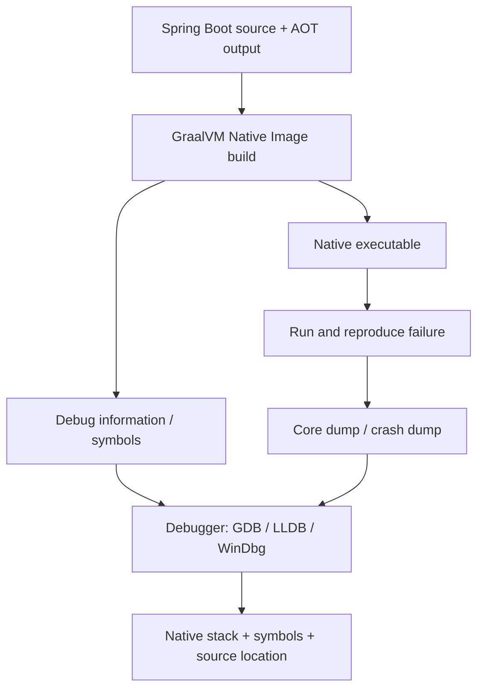

# Debug symbol và công cụ gỡ lỗi native theo hệ điều hành

## 1. Vì sao cần debug symbol cho Native Image?

Khi Spring Boot chạy dưới JVM, stack trace thường hiển thị class, method và line number từ bytecode/source metadata. Khi biên dịch bằng GraalVM Native Image, ứng dụng trở thành executable native của hệ điều hành. Khi xảy ra crash, segmentation fault, lỗi JNI, deadlock hoặc lỗi trong thư viện native, debugger cần thông tin để ánh xạ địa chỉ máy về function và source location.

**Debug symbols** là thông tin gỡ lỗi được tạo cùng quá trình biên dịch. Tùy target/toolchain, thông tin có thể nằm trong ELF/DWARF, Mach-O/dSYM hoặc định dạng debug phù hợp Windows. Symbol giúp debugger hiển thị tên hàm, stack frame, biến và vị trí source khi thông tin tương ứng được tạo và còn được giữ.

Với **Spring Boot Native Image**, cần quản lý symbol như một phần của build artifact: tạo debug information cho đúng binary, lưu symbol tương ứng với executable phát hành và dùng debugger phù hợp OS/architecture. Nếu strip symbol hoặc dùng symbol của build khác, crash dump có thể chỉ hiển thị địa chỉ hoặc stack frame không chính xác.

Bài này tập trung vào debug symbol và công cụ gỡ lỗi native theo hệ điều hành. Cú pháp và mức hỗ trợ thay đổi theo GraalVM Native Image version, compiler toolchain và target platform; luôn xác nhận option trên đúng bản cài đặt.



## 2. Phân biệt executable, debug information và source code

Ba thành phần thường cần khi phân tích crash:

- **Executable**: binary native đã được build và chạy trong môi trường gặp lỗi.
- **Debug information/symbol file**: thông tin ánh xạ địa chỉ máy tới function, compilation unit, source file và line khi có.
- **Source code tương ứng**: source revision chính xác dùng để tạo binary.

Debugger có thể đọc symbol nhưng không tìm thấy source nếu source path khác máy build. Có source code mới nhất không đủ nếu binary được tạo từ commit khác.

Mỗi bản phát hành cần gắn các thông tin:

| Thành phần | Thông tin cần lưu |
|---|---|
| Application binary | Tên, version, SHA-256 hoặc build ID |
| Debug symbols | File tương ứng, build ID/UUID/PDB identity |
| Source | Commit SHA và source archive nếu cần |
| Toolchain | GraalVM distribution/version, JDK, compiler, linker |
| Target | OS, CPU architecture, ABI/libc |
| Build flags | Optimization, debug-info và strip options |
| Container | Image digest, base/run image và shared libraries |

Không ghép symbol của build gần giống hoặc cùng version string. Chỉ symbol khớp đúng binary mới giúp debugger diễn giải địa chỉ đáng tin cậy.

## 3. Bật debug information khi build Native Image

GraalVM Native Image cung cấp tùy chọn tạo debug information. Trên nhiều phiên bản, tùy chọn `-g` yêu cầu sinh thông tin debug; các tùy chọn liên quan optimization và debug info có thể thay đổi theo phiên bản/toolchain.

Ví dụ dạng lệnh:

```bash
native-image -g -jar application.jar
```

Trong Spring Boot Gradle/Maven build, truyền option qua Native Build Tools hoặc Spring Boot plugin mà project đang sử dụng. Kiểm tra log để xác nhận `-g` thực sự tới native-image process.

Trước khi dùng trong CI, kiểm tra:

```bash
native-image --help
native-image --version
```

Với GraalVM Native Build Tools, option cấu hình thường nằm trong build arguments của binary/task. API DSL và tên task phụ thuộc plugin version. Không giả định một cấu hình Gradle/Maven dùng được cho mọi phiên bản.

Debug build thường tạo binary lớn hơn và có thể ảnh hưởng thời gian build. Có thể duy trì hai loại artifact: production executable tối ưu và symbol/debug artifact được lưu riêng để điều tra. Không loại bỏ symbol trước khi tạo bản lưu khớp binary.

## 4. Linux: ELF và DWARF

Trên Linux, native executable thường là ELF. Debug information phổ biến theo định dạng DWARF. Các công cụ thường dùng:

- `file`: nhận diện loại binary và kiến trúc.
- `readelf`: kiểm tra ELF sections, notes và build ID.
- `nm`: xem symbol table.
- `objdump`: xem symbol/disassembly.
- `gdb`: debugger tương tác.
- `addr2line`: ánh xạ địa chỉ về function/source line khi DWARF có sẵn.
- `objcopy`/`strip`: tách hoặc loại symbol theo quy trình kiểm soát.

Kiểm tra binary:

```bash
file ./api-app
readelf -n ./api-app
readelf -S ./api-app
```

Tìm debug sections:

```bash
readelf -S ./api-app | grep -E 'debug|symtab'
```

Nếu build có debug information, có thể thấy các section như `.debug_info`, `.debug_line`, `.debug_abbrev` hoặc thông tin symbol phù hợp. Tên section và cách lưu phụ thuộc compiler/linker.

## 5. Linux: tách debug symbols khỏi executable

Một cách triển khai phổ biến là lưu debug information riêng rồi strip executable để giảm kích thước runtime image. GNU binutils hỗ trợ quy trình minh họa:

```bash
objcopy --only-keep-debug api-app api-app.debug
strip --strip-debug api-app
objcopy --add-gnu-debuglink=api-app.debug api-app
```

Lệnh trên giả định binary ELF và công cụ binutils tương thích. Giữ `api-app.debug` trong kho artifact bảo mật; executable đã strip vẫn phải giữ identity/build ID phù hợp để debugger tìm đúng file debug.

Một quy trình khác dùng build ID và thư mục debug symbol theo cấu trúc hệ thống. Không tự đổi tên hoặc ghi đè symbol file mà mất liên kết với binary. Sau khi strip, kiểm tra lại bằng `readelf`, `file` và một phiên GDB thử nghiệm.

Không xóa symbol artifact ngay sau khi publish image. Khi sự cố xảy ra vài tuần sau, cần symbol đúng với binary đang chạy ở production.

## 6. Linux: dùng GDB phân tích executable

Khởi chạy GDB với executable:

```bash
gdb ./api-app
```

Một số lệnh thường dùng:

```gdb
break main
run
bt
info threads
thread apply all bt
info registers
frame 0
list
quit
```

Ý nghĩa:

- `break`: đặt breakpoint tại function hoặc địa chỉ.
- `run`: chạy process trong debugger.
- `bt`: hiển thị backtrace của thread hiện tại.
- `info threads`: liệt kê threads.
- `thread apply all bt`: lấy backtrace mọi thread.
- `info registers`: xem CPU registers.
- `frame`: chọn stack frame.
- `list`: hiển thị source nếu debugger tìm thấy file tương ứng.

Tên entry point native không nhất thiết là Java `main` theo cách nhìn source; nếu breakpoint `main` không phù hợp, đặt breakpoint tại symbol/function mà debugger liệt kê hoặc dùng địa chỉ/source line có debug info.

## 7. Linux: ánh xạ địa chỉ bằng addr2line

Khi log crash chỉ có địa chỉ instruction, có thể dùng `addr2line`:

```bash
addr2line -e ./api-app -f -C 0xADDRESS
```

- `-e`: executable hoặc file debug tương ứng.
- `-f`: in tên function.
- `-C`: demangle C++ symbol khi cần.
- `0xADDRESS`: địa chỉ cần phân giải.

Đối với executable PIE hoặc shared library được load tại base address khác, cần xử lý load bias/relative address chính xác. Địa chỉ tuyệt đối trong process không phải lúc nào cũng có thể truyền trực tiếp vào `addr2line`. GDB thường xử lý relocation tốt hơn khi có core và executable khớp.

Native Image có thể tạo stack chứa frame từ runtime, generated code hoặc thư viện native. Debug info chỉ giúp ở nơi compiler/toolchain đã sinh mapping; không phải mọi frame đều có source line.

## 8. Linux: tạo và phân tích core dump

Core dump lưu trạng thái process tại thời điểm crash, có thể gồm memory mappings, registers và thread state. Cấu hình core dump phụ thuộc shell, systemd và chính sách hệ điều hành.

Kiểm tra giới hạn trong shell:

```bash
ulimit -c
ulimit -c unlimited
```

Trên hệ thống dùng systemd-coredump:

```bash
coredumpctl list
coredumpctl info <PID-or-executable>
coredumpctl dump <PID-or-executable> --output=core.api-app
```

Phân tích:

```bash
gdb ./api-app core.api-app
```

Trong GDB:

```gdb
bt
thread apply all bt
info registers
info sharedlibrary
```

Core dump có thể chứa dữ liệu nhạy cảm trong memory: token, credential, request body, dữ liệu cá nhân và key material. Hạn chế quyền truy cập, mã hóa nơi lưu, áp dụng retention ngắn và không tải core lên nơi công cộng.

## 9. Linux: thư viện native và symbol của dependency

Nếu crash xảy ra trong JNI hoặc shared library, symbol của application executable chưa đủ. Cần đúng debug package/symbol file cho từng shared library liên quan.

Kiểm tra dependency:

```bash
ldd ./api-app
readelf -d ./api-app
```

Trong GDB, xem shared libraries và stack frame:

```gdb
info sharedlibrary
bt full
thread apply all bt full
```

Nếu thư viện hệ thống đã strip, stack có thể chỉ hiển thị địa chỉ hoặc symbol tổng quát. Cài debug symbols phù hợp từ package repository của distro trong môi trường điều tra, hoặc lấy symbol từ nhà cung cấp dependency. Không thay shared library production bằng bản debug khác version để thử suy đoán.

## 10. macOS: Mach-O và dSYM

Trên macOS, executable native thường dùng định dạng Mach-O. Debug information thường được đóng gói trong bundle `.dSYM`, được tạo bằng công cụ `dsymutil` khi toolchain hỗ trợ.

Kiểm tra binary:

```bash
file ./api-app
dwarfdump --uuid ./api-app
```

Tạo dSYM:

```bash
dsymutil ./api-app -o ./api-app.dSYM
```

Kiểm tra UUID của dSYM:

```bash
dwarfdump --uuid ./api-app.dSYM
```

UUID trong dSYM phải khớp binary. Nếu UUID không khớp, LLDB không thể dùng symbol bundle đó để phân giải đúng executable.

Giữ `.dSYM` cùng build identity trong artifact store. Khi đóng gói ứng dụng, có thể không đưa dSYM vào runtime image; lưu riêng ở nơi nhóm vận hành có thể truy cập.

## 11. macOS: dùng LLDB và atos

Mở executable bằng LLDB:

```bash
lldb ./api-app
```

Lệnh thường dùng:

```lldb
breakpoint set --name main
run
bt
thread backtrace all
register read
frame select 0
source list
quit
```

Nếu có địa chỉ crash và binary/dSYM khớp, `atos` có thể ánh xạ địa chỉ:

```bash
atos -o ./api-app -arch arm64 0xADDRESS
```

Với địa chỉ trong process có ASLR, cần cung cấp load address tương ứng hoặc dùng LLDB/core crash report để xử lý relocation. Không dùng địa chỉ runtime trực tiếp nếu chưa xác định image base.

macOS có crash report do hệ điều hành tạo trong Diagnostic Reports. Crash report có thể chứa thread backtrace, binary images và exception type. Ghép report với binary UUID/dSYM đúng phiên bản trước khi phân tích sâu.

## 12. macOS: crash report và symbolication

Khi ứng dụng native crash, thu thập:

- Crash report đầy đủ.
- Binary version/build identity.
- dSYM đúng UUID.
- OS version và hardware architecture.
- Native library/framework versions.
- Environment và command line đã chạy.

Xem crash report trong Console hoặc thư mục Diagnostic Reports của macOS theo chính sách hệ thống. Dùng Xcode/LLDB symbolication tools phù hợp để phân giải frame. Các công cụ Apple và cách tạo crash report có thể thay đổi theo macOS/Xcode version.

Nếu crash report có `EXC_BAD_ACCESS`, `SIGABRT` hoặc lỗi tương tự, đó là tín hiệu cần điều tra native memory/access path. Không kết luận ngay lỗi thuộc Spring; frame có thể nằm trong JNI library, allocator, runtime hoặc code được sinh bởi compiler.

## 13. Windows: symbol và PDB

Trên Windows, debugger hệ thống phổ biến là WinDbg; Visual Studio cũng có cửa sổ debugger và symbol support. PDB là định dạng symbol quen thuộc trong hệ sinh thái Microsoft, nhưng việc Native Image tạo và sử dụng PDB phụ thuộc GraalVM version, Windows toolchain và linker configuration.

Trước khi thiết kế pipeline, xác minh:

- Native Image version có hỗ trợ debug info trên Windows target theo cách cần dùng không.
- Toolchain/linker đang sử dụng (ví dụ Visual Studio Build Tools).
- Output có PDB hoặc định dạng debug tương ứng không.
- PDB identity khớp executable.
- Debugger có thể nạp symbol và source mapping.

Không giả định option Linux `objcopy` hoặc DWARF workflow áp dụng cho Windows. Dùng công cụ phù hợp với định dạng thực tế của binary.

## 14. Windows: dùng WinDbg

WinDbg có thể mở executable hoặc dump file:

```text
windbg.exe C:\path\to\api-app.exe
```

Với crash dump:

```text
windbg.exe -z C:\dumps\api-app.dmp
```

Một số lệnh WinDbg thường gặp:

```text
.symfix
.reload
!analyze -v
k
~* k
lm
!threads
```

- `.symfix` cấu hình symbol path mặc định cho Microsoft symbols.
- `.reload` nạp lại symbols.
- `!analyze -v` phân tích dump.
- `k` hiển thị stack.
- `~* k` hiển thị stack các thread.
- `lm` liệt kê modules.
- `!threads` hỗ trợ kiểm tra thread khi extension/runtime phù hợp.

Tên lệnh và extension có thể phụ thuộc WinDbg version. Symbol path cần chứa PDB đúng của application/dependencies; Microsoft public symbols không thay thế PDB của ứng dụng.

## 15. Windows: tạo dump khi process crash

Có thể dùng Windows Error Reporting LocalDumps hoặc ProcDump theo chính sách hệ thống. Ví dụ ProcDump:

```powershell
procdump -ma -e -x C:\dumps C:\app\api-app.exe
```

Tham số và cách dùng phụ thuộc ProcDump version. `-ma` yêu cầu full dump, có thể chứa toàn bộ dữ liệu nhạy cảm trong process memory. Thư mục dump cần ACL chặt chẽ, dung lượng đủ và retention được kiểm soát.

Với service chạy dưới Windows Service Manager hoặc container Windows, cấu hình dump phải phù hợp identity và nơi process có quyền ghi. Không chạy ứng dụng với quyền Administrator chỉ để tiện ghi dump nếu không cần.

## 16. Debug symbols trong container production

Một chiến lược phổ biến là tách runtime image nhỏ khỏi symbol artifact:

- Build native executable với debug info.
- Lưu binary chưa strip hoặc file symbol tách riêng vào artifact store.
- Tạo runtime executable/image đã strip nếu chính sách release yêu cầu.
- Ghi lại build ID/UUID/PDB identity và digest.
- Khi crash, lấy core/dump cùng symbol tương ứng.
- Phân tích trong môi trường bảo mật có toolchain/debugger.

Không build lại một binary “giống hệt” để lấy symbol sau sự cố. Compiler, timestamps, linker inputs, build flags hoặc dependency versions có thể khác khiến địa chỉ/symbol không còn khớp. Giữ symbol từ chính lần build tạo ra artifact production.

Nếu dùng Docker multi-stage, có thể chỉ copy executable runtime vào final stage và lưu symbol ở CI artifact. Nếu cần debug trực tiếp trong container, cân nhắc debugger permissions, ptrace policy, seccomp, user namespace và bảo mật memory dump. Thường an toàn hơn khi thu thập core theo chính sách host rồi phân tích bên ngoài container.

## 17. Địa chỉ trong stack trace và ASLR

Hệ điều hành có thể bật Address Space Layout Randomization (ASLR), làm địa chỉ module thay đổi giữa các lần chạy. Vì vậy:

- Địa chỉ tuyệt đối từ log không luôn tương ứng trực tiếp với offset trong file.
- Shared library có base address riêng.
- PIE executable có thể được relocate.
- Core dump và debugger có mapping để xử lý relocation khi binary khớp.
- Dùng build ID/UUID và module load address để xác định đúng binary.

Nếu chỉ có địa chỉ mà không có core, executable và load map, việc symbolicate có thể không chính xác. Thu thập crash dump và log module mapping ngay khi sự cố xảy ra.

## 18. Native Image và Java-level debugging

Debug symbol native giúp debugger hệ điều hành phân tích instruction, native function, thread và source mapping được tạo. Tuy nhiên, trải nghiệm không hoàn toàn giống debug một ứng dụng Java trên JVM:

- Không phải mọi Java local variable đều có thể quan sát như trong IDE JVM.
- Một số method có thể inline hoặc bị tối ưu hóa.
- Stack frame có thể đi qua generated runtime code.
- Source path có thể trỏ tới build workspace không tồn tại trên máy debug.
- JNI frame và thư viện native cần symbol riêng.

Để điều tra lỗi nghiệp vụ Java, vẫn nên giữ log có correlation ID, structured logging, exception context và metrics. Debugger native bổ sung cho observability; nó không thay thế logging/tracing ứng dụng.

## 19. Quy trình điều tra crash có thể lặp lại

Khi nhận crash report:

1. Ghi nhận thời điểm, instance/container, version và request/job correlation ID.
2. Thu thập application log, native stack trace và OS crash report.
3. Thu thập core/dump theo chính sách bảo mật.
4. Xác định OS, architecture, libc/runtime và shared libraries.
5. Lấy executable cùng debug symbols khớp build ID/UUID.
6. Mở dump bằng GDB, LLDB hoặc WinDbg.
7. Lấy backtrace mọi thread và registers cần thiết.
8. Xác định frame đầu tiên thuộc application/JNI/dependency/runtime.
9. Đối chiếu source commit, compiler flags và dependency versions.
10. Tạo test tái hiện lỗi và xác minh bản sửa trên native executable/container.

Không chia sẻ core dump, PDB hoặc dSYM công khai nếu chưa rà soát dữ liệu nhạy cảm và quyền truy cập.

## 20. Lỗi thường gặp khi debug symbol

| Triệu chứng | Nguyên nhân có thể | Hướng xử lý |
|---|---|---|
| GDB chỉ hiện địa chỉ | Binary bị strip hoặc thiếu debug file | Lấy symbol đúng build và cấu hình debug path |
| `addr2line` trả `??:0` | Không có DWARF, sai binary hoặc địa chỉ sai | Kiểm tra build ID, PIE/load bias và debug sections |
| dSYM không được LLDB nhận | UUID không khớp executable | Tạo/lấy dSYM từ đúng build |
| WinDbg không load PDB | PDB identity/path sai hoặc không được tạo | Kiểm tra linker/toolchain và symbol path |
| Stack có frame không tên | Dependency/runtime đã strip | Lấy debug symbols từ nhà cung cấp |
| Source line sai | Source revision khác binary hoặc tối ưu hóa | Dùng đúng commit và build metadata |
| Không tạo được core dump | ulimit/systemd/container policy/permission | Kiểm tra host core policy và dung lượng |
| Dump quá lớn | Full memory dump | Chọn loại dump phù hợp, retention và mã hóa |
| Native stack khó đọc | Thiếu symbol, frame inline hoặc runtime generated | Lấy symbols đầy đủ và thêm app-level logs |

## 21. Checklist build và lưu symbol

- Native Image build bật debug information theo đúng GraalVM version.
- Build log ghi nhận compiler/linker/debug options.
- Binary có build ID/UUID hoặc identity tương ứng.
- Debug symbol artifact được lưu cùng commit và dependency versions.
- Nếu strip, symbol được tách và lưu trước khi loại bỏ.
- Runtime image chỉ chứa thành phần cần thiết theo release policy.
- Có hướng dẫn debugger theo Linux/macOS/Windows target.
- Core/crash dump policy có giới hạn quyền, mã hóa và retention.
- Symbol của JNI/shared libraries được lưu hoặc có nguồn lấy lại.
- CI có thể truy xuất binary và symbol theo image digest/build ID.

## 22. Câu hỏi tự kiểm tra

1. Debug symbols giúp debugger ánh xạ địa chỉ native tới thông tin nào?
2. Vì sao phải giữ symbol đúng build ID/UUID của executable phát hành?
3. Trên Linux, DWARF, GDB, addr2line và core dump phối hợp ra sao?
4. dSYM và LLDB được dùng như thế nào trên macOS?
5. Vì sao không áp dụng objcopy workflow của Linux cho Windows?
6. PDB và WinDbg cần điều kiện gì để symbolicate crash?
7. ASLR ảnh hưởng thế nào tới việc ánh xạ địa chỉ crash?
8. Vì sao core dump cần được bảo vệ như dữ liệu nhạy cảm?
9. Debug native khác gì debug Java trên JVM?
10. Pipeline release cần lưu những artifact nào để điều tra crash về sau?

**Ghi nhớ:** debug symbol phải khớp chính xác executable đã chạy. Tạo và lưu symbol cùng build identity, dùng GDB/DWARF trên Linux, LLDB/dSYM trên macOS hoặc WinDbg/PDB khi toolchain Windows hỗ trợ, rồi phân tích core/crash dump trong môi trường bảo mật.
