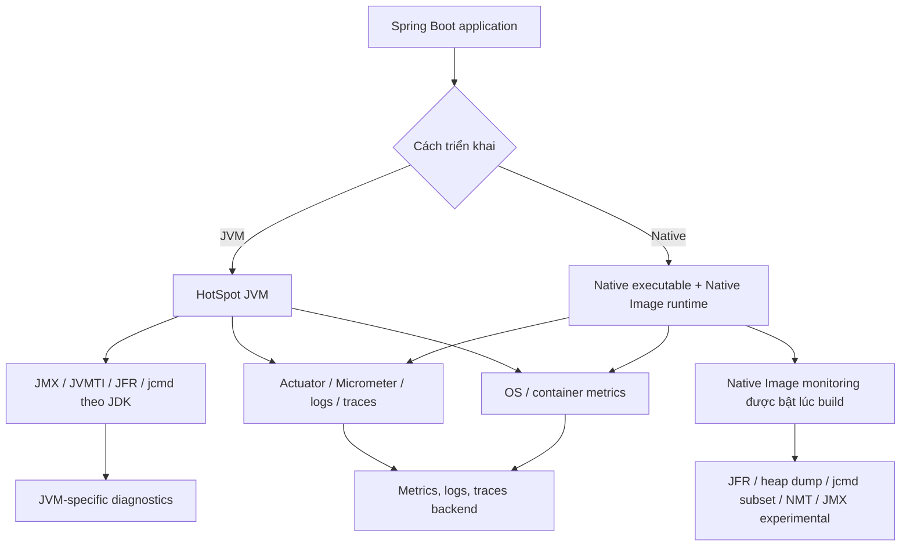

# Phân biệt công cụ giám sát tiến trình JVM với công cụ dành cho binary native

> **Chương: Quan sát.** Module **SPRING_BOOT_NATIVE_IMAGE** biên dịch ứng dụng Spring Boot thành GraalVM Native Image bằng Spring AOT để đánh giá lợi ích về thời gian khởi động và bộ nhớ. Sau khi biên dịch, ứng dụng chạy như một executable theo nền tảng đích, không còn chạy trên HotSpot JVM. Vì vậy, một số công cụ giám sát JVM quen thuộc không thể attach hoặc không còn ý nghĩa; một số tính năng khác vẫn có phiên bản hỗ trợ trong Native Image nếu được bật khi build. Bài học này giúp chọn đúng công cụ cho từng loại dữ liệu và xây dựng quy trình quan sát cho cả ứng dụng JVM lẫn binary native.

## 1. Mục tiêu học tập

Sau bài học, bạn có thể:

1. Giải thích vì sao công cụ dựa trên HotSpot attach API, JVMTI hoặc JIT không hoạt động đầy đủ với Native Image.
2. Phân biệt công cụ giám sát JVM, công cụ chẩn đoán Native Image và công cụ quan sát ở cấp ứng dụng/hệ điều hành.
3. Chọn đúng công cụ cho CPU, heap, native memory, thread, GC, log, metrics và distributed tracing.
4. Bật các tính năng monitoring của GraalVM ở build time bằng tùy chọn enable-monitoring.
5. Dùng JFR, jcmd, heap dump, Native Memory Tracking, JMX và perf theo phạm vi hỗ trợ của Native Image.
6. Dùng Spring Boot Actuator, Micrometer và OpenTelemetry để giữ metrics, logs và traces nhất quán giữa bản JVM và bản native.
7. Thiết kế phép đo so sánh JVM/native có cùng tải, cùng dữ liệu và cùng môi trường triển khai.

## 2. Khác biệt nền tảng: JVM process và native executable

Ứng dụng Spring Boot chạy trên JVM được thực thi bởi một runtime HotSpot. HotSpot quản lý class loading, JIT compilation, code cache, heap, garbage collector và nhiều giao diện serviceability. Các công cụ như JConsole, VisualVM, JDK Mission Control, jcmd, jstack, jmap, jstat hoặc profiler dựa trên JVMTI có thể sử dụng các giao diện này để quan sát tiến trình.

Native Image phân tích chương trình ở build time, biên dịch phần code reachable thành machine code và đóng gói thành executable theo hệ điều hành/kiến trúc đích. Khi chạy, binary có Native Image runtime và garbage collector riêng, nhưng không có HotSpot JIT compiler hoặc đầy đủ giao diện serviceability của một JVM thông thường.

Do đó, cần phân biệt:

- **Công cụ gắn với HotSpot:** phụ thuộc vào attach mechanism, JVMTI, JIT compiler, class loader hoặc cấu trúc memory pool của HotSpot. Chúng có thể không kết nối được hoặc báo dữ liệu không có ý nghĩa trên native executable.
- **Công cụ Native Image hỗ trợ có chọn lọc:** JFR, heap dump, jcmd, Native Memory Tracking và JMX có thể dùng trong một số cấu hình, nhưng nhiều tính năng phải được bật khi build và có giới hạn riêng.
- **Công cụ ở cấp ứng dụng/hệ điều hành:** metrics, tracing, log, process monitor, container metrics, perf và debugger native quan sát hành vi bên ngoài runtime Java. Chúng tiếp tục hữu ích nếu ứng dụng và môi trường cung cấp dữ liệu cần thiết.



Điểm quan trọng là **Native Image không đồng nghĩa không còn bất kỳ công cụ Java nào dùng được**. JFR, jcmd và heap dump hiện đã có hỗ trợ nhất định. Tuy nhiên, không nên giả định một công cụ hoạt động trên HotSpot sẽ có cùng lệnh, cùng event hoặc cùng cách attach trên binary native.

## 3. Ma trận công cụ: JVM, Native Image và hệ điều hành

| Công cụ | JVM/HotSpot | Native Image | Ghi chú |
|---|---|---|---|
| JConsole | Kết nối JMX và xem MBeans | Có thể kết nối nếu bật remote JMX; hỗ trợ Native Image còn giới hạn | JMX Native Image hiện là tính năng experimental |
| VisualVM | Theo dõi process, thread, heap và profiling | Có thể mở JFR/heap dump; có thể phát hiện process native qua jvmstat trong cấu hình phù hợp | Không coi live profiler trên native giống hệt HotSpot |
| JDK Mission Control | Phân tích JFR và dữ liệu HotSpot | Có thể phân tích file JFR native với event mà Native Image ghi được | Event set của native khác HotSpot |
| jcmd | Nhiều lệnh chẩn đoán HotSpot | Có subset lệnh nếu bật enable-monitoring=jcmd | Không có đầy đủ mọi diagnostic command của HotSpot |
| jstack | Thread dump của JVM | Dùng jcmd Thread.print hoặc Thread.dump_to_file khi tính năng hỗ trợ được bật | Không giả định attach jstack trực tiếp sẽ hoạt động |
| jmap | Heap inspection/dump tùy JDK | Dùng GC.heap_dump qua jcmd hoặc HeapDumpOnOutOfMemoryError khi bật heap dump | Không phải toàn bộ lệnh jmap đều có bản tương đương |
| jstat | Thống kê GC/class loading theo HotSpot | Không có đầy đủ giao diện jstat tương đương | Dùng JFR, jcmd, NMT và OS metrics theo nhu cầu |
| JVMTI profiler/agent | Có thể instrument bytecode và VM events | Không hỗ trợ các giao diện dựa trên bytecode runtime như HotSpot | Dùng JFR Native Image hoặc native profiler |
| perf | Profile process/JVM native code ở cấp OS | Profile machine code của executable; nên build kèm debug info | Linux; cần symbol/frame information phù hợp |
| GDB | Debug native runtime/JVM khi cần | Debug trực tiếp executable native với debug info | Hỗ trợ native debug của GraalVM có giới hạn nền tảng |
| top, ps, pidstat, docker stats | Dùng được | Dùng được | Quan sát CPU, RSS, thread, I/O và tài nguyên container |

Ma trận này là định hướng chọn công cụ, không phải cam kết tất cả phiên bản và hệ điều hành đều giống nhau. Hãy kiểm tra đúng GraalVM JDK, Native Image version và nền tảng triển khai trước khi đưa một công cụ vào quy trình vận hành.

## 4. Những công cụ HotSpot không nên dùng như mặc định cho native

### 4.1. JIT compiler và code cache

HotSpot biên dịch bytecode thành machine code trong lúc chạy bằng JIT. Các công cụ JVM có thể theo dõi compilation queue, compilation time, code cache, deoptimization và warm-up.

Native Image biên dịch code trước khi process khởi động. Vì vậy:

- Không có chu kỳ JIT warm-up như HotSpot.
- JIT compilation time và code cache của HotSpot không phải chỉ số thích hợp để so sánh.
- Công cụ chỉ phân tích bytecode đang được JIT compile có thể không có dữ liệu trên native.
- Cần đánh giá CPU bằng request latency, CPU time, native profiler và JFR event được hỗ trợ.

Một số Native Image runtime có thể có runtime compilation cho trường hợp đặc biệt như Truffle; điều đó không biến mọi ứng dụng Spring Boot native thành HotSpot JIT process.

### 4.2. Attach API và JVMTI

HotSpot tooling thường dựa trên cơ chế attach để yêu cầu JVM dump heap, thread, class histogram hoặc bật profiler. JVMTI dựa trên khả năng quan sát bytecode và sự kiện của VM.

Native Image dùng closed-world compilation và không giữ đầy đủ mô hình bytecode/class loading của HotSpot. Vì vậy, các agent dựa trên JVMTI hoặc bytecode instrumentation không thể được coi là tương thích mặc định. Nếu một công cụ quảng cáo hỗ trợ GraalVM, hãy kiểm tra rõ nó hỗ trợ:

- JVM chạy GraalVM hay executable được tạo bởi Native Image.
- Attach vào process đang chạy hay chỉ đọc file output.
- Profile Java-level method hay native machine code.
- Phiên bản GraalVM và hệ điều hành nào được hỗ trợ.

### 4.3. JMX và platform MXBeans

JMX vẫn có thể dùng với Native Image trong một cấu hình riêng, nhưng remote JMX hiện được GraalVM mô tả là experimental. Native Image hỗ trợ MXBeans và standard user-defined MBeans; dynamic MBeans và model MBeans không được hỗ trợ theo cách thông thường. Không phải mọi platform MXBean đều được triển khai đầy đủ hoặc có ý nghĩa trong native runtime.

Nếu dùng custom standard MBean, có thể cần reachability metadata cho interface proxy. Chỉ bật JMX khi có nhu cầu quản trị rõ ràng và đã xác minh bảo mật kết nối, authentication, TLS, firewall và metadata. Không mở cổng JMX không xác thực trên mạng production.

## 5. Native Image monitoring phải được bật ở build time

Khác với HotSpot, nhiều tính năng chẩn đoán Native Image phải được đưa vào executable khi build. Tùy chọn chính là:

```bash
native-image --enable-monitoring=jcmd,jfr,heapdump,nmt,jvmstat \
    -jar orders-service.jar
```

Ví dụ trên bật một tập tính năng thường dùng. Hãy bỏ các tính năng không cần thiết và kiểm tra hỗ trợ theo version/OS đích. Một số tính năng như JFR hoặc jcmd hiện không có trên Windows trong tài liệu GraalVM JDK 25; jvmstat chủ yếu giúp công cụ tìm process.

Với Gradle Native Build Tools, có thể truyền build argument:

```groovy
graalvmNative {
    binaries {
        main {
            buildArgs.add(
                "--enable-monitoring=jcmd,jfr,heapdump,nmt,jvmstat"
            )
        }
    }
}
```

Với Maven Native Build Tools, cấu hình build arguments trong plugin:

```xml
<plugin>
    <groupId>org.graalvm.buildtools</groupId>
    <artifactId>native-maven-plugin</artifactId>
    <configuration>
        <buildArgs>
            <buildArg>--enable-monitoring=jcmd,jfr,heapdump,nmt,jvmstat</buildArg>
        </buildArgs>
    </configuration>
</plugin>
```

Đây là ví dụ cấu hình plugin trực tiếp. Nếu Spring Boot plugin đang điều khiển native compilation, hãy đặt build argument vào đúng cấu hình native image mà plugin đang sử dụng. Không nhầm build argument của native executable với JVM argument dùng để chạy Maven/Gradle.

enable-monitoring có thể làm tăng kích thước binary và thêm overhead tùy tính năng. Nên chọn cấu hình theo nhu cầu vận hành: build release có JFR/NMT/heap dump khi cần điều tra; build tối giản có thể bỏ các tính năng không dùng.

## 6. JDK Flight Recorder trên Native Image

JFR ghi lại event theo thời gian như CPU sampling, GC, thread, allocation và thông tin container. GraalVM Native Image có hỗ trợ JFR nhưng phải bật khi build:

```bash
native-image --enable-monitoring=jfr -jar orders-service.jar
```

Sau đó khởi động executable và bắt đầu recording:

```bash
./orders-service \
  -XX:StartFlightRecording="filename=orders.jfr,duration=5m,dumponexit=true"
```

Các thuộc tính như filename, duration, maxage, maxsize và dumponexit giúp giới hạn kích thước và thời gian recording. Với ứng dụng chạy lâu, nên đặt giới hạn dung lượng và thời gian để tránh làm đầy filesystem/container volume.

Có thể đọc nhanh file recording bằng:

```bash
jfr summary orders.jfr
jfr print --events jdk.ExecutionSample orders.jfr
```

Mở file .jfr bằng JDK Mission Control hoặc VisualVM để xem timeline, thread, stack trace và event được hỗ trợ. JFR Native Image có thể tạo jdk.ExecutionSample và một số event allocation/GC/thread. Tuy nhiên, event set không giống HotSpot: các Java-level event được tạo bằng bytecode instrumentation trên HotSpot, ví dụ một số event file I/O và exception, chưa có đầy đủ trong Native Image. Một số event còn phụ thuộc Serial GC hoặc NMT.

### 6.1. Điều khiển JFR bằng jcmd

Nếu executable được build với cả jcmd và jfr, có thể dùng:

```bash
jcmd <pid> help
jcmd <pid> JFR.start name=incident filename=incident.jfr duration=5m
jcmd <pid> JFR.check
jcmd <pid> JFR.dump name=incident filename=incident.jfr
jcmd <pid> JFR.stop name=incident
```

Các lệnh JFR được hỗ trợ gồm JFR.start, JFR.stop, JFR.check và JFR.dump. Cú pháp chi tiết có thể kiểm tra bằng jcmd <pid> help JFR.start. Nếu process không xuất hiện khi chạy jcmd -l, hãy kiểm tra tính năng jvmstat và môi trường process/container.

### 6.2. Giới hạn nền tảng và event

- Theo tài liệu GraalVM JDK 25, JFR recording chưa khả dụng với Native Image trên Windows.
- Một số event chỉ có khi dùng Serial GC.
- Leak profiling qua jdk.OldObjectSample chỉ hỗ trợ một phần; đường dẫn tới GC root chưa có.
- Stack trace trong file JFR vẫn có thể xem được, nhưng stack trace của event streaming callback chưa khả dụng theo cùng cách.
- Remote JMX để điều khiển FlightRecorderMXBean là experimental.

Không dùng một JFR profile của HotSpot rồi giả định toàn bộ event sẽ có trong recording native. Hãy xem danh sách event thực tế và xác minh recording có dữ liệu trước khi phân tích.

## 7. Heap dump và phân tích bộ nhớ

Native Image có thể tạo heap dump theo định dạng HPROF nếu bật:

```bash
native-image --enable-monitoring=heapdump -jar orders-service.jar
```

Để tạo dump khi Java heap hết bộ nhớ:

```bash
./orders-service \
  -XX:+HeapDumpOnOutOfMemoryError \
  -XX:HeapDumpPath=/var/diagnostics/orders.hprof
```

Có thể dùng jcmd <pid> GC.heap_dump /var/diagnostics/orders.hprof khi build đã bật jcmd và heapdump. Trên Linux/macOS, Native Image còn hỗ trợ gửi SIGUSR1 để yêu cầu dump khi tính năng heap dump được bật. Cơ chế signal này không khả dụng trên Windows.

VisualVM có thể mở file HPROF được tạo từ native executable. Trên Windows, VisualVM có thể đọc file dump có sẵn nhưng hiện không thể yêu cầu heap dump trực tiếp từ một Native Image process đang chạy. Trên Linux/macOS, có thể phát hiện process bằng jvmstat rồi yêu cầu heap dump qua giao diện phù hợp.

Lưu ý: heap dump chỉ mô tả Java heap được quản lý bởi GC. Nó không tự thay thế việc kiểm tra RSS, native allocations, memory mapping, stack của thread hoặc bộ nhớ do thư viện C/JNI cấp phát.

## 8. Native Memory Tracking (NMT)

NMT theo dõi một phần bộ nhớ native/off-heap được runtime quản lý. Trên Native Image, NMT bị tắt mặc định và phải được bật khi build:

```bash
native-image --enable-monitoring=nmt -jar orders-service.jar
```

Để in thống kê khi process kết thúc:

```bash
./orders-service -XX:+PrintNMTStatistics
```

Nếu build có jcmd, có thể truy vấn:

```bash
jcmd <pid> VM.native_memory
```

Khác HotSpot, khi NMT được đưa vào Native Image thì nó luôn được bật trong executable. Native Image hiện hỗ trợ NMT ở mức summary; chưa có detailed mode với call-site tracking và baseline như HotSpot. NMT theo dõi cấp VM và các allocation qua Unsafe.allocateMemory; một thư viện gọi malloc trực tiếp có thể không được tính vào số liệu NMT.

NMT hữu ích để phân biệt heap do GC quản lý với một số vùng native memory. Khi điều tra memory footprint tổng thể, vẫn cần đối chiếu:

- Java heap và heap dump.
- NMT summary.
- RSS/working set của process.
- Container memory usage và memory limit.
- Native allocation của JNI/thư viện ngoài nếu có.

Không lấy riêng jvm.memory.used hoặc NMT làm tổng bộ nhớ process.

## 9. JMX, VisualVM và JDK Mission Control

Remote JMX có thể được bật cho Native Image bằng các feature riêng:

```bash
native-image \
  --enable-monitoring=jmxserver,jmxclient,jvmstat \
  -jar orders-service.jar
```

jmxserver cho phép executable nhận kết nối quản trị JMX; jmxclient cho phép process kết nối tới JMX server khác; jvmstat hỗ trợ VisualVM và công cụ tương tự phát hiện process. Chỉ bật các thành phần thực sự cần thiết.

Remote JMX Native Image hiện là experimental. Các giới hạn chính:

- Chỉ MXBeans và standard user-defined MBeans được hỗ trợ.
- Dynamic MBeans và model MBeans không được hỗ trợ theo cách thông thường.
- Một phần platform MXBean không được triển khai hoặc không phù hợp với Native Image.
- Standard MBean tùy biến có thể cần reflection/dynamic proxy metadata.
- Nếu dùng JMX để điều khiển JFR, jfr cũng cần được bật trong native executable.

VisualVM và JDK Mission Control có thể hữu ích khi mở JFR snapshot, heap dump hoặc kết nối JMX đã được cấu hình. Chúng không biến Native Image thành HotSpot process và không bổ sung các event/management interface mà runtime native chưa hỗ trợ.

## 10. Native profiler và debugger ở cấp hệ điều hành

Vì Native Image tạo machine code theo nền tảng, công cụ native có thể quan sát process mà không cần HotSpot attach API.

### 10.1. Linux perf

Để perf hiển thị tên method và ánh xạ stack trace tốt hơn, hãy build với debug information và frame pointer:

```bash
native-image -g -H:+PreserveFramePointer \
  -H:+SourceLevelDebug \
  -jar orders-service.jar
```

Sau đó thu CPU profile:

```bash
perf record -g -- ./orders-service
perf report
```

g sinh debug information; PreserveFramePointer giúp perf unwind stack đáng tin cậy hơn; SourceLevelDebug bổ sung thông tin source-level. Có thể cần giữ symbol để dùng các chức năng annotate sâu hơn. Debug info làm binary/artifact lớn hơn; O0 có thể giúp debug dễ hơn nhưng thay đổi mức tối ưu, do đó không dùng kết quả performance của build O0 để so sánh production.

perf là công cụ Linux. Khả năng symbolization phụ thuộc GraalVM release, kernel, quyền truy cập performance counters và cách binary được strip/đóng gói.

### 10.2. GDB

GDB có thể debug native executable với debug info:

```bash
native-image -g -O0 -jar orders-service.jar
gdb --args ./orders-service
```

Trong GDB, có thể đặt breakpoint theo symbol hoặc source line, xem native stack trace và kiểm tra crash. Native Image source-level debugging hiện được hỗ trợ chủ yếu trên Linux, có hỗ trợ ban đầu trên macOS và mang tính experimental. Dùng build debug riêng để điều tra, sau đó xác nhận lại trên build tối ưu hóa gần production.

### 10.3. Process và container tools

Các công cụ sau vẫn hữu ích cho JVM và native:

| Công cụ | Dữ liệu |
|---|---|
| ps, top, htop | CPU, RSS, số thread, thời gian sống của process |
| pidstat | CPU, memory, I/O theo PID theo thời gian |
| lsof | File descriptor và socket đang mở |
| ss | Socket và trạng thái kết nối |
| strace | System call trên Linux |
| docker stats | CPU, memory, network và block I/O của container |
| Kubernetes/cAdvisor metrics | CPU throttling, working set, restart, OOM và tài nguyên pod |

Những số liệu này đặc biệt quan trọng với native vì RSS còn bao gồm code segment, shared libraries, thread stacks, mapped files và native allocations; Java heap chỉ là một phần của tổng bộ nhớ process.

## 11. Spring Boot Actuator, Micrometer và OpenTelemetry vẫn là lớp quan sát chính

Các công cụ gắn với HotSpot có thể thay đổi, nhưng observability ở cấp ứng dụng vẫn có thể giữ nhất quán giữa bản JVM và native. Spring Boot cung cấp Actuator; Micrometer Observation tạo metrics/traces; logging framework ghi log; exporter chuyển dữ liệu tới backend giám sát.

### 11.1. Metrics

Thêm Actuator và Prometheus registry nếu hệ thống dùng Prometheus:

```groovy
dependencies {
    implementation("org.springframework.boot:spring-boot-starter-actuator")
    runtimeOnly("io.micrometer:micrometer-registry-prometheus")
}
```

Ví dụ cấu hình endpoint:

```yaml
management:
  endpoints:
    web:
      exposure:
        include: health,info,metrics,prometheus
  endpoint:
    health:
      probes:
        enabled: true
```

Các endpoint thường dùng:

- /actuator/health: trạng thái health tổng thể.
- /actuator/health/liveness: ứng dụng còn hoạt động hay không.
- /actuator/health/readiness: ứng dụng đã sẵn sàng nhận traffic chưa.
- /actuator/metrics: kiểm tra meter đã đăng ký.
- /actuator/prometheus: xuất metrics theo định dạng Prometheus khi registry được cấu hình và endpoint được expose.

Metrics ở cấp ứng dụng như request count, latency, error rate, connection pool, executor queue, cache hit/miss và business counters vẫn là tín hiệu quan trọng trên native. System/process metrics như CPU, uptime, file descriptor và disk cũng có thể hữu ích.

### 11.2. Cẩn trọng với metric mang tiền tố jvm.*

Spring Boot/Micrometer có thể đăng ký các meter như jvm.memory.*, jvm.gc.*, jvm.threads.*, class loading và JIT compilation. Tuy nhiên, ý nghĩa của các meter này phụ thuộc runtime:

- Native Image không có HotSpot JIT compilation; metric JIT không phải chỉ số dùng để so sánh hiệu năng native.
- Classpath và code reachable được cố định ở build time; class loading/unloading không diễn ra như một ứng dụng JVM thông thường.
- Các memory pool và non-heap area của HotSpot như Metaspace hoặc Code Cache không nhất thiết có đối tượng tương ứng trong native executable.
- Native Image có GC và Java heap, nhưng cấu trúc heap, memory pool và cách báo cáo có thể khác HotSpot.

Vì vậy, hãy kiểm tra meter thực sự có mặt và giá trị có hợp lý trong native runtime. Đừng coi metric tên jvm.* tự động là cùng một đại lượng giữa hai bản triển khai. Khi so sánh memory footprint, ghi riêng RSS/container memory, Java heap và NMT thay vì chỉ dùng jvm.memory.used.

### 11.3. Traces và logs

Spring Boot dùng Micrometer Observation cho metrics và traces. Có thể instrument nghiệp vụ bằng ObservationRegistry, dùng Micrometer Tracing và exporter OTLP để gửi trace tới backend OpenTelemetry tương thích. Logging qua SLF4J/Logback hoặc Log4j2 cũng tiếp tục hoạt động nếu dependency và cấu hình đã được kiểm tra Native Image.

Với @Async và reactive pipeline, cần chú ý context propagation. Nếu dùng auto-configured AsyncTaskExecutor, cấu hình spring.task.execution.propagate-context=true khi cần truyền observation context. Nếu tự tạo executor, có thể đăng ký ContextPropagatingTaskDecorator.

Các thư viện exporter, logging appender và tracing bridge vẫn phải tương thích Native Image. Hãy build và test native với exporter thật; không chỉ kiểm tra trên JVM rồi giả định exporter sẽ khởi động giống nhau trong binary.

### 11.4. Bảo vệ endpoint quản trị

Không expose toàn bộ Actuator hoặc JMX ra public internet. Chỉ expose endpoint cần thiết, giới hạn bằng Spring Security, network policy, ingress nội bộ và authentication phù hợp. Heap dump, thread dump, system properties và logs có thể chứa thông tin nhạy cảm; hãy bảo vệ quyền truy cập và retention.

## 12. Chọn công cụ theo câu hỏi cần trả lời

| Câu hỏi điều tra | Công cụ ưu tiên cho JVM | Công cụ ưu tiên cho Native Image |
|---|---|---|
| CPU cao ở method nào? | JFR, JMC, async-profiler/JVMTI profiler | JFR ExecutionSample, Linux perf, GDB khi cần |
| Thread bị block ở đâu? | jstack, VisualVM, JFR | jcmd Thread.print/Thread.dump_to_file, JFR thread events |
| Java heap tăng bất thường? | jmap, VisualVM heap dump, JFR | Heap dump HPROF, VisualVM, JFR allocation events |
| Native/off-heap memory tăng? | NMT, OS process metrics | NMT summary, RSS, container metrics, native profiler |
| GC pause dài? | JFR, GC logs, jstat | JFR GC events được hỗ trợ, GC log và runtime metrics |
| Request chậm hoặc lỗi? | Actuator, Micrometer, tracing, logs | Cùng lớp Actuator/Micrometer/tracing/logs |
| Container bị OOM? | Container metrics, JVM heap, NMT | Container metrics, RSS, heap dump, NMT và cgroup events |
| Crash native/JNI? | hs_err log, native debugger tùy trường hợp | GDB, core dump, debug symbols, OS logs |

## 13. Quy trình quan sát và so sánh JVM/native

Để so sánh có ý nghĩa, giữ cùng workload và cùng điều kiện:

1. Dùng cùng commit, dependency, cấu hình nghiệp vụ, dataset và backend phụ thuộc.
2. Chạy JVM và native trên cùng loại máy/container, cùng CPU/memory limit.
3. Ghi lại GraalVM JDK, Spring Boot, Native Build Tools, OS/architecture và build arguments.
4. Thu application metrics: request rate, p50/p95/p99 latency, error rate, DB pool, executor và cache.
5. Thu process/container metrics: CPU, RSS, working set, file descriptor, thread count và restart/OOM.
6. Với native, bật JFR/NMT/heapdump/jcmd khi cần và lưu rõ binary được build với tính năng nào.
7. Chạy cùng thời gian và cùng tải ổn định; với JVM, tách giai đoạn warm-up khỏi giai đoạn đo.
8. Phân tích JFR/heap dump/perf và đối chiếu với trace/log để giải thích nguyên nhân, không chỉ so một con số tổng.

Mẫu bảng kết quả:

| Chỉ số | JVM | Native | Ghi chú |
|---|---:|---:|---|
| Thời gian startup tới readiness | … | … | Đo từ process start tới readiness |
| RSS sau startup | … | … | Process resident memory |
| RSS dưới tải ổn định | … | … | Cùng workload |
| Request p95 | … | … | Cùng endpoint và dataset |
| CPU trung bình | … | … | Cùng giới hạn CPU |
| Error rate | … | … | Cùng khoảng đo |
| Java heap peak | … | … | Ghi rõ cách lấy số liệu mỗi runtime |
| Container memory peak | … | … | Bao gồm native/OS memory |
| GC pause | … | … | Dùng event/metric có ý nghĩa trên từng runtime |

Không so sánh jvm.memory.used của HotSpot với RSS của native; hai số đo có phạm vi khác nhau. Cũng không kết luận native nhanh hơn chỉ từ startup time nếu throughput và latency dưới tải chưa được kiểm tra.

## 14. Lỗi thường gặp

| Triệu chứng | Nguyên nhân có thể | Cách xử lý |
|---|---|---|
| VisualVM không thấy native process | Chưa bật jvmstat hoặc nền tảng không hỗ trợ discovery | Bật enable-monitoring=jvmstat; kiểm tra PID và OS |
| jcmd không kết nối được | Chưa bật jcmd lúc build hoặc đang dùng Windows | Build lại với enable-monitoring=jcmd; kiểm tra giới hạn nền tảng |
| jcmd không có lệnh mong đợi | Native Image chỉ hỗ trợ một tập command | Chạy jcmd <pid> help và dùng command được liệt kê |
| Không tạo được JFR recording | Chưa bật jfr hoặc nền tảng chưa hỗ trợ | Build với enable-monitoring=jfr; kiểm tra GraalVM JDK/OS |
| JFR thiếu file I/O hoặc exception events | Event Java-level dựa trên bytecode instrumentation chưa được hỗ trợ đầy đủ | Dùng application logs, tracing, OS tools hoặc instrument nghiệp vụ |
| Không tạo được heap dump | Chưa bật heapdump hoặc đường dẫn không ghi được | Bật monitoring feature, kiểm tra quyền và dung lượng volume |
| NMT không thấy malloc từ thư viện ngoài | Allocation trực tiếp qua native library không được NMT theo dõi | Dùng OS/native profiler và tài liệu thư viện |
| JMX client không đọc được custom MBean | Thiếu dynamic proxy/reflection metadata hoặc loại MBean không hỗ trợ | Thêm metadata đúng, dùng standard MBean/MXBean được hỗ trợ |
| Metric jvm.* bằng 0 hoặc không xuất hiện | Runtime native không cung cấp cùng HotSpot management data | Kiểm tra meter thực tế, dùng application/process/container metrics |
| perf chỉ hiện symbol vô danh | Thiếu debug info/frame pointer hoặc binary đã strip symbol | Build với -g, preserve frame pointer và giữ debug artifacts |
| GDB không map được source | Thiếu source/debug information hoặc nền tảng chưa hỗ trợ | Build debug với -g, kiểm tra source cache và OS |

## 15. Bài tập thực hành

Một dịch vụ Spring Boot xử lý đơn hàng được triển khai dưới hai dạng: JVM container và GraalVM Native Image container. Nhóm cần xác định vì sao RSS của bản native tăng khi có nhiều request đồng thời.

Thực hiện:

1. Bật Actuator, Micrometer Prometheus và tracing OTLP; expose health, metrics và prometheus trong mạng nội bộ.
2. Thu cùng request rate, latency, error rate, executor metrics, datasource pool metrics và container RSS cho cả hai bản.
3. Build native với enable-monitoring=jcmd,jfr,heapdump,nmt,jvmstat trên Linux nếu các tính năng này cần dùng.
4. Bắt một JFR recording native trong lúc tải tăng; phân tích execution samples, allocation và GC events có sẵn.
5. Dùng jcmd <pid> Thread.print và VM.native_memory để kiểm tra thread/NMT summary.
6. Khi nghi ngờ Java heap tăng, tạo HPROF dump và mở bằng VisualVM.
7. Dùng perf với debug information nếu CPU profile chưa giải thích được mức tăng.
8. Đối chiếu RSS với Java heap, NMT và container memory; xác định phần tăng đến từ heap, thread stack, native library hay cache.
9. Chạy lại trên build tối ưu hóa production sau khi điều tra, không dùng kết quả từ build O0 làm số liệu performance chính thức.

Mẫu báo cáo:

| Nguồn dữ liệu | JVM | Native | Kết luận |
|---|---|---|---|
| Actuator request metrics | … | … | … |
| Distributed traces | … | … | … |
| Container RSS/CPU | … | … | … |
| Heap dump | … | … | … |
| JFR event/profile | … | … | … |
| NMT summary | … | … | … |
| Thread dump | … | … | … |
| Native perf profile | Không áp dụng hoặc … | … | … |

## 16. Câu hỏi tự kiểm tra

1. Vì sao JConsole/VisualVM không thể được giả định sẽ giám sát native process giống HotSpot?
2. Native Image có còn runtime và garbage collector hay không?
3. Những monitoring feature nào cần bật ở build time?
4. jcmd trên Native Image hỗ trợ những nhóm lệnh nào và vì sao không tương đương jcmd của HotSpot?
5. Vì sao JFR native có event set khác HotSpot?
6. Heap dump native khác RSS của process như thế nào?
7. NMT Native Image theo dõi phần memory nào và có giới hạn gì?
8. Vì sao remote JMX trên Native Image cần được xem là tính năng experimental?
9. Khi nào nên dùng perf/GDB thay cho JVM profiler?
10. Vì sao Actuator/Micrometer/tracing là lớp quan sát phù hợp để giữ cùng cách đo giữa JVM và native?

## Ghi nhớ

**Chọn công cụ theo runtime thực tế, không chỉ theo ngôn ngữ Java của ứng dụng.** HotSpot có hệ sinh thái attach/JVMTI/JIT phong phú; Native Image cung cấp một tập tính năng JFR, jcmd, heap dump, NMT và JMX có giới hạn, phải bật khi build. Với vận hành Spring Boot, hãy giữ Actuator, Micrometer, logs và tracing làm lớp quan sát ứng dụng chung; bổ sung OS/container tools, JFR và native profiler để điều tra tài nguyên ở cấp process.

## Tài liệu tham khảo chính thức

- [GraalVM — Debugging and Diagnostics](https://www.graalvm.org/jdk25/reference-manual/native-image/debugging-and-diagnostics/): các khả năng quan sát và chẩn đoán Native Image.
- [GraalVM — Java Diagnostic Command with Native Image](https://www.graalvm.org/jdk25/reference-manual/native-image/debugging-and-diagnostics/jcmd/): bật jcmd và danh sách lệnh được hỗ trợ.
- [GraalVM — JDK Flight Recorder with Native Image](https://docs.oracle.com/en/graalvm/jdk/25/docs/reference-manual/native-image/debugging-and-diagnostics/JFR/): JFR build-time option, event set và giới hạn nền tảng.
- [GraalVM — Create a Heap Dump from a Native Executable](https://www.graalvm.org/jdk25.5/reference-manual/native-image/guides/create-heap-dump/): heap dump, VisualVM và OOME.
- [GraalVM — Native Memory Tracking](https://www.graalvm.org/jdk25/reference-manual/native-image/debugging-and-diagnostics/NMT/): NMT và giới hạn theo dõi native memory.
- [GraalVM — Build and Run Native Executables with Remote JMX](https://www.graalvm.org/latest/reference-manual/native-image/guides/build-and-run-native-executable-with-remote-jmx/): JMX experimental và các loại MBean được hỗ trợ.
- [GraalVM — Debug Info Feature](https://www.graalvm.org/jdk25/reference-manual/native-image/debugging-and-diagnostics/DebugInfo/): debug symbols, GDB, perf và source-level debug.
- [GraalVM — Native Image Compatibility Guide](https://www.graalvm.org/jdk25/reference-manual/native-image/metadata/Compatibility/): khác biệt giữa JVM và Native Image.
- [Spring Boot — Observability](https://docs.spring.io/spring-boot/reference/actuator/observability.html): Micrometer Observation, metrics, traces và context propagation.
- [Spring Boot — Metrics](https://docs.spring.io/spring-boot/reference/actuator/metrics.html): Actuator, Micrometer, Prometheus và meter được cung cấp.
- [Spring Boot — Actuator Endpoints](https://docs.spring.io/spring-boot/reference/actuator/endpoints.html): health, readiness, metrics và endpoint quản trị.
- [Micrometer — JVM Metrics](https://docs.micrometer.io/micrometer/reference/reference/jvm.html): các binder và meter JVM.
