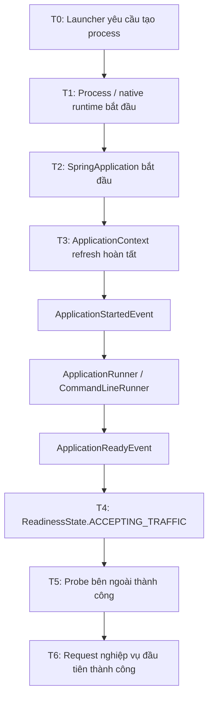

# Phân biệt thời gian tiến trình khởi động với thời điểm ứng dụng thực sự sẵn sàng

> **Chương:** Đo hiệu năng  
> **Module:** `SPRING_BOOT_NATIVE_IMAGE`  
> **Mục tiêu:** Xác định đúng mốc bắt đầu và kết thúc khi đo startup của Spring Boot Native Image; phân biệt process launch, Spring context refresh, application ready, readiness probe và request nghiệp vụ đầu tiên; dùng Spring Boot events, Micrometer metrics, ApplicationStartup và Kubernetes probes để đo và vận hành nhất quán.

## 1. Vì sao cần tách các mốc startup?

Một native executable có thể tạo process rất nhanh, nhưng điều đó chưa chứng minh ứng dụng đã sẵn sàng nhận request. Sau khi hệ điều hành tạo process, chương trình vẫn phải chạy runtime initialization, khởi tạo Spring context, tạo bean, mở web server, chạy các tác vụ khởi động và hoàn tất bước chuẩn bị dữ liệu cần thiết.

Ngược lại, log Spring báo ứng dụng đã ready cũng chưa chắc chứng minh một client bên ngoài đã kết nối thành công qua network, load balancer hoặc service mesh. Một readiness endpoint có thể phản hồi trước khi một luồng nghiệp vụ cụ thể được khởi tạo lần đầu.

Vì vậy, câu hỏi “ứng dụng khởi động mất bao lâu?” cần được tách thành nhiều câu hỏi nhỏ:

- Process được tạo và bắt đầu chạy lúc nào?
- Spring đã refresh ApplicationContext lúc nào?
- Các ApplicationRunner và CommandLineRunner đã chạy xong chưa?
- Spring Boot đã chuyển sang trạng thái chấp nhận traffic chưa?
- Một probe từ bên ngoài đã nhận được phản hồi thành công chưa?
- Request nghiệp vụ đầu tiên đã hoàn tất chưa?

Nếu dùng một con số duy nhất, ta có thể kết luận sai rằng native image đã sẵn sàng chỉ vì PID xuất hiện, hoặc cho rằng Spring startup chậm trong khi phần lớn thời gian nằm ở warm-up, database hoặc network probe.

## 2. Các mốc cần phân biệt

Đặt các mốc thời gian theo thứ tự:



| Mốc | Ý nghĩa | Nguồn đo phù hợp |
|---|---|---|
| T0 — Process launch | Hệ điều hành/container runtime bắt đầu tạo process | Launcher, container runtime hoặc orchestrator |
| T1 — Process started | Process đã tồn tại và thực thi | OS/process supervisor; không đồng nghĩa app ready |
| T2 — SpringApplication start | Spring Boot bắt đầu chu kỳ khởi động | Listener sớm hoặc instrumentation của ứng dụng |
| T3 — Context refreshed | Bean factory/context đã refresh; web server có thể đã khởi tạo | `ApplicationStartedEvent` và `application.started.time` |
| T4 — Application ready | Runner đã hoàn tất; Spring Boot chuyển readiness sang `ACCEPTING_TRAFFIC` | `ApplicationReadyEvent`, `ApplicationAvailability`, `application.ready.time` |
| T5 — External probe success | Client/probe bên ngoài nhận được HTTP response thành công | Probe harness, Kubernetes hoặc load balancer |
| T6 — First business success | Request đại diện cho nghiệp vụ thực tế hoàn tất | Synthetic client hoặc integration test |

T0 đến T4 đo startup của process và framework. T0 đến T5 đo thời gian triển khai thực tế cho tới khi có thể nhận traffic qua đường mạng. T0 đến T6 đo trải nghiệm của request đầu tiên. Ba kết quả có mục đích khác nhau, vì vậy hãy ghi nhãn rõ trong báo cáo.

## 3. `ApplicationStartedEvent` không có nghĩa là ứng dụng đã sẵn sàng

Spring Boot phát application events theo một thứ tự xác định:

1. `ApplicationStartingEvent`.
2. `ApplicationEnvironmentPreparedEvent`.
3. `ApplicationContextInitializedEvent`.
4. `ApplicationPreparedEvent`.
5. `ApplicationStartedEvent` sau khi ApplicationContext refresh hoàn tất.
6. `AvailabilityChangeEvent` với `LivenessState.CORRECT`.
7. `ApplicationReadyEvent` sau khi các ApplicationRunner và CommandLineRunner hoàn tất.
8. `AvailabilityChangeEvent` với `ReadinessState.ACCEPTING_TRAFFIC`.
9. `ApplicationFailedEvent` nếu startup thất bại.

Điểm quan trọng là `ApplicationStartedEvent` xảy ra **trước** các runner. Một runner có thể tiếp tục nạp cache, kiểm tra cấu hình, tải dữ liệu tham chiếu hoặc thực hiện tác vụ bắt buộc. Trong khoảng thời gian này, context đã refresh nhưng ứng dụng vẫn chưa được xem là sẵn sàng nhận traffic.

`ApplicationReadyEvent` được phát sau khi runner hoàn tất. Ngay sau event đó, Spring Boot chuyển readiness sang `ACCEPTING_TRAFFIC`. Đây là mốc framework phù hợp hơn khi cần đo thời gian ứng dụng sẵn sàng. [Spring Boot Reference — Application Events and Listeners](https://docs.spring.io/spring-boot/reference/features/spring-application.html#features.spring-application.application-events-and-listeners)

### 3.1. Trạng thái liveness và readiness khác nhau

Spring Boot quản lý hai trạng thái:

- **Liveness — `CORRECT`:** context đã refresh và ứng dụng được xem là còn khả năng hoạt động. Nếu liveness bị broken, hạ tầng có thể cần restart process.
- **Readiness — `ACCEPTING_TRAFFIC`:** ứng dụng đã hoàn tất startup tasks và có thể nhận traffic. Khi `REFUSING_TRAFFIC`, hạ tầng không nên route request tới instance.

Bảng vòng đời:

| Giai đoạn | Liveness | Readiness | Ý nghĩa |
|---|---|---|---|
| Starting | `BROKEN` | `REFUSING_TRAFFIC` | Context chưa sẵn sàng |
| Started | `CORRECT` | `REFUSING_TRAFFIC` | Context đã refresh, runner còn thực thi |
| Ready | `CORRECT` | `ACCEPTING_TRAFFIC` | Startup tasks hoàn tất, có thể nhận traffic |
| Graceful shutdown | `CORRECT` | `REFUSING_TRAFFIC` | Ngừng nhận request mới, xử lý request đang chạy |

Có thể truy vấn trạng thái bằng `ApplicationAvailability` hoặc lắng nghe `AvailabilityChangeEvent`. [Spring Boot Reference — Application Availability](https://docs.spring.io/spring-boot/reference/features/spring-application.html#features.spring-application.application-availability)

## 4. `ApplicationReadyEvent` vẫn khác probe bên ngoài

Khi Spring Boot chuyển sang `ACCEPTING_TRAFFIC`, framework đã hoàn tất các bước startup mà nó quản lý. Nhưng probe bên ngoài còn phụ thuộc:

- Web server bind port và nhận connection.
- Container network, port mapping và firewall.
- Service discovery, ingress, load balancer hoặc service mesh.
- HTTP route và security filter của endpoint được probe.
- Management endpoint có dùng port/context riêng hay không.
- Thời gian poll và timeout của probe.

Vì vậy, một phép đo production nên ghi cả thời điểm `ApplicationReadyEvent` lẫn thời điểm probe bên ngoài nhận HTTP success.

Readiness probe thành công cũng chưa đảm bảo mọi nghiệp vụ đã được warm-up. Ví dụ, một endpoint đơn giản có thể trả lời ngay trong khi cache sản phẩm, connection pool hoặc model xử lý request vẫn chưa sẵn sàng. Nếu nghiệp vụ yêu cầu những thành phần đó trước khi nhận traffic, phải đưa chúng vào startup tasks hoặc readiness gate riêng.

## 5. Request nghiệp vụ đầu tiên là một mốc khác nữa

Một request đầu tiên có thể chậm hơn các request tiếp theo vì:

- JVM đang thực hiện JIT compilation và tối ưu code nóng.
- Lazy initialization tạo bean hoặc khởi tạo serializer lần đầu.
- Connection pool mở connection đầu tiên.
- DNS lookup, TLS handshake hoặc authentication diễn ra lần đầu.
- Cache miss dẫn tới đọc dữ liệu từ database hoặc remote service.
- Native executable thực hiện static initialization hoặc khởi tạo một nhánh code chưa được chạy.

`ApplicationReadyEvent` không đo các chi phí này. Khi so sánh JVM JAR với native executable, hãy báo riêng:

- Thời gian đến readiness.
- Latency của request đầu tiên.
- Latency sau warm-up.
- Throughput và latency dưới workload đại diện.

Một native image có thể đạt readiness nhanh hơn nhưng request đầu tiên vẫn tốn thời gian khởi tạo dependency. Ngược lại, một JVM app có thể báo ready trước khi JIT warm-up đạt trạng thái ổn định.

## 6. Dùng các startup metrics có sẵn của Spring Boot

Spring Boot tự động công bố hai metric quan trọng qua Micrometer:

| Metric | Ý nghĩa |
|---|---|
| `application.started.time` | Thời gian cần để ứng dụng khởi động |
| `application.ready.time` | Thời gian cần để ứng dụng sẵn sàng phục vụ request |

Metric được gắn tag theo fully qualified name của application class. Đây là hai mốc nội bộ hữu ích để theo dõi thay đổi startup giữa các build và môi trường. [Spring Boot Reference — Application Startup Metrics](https://docs.spring.io/spring-boot/reference/actuator/metrics.html#actuator.metrics.supported.application-startup-metrics)

Để xem metric qua Actuator, cần có Spring Boot Actuator và expose endpoint phù hợp:

```yaml
management:
  endpoints:
    web:
      exposure:
        include: health,metrics
```

Có thể truy vấn:

```http
GET /actuator/metrics/application.started.time
GET /actuator/metrics/application.ready.time
```

Các metric này không phải đồng hồ đo từ lúc container image được tải hoặc từ lúc hệ điều hành tạo process. Chúng phục vụ đo thời gian startup trong vòng đời Spring Boot. Muốn đo từ T0, cần thêm một phép đo bên ngoài process.

## 7. Xem chi tiết startup bằng `ApplicationStartup`

Hai metric cho biết tổng thời gian, nhưng không chỉ ra bean hoặc startup step nào tốn thời gian. Spring Boot cung cấp `ApplicationStartup` để ghi lại các bước trong quá trình khởi tạo.

`BufferingApplicationStartup` lưu các startup steps trong bộ đệm. Cấu hình trước khi gọi `run`:

```java
import org.springframework.boot.SpringApplication;
import org.springframework.boot.autoconfigure.SpringBootApplication;
import org.springframework.boot.context.metrics.buffering.BufferingApplicationStartup;

@SpringBootApplication
public class PaymentApplication {

    public static void main(String[] args) {
        SpringApplication application =
                new SpringApplication(PaymentApplication.class);

        application.setApplicationStartup(
                new BufferingApplicationStartup(2048));

        application.run(args);
    }
}
```

Kích thước buffer `2048` là ví dụ. Nếu ứng dụng có nhiều startup steps, hãy chọn capacity đủ lớn để không mất dữ liệu cần phân tích.

Bật endpoint `startup` để xem dữ liệu dạng JSON:

```yaml
management:
  endpoints:
    web:
      exposure:
        include: health,metrics,startup
```

Sau khi có Actuator và `BufferingApplicationStartup`, truy cập:

```http
GET /actuator/startup
```

Endpoint này trình bày startup steps do `ApplicationStartup` thu thập. Nó hữu ích để tìm cấu hình, bean initialization hoặc phase nào đóng góp nhiều vào thời gian khởi động. [Spring Boot Reference — ApplicationStartup](https://docs.spring.io/spring-boot/reference/features/spring-application.html#features.spring-application.application-startup)

`ApplicationStartup` chỉ đo những bước Spring đã instrument. Nó không đo thời gian OS tạo process, thời gian container được schedule, image pull hoặc thời gian từ readiness event tới khi một client bên ngoài kết nối thành công. Hãy dùng nó để giải thích phần startup nội bộ sau khi đã đo tổng thời gian từ bên ngoài.

## 8. Đo từ lúc process launch tới readiness bên ngoài

Các metric của Spring Boot bắt đầu đo trong vòng đời Spring. Muốn biết từ lúc process/container được khởi chạy tới khi client có thể gửi request, hãy đo ở bên ngoài process.

Một probe harness có thể thực hiện theo quy trình:

1. Ghi T0 bằng monotonic clock ngay trước khi yêu cầu OS/container runtime tạo process.
2. Khởi chạy executable hoặc container.
3. Poll readiness endpoint trên đúng port mà traffic thực tế sử dụng.
4. Ghi T4 khi nhận response thành công đầu tiên theo tiêu chí đã chọn, ví dụ HTTP 200.
5. Gửi một request nghiệp vụ đại diện và ghi T5 khi request hoàn tất.
6. Tính các khoảng thời gian từ cùng một đồng hồ của harness.

Công thức:

```text
Process-to-ready = T4 - T0
Process-to-first-business-success = T5 - T0
Ready-to-first-business-success = T5 - T4
```

Dùng monotonic clock vì đồng hồ này không bị nhảy do đồng bộ NTP hoặc thay đổi giờ hệ thống. Không so sánh trực tiếp giá trị `System.nanoTime()` giữa hai process hoặc hai máy; giá trị này chỉ có ý nghĩa khi lấy hiệu trong cùng một miền đo. Nếu probe chạy ở máy khác, hãy để chính probe harness đo cả thời điểm launch và response bằng một clock duy nhất hoặc đồng bộ cơ chế tracing phù hợp.

### 8.1. Poll interval tạo sai số đo

Nếu probe kiểm tra mỗi 100 ms, thời điểm sẵn sàng thực tế có thể sớm hơn thời điểm harness ghi nhận tối đa gần một chu kỳ poll, chưa kể network và thời gian xử lý request probe.

Do đó:

- Dùng cùng poll interval và timeout cho JVM và native image.
- Ghi rõ poll interval trong báo cáo.
- Không đặt interval quá thấp tới mức chính probe tạo tải đáng kể.
- Nếu cần độ chính xác cao hơn, ghi thêm readiness event nội bộ và dùng probe ngoài để xác minh đường network.
- Dùng endpoint nhẹ, không thực hiện query nặng hoặc gọi nhiều dịch vụ mỗi lần poll.

### 8.2. Tách thời gian tạo container và tải image

Nếu đo bằng Docker hoặc Kubernetes, hãy ghi rõ T0 đang đại diện cho điều gì:

- Từ lúc gọi lệnh khởi chạy container.
- Từ lúc container runtime tạo process.
- Từ lúc Pod được tạo.
- Từ lúc container bắt đầu chạy.

Image pull, scheduling, volume mount và init container có thể chiếm thời gian đáng kể nhưng không phải thời gian Spring startup. Nếu mục tiêu là đo cold deployment, hãy báo các phần đó riêng. Nếu mục tiêu là so sánh runtime JVM và native, nên dùng image đã được tải sẵn để loại image pull khỏi phép đo.

## 9. Ghi mốc nội bộ bằng `System.nanoTime()`

Khi cần đối chiếu event của Spring với probe bên ngoài, có thể ghi thời gian tương đối từ đầu hàm `main`. Ví dụ dưới đây đo từ lúc Java/native entry đi vào `main`, không phải từ lúc OS bắt đầu tạo process:

```java
import org.slf4j.Logger;
import org.slf4j.LoggerFactory;
import org.springframework.boot.SpringApplication;
import org.springframework.boot.context.event.ApplicationStartedEvent;
import org.springframework.boot.context.event.ApplicationReadyEvent;
import org.springframework.boot.availability.AvailabilityChangeEvent;
import org.springframework.boot.availability.ReadinessState;
import org.springframework.context.ApplicationListener;

public class PaymentApplication {

    private static final Logger log =
            LoggerFactory.getLogger(PaymentApplication.class);

    public static void main(String[] args) {
        long mainEntryNanos = System.nanoTime();

        SpringApplication application =
                new SpringApplication(PaymentApplication.class);

        ApplicationListener<ApplicationStartedEvent> startedListener =
                event -> log.info("Context refreshed after {} ms",
                        elapsedMillis(mainEntryNanos));

        ApplicationListener<ApplicationReadyEvent> readyListener =
                event -> log.info("ApplicationReadyEvent after {} ms",
                        elapsedMillis(mainEntryNanos));

        ApplicationListener<AvailabilityChangeEvent<ReadinessState>>
                readinessListener = event -> {
                    if (event.getState() == ReadinessState.ACCEPTING_TRAFFIC) {
                        log.info("Accepting traffic after {} ms",
                                elapsedMillis(mainEntryNanos));
                    }
                };

        application.addListeners(
                startedListener,
                readyListener,
                readinessListener);

        application.run(args);
    }

    private static long elapsedMillis(long startNanos) {
        return (System.nanoTime() - startNanos) / 1_000_000;
    }
}
```

Ví dụ này giúp thấy phần chênh giữa context refresh, ApplicationReadyEvent và readiness state. Nó không thay thế phép đo T0 bên ngoài vì `main` chỉ chạy sau khi OS đã tạo process và runtime đã đi tới entry point.

Trong hệ thống thực tế, không nhất thiết phải tự viết listener nếu hai startup metrics mặc định đã đáp ứng nhu cầu. Chỉ thêm instrumentation khi cần đối chiếu milestone, phân tích runner hoặc tương quan log giữa các lần khởi động.

## 10. Đưa tác vụ warm-up vào readiness một cách có chủ đích

Nếu ứng dụng cần nạp dữ liệu bắt buộc trước khi nhận traffic, hãy quyết định tác vụ đó có thuộc startup hay không.

Với tác vụ đồng bộ và bắt buộc, dùng `ApplicationRunner` hoặc `CommandLineRunner`. Spring Boot chỉ phát `ApplicationReadyEvent` sau khi các runner hoàn tất, do đó thời gian của tác vụ sẽ nằm trong `application.ready.time`.

Ví dụ:

```java
@Component
public class ReferenceDataWarmup implements ApplicationRunner {

    private final ReferenceDataService referenceDataService;

    public ReferenceDataWarmup(ReferenceDataService referenceDataService) {
        this.referenceDataService = referenceDataService;
    }

    @Override
    public void run(ApplicationArguments args) {
        referenceDataService.loadRequiredReferenceData();
    }
}
```

Không đặt tác vụ startup dài trong `@PostConstruct` chỉ để cố ý trì hoãn readiness. Spring Boot khuyến nghị dùng runner cho công việc dự kiến chạy trong giai đoạn startup.

Nếu warm-up chạy bất đồng bộ sau khi runner trả về, Spring Boot có thể chuyển sang `ACCEPTING_TRAFFIC` trước khi warm-up kết thúc. Trong trường hợp đó, hãy bổ sung một readiness health indicator riêng và đưa nó vào readiness group, hoặc giữ runner chờ cho tới khi dữ liệu bắt buộc sẵn sàng. Không để readiness báo UP khi request thực tế vẫn có thể thất bại vì cache/model/config chưa được nạp.

Không phải mọi external dependency đều cần đưa vào readiness. Chỉ kiểm tra database, cache hoặc service bên ngoài nếu ứng dụng thực sự không thể phục vụ request khi dependency đó không sẵn sàng. Không đưa health check external service vào liveness vì sự cố chung ở dependency có thể khiến toàn bộ instance restart và tạo cascading failure. [Spring Boot Reference — Liveness and Readiness](https://docs.spring.io/spring-boot/reference/features/spring-application.html#features.spring-application.application-availability)

## 11. Cấu hình readiness và liveness endpoint cho Spring Boot

Khi chạy trên Kubernetes, Spring Boot Actuator cung cấp health groups:

- `/actuator/health/liveness`
- `/actuator/health/readiness`

Nếu management endpoint dùng port riêng, probe có thể thành công dù web server chính không nhận được connection. Có thể tạo thêm đường dẫn probe trên main server port:

```yaml
management:
  endpoint:
    health:
      probes:
        enabled: true
        add-additional-paths: true
```

Cấu hình này tạo các đường dẫn mặc định `/livez` và `/readyz` trên main server port. Nếu triển khai trong Kubernetes, Spring Boot thường tự kích hoạt probe support khi phát hiện môi trường Kubernetes; khai báo tường minh giúp cấu hình và test local dễ dự đoán hơn.

Chỉ expose endpoint cần thiết. Actuator mặc định chỉ expose health qua HTTP; endpoint `startup` và `metrics` cần được thêm vào exposure khi cần phân tích. Bảo vệ các endpoint có thể tiết lộ thông tin cấu hình hoặc chi tiết nội bộ của ứng dụng. [Spring Boot Reference — Actuator Kubernetes Probes](https://docs.spring.io/spring-boot/reference/actuator/endpoints.html#actuator.endpoints.kubernetes-probes)

## 12. Dùng startupProbe, livenessProbe và readinessProbe đúng mục đích

Ba loại probe của Kubernetes có nhiệm vụ khác nhau:

| Probe | Câu hỏi | Hành động khi thất bại |
|---|---|---|
| `startupProbe` | Ứng dụng đã vượt qua giai đoạn khởi động ban đầu chưa? | Kubelet restart container nếu vượt failure threshold |
| `livenessProbe` | Process còn ở trạng thái có thể tiếp tục hoạt động không? | Kubelet restart container |
| `readinessProbe` | Instance có thể nhận traffic lúc này không? | Pod bị loại khỏi endpoints nhận traffic |

Ví dụ Deployment:

```yaml
apiVersion: apps/v1
kind: Deployment
metadata:
  name: payment-api
spec:
  replicas: 2
  selector:
    matchLabels:
      app: payment-api
  template:
    metadata:
      labels:
        app: payment-api
    spec:
      containers:
        - name: payment-api
          image: example/payment-api:native
          ports:
            - name: http
              containerPort: 8080
          startupProbe:
            httpGet:
              path: /livez
              port: http
            periodSeconds: 2
            failureThreshold: 30
          livenessProbe:
            httpGet:
              path: /livez
              port: http
            periodSeconds: 10
            failureThreshold: 3
          readinessProbe:
            httpGet:
              path: /readyz
              port: http
            periodSeconds: 2
            failureThreshold: 3
```

Các con số trong ví dụ chỉ minh họa. Hãy đặt `periodSeconds`, `failureThreshold`, `timeoutSeconds` và `initialDelaySeconds` theo phân phối startup đo được, giới hạn tài nguyên và yêu cầu availability của hệ thống.

Khi có `startupProbe`, kubelet chưa chạy liveness và readiness probes cho tới khi startup probe thành công. Startup probe hữu ích nếu thời gian từ process start tới liveness có thể dài và không ổn định. Readiness probe tiếp tục chạy trong suốt vòng đời Pod để ngừng route traffic khi instance tạm thời không thể phục vụ. [Kubernetes Documentation — Startup, Liveness and Readiness Probes](https://kubernetes.io/docs/concepts/workloads/pods/probes/)

### 12.1. Không biến liveness thành kiểm tra database

Liveness trả lời câu hỏi instance có tự phục hồi được hay cần restart. Nếu database dùng chung đang down, restart mọi Pod không làm database phục hồi; nó chỉ tăng tải lên hệ thống đang gặp sự cố.

Readiness có thể kiểm tra một dependency nếu instance cụ thể không thể phục vụ request khi dependency đó down. Với dependency dùng chung, hãy cân nhắc kỹ vì nếu tất cả Pod cùng unready, Service có thể không còn endpoint để route traffic. Circuit breaker, fallback và retry policy có thể phù hợp hơn việc đưa mọi dependency vào readiness.

### 12.2. Startup probe không phải phép đo startup benchmark

Startup probe là cơ chế bảo vệ vòng đời container. Nó chỉ cho biết probe đã pass trong giới hạn cấu hình. Giá trị `failureThreshold × periodSeconds` là ngân sách cho phép khởi động, không phải kết quả đo chính xác thời gian startup.

Để benchmark, vẫn cần timestamp T0 và thời điểm probe success thực tế. Không lấy ngưỡng startup probe làm số đo startup của ứng dụng.

## 13. Thiết kế benchmark JVM và Native Image có thể so sánh

Khi so sánh JAR chạy trên JVM với native executable, hãy giữ các điều kiện sau nhất quán:

- Cùng commit/source code và tập tính năng.
- Cùng Spring Boot, dependency và cấu hình ứng dụng.
- Cùng dữ liệu test, database, schema và trạng thái migration.
- Cùng CPU architecture, số CPU và memory/cgroup limit.
- Cùng container runtime, network path và readiness endpoint.
- Cùng probe interval, timeout và cách xác định HTTP success.
- Cùng trạng thái image pull/page cache hoặc ghi rõ cold/warm scenario.

Tách các phép đo:

1. **Cold process start:** mỗi lần chạy tạo process/container mới.
2. **Warm host/container start:** image và các file cần thiết đã có trong cache.
3. **First request:** request nghiệp vụ đầu tiên sau readiness.
4. **Steady state:** workload sau warm-up, đo throughput và latency.

Không đưa thời gian compile native image hoặc tạo container image vào runtime startup. Nếu cần đo build duration hoặc deployment duration, báo thành metric riêng. Đối với JVM, readiness không đồng nghĩa JIT đã tối ưu xong; do đó phải có phép đo steady-state riêng.

### 13.1. Lặp lại và báo cáo phân phối

Startup có thể dao động do CPU scheduling, filesystem cache, page cache, DNS, database và tải trên node. Không kết luận từ một lần chạy.

Một baseline thực dụng:

- Thực hiện ít nhất 20–30 lần khởi chạy độc lập cho mỗi cấu hình khi có thể.
- Luân phiên thứ tự JVM/native để giảm thiên lệch do môi trường thay đổi theo thời gian.
- Báo median, p95, min/max và số mẫu.
- Ghi rõ run nào là cold và run nào là warm.
- Loại bỏ lần chạy lỗi chỉ khi có lý do được ghi lại; không xóa outlier chỉ vì nó làm kết quả xấu.
- Ghi CPU throttling, memory limit và node load khi benchmark trong container.

Với số mẫu nhỏ, p95 có thể không ổn định. Hãy công bố sample count để người đọc đánh giá mức tin cậy.

### 13.2. Báo cáo từng mốc thay vì chỉ một con số

Dùng bảng kết quả có các cột:

| Metric | JVM JAR | Native executable | Ghi chú |
|---|---:|---:|---|
| Process launch → Spring started | Đo thực tế | Đo thực tế | T0 tới context refresh |
| `application.started.time` | Đo thực tế | Đo thực tế | Mốc Spring internal |
| `application.ready.time` | Đo thực tế | Đo thực tế | Runner đã hoàn tất |
| Process launch → readiness probe success | Đo thực tế | Đo thực tế | T0 tới HTTP success bên ngoài |
| Readiness → first business success | Đo thực tế | Đo thực tế | Warm-up và first request |
| First request latency | Đo thực tế | Đo thực tế | Ghi riêng endpoint/payload |
| Steady-state p95 latency | Đo thực tế | Đo thực tế | Workload sau warm-up |

Không điền số minh họa như thể đó là kết quả benchmark. Mỗi giá trị phải gắn với cấu hình build, môi trường và số lần chạy.

## 14. Các lỗi diễn giải thường gặp

| Cách kết luận sai | Vì sao sai | Cách đo đúng |
|---|---|---|
| PID xuất hiện nghĩa là app ready | Process có thể còn đang khởi tạo Spring | Đo readiness event/probe |
| `ApplicationStartedEvent` là ready | Runner vẫn chưa chạy xong | Dùng `ApplicationReadyEvent` và readiness state |
| Port mở là mọi route hoạt động | Web server có thể bind nhưng endpoint nghiệp vụ chưa sẵn sàng | Gọi readiness endpoint và request đại diện |
| `/actuator/health` UP nghĩa là nhận traffic | Global health không nhất thiết bằng readiness group | Probe `/actuator/health/readiness` hoặc `/readyz` |
| Startup probe pass là startup mất đúng ngần ấy thời gian | Probe chỉ là ngưỡng kiểm soát | Ghi T0 và timestamp probe success |
| Native ready nhanh hơn nghĩa là request đầu tiên nhanh hơn | First request có thể khởi tạo lazy dependency | Đo first request riêng |
| JVM ready nghĩa là JIT warm | Readiness không đợi steady-state optimization | Benchmark workload sau warm-up |
| `application.ready.time` là process-to-ready | Metric thuộc Spring lifecycle | Dùng external harness để đo từ T0 |
| Management port probe pass nghĩa main port hoạt động | Management context có thể dùng hạ tầng khác | Dùng additional probe paths trên main port |

## 15. Quy trình đo startup cho một release

1. **Chốt định nghĩa:** quyết định T0 là process launch, container start hay Pod creation; chọn T4 là readiness state hay external probe success.
2. **Cấu hình nội bộ:** bật `application.started.time`, `application.ready.time`; bật `BufferingApplicationStartup` khi cần phân tích step.
3. **Cấu hình readiness:** xác định runner, cache warm-up, model load và dependency nào bắt buộc trước traffic.
4. **Cấu hình probe:** tách startup, liveness và readiness; dùng endpoint trên main port khi phù hợp.
5. **Chuẩn bị môi trường:** giữ CPU/memory limits, database, image cache, network và probe interval giống nhau.
6. **Chạy lặp:** đo cold và warm starts, lưu toàn bộ mẫu cùng thông tin môi trường.
7. **Đo request đầu tiên:** gửi request nghiệp vụ đại diện sau khi readiness pass.
8. **Đo steady state:** chạy workload đủ lâu để quan sát throughput, latency và memory sau warm-up.
9. **Phân tích startup steps:** dùng `/actuator/startup` để tìm bean hoặc phase nội bộ tốn thời gian.
10. **Báo cáo:** trình bày median/p95, sample count, các mốc T0–T6 và mọi giới hạn của phép đo.

## 16. Checklist phân biệt process startup và application readiness

- [ ] Định nghĩa T0 rõ ràng: process launch, container start hay Pod creation.
- [ ] Không dùng PID, log process hoặc port bind làm bằng chứng duy nhất cho readiness.
- [ ] Phân biệt `ApplicationStartedEvent` với `ApplicationReadyEvent`.
- [ ] Đã hiểu runner chạy sau context refresh và trước application ready.
- [ ] Đã ghi nhận `ReadinessState.ACCEPTING_TRAFFIC`.
- [ ] Đã đo external readiness probe trên đường network mà traffic thật sử dụng.
- [ ] Đã tách first business request khỏi readiness time.
- [ ] Đã ghi riêng `application.started.time` và `application.ready.time`.
- [ ] `BufferingApplicationStartup` được bật khi cần phân tích startup steps.
- [ ] Actuator endpoint chỉ được expose và bảo vệ theo nhu cầu.
- [ ] Startup, liveness và readiness probes có mục tiêu riêng.
- [ ] Liveness không phụ thuộc vào database hoặc dịch vụ bên ngoài dùng chung.
- [ ] Readiness chỉ kiểm tra dependency thực sự bắt buộc để phục vụ request.
- [ ] Startup probe timeout dựa trên phân phối startup thực tế.
- [ ] JVM và native image dùng cùng probe, workload và resource limits.
- [ ] Build time, image pull, process launch và Spring startup được báo riêng.
- [ ] Kết quả có sample count, median, p95 và cold/warm scenario.
- [ ] Request đầu tiên và steady-state performance được đo độc lập.

## 17. Ghi nhớ

Thời gian process launch, Spring context refresh, application ready và external readiness là những mốc khác nhau. `ApplicationStartedEvent` chỉ xác nhận context đã refresh; `ApplicationReadyEvent` được phát sau khi runner hoàn tất; ngay sau đó Spring Boot chuyển readiness sang `ACCEPTING_TRAFFIC`. Probe bên ngoài còn xác minh đường network và endpoint mà hạ tầng dùng để route traffic.

Khi đo Spring Boot Native Image, hãy báo ít nhất thời gian từ process launch tới readiness probe success, `application.started.time`, `application.ready.time` và latency của request nghiệp vụ đầu tiên. Dùng `ApplicationStartup` để tìm startup step chậm, Kubernetes probes để điều khiển traffic/restart, và benchmark nhiều lần trong điều kiện được kiểm soát. Chỉ khi tách các mốc này, phép so sánh JVM với native executable mới phản ánh đúng cả tốc độ khởi động lẫn thời điểm ứng dụng thực sự có thể phục vụ người dùng.

### Tài liệu tham khảo

- [Spring Boot Reference — SpringApplication and Application Events](https://docs.spring.io/spring-boot/reference/features/spring-application.html)
- [Spring Boot Reference — Application Availability](https://docs.spring.io/spring-boot/reference/features/spring-application.html#features.spring-application.application-availability)
- [Spring Boot Reference — Application Startup Metrics](https://docs.spring.io/spring-boot/reference/actuator/metrics.html#actuator.metrics.supported.application-startup-metrics)
- [Spring Boot Reference — ApplicationStartup](https://docs.spring.io/spring-boot/reference/features/spring-application.html#features.spring-application.application-startup)
- [Spring Boot Reference — Kubernetes Probes](https://docs.spring.io/spring-boot/reference/actuator/endpoints.html#actuator.endpoints.kubernetes-probes)
- [Kubernetes Documentation — Liveness, Readiness and Startup Probes](https://kubernetes.io/docs/concepts/workloads/pods/probes/)

