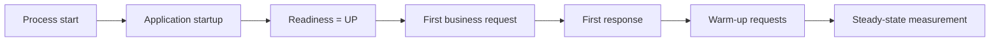

# Độ trễ yêu cầu đầu tiên, trạng thái chưa tải và trạng thái ổn định

Khi so sánh Spring Boot chạy trên JVM với GraalVM Native Image, thời gian khởi động nhanh không tự động có nghĩa request đầu tiên cũng nhanh, và request đầu tiên nhanh không có nghĩa hệ thống giữ được độ trễ đó dưới tải ổn định. Cần đo riêng **thời gian process khởi động**, **thời gian sẵn sàng nhận traffic**, **độ trễ request đầu tiên** và **độ trễ khi ứng dụng đã ổn định**.

Một ứng dụng vừa khởi động có thể chưa tạo connection pool, chưa nạp cache, chưa khởi tạo một số bean lazy hoặc chưa thực hiện truy vấn đầu tiên. JVM còn có quá trình JIT compilation khi code được chạy nhiều lần. Native Image không có JVM JIT ở runtime, nhưng vẫn có thể chịu chi phí khởi tạo lần đầu, nạp dữ liệu, thiết lập kết nối và làm nóng cache.

Bài học thuộc chương **Đo hiệu năng** của mô-đun `SPRING_BOOT_NATIVE_IMAGE`. Ta sẽ định nghĩa các mốc đo, phân biệt cold process với cold request và steady state, xây dựng phép đo HTTP có thể lặp lại, so sánh JVM/native công bằng và đọc kết quả bằng percentile thay vì chỉ nhìn một con số trung bình.

## 1. Bốn mốc thời gian cần đo riêng

Một lần khởi động service và gửi request có thể được chia thành các mốc:

1. **Process start:** thời điểm hệ điều hành bắt đầu tạo process.
2. **Ready:** thời điểm ứng dụng báo đã sẵn sàng nhận traffic.
3. **First request start:** thời điểm client gửi request nghiệp vụ đầu tiên sau readiness.
4. **First response:** thời điểm client nhận xong response đầu tiên.



Từ các mốc đó, tính ba chỉ số khác nhau:

| Chỉ số | Công thức | Ý nghĩa |
| --- | --- | --- |
| Startup-to-ready | T_ready - T_start | Thời gian từ khi tạo process đến khi ứng dụng sẵn sàng |
| First-request latency | T_first-response - T_first-request-start | Thời gian xử lý request nghiệp vụ đầu tiên, nhìn từ client |
| Startup-to-first-response | T_first-response - T_start | Thời gian từ lúc khởi động đến khi client nhận response nghiệp vụ đầu tiên |

Không cộng hoặc thay thế các chỉ số này cho nhau. Một ứng dụng có startup-to-ready thấp nhưng first-request latency cao vẫn có thể khiến người dùng chờ lâu ở request đầu tiên.

Ví dụ minh họa:

| Mốc | JVM | Native |
| --- | ---: | ---: |
| Startup-to-ready | 1.800 ms | 350 ms |
| First-request latency sau readiness | 420 ms | 260 ms |
| Startup-to-first-response | 2.220 ms | 610 ms |

Đây chỉ là số liệu giả định để minh họa cách đọc bảng, không phải kết quả benchmark chung cho Spring Boot. Kết quả thực tế phụ thuộc ứng dụng, dependency, phần cứng, cấu hình và workload.

## 2. Cold state và steady state là gì?

Từ "cold" có thể mô tả nhiều trạng thái. Khi lập benchmark, cần ghi rõ đang nói đến trạng thái nào.

| Trạng thái | Định nghĩa | Ví dụ |
| --- | --- | --- |
| Cold process | Một process mới vừa được khởi động | Container vừa tạo process native executable |
| Cold application state | Một số thành phần trong ứng dụng chưa được sử dụng | Cache rỗng, bean lazy chưa tạo, pool chưa mở connection |
| Cold connection | Chưa có connection TCP/TLS hoặc DB connection được tái sử dụng | Request đầu tiên phải thiết lập kết nối |
| Cold OS/page cache | Dữ liệu executable hoặc file chưa nằm trong page cache của hệ điều hành | Host vừa reboot hoặc cache hệ thống chưa được làm nóng |
| Warm-up state | Ứng dụng đã nhận một số request khởi động cache/JIT/connection | Đã chạy một số request nghiệp vụ trước khi đo |
| Steady state | Hành vi đã ổn định trong một khoảng đo xác định | Latency/throughput không còn biến động theo xu hướng rõ rệt |

Không phải benchmark nào cũng cần cold OS/page cache. Trong phần lớn trường hợp, mục tiêu là so sánh cold process và first business request trên cùng một host có page cache tương đương. Đừng dùng thao tác xóa page cache hệ điều hành trên máy production để tạo trạng thái lạnh; cách đó ảnh hưởng các process khác và khó tái lập.

### 2.1. Cold process không đồng nghĩa cold request

Một process có thể đã sẵn sàng nhưng chưa từng nhận request nghiệp vụ. Khi đó:

- Spring context đã được tạo.
- Readiness endpoint có thể trả về UP.
- Một số bean lazy chưa được khởi tạo.
- Connection pool có thể chưa mở connection.
- Cache nghiệp vụ có thể chưa có dữ liệu.

Request đầu tiên tới endpoint nghiệp vụ có thể trả chi phí khởi tạo mà health endpoint không chạm tới.

Ngược lại, nếu startup runner đã gọi service và nạp cache trước khi báo ready, request đầu tiên của client có thể nhanh hơn, nhưng thời gian startup-to-ready có thể dài hơn. Vì vậy cần đo cả hai phía.

### 2.2. Steady state phải có định nghĩa

Không nên gọi một process là steady chỉ vì đã chạy được vài request. Hãy xác định tiêu chí trước khi benchmark, ví dụ:

- Chạy warm-up trong một khoảng thời gian hoặc số request cố định.
- Đo qua nhiều cửa sổ liên tiếp.
- So sánh p50/p95 và throughput giữa các cửa sổ.
- Chỉ kết luận ổn định khi các chỉ số không còn xu hướng tăng/giảm đáng kể.

Một ví dụ thực hành là warm-up 60 giây, sau đó đo 3 cửa sổ, mỗi cửa sổ 60 giây. Đây là cấu hình minh họa; workload và ứng dụng có thể cần thời gian khác.

## 3. JVM và Native Image khác nhau ở first request

Cả hai hình thức triển khai đều có chi phí startup và chi phí lần sử dụng đầu tiên, nhưng nguyên nhân có thể khác nhau.

### 3.1. JVM

JVM có thể thực hiện:

- Class loading, verification và initialization.
- Khởi tạo Spring ApplicationContext.
- Tạo connection pool và các bean.
- JIT compilation khi method được chạy đủ thường xuyên.
- Tối ưu code theo profile runtime qua các tầng compiler.
- Làm nóng cache, DNS, TLS session hoặc client connection.

Vì vậy, request đầu tiên có thể chạy nhiều code chưa được JIT compile. Sau khi workload lặp lại, JVM có thể đạt throughput cao hơn hoặc latency thấp hơn ở một số đường code.

### 3.2. GraalVM Native Image

Native executable đã được biên dịch trước khi chạy, nên không có quá trình JVM JIT compilation như JVM mode. Tuy nhiên, native application vẫn có thể phải:

- Khởi tạo runtime và static state.
- Tạo bean hoặc component lazy.
- Đọc cấu hình, template hoặc resource lần đầu.
- Mở connection tới database, cache hoặc service bên ngoài.
- Nạp dữ liệu vào cache.
- Thiết lập TLS/DNS và connection pool.
- Chạy logic nghiệp vụ có chi phí khởi tạo riêng.

Native Image có thể giảm startup time và footprint trong nhiều workload, nhưng không bảo đảm mọi request đều nhanh hơn JVM. JVM đã warm-up có thể đạt hiệu năng steady-state rất cạnh tranh, tùy workload và cấu hình.

### 3.3. So sánh theo nguyên nhân

| Yếu tố | JVM mode | Native Image |
| --- | --- | --- |
| Spring context initialization | Có | Có, với AOT-generated initialization |
| Class loading/runtime initialization | Có | Có cơ chế runtime initialization tương ứng; nhiều quyết định đã được xử lý lúc build |
| Runtime JIT warm-up | Có | Không có JVM JIT runtime |
| Lazy bean initialization | Có | Có |
| Cache warming | Có | Có |
| DB/HTTP connection establishment | Có | Có |
| DNS/TLS setup | Có | Có |
| First-use resource loading | Có | Có, nếu resource được đóng gói/cấu hình đúng |
| PGO | Có các cơ chế tối ưu profile tùy JVM | Có thể dùng profile-guided optimization ở build time tùy GraalVM/toolchain; không phải runtime JIT |

Không nên cố tạo cùng một loại warm-up cho hai runtime rồi coi đó là công bằng. Hãy giữ cùng workload và báo cáo riêng cold behavior, JVM warm-up và steady-state behavior.

## 4. Xác định readiness trước khi gửi request

Để đo first request sau khi ứng dụng sẵn sàng, cần một tín hiệu readiness rõ ràng. Không dùng log "Started" làm mốc duy nhất nếu có thể kiểm tra endpoint health.

Nếu project dùng Spring Boot Actuator, có thể bật readiness/liveness probes:

```yaml
management:
  endpoint:
    health:
      probes:
        enabled: true
  endpoints:
    web:
      exposure:
        include: health
```

Khi cấu hình phù hợp, endpoint readiness thường là:

```http
GET /actuator/health/readiness
```

Readiness UP nghĩa là ứng dụng đủ điều kiện nhận traffic theo health indicators đã cấu hình. Nó không tự bảo đảm mọi cache hoặc mọi lazy component đã được khởi tạo.

Nếu yêu cầu benchmark là first business request trước mọi cache warming, đừng thêm startup runner chỉ để gọi trước endpoint nghiệp vụ. Nếu production thực tế có bước warm-up, hãy giữ bước đó trong benchmark và đo startup-to-ready cùng thời gian warm-up.

### 4.1. Readiness và liveness có mục đích khác nhau

- **Liveness:** process có còn sống và cần tiếp tục chạy không?
- **Readiness:** instance có sẵn sàng nhận traffic không?

Một process có thể liveness UP nhưng readiness REFUSING_TRAFFIC trong lúc startup hoặc chờ dependency. Benchmark nên chờ readiness thay vì chỉ kiểm tra TCP port đã mở.

### 4.2. Endpoint benchmark phải đại diện cho workload

Không dùng endpoint health làm request nghiệp vụ đầu tiên nếu mục tiêu là đo chi phí xử lý đơn hàng, truy vấn database hoặc serialize JSON.

Có thể có hai loại endpoint:

- Một endpoint rất nhẹ để đo HTTP/framework overhead.
- Một endpoint nghiệp vụ thực tế để đo service, persistence, cache và serialization.

Ghi rõ endpoint nào được đo. Hai loại này trả lời hai câu hỏi hiệu năng khác nhau.

## 5. Thiết kế workload có thể so sánh

Trước khi chạy benchmark, xác định một request đại diện:

```java
@RestController
@RequestMapping("/benchmark")
class BenchmarkController {

    private final BenchmarkService service;

    BenchmarkController(BenchmarkService service) {
        this.service = service;
    }

    @GetMapping("/light")
    Map<String, String> light() {
        return Map.of("status", "ok");
    }

    @GetMapping("/orders/{id}")
    OrderResponse order(@PathVariable long id) {
        return service.findOrder(id);
    }
}
```

Endpoint `/light` giúp đo đường HTTP nhỏ, còn `/orders/{id}` đại diện một luồng nghiệp vụ có service và có thể có database. Không gộp hai kết quả vào một số duy nhất.

Một benchmark tốt cần giữ các yếu tố sau giống nhau giữa JVM và native:

- Cùng source commit và dependency versions.
- Cùng business endpoint, method, request body và response size.
- Cùng database/cache/service bên ngoài và dataset.
- Cùng CPU architecture, host và container resource limits.
- Cùng TLS/proxy/network path.
- Cùng logging level, metrics instrumentation và tracing configuration.
- Cùng số lượng instance và concurrency.
- Ghi lại JVM heap/GC options và native runtime/build options.

Nếu một bên dùng database local còn bên kia dùng database từ xa, phép so sánh không còn cô lập được khác biệt runtime.

## 6. Đo first request latency và startup-to-ready

Một phép đo từ client nên ghi lại ít nhất:

- Process start time.
- Readiness success time.
- Thời gian gửi request đầu tiên.
- Thời gian nhận response đầu tiên.
- HTTP status và kích thước response.
- Request ID hoặc marker để đối chiếu server log nếu cần.

Dùng đồng hồ monotonic như `System.nanoTime()` hoặc `time.perf_counter_ns()` để đo khoảng thời gian. Không dùng timestamp wall-clock để trừ trực tiếp vì đồng hồ hệ thống có thể được đồng bộ hoặc điều chỉnh trong lúc đo.

Cần phân biệt độ trễ client-side với thời gian xử lý phía server:

- Client-side latency gồm DNS, TCP/TLS, network, queueing và thời gian server xử lý.
- Server-side request timer thường đo phần request được web server/framework ghi nhận, không gồm toàn bộ thời gian khởi tạo process hoặc kết nối client.

Cả hai đều hữu ích; chỉ cần đặt đúng tên và không so sánh nhầm.

## 7. Dùng HTTP client giữ kết nối để đo first request và steady requests

Nếu chạy lệnh `curl` riêng cho mỗi request, mỗi process curl thường tạo một client connection mới. Điều đó có thể khiến benchmark đo thêm TCP/TLS setup thay vì tái sử dụng kết nối như ứng dụng thật.

Dùng một HTTP client session để:

1. Chờ readiness bằng một session riêng.
2. Tạo một session mới cho endpoint nghiệp vụ.
3. Ghi thời gian request đầu tiên.
4. Gửi warm-up requests qua cùng session.
5. Ghi các request steady-state qua cùng session.

Ví dụ dưới đây dùng Python và thư viện `requests`. Script khởi động command được truyền vào, chờ readiness, đo request đầu tiên rồi đo các request tuần tự trên cùng một connection pool.

```python
import argparse
import json
import math
import subprocess
import time

import requests


def percentile(values, fraction):
    ordered = sorted(values)
    index = max(0, math.ceil(fraction * len(ordered)) - 1)
    return ordered[min(index, len(ordered) - 1)]


parser = argparse.ArgumentParser()
parser.add_argument("--ready-url", required=True)
parser.add_argument("--url", required=True)
parser.add_argument("--startup-timeout", type=float, default=90)
parser.add_argument("--request-timeout", type=float, default=10)
parser.add_argument("--warmup", type=int, default=100)
parser.add_argument("--samples", type=int, default=500)
parser.add_argument("--log-file", default="benchmark-app.log")
parser.add_argument("command", nargs=argparse.REMAINDER)
args = parser.parse_args()

if args.samples < 1 or args.warmup < 0:
    parser.error("--samples must be positive and --warmup cannot be negative")

command = args.command
if command and command[0] == "--":
    command = command[1:]

if not command:
    parser.error("Provide the application command after --")

started_ns = time.perf_counter_ns()
log_file = open(args.log_file, "w", encoding="utf-8")
process = subprocess.Popen(
    command,
    stdout=log_file,
    stderr=subprocess.STDOUT
)

try:
    deadline = time.monotonic() + args.startup_timeout

    with requests.Session() as readiness_client:
        while time.monotonic() < deadline:
            if process.poll() is not None:
                raise RuntimeError(
                    "Application exited before readiness"
                )

            try:
                response = readiness_client.get(
                    args.ready_url,
                    timeout=1
                )
                if response.status_code == 200:
                    break
            except requests.RequestException:
                pass

            time.sleep(0.1)
        else:
            raise TimeoutError("Readiness timeout")

    ready_ns = time.perf_counter_ns()

    with requests.Session() as client:
        first_started_ns = time.perf_counter_ns()
        first_response = client.get(
            args.url,
            timeout=args.request_timeout
        )
        first_finished_ns = time.perf_counter_ns()
        first_response.raise_for_status()

        first_request_ms = (
            first_finished_ns - first_started_ns
        ) / 1_000_000

        for _ in range(args.warmup):
            response = client.get(
                args.url,
                timeout=args.request_timeout
            )
            response.raise_for_status()

        samples_ms = []
        for _ in range(args.samples):
            request_started_ns = time.perf_counter_ns()
            response = client.get(
                args.url,
                timeout=args.request_timeout
            )
            request_finished_ns = time.perf_counter_ns()
            response.raise_for_status()

            samples_ms.append(
                (request_finished_ns - request_started_ns)
                / 1_000_000
            )

    result = {
        "startup_to_ready_ms": (
            ready_ns - started_ns
        ) / 1_000_000,
        "first_request_ms": first_request_ms,
        "startup_to_first_response_ms": (
            first_finished_ns - started_ns
        ) / 1_000_000,
        "steady_samples": len(samples_ms),
        "steady_p50_ms": percentile(samples_ms, 0.50),
        "steady_p95_ms": percentile(samples_ms, 0.95),
        "steady_p99_ms": percentile(samples_ms, 0.99),
        "steady_max_ms": max(samples_ms),
        "first_status": first_response.status_code
    }

    print(json.dumps(result, indent=2))

finally:
    if process.poll() is None:
        process.terminate()
        try:
            process.wait(timeout=10)
        except subprocess.TimeoutExpired:
            process.kill()
            process.wait()
    log_file.close()
```

Cài dependency cho client harness:

```bash
python -m pip install requests
```

Ví dụ chạy native executable:

```bash
python measure.py --ready-url http://127.0.0.1:8080/actuator/health/readiness --url http://127.0.0.1:8080/benchmark/orders/100 --warmup 100 --samples 500 -- ./orders-service
```

Ví dụ chạy JVM mode:

```bash
python measure.py --ready-url http://127.0.0.1:8080/actuator/health/readiness --url http://127.0.0.1:8080/benchmark/orders/100 --warmup 100 --samples 500 -- java -jar target/orders-service.jar
```

Script là một harness tuần tự, concurrency bằng một. Nó đo startup-to-ready, first request và một tập request sau warm-up. Request đầu tiên bao gồm chi phí mở kết nối HTTP client mới; đó là một phần của trải nghiệm client. Nếu muốn đo server processing riêng, dùng server-side metrics ở phần tiếp theo.

Readiness được polling mỗi 100 ms, nên mốc startup-to-ready có sai số lượng tử hóa tối đa xấp xỉ một chu kỳ polling cộng thời gian phản hồi health request. Dùng cùng interval cho JVM và native; nếu cần độ phân giải cao hơn, giảm interval hoặc dùng tín hiệu readiness do harness nhận trực tiếp. First business request dùng một session mới, vì vậy latency gồm cả thiết lập kết nối HTTP. Nếu production dùng TLS, proxy hoặc DNS từ xa, chạy benchmark qua cùng network path đó.

Để đo cold first request qua nhiều process, chạy harness nhiều lần, mỗi lần khởi động một process mới và lưu một record riêng. Không gửi 500 request rồi coi request thứ 501 là cold request.

## 8. Đo thời gian xử lý phía server bằng Micrometer

Client-side latency phản ánh trải nghiệm từ bên ngoài. Có thể đối chiếu với metric phía server để biết thời gian nằm ở HTTP/network hay trong ứng dụng.

Spring Boot Actuator/Micrometer thường ghi nhận timer `http.server.requests`. Có thể bật histogram:

```yaml
management:
  metrics:
    distribution:
      percentiles-histogram:
        http.server.requests: true
  endpoints:
    web:
      exposure:
        include: health, prometheus
```

Nếu xuất metric qua Prometheus, thêm registry dependency phù hợp, ví dụ `micrometer-registry-prometheus`, và expose endpoint theo chính sách vận hành.

Metric server-side giúp quan sát:

- Số request theo URI/method/status.
- Latency distribution.
- Request error rate.
- Sự khác biệt giữa first request và các request sau nếu có tag hoặc instrumentation bổ sung phù hợp.

Cần tránh high-cardinality tags như user ID hoặc order ID. Không đưa dữ liệu định danh từng request vào metric label.

Nếu muốn phân tích first request riêng, có thể thêm custom Timer hoặc log marker cho request đầu tiên. Đảm bảo instrumentation giống nhau ở JVM và native; metrics/tracing cũng tạo overhead, nên không thay đổi mức instrumentation giữa hai lần chạy.

## 9. Warm-up JVM và steady state

JVM thường cần warm-up để JIT compiler thu thập profile và tối ưu các đường code nóng. Một cách thực hành:

1. Khởi động process và chờ readiness.
2. Gửi first business request, lưu riêng latency.
3. Chạy warm-up workload có phân bố giống workload đo.
4. Quan sát latency/throughput theo từng cửa sổ.
5. Bắt đầu steady-state sampling khi các chỉ số đã ổn định.
6. Duy trì đủ lâu để quan sát GC, allocation và tail latency.

Không chọn warm-up chỉ theo số request mà không xem workload. Nếu warm-up chỉ gọi endpoint nhẹ nhưng đo endpoint có JSON serialization/database, code path cần tối ưu có thể chưa được làm nóng.

JVM steady-state cần ghi lại heap, GC configuration và JIT behavior nếu mục tiêu là phân tích sâu. Không nên bật profiler nặng trong một lần đo và tắt ở lần còn lại.

## 10. Warm-up và steady state của Native Image

Native Image không cần runtime JIT warm-up, nhưng vẫn cần kiểm tra trạng thái sau những lần sử dụng đầu tiên. Một số chi phí có thể biến mất sau khi process đã hoạt động:

- Connection pool đã mở connection.
- HTTP client đã thiết lập DNS/TLS/session.
- Cache đã chứa dữ liệu.
- Template/schema/config đã được đọc.
- Lazy bean hoặc singleton được khởi tạo.
- OS page cache đã giữ các file được truy cập thường xuyên.

Do đó, không nên kết luận "native không có warm-up" theo nghĩa không có bất kỳ thay đổi latency nào sau request đầu tiên. Chỉ có thể nói Native Image không trải qua JIT compilation runtime như JVM.

Nếu native request đầu tiên cao nhưng steady-state thấp, điều tra lazy initialization, external dependency, connection pool và cache trước khi thêm optimization vào native compiler.

## 11. Đo cold first request qua nhiều lần khởi động

First request là một sample cho mỗi process. Muốn có phân phối đáng tin cậy, cần nhiều lần khởi động độc lập.

Quy trình đề xuất:

1. Chọn một workload và readiness endpoint cố định.
2. Dừng process hoàn toàn sau mỗi lần đo.
3. Khởi động process mới.
4. Chờ readiness.
5. Gửi đúng một request nghiệp vụ đầu tiên và ghi latency.
6. Có thể tiếp tục warm-up/steady-state sampling trong cùng process.
7. Dừng process và lặp lại.
8. Tính median, p95 và min/max của first request giữa các process.

Ví dụ có 20 lần khởi động độc lập sẽ cho 20 mẫu first-request latency. Đây vẫn là tập mẫu nhỏ cho p99; không nên báo p99 đáng tin cậy từ vài chục mẫu. Nếu cần tail percentile, tăng số lần chạy hoặc dùng phương pháp thống kê phù hợp và báo rõ số mẫu.

Phải quyết định trước có giữ OS page cache hay không. Thông thường nên giữ điều kiện host tương tự giữa JVM/native và ghi rõ executable/image đã được pull/cache trước benchmark. Nếu mục tiêu là cold host boot, đó là một bài đo khác, cần môi trường kiểm soát riêng.

## 12. Đo steady-state latency và throughput

Để đo steady state, cần tạo đủ tải đại diện cho cách ứng dụng được sử dụng:

- Concurrency 1: xem latency cơ bản của một request tuần tự.
- Concurrency thấp/vừa: quan sát queueing và contention.
- Concurrency mục tiêu production: đánh giá latency và throughput ở tải dự kiến.
- Stress/load limit: tìm điểm mà latency hoặc error rate tăng nhanh.

Có thể dùng k6, Gatling, JMeter hoặc wrk. Ví dụ k6 tối giản:

```javascript
import http from "k6/http";
import { check, sleep } from "k6";

export const options = {
  vus: 1,
  duration: "60s",
  thresholds: {
    http_req_failed: ["rate<0.01"],
    http_req_duration: ["p(95)<500"]
  }
};

export default function () {
  const response = http.get(
    "http://127.0.0.1:8080/benchmark/orders/100"
  );

  check(response, {
    "status is 200": (r) => r.status === 200
  });

  sleep(0.1);
}
```

Threshold 500 ms chỉ là ví dụ minh họa; đặt theo SLA thực tế. Nếu dùng k6 để đo steady state, cấu hình warm-up riêng và bắt đầu measurement sau giai đoạn đó. Một bài đo first request cần client harness riêng để không vô tình gửi warm-up request trước mẫu đầu tiên.

## 13. Những chỉ số cần báo cáo

Không chỉ báo average latency. Tail latency thường quan trọng với API production.

| Chỉ số | Ý nghĩa | Khi sử dụng |
| --- | --- | --- |
| p50 | Một nửa request nhanh hơn hoặc bằng giá trị này | Latency điển hình |
| p90 | 90% request nhanh hơn hoặc bằng | Tail trung bình |
| p95 | 95% request nhanh hơn hoặc bằng | SLO/SLA phổ biến |
| p99 | 99% request nhanh hơn hoặc bằng | Tail latency |
| Max | Request chậm nhất trong tập mẫu | Phát hiện outlier, cần kèm sample count |
| Throughput | Request/second | Khả năng xử lý dưới tải |
| Error rate | Tỷ lệ request lỗi | Đảm bảo latency không được cải thiện bằng cách trả lỗi |
| Startup-to-ready | Thời gian tới readiness | Scale-out, restart, serverless |
| First-request latency | Latency request nghiệp vụ đầu tiên | User experience sau startup |
| Startup-to-first-response | Tổng thời gian từ process start đến response đầu | Cold-start user experience |

Luôn ghi sample count và thời lượng đo cạnh percentile. p99 từ 100 mẫu không ổn định như p99 từ hàng chục nghìn mẫu.

## 14. So sánh JVM và Native Image công bằng

Một bảng benchmark nên có cùng điều kiện:

| Điều kiện | JVM | Native Image |
| --- | --- | --- |
| Source commit | Cùng commit | Cùng commit |
| Dependency versions | Giống nhau | Giống nhau |
| OS/CPU architecture | Cùng host/target | Cùng host/target |
| CPU/memory limits | Cùng giới hạn | Cùng giới hạn |
| External services | Cùng DB/cache/API | Cùng DB/cache/API |
| Request data | Cùng payload/dataset | Cùng payload/dataset |
| Logging/metrics | Cùng cấu hình | Cùng cấu hình |
| Number of process starts | Cùng số lần | Cùng số lần |
| Warm-up policy | Ghi rõ riêng | Ghi rõ riêng |
| Concurrency | Cùng profile | Cùng profile |

Không so sánh JVM với heap rất lớn trên máy không giới hạn CPU với native trong container bị giới hạn chặt. Không để một bên dùng TLS còn bên kia không dùng. Không chạy hai benchmark đồng thời trên cùng host nếu CPU/memory contention làm nhiễu kết quả.

Nếu JVM dùng options đặc biệt như `-Xms`, `-Xmx`, GC hoặc class data sharing, ghi chúng vào report. Native image cũng cần ghi các build options và runtime environment có ảnh hưởng tới memory/GC.

## 15. Phân tích kết quả theo từng giai đoạn

Giả sử kết quả có dạng:

| Chỉ số | JVM | Native | Chênh lệch |
| --- | ---: | ---: | --- |
| Startup-to-ready | 1.800 ms | 350 ms | Native thấp hơn |
| First request | 420 ms | 260 ms | Native thấp hơn |
| Steady p50 | 8 ms | 9 ms | JVM thấp hơn |
| Steady p95 | 24 ms | 27 ms | JVM thấp hơn |
| Throughput | 4.500 req/s | 4.200 req/s | JVM cao hơn |

Các con số giả định này cho thấy một kết quả hoàn toàn có thể xảy ra: native khởi động và trả request đầu tiên nhanh hơn, nhưng JVM warm-up có steady-state throughput tốt hơn ở workload cụ thể.

Không nên kết luận một runtime "nhanh hơn" bằng một metric duy nhất. Hãy đọc kết quả theo mục tiêu triển khai:

- Serverless/scale-to-zero có thể ưu tiên startup-to-first-response.
- API instance chạy dài có thể ưu tiên steady-state p95/p99 và throughput.
- Workload nhiều instance ngắn hạn có thể cân bằng startup, memory và chi phí CPU.
- Workload có connection tới database có thể bị chi phối bởi thời gian mở connection hơn là runtime.

## 16. Những sai lầm thường gặp khi đo

| Sai lầm | Hệ quả | Cách khắc phục |
| --- | --- | --- |
| Dùng startup time thay cho first request | Bỏ qua lazy init và connection setup | Đo riêng first business request |
| Gửi health request rồi coi đó là request nghiệp vụ đầu tiên | Health endpoint không chạm code path cần đo | Chờ readiness, sau đó gọi business endpoint |
| Chỉ đo một process start | Không thấy biến động giữa các lần chạy | Lặp cold start độc lập |
| Dùng curl process mới cho từng request | Đo thêm TCP/TLS setup ở mỗi mẫu | Dùng client session/keep-alive |
| Chỉ báo average | Che khuất tail latency | Báo p50/p95/p99, sample count |
| So JVM chưa warm-up với native steady state | So sánh không cùng trạng thái | Báo cold và steady riêng |
| Gọi native "không có warm-up" | Bỏ qua cache, lazy bean và connection pool | Đo first-use và steady-state |
| Warm-up bằng endpoint khác workload | Không làm nóng code path thực tế | Dùng request mix đại diện |
| Chạy benchmark đồng thời trên cùng host | CPU/memory contention làm sai kết quả | Chạy tuần tự hoặc cô lập host |
| Không kiểm tra error rate | Request lỗi nhanh có thể làm latency đẹp giả tạo | Báo status và error rate |
| Đưa image pull vào startup nhưng không nói rõ | Trộn thời gian deploy với process startup | Tách image pull/scheduling khỏi process start |
| Dùng quá ít mẫu để báo p99 | Percentile không có ý nghĩa thống kê | Tăng sample count hoặc không báo p99 |

## 17. Mẫu báo cáo benchmark

Mỗi lần đo nên lưu metadata để có thể tái lập:

```text
Application:
Git commit:
Spring Boot version:
JDK / GraalVM version:
Native Build Tools version:
OS / CPU architecture:
Container image:
CPU limit:
Memory limit:
Database/cache version:
Endpoint and payload:
Logging/metrics settings:
JVM options:
Native build options:

Startup runs:
Startup-to-ready: median / p95
First request: median / p95 across independent process starts
Startup-to-first-response: median / p95

Steady-state:
Warm-up policy:
Measurement duration:
Sample count:
Concurrency:
p50 / p90 / p95 / p99:
Throughput:
Error rate:

Notes:
Known external dependencies:
Outliers and reruns:
```

Lưu cả raw samples, không chỉ bảng tổng hợp. Điều đó giúp xem outlier, kiểm tra lại percentile và so sánh khi thay đổi JDK, GraalVM hoặc dependency.

## 18. Quy trình benchmark đề xuất

1. **Chọn mục tiêu:** cold-start, first request, steady latency, throughput hay kết hợp.
2. **Chọn endpoint:** health/readiness chỉ để xác định mốc ready; workload đo phải là endpoint nghiệp vụ.
3. **Khóa môi trường:** source, toolchain, OS/CPU, resource limits, dependency và external services.
4. **Đo startup:** từ process spawn đến readiness.
5. **Đo first request:** gửi request nghiệp vụ đầu tiên sau readiness qua một client session mới.
6. **Lặp cold start:** dừng process hoàn toàn và chạy lại nhiều lần để thu thập first-request samples độc lập.
7. **Warm-up:** dùng workload đại diện; ghi rõ số request hoặc thời gian warm-up.
8. **Đo steady state:** chạy đủ lâu và ghi p50/p95/p99, throughput và error rate.
9. **Đối chiếu server metrics:** phân biệt network/client overhead với server processing.
10. **Lặp JVM/native:** giữ cùng điều kiện và chạy tuần tự để giảm nhiễu.
11. **Phân tích theo mục tiêu:** không gộp startup, first request và steady-state thành một điểm.
12. **Lưu raw data và cấu hình:** để benchmark có thể lặp lại sau mỗi lần nâng cấp.

## 19. Checklist trước khi kết luận

- [ ] Startup-to-ready và first-request latency được đo riêng.
- [ ] Startup-to-first-response được tính từ process start tới response nghiệp vụ đầu tiên.
- [ ] Readiness endpoint không bị nhầm với business endpoint.
- [ ] Cold process, cold application state và cold OS cache được định nghĩa rõ.
- [ ] JVM JIT warm-up được phân biệt với lazy initialization/cache warming của Native Image.
- [ ] First request được đo trên process mới, không lấy request sau warm-up.
- [ ] Cold first request được lặp qua nhiều lần process start độc lập.
- [ ] HTTP client giữ kết nối cho steady sequential samples.
- [ ] Workload, payload, response size và external dependencies giống nhau.
- [ ] CPU, memory, OS, architecture và container limits giống nhau.
- [ ] Warm-up policy và steady-state window được ghi rõ.
- [ ] Báo p50/p95/p99 cùng sample count, throughput và error rate.
- [ ] Có server-side metrics nếu cần tách network khỏi application processing.
- [ ] Không chạy benchmark đồng thời trên host gây contention.
- [ ] Không dùng một số average duy nhất để kết luận runtime nào nhanh hơn.
- [ ] Raw samples, toolchain versions và benchmark configuration được lưu lại.

### Câu hỏi tự đánh giá

1. Khác biệt giữa startup-to-ready và first-request latency là gì?
2. Vì sao readiness UP không bảo đảm cache hoặc connection pool đã được làm nóng?
3. Cold process và cold OS page cache khác nhau như thế nào?
4. JVM có thể làm request đầu tiên chậm hơn steady state do cơ chế nào?
5. Vì sao Native Image vẫn có thể có first-use latency dù không có JVM JIT?
6. Tại sao cần nhiều lần process start độc lập để đo phân phối first-request latency?
7. Client-side latency khác server-side HTTP timer ở những thành phần nào?
8. Khi nào cần báo p99 và tại sao số mẫu nhỏ làm p99 thiếu tin cậy?
9. Vì sao không nên gửi request health trước rồi dùng nó làm first business request?
10. Một benchmark có startup native nhanh nhưng steady-state JVM tốt hơn nên được diễn giải thế nào?

## Tài liệu tham khảo

- [Spring Boot — Application Availability](https://docs.spring.io/spring-boot/reference/features/spring-application.html): trạng thái startup, readiness và liveness của ứng dụng.
- [Spring Boot — Actuator Endpoints](https://docs.spring.io/spring-boot/reference/actuator/endpoints.html): health endpoint và quản lý endpoint.
- [Spring Boot — Metrics](https://docs.spring.io/spring-boot/reference/actuator/metrics.html): Micrometer và metric HTTP server.
- [GraalVM Native Image](https://www.graalvm.org/latest/reference-manual/native-image/): đặc điểm build ahead-of-time và runtime của native executable.
- [OpenJDK HotSpot Virtual Machine Performance Enhancements](https://docs.oracle.com/en/java/javase/21/vm/java-hotspot-virtual-machine-performance-enhancements.html): JIT compilation và các cơ chế tối ưu của JVM.
- [k6 Documentation](https://grafana.com/docs/k6/latest/): tạo workload, warm-up, đo latency và throughput.

**Kết quả cần đạt:** đo được riêng thời gian khởi động, thời gian đến readiness, request nghiệp vụ đầu tiên và trạng thái ổn định; giải thích được vì sao JVM và Native Image có đường cong latency khác nhau; và lập được benchmark có nhiều lần chạy, cùng workload, cùng điều kiện và đủ số liệu để đưa ra quyết định triển khai.
