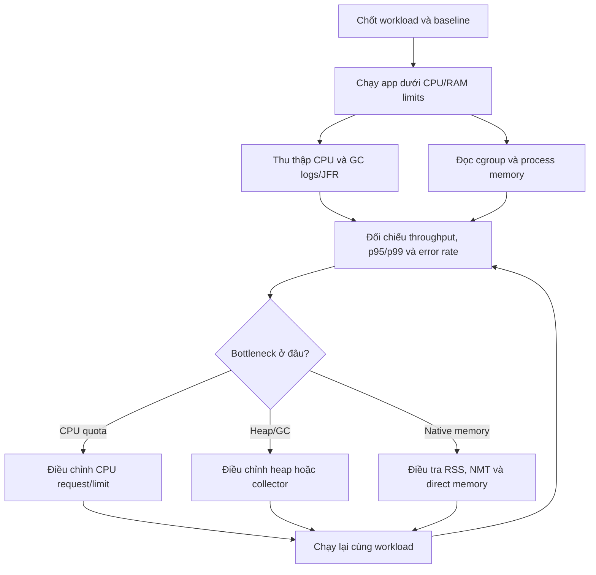

# Đo CPU, hoạt động GC và ảnh hưởng của mức tài nguyên được cấp

Một native executable có thể khởi động nhanh và dùng ít bộ nhớ trong một kịch bản thử nghiệm, nhưng kết quả đó không tự động đúng khi chạy dưới giới hạn CPU và RAM của container production. Khi CPU quota thấp, process có thể bị scheduler throttling; khi memory limit sát với working set, garbage collector phải thu hồi thường xuyên hơn hoặc container có thể bị OOM kill.

Để đánh giá hiệu năng Spring Boot Native Image, cần đo đồng thời **CPU consumption, garbage collection, process/container memory và độ trễ của request**. Bài này hướng dẫn cách lấy số liệu từ Spring Boot Actuator, Native Image GC logs, JFR, Linux perf và cgroup; sau đó thay đổi CPU/memory limits có kiểm soát để hiểu tác động tới throughput, latency và footprint.

## 1. Mục tiêu học tập

Sau bài học, bạn có thể:

- Phân biệt CPU time, CPU utilization, throughput và CPU throttling.
- Đo CPU của process và container trong khi chạy workload đại diện.
- Đọc GC logs và phân tích số lần collection, thời gian pause, heap trước/sau GC.
- Phân biệt Serial, G1 và Epsilon GC trong GraalVM Native Image.
- Dùng JFR để thu thập execution samples, GC events và container resource events.
- Dùng Linux perf để tìm method hoặc call path tiêu thụ CPU.
- Đọc CPU quota, throttling và memory usage từ cgroup v2.
- Giải thích khác biệt giữa Java heap, native memory, RSS và tổng memory của container.
- Thay đổi CPU/memory limits trong Docker hoặc Kubernetes và so sánh kết quả.
- Thiết kế phép đo lặp lại, có baseline và có tiêu chí đánh giá rõ ràng.

## 2. Vì sao phải đo CPU, GC và resource limits cùng nhau?

Các chỉ số này liên quan chặt chẽ:

- CPU quota thấp làm thread ứng dụng và GC có ít thời gian chạy hơn. Request có thể chờ lâu dù CPU utilization nhìn như đã chạm trần.
- Heap nhỏ làm GC xảy ra thường xuyên hơn. GC tiêu thụ CPU và có thể làm tăng tail latency.
- Heap quá lớn có thể tăng footprint và tạo áp lực lên memory limit; một số collection cần thêm bộ nhớ tạm.
- Container có thể bị OOM kill dù Java heap chưa chạm giới hạn max heap, vì process còn dùng native memory, thread stacks, direct buffers, mapped files và các vùng khác.
- Tăng CPU limit có thể giúp throughput hoặc giảm GC pause, nhưng không nhất thiết cải thiện nếu bottleneck là database, network hoặc lock contention.

Vì vậy, không nên kết luận “Native Image nhanh hơn” chỉ từ một con số CPU hoặc RSS. Hãy liên hệ số liệu với request rate, latency, error rate và giới hạn tài nguyên thực tế.



## 3. Bộ chỉ số cần theo dõi

| Nhóm | Chỉ số | Câu hỏi cần trả lời |
| --- | --- | --- |
| CPU | CPU time, CPU usage, CPU per request | Một request tiêu thụ bao nhiêu CPU? Process có bão hòa CPU không? |
| CPU quota | nr_throttled, throttled_usec, CPU pressure | Container có bị kernel giới hạn thời gian chạy không? |
| GC | Số lần GC, tổng GC time, pause duration, allocation rate | GC có chạy quá thường xuyên hoặc pause quá lâu không? |
| Java heap | Heap used, committed, max, live data sau GC | Heap có đủ chỗ cho workload và có tăng liên tục không? |
| Process memory | RSS, peak RSS, native memory | Process thực tế dùng bao nhiêu RAM? |
| Container memory | memory.current, memory.peak, memory.events | Container có gần giới hạn hoặc từng gặp OOM không? |
| Ứng dụng | Throughput, p50/p95/p99 latency, error rate | Resource pressure ảnh hưởng người dùng ra sao? |

### 3.1. CPU time khác CPU utilization

CPU time là tổng thời gian CPU thực sự thực thi cho process. Wall-clock time là thời gian trôi qua. Một process dùng trung bình một core trong 10 giây có thể tích lũy khoảng 10 giây CPU time.

Nếu process chạy song song trên nhiều core, CPU time có thể tăng nhanh hơn wall time. CPU utilization còn phụ thuộc cách công cụ chuẩn hóa theo số core hoặc CPU quota. Khi so sánh, hãy ghi rõ mẫu số đang dùng:

- Phần trăm một logical CPU.
- Phần trăm tổng CPU của host.
- Phần trăm CPU quota được cấp cho container.

Chỉ số **CPU seconds per request** thường hữu ích hơn phần trăm CPU đơn lẻ khi so sánh hai binary xử lý cùng một lượng request.

### 3.2. GC throughput, latency và footprint

Ba mục tiêu chính của garbage collector là:

- **Throughput:** phần thời gian ứng dụng không dành cho GC trong một khoảng dài.
- **Latency:** độ phản hồi; stop-the-world pause có thể làm request bị chậm.
- **Footprint:** working set bộ nhớ mà process chiếm dụng.

Tăng kích thước vùng heap hoặc young generation có thể cải thiện throughput nhưng làm tăng footprint và thay đổi pause behavior. Thu nhỏ heap có thể giảm memory reservation nhưng khiến collection xảy ra thường xuyên hơn. Không có một cấu hình tối ưu cho mọi workload.

## 4. Phân biệt JVM và Native Image khi đo

HotSpot JVM và GraalVM Native Image có runtime khác nhau:

| Khía cạnh | JVM | Native Image |
| --- | --- | --- |
| Thực thi code | JIT biên dịch trong lúc chạy | Code ứng dụng chủ yếu được biên dịch AOT lúc build |
| Startup | Có thể cần class loading, JIT và warm-up | Thường startup nhanh hơn, nhưng Spring vẫn cần khởi tạo context và kết nối |
| GC | Collector do HotSpot cung cấp và cấu hình | Collector của Native Image runtime |
| Profiling | JFR, JMX, async profiler, perf | JFR và perf có hỗ trợ riêng, một số event/feature khác JVM |
| Heap | Java heap và native memory của HotSpot | Java heap của Native Image và các vùng native/runtime khác |
| CPU warm-up | Có thể có JIT warm-up đáng kể | Không có JIT warm-up cho code AOT, nhưng cache, connection pool và application state vẫn cần warm-up |

Khi benchmark JVM và native, đo startup riêng với steady-state. Không so sánh native cold start với JVM đã warm-up hoặc ngược lại. Cũng không giả định mọi JMX/MXBean hoặc JFR event của HotSpot đều có mặt trong Native Image.

## 5. Đo CPU ở tầng ứng dụng với Spring Boot Actuator

Spring Boot Actuator và Micrometer cung cấp các meter cho system/process CPU, uptime, startup và nhiều loại tài nguyên khác. JVM metrics cũng có thể bao gồm GC statistics, thread utilization, memory pools và class loading.

Thêm Actuator và một registry phù hợp, ví dụ Prometheus:

```xml
<dependency>
    <groupId>org.springframework.boot</groupId>
    <artifactId>spring-boot-starter-actuator</artifactId>
</dependency>

<dependency>
    <groupId>io.micrometer</groupId>
    <artifactId>micrometer-registry-prometheus</artifactId>
</dependency>
```

Cấu hình endpoint:

```properties
management.endpoints.web.exposure.include=health,metrics,prometheus
management.endpoint.health.probes.enabled=true
```

Chỉ expose endpoint metrics trong network quản trị đáng tin cậy hoặc bảo vệ bằng authentication/authorization. Không mở endpoint chẩn đoán ra internet công khai.

Các meter thường hữu ích:

- System/process CPU usage và CPU time.
- application.started.time và application.ready.time.
- JVM memory và garbage collection metrics nếu runtime/registry cung cấp.
- HTTP server request duration, request count và error status.

Có thể xem danh sách meter qua /actuator/metrics, sau đó truy vấn một meter cụ thể. Tên metric và tag có thể khác theo phiên bản Micrometer, hệ điều hành và runtime.

**Lưu ý với Native Image:** Spring Boot mô tả các meter jvm.* là JVM metrics. Không mặc định mọi meter dựa trên HotSpot MXBean đều có cùng mức hỗ trợ hoặc cùng semantics trong native executable. Kiểm tra meter thực tế trên native binary. Với GC native, dùng GC logs/JFR làm nguồn chẩn đoán trực tiếp.

## 6. Đo CPU bằng Linux perf

perf là profiler của Linux, có thể ghi CPU samples, call stacks và hardware performance counters. Để xem method Java trong native executable, cần tạo debug information và giữ frame pointer khi build.

### 6.1. Build binary có debug symbols

Với lệnh native-image:

```bash
native-image \
  -g \
  -H:+PreserveFramePointer \
  -jar target/order-service.jar \
```

Với Spring Boot Maven/Gradle plugin, truyền các build arguments tương ứng qua cấu hình Native Build Tools. Ví dụ trên minh họa option của Native Image builder; cách truyền chính xác phụ thuộc plugin và phiên bản.

- -g tạo debug information để profiler có thể ánh xạ địa chỉ về symbol/method.
- -H:+PreserveFramePointer giữ frame pointer để perf unwind call stack ổn định hơn.

Debug information có thể làm tăng kích thước artifact. Hãy giữ symbol file phù hợp với binary đang đo và không dùng một binary khác commit để đọc profile.

### 6.2. Ghi CPU samples

Trên Linux:

```bash
perf record -g -o perf.data -- ./order-service
```

Chạy workload trong thời gian đủ dài, sau đó:

```bash
perf report -i perf.data
```

Có thể xem call graph để tìm:

- Method tiêu thụ nhiều CPU.
- Serialization/deserialization hoặc mapping tốn CPU.
- Hashing, compression, cryptography.
- Lock contention hoặc thread scheduling.
- GC và runtime functions chiếm CPU.

Để đo hardware counters, xem các event được host hỗ trợ:

```bash
perf list
perf stat -e cycles,instructions,cache-misses -- ./order-service
```

Tên event có thể phụ thuộc CPU, kernel và quyền truy cập perf. Không phải mọi máy ảo hoặc container đều cho phép đọc hardware counters.

### 6.3. Quyền và giới hạn

perf có thể bị giới hạn bởi perf_event_paranoid, kernel policy, container capability hoặc quyền quản trị. Không hạ các kernel security settings trên production chỉ để lấy profile. Hãy chạy profiling trên môi trường đo riêng hoặc nhờ quản trị viên cấp quyền tối thiểu cần thiết.

perf là công cụ Linux. Nếu build hoặc chạy trên Windows/macOS, dùng công cụ profiling phù hợp nền tảng hoặc JFR khi được hỗ trợ.

## 7. Đo bằng JFR trong Native Image

GraalVM Native Image hỗ trợ JDK Flight Recorder (JFR), nhưng phải bật support lúc build. JFR ghi execution samples, GC events, container CPU events và một số thông tin runtime khác.

### 7.1. Bật JFR khi build

Thêm option:

```bash
native-image --enable-monitoring=jfr ...
```

Với Maven/Gradle, thêm --enable-monitoring=jfr vào Native Image build arguments của application binary.

JFR recording của Native Image hiện chưa hỗ trợ trên Windows. Event và stack trace availability cũng khác HotSpot; hãy kiểm tra danh sách event của GraalVM version đang dùng.

### 7.2. Ghi recording khi chạy

```bash
./order-service \
  -XX:StartFlightRecording="filename=order-service.jfr,dumponexit=true,duration=120s"
```

Hoặc để ghi đến khi process kết thúc:

```bash
./order-service \
  -XX:StartFlightRecording="filename=order-service.jfr,dumponexit=true"
```

Đọc summary và event:

```bash
jfr summary order-service.jfr
jfr print --events jdk.ExecutionSample,jdk.GarbageCollection,jdk.GCHeapSummary order-service.jfr
```

Có thể mở file .jfr bằng JDK Mission Control hoặc VisualVM để xem timeline, execution samples, GC và thread activity.

### 7.3. Event hữu ích

Native Image JFR có thể cung cấp các event:

| Event | Ý nghĩa |
| --- | --- |
| jdk.ExecutionSample | Stack sample để xem method nào đang tiêu thụ CPU |
| jdk.GarbageCollection | Sự kiện GC |
| jdk.GCHeapSummary | Thống kê heap quanh GC |
| jdk.GCPhasePause | Pha pause của GC |
| jdk.ContainerCPUUsage | CPU usage ở container |
| jdk.ContainerCPUThrottling | CPU throttling của container |
| jdk.ContainerMemoryUsage | Container memory usage |
| jdk.ThreadCPULoad | CPU load theo thread |

Một số event GC như jdk.GarbageCollection, jdk.GCHeapSummary và jdk.GCPhasePause chỉ có khi dùng Serial GC. Event native memory cần Native Memory Tracking (NMT). Không suy luận event bị thiếu đồng nghĩa ứng dụng không có GC hoặc không có native memory.

## 8. Native Image có những garbage collector nào?

Native Image có runtime GC riêng, không phải HotSpot GC chạy bên trong binary.

| Collector | Đặc điểm | Khi nào cân nhắc |
| --- | --- | --- |
| **Serial GC** | Mặc định; stop-and-copy, không parallel/concurrent; footprint thấp, phù hợp heap nhỏ | Service nhỏ, giới hạn RAM chặt hoặc workload không cần GC concurrency cao |
| **G1 GC** | Multithreaded, có công việc concurrent; hướng tới cân bằng throughput và pause latency | Workload lớn cần giảm stop-the-world pause, nếu edition/OS/architecture hỗ trợ |
| **Epsilon GC** | Không thu hồi bất kỳ object nào | Process rất ngắn, allocation nhỏ và có giới hạn; không phù hợp service chạy lâu |

Theo tài liệu GraalVM hiện hành:

- Serial GC là mặc định.
- G1 có thể bật bằng --gc=G1, hiện hỗ trợ Native Image trên Linux AMD64 và AArch64 trong Oracle GraalVM; không có trong GraalVM Community Edition.
- Epsilon có thể bật bằng --gc=epsilon, nhưng không thực hiện garbage collection và không giải phóng memory.

Luôn kiểm tra edition, platform và GraalVM version trước khi chọn collector. Không áp dụng một build argument G1 vào mọi runner rồi giả định binary sẽ được tạo ở mọi môi trường.

## 9. Đọc GC logs và đánh giá hoạt động GC

Native executable có thể in thông tin GC trực tiếp:

```bash
./order-service -XX:+PrintGC
```

Để có thêm chi tiết:

```bash
./order-service -XX:+PrintGC -XX:+VerboseGC
```

Thông tin cụ thể phụ thuộc collector. Khi phân tích log, ghi nhận:

- Số lần young collection và full collection.
- Thời gian mỗi collection và tổng thời gian GC.
- Heap trước và sau collection.
- Mức tăng heap giữa hai lần GC.
- Tần suất allocation và khoảng cách giữa các collection.
- Có collection liên tiếp nhưng không thu hồi được đủ memory hay không.

Một số cách diễn giải:

| Quan sát | Có thể cho thấy | Cần kiểm tra thêm |
| --- | --- | --- |
| Young GC dày đặc | Allocation rate cao hoặc young generation nhỏ | CPU/request, object allocation, request payload |
| Full GC thường xuyên | Old generation đầy, live set lớn hoặc heap không phù hợp | Heap sau GC, object retention và memory leak |
| GC pause tăng khi CPU limit giảm | GC có ít CPU time hơn hoặc bị throttling | cpu.stat, CPU pressure, collector và thread count |
| Heap sau GC tăng qua từng chu kỳ | Live set tăng, cache tăng hoặc có leak | So sánh cùng workload và thời gian chạy dài hơn |
| GC time thấp nhưng RSS cao | Native memory, stack, direct buffer hoặc file mapping lớn | Cgroup memory, RSS, NMT và direct memory |
| GC time cao nhưng latency vẫn tốt | Collector đang thu gom thường xuyên nhưng pause ngắn | Tổng GC CPU, throughput và p99 latency |

Không chỉ đếm số lần GC. Một collector có thể chạy nhiều young collections ngắn nhưng vẫn có latency tốt; một full collection hiếm nhưng kéo dài có thể ảnh hưởng nghiêm trọng đến p99.

## 10. Java heap không phải tổng bộ nhớ của container

Native Image có Java heap để quản lý object. Tuy nhiên, process còn sử dụng memory ngoài Java heap, ví dụ:

- Thread stacks.
- Direct byte buffers.
- Native libraries và allocations từ JNI.
- Runtime/GC internal data structures.
- Memory-mapped files và shared libraries.
- Socket buffers và một phần memory được kernel tính cho cgroup.

Xmx chỉ đặt giới hạn trên của **Java heap**. Nó không phải giới hạn tổng RSS hoặc container memory. Do đó, không đặt Xmx bằng đúng memory limit của container.

### 10.1. Các khái niệm bộ nhớ

| Chỉ số | Ý nghĩa |
| --- | --- |
| Java heap used | Object memory đang được sử dụng |
| Java heap committed | Memory mà runtime đã commit cho heap |
| Xmx | Giới hạn tối đa của Java heap |
| RSS | Các trang memory resident của process tại thời điểm đo |
| Container memory current | Memory mà cgroup đang tính cho container và descendants |
| Container memory limit | Giới hạn cgroup; vượt quá có thể dẫn đến OOM |
| Peak memory | Mức memory cao nhất trong khoảng đo hoặc vòng đời container |

RSS và cgroup memory không nhất thiết bằng nhau. Cgroup có thể tính thêm page cache, socket buffers và kernel memory. Vì vậy, theo dõi cả process metrics lẫn container metrics.

### 10.2. GC có thể làm RSS tăng tạm thời

GC cần thêm memory trong lúc thực hiện collection. Tài liệu Native Image lưu ý RSS có thể tăng tạm thời khi GC chạy; trong trường hợp xấu nhất, phần memory bổ sung có thể lên tới hai lần maximum heap, dù thực tế thường thấp hơn đáng kể. Với container memory limit chặt, khoảng tăng tạm thời này cần được tính vào headroom.

Nếu container bị OOM kill khi heap chưa đầy, hãy kiểm tra:

1. Xmx và heap usage.
2. RSS/peak RSS.
3. Direct memory và native library allocations.
4. Thread count và stack memory.
5. GC activity và peak trong lúc collection.
6. memory.events để biết cgroup có ghi nhận oom hoặc oom_kill không.

### 10.3. Theo dõi native memory với NMT

Native Memory Tracking (NMT) ghi nhận một phần memory ngoài Java heap. Tính năng này tắt mặc định và phải được bật lúc build:

```bash
native-image --enable-monitoring=nmt -jar target/order-service.jar
```

Để in báo cáo khi native process kết thúc:

```bash
./order-service -XX:+PrintNMTStatistics
```

NMT của Native Image hiện cung cấp summary mode; không có call-site tracking chi tiết như HotSpot. Nó theo dõi memory do VM quản lý và các allocation qua Unsafe, nhưng không nhất thiết thấy các thư viện tự gọi malloc trực tiếp. Nếu cần JFR native-memory events, build với --enable-monitoring=jfr,nmt rồi ghi JFR recording.

## 11. Quan sát cgroup v2 trong Linux

Container trên Linux thường nhận resource limits qua cgroups. Với cgroup v2, các file quan trọng gồm:

| File | Nội dung |
| --- | --- |
| cpu.max | CPU quota và period |
| cpu.stat | CPU usage và throttling counters |
| cpu.pressure | CPU pressure stall information |
| memory.current | Memory hiện tại của cgroup |
| memory.peak | Peak memory của cgroup |
| memory.max | Hard memory limit |
| memory.high | Ngưỡng gây reclaim/throttling memory pressure |
| memory.events | Số lần chạm high/max, OOM và OOM kill |
| memory.stat | Phân rã memory usage theo loại |

Trong cgroup v2, đường dẫn thường được mount tại /sys/fs/cgroup, nhưng cgroup namespace và runtime có thể làm đường dẫn thực tế khác. Xác định cgroup của process qua /proc/self/cgroup và mount qua /proc/self/mountinfo.

Ví dụ kiểm tra trong container:

```bash
cat /proc/self/cgroup
cat /sys/fs/cgroup/cpu.max
cat /sys/fs/cgroup/cpu.stat
cat /sys/fs/cgroup/memory.current
cat /sys/fs/cgroup/memory.max
cat /sys/fs/cgroup/memory.events
```

Nếu host dùng cgroup v1, tên file và cấu trúc controller khác. Không áp dụng nguyên lệnh cgroup v2 cho cgroup v1.

### 11.1. Hiểu cpu.max

cpu.max có dạng:

```text
MAX PERIOD
```

Ví dụ:

```text
150000 100000
```

Nghĩa là cgroup có tối đa 150.000 microseconds CPU trong mỗi period 100.000 microseconds, tương đương quota 1,5 CPU theo thời gian. max ở vị trí đầu tiên có nghĩa không đặt bandwidth limit ở cgroup này.

### 11.2. Hiểu cpu.stat

cpu.stat có thể chứa:

```text
usage_usec 12345678
user_usec 10000000
system_usec 2345678
nr_periods 5000
nr_throttled 1200
throttled_usec 45000000
```

Các số trên chỉ minh họa. Ý nghĩa:

- usage_usec: tổng CPU time của cgroup.
- user_usec: CPU time ở user mode.
- system_usec: CPU time ở kernel mode.
- nr_periods: số chu kỳ quota.
- nr_throttled: số chu kỳ bị throttling.
- throttled_usec: thời gian throttling được ghi nhận.

Đọc số liệu ở đầu và cuối workload để tính delta. nr_throttled / nr_periods cho biết tỷ lệ period có throttling, không phải phần trăm CPU utilization. Kết hợp nó với latency và throughput để xác định ảnh hưởng thực tế.

### 11.3. Hiểu memory.current, memory.max và memory.events

- memory.current là tổng memory cgroup đang dùng.
- memory.max là hard limit; nếu không thể reclaim đủ memory, kernel có thể kích hoạt OOM killer.
- memory.events ghi nhận các sự kiện như high, max, oom và oom_kill.
- memory.stat giúp phân biệt anonymous memory, file cache, kernel memory và các loại khác.

Nếu memory.events tăng oom_kill, hãy kiểm tra container restart count và exit reason trong orchestrator. Exit code 137 thường gợi ý SIGKILL nhưng cần xem trạng thái container để xác định có phải OOM kill hay không.

## 12. Thay đổi CPU và memory limits

### 12.1. Docker

Chạy container với một mức CPU và RAM cụ thể:

```bash
docker run --rm \
  --cpus=1.5 \
  --memory=768m \
  --name order-service \
  order-service:native
```

Thử nghiệm một mức CPU khác nhưng giữ nguyên memory:

```bash
docker run --rm \
  --cpus=0.75 \
  --memory=768m \
  --name order-service \
  order-service:native
```

Sau mỗi lượt, thu thập throughput, latency, CPU time, GC logs, peak RSS và container memory. Không chạy hai lượt benchmark cùng lúc trên một host nếu muốn so sánh chính xác.

### 12.2. Kubernetes

Ví dụ resource requests/limits:

```yaml
apiVersion: apps/v1
kind: Deployment
metadata:
  name: order-service
spec:
  replicas: 1
  selector:
    matchLabels:
      app: order-service
  template:
    metadata:
      labels:
        app: order-service
    spec:
      containers:
        - name: app
          image: order-service:native
          resources:
            requests:
              cpu: "500m"
              memory: "512Mi"
            limits:
              cpu: "1500m"
              memory: "768Mi"
```

Trong Kubernetes:

- CPU request ảnh hưởng scheduling và trọng số chia sẻ CPU khi node có tranh chấp.
- CPU limit là hard ceiling được kernel thực thi bằng throttling.
- Memory request chủ yếu ảnh hưởng scheduling.
- Memory limit được thực thi bằng memory cgroup và có thể dẫn đến OOM kill.

Container bị CPU throttling thường vẫn chạy nhưng chậm hơn. Container vượt memory limit có thể bị kernel kết thúc; Kubernetes sẽ hiển thị trạng thái như OOMKilled khi phù hợp.

### 12.3. Để lại headroom cho Java heap

Giả sử memory limit của container là 768 MiB. Không nên đặt Xmx768m rồi kỳ vọng process luôn nằm trong giới hạn. Cần dành bộ nhớ cho native runtime, thread stacks, direct buffers, shared libraries, GC và phần memory mà kernel tính vào cgroup.

Ví dụ giới hạn heap tường minh:

```bash
./order-service -Xms128m -Xmx512m
```

Các giá trị chỉ để minh họa. Hãy chọn sau khi đo peak RSS và container memory với workload thực tế. Nếu native memory hoặc direct buffers tăng, có thể cần giảm heap hoặc tăng container limit.

## 13. Cấu hình và lựa chọn GC

### 13.1. Serial GC

Serial GC là mặc định:

```bash
native-image --gc=serial -jar target/order-service.jar
```

Nó thường phù hợp khi heap nhỏ và cần footprint thấp. Vì GC không parallel/concurrent, CPU quota thấp có thể làm collection kéo dài khi live set lớn.

### 13.2. G1 GC

Nếu dùng Oracle GraalVM trên Linux AMD64/AArch64 và edition hỗ trợ G1:

```bash
native-image --gc=G1 -jar target/order-service.jar
```

G1 dùng nhiều thread và có công việc concurrent để cân bằng throughput với pause latency. Khi container chỉ được cấp ít CPU, số GC threads và concurrent work cần được quan sát. Đừng bật G1 chỉ vì kỳ vọng nó luôn nhanh hơn Serial.

### 13.3. Epsilon GC

```bash
native-image --gc=epsilon -jar target/short-task.jar
```

Epsilon không thu hồi object. Nó chỉ phù hợp với process rất ngắn, allocation nhỏ và có giới hạn đã biết. Dùng Epsilon cho service chạy lâu có thể làm memory tăng liên tục cho đến khi allocation thất bại hoặc container bị OOM kill.

### 13.4. Heap size options

Native Image tự xác định heap settings theo system configuration và collector. Tài liệu hiện hành mô tả max heap mặc định của Serial GC là 80% physical memory; với G1 là 25% physical memory nếu không đặt giới hạn khác. Các tỷ lệ này không phải sizing recommendation cho mọi container. Khi memory limit chặt, kiểm tra memory sizing thực tế và cân nhắc đặt Xmx tường minh để giữ headroom cho native memory, thread stacks và GC.

Native Image hỗ trợ các runtime options:

| Option | Ý nghĩa |
| --- | --- |
| Xms | Heap size tối thiểu |
| Xmx | Heap size tối đa |
| Xmn | Kích thước young generation |
| MaximumHeapSizePercent | Tỷ lệ physical memory dùng làm max heap với Serial GC |
| MaxRAMPercentage | Tỷ lệ RAM dùng làm max heap với G1 GC |

Có thể đặt mặc định ở build time bằng R:MaxHeapSize, R:MinHeapSize và R:MaxNewSize. Đừng copy giá trị heap từ JVM sang native mà không đo lại; collector và runtime khác nhau.

## 14. Quy trình benchmark có kiểm soát

Để biết thay đổi CPU/memory limit ảnh hưởng thế nào, giữ các biến khác ổn định.

### 14.1. Chuẩn bị baseline

Ghi lại:

- GraalVM distribution, version, Java version và Native Image build arguments.
- Spring Boot version, dependencies và commit SHA.
- OS, kernel, CPU model, architecture và host memory.
- GC collector, heap options và monitoring features.
- Container image, CPU request/limit và memory request/limit.
- Workload, dataset, concurrency, arrival rate và thời lượng chạy.

Không thay đồng thời code, GC collector, heap size và resource limit trong cùng một lượt nếu mục tiêu là tìm nguyên nhân.

### 14.2. Tách startup test và steady-state test

**Startup test:**

1. Khởi chạy process/container mới.
2. Ghi thời gian từ lúc process start tới ApplicationReadyEvent hoặc readiness thành công.
3. Lặp lại nhiều lần để tránh kết luận từ một lần chạy.
4. Ghi peak memory trong startup.

**Steady-state test:**

1. Khởi động ứng dụng và đợi readiness.
2. Warm-up cache/connection pool bằng workload cố định.
3. Bắt đầu đo sau warm-up.
4. Chạy tải ổn định trong một khoảng thời gian đủ dài để có nhiều chu kỳ GC.
5. Ghi throughput, p50/p95/p99, error rate, CPU time, throttling, GC và memory.

Không gộp thời gian startup vào latency của steady-state request.

### 14.3. Chọn workload

Chọn workload đại diện cho service:

- JSON parsing và serialization.
- Database query/update.
- HTTP call tới service ngoài.
- Allocation-heavy mapping hoặc batch processing.
- Message consumption hoặc scheduled job.
- Tải hỗn hợp nếu production có nhiều loại request.

Giữ payload, dataset, request mix và concurrency giống nhau. Nếu dùng fixed arrival rate, ghi lại số request bị queue hoặc drop; nếu dùng fixed concurrency, ghi rõ concurrency được giữ ổn định.

### 14.4. Ma trận thay đổi tài nguyên

Ví dụ ma trận để chạy từng lượt:

| Run | CPU limit | Memory limit | Mục đích |
| --- | ---: | ---: | --- |
| A | 1.5 CPU | 768 MiB | Baseline |
| B | 0.75 CPU | 768 MiB | Đo ảnh hưởng CPU quota |
| C | 1.5 CPU | 512 MiB | Đo ảnh hưởng memory limit |
| D | 0.75 CPU | 512 MiB | Quan sát tương tác CPU và memory |
| E | 2 CPU | 1 GiB | Xác định mức tăng tài nguyên còn cải thiện không |

Đây là ví dụ ma trận, không phải sizing recommendation. Chọn các mức phù hợp với môi trường và tránh memory limit thấp đến mức test chỉ đo hành vi OOM.

### 14.5. Lặp lại và ghi kết quả

Mỗi cấu hình nên chạy nhiều lần trên host tương đương. Báo cáo median và độ phân tán; nếu kết quả dao động lớn, kiểm tra background load, CPU frequency, cache state, network hoặc noisy neighbor.

Mẫu bảng kết quả:

| Run | CPU limit | Throughput | p95 | p99 | CPU sec/request | GC time % | Peak container memory | Throttling |
| --- | ---: | ---: | ---: | ---: | ---: | ---: | ---: | --- |
| A | 1.5 | — | — | — | — | — | — | — |
| B | 0.75 | — | — | — | — | — | — | — |
| C | 1.5 | — | — | — | — | — | — | — |
| D | 0.75 | — | — | — | — | — | — | — |

Không điền số giả định vào báo cáo. Ghi rõ thời gian đo và nguồn từng metric.

## 15. Phân tích ảnh hưởng của CPU limit

Khi CPU limit giảm:

- CPU time tối đa trong một khoảng thời gian giảm.
- nr_throttled và throttled_usec có thể tăng.
- Request queue có thể dài hơn, làm p95/p99 tăng.
- GC threads có ít thời gian chạy hơn; pause hoặc concurrent collection có thể kéo dài.
- Throughput có thể giảm dù CPU utilization luôn gần quota.

Nếu CPU utilization cao và throttling tăng, thử tăng CPU limit trong một lượt riêng. Nếu CPU usage thấp nhưng latency cao, bottleneck có thể nằm ở I/O, lock, connection pool hoặc service ngoài.

Đừng dùng CPU percentage đơn lẻ để kết luận. Hãy kết hợp CPU seconds/request, throughput, p99 và cgroup throttling.

## 16. Phân tích ảnh hưởng của memory limit

Khi memory limit giảm:

- Heap có ít không gian hơn nếu Xmx hoặc default sizing được điều chỉnh theo cấu hình đó.
- GC có thể chạy thường xuyên hơn.
- Memory reclaim và page cache pressure có thể tăng.
- RSS peak trong lúc GC có thể chạm container limit.
- Container có thể bị OOM kill dù Java heap chưa đạt Xmx.

Khi memory limit thấp, so sánh:

1. Heap used trước/sau GC.
2. Heap max và Xmx.
3. RSS peak và memory.current.
4. memory.events trước/sau test.
5. Số lần GC, tổng GC time và pause.
6. Restart count, OOMKilled và application exit logs.

Nếu heap sau GC ổn định nhưng container memory vẫn tăng, hãy điều tra native allocations, direct buffers, thread stacks, memory mapping hoặc page cache thay vì chỉ giảm heap.

## 17. Phân tích kết hợp CPU và GC

| Quan sát | Giả thuyết | Hành động tiếp theo |
| --- | --- | --- |
| CPU throttling cao, GC pause tăng | GC bị thiếu CPU time | Thử tăng CPU quota, xem GC thread count và latency |
| GC time cao, heap sau GC thấp | Allocation rate cao | Dùng JFR allocation samples hoặc profiler tìm nơi tạo object |
| Full GC nhiều, heap sau GC cao | Live set lớn hoặc object retention | Kiểm tra cache, collection, session và heap dump nếu hỗ trợ |
| CPU cao, GC time thấp | CPU chủ yếu dùng cho application code | Dùng perf/JFR execution samples tìm hot methods |
| CPU thấp, latency cao | Có thể chờ network, database, lock hoặc queue | Xem thread states, socket events, dependency latency |
| RSS cao, heap thấp | Native memory hoặc memory ngoài heap | Kiểm tra direct buffers, JNI, thread stacks và cgroup stats |
| OOM kill không có Java OOME | Kernel kết thúc process ở container limit | Xem memory.events, Kubernetes OOMKilled và peak memory |

Đây là các giả thuyết để định hướng điều tra, không phải kết luận tự động. Hãy xác nhận bằng profile hoặc số liệu tương ứng.

## 18. Spring Boot Actuator và metric export

Với Prometheus, expose metrics endpoint trong mạng nội bộ:

```properties
management.endpoints.web.exposure.include=health,prometheus
management.endpoint.prometheus.access=read-only
```

Prometheus scrape /actuator/prometheus. Dùng dashboard để theo dõi:

- CPU process/system.
- HTTP request count, duration và status.
- Startup/ready time.
- JVM memory/GC meters khi có sẵn.
- Executor/thread-pool metrics.

Với Native Image, bổ sung JFR và container metrics để có thông tin mà các JVM meters có thể không cung cấp. Giữ nhãn metric có cardinality thấp; không gắn order ID, customer ID hoặc URL đầy đủ làm tag.

## 19. Troubleshooting

| Triệu chứng | Nguyên nhân có thể | Cách kiểm tra |
| --- | --- | --- |
| CPU usage chạm quota, throughput không tăng | CPU throttling | So sánh cpu.max, cpu.stat, JFR ContainerCPUThrottling |
| CPU thấp nhưng request chậm | I/O wait, dependency chậm, lock hoặc queue | Kiểm tra JFR thread/socket events và dependency latency |
| GC log không có thông tin | Chưa bật GC logging hoặc option không hợp version | Chạy binary với PrintGC và VerboseGC |
| JFR không tạo file | Chưa build enable-monitoring=jfr, file path không ghi được hoặc platform không hỗ trợ | Kiểm tra build args, quyền ghi và GraalVM platform |
| JFR không có GC pause events | Event chỉ có với Serial GC hoặc runtime version khác | Kiểm tra GC collector và JFR event availability |
| perf không hiện Java method names | Binary thiếu debug symbols/frame pointer hoặc symbol không khớp | Build với -g và PreserveFramePointer, dùng đúng binary |
| perf permission denied | Kernel perf policy hoặc container thiếu quyền | Dùng runner profiling được cấp quyền phù hợp |
| Container OOM nhưng heap chưa đầy | Native memory, direct buffers, stacks hoặc cgroup accounting | So sánh Xmx, RSS, memory.current, memory.events |
| GC chạy quá thường xuyên | Heap/young generation nhỏ hoặc allocation rate cao | Đọc GC logs, heap after GC và allocation profile |
| Tăng memory limit nhưng RSS vẫn tăng | Leak, cache không giới hạn hoặc native allocation | Quan sát peak theo thời gian, profile allocation và native memory |
| G1 không build được | GraalVM edition/platform không hỗ trợ | Xác nhận Oracle GraalVM, Linux AMD64/AArch64 và version |
| Kết quả benchmark dao động mạnh | Host contention, frequency scaling hoặc workload không ổn định | Chạy lại trên host yên tĩnh, cố định workload và báo cáo median |

## 20. Bài thực hành tổng hợp

**Bối cảnh:** order-service chạy bằng GraalVM Native Image trong Kubernetes. Service có workload đọc order, xác nhận order và truy vấn database. Bạn cần biết vì sao p99 tăng khi deployment được cấp ít CPU hơn.

Thực hiện:

1. Build native executable với JFR support bằng enable-monitoring=jfr.
2. Bật Actuator metrics và ghi nhận startup, HTTP request, system/process CPU.
3. Chạy baseline với CPU limit 1.5 và memory limit 768 MiB.
4. Gửi workload cố định trong 5–10 phút sau warm-up; lưu throughput, p95/p99, CPU time và error rate.
5. Ghi JFR recording bằng StartFlightRecording và bật GC logs bằng PrintGC và VerboseGC.
6. Đọc cpu.max, cpu.stat, memory.current, memory.max và memory.events trước/sau workload.
7. Giảm CPU limit còn 0.75, giữ nguyên memory limit và lặp lại workload.
8. So sánh throttling, CPU seconds/request, GC pause, throughput và p99.
9. Giữ CPU limit baseline, giảm memory limit; quan sát GC frequency, RSS peak và OOM events.
10. Nếu CPU profile cho thấy method cụ thể chiếm nhiều CPU, build một binary profiling có debug information/frame pointer và dùng perf.
11. Thử thay đổi một biến như heap max hoặc GC collector trong một lượt riêng, chỉ khi platform hỗ trợ.
12. Viết kết luận chỉ rõ resource limit nào gây bottleneck và metric nào chứng minh kết luận đó.

**Câu hỏi tự kiểm tra:** Vì sao container có thể bị OOM kill dù heap usage thấp hơn Xmx? Vì Xmx chỉ giới hạn Java heap. Cgroup memory còn tính các vùng native memory, direct buffers, thread stacks, mapped pages, socket buffers và một số memory của kernel/page cache. Phải đối chiếu RSS, cgroup memory và OOM events.

## 21. Ghi nhớ

- Đo CPU, GC, process/container memory, throughput và latency cùng lúc để xác định bottleneck.
- Serial GC là mặc định của Native Image; G1 chỉ có trên edition/platform được hỗ trợ; Epsilon không thu hồi memory.
- PrintGC và VerboseGC cung cấp GC logs; JFR cần bật enable-monitoring=jfr khi build.
- JFR Native Image có execution samples và container CPU events, nhưng một số GC events chỉ có với Serial GC; JFR recording hiện chưa hỗ trợ Native Image trên Windows.
- Linux perf có thể profile native executable với debug information và frame pointers.
- CPU quota thấp có thể làm container bị throttling và tăng tail latency; memory limit có thể gây reclaim hoặc OOM kill.
- cpu.max, cpu.stat, memory.current, memory.max và memory.events là các file quan trọng của cgroup v2.
- Xmx giới hạn Java heap, không giới hạn tổng RSS hoặc container memory. Phải để headroom cho native memory và GC.
- So sánh các lượt benchmark với cùng workload, cùng host/toolchain và chỉ thay đổi một yếu tố tại một thời điểm.
- Kiểm thử trong resource limits tương tự production trước khi chốt sizing CPU, memory và GC.

Khi đo đúng cả CPU quota, GC và memory cgroup, bạn có thể phân biệt ứng dụng đang thiếu CPU, heap đang chịu áp lực hay process đang chạm giới hạn container. Những số liệu này giúp chọn resource requests/limits và GC settings dựa trên hành vi thực tế của native executable.

## Tài liệu tham khảo chính thức

- [GraalVM Native Image — Memory Management](https://www.graalvm.org/latest/reference-manual/native-image/optimizations-and-performance/MemoryManagement/): Serial, G1, Epsilon GC, heap settings, GC logs và trade-off throughput/latency/footprint.
- [GraalVM Native Image — JFR](https://www.graalvm.org/jdk25/reference-manual/native-image/debugging-and-diagnostics/JFR/): bật JFR, recording options, execution samples và danh sách events hỗ trợ.
- [GraalVM Native Image — Linux Perf Profiler](https://www.graalvm.org/latest/reference-manual/native-image/debugging-and-diagnostics/perf-profiler/): debug symbols, frame pointers và CPU profiling bằng perf.
- [GraalVM Native Image — Native Memory Tracking](https://www.graalvm.org/latest/reference-manual/native-image/debugging-and-diagnostics/NMT/): theo dõi memory ngoài Java heap.
- [Spring Boot — Metrics](https://docs.spring.io/spring-boot/reference/actuator/metrics.html): Micrometer, JVM/system/process metrics và application startup metrics.
- [Linux Kernel — Control Group v2](https://docs.kernel.org/admin-guide/cgroup-v2.html): CPU quota/throttling, memory limits và memory events.
- [Kubernetes — Resource Management for Pods and Containers](https://kubernetes.io/docs/concepts/configuration/manage-resources-containers/): CPU requests/limits, throttling, memory limits và OOM behavior.
- [Docker — Resource Constraints](https://docs.docker.com/engine/containers/resource_constraints/): giới hạn CPU và memory của container.
