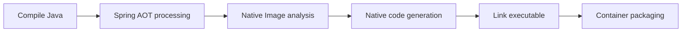

# Thời gian build, RAM build, kích thước binary và kích thước container image

## 1. Vì sao phải đo cả chi phí build lẫn kích thước artifact?

GraalVM Native Image thường tạo executable khởi động nhanh và có thể dùng ít bộ nhớ runtime hơn trong một số workload. Đổi lại, quá trình biên dịch native thường tốn thời gian và RAM đáng kể hơn so với đóng gói JAR. Binary native cũng có thể lớn hơn hoặc nhỏ hơn JAR tùy dependency, debug information, static/dynamic linking và cách đóng gói container.

Khi đánh giá **SPRING_BOOT_NATIVE_IMAGE**, chỉ đo startup hoặc RSS lúc chạy sẽ chưa đủ. Cần đo đồng thời bốn nhóm:

- **Build duration:** thời gian từ lúc bắt đầu build đến khi artifact hoàn tất.
- **Build memory:** RAM tối đa mà compiler/build process sử dụng.
- **Executable size:** kích thước native binary và các file đi kèm cần thiết.
- **Container image size:** kích thước image được tạo và phân phối qua registry.

Các chỉ số phải được đo trên cùng source revision, dependency, toolchain, cấu hình build và môi trường phần cứng. Nếu thay đổi nhiều yếu tố giữa các lần đo, không thể quy chênh lệch cho Native Image một cách đáng tin cậy.

## 2. Phân biệt các đại lượng cần ghi nhận

| Chỉ số | Đơn vị thường dùng | Ý nghĩa |
|---|---|---|
| Wall-clock build time | giây/phút | Thời gian thực tế người dùng/CI phải chờ |
| CPU time | giây | Tổng thời gian CPU tiêu thụ bởi process hoặc nhóm process |
| Peak build RSS | MiB/GiB | Bộ nhớ resident lớn nhất quan sát được |
| Peak container/cgroup memory | MiB/GiB | Bộ nhớ tối đa của build container, gồm process liên quan |
| Native executable size | MiB | Kích thước file binary sau build |
| Runtime support files | MiB | Shared libraries, config, certificates hoặc file cần đi kèm |
| Container image size | MiB/GiB | Kích thước image theo cách đo đã ghi rõ |
| Compressed transfer size | MiB/GiB | Dữ liệu image cần truyền qua registry/network |

Không dùng một đại lượng thay cho đại lượng khác. Ví dụ, `du -sh` trên thư mục output không phải peak RAM; kích thước binary không phải kích thước container; image size hiển thị trong registry có thể là compressed layer size khác với dung lượng giải nén trên host.

## 3. Xây dựng baseline JVM và native công bằng

Để so sánh chi phí build, tạo hai pipeline từ cùng revision:

**JVM artifact**
- Compile application.
- Chạy test cần thiết.
- Đóng gói executable JAR.
- Ghi thời gian và kích thước JAR.

**Native artifact**
- Compile application và test theo cùng phạm vi.
- Chạy Spring AOT.
- Chạy GraalVM Native Image compiler.
- Đóng gói executable và runtime files.
- Ghi thời gian, RAM và kích thước.

Không so sánh một lệnh `package` JVM với toàn bộ pipeline native có thêm test, AOT, code generation và container build rồi kết luận toàn bộ chênh lệch do compiler. Hãy tách thời gian theo stage để biết chi phí nằm ở compile, AOT, Native Image hay container packaging.

Ghi rõ có tính dependency download, test execution, Docker build và cache warm-up vào tổng build time hay không. Đưa ra cả tổng pipeline duration lẫn từng stage giúp người đọc hiểu trade-off.

## 4. Cố định điều kiện đo

Trước khi chạy benchmark, ghi lại:

- Git commit, trạng thái working tree và các thay đổi chưa commit.
- JDK/GraalVM distribution, version và architecture.
- Spring Boot, Spring Framework, Native Build Tools và plugin versions.
- Maven/Gradle wrapper version.
- CPU model, số core được cấp và RAM limit.
- OS, kernel, filesystem và container runtime.
- Native Image build arguments, profile và RuntimeHints.
- Dependency cache trạng thái cold/warm.
- Có bật debug symbols, build report, PGO hoặc monitoring features không.
- Có chạy song song job khác trên cùng host không.

Ví dụ metadata benchmark:

```text
commit=8a12f3c
jdk=21
graalvm=version-pinned
spring-boot=version-pinned
native-build-tools=version-pinned
cpu-limit=8
memory-limit=16GiB
cache=warm
profile=native-prod
build-mode=release
```

Giá trị chỉ là ví dụ. Báo cáo thật cần ghi phiên bản chính xác, không dùng nhãn chung như “latest”. Nếu không thể kiểm soát host dùng chung, chạy nhiều lần và ghi nhận biến động.

## 5. Đo wall-clock build time

Đo wall-clock là cách trực tiếp nhất để biết CI/developer phải chờ bao lâu. Trên PowerShell:

```powershell
$timer = [System.Diagnostics.Stopwatch]::StartNew()
./mvnw -Pnative -DskipTests package
$exitCode = $LASTEXITCODE
$timer.Stop()

"exitCode=$exitCode"
"elapsedSeconds=$($timer.Elapsed.TotalSeconds)"
if ($exitCode -ne 0) {
    throw "Native build failed"
}
```

Trên POSIX shell:

```bash
/usr/bin/time -f 'elapsed=%e sec user=%U sec system=%S sec' \
  ./mvnw -Pnative -DskipTests package
```

Với Gradle:

```bash
/usr/bin/time -f 'elapsed=%e sec user=%U sec system=%S sec' \
  ./gradlew nativeCompile
```

Task/goal chính xác phụ thuộc plugin và project. Xác nhận task tồn tại trước khi benchmark. Đo riêng các stage nếu cần: compile, `processAot`, native compile và container image build.

Không bỏ qua exit code. Một lần build fail nhanh không thể được tính là một build time thành công. Ghi riêng failure duration để điều tra, không trộn với sample thành công.

## 6. Tách thời gian Spring AOT và Native Image compilation

Native pipeline thường có nhiều giai đoạn. Mô hình đơn giản:



Tùy plugin, một task có thể gọi nhiều stage hoặc cache output của stage trước. Đọc build log và task graph để phân rã thời gian:

| Stage | Chi phí cần quan sát |
|---|---|
| Dependency resolution | Download, metadata và cache |
| Java compile/test compile | Compiler JVM |
| Spring AOT | Context analysis và generated source |
| Native Image analysis | Reachability analysis, initialization |
| Code generation/link | Compile/link native code |
| Container packaging | Copy files, layer creation, compression |

Nếu tổng build time tăng, cần biết stage nào chiếm phần lớn. Tối ưu cache cho dependency download sẽ không giải quyết thời gian code generation; tăng CPU có thể giúp compiler nhưng không nhất thiết cải thiện link hoặc filesystem-bound stage.

## 7. Đo peak RAM của Native Image build

Peak RAM là chỉ số quan trọng vì native compiler có thể tiêu thụ nhiều bộ nhớ. Trên Linux, `/usr/bin/time -v` thường cung cấp maximum resident set size cho process được đo:

```bash
/usr/bin/time -v ./gradlew nativeCompile
```

Tìm dòng `Maximum resident set size`. Đơn vị output phụ thuộc hệ điều hành/tool version; kiểm tra trước khi chuyển sang MiB.

Lưu ý: process build tool có thể khởi chạy Native Image compiler dưới dạng child process. Số đo của shell command có thể không phản ánh tổng peak memory của cả process tree theo cách bạn mong muốn. Trong CI container, cgroup memory peak thường hữu ích hơn để đo tổng memory mà job tiêu thụ.

## 8. Đo memory theo cgroup/container

Nếu build chạy trong Linux container hoặc CI runner có cgroup v2, có thể đọc các file như:

```bash
cat /sys/fs/cgroup/memory.peak
cat /sys/fs/cgroup/memory.max
```

`memory.peak` thường ghi peak memory của cgroup theo byte; `memory.max` cho biết giới hạn nếu được cấu hình. Vị trí và quyền truy cập phụ thuộc cgroup version, container runtime và cách mount.

Với Docker, có thể theo dõi:

```bash
docker stats --no-stream native-build-container
```

Đây là snapshot tại thời điểm gọi, không bảo đảm bắt được peak đã xảy ra trước đó. Để đo peak chính xác hơn, dùng cgroup counters hoặc metrics của CI/container runtime. Ghi rõ số đo là process RSS, process-tree RSS hay cgroup peak.

Nếu build container bị OOM-killed, ghi nhận exit status và kernel/container OOM event. Không xem memory limit cấu hình là lượng RAM thực tế đã sử dụng.

## 9. Điều chỉnh memory limit và compiler parallelism

Native Image compiler có thể dùng nhiều worker/CPU và RAM. Tăng song song hóa có thể rút ngắn thời gian nhưng tăng peak memory. Giảm parallelism có thể giúp build ổn định trong runner nhỏ nhưng kéo dài thời gian.

Tùy GraalVM version, có thể có option điều khiển số luồng compiler, ví dụ:

```bash
native-image --parallelism=4 ...
```

Xác nhận option được hỗ trợ bằng `native-image --help` của đúng version. Không dùng cú pháp của release khác mà chưa kiểm tra.

Thiết kế benchmark với vài mức tài nguyên:

| Profile | CPU limit | Memory limit | Mục tiêu |
|---|---:|---:|---|
| Small runner | 2 core | 4 GiB | Xác định build có khả thi không |
| Standard CI | 4 core | 8 GiB | Mức runner phổ biến |
| Large runner | 8 core | 16 GiB | Đánh giá thời gian khi cấp thêm tài nguyên |

Đây là ma trận ví dụ, không phải khuyến nghị cố định. Đo nhiều lần cho từng profile, giữ các yếu tố khác giống nhau và theo dõi cả OOM/failure.

## 10. Cold cache và warm cache

Build lần đầu có thể tải dependency, tạo compiler cache hoặc thực hiện công việc chưa có trong các lần sau. Vì vậy cần phân biệt:

- **Cold build:** cache dependency/compiler trống hoặc được cô lập.
- **Warm build:** cache đã có artifact cần thiết từ lần trước.
- **Incremental build:** source thay đổi một phần và build tool tái sử dụng output hợp lệ.

Không so cold JVM build với warm native build. Chọn cách đo theo câu hỏi:

- Đánh giá trải nghiệm CI từ runner mới: cold build.
- Đánh giá pipeline CI có cache: warm build.
- Đánh giá vòng lặp developer: incremental build.

Ghi cache key và chính sách invalidation. Nếu cache native output được tái sử dụng giữa các commit không tương thích, kết quả có thể sai hoặc không tái lập.

## 11. Đo kích thước native executable

Sau khi build thành công, xác định chính xác binary:

```bash
ls -lh target/orders-service
stat target/orders-service
file target/orders-service
```

Trên PowerShell:

```powershell
Get-Item target/orders-service |
    Select-Object Name, Length, LastWriteTime
```

Kích thước file là số byte; chuyển sang MiB bằng cách chia cho (1024^2). Ghi cả kích thước tuyệt đối và cách biểu diễn (MB decimal hay MiB binary).

Đừng chỉ đo file executable nếu ứng dụng còn cần:
- Shared libraries không có sẵn trong runtime base image.
- CA certificates hoặc timezone data.
- External configuration/templates.
- Native libraries như `.so` hoặc `.dll`.
- Script/entrypoint và file permission metadata.

Có thể báo cáo binary riêng và tổng runtime payload riêng để người đọc thấy rõ chi phí triển khai.

## 12. Các yếu tố làm binary lớn hoặc nhỏ

Kích thước native executable chịu ảnh hưởng bởi:

- Reachability graph và dependency được đưa vào.
- Reflection/resource/proxy/serialization metadata.
- Optimization level và target architecture.
- Debug information và symbol stripping.
- Static hay dynamic linking.
- Native library và runtime support.
- Build arguments và monitoring features.
- PGO/profile-guided optimization nếu sử dụng.
- Phiên bản compiler và toolchain.

Không nên kết luận một thư viện làm binary tăng bao nhiêu chỉ từ một lần build. Để đánh giá dependency, tạo hai build khác nhau đúng một biến, dùng cùng toolchain và build arguments, rồi so sánh artifact/report.

Debug symbols có thể được tách ra hoặc strip tùy platform/toolchain. Nếu so release binary, phải dùng cùng chính sách symbol giữa các lần đo. Nếu cần debug production, lưu symbol tương ứng trong artifact store thay vì so một binary có symbols với binary đã strip.

## 13. Phân biệt binary size, filesystem size và container image size

Ba số đo thường bị nhầm:

- **Logical file size:** số byte mà file khai báo.
- **Filesystem allocated size:** dung lượng thực filesystem cấp phát, phụ thuộc block size/sparse file.
- **Container image size:** tổng các layer theo cách hiển thị của container engine/registry.

Một binary 80 MiB không có nghĩa container image chỉ 80 MiB. Image còn có base OS, shared libraries, CA certificates, timezone data, metadata và các layer khác.

Tương tự, một image có nhiều layer trùng dữ liệu có thể chia sẻ layer trong local host; dung lượng tải từ registry và dung lượng disk sau pull có thể khác nhau. Báo cáo phải nói rõ số đo lấy từ lệnh nào và là compressed hay unpacked size.

## 14. Đo container image size

Sau khi build image:

```bash
docker image ls orders-service:1.0
docker image inspect orders-service:1.0
```

Có thể xem layer:

```bash
docker history --no-trunc orders-service:1.0
```

Các lệnh trên cung cấp góc nhìn khác nhau. `docker image ls` hiển thị size theo Docker engine; `inspect` trả metadata; `history` cho biết các layer và lệnh tạo layer. Để biết kích thước truyền qua registry, cần dùng công cụ registry/manifest phù hợp và ghi rõ cách tính compressed layers.

Nếu dùng Podman hoặc buildpacks, dùng công cụ tương ứng và không so trực tiếp con số khác semantics. Khi so JVM và native, build cả hai image trên cùng base image family và kiến trúc nếu mục tiêu là so chi phí artifact/runtime.

## 15. Chọn base image ảnh hưởng lớn đến image size

Ví dụ native executable có thể chạy trên base image nhỏ nếu binary được build tương thích với libc và shared libraries của base đó. Tuy nhiên, chọn distroless/minimal image không tự động bảo đảm binary chạy được.

Các điểm cần xác minh:

- glibc hay musl và cách binary được link.
- Shared libraries mà executable cần.
- CA certificates cho TLS.
- Timezone data nếu ứng dụng xử lý timezone.
- User/group và quyền filesystem.
- Thư mục tạm, writable path và working directory.
- Native library bổ sung.

Một image rất nhỏ nhưng thiếu thư viện runtime sẽ không có giá trị. Đo image size sau khi chạy smoke/integration tests trong chính image đó.

## 16. Ví dụ Dockerfile cho native executable

Ví dụ multi-stage đơn giản:

```dockerfile
FROM ubuntu:24.04 AS runtime
WORKDIR /app
COPY target/orders-service /app/orders-service
USER 10001:10001
EXPOSE 8080
ENTRYPOINT ["/app/orders-service"]
```

Đây là ví dụ minh họa, cần chọn base image phù hợp với môi trường mà binary được build. Nếu executable phụ thuộc shared library chưa có trong Ubuntu base, phải bổ sung runtime package hoặc chọn image tương thích.

Để tránh đưa toolchain/build cache vào runtime image, build native ở stage/build job riêng và chỉ copy executable cùng file runtime cần thiết. Nếu dùng buildpacks, cấu hình builder/run image theo cơ chế buildpack thay vì giả định Dockerfile này áp dụng nguyên trạng.

Sau khi build:

```bash
docker build -t orders-service:native .
docker image ls orders-service:native
docker run --rm -p 8080:8080 orders-service:native
```

Chạy health/readiness và một luồng nghiệp vụ đại diện trước khi ghi nhận image là hợp lệ.

## 17. So sánh JVM và native container công bằng

Để đo container size:

- Cùng kiến trúc CPU và nền tảng build.
- Cùng base image family hoặc ghi rõ khác biệt.
- Cùng chính sách CA certificates/timezone.
- Không đưa source, compiler cache hoặc test reports vào runtime image nếu không cần.
- Không so image JVM có JDK đầy đủ với native image distroless rồi quy toàn bộ chênh lệch cho executable.
- Ghi rõ compressed/uncompressed size và layer sharing.
- Xác nhận cả hai image chạy cùng endpoint/test fixtures.

Có thể báo cáo hai góc nhìn:
1. **Operational image:** image tối ưu thực tế mà mỗi runtime sẽ triển khai.
2. **Controlled comparison:** cố định base image và file hỗ trợ để cô lập chênh lệch do runtime artifact.

Cả hai hữu ích nhưng trả lời câu hỏi khác nhau.

## 18. Đo lặp lại và tổng hợp thống kê

Build time và peak RAM có thể biến động do CPU contention, filesystem cache, daemon state, GC và background jobs. Không kết luận từ một sample.

Thực hiện tối thiểu một số lần lặp đủ để thấy độ biến động; ví dụ 3–5 lần cho benchmark sơ bộ và nhiều hơn khi chênh lệch nhỏ. Ghi từng sample, không chỉ ghi trung bình.

Bảng dữ liệu mẫu:

| Run | JVM build (s) | Native build (s) | Native peak RAM (GiB) | Binary (MiB) | Native image (MiB) |
|---:|---:|---:|---:|---:|---:|
| 1 | 42 | 318 | 7.4 | 86 | 112 |
| 2 | 40 | 305 | 7.1 | 86 | 112 |
| 3 | 43 | 326 | 7.6 | 86 | 112 |

Số liệu trên chỉ minh họa cách trình bày, không phải benchmark của Spring Boot hoặc kết quả kỳ vọng.

Báo cáo median, min/max và độ lệch nếu cần. Với build time, median thường ít bị một lần CI bị contention làm lệch hơn mean. Ghi riêng failed/OOM runs và không âm thầm loại chúng khỏi báo cáo.

## 19. Tách benchmark build khỏi benchmark runtime

Bài này đo chi phí tạo artifact. Khi đánh giá lựa chọn runtime, cần đo thêm:

- Startup tới readiness.
- RSS idle và RSS khi tải.
- Throughput và latency.
- CPU usage.
- Scale-out time và số replica cần thiết.
- Cold start trong môi trường triển khai.

Không trộn những chỉ số này vào build duration. Một native build mất nhiều phút vẫn có thể tạo executable phù hợp với workload serverless; một build nhanh hơn chưa chắc cho runtime tốt hơn.

Quyết định nên xét tổng chi phí vòng đời: thời gian CI, tài nguyên runner, dung lượng registry, thời gian pull, memory/CPU production và yêu cầu scale.

## 20. Các lỗi thường gặp khi đo

| Triệu chứng | Nguyên nhân có thể | Cách xử lý |
|---|---|---|
| Native build time dao động mạnh | Host contention, cache không nhất quán | Cô lập runner, ghi cache state, chạy lặp |
| Peak RAM thấp bất thường | Chỉ đo process cha, bỏ sót compiler child | Đo cgroup/process tree |
| Build bị OOM | Memory limit thấp hoặc compiler parallelism cao | Tăng limit hoặc giảm parallelism theo version |
| Binary nhỏ nhưng container lớn | Base image/libraries/files lớn | Phân tích layer và runtime payload |
| Container nhỏ nhưng không chạy | Thiếu libc/shared library/certificate | Kiểm tra dependency và test đúng image |
| So sánh JVM/native lệch | Khác base image, tests hoặc build flags | Chuẩn hóa pipeline |
| Lần build sau nhanh hơn nhiều | Warm cache/incremental output | Báo cold và warm riêng |
| Kích thước binary thay đổi khó giải thích | Khác symbols, optimization, metadata hoặc toolchain | Pin build configuration và inspect reports |

## 21. Bài thực hành: lập bảng chi phí build và artifact

**Bối cảnh:** nhóm cần quyết định dùng executable JAR hay Native Image cho Order API. Mục tiêu là biết chi phí CI và dung lượng triển khai trước khi đo runtime.

**Bước 1 — Pin môi trường.** Ghi commit, JDK/GraalVM, Spring Boot, plugin, CPU/RAM limit và cache policy.

**Bước 2 — Build JVM.** Chạy cùng compile/test/package scope, đo wall-clock, ghi JAR size và tạo JVM container image.

**Bước 3 — Build native.** Chạy AOT và Native Image, đo từng stage cùng tổng wall-clock. Ghi peak memory bằng cgroup hoặc công cụ theo dõi process tree.

**Bước 4 — Đo executable.** Ghi logical file size, runtime support files và debug symbol policy.

**Bước 5 — Build container image.** Dùng base image tương thích, đo image size/layer và ghi rõ compressed hay unpacked.

**Bước 6 — Lặp lại.** Chạy nhiều sample với cold/warm cache được phân biệt; không trộn sample giữa các điều kiện.

**Bước 7 — Kiểm tra artifact.** Chạy smoke và integration scenario trong cả hai image để bảo đảm image size được đo là artifact có thể vận hành.

**Bước 8 — Tổng hợp.** Báo median/min/max, peak RAM, binary size, image size, failure/OOM và trade-off CI.

Tiêu chí hoàn thành: số liệu có thể tái lập; build time được phân tách theo stage; peak memory phản ánh đúng phạm vi đo; binary/container size được định nghĩa rõ; cả hai image vượt qua runtime smoke/integration checks.

## 22. Kết luận

Đánh giá chi phí build của Spring Boot Native Image cần đo riêng thời gian build, peak RAM, kích thước executable và kích thước container image. Các số liệu chỉ có ý nghĩa khi cùng source revision, toolchain, resource limit, cache policy và phạm vi pipeline được kiểm soát. Đặc biệt, cần phân biệt process RSS với cgroup peak, binary size với image size và compressed registry size với dung lượng lưu trên host.

Hãy tách stage Spring AOT, Native Image compilation và container packaging; chạy lặp, lưu từng sample và xác minh artifact trong runtime image thực tế. Kết hợp chi phí CI/registry với startup, memory và throughput runtime sẽ giúp quyết định JVM hay native dựa trên tổng chi phí vận hành thay vì một con số đơn lẻ.
