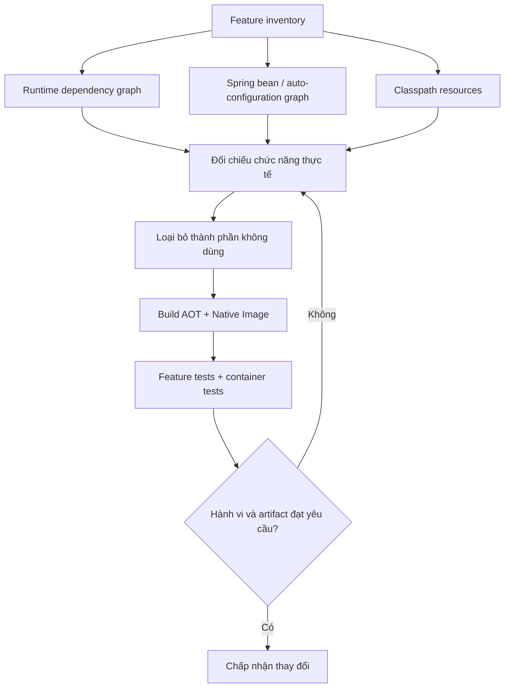

# Giảm dependency và tài nguyên không cần thiết dựa trên chức năng thực tế

## 1. Tối ưu bắt đầu từ chức năng ứng dụng

Native Image thường tạo executable nhỏ gọn hơn so với việc đóng gói một JVM runtime đầy đủ, nhưng kích thước và mức tiêu thụ bộ nhớ vẫn phụ thuộc vào những gì ứng dụng thực sự sử dụng. Dependency dư thừa, auto-configuration không cần thiết, resource không dùng, driver không cần hoặc nhiều implementation cùng tồn tại có thể làm tăng thời gian build, kích thước artifact, bề mặt bảo trì và đôi khi cả footprint runtime.

Cách tối ưu an toàn là bắt đầu từ **feature inventory**: liệt kê chức năng mà Spring Boot service cần cung cấp trong môi trường triển khai. Từ đó đối chiếu với dependency graph, bean graph, resource và runtime metadata để loại bỏ những thành phần không phục vụ chức năng đó.

Không nên xóa dependency chỉ vì tên thư viện không xuất hiện trong source code. Nó có thể được dùng gián tiếp bởi auto-configuration, reflection, ServiceLoader, JDBC driver discovery, serializer, logging provider hoặc thư viện khác. Mỗi thay đổi cần được kiểm tra bằng build và test trên đúng application executable.

Trong module **SPRING_BOOT_NATIVE_IMAGE**, tối ưu dependency/resource giúp giảm chi phí build và đóng gói, nhưng vẫn phải giữ đầy đủ chức năng Spring AOT, reflection/resource hints, kiểm thử tương thích và vận hành container.



## 2. Phân biệt các lớp có thể tối ưu

Dependency và tài nguyên xuất hiện ở nhiều lớp khác nhau. Loại bỏ một dependency khỏi build file không giống với loại bỏ bean khỏi Spring context hay bỏ một resource khỏi native image.

| Lớp | Ví dụ | Cách kiểm tra |
|---|---|---|
| Build dependency | Module thư viện không dùng | Gradle/Maven dependency graph |
| Runtime dependency | JDBC driver, logging backend | Runtime classpath và artifact |
| Auto-configuration | Client hoặc integration được bật tự động | Condition evaluation report, bean graph |
| Spring bean | Service/adapter không thuộc feature | ApplicationContext và AOT output |
| Class reachability | Class được giữ do tham chiếu tĩnh/metadata | Native Image analysis |
| Reflection/proxy metadata | Constructor, method, JDK proxy | RuntimeHints và reachability metadata |
| Classpath resource | Template, schema, font, message bundle | JAR contents và resource hints |
| OS shared library | JNI dependency, CA certificates | Container filesystem và binary dependencies |

Một thư viện có thể không được gọi trực tiếp nhưng vẫn cần vì nó cung cấp implementation cho một interface được framework discovery. Ngược lại, một dependency có thể được resolve trong runtime classpath nhưng không cần cho artifact production nếu chỉ phục vụ một tool/test riêng.

## 3. Lập feature inventory trước khi chỉnh dependency

Ghi lại các chức năng ứng dụng phải hỗ trợ. Ví dụ một service quản lý hóa đơn:

| Feature | Thành phần có thể liên quan |
|---|---|
| HTTP API | Spring MVC, JSON mapper, validation |
| Persistence | JDBC/JPA, driver database, connection pool |
| Authentication | Security framework, token/JWT library |
| Xuất PDF | PDF engine, font, template |
| Gửi email | Mail client, template resource |
| Metrics | Micrometer registry, Actuator |
| Logging | Logging facade và backend |
| Migration | Flyway/Liquibase và migration resources |
| Messaging | Kafka/RabbitMQ client |
| Health checks | Actuator health contributors |

Đánh dấu mỗi feature là bắt buộc, tùy chọn, chỉ dùng trong môi trường vận hành hoặc không còn sử dụng. Ghi rõ profile/feature flag nào kích hoạt nó.

Không xóa một module chỉ vì hiện tại ít request sử dụng. Nếu nó là chức năng đã cam kết trong API hoặc được bật bởi cấu hình production, nó vẫn thuộc phạm vi cần giữ.

## 4. Kiểm tra runtime dependency graph

Gradle:

```bash
./gradlew :api-app:dependencies --configuration runtimeClasspath
./gradlew :api-app:dependencyInsight --dependency library-name --configuration runtimeClasspath
```

Maven:

```bash
./mvnw dependency:tree
```

Đối chiếu graph với feature inventory:

- Dependency trực tiếp và transitive.
- Version thực tế được resolve.
- Module optional/classifier.
- Exclusions và dependency constraints.
- Runtime scope so với test scope.
- Driver/provider được phát hiện gián tiếp.
- Các thư viện chỉ còn do dependency cũ hoặc integration đã bị loại.

Trong Gradle multi-project, chạy lệnh trên đúng application module. Một thư viện có thể được khai báo trong module dùng chung nhưng chỉ application module mới đưa nó vào runtime artifact.

Không xóa dependency transitive bằng cách thêm exclusion trước khi biết thư viện nào đang cần nó. Nếu dependency đến từ starter hoặc auto-configuration, hãy xác định starter có còn cần thiết không và có module nhỏ hơn phù hợp không.

## 5. Chọn starter phù hợp thay vì kéo cả hệ sinh thái

Spring Boot starter giúp cấu hình tích hợp thuận tiện, nhưng một starter có thể đưa vào nhiều thư viện hơn feature cần. Kiểm tra dependency tree và chọn đúng starter/module.

Ví dụ:

- Chỉ cần JDBC có thể dùng starter JDBC thay vì starter Data JPA nếu không cần ORM.
- Chỉ cần HTTP client có thể không cần toàn bộ stack MVC.
- Chỉ cần metrics API có thể không cần exporter cho hệ thống monitoring chưa sử dụng.
- Không thêm nhiều logging backend cùng lúc.
- Không thêm nhiều JDBC driver nếu service chỉ kết nối một loại database.

Đây là nguyên tắc lựa chọn theo chức năng, không phải quy tắc xóa mọi dependency transitive. Starter có thể cung cấp cấu hình, version alignment và integration quan trọng. Trước khi thay starter bằng các module rời, kiểm tra auto-configuration, dependency management và test behavior.

## 6. Quản lý dependency theo scope

Gradle thường phân biệt:

| Configuration | Mục đích |
|---|---|
| implementation | Dependency cần khi compile và runtime |
| runtimeOnly | Cần khi chạy nhưng không dùng API lúc compile |
| compileOnly | Chỉ cần compile, runtime do môi trường cung cấp |
| testImplementation | Chỉ dùng khi compile test |
| testRuntimeOnly | Chỉ dùng khi chạy test |

Maven có các scope như compile, runtime, provided và test. Chọn scope dựa trên vòng đời thực tế.

Ví dụ JDBC driver thường là runtime dependency:

```groovy
dependencies {
    implementation("org.springframework.boot:spring-boot-starter-jdbc")
    runtimeOnly("org.postgresql:postgresql")
    testImplementation("org.springframework.boot:spring-boot-starter-test")
}
```

Không chuyển driver sang test scope chỉ để giảm artifact. Ứng dụng production vẫn cần driver để kết nối database. Ngược lại, JUnit, Mockito và test fixture không nên lọt vào runtime classpath production.

## 7. Xóa dependency không dùng có kiểm soát

Một dependency có thể được xem xét loại bỏ khi:

- Không có feature production nào cần API của nó.
- Không được dependency khác yêu cầu ở runtime.
- Không cung cấp auto-configuration hoặc provider đang sử dụng.
- Không được nạp qua reflection, ServiceLoader hoặc plugin registry.
- Không chứa resource/runtime metadata cần thiết.
- Test và build sau khi loại bỏ vẫn pass.

Quy trình an toàn:

1. Ghi nhận dependency và đường đi trong graph.
2. Tìm module/feature sử dụng nó.
3. Kiểm tra API, auto-configuration và provider discovery.
4. Loại bỏ hoặc thay thế dependency.
5. Chạy dependency resolution và AOT processing.
6. Build Native Image.
7. Chạy feature tests trên executable.
8. Chạy container integration tests.
9. So sánh kích thước, build time và runtime metrics trước/sau.

Không dùng số lượng JAR giảm làm bằng chứng duy nhất rằng tối ưu thành công. Native Image có thể loại class không reachable dù dependency JAR có trong build graph; ngược lại một dependency nhỏ có thể kéo theo native library hoặc resource quan trọng.

## 8. Loại auto-configuration không cần thiết

Spring Boot auto-configuration thường được kích hoạt theo classpath, property và bean hiện có. Một dependency có mặt có thể làm auto-configuration được đánh giá, nhưng không phải mọi auto-configuration đều tạo bean hoặc làm tăng đáng kể executable.

Nếu một integration thực sự không được dùng, ưu tiên loại dependency/starter tương ứng. Có thể loại auto-configuration cụ thể khi biết rõ nó không thuộc feature set.

Ví dụ cấu hình loại trừ:

```java
@SpringBootApplication(exclude = SomeClientAutoConfiguration.class)
public class ApiApplication {
}
```

Hoặc qua property nếu auto-configuration hỗ trợ:

```yaml
spring:
  autoconfigure:
    exclude:
      - com.example.client.SomeClientAutoConfiguration
```

Tên class chỉ là ví dụ; dùng class/property thật của thư viện. Exclude auto-configuration không nhất thiết loại dependency khỏi artifact, và có thể làm mất bean mà một integration khác cần. Kiểm tra condition evaluation report và application context sau thay đổi.

## 9. Profile và feature flag: tránh nhầm runtime với build-time

Spring AOT phân tích bean graph trong môi trường build. Các điều kiện như profile, conditional property và classpath condition có thể quyết định bean nào được đưa vào generated context.

Nếu production chỉ cần một profile, build AOT với profile mục tiêu và ghi nhận nó. Không kỳ vọng đổi profile runtime sẽ tạo bean đã bị loại khỏi AOT output.

Feature flag runtime phù hợp để bật/tắt behavior bên trong bean đã tồn tại. Nếu feature flag làm thay đổi cấu trúc bean graph, cần kiểm tra cách Spring AOT xử lý và cân nhắc artifact riêng cho các cấu hình khác nhau.

Không xóa dependency của feature chỉ vì feature đang tắt trong môi trường test. Hãy kiểm tra mọi profile/tenant/deployment configuration được hỗ trợ.

## 10. Loại resource không dùng

Classpath resources có thể đến từ application hoặc dependency JAR:

- Template HTML/email.
- JSON/XML schema.
- Font, image, static asset.
- Message bundle.
- SQL migration/query.
- File cấu hình mặc định.
- Certificate public hoặc dữ liệu lookup.

Kiểm tra resource trong archive:

```bash
jar tf build/libs/api-app.jar
```

Resource có thể được đọc theo tên tạo động hoặc thông qua framework. Không xóa file chỉ vì không thấy tham chiếu trực tiếp trong source. Kiểm tra code path, resource loader, thư viện và tracing/test evidence.

Nếu dùng resource hints, giữ pattern hẹp và đúng feature:

```java
hints.resources().registerPattern("templates/invoice/*.html");
```

Ví dụ pattern minh họa. Pattern quá rộng có thể giữ nhiều resource không cần; pattern quá hẹp làm thiếu template khi runtime chọn một tên hợp lệ khác. Sau khi thay đổi, test mọi locale/template/schema mà ứng dụng cam kết hỗ trợ trên native executable.

## 11. Phân biệt classpath resource và file runtime

Classpath resource thường được đóng gói trong JAR hoặc native image metadata. File runtime được mount hoặc tạo trên filesystem khi ứng dụng chạy.

Ví dụ:

- Template mặc định đóng gói trong JAR: classpath resource.
- File upload của người dùng: filesystem/object storage runtime.
- CA bundle do nền tảng mount: file runtime hoặc truststore cấu hình.
- SQL migration đóng gói cùng ứng dụng: classpath resource.
- Secret file do orchestrator mount: runtime secret.

Không đưa secret runtime vào native image resource. Không dùng `Resource.getFile()` để giả định resource trong executable/JAR là file thường. Đọc classpath resource bằng stream; truy cập file runtime qua path cấu hình và kiểm tra permission.

## 12. Tối ưu reflection và proxy metadata theo chức năng

RuntimeHints và GraalVM reachability metadata nên phản ánh các thao tác động thực sự cần:

- Chỉ đăng ký constructor/method/field được sử dụng.
- Chỉ đăng ký JDK proxy với tập interface cần thiết.
- Chỉ giữ resource patterns cần thiết.
- Chỉ đăng ký serialization types trong object graph thực tế.
- Chỉ khai báo JNI access khi dependency thực sự dùng JNI.

Không xóa metadata chỉ vì không thấy code gọi trực tiếp; framework có thể dùng reflection hoặc proxy gián tiếp. Dựa vào test scenarios, RuntimeHints Agent và tài liệu vendor để xác định nhu cầu.

Cũng không dùng hints rộng để bù cho dependency graph không rõ ràng. Nếu một plugin không còn được hỗ trợ, loại plugin và metadata liên quan theo cùng một thay đổi, rồi test lại các plugin còn lại.

## 13. Loại logging và observability backend không dùng

Một service có thể vô tình đóng gói nhiều logging implementation hoặc metrics exporter. Kiểm tra:

- Logging facade và backend được chọn.
- Bridge giữa các logging API.
- Actuator endpoints thực sự bật.
- Micrometer registry/exporter đang dùng.
- Tracing exporter và transport.
- Agent hoặc diagnostic library chỉ cần ở môi trường riêng.

Không loại logging backend production nếu ứng dụng cần log để vận hành. Với metrics, giữ API/instrumentation cần thiết nhưng chỉ thêm exporter tương ứng nền tảng monitoring. Kiểm tra behavior khi backend bị loại để tránh mất log hoặc metrics âm thầm.

## 14. Native library và driver: không tối ưu bằng cách bỏ nhầm

Một dependency có thể chứa binary theo OS/architecture hoặc tải thư viện native lúc runtime. Kiểm tra:

- Native library có thực sự được gọi trong feature production không.
- Artifact/classifier đúng platform.
- JNI metadata và resource extraction có cần không.
- Shared library dependency có trong run image không.
- Có Java fallback được hỗ trợ và đã test không.

Không xóa native resource chỉ vì nó làm tăng kích thước JAR nếu runtime path cần nó. Nếu chỉ một platform được phát hành, dùng dependency/platform packaging được nhà cung cấp hỗ trợ thay vì xóa file bằng script không phân biệt target.

## 15. Đo tác động trước và sau tối ưu

Ghi baseline trước khi sửa:

| Chỉ số | Trước | Sau | Ý nghĩa |
|---|---:|---:|---|
| Runtime dependency count | Ghi số thực tế | Ghi số thực tế | Chỉ số tham khảo, không phải mục tiêu duy nhất |
| Native executable size | MiB | MiB | Kích thước binary |
| Container image size | MiB | MiB | Kích thước image phát hành |
| Native build duration | phút | phút | Chi phí build |
| Startup-to-ready | ms/s | ms/s | Tác động startup |
| RSS sau mốc cố định | MiB | MiB | Bộ nhớ resident |
| Throughput/latency | Theo workload | Theo workload | Không được suy giảm ngoài ngưỡng |

Đo trong cùng môi trường, cùng commit trừ thay đổi đang thử nghiệm, cùng toolchain, workload và container limits. Lặp lại phép đo và báo phân bố; không kết luận từ một lần build hoặc một lần chạy.

Dependency count giảm không nhất thiết làm executable nhỏ tương ứng vì reachability analysis có thể loại code không dùng. Ngược lại, một thư viện bổ sung resource lớn hoặc native binary có thể tác động đáng kể dù số dependency tăng ít.

## 16. Quy trình tối ưu theo từng thay đổi nhỏ

Nên thực hiện theo vòng lặp:

1. **Inventory**: ghi feature, dependency, bean và resource.
2. **Hypothesis**: nêu thành phần nào không cần và metric nào có thể thay đổi.
3. **Baseline**: lưu graph, artifact size, build time và runtime metrics.
4. **Change**: loại một nhóm nhỏ dependency/resource/auto-configuration.
5. **Build**: resolve dependency, chạy Spring AOT và Native Image.
6. **Test**: JVM tests, native feature tests và container integration.
7. **Measure**: đo lại cùng protocol.
8. **Decision**: giữ thay đổi nếu chức năng còn nguyên và lợi ích đo được đáng kể.
9. **Document**: ghi lý do, feature bị ảnh hưởng và giới hạn.

Thay đổi từng nhóm nhỏ giúp tìm nguyên nhân nhanh nếu feature bị hỏng. Nếu xóa nhiều starter, hints và resources cùng lúc, khi native runtime fail sẽ khó biết phần nào gây ra lỗi.

## 17. Ví dụ: service chỉ dùng JDBC nhưng kéo thêm JPA

Giả sử service chỉ gọi SQL qua `JdbcTemplate` nhưng dependency graph có cả starter Data JPA do starter cũ được thêm từ đầu.

Trước khi xóa JPA:

- Tìm `EntityManager`, repository interface, entity scanning và JPA configuration.
- Kiểm tra Flyway/Liquibase có phụ thuộc cấu hình JPA không.
- Kiểm tra integration test có dùng repository không.
- Kiểm tra auto-configuration và transaction manager đang được tạo.

Nếu xác nhận không dùng JPA, có thể bỏ starter Data JPA, giữ starter JDBC và driver. Sau đó build lại, kiểm tra bean graph, transaction behavior, migration và endpoint database trên native executable.

Đây là tối ưu theo chức năng. Không bỏ driver hoặc transaction manager chỉ vì chúng được kéo theo dependency tree.

## 18. Ví dụ: chỉ giữ template được phát hành

Giả sử ứng dụng chứa nhiều template cũ nhưng production chỉ hỗ trợ `invoice` và `receipt`. Trước khi loại template khác:

- Tìm nơi template name được chọn.
- Kiểm tra locale/tenant có thể chọn biến thể khác không.
- Kiểm tra fallback template.
- Kiểm tra thư viện email/PDF có đọc template qua tên runtime không.
- Tạo test cho tất cả tên hợp lệ.

Sau đó có thể thu hẹp resource hint hoặc loại file đã xác nhận không còn dùng. Nếu tên template do user gửi, không cho phép path tùy ý; dùng allowlist để tránh path traversal và resource access ngoài dự kiến.

## 19. Các sai lầm thường gặp

| Sai lầm | Hậu quả | Cách làm đúng |
|---|---|---|
| Xóa dependency vì không import trực tiếp | Mất provider/auto-configuration gián tiếp | Kiểm tra graph và discovery |
| Chỉ nhìn số JAR | Không phản ánh reachability/native resource | Đo binary/image và runtime |
| Exclude auto-configuration quá rộng | Thiếu bean cần thiết | Kiểm tra condition report và context |
| Build AOT với profile không đại diện | Bean graph thiếu feature production | Đồng bộ profile mục tiêu |
| Xóa resource theo tìm kiếm text | Mất resource được nạp động | Test mọi tên hợp lệ |
| Xóa reflection hints theo suy đoán | Native runtime lỗi ở nhánh hiếm | Dựa vào test/agent và metadata evidence |
| Loại driver để giảm kích thước | Database integration không chạy | Giữ driver production cần |
| Chỉ chạy JVM tests | Không phát hiện native reachability issue | Chạy native/container feature tests |
| Thay đổi quá nhiều thứ cùng lúc | Khó xác định nguyên nhân regression | Tối ưu từng nhóm nhỏ |

## 20. Checklist trước khi chấp nhận tối ưu

- Feature inventory phản ánh mọi chức năng được phát hành.
- Runtime dependency graph của đúng application module đã được kiểm tra.
- Dependency gián tiếp, provider, driver và auto-configuration đã được xác minh.
- Test-only dependencies được tách khỏi runtime artifact.
- Bean/profile/conditional configuration phù hợp AOT build.
- Resource classpath và file runtime được phân biệt.
- Reflection, proxy, serialization và JNI metadata còn đủ cho feature.
- Native Image build hoàn tất.
- Native feature tests và container integration tests pass.
- Artifact size, build time, startup, RSS và workload metrics được đo trước/sau.
- Thay đổi không làm suy giảm chức năng, SLA hoặc khả năng vận hành.
- Lý do và giới hạn tối ưu được ghi lại.

## 21. Câu hỏi tự kiểm tra

1. Vì sao feature inventory cần có trước khi loại dependency?
2. Khác nhau giữa build dependency, runtime dependency và test dependency là gì?
3. Vì sao dependency không được import trực tiếp vẫn có thể cần cho production?
4. Auto-configuration và AOT bean graph có thể bị ảnh hưởng thế nào khi loại starter?
5. Làm thế nào phân biệt classpath resource với file runtime được mount?
6. Vì sao không nên xóa RuntimeHints chỉ dựa trên tìm kiếm source code?
7. Tại sao giảm số JAR không đảm bảo native executable nhỏ hơn?
8. Cần đo và test những gì trước khi chấp nhận một thay đổi tối ưu?

**Ghi nhớ:** giảm dependency và resource phải dựa trên feature thực tế, runtime dependency graph và hành vi được kiểm thử. Loại từng thành phần có căn cứ, giữ metadata/driver/resource mà framework cần, rồi build và đo lại trên native executable cùng container phát hành.
